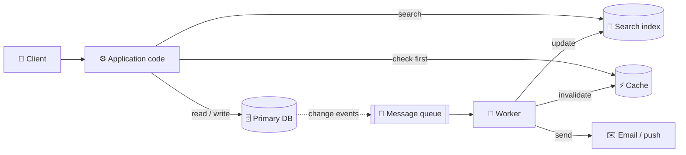
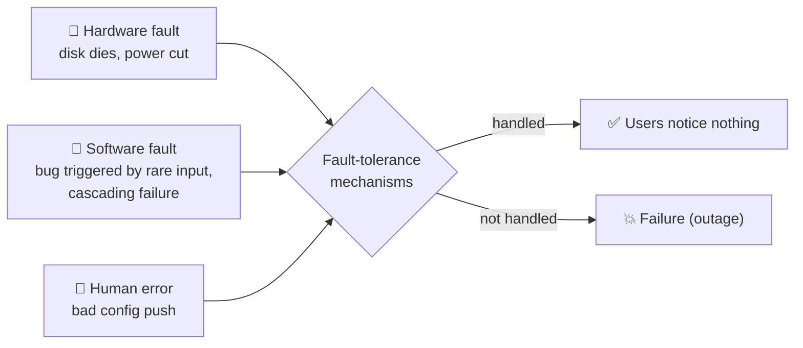
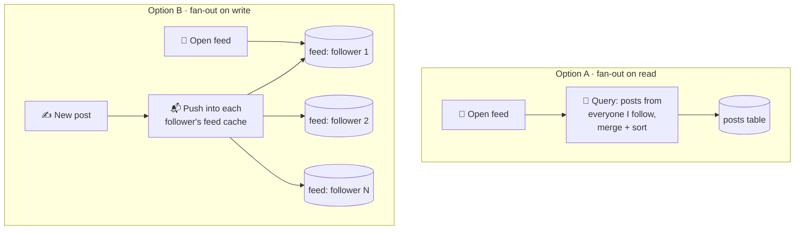
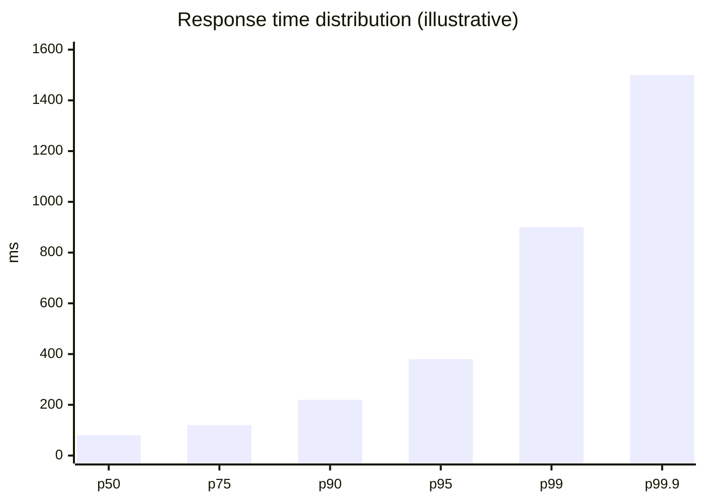
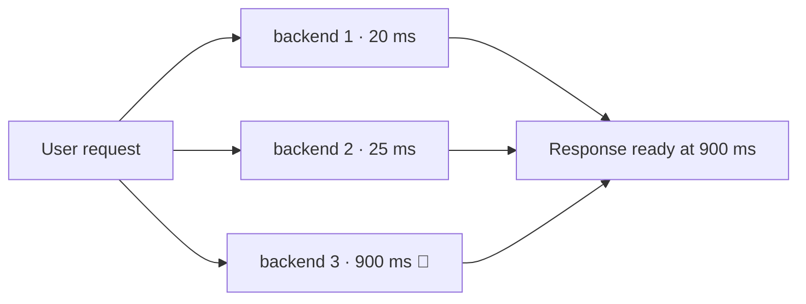
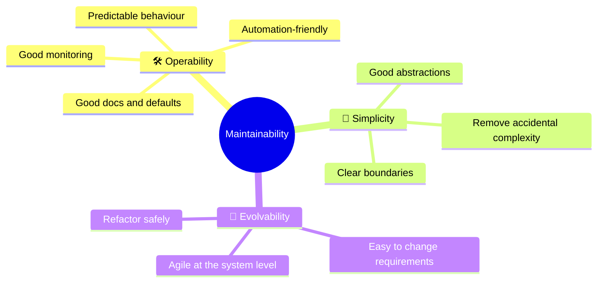

# 1 · Reliable, scalable and maintainable applications

> **In one line:** most apps today are limited by data (its volume, complexity and rate of change), not CPU. Good data systems are judged on three qualities: they keep working, they keep up with growth, and people can keep changing them.

<BookRef pages="25–47" section="Chapter 1" />

## 1.1 A data system is a pipeline of tools

<BookRef pages="26–28" section="Thinking About Data Systems" />

A typical app glues together several specialised tools: a primary database, a cache, a search index, a message queue and some batch jobs. Your application code keeps them in sync, which makes **you** the designer of a new, special-purpose data system.

<KeyIdea>Once you combine tools, the guarantees you give your users (e.g. "the cache is never stale for more than a second") are your responsibility, not the database's.</KeyIdea>

## 1.2 Reliability: keep working when things go wrong

<BookRef pages="28–32" section="Reliability" />

- A **fault** is one component deviating from its spec.
- A **failure** is the whole system stopping to provide service to the user.
- The goal is **fault tolerance**: stop faults from turning into failures. You can't remove every fault.

| Fault type | Nature | Typical defences |
|---|---|---|
| **Hardware** | Mostly random and independent | Redundancy (RAID, dual power, multiple machines), rolling restarts |
| **Software** | Correlated: one bug hits every node at once | Careful assumptions, testing, process isolation, crash-restart, monitoring of invariants |
| **Human** | The leading cause of outages | Good APIs that make the right thing easy, sandboxes, fast rollback, gradual rollouts, telemetry |

**Chaos engineering:** deliberately inject faults (kill processes, drop packets) to make sure the recovery paths actually work.

## 1.3 Scalability: cope with growing load

<BookRef pages="32–40" section="Scalability" />

"Is it scalable?" is meaningless on its own. Ask instead: **if load grows in this specific way, what are our options?**

### Step 1: describe the load

Pick the **load parameters** that matter: requests per second, read/write ratio, active users, cache hit rate, fan-out.

**Example: a social feed.** Users post rarely, but read their home feed constantly. There are two ways to build the feed.

| | Fan-out on read | Fan-out on write |
|---|---|---|
| Write cost | Cheap: 1 insert | Expensive: 1 insert per follower |
| Read cost | Expensive: join at read time | Cheap: read a precomputed list |
| Breaks when | Reads grow | One account has millions of followers |
| **Hybrid** | Precompute for normal users, merge celebrity posts at read time | |

The key load parameter here is the **distribution of followers per user**.

### Step 2: describe performance

- **Throughput:** records processed per second (batch systems).
- **Response time:** what the client sees = network + queueing + service time.
- Response time is a **distribution**, not a number. Use **percentiles**, not averages.

| Percentile | Meaning | Why it matters |
|---|---|---|
| **p50 (median)** | Half of requests are faster | The "typical" experience |
| **p99 / p99.9** | Tail latency | The slowest requests often belong to your most valuable users (they have the most data) |

**Tail-latency amplification:** if one user request fans out to many backend calls, it is as slow as the **slowest** call. The more calls, the more likely one of them hits the tail.

**Head-of-line blocking:** a few slow requests at the front of a queue hold up the fast ones behind them. That's why you measure response time **on the client side**.

### Step 3: choose how to scale

| Approach | Meaning | Trade-off |
|---|---|---|
| **Scale up (vertical)** | Bigger machine | Simple, but expensive and has a ceiling |
| **Scale out (horizontal)** | More machines (shared-nothing) | No ceiling, but adds distributed-systems complexity |
| **Elastic** | Add machines automatically when load rises | Good for unpredictable load, more moving parts |

<KeyIdea>There is no generic scalable architecture. A system built for 100k small requests per second looks nothing like one built for 3 huge requests per minute, even if the data volume is the same.</KeyIdea>

## 1.4 Maintainability: keep it cheap to change

<BookRef pages="40–44" section="Maintainability" />

Most software cost comes **after** launch: fixing bugs, operating, adapting, paying down debt.

- **Accidental complexity** comes from the implementation, not from the problem itself. Abstraction is the main tool against it. SQL, for example, hides storage layout and concurrency.

## Summary

| Quality | Question it answers | Main tools |
|---|---|---|
| Reliability | Does it keep working when things go wrong? | Redundancy, testing, isolation, rollbacks |
| Scalability | Does it stay fast as load grows? | Load parameters, percentiles, scale out, caching, fan-out choices |
| Maintainability | Can people keep operating and changing it? | Observability, abstraction, evolvability |

## 🧠 Check yourself

<Quiz question="A page calls 10 backend services in parallel. Each is slow (above its p99) 1% of the time. Roughly what share of page loads hit at least one slow call?" options={["1%", "~5%", "~10%", "~50%"]} answer={2} explain="1 − 0.99¹⁰ ≈ 9.6%. This is tail-latency amplification." />

<Quiz question="Why are percentiles better than the average for response time?" options={["They are cheaper to compute", "The average hides how many users get a bad experience", "Averages can't be monitored", "Percentiles ignore outliers"]} answer={1} explain="An average blends fast and slow requests. p95/p99 tell you how slow it is for the unluckiest users." />

<Quiz question="Which fault type is most likely to take down every node at once?" options={["Disk failure", "Power supply failure", "A software bug triggered by a specific input", "A network cable unplugged"]} answer={2} explain="Software faults are correlated: every node runs the same code, so the same bad input hits all of them." />

**Interview prompts**
- Design a home-feed service. Which load parameter decides fan-out on read vs write?
- Your p50 latency is fine but p99 doubled. Where do you look first?
- How would you make a config push safer?
