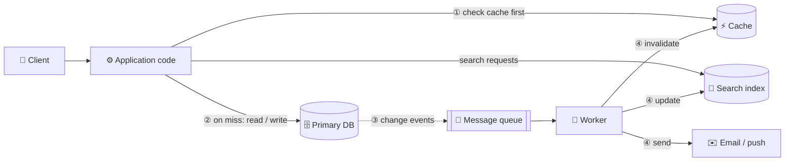
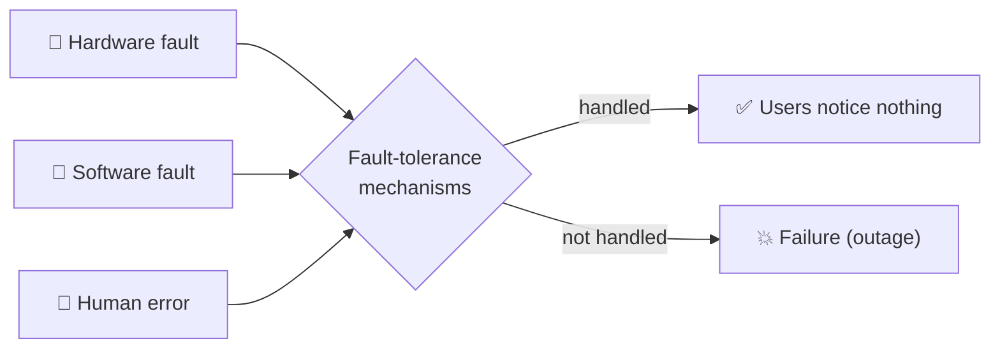
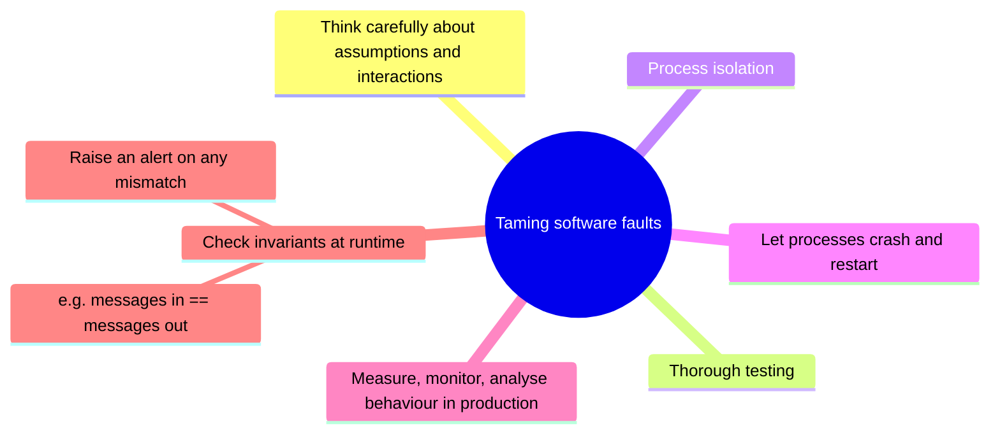
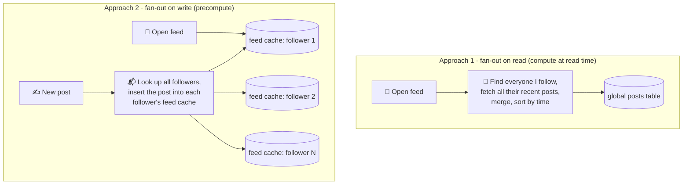
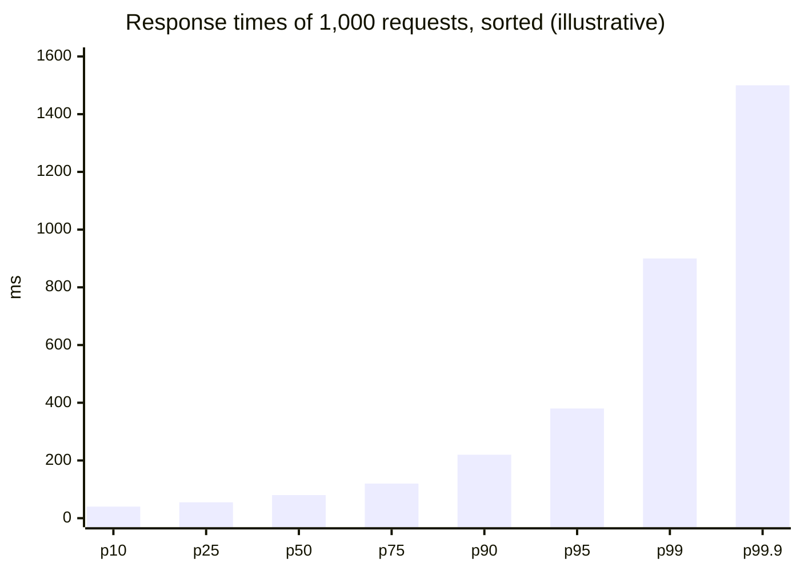
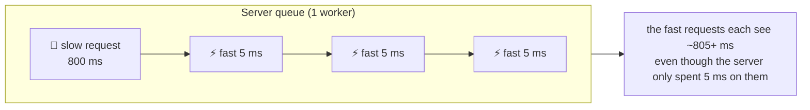
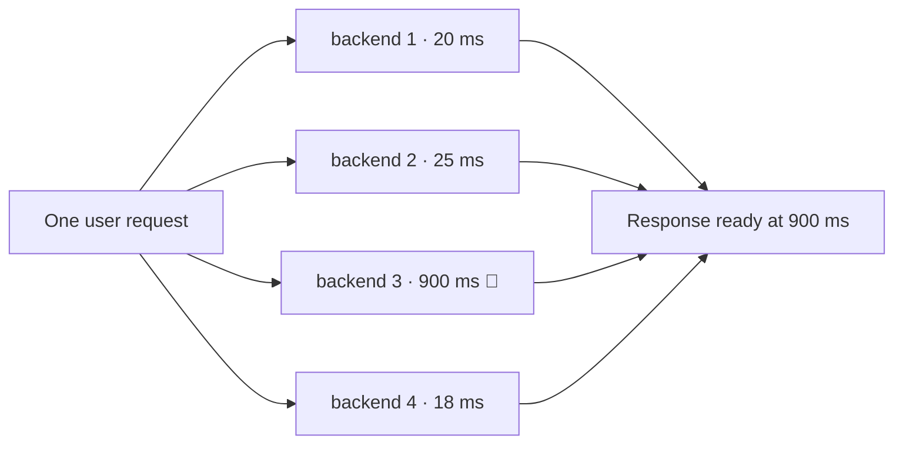
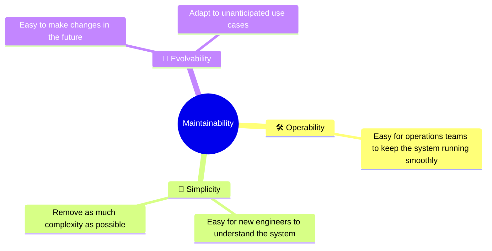
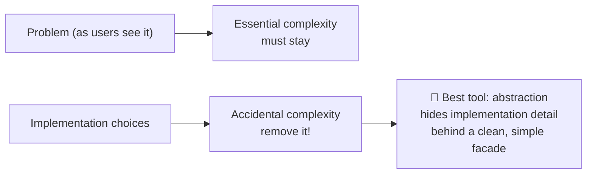

# 1 · Reliable, scalable and maintainable applications

> **In one line:** most apps today are limited by data (its volume, complexity and rate of change), not CPU. Good data systems are judged on three qualities: they keep working, they keep up with growth, and people can keep changing them.

<BookRef pages="25–47" section="Chapter 1" />

## Why "data-intensive"?

An application is **compute-intensive** when raw CPU power is the bottleneck: simulations, video encoding, model training. Most business software isn't like that. Its hard problems are:

- **how much** data there is (it no longer fits on one disk or in one machine's memory),
- **how complex** the data is (many entity types with tangled relationships),
- **how fast it changes** (millions of writes, constantly changing schemas and features).

That's what *data-intensive* means. The CPU is rarely the limit; the data is.

Almost every data-intensive app is built from the same handful of building blocks:

<IconCards items={[
  {icon: '🗄️', title: 'Databases', text: 'Store data so it can be found again later, by you or another app.', color: '#8b5cf6'},
  {icon: '⚡', title: 'Caches', text: 'Remember the result of an expensive operation to speed up reads.', color: '#f59e0b'},
  {icon: '🔎', title: 'Search indexes', text: 'Let users search by keyword or filter in many ways.', color: '#3b82f6'},
  {icon: '📨', title: 'Stream processing', text: 'Send messages to another process to be handled asynchronously.', color: '#ec4899'},
  {icon: '🧮', title: 'Batch processing', text: 'Periodically crunch a large amount of accumulated data.', color: '#10b981'},
]} />

These sound so obvious that we take them for granted. But for each one there are many products with very different properties, and real apps often need several combined. The rest of the book is about understanding those properties so you can choose and combine them well.

## 1.1 Thinking about data systems

<BookRef pages="26–28" section="Thinking About Data Systems" />

We usually think of databases, queues and caches as completely different categories. Two trends blur those lines:

1. **Tools now overlap.** Redis is a datastore that can also act as a message queue. Kafka is a message queue with database-like durability. The old boundaries don't hold.
2. **No single tool does everything.** Real requirements are broad, so the work is split into tasks that one tool handles well, and **application code glues them together**.



Once you combine tools like this behind one API, **you have designed a new, special-purpose data system**. The API hides the details from clients, but you are now responsible for its guarantees:

- How do you make sure the cache is correctly invalidated when the DB changes?
- What happens to the search index if the worker crashes halfway?
- How do you give consistently good performance when one component is degraded?
- How does the whole thing scale when load increases?
- What should the API look like?

The answers depend on many factors (team skills, legacy dependencies, time-to-market, risk tolerance, regulation), but three concerns matter in almost every system: **reliability, scalability and maintainability**.

## 1.2 Reliability

<BookRef pages="28–32" section="Reliability" />

Roughly, reliable means **"continuing to work correctly, even when things go wrong"**. For software, that typically means:

- it performs the function the user expects,
- it tolerates users making mistakes or using it in unexpected ways,
- its performance is good enough for the required load and data volume,
- it prevents unauthorised access and abuse.

### Faults vs failures

| Term | Meaning | Example |
|---|---|---|
| **Fault** | One component deviates from its spec | One disk dies |
| **Failure** | The system as a whole stops providing the required service to the user | The website is down |

You can't reduce the probability of faults to zero, so the goal is to **design fault-tolerance mechanisms that stop faults from turning into failures**. Systems that anticipate faults are called *fault-tolerant* or *resilient*. (They tolerate *certain types* of faults. No system survives the planet being swallowed by a black hole.)



It can even make sense to **trigger faults on purpose**: randomly kill processes without warning. Many critical bugs come from poor error handling. Deliberately inducing faults ensures the fault-tolerance machinery is continually exercised and tested, which raises confidence that real faults will be handled. Netflix's *Chaos Monkey* is the best-known example of this approach (**chaos engineering**).

Generally we prefer tolerating faults over preventing them. The exception is **security**: if an attacker has compromised a system and stolen data, that can't be undone, so prevention is the only option.

### Hardware faults

<BookRef pages="29–30" section="Hardware Faults" />

Hard disks crash, RAM becomes faulty, the power grid has a blackout, someone unplugs the wrong network cable. Hard disks have a mean time to failure (MTTF) of about **10 to 50 years**. On a cluster of 10,000 disks, you should therefore expect on average **about one disk to die per day**.

| Era | Approach |
|---|---|
| Classic | **Redundancy per machine:** RAID disks, dual power supplies, hot-swappable CPUs, batteries and diesel generators for backup power. When one component dies, the redundant one takes over. |
| Modern | Data volumes and compute demands grew, so apps use **many machines**, which increases the hardware fault rate proportionally. Cloud platforms such as AWS often prioritise flexibility over single-machine reliability: VMs can become unavailable without warning. |
| Result | Move toward **software fault-tolerance** that tolerates the loss of entire machines. Bonus: you can patch one node at a time (**rolling upgrade**) with no downtime for the whole system. |

Hardware faults are mostly **random and independent**: one disk failing doesn't imply another will. (Weak correlations exist, e.g. same temperature in a rack.)

### Software errors

<BookRef pages="30–31" section="Software Errors" />

These are **systematic errors** within the system. They are harder to anticipate and, because they are **correlated across nodes**, they cause many more system failures than uncorrelated hardware faults. Examples:

- A bug that crashes every instance of a server when given one particular bad input. (A classic example is a leap second that made many applications hang at the same moment because of a Linux kernel bug.)
- A runaway process that uses up a shared resource: CPU, memory, disk space or network bandwidth.
- A service the system depends on slows down, stops responding or returns corrupted responses.
- **Cascading failures**: a small fault in one component triggers a fault in another, which triggers further faults.

These bugs often lie dormant for a long time until triggered by unusual circumstances. They reveal that the software was making **an assumption about its environment** that was usually true but stopped being true.

There's no quick fix, but many small things help:



### Human errors

<BookRef pages="31–32" section="Human Errors" />

Humans design, build and operate these systems, and even with the best intentions they are unreliable. One study of large internet services found that **configuration errors by operators were the leading cause of outages**, while hardware faults played a role in only 10–25% of outages.

| Technique | How it helps |
|---|---|
| **Design to minimise opportunities for error** | Well-designed abstractions, APIs and admin interfaces make the right thing easy and the wrong thing hard. If they're too restrictive, though, people work around them. |
| **Decouple where mistakes are made from where they cause failures** | Fully featured, non-production **sandbox** environments using real data, where people can explore and experiment safely. |
| **Test thoroughly at all levels** | Unit tests, whole-system integration tests, manual tests. **Automated testing** is especially valuable for corner cases that rarely arise in normal operation. |
| **Allow quick and easy recovery** | Fast config rollback, **gradual rollout** of new code (so a bug only affects a small subset of users), tools to recompute data if the old computation was wrong. |
| **Detailed, clear monitoring** | Performance metrics and error rates (**telemetry**), as rocket engineers use: early warning signals, checks on whether assumptions or constraints are being violated, and diagnosis data. |
| **Good management practices and training** | A complex and important aspect, beyond the scope of the book. |

### How important is reliability?

<BookRef pages="32" section="How Important Is Reliability?" />

It's not just for nuclear power stations and air traffic control. Bugs in business apps cost productivity (and legal risk if figures are reported incorrectly), and e-commerce outages cost revenue and reputation. Even "non-critical" apps have a responsibility to their users. Imagine a parent who stores every photo and video of their children in your photo app: how would they feel if that database suddenly got corrupted?

Sometimes you *choose* to cut reliability to reduce development or operational cost, for example for a prototype for an unproven market. If you do, be **very conscious** of when you are cutting corners.

## 1.3 Scalability

<BookRef pages="32–40" section="Scalability" />

Even if a system works reliably today, that doesn't mean it will in the future. A common reason for degradation is **increased load**: concurrent users grew from 10,000 to 100,000, or from 1 million to 10 million, or the system processes much more data than before.

**Scalability** is the term we use to describe a system's ability to cope with increased load. Saying "X is scalable" or "Y doesn't scale" is meaningless. Discussing scalability means asking:

- *"If the system grows in a particular way, what are our options for coping with the growth?"*
- *"How can we add computing resources to handle the additional load?"*

### Describing load

<BookRef pages="33–35" section="Describing Load" />

First you need to describe the current load succinctly, using a few numbers called **load parameters**. The best choice depends on your architecture:

- requests per second to a web server,
- ratio of reads to writes in a database,
- number of simultaneously active users in a chat room,
- hit rate on a cache,
- or something else. Sometimes the **average** case matters; sometimes the bottleneck is a small number of **extreme** cases.

#### Worked example: a social network home feed

Imagine a social network with two main operations:

| Operation | Rate (illustrative) |
|---|---|
| **Post a message** | ~5k requests/sec on average, peaks around 15k/sec |
| **View home feed** (posts by people you follow) | ~250k requests/sec |

Handling 15k writes per second on its own would be easy. The difficulty is **fan-out**: each user follows many people and is followed by many people. (*Fan-out* is a term borrowed from electronics: the number of logic gate inputs attached to one gate's output. Here it means the number of requests to other services needed to serve one incoming request.)

There are two broad ways to implement the feed:



Approach 1 as SQL:

```sql
SELECT posts.*, users.*
FROM posts
  JOIN users   ON posts.sender_id = users.id
  JOIN follows ON follows.followee_id = users.id
WHERE follows.follower_id = :current_user
ORDER BY posts.timestamp DESC
LIMIT 50;
```

| | Fan-out on read | Fan-out on write |
|---|---|---|
| Work at post time | 1 insert | 1 insert per follower (avg 100 followers → **~500k feed writes/sec**) |
| Work at read time | Big join on every feed load | Read one precomputed list |
| Good when | Writes far outnumber reads | Reads far outnumber writes (two orders of magnitude here) |
| Breaks when | Feed reads are very frequent | **A few accounts have tens of millions of followers**: a single post means tens of millions of writes, and it must reach followers quickly |

The real-world answer is a **hybrid**: most users' posts are fanned out on write, but a small number of accounts with huge follower counts are excluded. Their posts are fetched separately at read time and merged in, like approach 1.

<KeyIdea>The key load parameter in this example is the **distribution of followers per user** (perhaps weighted by how often those users read). It decides the fan-out load. Your app has different characteristics, but you can reason about its load in the same way.</KeyIdea>

### Describing performance

<BookRef pages="35–39" section="Describing Performance" />

Once you've described load, you can ask what happens when it grows:

1. If you increase a load parameter and keep resources (CPU, memory, bandwidth) the same, **how is performance affected?**
2. If you increase a load parameter, **how much do you need to increase resources** to keep performance the same?

Both need performance numbers.

| System type | What we usually care about |
|---|---|
| Batch processing (e.g. Hadoop) | **Throughput**: records processed per second, or total time to run a job on a dataset of a certain size |
| Online systems | **Response time**: time between a client sending a request and receiving a response |

> **Latency vs response time.** People use them as synonyms, but they aren't. *Response time* is what the client sees: actual processing time (**service time**) + network delays + **queueing delays**. *Latency* is the time a request is *latent*, waiting to be handled.

#### Response time is a distribution, not a number

If you send the same request over and over, you get slightly different response times each time. In practice, a system handling many requests gets a wide range of response times. Random extra latency can come from:

- a context switch to a background process,
- a lost network packet and TCP retransmission,
- a garbage-collection pause,
- a page fault forcing a read from disk,
- mechanical vibrations in the server rack,
- and many other causes.

So we measure the **distribution** and summarise it with **percentiles**.



| Measure | What it tells you |
|---|---|
| **Mean (average)** | Not a good measure of the "typical" response time: it doesn't tell you how many users experienced a given delay |
| **Median (p50)** | Half of requests are faster, half slower. A good measure of how long users *typically* wait. |
| **p95, p99, p99.9** | **Tail latencies**: thresholds that 95%, 99% or 99.9% of requests beat. They tell you how bad the outliers are. |

Why tail latencies matter: the customers with the slowest requests are often those with **the most data in their accounts**, because they've made many purchases. They're your most valuable customers. Amazon has described its internal service targets in terms of **p99.9** for this reason. Optimising p99.99 (the slowest 1 in 10,000) was judged too expensive for the benefit, because those delays are often caused by random events outside your control.

Percentiles are often used in **service level objectives (SLOs)** and **service level agreements (SLAs)**, contracts defining expected performance and availability. For example: *"the service is up if it has median response time < 200 ms and p99 < 1 s, and it must be up at least 99.9% of the time"*.

#### Queueing and head-of-line blocking

Queueing delays often account for a large part of high-percentile response times. A server can only process a small number of things in parallel (limited by CPU cores, for example), so **a few slow requests can hold up the processing of everything behind them**. This is called **head-of-line blocking**.



That's why you must **measure response times on the client side**. And when load testing, the load-generating client must **keep sending requests independently** of response times. If it waits for each response before sending the next, it artificially keeps the queues shorter than in reality and skews the measurement.

#### Tail-latency amplification

When one end-user request requires several backend calls, the slowest backend call decides the total. Even if only a small share of backend calls are slow, the chance of getting at least one slow call grows when a request needs many of them, so a higher proportion of end-user requests end up slow.



If each backend call is slow 1% of the time and a page makes 100 calls in parallel, then `1 − 0.99¹⁰⁰ ≈ 63%` of page loads include at least one slow call.

#### Computing percentiles in practice

To show percentiles on monitoring dashboards, compute them **efficiently and continuously** over a rolling window (e.g. the last 10 minutes). The naive way is to keep a list of all response times in the window and sort it every minute. Approximation algorithms such as **forward decay, t-digest or HdrHistogram** compute good approximations with minimal CPU and memory.

⚠️ **Averaging percentiles is mathematically meaningless.** To combine data from several machines or time windows, **add the histograms** together, then compute the percentile.

### Approaches for coping with load

<BookRef pages="39–40" section="Approaches for Coping with Load" />

An architecture that suits one level of load is unlikely to cope with 10× that load. On a fast-growing service, you'll probably need to **rethink your architecture at every order-of-magnitude increase**, or even more often.

| Approach | Meaning | Trade-off |
|---|---|---|
| **Scaling up** (vertical) | Move to a more powerful machine | Simple, but high-end machines get very expensive and there's a ceiling |
| **Scaling out** (horizontal) | Distribute load across many smaller machines (**shared-nothing**) | No ceiling, but adds the complexity of distributed systems |
| **Elastic** | Automatically add resources when load increases | Useful when load is highly unpredictable, but more complex to operate |
| **Manually scaled** | A human analyses capacity and adds machines | Simpler, fewer operational surprises |

In practice a good architecture is often a **pragmatic mix**: several fairly powerful machines can still be simpler and cheaper than lots of small VMs.

**Stateless vs stateful:** distributing *stateless* services across machines is fairly simple. Taking a *stateful* data system from one node to a distributed setup adds a lot of complexity. So common wisdom used to be to keep the database on one node (scale up) until cost or high-availability needs forced you to distribute. As distributed-systems tools and abstractions improve, distributed data systems may well become the default, even for use cases that don't need huge scale.

<KeyIdea>No single architecture scales for every workload. A system that handles 100,000 requests per second of 1 kB each looks very different from one that handles 3 requests per minute of 2 GB each, even though both move the same amount of data. An architecture that scales well is built around **assumptions about which operations will be common and which will be rare**: the load parameters. If those assumptions are wrong, the scaling effort is at best wasted and at worst counterproductive. For an early-stage startup, iterating quickly on features usually matters more than scaling to a hypothetical future load.</KeyIdea>

## 1.4 Maintainability

<BookRef pages="40–44" section="Maintainability" />

The majority of software cost is **not** initial development but **ongoing maintenance**:
- fixing bugs,
- keeping systems operational,
- investigating failures,
- adapting to new platforms,
- modifying for new use cases,
- repaying technical debt,
- adding new features.

Many people dislike working on "legacy" systems: they mean fixing other people's mistakes, or working with outdated platforms, or systems forced to do things they were never designed for. Every legacy system is unpleasant in its own way, so it's hard to give general advice. But we **can and should design software to minimise pain during maintenance**, so we don't create legacy software ourselves. Three design principles help:



### Operability: making life easy for operations

<BookRef pages="41–42" section="Operability: Making Life Easy for Operations" />

Strong operations can compensate for weak software, but even excellent software will be unreliable if it is operated badly. An operations team is responsible for:

| Operations duty | |
|---|---|
| Monitoring system health | Quickly restoring service when it's in a bad state |
| Tracking down the cause of problems | System failures or degraded performance |
| Keeping software and platforms up to date | Including security patches |
| Understanding how systems affect each other | So a problematic change can be avoided before it causes damage |
| Anticipating future problems | Capacity planning |
| Establishing good practices and tools | For deployment, configuration management and more |
| Complex maintenance tasks | e.g. moving an application from one platform to another |
| Maintaining security | As configuration changes are made |
| Defining processes | That make operations predictable and keep production stable |
| Preserving knowledge | Even as individual people come and go |

Data systems can make routine tasks easier by:

- giving **visibility** into runtime behaviour and internals, with good monitoring,
- providing good support for **automation** and integration with standard tools,
- **avoiding dependency on individual machines** (machines can be taken down for maintenance while the system keeps running),
- providing good **documentation** and an easy-to-understand operational model ("if I do X, Y will happen"),
- providing **good default behaviour**, while giving admins freedom to override defaults when needed,
- **self-healing** where appropriate, while still giving admins manual control over system state,
- showing **predictable behaviour** and minimising surprises.

### Simplicity: managing complexity

<BookRef pages="42–43" section="Simplicity: Managing Complexity" />

Small projects can have delightfully simple and expressive code, but as projects grow they often become very complex: a **big ball of mud**.

**Symptoms of complexity:**
- explosion of the state space,
- tight coupling of modules,
- tangled dependencies,
- inconsistent naming and terminology,
- hacks aimed at solving performance problems,
- special-casing to work around issues elsewhere.

When complexity makes maintenance hard, budgets and schedules overrun. There's also a greater risk of **introducing bugs** when making a change: when the system is hard to understand, hidden assumptions, unintended consequences and unexpected interactions are more easily overlooked.

Making a system simpler doesn't necessarily mean reducing its functionality. It means removing **accidental complexity**: complexity that isn't inherent in the problem the software solves (as the users see it) but arises only from the implementation.



**Abstraction** is one of the best tools for removing accidental complexity. A good abstraction can hide a lot of implementation detail behind a clean, simple-to-understand facade, and it can be reused by many applications. Examples:

- **High-level programming languages** hide machine code, CPU registers and syscalls.
- **SQL** hides complex on-disk and in-memory data structures, concurrent requests from other clients, and inconsistencies after crashes.

Finding good abstractions is very hard, especially in distributed systems. Much of this book is about extracting **good abstractions** that let us split a large system into well-defined, reusable components.

### Evolvability: making change easy

<BookRef pages="43–44" section="Evolvability: Making Change Easy" />

It's extremely unlikely that your system's requirements will stay the same forever. You'll:
- learn new facts,
- face previously unanticipated use cases,
- see business priorities change,
- get user requests for new features,
- swap or replace platforms,
- see legal or regulatory requirements change,
- grow, which forces architectural changes.

Agile working practices give a framework for adapting to change, and the agile community has developed tools and patterns such as **test-driven development (TDD)** and **refactoring**. Most of those focus on small, local scales (a couple of source files in one app). This book looks for ways to increase agility at the level of **a larger data system**, possibly consisting of several different applications or services with different characteristics. Example: how would you "refactor" a social network's architecture for assembling home feeds from approach 1 to approach 2?

The ease with which you can modify a data system is closely linked to its **simplicity and abstractions**: simple, easy-to-understand systems are easier to modify. Because it's such an important idea, the book uses a different word for agility at the data-system level: **evolvability**.

## Summary

<BookRef pages="44–47" section="Summary" />

An application has to meet **functional requirements** (what it should do: store, retrieve, search, process data) and **nonfunctional requirements** (general properties like security, reliability, compliance, scalability, compatibility and maintainability).

| Quality | Question it answers | Main tools |
|---|---|---|
| **Reliability** | Does it work correctly even when faults occur? | Redundancy, software fault tolerance, testing, isolation, quick rollback, telemetry |
| **Scalability** | Does performance stay good as load grows? | Load parameters, percentiles, adding capacity, caching, fan-out choices |
| **Maintainability** | Can people keep operating and changing it? | Operability (visibility, automation), simplicity (abstraction), evolvability |

There's unfortunately no easy fix for making applications reliable, scalable or maintainable. But certain **patterns and techniques keep reappearing** in different kinds of applications. The next chapters look at examples of data systems and how they work toward these goals.

## 🧠 Check yourself

<Quiz question="A page calls 10 backend services in parallel. Each is slow (above its p99) 1% of the time. Roughly what share of page loads hit at least one slow call?" options={["1%", "~5%", "~10%", "~50%"]} answer={2} explain="1 − 0.99¹⁰ ≈ 9.6%. This is tail-latency amplification." />

<Quiz question="Why are percentiles better than the average for response time?" options={["They are cheaper to compute", "The average hides how many users get a bad experience", "Averages can't be monitored", "Percentiles ignore outliers"]} answer={1} explain="An average blends fast and slow requests. p95/p99 tell you how slow it is for the unluckiest users." />

<Quiz question="Which fault type is most likely to take down every node at once?" options={["Disk failure", "Power supply failure", "A software bug triggered by a specific input", "A network cable unplugged"]} answer={2} explain="Software faults are correlated: every node runs the same code, so the same bad input hits all of them." />

<Quiz question="You have p99 latency from 10 servers. How do you get the cluster-wide p99?" options={["Average the ten p99 values", "Take the maximum p99", "Add the response-time histograms, then compute p99", "Take the median of the ten p99 values"]} answer={2} explain="Percentiles can't be averaged. Merge the underlying distributions (histograms) and compute from that." />

<Quiz question="In a load test, the client waits for each response before sending the next request. What's wrong?" options={["Nothing", "It keeps queues artificially short, so measured response times look better than reality", "It overloads the server", "It measures throughput instead of latency"]} answer={1} explain="Real users don't wait for each other. The load generator must send requests independently of response times." />

<Quiz question="Which is an example of accidental complexity?" options={["A tax app needing to handle tax rules", "A hack that special-cases one customer to work around a performance problem elsewhere", "A banking app needing transactions", "A chat app needing message ordering"]} answer={1} explain="It comes from the implementation, not the problem users care about." />

**Interview prompts**
- Design a home-feed service. Which load parameter decides fan-out on read vs write? How does the hybrid handle celebrity accounts?
- Your p50 latency is fine but p99 doubled. Where do you look first? (Hint: queueing, GC, a slow dependency, a larger customer's data.)
- How would you make a config push safer? (Sandbox, gradual rollout, quick rollback, telemetry.)
- Write an SLO for a checkout API and explain why you chose those percentiles.
