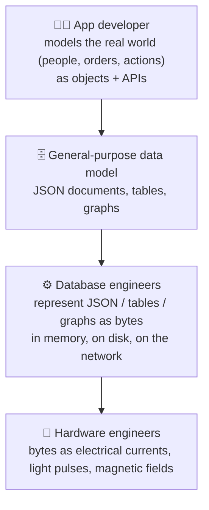
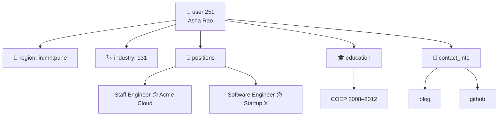
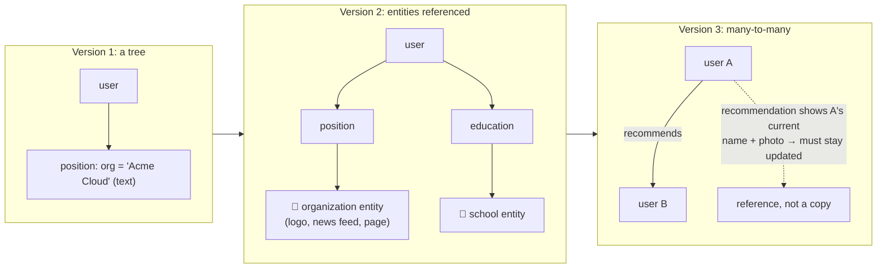
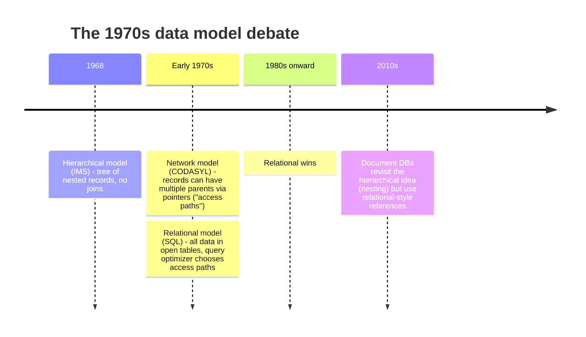
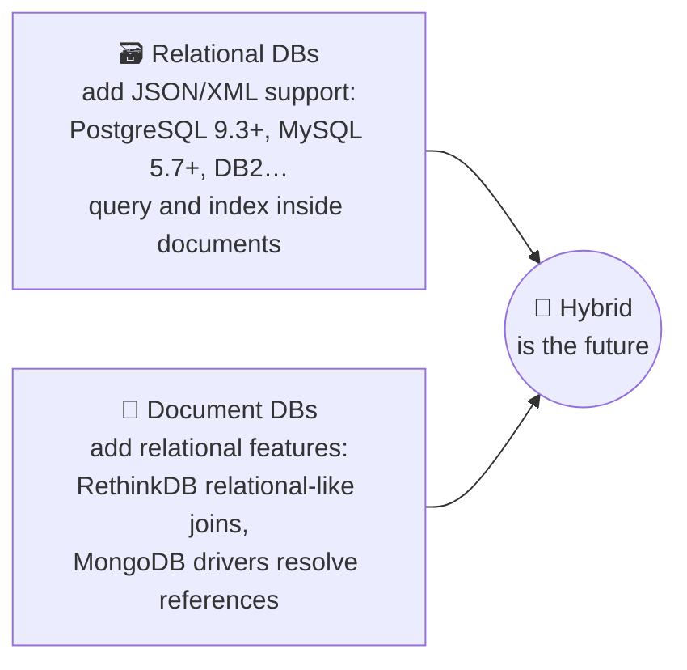
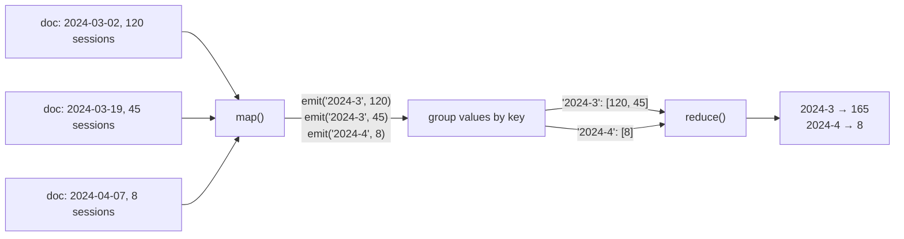
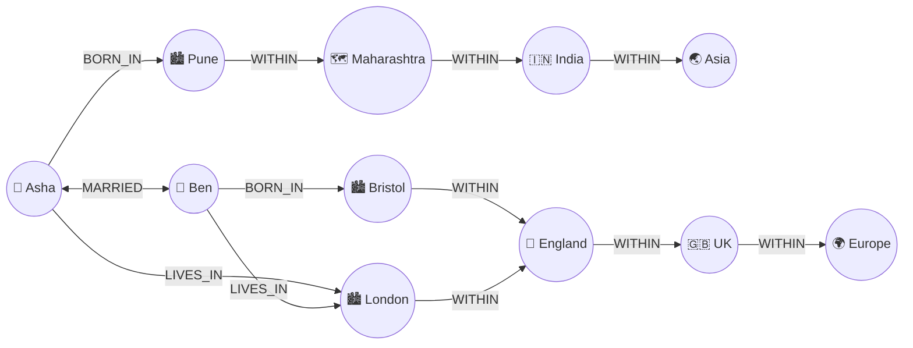
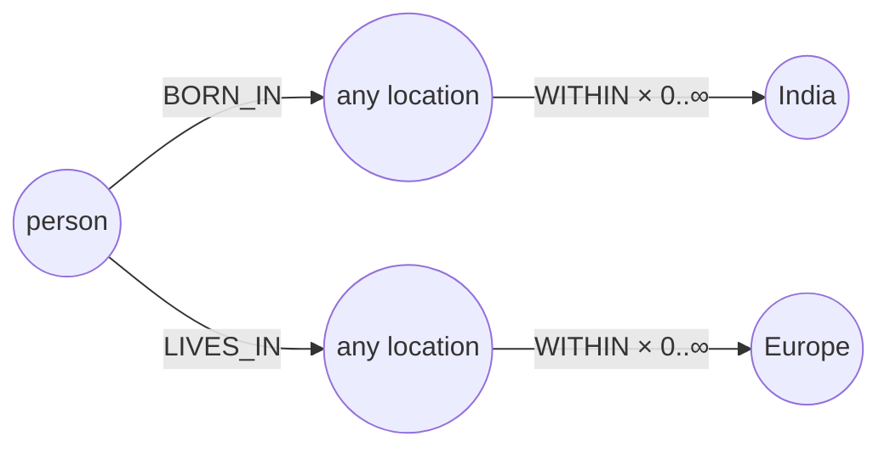
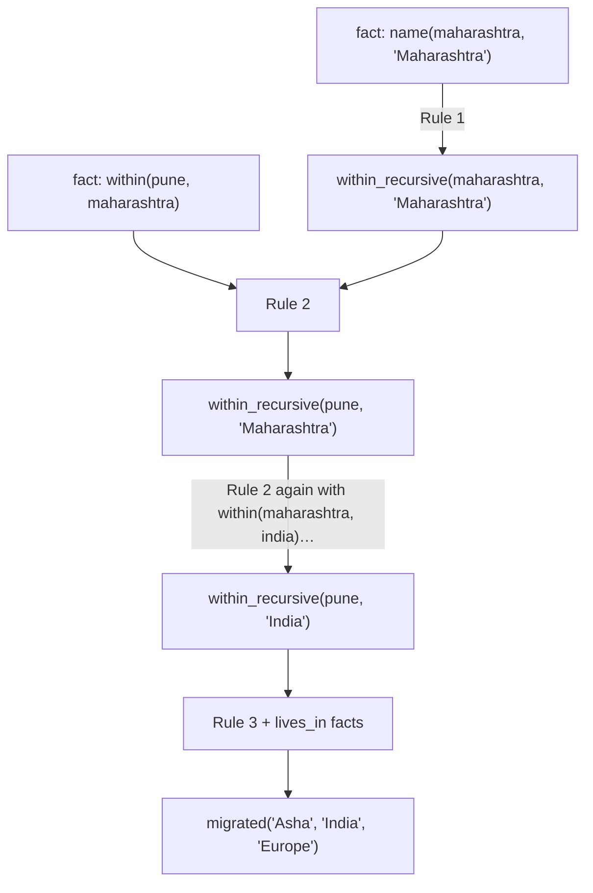
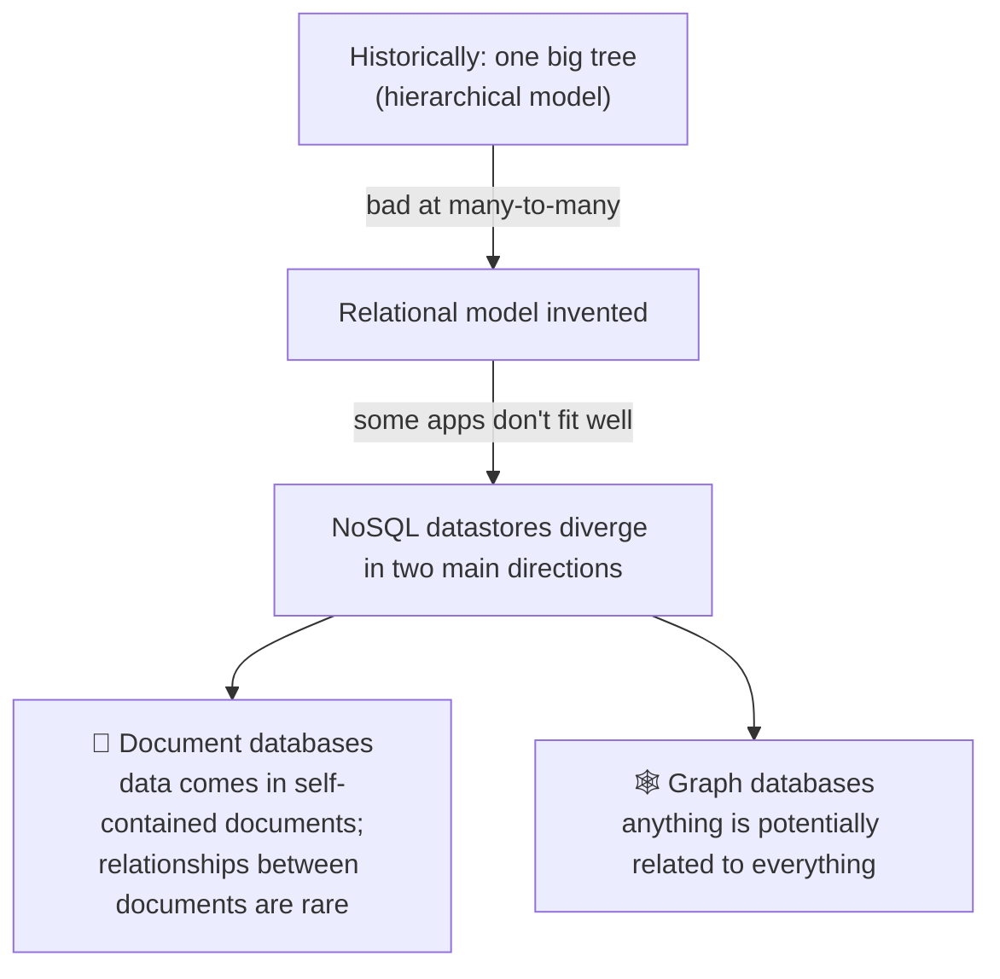

# 2 · Data models and query languages

> **In one line:** the data model shapes how you think about the problem. Relational, document and graph models each make some relationships easy and others painful.

<BookRef pages="49–89" section="Chapter 2" />

## Layers of data models

Most applications are built by **layering one data model on top of another**. At each layer, the key question is: *how is this represented in terms of the next-lower layer?*



Each layer hides the complexity of the layers below it with a **clean data model**. That abstraction lets different groups of people (database vendors and app developers) work together effectively.

The data model also has a profound effect on what software above it **can and can't do easily**. Each model embodies assumptions about how it will be used: some operations are fast, some perform badly, some data transformations feel natural and some are awkward. So it's important to choose one that fits your application.

## 2.1 Relational model vs document model

<BookRef pages="50–64" section="Relational Model Versus Document Model" />

The best-known model is SQL, based on the **relational model** proposed in 1970: data is organised into **relations** (tables in SQL), where each relation is an unordered collection of **tuples** (rows).

It began as a theoretical proposal, and many doubted it could be implemented efficiently. By the mid-1980s, though, relational databases dominated, and they kept that position for 25–30 years, which is an eternity in computing.

Their roots were in **business data processing** on 1960s–70s mainframes:
- **transaction processing:** sales or banking transactions, airline reservations, stock-keeping in warehouses,
- **batch processing:** customer invoicing, payroll, reporting.

Competing models came and went (the network and hierarchical models in the 1970s–80s, object databases in the late 80s–early 90s, XML databases in the early 2000s). Each generated hype, and none lasted. Relational databases generalised remarkably well, far beyond their original scope: much of what we see on the web today (publishing, discussion, social networking, e-commerce, games, SaaS) is still powered by them.

### The birth of NoSQL

<BookRef pages="51" section="The Birth of NoSQL" />

In the 2010s, **NoSQL** was the latest attempt to challenge the relational model. The name was originally just a catchy Twitter hashtag for a 2009 meetup on open source, distributed, non-relational databases. It has since been retroactively reinterpreted as **"Not Only SQL"**.

Driving forces:

<IconCards items={[
  {icon: '📈', title: 'Scale', text: 'Need for greater scalability than relational DBs easily achieved: very large datasets or very high write throughput.', color: '#3b82f6'},
  {icon: '🆓', title: 'Open source', text: 'Widespread preference for free and open source software over commercial databases.', color: '#10b981'},
  {icon: '🔎', title: 'Special queries', text: 'Specialised query operations the relational model didn\'t support well.', color: '#f59e0b'},
  {icon: '🧩', title: 'Flexibility', text: 'Frustration with restrictive relational schemas; desire for a more dynamic, expressive data model.', color: '#ec4899'},
]} />

Different applications have different requirements. The likely future is **polyglot persistence**: relational databases used alongside a broad variety of non-relational datastores.

### The object-relational mismatch

<BookRef pages="51–55" section="The Object-Relational Mismatch" />

Most application code today is written in object-oriented languages. If data is stored in relational tables, an **awkward translation layer** is needed between objects in code and the tables, rows and columns of the database. This disconnect is called the **impedance mismatch** (a term borrowed from electronics).

**ORM** frameworks (ActiveRecord, Hibernate, Django ORM…) reduce the boilerplate for this translation layer, but they can't completely hide the differences.

#### Example: a résumé / professional profile

A profile has a name, a summary and a region, plus **lists**: jobs (positions), education entries, contact links. Ways to represent the lists:

| Representation | How | Notes |
|---|---|---|
| **Normalised tables** | Separate `positions`, `education`, `contact_info` tables with a foreign key to `users` | The traditional SQL approach |
| **Structured datatypes / JSON columns** | Multi-valued data stored inside one row, queryable and indexable | Supported by modern SQL databases (PostgreSQL, MySQL, Oracle, SQL Server…) |
| **Encoded text blob** | Store JSON or XML as text; the app interprets it | The DB can't query inside it |

For a self-contained structure like a résumé, a **JSON document** is quite natural:

```json
{
  "user_id": 251,
  "first_name": "Asha",
  "last_name": "Rao",
  "summary": "Platform engineer, distributed systems",
  "region_id": "in:mh:pune",
  "industry_id": 131,
  "positions": [
    {"job_title": "Staff Engineer", "organization": "Acme Cloud"},
    {"job_title": "Software Engineer", "organization": "Startup X"}
  ],
  "education": [
    {"school_name": "COEP", "start": 2008, "end": 2012}
  ],
  "contact_info": {"blog": "https://example.dev", "github": "asha-r"}
}
```

Advantages of the JSON document here:
- **Less impedance mismatch** with application code (it looks like the object).
- **Better locality:** to fetch the profile in the relational example, you either do several queries (one per table) or a messy multi-way join. In the document, all relevant information is in one place, so **one query** is enough.

The one-to-many relationships (user → positions, user → education) form a **tree structure**, which JSON makes explicit:



### Many-to-one and many-to-many relationships

<BookRef pages="55–58" section="Many-to-One and Many-to-Many Relationships" />

In the example, `region_id` and `industry_id` are **IDs**, not free text like "Greater Pune Area". Why?

If the UI offers drop-down lists or autocomplete of standardised values, you get:

| Benefit | |
|---|---|
| **Consistent style and spelling** | No "Pune", "pune", "Poona" variants |
| **Avoiding ambiguity** | Several cities share the same name |
| **Ease of updating** | The name is stored in one place; renaming is one update |
| **Localisation** | Show the region in the viewer's language |
| **Better search** | A search for engineers in Maharashtra can match a profile in Pune, because the region list can encode that Pune is in Maharashtra |

The key rule: **IDs have no meaning to humans, so they never need to change**. Anything meaningful to humans may need to change some day. If that information is duplicated, every copy must be updated: that's write overhead and a risk of inconsistency. **Removing duplication is the key idea behind normalisation.**

But normalising requires **many-to-one** relationships (many people live in one region). Those fit **poorly** in the document model:
- in relational DBs, referring to rows in other tables by ID is normal because **joins are easy**,
- in document DBs, joins aren't needed for tree structures, and **support for joins is often weak**,
- if the DB doesn't support joins, you must **emulate them in application code** with multiple queries.

And data tends to become **more interconnected as features are added**:



- **Organisations and schools as entities:** they become separate entities with their own web pages, logos and news. Each résumé links to them.
- **Recommendations:** one user writes a recommendation for another. It shows the recommender's name and photo, which must update if they change their photo. So it needs a reference.

These are **many-to-many** relationships. The data can be shown as a tree within each document, but references between documents need joins.

### Are document databases repeating history?

<BookRef pages="58–60" section="Are Document Databases Repeating History?" />

The debate about how best to represent many-to-many relationships is much older than NoSQL. It goes back to the earliest computerised databases.

**The hierarchical model** (IBM's IMS, originally built for stock-keeping in the Apollo space programme, 1968) represented all data as a **tree of records nested within records**, much like JSON. It worked well for one-to-many relationships but made many-to-many difficult and didn't support joins. Developers had to decide whether to **duplicate (denormalise) data** or **manually resolve references**. Sound familiar? The same problems document DBs face today.

Two solutions were proposed:



#### The network model (CODASYL)

- A generalisation of the hierarchical model: a record could have **multiple parents**. Many-to-one and many-to-many relationships became possible.
- Links between records were like **pointers** (stored on disk), not foreign keys.
- The only way to access a record was to **follow a path** from a root record along these chains of links: an **access path**.
- A query was like moving a **cursor** through the database by iterating over lists and following access paths. If a record had multiple parents, the app code had to keep track of all the relationships.
- 🚫 Changing access paths was very hard: you might have to rewrite a lot of hand-written database query code. **Querying and updating were complicated and inflexible.**

#### The relational model

- All data in the open: a relation (table) is just a collection of tuples (rows). **No nested structures and no complicated access paths** to follow.
- Read any or all rows, select the ones that match any condition, read a row by designating a key column.
- Insert a new row without worrying about foreign-key relationships to and from other tables.
- **The query optimizer** automatically decides which parts of the query to run in which order, and which indexes to use. Those choices are effectively the "access path", but they're made **by the optimizer, not by the app developer**, so we rarely need to think about them.
- Want to query data in new ways? **Declare a new index**, and queries automatically use whichever indexes are most appropriate. No need to change your queries.

> The key insight: a query optimizer is a complicated beast, but you **only need to build it once**, and all applications using the database benefit. A general-purpose solution wins in the long run.

#### Comparison to document databases

- Document DBs reverted to the hierarchical model in one aspect: storing **nested records** (one-to-many) inside the parent record rather than in a separate table.
- For **many-to-one and many-to-many**, relational and document DBs are not fundamentally different: both refer to the related item by a unique identifier. That's a *foreign key* in the relational model and a *document reference* in the document model. The identifier is resolved at read time with a join or follow-up queries.
- Document databases **have not followed the path of CODASYL**.

### Relational vs document databases today

<BookRef pages="60–64" section="Relational Versus Document Databases Today" />

Leaving aside fault tolerance and concurrency (later chapters), the **data model** differences come down to:

| Document model | Relational model |
|---|---|
| ✅ Schema flexibility | ✅ Better support for joins |
| ✅ Better performance due to **locality** | ✅ Better support for many-to-one and many-to-many |
| ✅ Closer to the data structures some apps use | |

#### Which model leads to simpler application code?

- If the data has a **document-like structure** (a tree of one-to-many relationships, typically loaded all at once), use the document model. **Shredding** a document-like structure into multiple tables (as relational does) leads to cumbersome schemas and complicated application code.
- Limitations of the document model:
  - you can't directly refer to a nested item within a document; you say "the 2nd item in the list of positions for user 251", much like an access path in the hierarchical model. That's not usually a problem as long as documents aren't too deeply nested.
  - **poor support for joins** may or may not be a problem. An analytics app recording which events happened when may never need many-to-many relationships.
- If the app **does** use many-to-many relationships, the document model is less appealing. Reducing joins by denormalising means extra work to keep data consistent. Emulating joins in app code with multiple requests moves complexity into the app and is usually **slower** than a join done by specialised code inside the database.

> **Rule of thumb:** it's impossible to say in general which model gives simpler code. It depends on the relationships between data items. For **highly interconnected** data, the document model is awkward, the relational model is acceptable, and **graph models** are the most natural.

#### Schema flexibility: schema-on-read vs schema-on-write

Most document DBs, and JSON support in relational DBs, don't enforce any schema on the data. XML support in relational DBs usually comes with optional schema validation. **No schema** means arbitrary keys and values can be added to a document, and readers have no guarantee about which fields a document contains.

"Schemaless" is misleading: the code that reads the data usually assumes some structure, so there's an **implicit schema** that isn't enforced by the database.

| | Schema-on-read | Schema-on-write |
|---|---|---|
| What | Structure is implicit and only interpreted when data is read | Schema is explicit and the DB ensures all written data conforms |
| Analogy | **Dynamic** (runtime) type checking | **Static** (compile-time) type checking |

**Example: change the format of a field.** You currently store each user's full name in one field and want first and last name separately.

```js
// Document DB (schema-on-read): new documents get the new fields;
// the app handles old documents when it reads them.
if (user && user.name && !user.first_name) {
  // Older documents (written before the migration) only have `name`
  user.first_name = user.name.split(" ")[0];
}
```

```sql
-- Relational DB (schema-on-write): migrate the schema, then backfill.
ALTER TABLE users ADD COLUMN first_name text;
UPDATE users SET first_name = split_part(name, ' ', 1);      -- PostgreSQL
UPDATE users SET first_name = substring_index(name, ' ', 1); -- MySQL
```

Schema changes have a bad reputation for being slow and requiring downtime. That's not entirely deserved:
- most relational DBs run `ALTER TABLE` in a few milliseconds,
- **MySQL** is a notable exception: it historically **copied the entire table** on `ALTER TABLE`, which could mean minutes or hours of downtime on large tables (tools exist to work around this),
- running `UPDATE` on a large table is slow on any database, since every row must be rewritten. If that's a problem, leave `first_name` set to the default `NULL` and fill it in **at read time**, as you would with a document DB.

**Schema-on-read is advantageous when items in a collection don't all have the same structure** (the data is heterogeneous), for example because:
- there are many different types of objects, and putting each in its own table is impractical,
- the structure of the data is determined by **external systems** you don't control and which may change at any time.

When all records are expected to have the same structure, a schema is a useful mechanism for **documenting and enforcing** that structure.

#### Data locality for queries

A document is usually stored as a **single continuous string**, encoded as JSON, XML or a binary variant (MongoDB's BSON). If your app often needs to **access the entire document** (e.g. to render it on a web page), storage locality is a performance advantage: splitting data across multiple tables needs several index lookups, which means more disk seeks and more time.

The locality advantage only applies if you need **large parts of the document at the same time**:
- the database typically has to **load the entire document**, even if you only access a small part of it, which is wasteful on large documents,
- on **updates**, the entire document usually needs to be **rewritten**. Only modifications that don't change the encoded size can easily be done in place.

So: **keep documents fairly small** and avoid writes that increase the size of a document.

Locality isn't exclusive to the document model:
- **Google Spanner** lets the schema declare that a table's rows should be **interleaved** (nested) within a parent table,
- **Oracle** has *multi-table index cluster tables*,
- the **column-family** concept in the Bigtable model (Cassandra, HBase) has a similar purpose of managing locality.

#### Convergence of document and relational databases



Relational and document databases are becoming more similar over time, and that's a good thing: the data models complement each other. A hybrid of both models is a good route for databases to take.

## 2.2 Query languages for data

<BookRef pages="64–71" section="Query Languages for Data" />

When the relational model was introduced, it came with a new way of querying: **SQL is a declarative query language**, whereas IMS and CODASYL queried the database with **imperative** code.

```js
// Imperative: tell the computer HOW, step by step, in a certain order.
function getOverdueInvoices() {
  const overdue = [];
  for (let i = 0; i < invoices.length; i++) {
    if (invoices[i].status === "OVERDUE") {
      overdue.push(invoices[i]);
    }
  }
  return overdue;
}
```

```sql
-- Declarative: say WHAT pattern of data you want, not how to get it.
SELECT * FROM invoices WHERE status = 'OVERDUE';
```

In a declarative query language (SQL or relational algebra), you specify:
- the pattern of the data you want (conditions the results must meet),
- how the data should be transformed (sorted, grouped, aggregated),

but **not how to achieve that goal**. It's up to the database's query optimizer to decide which indexes and join methods to use, and in which order to run the various parts of the query.

| Why declarative wins | |
|---|---|
| **More concise and easier to work with** than an imperative API | |
| **Hides implementation details** of the database engine | The engine can improve performance **without any changes to queries**. In the imperative example, the code assumes a particular order; if the DB wanted to reclaim disk space behind the scenes by reordering records, it might break code that relies on that order. Declarative SQL makes no ordering promises unless you ask for one. |
| **Lends itself to parallel execution** | CPUs are getting faster by adding more cores, not by running much higher clock speeds. Imperative code is very hard to parallelise because it specifies instructions in a particular order. Declarative languages only specify the pattern of results, so the DB is free to use a parallel implementation. |

### Declarative queries on the web

<BookRef pages="66–68" section="Declarative Queries on the Web" />

The advantages of declarative queries aren't limited to databases. Example: a sidebar menu where the title of the currently selected section should have a blue background.

```html
<ul>
  <li class="selected"><p>Billing</p>
    <ul><li>Invoices</li><li>Refunds</li></ul>
  </li>
  <li><p>Settings</p></li>
</ul>
```

```css
/* Declarative CSS: "the <p> directly inside a selected <li>" */
li.selected > p { background-color: blue; }
```

```js
// Imperative DOM version: same effect, far more fragile
const liElements = document.getElementsByTagName("li");
for (let i = 0; i < liElements.length; i++) {
  if (liElements[i].className === "selected") {
    const children = liElements[i].childNodes;
    for (let j = 0; j < children.length; j++) {
      const child = children[j];
      if (child.nodeType === Node.ELEMENT_NODE && child.tagName === "P") {
        child.setAttribute("style", "background-color: blue");
      }
    }
  }
}
```

Problems with the imperative version:
- If the `selected` class is removed (user clicks another page), the blue colour **won't be removed**, even if the code is rerun. With CSS, the browser automatically detects when the rule no longer applies and removes the styling.
- If you want to use a new API such as `document.evaluate()` (XPath) or `querySelectorAll()` for performance, you must **rewrite the code**. Browser vendors can improve CSS and XPath performance without breaking compatibility.

> In a web browser, declarative CSS styling is much better than manipulating styles imperatively in JavaScript. Similarly, in databases, declarative query languages like SQL turned out to be much better than imperative query APIs.

### MapReduce querying

<BookRef pages="68–71" section="MapReduce Querying" />

**MapReduce** is a programming model for processing large amounts of data in bulk across many machines, popularised by Google. A limited form is supported by some NoSQL datastores (MongoDB, CouchDB) as a mechanism for **read-only queries across many documents**.

It's **neither fully declarative nor fully imperative**: query logic is expressed with snippets of code, which the processing framework calls repeatedly. It's based on the `map` (or `collect`) and `reduce` (or `fold`, `inject`) functions found in many functional languages.

**Example: a mobile team logs every app crash** (timestamp, platform, number of affected sessions). They want the total affected sessions per month for Android.

```sql
-- PostgreSQL
SELECT date_trunc('month', crashed_at) AS crash_month,
       sum(affected_sessions) AS total_sessions
FROM crashes
WHERE platform = 'android'
GROUP BY crash_month;
```

```js
// MongoDB MapReduce
db.crashes.mapReduce(
  function map() {                       // ② called once per matching document
    const year  = this.crashedAt.getFullYear();
    const month = this.crashedAt.getMonth() + 1;
    emit(year + "-" + month, this.affectedSessions);  // ③ emit key (month) and value
  },
  function reduce(key, values) {         // ④ called once per key with all its values
    return Array.sum(values);            // ⑤ add up the counts
  },
  {
    query: { platform: "android" },      // ① filter declaratively first
    out: "monthlyAndroidCrashes"         // ⑥ write results to a collection
  }
);
```



Rules for the `map` and `reduce` functions: they must be **pure functions**. They only use the data passed to them as input, can't perform extra database queries, and must not have side effects. This lets the DB run them anywhere, in any order, and rerun them on failure. They're still powerful: they can parse strings, call library functions, perform calculations and more.

**Usability problem:** you have to write **two carefully coordinated JavaScript functions**, which is often harder than writing a single query. And a declarative query language gives the optimizer more opportunities to improve performance. So MongoDB 2.2 added a declarative query language called the **aggregation pipeline**:

```js
db.crashes.aggregate([
  { $match: { platform: "android" } },
  { $group: {
      _id: { year:  { $year:  "$crashedAt" },
             month: { $month: "$crashedAt" } },
      totalSessions: { $sum: "$affectedSessions" }
  } }
]);
```

It's similar in expressiveness to a subset of SQL, but uses JSON-based syntax. The moral: a NoSQL system may find itself **accidentally reinventing SQL**, albeit in disguise.

## 2.3 Graph-like data models

<BookRef pages="71–85" section="Graph-Like Data Models" />

If your application has mostly one-to-many relationships (tree-structured data) or no relationships between records, the document model is appropriate. But what if **many-to-many relationships are very common**? The relational model can handle simple cases, but as connections in your data grow more complex, it becomes more natural to model the data as a **graph**.

A graph consists of:
- **vertices** (also called *nodes* or *entities*),
- **edges** (also called *relationships* or *arcs*).

| Typical graph | Vertices | Edges |
|---|---|---|
| **Social graphs** | People | Which people know each other |
| **The web graph** | Web pages | HTML links to other pages |
| **Road or rail networks** | Junctions | Roads or railway lines between them |

Well-known algorithms operate on these graphs: car navigation finds the **shortest path** between two points, and **PageRank** uses the web graph to decide the popularity of a page and its ranking in search results.

Graphs aren't limited to **homogeneous** data. A powerful use is storing **completely different types of objects in a single datastore**. Facebook, for example, keeps one graph with many types of vertices and edges: vertices for people, locations, events, check-ins and comments; edges for friendships, who checked in where, who commented on which post, who attended which event.

**Running example:** two people, one born in one country who now lives in another, and they're married.



Notice: the data has **different granularity** in different places. Pune is within a state within a country; London is within a country within a region. Graphs handle that easily.

### Property graphs

<BookRef pages="72–74" section="Property Graphs" />

In the property graph model (Neo4j, Titan, InfiniteGraph):

| Each **vertex** has | Each **edge** has |
|---|---|
| A unique identifier | A unique identifier |
| A set of outgoing edges | The **tail vertex** (where the edge starts) |
| A set of incoming edges | The **head vertex** (where the edge ends) |
| A collection of properties (key-value pairs) | A **label** describing the kind of relationship |
| | A collection of properties (key-value pairs) |

You can think of a graph store as **two relational tables**, one for vertices and one for edges:

```sql
CREATE TABLE vertices (
  vertex_id   integer PRIMARY KEY,
  properties  json
);

CREATE TABLE edges (
  edge_id     integer PRIMARY KEY,
  tail_vertex integer REFERENCES vertices (vertex_id),
  head_vertex integer REFERENCES vertices (vertex_id),
  label       text,
  properties  json
);

-- Efficiently traverse incoming and outgoing edges of any vertex:
CREATE INDEX edges_tails ON edges (tail_vertex);
CREATE INDEX edges_heads ON edges (head_vertex);
```

Important properties of this model:

1. **Any vertex can have an edge connecting it to any other vertex.** No schema restricts which kinds of things can or can't be associated.
2. Given any vertex, you can efficiently find both its **incoming and outgoing edges**, and so **traverse** the graph forwards and backwards (that's why both columns are indexed).
3. By using **different labels** for different kinds of relationships, you can store several kinds of information in one graph while keeping the data model clean.

That gives great flexibility. Things that are awkward in a traditional relational schema are easy here: different regional structures in different countries (France has *départements* and *régions*, the US has *counties* and *states*), quirks of history like a country within a country, varying granularity of data. And graphs are good for **evolvability**: as you add features, a graph can easily be extended (e.g. add each person's food allergies as edges to allergen vertices, linked to a set of foods).

### The Cypher query language

<BookRef pages="74–75" section="The Cypher Query Language" />

**Cypher** is a declarative query language for property graphs, created for Neo4j. (Named after a character in *The Matrix*; not related to ciphers in cryptography.)

```text
-- Insert part of the example graph
CREATE
  (Asia:Location        {name:'Asia',        type:'continent'}),
  (India:Location       {name:'India',       type:'country'}),
  (Maharashtra:Location {name:'Maharashtra', type:'state'}),
  (Pune:Location        {name:'Pune',        type:'city'}),
  (Pune)-[:WITHIN]->(Maharashtra)-[:WITHIN]->(India)-[:WITHIN]->(Asia),
  (Asha:Person {name:'Asha'}),
  (Asha)-[:BORN_IN]->(Pune)
```

**Query: find the names of everyone who emigrated from India to Europe.** That means: find vertices that have a `BORN_IN` edge to a location within India **and** a `LIVES_IN` edge to a location within Europe.

```text
MATCH
  (person) -[:BORN_IN]->  () -[:WITHIN*0..]-> (:Location {name:'India'}),
  (person) -[:LIVES_IN]-> () -[:WITHIN*0..]-> (:Location {name:'Europe'})
RETURN person.name
```

- `-[:WITHIN*0..]->` means "follow a `WITHIN` edge **zero or more times**", like `*` in a regular expression.
- The arrow notation `(a)-[:LABEL]->(b)` reads almost like a diagram.



There are several possible ways to run this query. You could start by scanning all people, check each person's birthplace and residence, and return only matches. Or you could start from the two `Location` vertices and work backwards: if there's an index on `name`, you can find India and Europe efficiently, then find all locations in each by following incoming `WITHIN` edges, and finally look for people who can be found through an incoming `BORN_IN` or `LIVES_IN` edge at one of those locations. **As a declarative language, you don't need to specify these details**: the query optimizer picks the strategy it predicts will be most efficient.

### Graph queries in SQL

<BookRef pages="75–77" section="Graph Queries in SQL" />

If graph data is stored in relational tables, can you query it with SQL? Yes, with some difficulty.

In a relational database you normally know **in advance which joins** your query needs. In a graph query, you may need to traverse a **variable number of edges** before finding the vertex you're looking for. The number of joins isn't fixed.

In the example, that happens in `-[:WITHIN*0..]->`. A person's `LIVES_IN` edge may point at any kind of location: a street, a city, a district, a region, a state. A city may be within a region, a region within a state, a state within a country. The `LIVES_IN` edge may point directly at the location you're looking for, or it may be **several levels removed** in the location hierarchy.

Since SQL:1999, this variable-length traversal can be expressed with **recursive common table expressions** (`WITH RECURSIVE`), supported in PostgreSQL, IBM DB2, Oracle and SQL Server:

```sql
WITH RECURSIVE
  -- in_india: the set of vertex IDs of all locations within India
  in_india(vertex_id) AS (
      SELECT vertex_id FROM vertices WHERE properties->>'name' = 'India'   -- ① start
    UNION
      SELECT edges.tail_vertex FROM edges                                  -- ② follow WITHIN edges backwards
        JOIN in_india ON edges.head_vertex = in_india.vertex_id
        WHERE edges.label = 'within'
  ),
  -- in_europe: same idea for Europe
  in_europe(vertex_id) AS (
      SELECT vertex_id FROM vertices WHERE properties->>'name' = 'Europe'
    UNION
      SELECT edges.tail_vertex FROM edges
        JOIN in_europe ON edges.head_vertex = in_europe.vertex_id
        WHERE edges.label = 'within'
  ),
  -- people born in India
  born_in_india(vertex_id) AS (
    SELECT edges.tail_vertex FROM edges
      JOIN in_india ON edges.head_vertex = in_india.vertex_id
      WHERE edges.label = 'born_in'
  ),
  -- people living in Europe
  lives_in_europe(vertex_id) AS (
    SELECT edges.tail_vertex FROM edges
      JOIN in_europe ON edges.head_vertex = in_europe.vertex_id
      WHERE edges.label = 'lives_in'
  )
SELECT vertices.properties->>'name'
FROM vertices
  JOIN born_in_india   ON vertices.vertex_id = born_in_india.vertex_id     -- ③ intersect
  JOIN lives_in_europe ON vertices.vertex_id = lives_in_europe.vertex_id;
```

The same query takes **4 lines in Cypher and about 30 lines in SQL**. That shows that different data models are designed for different use cases. Choose one that suits your application.

### Triple-stores and SPARQL

<BookRef pages="77–82" section="Triple-Stores and SPARQL" />

The **triple-store** model is mostly equivalent to the property graph model, using different words for the same ideas. It's still worth knowing, because there are tools and languages built around it.

All information is stored as very simple **three-part statements**: `(subject, predicate, object)`. Example: `(asha, speaks, marathi)`.

| Part | Meaning |
|---|---|
| **Subject** | Equivalent to a vertex |
| **Object** | Either ① a **primitive value** (string, number), in which case predicate + object are like a **property key and value** on the subject vertex, e.g. `(lucy, age, 33)`; or ② **another vertex**, in which case the predicate is an **edge**: subject = tail vertex, object = head vertex, e.g. `(lucy, marriedTo, alain)` |

```text
# Turtle format (a subset of Notation3)
@prefix : <urn:example:>.
_:asha        a :Person;    :name "Asha";        :bornIn _:pune;  :livesIn _:london.
_:pune        a :Location;  :name "Pune";        :type "city";    :within _:maharashtra.
_:maharashtra a :Location;  :name "Maharashtra"; :type "state";   :within _:india.
_:india       a :Location;  :name "India";       :type "country"; :within _:asia.
_:asia        a :Location;  :name "Asia";        :type "continent".
```

Vertices are written as `_:someName`, which only means something inside this file. When the predicate is an edge, the object is a vertex (`_:pune`). When it's a property, the object is a string literal (`"Pune"`). Semicolons let you say several things about the same subject.

#### The semantic web

Triple-stores are closely associated with the **semantic web**: the idea that websites already publish information as text and pictures for humans, so why not also publish **machine-readable data** for computers? The **Resource Description Framework (RDF)** was meant as a mechanism for different websites to publish data in a consistent format, so data from different sites could be combined automatically into a **web of data**, a kind of internet-wide "database of everything".

It was over-hyped in the early 2000s and hasn't (so far) been realised in practice, with a lot of overly complex standards and acronyms. But there's a lot of good work in it, and **triples can be a good internal data model for applications**, even if you never publish RDF data on the web.

RDF is designed for internet-wide data exchange, so subjects, predicates and objects are often **URIs** (e.g. `<http://my-company.com/namespace#lives_in>` instead of `livesIn`). The URI doesn't need to resolve to anything; it's just a **namespace** to avoid conflicts if your data is combined with someone else's, where `within` or `lives_in` might mean something different.

#### SPARQL

**SPARQL** (pronounced "sparkle") is a query language for triple-stores using RDF. It predates Cypher, and Cypher's pattern matching borrows from it, so they look quite similar.

```text
PREFIX : <urn:example:>
SELECT ?personName WHERE {
  ?person :name ?personName.
  ?person :bornIn  / :within* / :name "India".
  ?person :livesIn / :within* / :name "Europe".
}
```

- Variables start with `?`.
- `:within*` means zero or more `within` edges (like Cypher's `*0..`).
- Because RDF doesn't distinguish properties from edges, the same syntax matches both.

> **Graph databases vs the network model (CODASYL).** Graph DBs look superficially similar, but differ in important ways:
> - CODASYL had a **schema** specifying which record types could be nested within which. A graph DB has **no such restriction**: any vertex can link to any other, which adapts much better to changing requirements.
> - In CODASYL, the **only way to reach a record** was to traverse one of its access paths. In a graph DB, you can **refer to any vertex directly by its unique ID**, or use an index to find vertices with a particular value.
> - In CODASYL, a record's children were an **ordered set**, so the database had to maintain ordering. In a graph DB, vertices and edges **aren't ordered** (you can only sort query results).
> - In CODASYL, all queries were **imperative**, difficult to write and easily broken by schema changes. Graph DBs support imperative code too, but most also support **high-level declarative** languages like Cypher or SPARQL.

### The foundation: Datalog

<BookRef pages="82–85" section="The Foundation: Datalog" />

**Datalog** is a much older language than SPARQL or Cypher, studied extensively by academics in the 1980s. It's less well known among software engineers, but important because it provides the **foundation that later query languages build on**. It's used by Datomic as its query language, and Cascalog is a Datalog implementation for querying large datasets in Hadoop.

The data model is similar to triple-stores, generalised a bit. Instead of `(subject, predicate, object)`, it's written as `predicate(subject, object)`:

```prolog
name(india, 'India').
type(india, country).
within(india, asia).

name(pune, 'Pune').
type(pune, city).
within(pune, maharashtra).

name(asha, 'Asha').
born_in(asha, pune).
lives_in(asha, london).
```

Queries are built from **rules**, which you define and then combine:

```prolog
within_recursive(Location, Name) :- name(Location, Name).          /* Rule 1 */

within_recursive(Location, Name) :- within(Location, Via),          /* Rule 2 */
                                    within_recursive(Via, Name).

migrated(Name, BornIn, LivingIn) :- name(Person, Name),             /* Rule 3 */
                                    born_in(Person, BornLoc),
                                    within_recursive(BornLoc, BornIn),
                                    lives_in(Person, LivingLoc),
                                    within_recursive(LivingLoc, LivingIn).

?- migrated(Who, 'India', 'Europe').
/* Who = 'Asha'. */
```

How to read it:
- Words starting with an **uppercase letter are variables**; predicates are matched like in Cypher and SPARQL.
- A rule `head :- body` means: if the system can find a match for **all** predicates on the right side, it adds the left side to the database (as if you'd inserted it).
- Rules can refer to other rules, or **recursively to themselves**. That's how complex queries are built up **a small piece at a time**.



| ✅ | ❌ |
|---|---|
| Rules can be combined and **reused in different queries** | Requires a different kind of thinking from other query languages |
| Copes well with **complex data** | Less convenient for **simple one-off queries** |

## Summary

<BookRef pages="85–89" section="Summary" />



| Model | Strength | Weakness | Query languages |
|---|---|---|---|
| Hierarchical / document | Locality, flexible schema, maps to objects | Weak joins, many-to-many awkward | MongoDB queries, aggregation pipeline, MapReduce |
| Relational | Joins, optimizer, integrity, many-to-one | Impedance mismatch, rigid migrations (sometimes) | SQL |
| Graph | Arbitrary connections, variable-length paths, evolvability | Overkill for tree-shaped data | Cypher, SPARQL, Datalog, Gremlin |

All three are widely used today, and each is good in its respective domain. One model can be **emulated** in terms of another (graph data can live in a relational database), but the result is often awkward. That's why we have different systems for different purposes, not a single one-size-fits-all solution.

Document and graph databases typically **don't enforce a schema** for the data they store. That makes it easier to adapt to changing requirements, but the application still most likely assumes data has a certain structure. It's only a question of whether the schema is **explicit** (enforced on write) or **implicit** (handled on read).

Other specialised data models exist too:
- **Genome databases** (e.g. GenBank) for **sequence-similarity searches**: take one very long string (a DNA molecule) and match it against a large database of similar but not identical strings.
- **Particle physics** (e.g. the Large Hadron Collider): hundreds of petabytes, custom solutions needed to keep hardware cost under control.
- **Full-text search** is arguably a data model frequently used alongside databases (covered briefly in chapter 3).

## 🧠 Check yourself

<Quiz question="Why did the relational model beat the network (CODASYL) model?" options={["It was faster on disk", "The query optimizer chooses access paths, so apps don't hand-navigate pointers", "It had no schema", "It supported JSON"]} answer={1} explain="Declarative queries plus an optimizer meant adding an index didn't require rewriting application code." />

<Quiz question="You store a product catalogue where each category has very different attributes, and pages always load one whole product. Best fit?" options={["Graph", "Document", "Relational with one column per attribute", "Key-value only"]} answer={1} explain="Heterogeneous, self-contained records read all at once fit the document model's flexibility and locality." />

<Quiz question="Schema-on-read is most like…" options={["Static typing", "Dynamic typing", "No typing", "Strong typing"]} answer={1} explain="Structure is only interpreted when data is read, just like a dynamically typed language checks types at runtime." />

<Quiz question="Why store region_id instead of the region's name in every profile?" options={["IDs are shorter", "IDs mean nothing to humans so never change; the name lives in one place", "Names can't be indexed", "JSON doesn't support strings"]} answer={1} explain="Removing duplication of human-meaningful data is the core idea of normalisation." />

<Quiz question="When is document locality NOT an advantage?" options={["When you render the whole document", "When you frequently read or update a small part of a large document", "When documents are small", "When there are no joins"]} answer={1} explain="The DB usually loads and rewrites the whole document, which wastes work on large documents." />

<Quiz question="What does `-[:WITHIN*0..]->` mean in Cypher?" options={["Exactly one WITHIN edge", "Zero or more WITHIN edges", "No WITHIN edge", "A WITHIN edge with property 0"]} answer={1} explain="It's like * in a regular expression: follow WITHIN edges any number of times, including none." />

<Quiz question="Why are declarative query languages easier to parallelise?" options={["They use fewer CPU instructions", "They specify only the result pattern, not the order of steps", "They don't use indexes", "They only run on one core"]} answer={1} explain="Imperative code fixes an order of execution; declarative queries leave the engine free to split the work." />

**Interview prompts**
- Model LinkedIn profiles. What goes in a document, and what needs references (organisations, schools, recommendations)?
- How would you find "friends of friends who live in my city" in SQL vs a graph database?
- A team wants to move from Postgres to MongoDB for "flexibility". What questions do you ask first?
- Explain schema-on-read vs schema-on-write and how you'd migrate a field in each.
