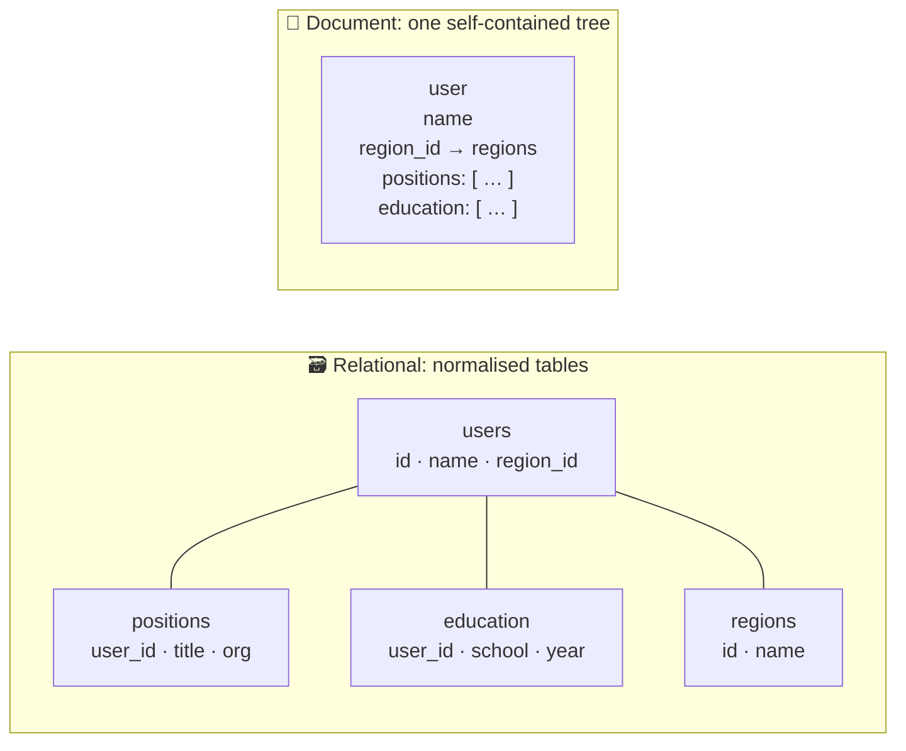
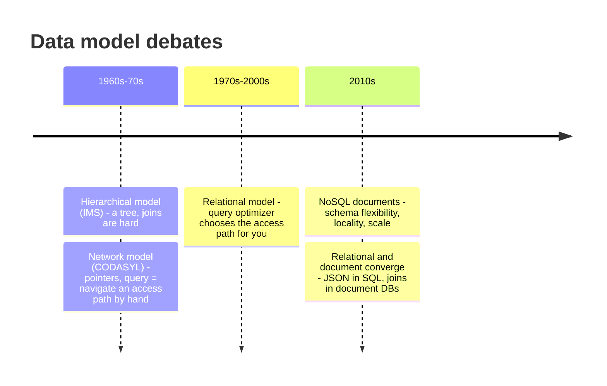
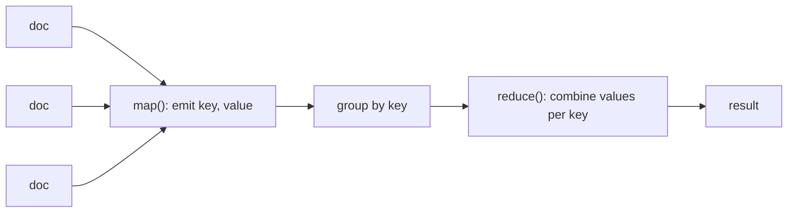
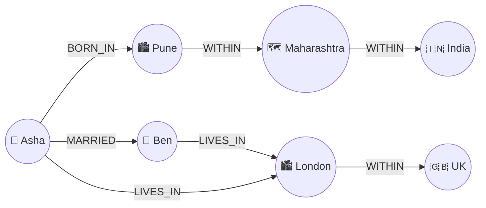
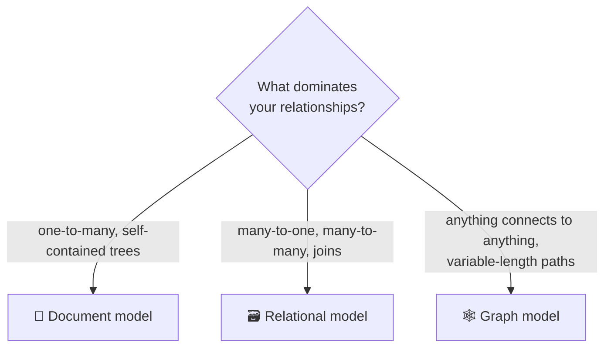

# 2 · Data models and query languages

> **In one line:** the data model shapes how you think about the problem. Relational, document and graph models each make some relationships easy and others painful.

<BookRef pages="49–89" section="Chapter 2" />

Every layer of software represents data in terms of the layer below it: app objects → JSON/tables/graphs → bytes on disk → electrical signals. Each layer hides the complexity beneath with a clean model.

## 2.1 Relational vs document

<BookRef pages="50–64" section="Relational Model Versus Document Model" />

### The same résumé, two ways



- A résumé is mostly a **tree** (one-to-many): one user → many jobs → many details. A document stores the whole tree together. That gives **locality**: one read loads everything.
- As soon as things refer to each other (**many-to-one** like "region", **many-to-many** like "people who worked at the same company"), documents get awkward. You need joins, and document databases traditionally have weak join support.

### Why normalise? IDs vs copied text

Storing `region_id = 42` instead of the text `"Greater Seattle Area"` means:
- one place to update, no inconsistent spellings
- easy localisation and better search
- the cost: something has to **join** to show the name

### History repeats



The relational model won because the **query optimizer** picks the access path for you. In the network model, every app had to navigate pointers by hand.

### Which one fits?

| Choose **document** when… | Choose **relational** when… |
|---|---|
| Data is a tree loaded all at once | Many-to-one and many-to-many relationships matter |
| Records are heterogeneous | You need joins and ad-hoc queries |
| Schema changes often | Strong integrity constraints |
| You need locality for big reads | You update small parts of large records often |

### Schema-on-read vs schema-on-write

| | Schema-on-write (relational) | Schema-on-read (document) |
|---|---|---|
| Analogy | Static type checking | Dynamic type checking |
| Changing a field format | `ALTER TABLE` + migrate (`UPDATE`) | App handles both old and new shapes when reading |
| Good for | Uniform data, enforced structure | Heterogeneous data, structure set by external systems |

<KeyIdea>"Schemaless" is misleading. There is always an implicit schema; the question is whether the database enforces it on write, or your code assumes it on read.</KeyIdea>

## 2.2 Query languages

<BookRef pages="64–71" section="Query Languages for Data" />

| Style | You say | Who chooses how | Examples |
|---|---|---|---|
| **Imperative** | *How* to compute it, step by step | You | Loops in app code, DOM manipulation |
| **Declarative** | *What* result you want | The engine (can optimise, parallelise) | SQL, CSS selectors, Cypher |

```sql
-- Declarative: the engine is free to use indexes or run in parallel
SELECT * FROM animals WHERE family = 'Sharks';
```

**MapReduce querying** sits in between: you write two small pure functions (`map`, `reduce`) and the framework distributes them. It works but is clunky, which is why many document stores added declarative aggregation pipelines.



## 2.3 Graph-like data models

<BookRef pages="71–85" section="Graph-Like Data Models" />

When **many-to-many** relationships are the main thing (social networks, road maps, fraud rings, knowledge bases), model the data as a graph: **vertices** (nodes) and **edges** (relationships).



Query: *"find people who were born in India and live in Europe"*. The `WITHIN` chain can be any length, so you need **variable-length traversal**.

### Two graph flavours

| | Property graph | Triple store |
|---|---|---|
| Unit | Vertex and edge, each with properties | `(subject, predicate, object)` |
| Example | Neo4j | RDF stores, Datomic |
| Query languages | Cypher, Gremlin | SPARQL, Datalog |

```text
-- Cypher-style (illustrative)
MATCH (p:Person)-[:BORN_IN]->()-[:WITHIN*0..]->(:Country {name:'India'}),
      (p)-[:LIVES_IN]->()-[:WITHIN*0..]->(:Continent {name:'Europe'})
RETURN p.name
```

The same query in SQL needs a **recursive common table expression** (`WITH RECURSIVE`), which is possible but much longer.

**Datalog** builds queries from small rules that combine, a bit like functions. It's less convenient for one-off queries, but scales well to complex ones.



## Summary

| Model | Strength | Weakness |
|---|---|---|
| Hierarchical / document | Locality, flexible schema, maps to objects | Weak joins, many-to-many is awkward |
| Relational | Joins, optimizer, integrity | Impedance mismatch with objects, rigid migrations |
| Graph | Arbitrary connections, path queries | Overkill for simple, tree-shaped data |

## 🧠 Check yourself

<Quiz question="Why did the relational model beat the network (CODASYL) model?" options={["It was faster on disk", "The query optimizer chooses access paths, so apps don't hand-navigate pointers", "It had no schema", "It supported JSON"]} answer={1} explain="Declarative queries plus an optimizer meant adding an index didn't require rewriting application code." />

<Quiz question="You store a product catalogue where each category has very different attributes, and pages always load one whole product. Best fit?" options={["Graph", "Document", "Relational with one column per attribute", "Key-value only"]} answer={1} explain="Heterogeneous, self-contained records that are read all at once fit the document model's flexibility and locality." />

<Quiz question="Schema-on-read is most like…" options={["Static typing", "Dynamic typing", "No typing", "Strong typing"]} answer={1} explain="Structure is only interpreted when data is read, just like a dynamically typed language checks types at runtime." />

**Interview prompts**
- Model LinkedIn profiles. What goes in a document, and what needs references?
- How would you find "friends of friends who live in my city" in SQL vs a graph database?
