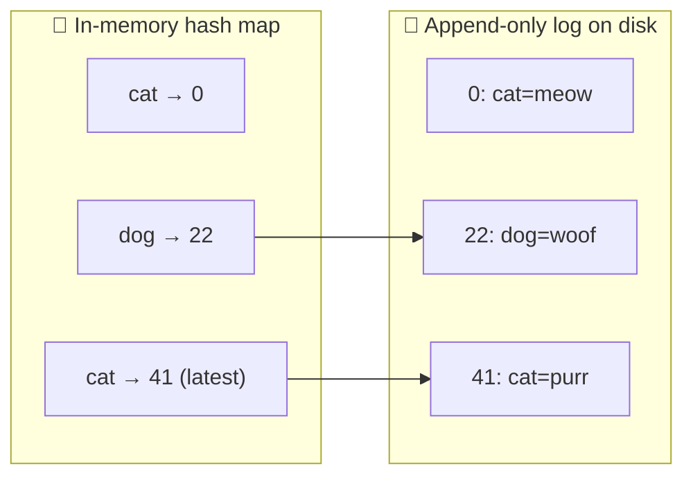
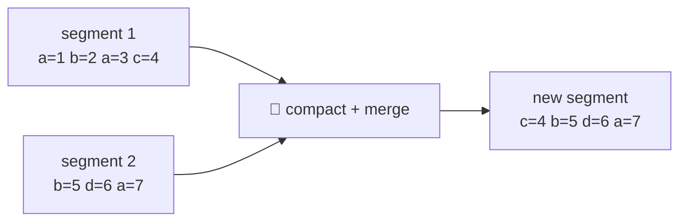
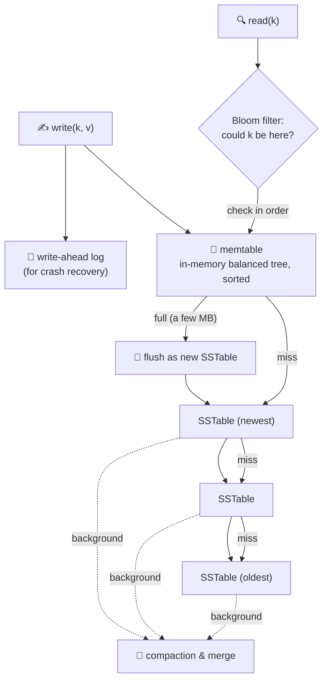
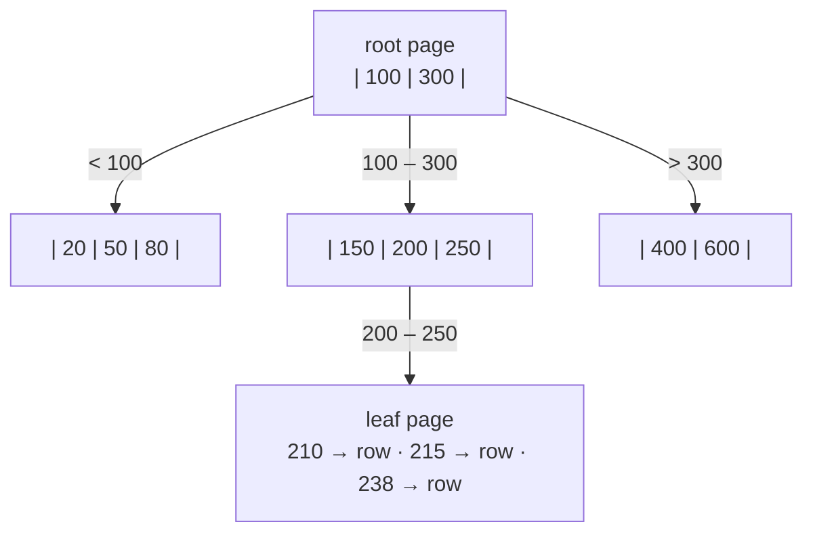
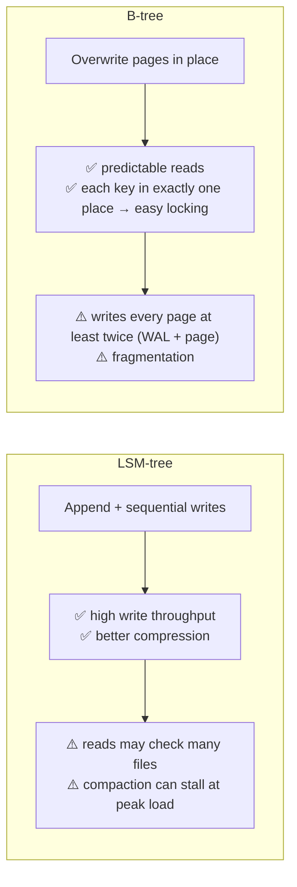
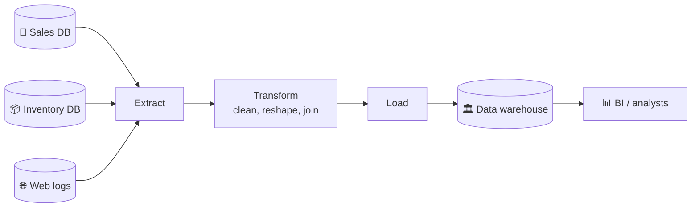
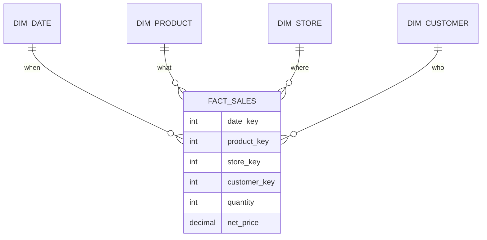
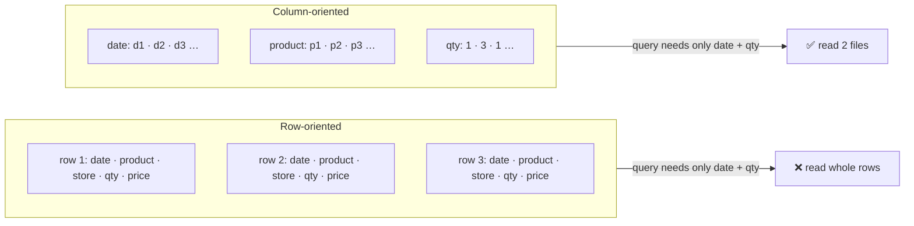
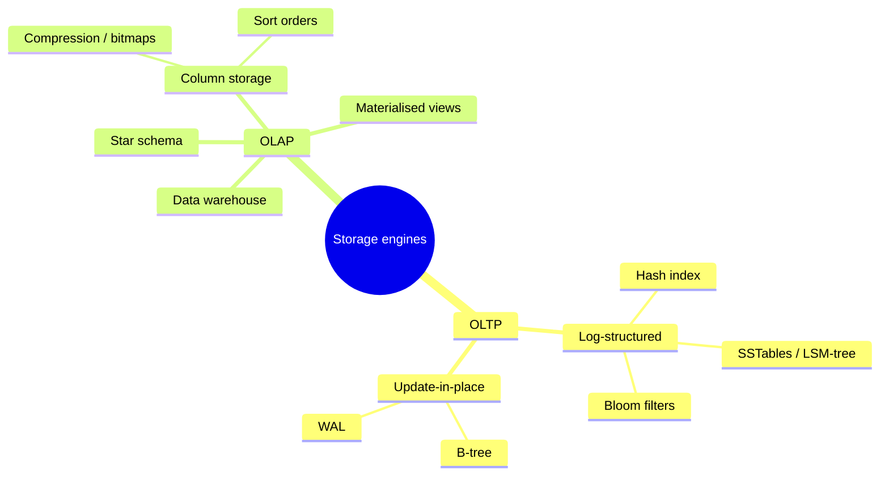

# 3 · Storage and retrieval

> **In one line:** a database does two things: store data and find it again. There are two big families of storage engine: **log-structured** (append, then merge) and **page-oriented** (B-trees, update in place). Workloads split into **OLTP** and **OLAP**.

<BookRef pages="91–131" section="Chapter 3" />

## 3.1 The simplest database: an append-only log

<BookRef pages="92–95" section="Data Structures That Power Your Database" />

- `set(key, value)`: append `key,value` to the end of a file. Very fast, because sequential writes are cheap.
- `get(key)`: scan the whole file for the last entry with that key. O(n), which is terrible.

An **index** is an extra structure, derived from the data, that speeds up reads. Every index **slows down writes**, because each write must also update the index. That's why databases don't index everything by default.

## 3.2 Hash indexes

<BookRef pages="95–99" section="Hash Indexes" />

Keep an in-memory hash map: `key → byte offset in the log file`.



**Stopping the log from growing forever:** split it into **segments**. Background **compaction** keeps only the latest value per key and merges segments.



| Detail | How it's handled |
|---|---|
| Deletes | Append a **tombstone** record. Merge drops the key. |
| Crash recovery | Rebuild the hash map by reading segments, or load a snapshot of it |
| Half-written records | Checksums detect and ignore them |
| Concurrency | One writer thread. Segments are immutable, so many readers are safe. |
| **Limits** | All keys must fit in RAM. Range queries are slow. |

## 3.3 SSTables and LSM-trees

<BookRef pages="99–103" section="SSTables and LSM-Trees" />

**SSTable** (Sorted String Table): a segment file where keys are **sorted** and each key appears once per segment.

Why sorting helps:
1. **Merging is a mergesort.** Read files side by side and take the newest value for each key. Works even when files are larger than memory.
2. **Sparse index.** You only need some keys in memory. Find the nearest keys before and after, then scan that small range.
3. **Compression.** Records between index points can be compressed as a block.

### How an LSM-tree engine writes and reads



- **Bloom filter:** a small memory structure that can say "definitely not here", so lookups for missing keys skip most files.
- **Compaction strategies:**
  - **size-tiered:** merge newer, smaller tables into older, bigger ones
  - **leveled:** key ranges split into levels; less disk space, more incremental

Used by LevelDB, RocksDB, Cassandra, HBase and Lucene (for its term dictionary).

## 3.4 B-trees

<BookRef pages="103–108" section="B-Trees" />

The most widely used index structure. It breaks the database into fixed-size **pages** (often 4 KB) and **updates them in place**.



- **Branching factor** is usually several hundred, so a 4-level tree of 4 KB pages can hold ~250 TB. Lookups are O(log n) with very few disk reads.
- **Insert into a full page:** split it into two half-full pages and update the parent.
- **Crash safety:** a split overwrites several pages. A crash halfway corrupts the tree, so B-trees use a **write-ahead log (WAL)**: write the intended change to an append-only log first, then apply it.
- **Concurrency:** **latches** (lightweight locks) protect pages while threads change them.
- **Optimisations:**
  - copy-on-write pages instead of WAL
  - abbreviated keys in interior pages
  - keep leaf pages in key order on disk
  - sibling pointers between leaves for fast range scans

## 3.5 B-trees vs LSM-trees

<BookRef pages="108–111" section="Comparing B-Trees and LSM-Trees" />



| | LSM-tree | B-tree |
|---|---|---|
| Writes | Faster (sequential, lower write amplification usually) | Slower (random page writes + WAL) |
| Reads | Can be slower (several structures to check) | Faster, predictable |
| Disk space | Smaller after compaction | Some unused space inside pages |
| Tail latency | Compaction can interfere | More predictable |
| Transactions | Harder | Easy: key lives in one place, so you can lock ranges |

**Write amplification:** one logical write turns into several physical writes over the data's lifetime. This matters on SSDs, which wear out after a limited number of writes.

## 3.6 Other index types

<BookRef pages="111–117" section="Other Indexing Structures" />

| Index | What it's for |
|---|---|
| **Secondary index** | Index on a non-unique column. Store a list of matching row IDs, or make keys unique by appending the row ID. |
| **Clustered index** | Row stored inside the index itself (e.g. the primary key in InnoDB) |
| **Heap file + pointers** | Index stores a pointer to the row's location in an unordered file. Avoids copying rows. |
| **Covering index** | Stores *some* columns in the index so certain queries need no extra lookup |
| **Concatenated (multi-column)** | `(last_name, first_name)`. Works only for prefix queries. |
| **Multi-dimensional** | Geo queries (lat AND lon in range) via R-trees or space-filling curves |
| **Full-text / fuzzy** | Search within edit distance, synonyms (Lucene: a trie-like automaton over terms) |
| **In-memory DB** | Faster not because it skips disk reads, but because it skips **encoding** data into disk-friendly formats. Allows richer structures (Redis sets, queues). |

## 3.7 OLTP vs OLAP

<BookRef pages="112–117" section="Transaction Processing or Analytics?" />

| | OLTP (transactions) | OLAP (analytics) |
|---|---|---|
| Read pattern | Few rows by key | Aggregate over millions of rows |
| Write pattern | Random, low-latency writes from users | Bulk import (ETL) or event stream |
| Users | End users through an app | Analysts, BI dashboards |
| Data | Current state | History of events |
| Size | GB – TB | TB – PB |
| Bottleneck | Disk seek time | Disk bandwidth |

### Data warehouse

Analysts shouldn't run heavy queries on the OLTP database. Instead, copy the data into a separate **warehouse** with **ETL**.



### Star schema

A big **fact table** of events (each sale) surrounded by **dimension tables** (who, what, where, when). It's called a **snowflake** schema if the dimensions are themselves normalised further.



## 3.8 Column-oriented storage

<BookRef pages="117–125" section="Column-Oriented Storage" />

Fact tables can have hundreds of columns, but a query usually touches 4 or 5 of them. Row storage forces you to read every column of every row. **Column storage** stores each column in its own file, and the *k*-th entry of every column file belongs to row *k*.



- **Compression:** columns repeat a lot. **Bitmap encoding** with **run-length encoding** makes them tiny, and you can `AND`/`OR` bitmaps directly to evaluate `WHERE` clauses.

```text
product_id column:  69 69 69 74 31 31 31 31 29
bitmap for 31:      0  0  0  0  1  1  1  1  0
run-length:         4 zeros, 4 ones, 1 zero  →  "4,4,1"
```

- **Vectorised processing:** tight loops over compressed column chunks that fit in CPU cache, with SIMD instructions.
- **Sort order:** sort all columns together by the most common filter (e.g. date). Store a few **different sort orders** on replicas you need anyway.
- **Writing:** in-place updates are hard. Use an LSM-like approach: buffer writes in memory, then merge into column files in bulk.
- **Materialised views / data cubes:** precompute aggregates such as `SUM(sales)` grouped by date × product. Queries are very fast, but you lose flexibility.

<KeyIdea>OLTP engines are optimised to find a few rows fast (indexes, seek time). Analytics engines are optimised to scan many rows fast (columns, compression, bandwidth).</KeyIdea>

## Summary



## 🧠 Check yourself

<Quiz question="Why can an SSTable use a sparse in-memory index?" options={["Keys are hashed", "Keys are sorted, so you can find the range between two known keys and scan it", "Values are small", "It uses a Bloom filter instead"]} answer={1} explain="Sorted keys let you jump to the nearest indexed key and scan a small block." />

<Quiz question="Which structure makes it easiest to lock a key range for transactions?" options={["LSM-tree", "B-tree", "Hash index", "Bloom filter"]} answer={1} explain="In a B-tree each key exists in exactly one place, so range locks attach directly to the tree." />

<Quiz question="A query scans 1 billion rows but only uses 3 of 200 columns. Best storage layout?" options={["Row-oriented with a B-tree", "Column-oriented", "Hash index", "Graph store"]} answer={1} explain="Column storage reads only the 3 needed column files, and they compress well." />

<Quiz question="What does a Bloom filter tell you?" options={["Exactly where a key is", "That a key is definitely not in a file (or might be)", "The newest version of a key", "How many keys exist"]} answer={1} explain="No false negatives, possible false positives, so it can skip files that definitely don't contain the key." />

**Interview prompts**
- You need a write-heavy time-series store. LSM or B-tree? Why?
- Why shouldn't analysts query the production Postgres directly?
- Explain write amplification and why SSD wear makes it matter.
