# 3 · Storage and retrieval

> **In one line:** a database does two things: store data and find it again. There are two big families of storage engine, **log-structured** (append, then merge) and **page-oriented** (B-trees, update in place), and two big workload types, **OLTP** and **OLAP**, which need very different engines.

<BookRef pages="91–131" section="Chapter 3" />

Chapter 2 was about the data model, the format in which *you* give the database data and the mechanism by which you ask for it back. This chapter is the same discussion from the **database's point of view**: how it stores the data and how it finds it again.

Why should an app developer care about storage internals? You won't implement a storage engine, but you **do** need to choose one that fits your application from the many available. To tune an engine for your workload, you need a rough idea of what it does under the hood. In particular, engines optimised for **transactional** workloads differ hugely from those optimised for **analytics**.

## 3.1 Data structures that power your database

<BookRef pages="92–94" section="Data Structures That Power Your Database" />

Imagine the simplest possible key-value database, a few lines of Python:

```python
def put(key, value):
    with open("data.log", "a") as f:          # always append, never overwrite
        f.write(f"{key}\t{value}\n")

def get(key):
    result = None
    with open("data.log") as f:
        for line in f:                        # scan the whole file…
            k, v = line.rstrip("\n").split("\t", 1)
            if k == key:
                result = v                    # …and keep the LAST match
    return result

put("user:7", '{"plan":"free"}')
put("user:7", '{"plan":"pro"}')
get("user:7")   # -> '{"plan":"pro"}'
```

- The storage format is a text file where each line is a key-value pair. Every `put` **appends** to the end; old versions aren't overwritten. `db_get` looks for the **last** occurrence of the key.
- `put` has **pretty good performance**, because appending to a file is generally very efficient. Many databases internally use a **log**: an append-only data file. (Real ones also handle concurrency, reclaim disk space so the log doesn't grow forever, and handle errors and partially written records.)

> Here **log** means "an append-only sequence of records". It needn't be human-readable; it might be binary and intended only for other programs.

- `get` has **terrible performance** with many records: it scans the whole file. In algorithmic terms, lookup is **O(n)**. Double the records, double the lookup time.

To find a key efficiently we need an **index**: an *additional* structure derived from the primary data. The idea is to keep extra metadata on the side that acts as a signpost.

<KeyIdea>**The fundamental trade-off:** well-chosen indexes speed up read queries, but **every index slows down writes**, because the index must also be updated on every write. Simply appending to a file is hard to beat for write performance. That's why databases **don't index everything by default**: you, the developer or admin, choose indexes manually, using your knowledge of the app's typical query patterns.</KeyIdea>

### Hash indexes

<BookRef pages="94–98" section="Hash Indexes" />

Key-value stores are quite similar to the dictionary type in most languages, usually implemented as a hash map. Since we already have in-memory hash maps, why not use them to index data on disk?

**Simplest strategy:** keep an in-memory hash map where every key maps to a **byte offset** in the data file, the location where the value can be found.

- Append a new key-value pair → also update the hash map with the offset of the data you just wrote. (This works both for new keys and for updating existing ones.)
- Look up a value → use the hash map to find the offset, **seek** to that location and read the value.

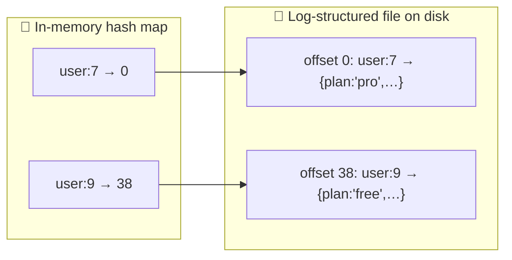

This sounds simplistic, but it's a viable approach. It's essentially what **Bitcask** (the default storage engine in Riak) does. Bitcask offers high-performance reads and writes, as long as **all keys fit in available RAM**. Values can use more space than memory, since they're loaded from disk with one seek. If that part of the file is already in the filesystem cache, a read needs no disk I/O at all.

**Good fit:** workloads where the **value for each key is updated frequently**. Example: the key is a post ID and the value is its like count, incremented every time someone taps ❤️. There are many writes, but not too many distinct keys.

#### Avoiding running out of disk: segments + compaction

Since we only ever append to a file, how do we avoid eventually running out of disk space?

1. **Break the log into segments** of a certain size: close a segment file when it reaches a certain size and make subsequent writes to a new segment file.
2. **Compaction**: throw away duplicate keys in the log and keep only the **most recent** update for each key.
3. Compaction often makes segments much smaller (a key is often overwritten many times within one segment), so you can also **merge several segments together** while compacting.
4. Segments are **never modified** after being written, so the merged segment is written to a **new file**. Merging and compaction run in a **background thread**, and meanwhile you keep serving reads using the old segments and writes to the latest one. When merging is done, switch reads to the new merged segment and delete the old ones.

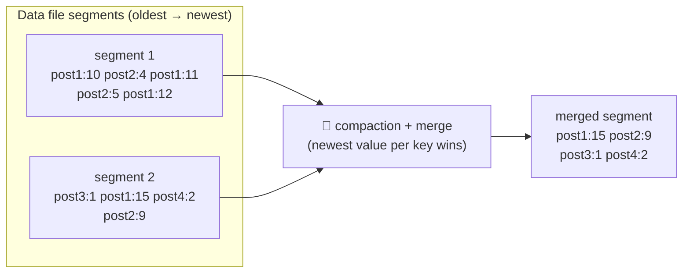

Each segment now has its **own in-memory hash table**. To find a key, check the most recent segment's hash map first; if the key isn't there, check the second most recent, and so on. Merging keeps the number of segments small, so lookups don't need many hash maps.

#### Implementation details that matter

| Issue | How it's handled |
|---|---|
| **File format** | CSV isn't the best. A **binary format** that first encodes the length of a string in bytes, followed by the raw string (no escaping needed), is faster and simpler. |
| **Deleting records** | Append a special deletion record, a **tombstone**. During merging, the tombstone tells the merge to discard any previous values for the deleted key. |
| **Crash recovery** | If the DB restarts, the in-memory hash maps are lost. You could rebuild them by reading every segment from start to end, but that's slow for large segments. Bitcask speeds this up by storing a **snapshot of each segment's hash map on disk**, which loads quickly. |
| **Partially written records** | The DB can crash halfway through appending a record. Bitcask files include **checksums**, so corrupted parts of the log are detected and ignored. |
| **Concurrency control** | Writes are appended in strictly sequential order, so a common choice is **one writer thread**. Data segments are append-only and otherwise immutable, so they can be **read concurrently** by many threads. |

#### Why append-only instead of overwriting in place?

An append-only log looks wasteful at first: why not update the file in place, overwriting the old value? But append-only turns out to be a good design for several reasons:

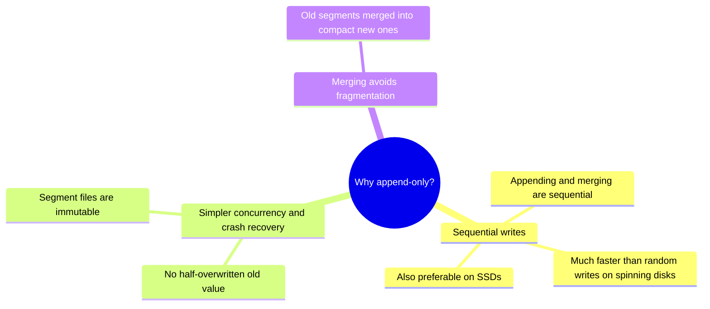

#### Limitations of the hash table index

- **The hash table must fit in memory.** With a very large number of keys, you're out of luck. You could keep a hash map on disk, but it's hard to make perform well: it needs lots of random-access I/O, is expensive to grow when it becomes full, and hash collisions need fiddly logic.
- **Range queries are inefficient.** You can't easily scan all keys between `kitty00000` and `kitty99999`; you have to look up each key individually in the hash maps.

The next index structure has neither limitation.

### SSTables and LSM-trees

<BookRef pages="98–101" section="SSTables and LSM-Trees" />

Make one simple change to the segment files: require that **the sequence of key-value pairs is sorted by key**. This format is called a **Sorted String Table**, or **SSTable**. We also require that **each key appears only once** within each merged segment file (compaction already ensures that).

SSTables have several big advantages over log segments with hash indexes:

**① Merging segments is simple and efficient, even if the files are bigger than memory.** The approach is like the one used in the **mergesort** algorithm: read the input files side by side, look at the first key in each file, copy the lowest key (according to the sort order) to the output file, and repeat. This produces a new merged segment file, also sorted by key. If the same key appears in several input segments, keep the value from the **most recent** segment and discard the older ones.

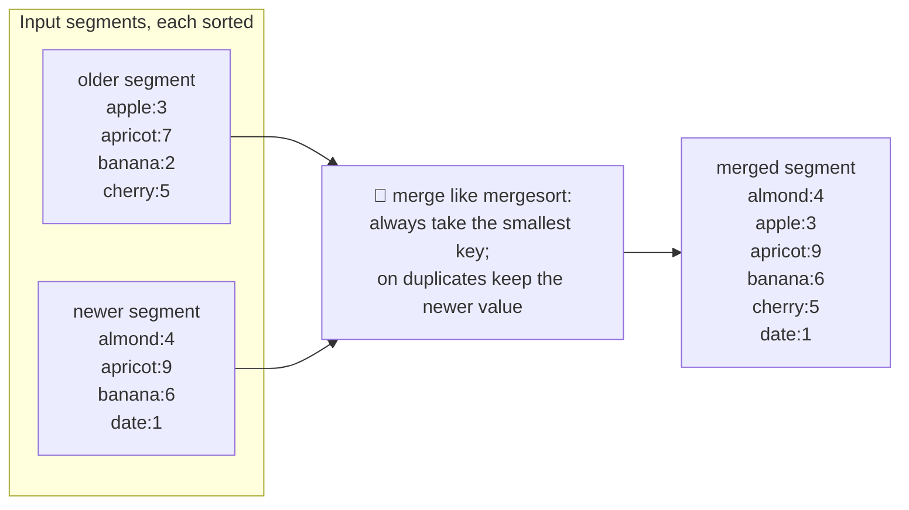

**② You no longer need to keep an index of all keys in memory.** Say you're looking for `blueberry`, but you don't know its exact offset. You do know the offsets of `banana` and `cherry`, and because of the sorting, `blueberry` must appear **between those two**. Jump to the offset for `banana` and scan from there until you find it (or establish it's not in the file).

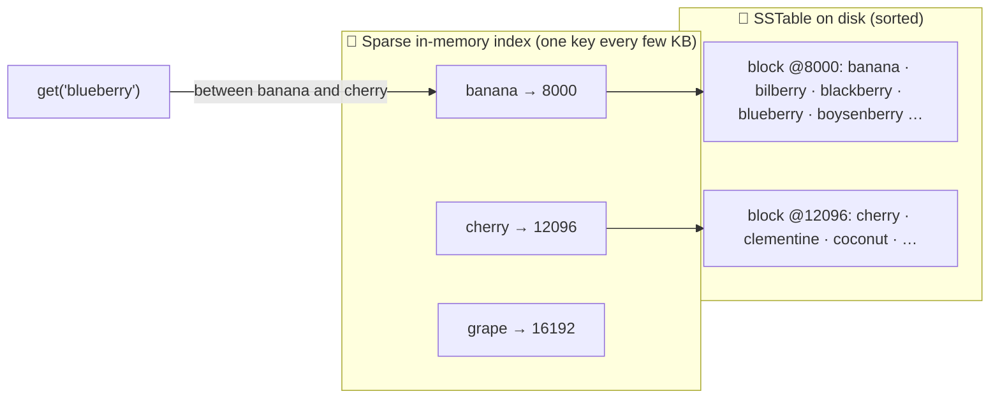

You still need an in-memory index to tell you the offsets for some of the keys, but it can be **sparse**: one key for every few kilobytes of segment file is enough, because a few KB can be scanned very quickly.

**③ Compression.** Since read requests need to scan over several key-value pairs in the requested range anyway, you can **group those records into a block and compress it** before writing to disk. Each entry of the sparse index then points at the start of a compressed block. Besides saving disk space, compression also **reduces I/O bandwidth** use.

#### Constructing and maintaining SSTables

How do you get your data sorted by key in the first place? Incoming writes can arrive in any order.

Maintaining a sorted structure **on disk** is possible (B-trees, next section), but maintaining it **in memory** is much easier. There are plenty of well-known tree data structures, such as **red-black trees** or **AVL trees**, where you can insert keys in any order and read them back in sorted order.

The storage engine then works like this:

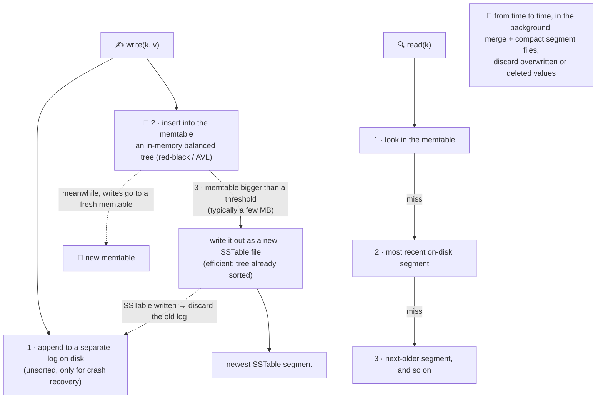

This scheme works very well. It has one problem: if the database crashes, the most recent writes (in the memtable but not yet written to disk) are lost. That's why **every write is also immediately appended to a separate log on disk**. That log is not sorted, but that doesn't matter: its only purpose is to **restore the memtable after a crash**. Every time the memtable is written out to an SSTable, the corresponding log can be discarded.

#### Making an LSM-tree out of SSTables

This algorithm is essentially what's used in **LevelDB** and **RocksDB** (key-value engine libraries designed to be embedded in other apps; LevelDB can be used in Riak as an alternative to Bitcask). Similar engines are used in **Cassandra and HBase**, both inspired by Google's **Bigtable** paper, which introduced the terms *SSTable* and *memtable*.

The indexing structure was originally described as the **Log-Structured Merge-Tree (LSM-tree)**, building on earlier work on log-structured filesystems. Storage engines based on this principle of merging and compacting sorted files are often called **LSM storage engines**.

**Lucene**, the indexing engine for full-text search used by Elasticsearch and Solr, uses a similar method for its **term dictionary**. A full-text index is more complex than a key-value index but based on a similar idea: given a word in a search query, find all documents (web pages, product descriptions…) that mention it. This is a key-value structure where the **key is a word (term)** and the **value is the list of IDs of all documents containing the word** (the *postings list*). In Lucene, this mapping from term to postings list is kept in SSTable-like sorted files, merged in the background as needed.

#### Performance optimisations

**Bloom filters.** The LSM-tree algorithm can be slow when looking up **keys that don't exist** in the database: you check the memtable, then the segments all the way back to the oldest (possibly reading each from disk) before you can be sure the key doesn't exist. A **Bloom filter** is a memory-efficient data structure for approximating the contents of a set. It can tell you if a key **does not appear** in the database, saving many unnecessary disk reads for nonexistent keys.

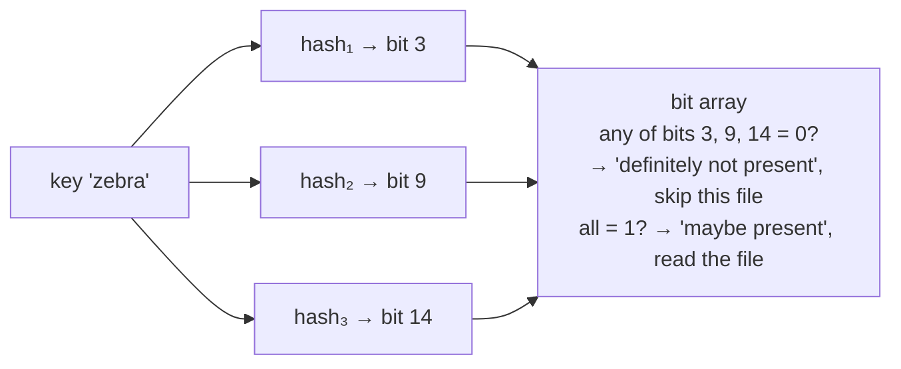

**Compaction strategies.** Different strategies decide the order and timing of compaction and merging:

| Strategy | How it works | Used by |
|---|---|---|
| **Size-tiered** | Newer and smaller SSTables are successively merged into older and larger SSTables | HBase; Cassandra supports both |
| **Leveled** | The key range is split into smaller SSTables, and older data is moved into separate "levels". Compaction can proceed more incrementally and use less disk space. | LevelDB (hence the name), RocksDB; Cassandra supports both |

<KeyIdea>The basic idea of LSM-trees, keeping a cascade of SSTables that are merged in the background, is simple and effective. It keeps working when the dataset is **much bigger than available memory**. Because data is stored in sorted order, **range queries** are efficient (scan all keys above some minimum and up to some maximum). And because disk writes are **sequential**, LSM-trees can support **remarkably high write throughput**.</KeyIdea>

### B-trees

<BookRef pages="101–105" section="B-Trees" />

The log-structured indexes above are gaining acceptance, but they're not the most common type of index. The **most widely used** indexing structure is quite different: the **B-tree**.

Introduced in 1970 and called "ubiquitous" less than 10 years later, B-trees have stood the test of time very well. They remain the **standard index implementation in almost all relational databases**, and many non-relational databases use them too.

Like SSTables, B-trees **keep key-value pairs sorted by key**, which allows efficient key-value lookups and range queries. That's where the similarity ends: B-trees have a very different design philosophy.

| | Log-structured (LSM) | B-tree |
|---|---|---|
| Unit | Variable-size **segments** (several MB or more), always written sequentially | Fixed-size **blocks or pages**, traditionally **4 KB** (sometimes bigger) |
| Writes | Append; never modify a file once written | Read or write **one page at a time**, overwrite in place |
| Fit to hardware | | Corresponds closely to the underlying hardware, since disks are also arranged in fixed-size blocks |

Each page can be identified by an address or location, which lets one page **refer to another**, similar to a pointer, but on disk instead of in memory. These page references build a **tree of pages**:

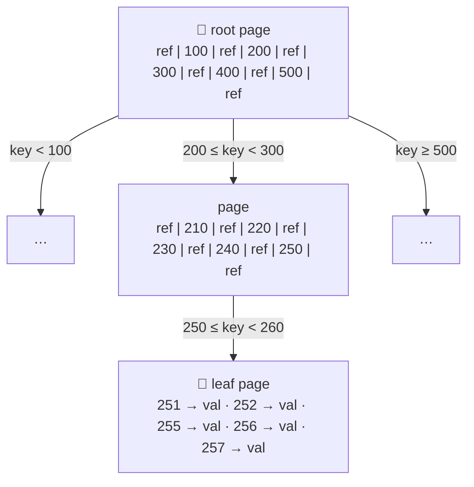

- One page is designated the **root** of the B-tree. Whenever you look up a key in the index, you start there.
- Each page contains several keys and references to child pages. Each child is responsible for a **continuous range of keys**, and the keys between the references indicate where the boundaries between those ranges lie.
- Example: looking for key **251**. Follow the reference between the boundaries 200 and 300, which leads to a page that further breaks 200–300 into subranges. Eventually you reach a page with individual keys (a **leaf page**), which either contains each key's value **inline** or contains **references to the pages where the values can be found**.

The number of references to child pages in one page is the **branching factor**. In practice it depends on the space needed for page references and range boundaries, but it's typically **several hundred**.

#### Updating and inserting

- **Update the value of an existing key:** search for the leaf page containing that key, change the value in that page, and **write the page back to disk**. Any references to that page stay valid.
- **Add a new key:** find the page whose range includes the new key and add it there. If there isn't enough free space in the page, **split it into two half-full pages** and update the parent page to account for the new subdivision of key ranges.

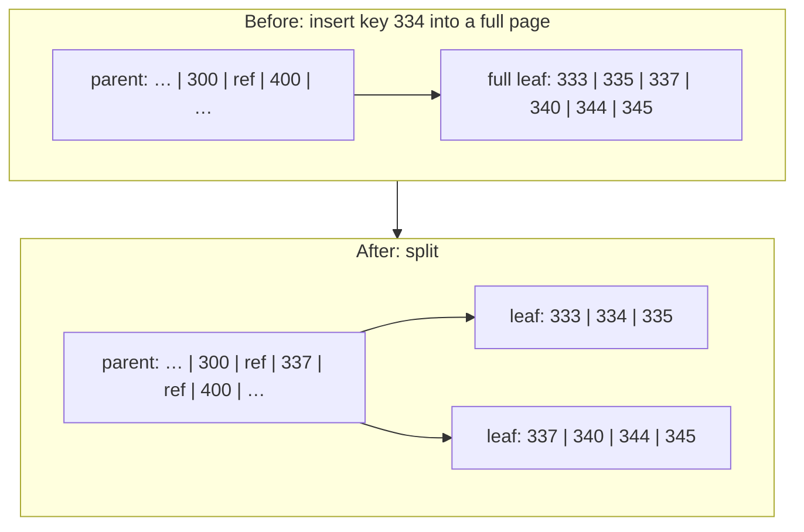

This algorithm keeps the tree **balanced**: a B-tree with *n* keys always has a depth of **O(log n)**. Most databases fit into a B-tree that's **three or four levels deep**, so you don't need to follow many page references to find the page you're looking for.

> **Scale check:** a four-level tree of 4 KB pages with a branching factor of 500 can store up to **256 TB**.

#### Making B-trees reliable

The basic underlying write operation of a B-tree is to **overwrite a page on disk with new data**. It's assumed that the overwrite doesn't change the location of the page: all references to that page stay intact when it's overwritten. This is in stark contrast to log-structured indexes like LSM-trees, which only append to files (and eventually delete obsolete files) but **never modify files in place**.

You can think of overwriting a page on disk as an actual hardware operation:
- on a **magnetic hard drive**: move the disk head to the right place, wait for the right position on the spinning platter to come around, then overwrite the sector with new data,
- on **SSDs**, it's more complicated: an SSD must erase and rewrite fairly large blocks of a storage chip at a time.

Some operations require **several different pages to be overwritten**. Splitting a page because an insertion caused it to be overfull means writing the two split pages **and** overwriting their parent to update the references. This is dangerous: if the database crashes after only some of the pages have been written, you end up with a **corrupted index** (e.g. an **orphan page** that isn't a child of any parent).

| Problem | Solution |
|---|---|
| **Crash halfway through a multi-page write** | A **write-ahead log (WAL)**, also called a *redo log*: an append-only file to which every B-tree modification must be written **before** it can be applied to the pages of the tree itself. When the DB comes back after a crash, this log restores the B-tree to a consistent state. |
| **Concurrency**: multiple threads accessing the B-tree at the same time may see the tree in an inconsistent state | Protect the tree's data structures with **latches** (lightweight locks). Log-structured approaches are simpler here, because merging happens in the background without interfering with incoming queries, and old segments are atomically swapped for new ones from time to time. |

#### B-tree optimisations

As B-trees have been around so long, many optimisations have been developed over the years:

| Optimisation | Idea |
|---|---|
| **Copy-on-write instead of WAL** | Some databases (e.g. LMDB) use a copy-on-write scheme instead of overwriting pages and keeping a WAL. A modified page is written to a **different location**, and a new version of the parent pages in the tree is created, pointing at the new location. Also useful for **concurrency control** (snapshot isolation, chapter 7). |
| **Abbreviated keys** | Save space in pages by not storing the entire key. Interior pages only need enough of the key to act as **boundaries between key ranges**. Packing more keys into a page gives a **higher branching factor**, and so fewer levels. (This variant is sometimes called a B+ tree, although the optimisation is so common that it often isn't distinguished from other B-tree variants.) |
| **Sequential leaf layout** | Pages can be anywhere on disk, so a range scan over sorted keys may need a disk seek for every page read. Many B-tree implementations try to **lay out the tree so that leaf pages appear in sequential order** on disk. That's hard to keep up as the tree grows; LSM-trees have an advantage here, because they rewrite large segments in one go during merging, so it's easier to keep sequential keys close together on disk. |
| **Sibling pointers** | Extra pointers in the tree: each leaf page may have references to its **sibling pages to the left and right**, which allows scanning keys in order without jumping back to parent pages. |
| **Fractal trees** | B-tree variants borrow some log-structured ideas to **reduce disk seeks** (nothing to do with fractals). |

### Comparing B-trees and LSM-trees

<BookRef pages="105–107" section="Comparing B-Trees and LSM-Trees" />

As a rule of thumb, **LSM-trees are typically faster for writes**, whereas **B-trees are thought to be faster for reads**. Reads are typically slower on LSM-trees because they have to check several different data structures and SSTables at different stages of compaction. Benchmarks are often inconclusive and sensitive to workload details, though: **test with your particular workload**.

#### Advantages of LSM-trees

**Write amplification.** A B-tree index must write every piece of data **at least twice**: once to the WAL and once to the tree page itself (and again as pages are split). There's also overhead from having to write an **entire page at a time**, even if only a few bytes in that page changed. Some engines even overwrite the same page twice to avoid ending up with a partially updated page after a power failure.

Log-structured indexes also rewrite data multiple times, because of repeated compaction and merging of SSTables. This effect, one write to the database causing multiple writes to disk over the database's lifetime, is called **write amplification**. It's of particular concern on **SSDs**, which can only overwrite blocks a limited number of times before wearing out.

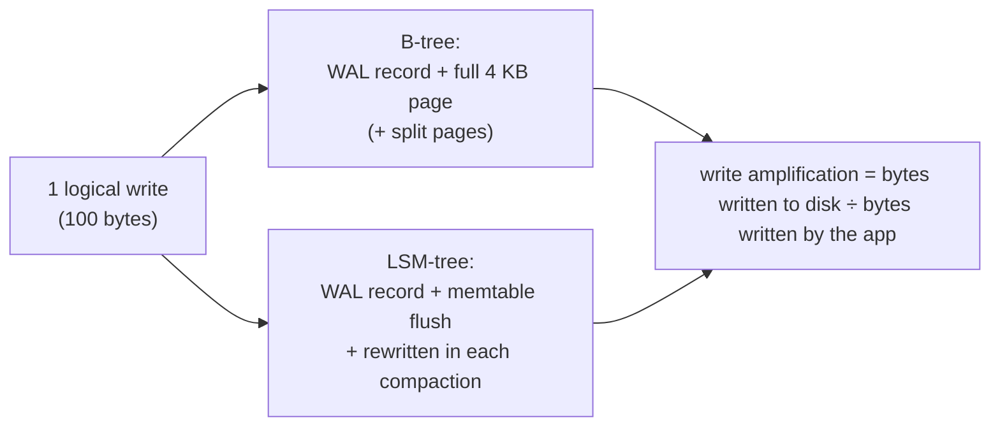

| | Why LSM-trees often win |
|---|---|
| **Higher write throughput** | They sometimes have **lower write amplification** (depending on engine config and workload), and they **sequentially write** compact SSTable files rather than overwriting several pages in the tree. Especially important on magnetic hard drives, where sequential writes are much faster than random writes. |
| **Better compression** | They can be compressed better, so they often produce **smaller files on disk**. B-tree engines leave some disk space unused due to **fragmentation**: when a page is split, or when a row can't fit into an existing page, some space in a page remains unused. LSM-trees aren't page-oriented and periodically rewrite SSTables to remove fragmentation, so they have **lower storage overheads**, especially with leveled compaction. |
| **SSD friendliness** | On many SSDs, the firmware internally uses a log-structured algorithm to turn random writes into sequential writes on the storage chips, so the impact of the engine's write pattern is less pronounced. But lower write amplification and less fragmentation still help: representing data more compactly allows **more read and write requests within the available I/O bandwidth**. |

#### Downsides of LSM-trees

**Compaction can interfere with ongoing reads and writes.** Even though engines try to perform compaction incrementally without affecting concurrent access, disks have limited resources. A request can easily have to **wait while the disk finishes an expensive compaction**. The impact on throughput and average response time is usually small, but at **higher percentiles** the response time of queries to log-structured engines can sometimes be **quite high**. B-trees can be **more predictable**.

**Compaction at high write throughput.** The disk's finite write bandwidth has to be **shared** between the initial write (logging and flushing a memtable to disk) and the compaction threads running in the background. When writing to an empty database, the full disk bandwidth can be used for the initial write; the bigger the database gets, the more disk bandwidth compaction needs.

If write throughput is high and compaction isn't configured carefully, **compaction can't keep up** with the rate of incoming writes. The number of unmerged segments on disk keeps growing until you **run out of disk space**, and reads also slow down because they need to check more segment files. Typically, SSTable-based engines **don't throttle** the rate of incoming writes even if compaction can't keep up, so you need **explicit monitoring** to detect this situation.

**Transactional semantics.** An advantage of B-trees is that **each key exists in exactly one place** in the index, whereas a log-structured engine may have **multiple copies of the same key** in different segments. That makes B-trees attractive for databases that want strong transactional semantics: in many relational databases, transaction isolation is implemented using **locks on ranges of keys**, and in a B-tree those locks can be **attached directly to the tree**.

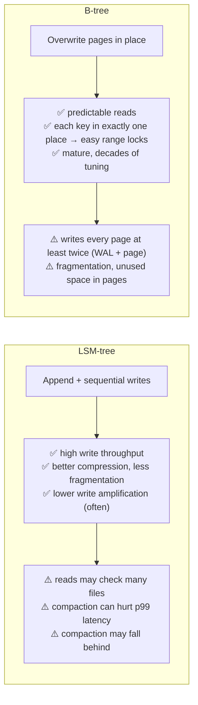

<KeyIdea>B-trees are very ingrained in database architecture and provide consistently good performance for many workloads, so they're unlikely to go away soon. In new datastores, log-structured indexes are becoming increasingly popular. There's no quick rule for which type is better for your use case: **test empirically**.</KeyIdea>

### Other indexing structures

<BookRef pages="107–112" section="Other Indexing Structures" />

So far we've discussed **key-value indexes**, like a **primary key** index in the relational model. A primary key uniquely identifies one row in a relational table, one document in a document database, or one vertex in a graph database. Other records refer to that row, document or vertex by its primary key (or ID), and the index is used to resolve such references.

**Secondary indexes** are also very common. In relational databases you can create several secondary indexes on the same table using `CREATE INDEX`, and they're often crucial for performing **joins** efficiently.

| | Primary index | Secondary index |
|---|---|---|
| Key uniqueness | Unique | **Not necessarily unique**: many rows may share the same key |
| How to handle duplicates | n/a | ① make each value in the index a **list of matching row identifiers** (like a postings list in a full-text index), or ② make each key unique by **appending a row identifier** to it |

Both B-trees and log-structured indexes can be used as secondary indexes.

#### Storing values within the index

The key in an index is the thing queries search for, but the value can be one of two things:

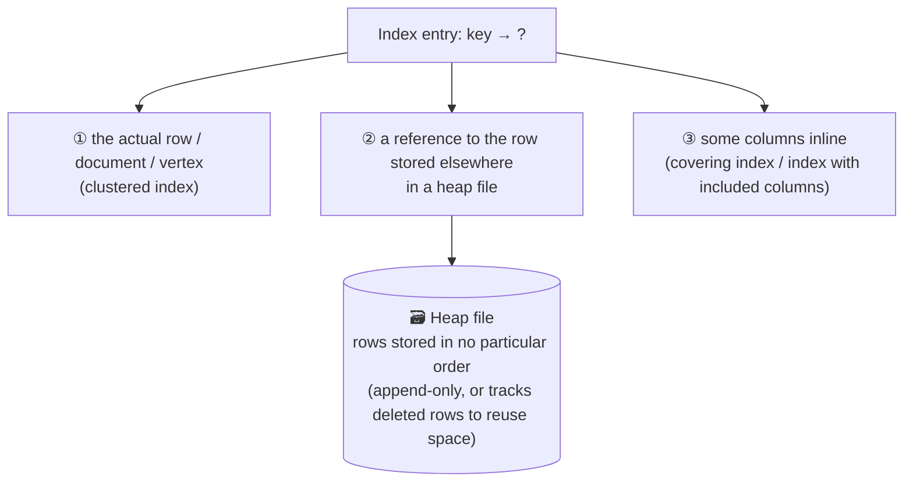

**Heap files** are common because they **avoid duplicating data** when there are multiple secondary indexes: each index just references a location in the heap file, and the actual data is kept in one place.

- **Updating a value without changing the key:** efficient if the new value is **not larger** than the old one; the record can be overwritten in place.
- **If the new value is larger:** it probably needs to move to a new location in the heap where there's enough space. Then either all indexes must be updated to point at the new heap location, or a **forwarding pointer** is left behind in the old heap location.

**Clustered index.** Sometimes the extra hop from the index to the heap file is too much of a performance penalty for reads, so it can be desirable to store the indexed **row directly within the index**. Examples:
- in **MySQL's InnoDB** engine, the primary key of a table is always a clustered index, and secondary indexes **refer to the primary key** (not a heap file location),
- in **SQL Server**, you can specify one clustered index per table.

**Covering index (index with included columns).** A compromise between clustered (all row data in the index) and non-clustered (only references in the index): it stores **some of a table's columns** within the index. Some queries can then be answered **using the index alone** (the index "covers" the query).

| | Clustered / covering indexes |
|---|---|
| ✅ | Speed up reads |
| ❌ | Need **additional storage** and add **overhead on writes** |
| ❌ | Databases need extra effort to enforce **transactional guarantees**, because applications shouldn't see inconsistencies due to the duplication |

#### Multi-column indexes

The indexes so far map **a single key to a value**. That's not enough if you need to query **multiple columns** of a table (or multiple fields in a document) simultaneously.

**Concatenated index.** The most common type of multi-column index: it combines several fields into one key by **appending one column to another**. The index definition specifies the order in which the fields are concatenated. It's like an old-fashioned paper **phone book**, an index from `(lastname, firstname)` to phone number. Because of the sort order:
- ✅ find everyone with a particular last name,
- ✅ find everyone with a particular `lastname + firstname` combination,
- ❌ **useless** for finding everyone with a particular first name.

**Multi-dimensional indexes.** A more general way of querying several columns at once, particularly important for **geospatial data**. A restaurant-search website might have a database of each restaurant's latitude and longitude. When a user views restaurants on a map, the site needs all restaurants within the rectangular map area:

```sql
SELECT * FROM restaurants
WHERE latitude  > 18.5100 AND latitude  < 18.5350
  AND longitude > 73.8400 AND longitude < 73.8700;
```

A standard B-tree or LSM-tree index can't answer this efficiently. It can give you all restaurants in a **range of latitudes** (at any longitude), or all restaurants in a **range of longitudes** (anywhere between the North and South Poles), but **not both simultaneously**.

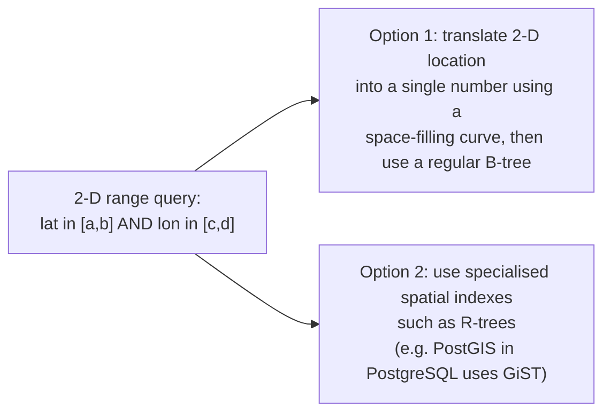

Multi-dimensional indexes aren't just for geography:
- on an e-commerce website, a 3-D index on `(red, green, blue)` could search for products in a **range of colours**,
- in a weather database, a 2-D index on `(date, temperature)` could efficiently find all observations during 2013 where the temperature was between 25 and 30 °C. With a 1-D index you'd have to either scan all records from 2013 and filter by temperature, or vice versa. A 2-D index narrows down by timestamp and temperature **simultaneously**. (This technique is used by HyperDex.)

#### Full-text search and fuzzy indexes

All indexes so far assume **exact data**: you query for exact values of a key, or a range of values of a key with a sort order. They don't let you search for **similar** keys, such as misspelled words. That kind of **fuzzy querying** needs different techniques.

Full-text search engines commonly allow:
- a search for one word to be **expanded to include synonyms**,
- ignoring **grammatical variations** of words (stemming),
- searching for occurrences of words **near each other** in the same document,
- other features that depend on **linguistic analysis** of the text,
- handling typos: **Lucene** can search text for words within a certain **edit distance** (an edit distance of 1 means one letter has been added, removed or replaced).

Lucene uses an SSTable-like structure for its term dictionary. That structure needs a small in-memory index that tells queries at which offset in the sorted file they need to look for a key. In LevelDB, this in-memory index is a sparse collection of some of the keys. In **Lucene, the in-memory index is a finite state automaton over the characters in the keys**, similar to a **trie**. This automaton can be transformed into a **Levenshtein automaton**, which supports efficient search for words within a given edit distance.

Other fuzzy-search techniques go in the direction of **document classification and machine learning** (see an information-retrieval textbook for details).

#### Keeping everything in memory

The data structures so far have all been answers to the **limitations of disks**. Compared with main memory, disks are awkward to deal with: with both magnetic disks and SSDs, data on disk must be **laid out carefully** for good read and write performance. We tolerate this awkwardness because disks have two big advantages: they're **durable** (contents aren't lost if the power is turned off) and they have a **lower cost per gigabyte** than RAM.

As RAM becomes cheaper, the cost-per-gigabyte argument weakens. Many datasets simply aren't that big, so it's quite feasible to keep them **entirely in memory**, potentially distributed across several machines. This has led to **in-memory databases**:

| Type | Durability | Examples |
|---|---|---|
| **Caching only** | Acceptable for data to be lost if a machine restarts | **Memcached** |
| **Durable in-memory** | Special hardware (battery-powered RAM), writing a **log of changes to disk**, writing **periodic snapshots** to disk, or **replicating** in-memory state to other machines | **VoltDB, MemSQL, Oracle TimesTen** (relational); **RAMCloud** (key-value, log-structured for both memory and disk); **Redis, Couchbase** (weak durability by writing to disk asynchronously) |

When an in-memory database restarts, it needs to **reload its state**, either from disk or over the network from a replica (unless special hardware is used). Despite writing to disk, it's still an in-memory database, because the disk is **merely used as an append-only log for durability**, and **reads are served entirely from memory**. Writing to disk also has operational advantages: files on disk can easily be backed up, inspected and analysed by external utilities.

> **Counterintuitive point:** the performance advantage of in-memory databases is **not** due to the fact that they don't need to read from disk. Even a disk-based storage engine may never need to read from disk if you have enough memory, because the **operating system caches recently used disk blocks** in memory anyway. Rather, they can be faster because they **avoid the overheads of encoding in-memory data structures in a form that can be written to disk**.

Besides performance, in-memory databases enable **data models that are difficult to implement with disk-based indexes**. For example, **Redis** offers a database-like interface to various data structures such as **priority queues and sets**. Because it keeps all data in memory, its implementation is comparatively simple.

**Anti-caching.** Recent research indicates that an in-memory architecture can be extended to support **datasets larger than available memory**, without bringing back the overheads of a disk-centric architecture. The anti-caching approach works by **evicting the least recently used data from memory to disk** when there isn't enough memory, and loading it back into memory when it's accessed again in the future. This is similar to what operating systems do with virtual memory and swap files, but the database can manage memory more efficiently than the OS, as it can work at the granularity of **individual records** rather than entire memory pages. This approach still requires **indexes to fit entirely in memory**.

Further changes may come if **non-volatile memory (NVM)** technologies become more widely adopted.

## 3.2 Transaction processing or analytics?

<BookRef pages="112–113" section="Transaction Processing or Analytics?" />

In the early days of business data processing, a write to the database typically corresponded to a **commercial transaction**: making a sale, placing an order with a supplier, paying an employee's salary. As databases expanded into areas that didn't involve money changing hands, the term *transaction* stuck, referring to **a group of reads and writes that form a logical unit**.

> A transaction needn't have ACID (atomicity, consistency, isolation, durability) properties. **Transaction processing** just means allowing clients to make **low-latency reads and writes**, as opposed to batch processing jobs, which only run periodically (e.g. once per day).

Even though databases started being used for many different kinds of data (comments on blog posts, actions in a game, contacts in an address book…), the basic access pattern stayed similar to processing business transactions. An application typically looks up a **small number of records by some key**, using an index. Records are inserted or updated based on the **user's input**. Because these applications are interactive, the access pattern became known as **online transaction processing (OLTP)**.

Databases also started being used increasingly for **data analytics**, which has very different access patterns. Usually an analytic query needs to **scan over a huge number of records**, only reading a **few columns per record**, and calculates **aggregate statistics** (count, sum or average) rather than returning raw data to the user. If your data is a table of sales transactions, analytic queries might be:

- Which regions grew revenue fastest last quarter?
- Did the free-shipping campaign raise average basket size?
- Which two products are most often bought in the same order?

These queries are often written by **business analysts** and feed into reports that help a company's management make better decisions (**business intelligence**). To distinguish this pattern from transaction processing, it's been called **online analytic processing (OLAP)**. (The meaning of *online* in OLAP is unclear; it probably refers to the fact that queries aren't just for predefined reports, but that analysts use the OLAP system interactively for explorative queries.)

| Property | Transaction processing (OLTP) | Analytic systems (OLAP) |
|---|---|---|
| **Main read pattern** | Small number of records per query, fetched by key | Aggregate over a large number of records |
| **Main write pattern** | Random-access, low-latency writes from user input | Bulk import (ETL) or event stream |
| **Primarily used by** | End user / customer, via a web application | Internal analyst, for decision support |
| **What data represents** | Latest state of data (current point in time) | History of events that happened over time |
| **Dataset size** | Gigabytes to terabytes | Terabytes to petabytes |
| **Bottleneck** | Disk **seek time** | Disk **bandwidth** |

At first, the same databases were used for both. SQL turned out to be quite flexible in this regard: it works well for OLTP-type queries as well as OLAP-type queries. Nevertheless, in the late 1980s and early 1990s there was a trend for companies to **stop using their OLTP systems for analytics** and run the analytics on a **separate database** instead. This separate database was called a **data warehouse**.

### Data warehousing

<BookRef pages="113–115" section="Data Warehousing" />

An enterprise may have **dozens of different transaction processing systems**: systems powering the customer-facing website, controlling point-of-sale (checkout) systems in physical stores, tracking inventory in warehouses, planning routes for vehicles, managing suppliers, administering employees, and so on. Each is complex and needs a team to maintain it, so the systems end up operating mostly **autonomously** from each other.

These OLTP systems are usually expected to be **highly available** and to process transactions with **low latency**, since they're often critical to the business. Database administrators therefore closely guard their OLTP databases. They're usually **reluctant to let business analysts run ad hoc analytic queries** on an OLTP database, because those queries are often expensive (scanning large parts of the dataset), which can harm the performance of concurrently executing transactions.

A **data warehouse** is a separate database that analysts can query to their heart's content, **without affecting OLTP operations**. It contains a **read-only copy** of the data in all the various OLTP systems in the company. Data is extracted from OLTP databases (using either a periodic data dump or a continuous stream of updates), transformed into an **analysis-friendly schema**, cleaned up, and then loaded into the data warehouse. This process is known as **Extract–Transform–Load (ETL)**:

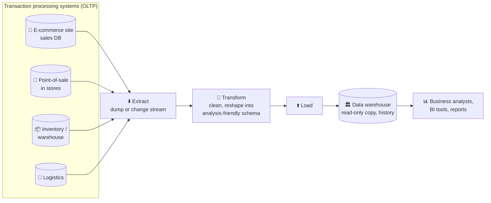

Data warehouses now exist in almost all large enterprises, but in small companies they're almost unheard of. That's probably because most small companies don't have so many different OLTP systems, and most have a small amount of data, small enough to be queried in a conventional SQL database or even analysed in a spreadsheet. In a large company, a lot of heavy lifting is required to do something that's simple in a small company.

A big advantage of using a separate data warehouse, rather than querying OLTP systems directly for analytics, is that the warehouse can be **optimised for analytic access patterns**. The indexing algorithms discussed in the first half of this chapter work well for OLTP, but are **not very good at answering analytic queries**.

#### The divergence between OLTP databases and data warehouses

The data model of a warehouse is most commonly **relational**, because SQL is generally a good fit for analytic queries. There are many graphical data analysis tools that generate SQL queries, visualise the results, and let analysts explore the data (through operations such as **drill-down and slicing and dicing**).

On the surface, a data warehouse and a relational OLTP database look similar, because both have a SQL query interface. However, their **internals can look quite different**, because they're optimised for very different query patterns. Many database vendors now focus on supporting either transaction processing or analytics workloads, but not both.

| Vendor type | Examples |
|---|---|
| Both, in one product (increasingly becoming two separate storage and query engines behind a common SQL interface) | Microsoft SQL Server, SAP HANA |
| Commercial warehouses, often expensive licences | Teradata, Vertica, SAP HANA, ParAccel (Amazon Redshift is a hosted version of ParAccel) |
| Open source **SQL-on-Hadoop** (young, aiming to compete with commercial warehouses) | Apache Hive, Spark SQL, Cloudera Impala, Facebook Presto, Apache Tajo, Apache Drill (some based on ideas from Google's Dremel) |

### Stars and snowflakes: schemas for analytics

<BookRef pages="115–117" section="Stars and Snowflakes: Schemas for Analytics" />

As explored in chapter 2, a wide range of data models is used in the realm of transaction processing, depending on the needs of the application. In analytics, there's **much less diversity**. Many data warehouses are used in a fairly formulaic style, known as a **star schema** (also known as **dimensional modelling**).

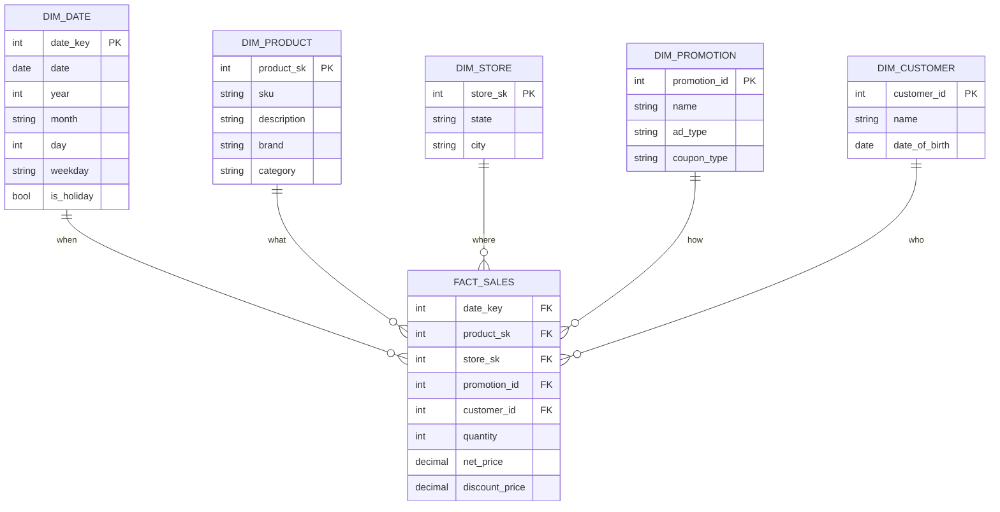

**The fact table** is at the centre of the schema. In the example, each row of the fact table represents a **customer's purchase of a product at a particular time**. If we were analysing website traffic rather than retail sales, each row might represent a page view or a click by a user.

- Usually, facts are captured as **individual events**, because this allows maximum flexibility of analysis later. However, this means that the fact table can become **extremely large**. A big enterprise might have tens of **petabytes** of transaction history in its warehouse, most of it in fact tables.
- Some of the columns in the fact table are **attributes**, such as the price at which the product was sold and the cost of buying it from the supplier (allowing the profit margin to be calculated).
- Other columns in the fact table are **foreign key references** to other tables, called **dimension tables**.

As each row in the fact table represents an event, the dimensions represent the **who, what, where, when, how and why** of the event. For example, one dimension is the product that was sold. Each row in `dim_product` represents one type of product for sale, including its stock-keeping unit (SKU), description, brand name, category, fat content, package size, and so on. Each row in `fact_sales` uses a foreign key to indicate which product was sold in that particular transaction. (For simplicity, if a customer buys several different products at once, they're represented as separate rows in the fact table.)

Even **date and time** are often represented using dimension tables, because this lets **additional information about dates** (such as public holidays) be encoded, allowing queries to differentiate between sales on holidays and non-holidays.

The name *star schema* comes from the fact that when the table relationships are visualised, the fact table is in the middle, surrounded by its dimension tables; the connections to these tables are like the rays of a star.

| Variation | Description |
|---|---|
| **Snowflake schema** | Dimensions are further broken down into **sub-dimensions**. For example, there could be separate tables for brands and product categories, and each row in `dim_product` could reference the brand and category as foreign keys, rather than storing them as strings. Snowflake schemas are **more normalised** than star schemas, but star schemas are often preferred because they're **simpler for analysts to work with**. |

In a typical data warehouse, tables are often **very wide**: fact tables often have **over 100 columns**, sometimes several hundred. Dimension tables can also be very wide, as they include all the metadata that may be relevant for analysis. For example, `dim_store` may include details of which services are offered at each store, whether it has an in-store bakery, the square footage, the date the store was first opened, when it was last remodelled, how far it is from the nearest highway, and so on.

## 3.3 Column-oriented storage

<BookRef pages="117–119" section="Column-Oriented Storage" />

If you have **trillions of rows and petabytes** of data in your fact tables, storing and querying them efficiently becomes a challenging problem. Dimension tables are usually much smaller (millions of rows), so here we concentrate on storage of facts.

Although fact tables are often over 100 columns wide, a typical warehouse query **only accesses 4 or 5 of them** at a time (`SELECT *` queries are rarely needed for analytics). Example: do umbrella and sunscreen sales depend on the month of the year?

```sql
SELECT
  dim_date.month, dim_product.category,
  SUM(fact_sales.quantity) AS quantity_sold
FROM fact_sales
  JOIN dim_date    ON fact_sales.date_key   = dim_date.date_key
  JOIN dim_product ON fact_sales.product_sk = dim_product.product_sk
WHERE
  dim_date.year = 2024 AND
  dim_product.category IN ('Umbrellas', 'Sunscreen')
GROUP BY
  dim_date.month, dim_product.category;
```

This query accesses a large number of rows (every umbrella or sunscreen sale in 2024), but it **only needs three columns** of the `fact_sales` table: `date_key`, `product_sk` and `quantity`. It ignores all other columns.

How can we execute this efficiently? In most OLTP databases, storage is laid out in a **row-oriented** fashion: all the values from one row of a table are stored next to each other. Document databases are similar: an entire document is typically stored as one contiguous sequence of bytes.

To process a query like the one above, you may have indexes on `fact_sales.date_key` and/or `fact_sales.product_sk` that tell the storage engine where to find all the sales for a particular date or product. But then a row-oriented engine still needs to **load all those rows** (each consisting of over 100 attributes) from disk into memory, parse them, and filter out those that don't meet the required conditions. That can take a long time.

**The idea behind column-oriented storage is simple:** don't store all the values from one row together, but **store all the values from each column together** instead. If each column is stored in a separate file, a query only needs to read and parse the columns that are used in that query, which can save a lot of work.

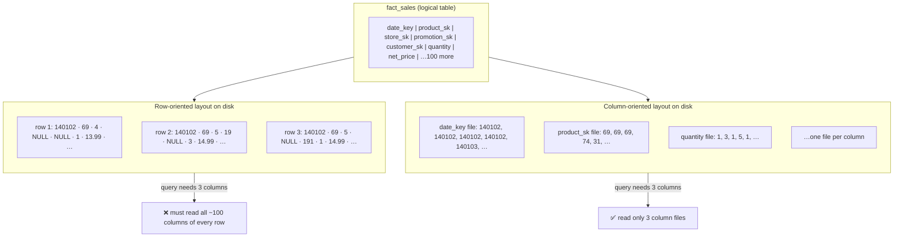

The column-oriented storage layout relies on **each column file containing the rows in the same order**. If you need to reassemble an entire row, you can take the **23rd entry from each of the individual column files** and put them together to form the 23rd row of the table.

> Column storage isn't limited to the relational model. **Parquet** is a columnar storage format that supports a **document** data model, based on Google's Dremel.

### Column compression

<BookRef pages="119–121" section="Column Compression" />

Besides only loading the columns from disk that are required for a query, we can further reduce the demands on disk throughput by **compressing data**. Fortunately, column-oriented storage often lends itself very well to compression.

Look at the sequence of values for each column: they often look **quite repetitive**, which is a good sign for compression. Depending on the data in the column, different compression techniques can be used. One technique that's particularly effective in data warehouses is **bitmap encoding**:

```text
Column values (store_sk):  7 7 7 2 2 9 9 9 9 2 7 7

Bitmap for each distinct value (one bit per row):
store_sk = 2:   0 0 0 1 1 0 0 0 0 1 0 0
store_sk = 7:   1 1 1 0 0 0 0 0 0 0 1 1
store_sk = 9:   0 0 0 0 0 1 1 1 1 0 0 0

Run-length encoded (count of 0s, then 1s, then 0s…):
store_sk = 2:   3, 2, 4, 1      (3 zeros, 2 ones, 4 zeros, 1 one, rest zeros)
store_sk = 7:   0, 3, 7, 2      (0 zeros, 3 ones, 7 zeros, 2 ones)
store_sk = 9:   5, 4            (5 zeros, 4 ones, rest zeros)
```

How it works:
- Often, the **number of distinct values in a column is small** compared with the number of rows (a retailer may have billions of sales transactions, but only 100,000 distinct products).
- Take a column with *n* distinct values and turn it into *n* separate bitmaps: **one bitmap for each distinct value, with one bit for each row**. The bit is 1 if the row has that value, and 0 if not.
- If *n* is very small (for example, a *country* column may have ~200 distinct values), those bitmaps can be stored with one bit per row.
- If *n* is bigger, there will be **a lot of zeros** in most of the bitmaps (they're **sparse**). In that case, the bitmaps can additionally be **run-length encoded**. This can make the encoding of a column remarkably compact.

Bitmap indexes like these are very well suited for the kinds of queries that are common in a data warehouse:

```sql
WHERE store_sk IN (2, 9)
-- Load the bitmaps for 2 and 9 and compute the bitwise OR.
-- That can be done very efficiently.

WHERE store_sk = 7 AND product_sk = 40
-- Load the bitmaps for store_sk = 7 and product_sk = 40 and compute the bitwise AND.
-- Works because the columns contain the rows in the same order,
-- so the k-th bit in one column's bitmap corresponds to the same row
-- as the k-th bit in another column's bitmap.
```

> **Column-oriented storage vs column families.** Cassandra and HBase have a concept of **column families**, which they inherited from Bigtable. However, it's very misleading to call them column-oriented: within each column family, they store **all columns from a row together**, along with a row key, and they don't use column compression. Thus, the Bigtable model is still **mostly row-oriented**.

#### Memory bandwidth and vectorised processing

For data warehouse queries that need to scan over millions of rows, a big bottleneck is the **bandwidth for getting data from disk into memory**. That's not the only bottleneck, though. Developers of analytical databases also worry about efficiently using the bandwidth from **main memory into the CPU cache**, avoiding **branch mispredictions** and **bubbles in the CPU instruction processing pipeline**, and making use of **single-instruction-multi-data (SIMD)** instructions in modern CPUs.

Besides reducing the volume of data that needs to be loaded from disk, column-oriented storage layouts are also good for making **efficient use of CPU cycles**:
- the query engine can take a **chunk of compressed column data that fits comfortably in the CPU's L1 cache** and iterate through it in a **tight loop** (that is, with no function calls),
- a CPU can execute such a loop much faster than code that requires a lot of function calls and conditions for each record processed,
- column compression allows **more rows from a column to fit in the same amount of L1 cache**,
- operators such as the bitwise AND and OR described above can be designed to **operate on such chunks of compressed column data directly**.

This technique is known as **vectorised processing**.

### Sort order in column storage

<BookRef pages="121–123" section="Sort Order in Column Storage" />

In a column store, it doesn't necessarily matter in which order the rows are stored. It's easiest to store them in the **order in which they were inserted**, since then inserting a new row just means appending to each of the column files. However, we can choose to **impose an order**, like we did with SSTables previously, and use that as an indexing mechanism.

⚠️ It wouldn't make sense to sort each column independently, because then we would no longer know which items in the columns belong to the same row. We can only reconstruct a row because we know that the *k*-th item in one column belongs to the same row as the *k*-th item in another column. Rather, the data needs to be **sorted an entire row at a time**, even though it's stored by column.

The database administrator can choose the columns by which the table should be sorted, using their knowledge of common queries:
- If queries often target **date ranges**, such as the last month, it might make sense to make `date_key` the **first sort key**. Then the query optimizer can scan only the rows from the last month, which will be much faster than scanning all rows.
- A **second column can determine the sort order of any rows that have the same value in the first column**. For example, if `date_key` is the first sort key, it might make sense for `product_sk` to be the second sort key, so that all sales for the same product on the same day are grouped together in storage. That helps queries that need to group or filter sales by product within a certain date range.

**Sorted order also helps compression.** If the primary sort column doesn't have many distinct values, then after sorting, it will have **long sequences where the same value is repeated** many times in a row. A simple run-length encoding could compress that column down to a few kilobytes, even if the table has billions of rows.

That compression effect is **strongest on the first sort key**. The second and third sort keys will be more jumbled up, and thus not have such long runs of repeated values. Columns further down the sorting priority appear in essentially random order, so they probably won't compress as well. But having the first few columns sorted is still a win overall.

#### Several different sort orders

A clever extension of this idea was introduced in C-Store and adopted in the commercial data warehouse **Vertica**:
- Different queries benefit from different sort orders, so why not store the **same data sorted in several different ways**?
- Data needs to be **replicated to multiple machines** anyway, so that you don't lose data if one machine fails. You might as well **store that redundant data sorted in different ways**, so that when you're processing a query, you can use the version that best fits the query pattern.

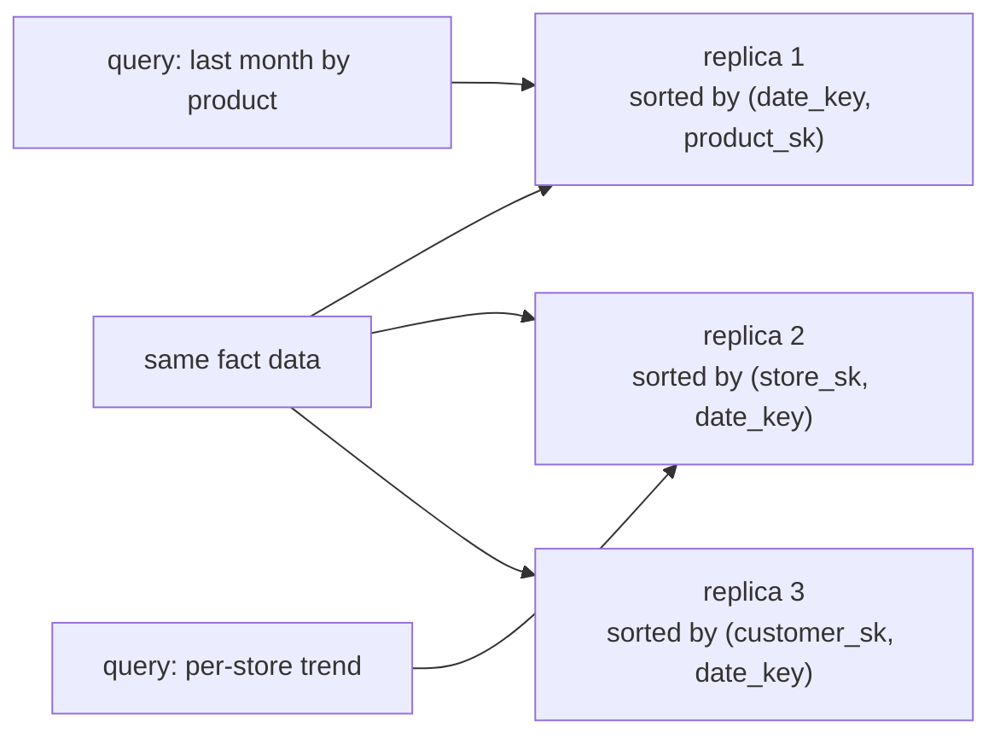

Having multiple sort orders in a column-oriented store is a bit similar to having multiple secondary indexes in a row-oriented store. But the big difference is that the row-oriented store keeps every row in one place (in the heap file or a clustered index), and secondary indexes just contain **pointers** to the matching rows. In a column store, there normally **aren't any pointers to data elsewhere**, only columns containing values.

### Writing to column-oriented storage

<BookRef pages="123" section="Writing to Column-Oriented Storage" />

These optimisations make sense in data warehouses, because most of the load consists of **large read-only queries** run by analysts. Column-oriented storage, compression and sorting all help to make those read queries faster. However, they have the downside of **making writes more difficult**.

An **update-in-place** approach, like B-trees use, is **not possible with compressed columns**. If you wanted to insert a row in the middle of a sorted table, you would most likely have to **rewrite all the column files**. As rows are identified by their position within a column, the insertion has to update all columns consistently.

Fortunately, we've already seen a good solution earlier in this chapter: **LSM-trees**.

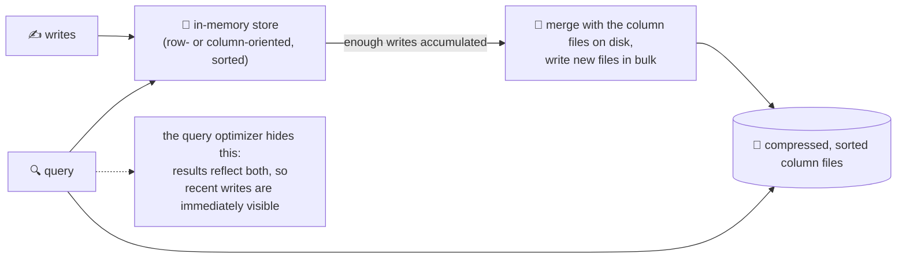

- All writes first go to an **in-memory store**, where they're added to a sorted structure and prepared for writing to disk. It doesn't matter whether the in-memory store is row-oriented or column-oriented.
- When enough writes have accumulated, they're **merged with the column files on disk** and written to new files in bulk. This is essentially what **Vertica** does.
- Queries need to **examine both the column data on disk and the recent writes in memory**, and combine the two. The query optimizer hides this distinction from the user. From an analyst's point of view, data that has been modified with inserts, updates or deletes is **immediately reflected** in subsequent queries.

### Aggregation: data cubes and materialised views

<BookRef pages="123–125" section="Aggregation: Data Cubes and Materialized Views" />

Not every data warehouse is necessarily a column store: traditional row-oriented databases and a few other architectures are also used. However, columnar storage can be **significantly faster for ad hoc analytical queries**, so it's rapidly gaining popularity.

Another aspect of data warehouses worth mentioning briefly is **materialised aggregates**. Data warehouse queries often involve an aggregate function, such as `COUNT`, `SUM`, `AVG`, `MIN` or `MAX` in SQL. If the same aggregates are used by many different queries, it can be wasteful to crunch through the raw data every time. Why not **cache** some of the counts or sums that queries use most often?

| | Virtual view | Materialised view |
|---|---|---|
| What it is | A table-like object whose contents are the results of some query; just a **shortcut for writing queries** | An **actual copy of the query results, written to disk** |
| On read | SQL engine **expands it into the view's underlying query on the fly**, then processes the expanded query | Read the precomputed results directly |
| On write to underlying data | Nothing to do | Must be **updated**, because it's a denormalised copy of the data. The DB can do that automatically, but such updates make **writes more expensive**, which is why materialised views aren't often used in OLTP databases. In read-heavy data warehouses they can make more sense (whether or not they actually improve read performance depends on the individual case). |

A common special case of a materialised view is known as a **data cube** or **OLAP cube**. It's a **grid of aggregates grouped by different dimensions**:

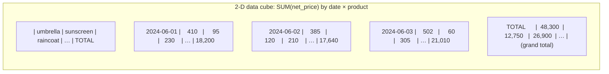

- Each fact has foreign keys to only two dimension tables in this simplified example: `date` and `product`.
- Draw a two-dimensional table, with **dates along one axis and products along the other**. Each cell contains the aggregate (e.g. `SUM`) of an attribute (e.g. `net_price`) of all facts with that **date-product combination**.
- Then you can apply the same aggregate **along each row or column** and get a summary that has been reduced by one dimension (the sales by product regardless of date, or the sales by date regardless of product).
- In general, facts often have **more than two dimensions**. Imagine a five-dimensional hypercube for `date`, `product`, `store`, `promotion` and `customer`; it's much harder to imagine, but the principle stays the same: each cell contains the sales for a particular date-product-store-promotion-customer combination. These values can then repeatedly be summarised along each of the dimensions.

| Data cube | |
|---|---|
| ✅ **Advantage** | Certain queries become **very fast**, because they've effectively been **precomputed**. If you want to know the total sales per store yesterday, you just need to look at the totals along the appropriate dimension; no need to scan millions of rows. |
| ❌ **Disadvantage** | **Doesn't have the same flexibility as querying the raw data.** You can't calculate which proportion of sales comes from items that cost more than $100, because the price isn't one of the dimensions. |

Most data warehouses therefore try to **keep as much raw data as possible**, and use aggregates such as data cubes **only as a performance boost** for certain queries.

## Summary

<BookRef pages="125–131" section="Summary" />

This chapter looked at how databases handle storage and retrieval: what happens when you store data in a database, and what the database does when you query for the data again later.

At a high level, storage engines fall into two broad categories:

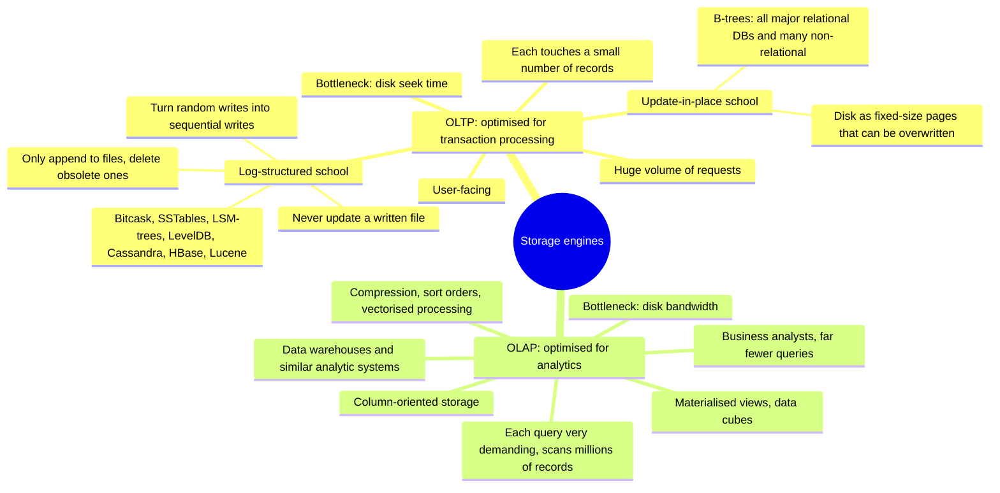

On the OLTP side, log-structured storage engines are a comparatively recent development. Their key idea is that they **systematically turn random-access writes into sequential writes on disk**, which enables higher write throughput due to the performance characteristics of hard drives and SSDs.

Along the way, we covered more complex indexing structures (secondary indexes, clustered and covering indexes, multi-dimensional indexes, full-text and fuzzy indexes) and databases optimised for **keeping all data in memory**.

Then we detoured from the internals of storage engines to look at the high-level architecture of a typical **data warehouse**. That background showed why analytic workloads are so different from OLTP: when your queries require sequentially scanning across a large number of rows, **indexes are much less relevant**. Instead it becomes important to **encode data very compactly**, to minimise the amount of data the query needs to read from disk. Column-oriented storage helps achieve this goal.

As an application developer, if you're armed with this knowledge about the internals of storage engines, you're in a much better position to know **which tool is best suited for your particular application**. If you need to adjust a database's tuning parameters, this understanding lets you imagine what effect a higher or a lower value may have.

## 🧠 Check yourself

<Quiz question="Why can an SSTable use a sparse in-memory index?" options={["Keys are hashed", "Keys are sorted, so you can find the range between two known keys and scan it", "Values are small", "It uses a Bloom filter instead"]} answer={1} explain="Sorted keys let you jump to the nearest indexed key and scan a small block." />

<Quiz question="Which structure makes it easiest to lock a key range for transactions?" options={["LSM-tree", "B-tree", "Hash index", "Bloom filter"]} answer={1} explain="In a B-tree each key exists in exactly one place, so range locks attach directly to the tree." />

<Quiz question="A query scans 1 billion rows but only uses 3 of 200 columns. Best storage layout?" options={["Row-oriented with a B-tree", "Column-oriented", "Hash index", "Graph store"]} answer={1} explain="Column storage reads only the 3 needed column files, and they compress well." />

<Quiz question="What does a Bloom filter tell you?" options={["Exactly where a key is", "That a key is definitely not in a file (or might be)", "The newest version of a key", "How many keys exist"]} answer={1} explain="No false negatives, possible false positives, so it can skip files that definitely don't contain the key." />

<Quiz question="What's the main limitation of a Bitcask-style hash index?" options={["Can't handle updates", "All keys must fit in memory, and range queries are inefficient", "Writes are random", "No crash recovery"]} answer={1} explain="The hash map lives in RAM and gives no ordering between keys." />

<Quiz question="Why does an LSM engine also write to a log on every write?" options={["To sort the data", "To rebuild the memtable after a crash", "To speed up reads", "For compaction"]} answer={1} explain="The memtable is in memory; the unsorted log lets it be restored if the process crashes before a flush." />

<Quiz question="What's the real reason in-memory databases are fast?" options={["They never read from disk", "They avoid encoding in-memory structures into a disk-friendly format", "They have no indexes", "They don't support transactions"]} answer={1} explain="A disk-based DB with enough RAM rarely reads from disk either (OS page cache). The win is skipping disk-oriented encoding." />

<Quiz question="Why does sorting a column store by date_key first improve compression?" options={["Dates are small", "It creates long runs of identical values in the first sort column, which run-length encoding compresses well", "It removes duplicates", "It enables B-tree indexes"]} answer={1} explain="Sorted low-cardinality columns turn into long repeated runs; the effect is strongest on the first sort key." />

<Quiz question="What's the drawback of a data cube?" options={["Slower queries", "Less flexible than querying raw data: you can only slice by the precomputed dimensions", "More storage than raw data always", "Can't be used with SQL"]} answer={1} explain="If an attribute (like price threshold) isn't a dimension, the cube can't answer queries on it." />

**Interview prompts**
- You need a write-heavy time-series store. LSM or B-tree? Why? How would you monitor compaction health?
- Why shouldn't analysts query the production Postgres directly? What would you build instead?
- Explain write amplification and why SSD wear makes it matter.
- Design the storage for a "restaurants near me" search. Which index would you use?
- How would you speed up a dashboard that shows daily revenue per store across 5 years of data?
