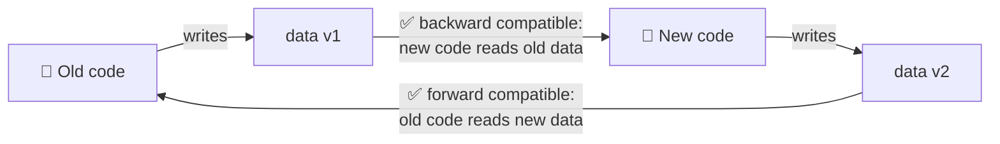
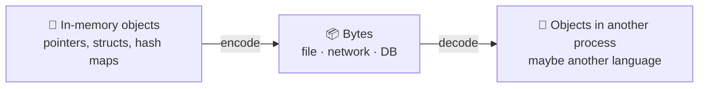
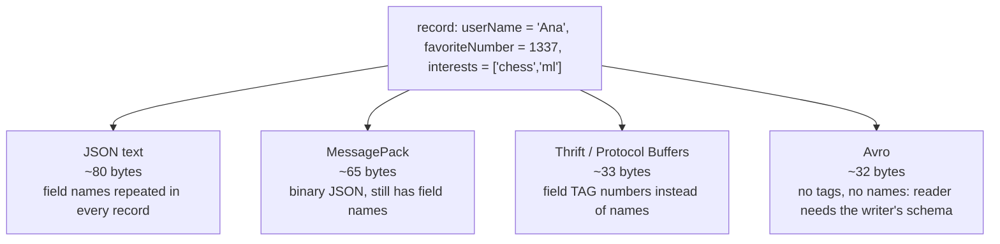
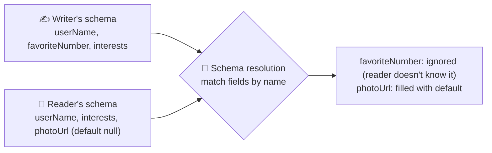
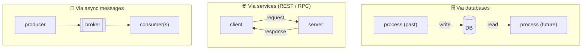
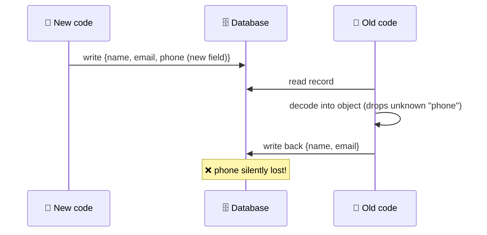

# 4 · Encoding and evolution

> **In one line:** apps change and new code is deployed gradually, so old and new versions of data and code must live side by side. Pick encodings that support **backward** and **forward** compatibility.

<BookRef pages="133–165" section="Chapter 4" />

## 4.1 Two kinds of compatibility



- **Backward compatibility** (new reads old) is usually easy: you know the old format.
- **Forward compatibility** (old reads new) is harder: old code must **ignore** fields it doesn't know about, and ideally **preserve** them.

Why both are needed: during a **rolling upgrade**, servers run mixed versions. Mobile users don't update their apps. Data written years ago is still in the database.

## 4.2 Encoding formats

<BookRef pages="134–150" section="Formats for Encoding Data" />

**Encoding** (serialisation, marshalling) turns in-memory objects into a byte sequence. **Decoding** turns it back.



### Option 1: language-built-in (Java Serializable, Python pickle)

❌ Locks you into one language. ❌ Decoding can create arbitrary classes, which is a **security hole**. ❌ Versioning is an afterthought. ❌ Often slow and bloated. **Avoid** except for very short-lived data.

### Option 2: JSON, XML, CSV

| Problem | Example |
|---|---|
| Number ambiguity | JSON doesn't separate integers from floats. Integers above 2⁵³ lose precision in JavaScript. |
| No binary strings | Base64 workaround, +33% size |
| Optional schemas | Rarely used, complex |
| CSV | No schema at all, quoting rules are vague |

They're still great as an **interchange** format between organisations, because everyone agrees on them.

### Option 3: binary formats with a schema



#### Thrift and Protocol Buffers: field tags

```protobuf
message Person {
  required string user_name       = 1;
  optional int64  favorite_number = 2;
  repeated string interests       = 3;
}
```

Each encoded field is `tag + type + value`. **Field names never go on the wire, only tag numbers**, so tags are the contract.

| Change | Safe? | Why |
|---|---|---|
| Rename a field | ✅ | Names aren't encoded |
| Add a new field with a new tag | ✅ if optional or has a default | Old code skips unknown tags (forward). New code fills in the default (backward). |
| Remove a field | ✅ if optional, and **never reuse its tag** | |
| Change a tag number | ❌ | Breaks every existing record |
| Change type (int32 → int64) | ⚠️ | New reads old fine. Old code may truncate. |

#### Avro: writer's schema + reader's schema

No tags at all: values are just concatenated. To decode, the reader needs the **exact schema the writer used**. Avro then **resolves** the writer's schema against the reader's schema by **field name**.



How does the reader get the writer's schema?

| Context | Mechanism |
|---|---|
| Large file of records | Schema written once in the file header |
| Database with individual records | Store a schema **version number** with each record, plus a schema registry |
| Network connection | Negotiate the schema when the connection opens |

**Rule:** you may only add or remove fields that have a **default value**.

**Avro's strength:** no tag numbers to manage by hand, so it's ideal for **schemas generated from a database** (dump a table, and the schema is generated from its columns).

### Why schemas are worth it

- Much more compact than JSON
- The schema is **documentation that's always up to date**
- A registry can **check compatibility** before you deploy
- Code generation for statically typed languages

## 4.3 Modes of dataflow

<BookRef pages="150–161" section="Modes of Dataflow" />



### Through databases: "a message to your future self"

**Data outlives code.** A 5-year-old row is still encoded the old way. Watch out for this trap:



Fix: old code must **keep unknown fields** when it rewrites a record.

### Through services: REST and RPC

| | REST | RPC (gRPC, Thrift…) |
|---|---|---|
| Philosophy | Resources over plain HTTP, URLs, cache headers | Make a remote call look like a local function |
| Encoding | Usually JSON | Usually binary (Protobuf etc.) |
| Great for | Public APIs, browsers, experimentation (curl) | Internal service-to-service calls within one org |

**Why "remote call = local call" is a leaky abstraction:**
- the network can lose the request or the response, so you can't tell if it ran
- retries can repeat the action, so you need **idempotency**
- latency varies wildly
- you can't pass pointers, and large objects must be encoded
- client and server may be written in different languages

**Evolving APIs:** servers are upgraded first, so requests need **backward** compatibility and responses need **forward** compatibility. Public APIs often keep several versions alive for years (version in the URL or header).

### Through asynchronous message passing

A **message broker** (Kafka, RabbitMQ, SQS) sits between producer and consumer:
- buffers messages when the consumer is down or overloaded
- redelivers after crashes
- the sender doesn't need the recipient's address
- one message can go to many consumers
- decouples sender and receiver (fire and forget)

**Actor model** (Akka, Orleans, Erlang): logic is split into actors that hold local state and talk only through async messages. Distributed actor frameworks use the same model across nodes. Rolling upgrades still need compatible message encodings.

## Summary

| Flow | Who encodes / decodes | Compatibility concern |
|---|---|---|
| Database | Writer process / future reader process | Old data read by new code, and old code rewriting new data |
| REST / RPC | Client / server | Server upgraded first: backward-compatible requests, forward-compatible responses |
| Messages | Producer / consumer | Mixed versions of producers and consumers on the same topic |

## 🧠 Check yourself

<Quiz question="In Protocol Buffers, which change breaks existing data?" options={["Renaming a field", "Adding an optional field with a new tag", "Changing a field's tag number", "Removing an optional field"]} answer={2} explain="The tag is what's encoded on the wire. Changing it makes old records unreadable." />

<Quiz question="Old code reads data written by new code. What kind of compatibility is that?" options={["Backward", "Forward", "Sideways", "Semantic"]} answer={1} explain="Forward compatibility: older code copes with data from the future." />

<Quiz question="Why is Avro well suited to dumping database tables?" options={["It uses tag numbers", "Schemas can be generated from the table, with no hand-assigned tags", "It is text-based", "It has no schema"]} answer={1} explain="Fields are matched by name, so a generated schema works without anyone managing tag numbers." />

**Interview prompts**
- How do you deploy a new required field without downtime? (Hint: add it as optional first, backfill, then enforce.)
- Why do retries in RPC need idempotency keys?
- When would you choose Kafka + Avro + schema registry over REST + JSON?
