# 4 · Encoding and evolution

> **In one line:** applications change all the time, and new code never replaces old code and old data in one instant, so the bytes you write today must stay readable by tomorrow's code (**backward compatibility**) and the bytes tomorrow's code writes must not break today's code (**forward compatibility**). Your choice of encoding format decides how painful that is.

<BookRef pages="133–165" section="Chapter 4" />

Software is never finished. Product managers ask for a new field, a team splits a service in two, a regulation forces you to stop storing a value. Chapter 1 called this property **evolvability**. Chapter 2 showed that data models differ in how they cope with change: relational databases enforce one schema at a time (changed by migrations), while document stores are "schema-on-read" and happily hold a mix of old and new shapes.

Whatever the data model, a change to the data's shape almost always means a change to the **code** that reads and writes it. And in any system bigger than a toy, that code change can't happen everywhere at once:

- **Server-side apps** are deployed with a **rolling upgrade** (also called a staged rollout): a few nodes get the new version, you watch the error rate, then you continue. For a while, old and new versions serve traffic side by side. This is how you deploy without downtime, and it's what makes frequent, small, low-risk releases possible.
- **Client-side apps** are at the mercy of the user. Someone might not open the app store for a year, and their phone keeps calling your API with the old request format.
- **Stored data** stays around much longer than any one deployment. A row written three years ago is still in the table, encoded the way the code of three years ago wrote it.

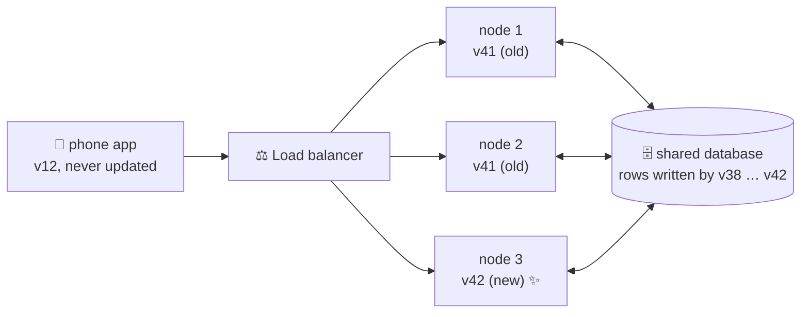

So at any moment, several versions of code and several "generations" of data coexist. For the system to keep working, data flowing between them must be compatible in **both** directions.

<IconCards items={[
  {icon:'⬅️', title:'Backward compatibility', text:'Newer code can read data that older code wrote. Usually easy: when you write the new code you know exactly what the old format looked like, so you can handle it explicitly.', color:'#3b82f6'},
  {icon:'➡️', title:'Forward compatibility', text:'Older code can read data that newer code wrote. Harder: the old code was written before the new format existed, so it must be built to ignore things it doesn\'t understand.', color:'#f59e0b'}
]} />

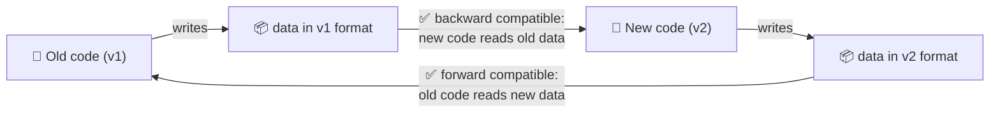

The trick for forward compatibility is almost always the same: **old code must skip over parts it doesn't recognise**, and ideally **carry them along unchanged** if it writes the record back. Whether that's even possible depends on the encoding format. That's what the first half of this chapter is about. The second half looks at the different ways data flows between processes (databases, services, message brokers), and what compatibility means in each.

## 4.1 Formats for encoding data

<BookRef pages="134–150" section="Formats for Encoding Data" />

Programs deal with data in (at least) two very different representations:

1. **In memory**, data lives in objects, structs, lists, hash maps, trees. These are optimised for the CPU to access and change efficiently, and they're full of **pointers**: memory addresses that mean nothing outside the current process.
2. **On disk or on the network**, there are no pointers. You need a **self-contained sequence of bytes** (a JSON document, a Protobuf message, a row in a page file) that another process can make sense of.

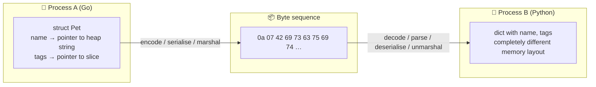

Turning the in-memory form into bytes is called **encoding** (also *serialisation* or *marshalling*), and the reverse is **decoding** (*parsing*, *deserialisation*, *unmarshalling*).

> **Terminology clash:** "serialisation" also means something completely different in transactions (Chapter 7, serialisable isolation). To avoid confusion these notes say **encoding**.

Because translating between the two forms is so common, there are dozens of libraries and formats for it. We'll walk through the main families, using **one example record** all the way through so you can compare byte counts directly.

### The running example for this chapter

A veterinary clinic app, which these notes will call *PawTrack*, stores a record for every pet:

```json
{
  "petName": "Biscuit",
  "ageMonths": 30,
  "vaccinated": true,
  "tags": ["indoor", "shy"]
}
```

Four fields, four different kinds of value: a string, an integer, a boolean and a list of strings. That's enough to exercise every interesting part of each encoding.

### Language-specific formats

<BookRef pages="135–136" section="Language-Specific Formats" />

Most languages ship with a built-in way to dump objects to bytes:

| Language | Built-in mechanism |
|---|---|
| Java | `java.io.Serializable` (plus third-party Kryo) |
| Python | `pickle` |
| Ruby | `Marshal` |
| PHP | `serialize()` / `unserialize()` |
| .NET | `BinaryFormatter` (now deprecated and disabled by default) |

They're tempting because they're one line of code and they round-trip almost anything, even object graphs with cycles. But they come with deep problems:

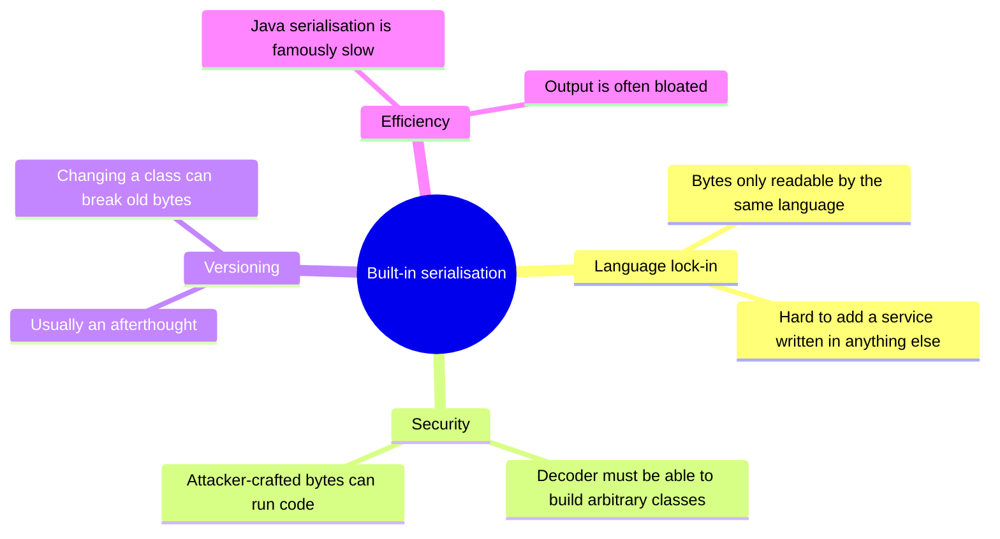

1. **Language lock-in.** A pickled Python object is effectively unreadable from Go or Java. You've tied your stored data, and every process that talks to you, to one language. That's a long-lived commitment that's hard to undo.
2. **Security.** To rebuild the original objects, the decoder must be able to instantiate **any class** named in the bytes. If an attacker can get your app to decode bytes they control, they may pick classes whose constructors or "magic methods" do dangerous things. This has caused a long series of real remote-code-execution vulnerabilities (Java deserialisation gadget chains in popular libraries, Python's `pickle` documentation warning that it must never be used on untrusted input, Ruby on Rails YAML/Marshal bugs).
3. **Versioning is an afterthought.** These formats exist for convenience, so they rarely give you clear rules for forward and backward compatibility. Rename a private field in a Java class and old bytes may no longer decode.
4. **Efficiency is often poor.** Both CPU time and encoded size are frequently worse than a purpose-built format.

```python
import pickle, os

class Evil:
    def __reduce__(self):
        # pickle calls this when encoding; on decode it will CALL os.system(...)
        return (os.system, ("echo pwned",))

payload = pickle.dumps(Evil())
pickle.loads(payload)   # prints "pwned": decoding executed a shell command
```

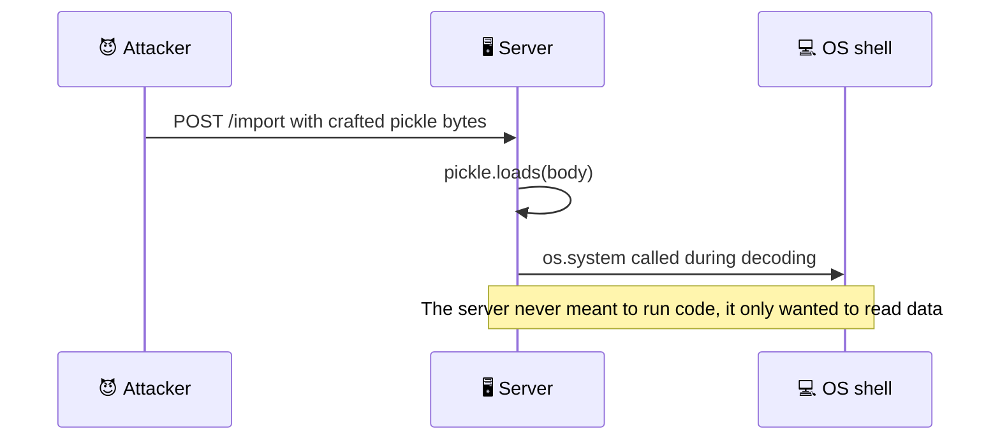

<KeyIdea title="Rule of thumb">Use your language's built-in serialisation only for very short-lived data inside a single process or trusted cache, never for storage, APIs, or anything an outsider can send you.</KeyIdea>

### JSON, XML, and binary variants

<BookRef pages="136–139" section="JSON, XML, and Binary Variants" />

The obvious step up is a **standardised, language-neutral** format. JSON and XML are the big two; CSV is a popular, more primitive cousin. All three are **textual**, so a human can read them, and that's a real advantage when debugging. But they have subtle problems that bite in production:

| Problem | What goes wrong | Example |
|---|---|---|
| **Numbers are ambiguous** | XML and CSV can't tell a number from a string of digits without a schema. JSON distinguishes numbers from strings, but not integers from floats, and says nothing about precision. | JavaScript parses every JSON number as a 64-bit float, so integers above 2^53 (9,007,199,254,740,992) silently lose precision. |
| **No binary strings** | JSON and XML handle Unicode text well, but not raw bytes. | People Base64-encode images or hashes into strings: about 33% bigger, and the schema has to say "this string is really bytes". |
| **Schemas are optional and complex** | XML Schema and JSON Schema exist and are powerful, but many tools ignore them. Without a schema, the meaning of the data (is this a date? cents or dollars?) is hard-coded in every app that reads it. | One service writes `"price": 1999` meaning cents, another reads it as dollars. |
| **CSV is vague** | There's no schema at all, so adding a column is the app's problem. Escaping rules (commas or newlines inside values) exist in RFC 4180 but many parsers don't follow them. | A pet named `Biscuit, Jr.` splits into two columns in a naive parser. |

The integer precision problem is a classic real-world trap. Imagine PawTrack issues pet IDs from a 64-bit Snowflake-style generator:

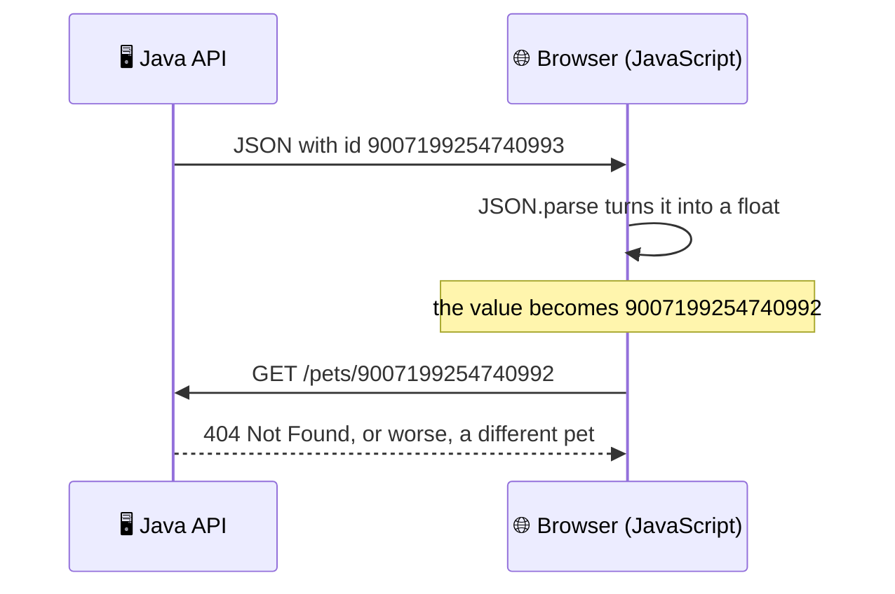

The common workaround (used by several large public APIs) is to send big IDs **twice**: once as a number and once as a decimal string, for example `"id": 9007199254740993, "id_str": "9007199254740993"`. Clients in JavaScript use the string.

Despite the flaws, JSON, XML and CSV are **good enough for many purposes** and they'll stay popular, especially as **data interchange formats between organisations**. There, the hard part is getting different companies to agree on *anything*; how pretty or efficient the format is matters much less.

#### Binary encoding

Inside one organisation you have more freedom. If a dataset is only read and written by your own services, you can pick a format that's more compact or faster to parse. For a few kilobytes it doesn't matter, but for terabytes it does.

The first idea people had was a **binary encoding of JSON** (or XML): keep the same data model, just encode it in bytes. Examples:

| Format | Notes |
|---|---|
| **MessagePack** | Compact, widely supported, used in Redis Lua scripting and many RPC systems |
| **BSON** | MongoDB's storage and wire format; adds types like dates and ObjectIds |
| **CBOR** | IETF standard (RFC 8949), used in WebAuthn and IoT protocols |
| **Smile**, **UBJSON**, **BJSON**, **BISON** | Other JSON-shaped binary formats |
| **WBXML**, **Fast Infoset** | Binary encodings of XML |

Some of these extend the data model (separate integer and float types, a real binary-string type), but they keep JSON's key idea: **no schema**, so **every record carries its own field names**.

#### Byte-level walk-through: our pet in JSON and MessagePack

Compact JSON (no whitespace) for the pet record:

```text
{"petName":"Biscuit","ageMonths":30,"vaccinated":true,"tags":["indoor","shy"]}
```

That's **78 bytes**. Now the same record in MessagePack, byte by byte (hex):

```text
84                          map with 4 entries          (0x80 | 4)
a7 70 65 74 4e 61 6d 65     string, 7 bytes: "petName"   (0xa0 | 7)
a7 42 69 73 63 75 69 74     string, 7 bytes: "Biscuit"
a9 61 67 65 4d 6f 6e 74 68 73
                            string, 9 bytes: "ageMonths" (0xa0 | 9)
1e                          positive integer 30, fits in the type byte itself
aa 76 61 63 63 69 6e 61 74 65 64
                            string, 10 bytes: "vaccinated"
c3                          true
a4 74 61 67 73              string, 4 bytes: "tags"
92                          array with 2 entries         (0x90 | 2)
a6 69 6e 64 6f 6f 72        string, 6 bytes: "indoor"
a3 73 68 79                 string, 3 bytes: "shy"
```

**57 bytes**, a 27% saving. Notice the tricks: small counts and small integers are packed into the **same byte as the type marker** (`84`, `a7`, `1e`, `92`), and there are no quotes, colons or commas.

But look where most of the bytes went: `petName`, `ageMonths`, `vaccinated`, `tags` take **34 of the 57 bytes**. Every single record repeats the field names. Shaving a quarter off isn't obviously worth losing human readability. To do much better, we need a **schema** so the field names don't have to travel with the data.

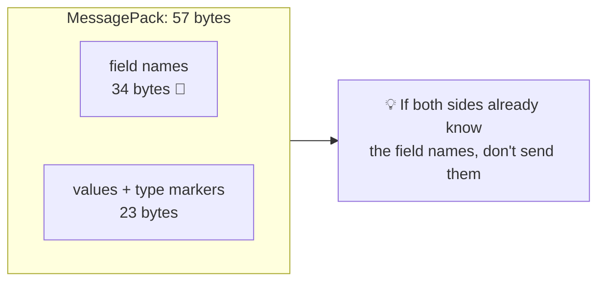

### Thrift and Protocol Buffers

<BookRef pages="139–144" section="Thrift and Protocol Buffers" />

**Apache Thrift** (created at Facebook) and **Protocol Buffers** (protobuf, created at Google) were both open-sourced around 2007–08. They follow the same principle: **you write a schema in an interface definition language (IDL)**, and a code generator produces classes in many languages that encode and decode records matching that schema.

Our pet in Thrift IDL:

```text
struct Pet {
  1: required string       petName,
  2: optional i64          ageMonths,
  3: optional bool         vaccinated,
  4: optional list<string> tags
}
```

And in Protocol Buffers (proto3 syntax, which is what most new projects use):

```protobuf
syntax = "proto3";

message Pet {
  string          pet_name   = 1;
  int64           age_months = 2;
  bool            vaccinated = 3;
  repeated string tags       = 4;
}
```

The numbers `1`, `2`, `3`, `4` are **field tags**. They're the whole point:

<KeyIdea title="Tags, not names">The encoded bytes never contain field names. Each field is identified by its small integer tag, which is a compact alias for the field. The schema maps tags to names; the wire only knows tags.</KeyIdea>

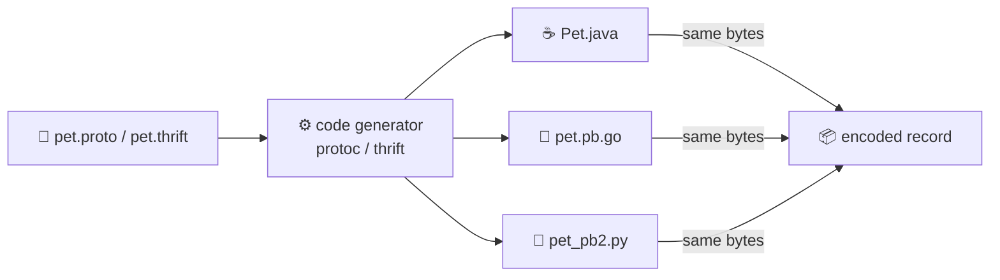

#### Thrift BinaryProtocol

Thrift has two main binary encodings (plus a JSON one and a few more). The simple one, **BinaryProtocol**, writes each field as *type (1 byte) + tag (2 bytes) + value*:

```text
0b 00 01                    field type 11 = string, tag 1
00 00 00 07                 length 7 (always 4 bytes)
42 69 73 63 75 69 74        "Biscuit"
0a 00 02                    field type 10 = i64, tag 2
00 00 00 00 00 00 00 1e     30 as a full 8-byte integer
02 00 03                    field type 2 = bool, tag 3
01                          true
0f 00 04                    field type 15 = list, tag 4
0b                          element type: string
00 00 00 02                 2 elements
00 00 00 06 69 6e 64 6f 6f 72    length 6, "indoor"
00 00 00 03 73 68 79             length 3, "shy"
00                          end of struct (stop byte)
```

**55 bytes**. Barely smaller than MessagePack, even though there are no field names, because of all the fixed-width lengths and the 8-byte integer. Lots of `00` bytes is a hint we can do better.

#### Thrift CompactProtocol

**CompactProtocol** squeezes the same information into far fewer bytes with two tricks:

1. **Pack the tag and type into one byte.** Instead of the full tag, store the *difference* from the previous tag (1 for consecutive fields) in the high 4 bits and the type in the low 4 bits. For booleans, the value is folded into the type itself (type 1 = true, 2 = false).
2. **Variable-length integers (varints)** for numbers and lengths, so small numbers take one byte.

```text
18                          tag delta 1, type 8 (binary/string)
07 42 69 73 63 75 69 74     length 7 as varint, "Biscuit"
16                          tag delta 1, type 6 (i64)
3c                          30, zigzag-encoded varint (30 * 2 = 60 = 0x3c)
11                          tag delta 1, type 1 (boolean TRUE): no value byte needed
19                          tag delta 1, type 9 (list)
28                          list header: 2 elements, element type 8 (string)
06 69 6e 64 6f 6f 72        "indoor"
03 73 68 79                 "shy"
00                          stop
```

**26 bytes**, a third of the JSON size.

#### Protocol Buffers

Protobuf has a single binary encoding, very similar in spirit to CompactProtocol. Each field starts with a **key** byte: `(tag << 3) | wire_type`, where wire type 0 means varint and 2 means "length-delimited" (strings, bytes, nested messages, packed lists).

```text
0a                          key: tag 1, wire type 2 (1<<3 | 2)
07 42 69 73 63 75 69 74     length 7, "Biscuit"
10                          key: tag 2, wire type 0 (2<<3 | 0)
1e                          30 as a varint
18                          key: tag 3, wire type 0
01                          true
22                          key: tag 4, wire type 2
06 69 6e 64 6f 6f 72        "indoor"
22                          key: tag 4 again
03 73 68 79                 "shy"
```

**26 bytes** as well. Note two protobuf quirks visible here:

- A **repeated string** field is just the same tag appearing multiple times. There's no list header; the decoder appends each occurrence to the list.
- In proto3, a field equal to its **default value** (0, empty string, false) isn't written at all. If Biscuit weren't vaccinated, the `18 01` pair would vanish and the record would be 24 bytes.

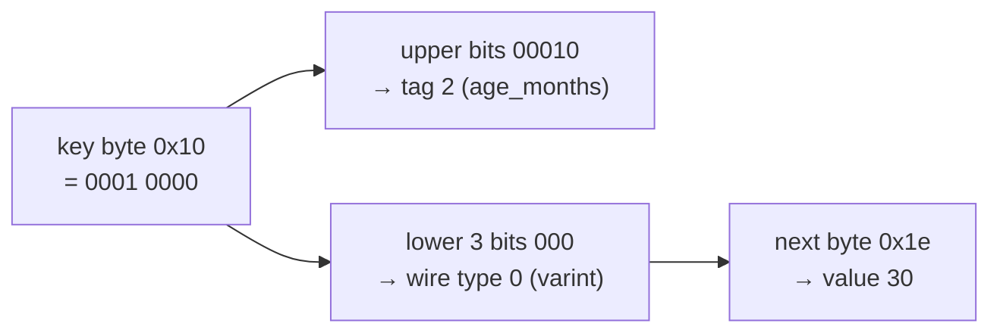

#### How varints work

A **varint** stores an integer in 7-bit groups, least significant group first. The top bit of each byte says "more bytes follow". So:

| Value | Bytes (hex) | Why |
|---|---|---|
| 30 | `1e` | fits in 7 bits, top bit 0 |
| 127 | `7f` | largest 1-byte varint |
| 300 | `ac 02` | 300 = 0b10_0101100 → low 7 bits `0101100` with continue bit = `ac`, then `10` = `02` |
| 1500 | `dc 0b` | two bytes instead of eight |

Negative numbers are a problem: in two's complement, -3 has its top bits all set, so a plain varint would take 10 bytes. **Zigzag encoding** fixes this by interleaving signs: 0 → 0, -1 → 1, 1 → 2, -2 → 3, 2 → 4 … so small negative numbers stay small (-3 becomes 5, one byte `05`). Thrift CompactProtocol and Avro zigzag every integer; protobuf only does it for `sint32`/`sint64` fields, which is why choosing `int64` vs `sint64` matters if you expect negatives.

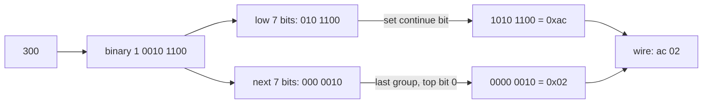

#### Required vs optional

In Thrift and in proto2 you mark fields `required` or `optional`. Interestingly, this makes **no difference to the encoding**: nothing in the bytes says whether a field was required. `required` is purely a **runtime check**: encoding fails if the field isn't set, and decoding fails if it's missing. That's useful for catching bugs, but it turned out to be dangerous for evolution (see below), so **proto3 dropped `required` entirely**. In proto3 every singular field is implicitly optional; since version 3.15 you can again write `optional` to get explicit "was it set?" presence tracking, which you need to tell "0" apart from "not provided".

#### Field tags and schema evolution

Schemas change. How do Thrift and protobuf keep old and new code compatible? Through the tags:

- **You can rename a field freely**: names aren't in the bytes, so renaming `petName` to `displayName` changes nothing on the wire.
- **You can never change a field's tag**: that would make every existing record mean something else.
- **You can add a field with a new tag.** Old code that hits an unknown tag uses the **type/wire-type** information to know how many bytes to skip. That's what gives **forward compatibility**. (Modern protobuf libraries also keep unknown fields and re-emit them when the message is re-encoded.)
- New code reading old data simply finds the new tag missing. That's **backward compatibility**, as long as the new field is optional or has a default. If you add a **`required`** field, new code will reject every old record, so **every field added after the initial release must be optional or have a default**.
- **You can remove a field** only if it was optional (a required field can never go away, because old code would reject new records), and you must **never reuse its tag**, because old data with that tag is still around. Protobuf lets you write `reserved 5;` to make the compiler enforce this.

Here's PawTrack adding a microchip ID as tag 5 while older services are still running:

```protobuf
message Pet {
  string          pet_name    = 1;
  int64           age_months  = 2;
  bool            vaccinated  = 3;
  repeated string tags        = 4;
  string          microchip   = 5;   // new in v2
}
```

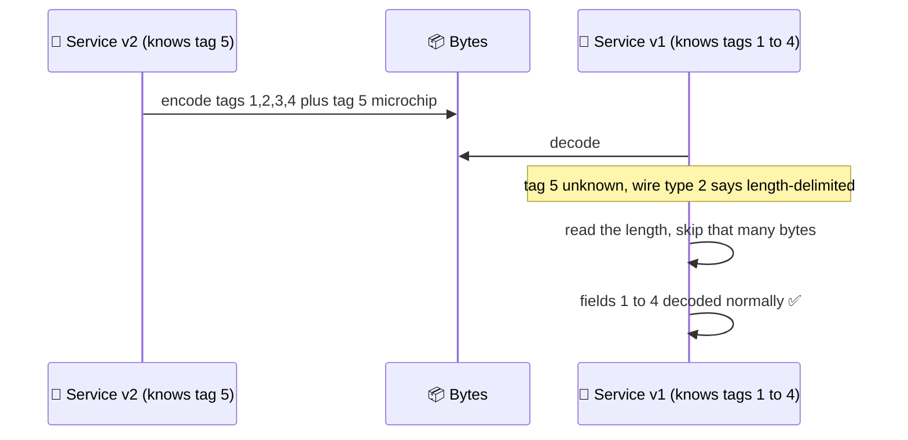

| Change | Safe? | Reason |
|---|---|---|
| Rename a field | ✅ | Names aren't encoded |
| Add an optional field / field with default, new tag | ✅ | Old code skips the unknown tag; new code uses the default for old data |
| Add a required field | ❌ | New code rejects all old data |
| Remove an optional field | ✅ | Must never reuse the tag (`reserved`) |
| Remove a required field | ❌ | Old code rejects data without it |
| Change a field's tag number | ❌ | Every existing record now means something else |

#### Datatypes and schema evolution

Changing a field's **type** is possible in some cases, but risky:

- **Widening an integer** (`int32` → `int64`): new code reads old data fine, because the decoder fills in the missing high bits. But **old code reading new data** stores the value in a 32-bit variable, and anything that doesn't fit is **truncated**. If PawTrack ever stores an age in seconds instead of months, old services will silently see garbage.
- **Protobuf has no list type.** It has `repeated` instead. Because a repeated field is just the same tag appearing several times, you can change an `optional` (single-value) field into a `repeated` one: new code reading old data sees a list of zero or one item; old code reading new data sees **only the last** element. Neat, but only works because of how the encoding happens to be designed.
- **Thrift has a real `list` type**, parameterised by element type. It doesn't allow the single-to-list trick, but it does support **nested lists**, which protobuf can't express directly.
- Some type changes are wire-compatible by accident (`int32`, `uint32`, `int64`, `bool` all use varints in protobuf), but the *meaning* may change. Read the official compatibility tables before relying on it.

### Avro

<BookRef pages="144–149" section="Avro" />

**Apache Avro** started in 2009 as a subproject of Hadoop, because Thrift wasn't a good fit for Hadoop's use cases. It also uses a schema, but makes a very different design choice: **there are no tags in the data at all**.

Avro has two schema languages: **Avro IDL**, meant for humans, and an equivalent **JSON** form that's easier for machines.

```text
record Pet {
  string        petName;
  long          ageMonths;
  boolean       vaccinated;
  array<string> tags;
}
```

```json
{
  "type": "record",
  "name": "Pet",
  "fields": [
    { "name": "petName",    "type": "string" },
    { "name": "ageMonths",  "type": "long" },
    { "name": "vaccinated", "type": "boolean" },
    { "name": "tags",       "type": { "type": "array", "items": "string" } }
  ]
}
```

#### Byte-level walk-through in Avro

```text
0e                          string length 7 (zigzag: 7 * 2 = 14 = 0x0e)
42 69 73 63 75 69 74        "Biscuit"
3c                          long 30 (zigzag: 60 = 0x3c)
01                          boolean true
04                          array block with 2 items (zigzag 2 = 4)
0c 69 6e 64 6f 6f 72        length 6, "indoor"
06 73 68 79                 length 3, "shy"
00                          end of array (block of 0 items)
```

**23 bytes**: the smallest of all. There's nothing to say *which* field a value belongs to or even what *type* it is. A string is just a length followed by UTF-8 bytes; an integer is a zigzag varint; they're simply **concatenated in the order the schema lists the fields**.

That has a big consequence: to decode, you go through the fields **in schema order** and use the schema to know each one's type. So the data can be decoded **only if the reader uses exactly the same schema as the writer**, or at least knows what that schema was. Any mismatch would be read as nonsense.

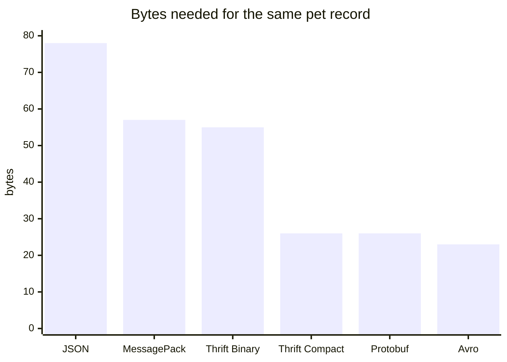

#### The writer's schema and the reader's schema

So how does Avro support schema evolution? By distinguishing two schemas:

- The **writer's schema**: whatever schema the application that *encoded* the data had compiled in.
- The **reader's schema**: whatever schema the application *decoding* the data expects, perhaps generated into its code at build time.

The key idea: **these don't have to be the same, only compatible**. When decoding, the Avro library looks at both side by side and **resolves** the differences, translating data from the writer's schema into the reader's schema:

- Fields are **matched by name**, so their **order doesn't matter**.
- A field in the writer's schema but **not in the reader's** is **ignored** (skipped).
- A field the reader expects but the **writer didn't write** is filled with the **default value declared in the reader's schema**.

Suppose the clinic's billing service is on an older schema without `vaccinated`, and a newer version of the records service wrote the record. Meanwhile billing's own newest schema added `ownerId` with a default:

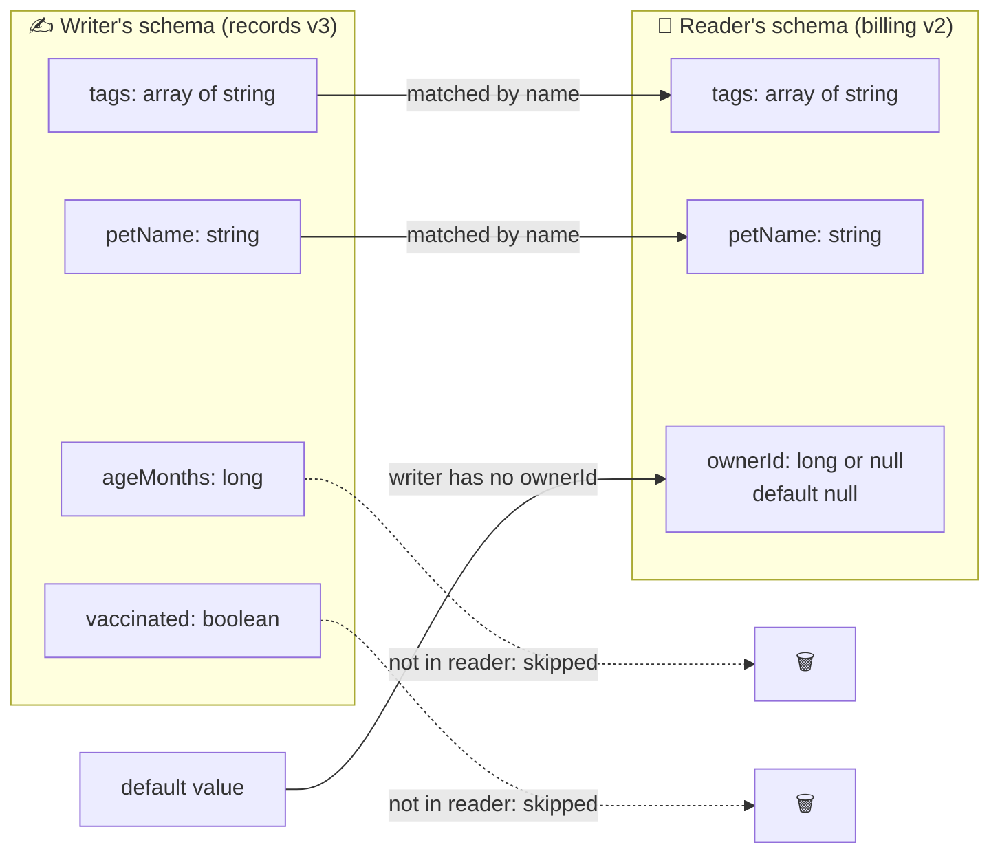

#### Schema evolution rules

With Avro, **forward compatibility** means a new writer's schema works with an old reader's schema, and **backward compatibility** means a new reader's schema works with an old writer's schema.

<KeyIdea>To stay compatible in both directions, you may only add or remove a field that has a default value.</KeyIdea>

Why both directions work:

- **Add a field with a default.** New reader + old data: the field is missing, so the reader fills in the default (backward ✅). Old reader + new data: the field isn't in its schema, so it's skipped (forward ✅).
- **Add a field without a default.** New readers can't decode old data, because there's nothing to fill in → **breaks backward compatibility**.
- **Remove a field without a default.** Old readers expect the field and new writers no longer produce it, so there's nothing to fill in → **breaks forward compatibility**.

| Change | Backward (new reads old) | Forward (old reads new) |
|---|---|---|
| Add field **with** default | ✅ | ✅ |
| Add field **without** default | ❌ | ✅ |
| Remove field that **had** a default | ✅ | ✅ |
| Remove field **without** default | ✅ | ❌ |
| Rename field (reader adds an `aliases` entry) | ✅ | ❌ (old reader can't match the new name) |
| Promote type: `int` → `long`, `float` → `double`, `string` ↔ `bytes` | ✅ (Avro converts) | depends on direction |
| Add a branch to a union | ✅ | ❌ (old reader can't decode the new branch) |

#### Union types and null defaults

Unlike many languages, Avro **doesn't let `null` sneak into every field**. A field of type `long` can never be null. If you want a nullable field, you must say so with a **union type**, a list of alternatives:

```json
{ "name": "ownerId", "type": ["null", "long"], "default": null }
```

On the wire, a union value is the **index of the branch** (zigzag varint) followed by the value. If `ownerId` were `4417`, the bytes would be `02` (branch 1 = long) and then the varint for 4417; if null, just `00`. Rules to remember:

- The **default value must match the first branch** of the union, which is why `"null"` usually comes first.
- Being explicit about nullability is more verbose, but prevents a whole class of bugs ("I didn't know this could be missing").
- Avro has **no `optional` or `required` markers** the way protobuf and Thrift do. Nullable-with-default *is* how you say optional.

#### But how does the reader know the writer's schema?

The reader needs the exact writer's schema for every record. Including the whole schema in every record would defeat the purpose: the schema JSON for our pet is bigger than 23 bytes many times over. The answer depends on the context:

| Context | How the writer's schema travels |
|---|---|
| **Large file with lots of records** (typical in Hadoop, data lakes) | The writer stores its schema **once in the file header**. Avro's **object container file** format does exactly this: header with schema, then millions of records. |
| **Database with individually written records** | Different records were written at different times with different schemas. So each record starts with a small **schema version number**, and a table (or a **schema registry**) maps versions to full schemas. LinkedIn's Espresso database works this way, and so does Kafka with the Confluent Schema Registry (each message starts with a magic byte and a 4-byte schema ID). |
| **Network connection between two processes** | The two sides **negotiate the schema** when the connection is set up, then use it for the whole connection. The Avro RPC protocol does this. |

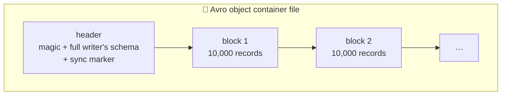

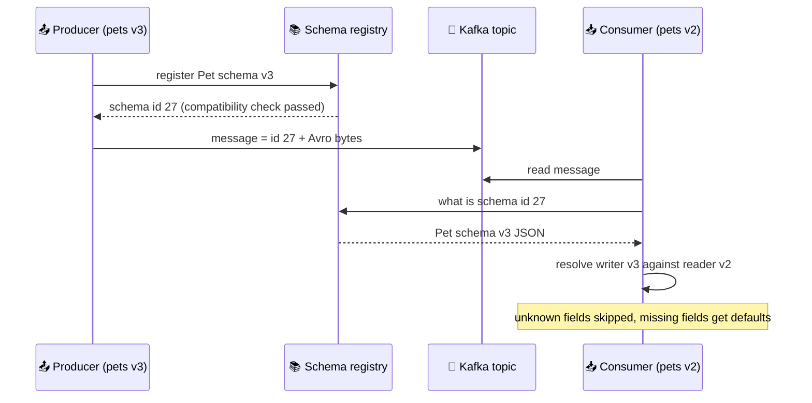

A database of schema versions is useful in its own right: it's documentation, and a registry can **refuse a new schema version** if it would break compatibility (for example, adding a field without a default), catching the mistake **before deployment**. The version number can be a simple increasing integer or a hash of the schema.

#### Dynamically generated schemas

What's the practical upside of having **no tag numbers**? It makes Avro much friendlier to **schemas generated automatically from other data**.

Suppose PawTrack wants to dump its Postgres database into a data lake every night. With Avro, you can write a small program that:

1. reads the database catalog,
2. generates one Avro **record schema per table**, with one **field per column** (column name → field name),
3. dumps every table into an Avro object container file.

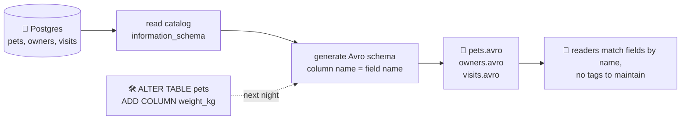

When a column is added or removed, the next dump **just generates a new schema**, and because fields are matched by name, readers can still resolve old and new files. Nobody has to hand-assign tag numbers.

With Thrift or protobuf you'd have to assign tags yourself, and every schema change would need an admin to update a mapping from column names to tags, carefully never reusing an old tag. Avro was explicitly designed with such **dynamically generated schemas** in mind; Thrift and protobuf weren't.

#### Code generation and dynamically typed languages

Thrift and protobuf rely on **code generation**: you compile the IDL into classes. That suits statically typed languages (Java, C++, Go, C#, Rust), where generated classes give you efficient in-memory structures and compile-time type checks and IDE autocomplete.

In dynamically typed languages (Python, Ruby, JavaScript), a compile step adds friction and gives less benefit, since there's no compiler to satisfy. Avro supports code generation optionally, but **works equally well without it**: an object container file is **self-describing** (the schema is in the header), so you can open it with a generic Avro library and get plain dictionaries back, just like reading JSON. This is popular with dynamically typed data tools such as Apache Pig, Spark and Python notebooks: point at a file, analyse it, write derived data back as Avro, without ever thinking about schemas.

```python
from fastavro import reader

with open("pets.avro", "rb") as f:
    for pet in reader(f):          # schema comes from the file header
        if "shy" in pet["tags"]:
            print(pet["petName"])  # plain dicts, no generated classes
```

| | Thrift / Protobuf | Avro |
|---|---|---|
| Field identity on the wire | Numeric tags | Position, resolved via schema field **names** |
| Encoded size | Small | Smallest |
| Decoding needs | Reader's schema only | Writer's schema **and** reader's schema |
| Unknown fields | Skipped by type info | Skipped during schema resolution |
| Nullability | `optional`, defaults | Explicit `union` with `null` |
| Generated schemas (from DB tables) | Awkward: tags must be maintained by hand | Natural |
| Code generation | Central | Optional |
| Typical home | RPC (gRPC), mobile, storage at Google/Meta | Hadoop, Kafka pipelines, data lakes |

### The merits of schemas

<BookRef pages="149–150" section="The Merits of Schemas" />

Protobuf, Thrift and Avro all use a schema to describe a binary format. Their schema languages are much simpler than XML Schema or JSON Schema, which supports far more detailed validation rules (a string must match a regex, a number must be between 0 and 100). That simplicity has made them easy to implement and use, and they're supported by a huge range of languages.

The ideas aren't new. **ASN.1**, a schema definition language standardised in 1984, is used to define network protocols and its binary **DER** encoding is still how **X.509 TLS certificates** are encoded today. ASN.1 also uses tag numbers to support schema evolution, much like protobuf. But it's very complex and badly documented, so it's not a good pick for new applications.

Many data systems also use a proprietary binary encoding with a schema for their own protocols: relational databases have a network protocol (Postgres's wire protocol, MySQL's protocol), and the vendor provides drivers (JDBC, ODBC, libpq) that decode the responses into in-memory structures.

So although textual formats like JSON, XML and CSV are everywhere, **binary encodings based on schemas are a viable option** with nice properties:

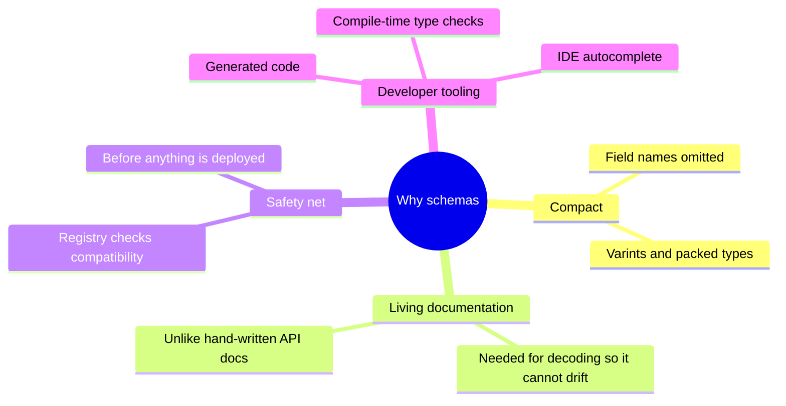

- They can be **much more compact** than binary JSON variants, because they omit field names.
- The **schema is valuable documentation**, and because it's **required for decoding**, you can be sure it's up to date (manually maintained docs drift; a schema that's out of date simply doesn't work).
- A **database of schemas** lets you check forward and backward compatibility of a change **before** anything is deployed.
- For statically typed languages, **generated code** gives compile-time type checking.

<KeyIdea>Schema evolution gives you the same flexibility as schemaless (schema-on-read) JSON databases, while also giving you better guarantees about your data and better tooling.</KeyIdea>

## 4.2 Modes of dataflow

<BookRef pages="150–161" section="Modes of Dataflow" />

Whenever you send data to a process **you don't share memory with**, you have to encode it as bytes. And compatibility is a relationship between **one process that encodes** the data and **another process that decodes** it. So the question "is this change compatible?" only makes sense once you know who writes and who reads.

There are many ways data flows between processes. The three most common:

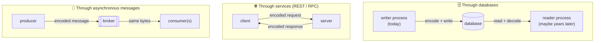

### Dataflow through databases

<BookRef pages="151–153" section="Dataflow Through Databases" />

In a database, the process that writes encodes the data, and the process that reads decodes it. It might be the **same process** reading later, in which case storing something in a database is like **sending a message to your future self**.

- **Backward compatibility is clearly needed**: your future self (new code) must be able to decode what you (old code) wrote, or old data becomes unreadable.
- **Forward compatibility is needed too**, because many processes access the database at once, and during a rolling upgrade some run newer code than others. A value might be written by v42 and then read by a node still on v41.

#### The "unknown field" trap

Suppose PawTrack v42 adds an `emergencyContact` field to the owner record, and a node still on v41 updates the owner's address:

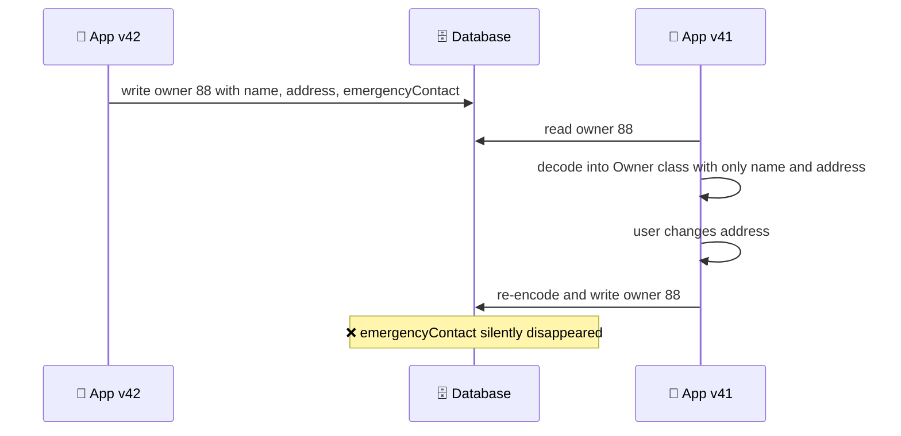

The encoding format might handle unknown fields perfectly, but the **application** can still lose them if it decodes into a model object that has no slot for them, then writes that object back. The fix is at the application layer:

- Keep unknown fields around (modern protobuf runtimes do this by default; Jackson has `@JsonAnySetter`/`@JsonAnyGetter`; with Avro you can read with the writer's schema to preserve everything).
- Prefer **targeted updates** (`UPDATE owners SET address = … WHERE id = 88`, or a partial `$set` in a document store) over read-modify-write of the whole record.

<KeyIdea>Forward compatibility isn't only about decoding: code that reads a record and writes it back must preserve fields it doesn't understand.</KeyIdea>

#### Different values written at different times

A database lets you update any value at any time. So in a single table you can have rows written **five milliseconds ago** right next to rows written **five years ago**.

When you deploy a new version of your app (of a server-side app, at least), the old code is replaced within minutes. That's **not true of the data**: five-year-old rows are still in the original encoding unless you've explicitly rewritten them. This is often summed up as **data outlives code**.

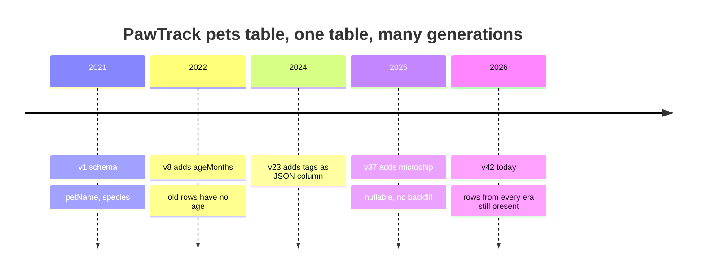

Rewriting (**migrating**) all data into a new schema is possible, but expensive on a large dataset, so most databases avoid it where they can:

- Most relational databases allow **simple schema changes without rewriting** existing data. For example, adding a nullable column (or, in PostgreSQL 11+ and MySQL 8 with `INSTANT`, even a column with a constant default) only updates the catalog. When an old row is read, the database fills in `NULL`/the default for the missing column on the fly.
- **LinkedIn's Espresso** stores documents as Avro and uses Avro's schema-resolution rules to read old documents with the current schema.

```sql
-- Instant in PostgreSQL 11+: no table rewrite, old rows report 'unknown' on read
ALTER TABLE pets ADD COLUMN diet TEXT NOT NULL DEFAULT 'unknown';
```

So **schema evolution makes the whole database look as if it were encoded with a single schema**, even though the underlying storage holds records encoded with many historical versions of the schema.

#### Archival storage

You might take a **snapshot** of your database from time to time: for backups, or to load into a data warehouse (Chapter 3). In that case, the dump is usually encoded with the **latest schema**, even if the source database held a mixture of schema versions. Since you're copying all the data anyway, you might as well encode it consistently.

A dump is **written once and never modified**, so formats like **Avro object container files** suit it well. It's also a good opportunity to encode the data in an analytics-friendly **column-oriented** format such as **Parquet** or ORC (Chapter 3).

```mermaid
flowchart LR
  LIVE[("🗄️ live DB<br/>rows in schema v1 … v42")] -->|"nightly snapshot,<br/>decode each row with resolution"| ENC["encode everything<br/>with schema v42"]
  ENC --> AV["📁 pets-2026-10-25.avro<br/>(row-oriented, one schema)"]
  ENC --> PQ["📊 pets/dt=2026-10-25/*.parquet<br/>(columnar, for the warehouse)"]
```

### Dataflow through services: REST and RPC

<BookRef pages="153–158" section="Dataflow Through Services: REST and RPC" />

When processes communicate over a network, the most common arrangement is **clients and servers**. The server exposes an **API** over the network; clients connect and make requests. The API the server exposes is called a **service**.

The web works this way: browsers request resources with `GET`, and submit data with `POST`. The APIs are a set of standard protocols and formats (HTTP, URLs, TLS, HTML, CSS, JavaScript, JSON…). But there are many other kinds of client:

- A **native app** (mobile or desktop) makes requests to a server, often getting JSON back rather than HTML.
- A **client-side JavaScript app** in the browser can use `fetch` to call an HTTP API.
- A **server can itself be a client** of another service. A web app server might call a database, or a pricing service, or a notifications service.

That last pattern, breaking a large app into smaller services by area of functionality, is called **service-oriented architecture (SOA)**, rebranded more recently as **microservices**.

```mermaid
flowchart LR
  APP["📱 PawTrack app"] -->|"HTTPS + JSON"| GW["🚪 API gateway"]
  WEB["🌐 browser SPA"] -->|"HTTPS + JSON"| GW
  GW -->|"gRPC"| APPT["📅 appointments service"]
  GW -->|"gRPC"| PETS["🐶 pets service"]
  APPT -->|"gRPC"| BILL["💳 billing service"]
  APPT -->|"gRPC"| PETS
  PETS --> PDB[("pets DB")]
  APPT --> ADB[("appointments DB")]
```

Services resemble databases in that clients submit and query data, but with a key difference: a database lets you run **arbitrary queries** in its query language, while a service exposes an **application-specific API** that only allows inputs and outputs predetermined by its business logic. That restriction provides **encapsulation**: the service can enforce rules about what clients may do.

A key design goal of SOA/microservices is to make the application easier to change by making **services independently deployable and evolvable**. Each service is owned by one team, which can release new versions frequently without coordinating with other teams. So we should expect **old and new versions of servers and clients to be running at the same time**, which means the encodings they use must be compatible across versions of the service API.

#### Web services

When HTTP is the underlying protocol for talking to the service, it's called a **web service**. That's a slight misnomer, because web services aren't only used on the web:

1. A client app on a user's device making requests over the internet to a service.
2. One service calling another **inside the same organisation**, often in the same data centre, as part of SOA. (Software that supports this is sometimes called **middleware**.)
3. One service calling a service **owned by a different organisation**, usually over the internet: public APIs, payment providers, OAuth for shared access to user data.

There are two popular approaches to web services:

| | **REST** | **SOAP** |
|---|---|---|
| What it is | A **design philosophy** built on the principles of HTTP | An **XML-based protocol** for network API requests |
| Key ideas | Simple data formats, URLs to identify resources, HTTP features for cache control, auth and content negotiation | Aims to be independent of HTTP; comes with a sprawling set of related standards (the `WS-*` framework) |
| API description | Optional: **OpenAPI** (formerly Swagger) | **WSDL**, an XML-based description language that enables code generation |
| Tooling | `curl`, a browser, any HTTP library | Heavily relies on IDE tooling and generated code; WSDL isn't designed to be human-readable |
| Interoperability | Excellent | Often poor between vendors' implementations |
| Today | Dominant, especially for public APIs and cross-org integration | Mostly legacy, still found in large enterprises |

An API designed according to REST principles is called **RESTful**. SOAP lost popularity outside big enterprises largely because of its complexity, and because users of languages without good IDE support (and without code generation) found SOAP services hard to integrate with.

```bash
# RESTful PawTrack API: resources, verbs, status codes, cacheable GETs
curl -s https://api.pawtrack.example/v1/pets/551 \
     -H 'Accept: application/json'
curl -s -X POST https://api.pawtrack.example/v1/pets/551/visits \
     -H 'Content-Type: application/json' \
     -H 'Idempotency-Key: 7c1e-visit-request' \
     -d '{"reason":"annual checkup","date":"2026-11-03"}'
```

#### The problems with remote procedure calls (RPC)

Web services are only the latest incarnation of a long line of technologies for making API requests over a network, many of which got a lot of hype but have serious problems: **Enterprise JavaBeans** and **Java RMI** (Java-only), **DCOM** (Microsoft-only), **CORBA** (excessively complex, no backward or forward compatibility).

All of these are based on the idea of a **remote procedure call (RPC)**, around since the 1970s. The RPC model tries to make a request to a remote network service **look the same as calling a function** in your programming language, in the same process. This abstraction is called **location transparency**.

It sounds convenient, but the approach is **fundamentally flawed**, because a network request is very different from a local function call:

| Local function call | Network request |
|---|---|
| **Predictable**: succeeds or fails depending only on parameters you control | **Unpredictable**: the request or response may be lost, or the remote machine may be slow or unavailable, entirely outside your control. You must anticipate this, e.g. by retrying. |
| Returns a result, throws an exception, or never returns (infinite loop or crash) | Has a fourth outcome: it may return **nothing at all** due to a **timeout**, and then you **don't know** whether the request got through |
| Retrying is pointless | Retrying may be necessary, but if the request *did* get through and only the response was lost, the action runs **twice**, unless you build **idempotence** (deduplication) into the protocol |
| Takes about the same time every call | Latency is much slower and **wildly variable**: under a millisecond when the network is quiet, several seconds when it's congested or the remote service is overloaded |
| You can pass **pointers** to objects in memory efficiently | All parameters must be **encoded into bytes**; fine for primitives, problematic for large objects |
| Same language on both sides | Client and server may be in **different languages**, so the RPC framework must translate types, which can get ugly (remember JavaScript's numbers above 2^53) |

The timeout case is the nastiest. Here's PawTrack charging for a visit:

```mermaid
sequenceDiagram
  participant A as 📅 Appointments
  participant B as 💳 Billing
  A->>B: chargeVisit(visit 9031, 85 dollars)
  B->>B: charge card ✅
  B--xA: response lost (network blip)
  Note over A: timeout after 2s, did it work or not
  A->>B: retry chargeVisit(visit 9031, 85 dollars)
  B->>B: charge card again ❌ owner billed twice
  Note over A,B: Fix: send an idempotency key, Billing stores processed keys and returns the first result
```

```python
# Server side: make the operation idempotent with a key supplied by the client
def charge_visit(visit_id, amount_cents, idempotency_key):
    prior = processed.get(idempotency_key)
    if prior is not None:
        return prior                      # duplicate retry: return the original result
    result = payment_gateway.charge(visit_id, amount_cents)
    processed.put(idempotency_key, result)  # in practice: same transaction as the charge
    return result
```

<KeyIdea>Pretending a remote call is a local one hides exactly the things you most need to handle: timeouts, retries, partial failure and variable latency. REST's appeal is partly that it doesn't hide the network: it treats state transfer over the network as distinct from a function call.</KeyIdea>

#### Current directions for RPC

Despite all this, RPC isn't going away. Several frameworks are built on the encodings from this chapter:

| Framework | Encoding | Notes |
|---|---|---|
| **Thrift** | Thrift | RPC framework built into Thrift |
| **gRPC** | Protocol Buffers | Over HTTP/2; supports **streams** (a call can be a series of requests and responses over time) |
| **Avro RPC** | Avro | Negotiates schemas on connection |
| **Finagle** (Twitter) | Thrift | Uses **futures** to compose async calls |
| **Rest.li** (LinkedIn) | JSON over HTTP | Also uses futures/promises |

This new generation is more explicit that a remote call is different from a local one:

- **Futures (promises)** encapsulate asynchronous actions that may fail, and make it easy to **fire off requests to several services in parallel** and combine their results.
- **Streams** in gRPC let a single call carry many messages each way.
- Some frameworks provide **service discovery**: letting a client find out at which IP address and port it can reach a given service (Chapter 6 discusses this).

**Custom RPC with a binary encoding can be faster** than generic JSON over REST. But a RESTful API has other big advantages:

- Easy to **experiment and debug** with a web browser or `curl`, no code generation or software installation needed.
- Supported by **every mainstream language and platform**.
- A **vast ecosystem of tools**: servers, caches, load balancers, proxies, firewalls, monitoring, debugging, testing.

So **REST dominates public APIs**, while RPC frameworks mostly serve **requests between services owned by the same organisation, typically within the same data centre**.

```mermaid
flowchart TB
  Q{"Who calls the API?"} -->|"external developers,<br/>browsers, partners"| REST["🌐 REST + JSON<br/>(OpenAPI for docs)"]
  Q -->|"internal services,<br/>same org"| Q2{"Need streaming or<br/>tight latency?"}
  Q2 -->|"yes"| GRPC["⚡ gRPC + Protobuf"]
  Q2 -->|"no, simplicity wins"| REST2["🌐 REST + JSON is fine too"]
```

#### Data encoding and evolution for RPC

For evolvability, RPC clients and servers must be **changeable and deployable independently**. Compared with dataflow through databases (previous section), we can make a simplifying assumption: **all servers are updated first, and all clients second**. So you only need:

- **Backward compatibility on requests**: new server code must accept requests from old clients.
- **Forward compatibility on responses**: old client code must handle responses from the new server.

```mermaid
sequenceDiagram
  participant OC as 📱 Old client (v1)
  participant NS as 🖥️ New server (v2)
  OC->>NS: request in v1 shape (no new fields)
  Note over NS: backward compatible, treats missing new fields as defaults
  NS-->>OC: response in v2 shape (extra fields)
  Note over OC: forward compatible, ignores fields it does not know
```

The compatibility properties of an RPC scheme are inherited from whatever encoding it uses:

- **Thrift, gRPC (protobuf) and Avro RPC** evolve according to the rules of their encoding formats, described above.
- **SOAP** requests and responses are XML schemas. These can be evolved, but there are pitfalls.
- **RESTful APIs** most commonly use JSON (without a formally specified schema) for responses, and JSON or URI-encoded/form-encoded parameters for requests. **Adding optional request parameters** and **adding new fields to response objects** are usually considered changes that maintain compatibility.

Service compatibility is made **harder** when RPC is used across organisational boundaries: the provider has **no control over its clients** and can't force them to upgrade. So compatibility often has to be maintained **for a very long time, perhaps indefinitely**. If a compatibility-breaking change is needed, the provider often ends up **maintaining multiple versions of the API side by side**.

There's no agreement on how API versioning should work. Common approaches for REST:

| Approach | Example | Trade-off |
|---|---|---|
| Version in the URL | `/v1/pets/551`, `/v2/pets/551` | Very visible and cache-friendly, but clients must change every URL to upgrade |
| Version in an HTTP header | `Accept: application/vnd.pawtrack.v2+json` | Clean URLs, harder to test from a browser |
| Version stored per API key on the server | Client's account pinned to version `2026-04-01`, overridable per request with a header | Clients get stability by default and upgrade deliberately; the server must translate between many versions (Stripe is a well-known public example of this style) |

### Message-passing dataflow

<BookRef pages="158–161" section="Message-Passing Dataflow" />

We've looked at REST/RPC (one process sends a request over the network and **expects a response as quickly as possible**) and databases (one process writes encoded data, another reads it **sometime in the future**). **Asynchronous message passing** sits somewhere in between:

- Like RPC, a client's request (usually called a **message**) is delivered to another process with **low latency**.
- Like a database, the message isn't sent via a direct network connection but goes via an intermediary called a **message broker** (or message queue, or message-oriented middleware), which **stores the message temporarily**.

#### Message brokers

Using a broker has several advantages over direct RPC:

<IconCards items={[
  {icon:'🛟', title:'Buffering', text:'If the recipient is unavailable or overloaded, the broker holds messages until it catches up, which improves reliability.', color:'#10b981'},
  {icon:'🔁', title:'Redelivery', text:'If a consumer crashes mid-processing, the broker can redeliver the message, so messages are not lost.', color:'#3b82f6'},
  {icon:'📮', title:'No addresses needed', text:'The sender does not need to know the IP and port of the recipient, which helps in cloud setups where VMs come and go.', color:'#8b5cf6'},
  {icon:'📣', title:'Fan-out', text:'One message can be delivered to several recipients, each doing its own thing with it.', color:'#f59e0b'},
  {icon:'🔌', title:'Decoupling', text:'The sender just publishes and does not care who consumes. Producers and consumers can be deployed independently.', color:'#ef4444'}
]} />

The one key difference from RPC: message-passing communication is usually **one-way**. A sender doesn't normally expect a reply. A process *can* send a response, but it's usually done on a **separate channel** (a reply queue). This communication pattern is **asynchronous**: the sender doesn't wait for the message to be delivered, it just sends it and forgets about it.

Historically the broker landscape was dominated by commercial enterprise software (TIBCO, IBM WebSphere MQ, webMethods). Today popular open source and cloud options include **RabbitMQ**, **ActiveMQ**, **NATS**, **Apache Kafka**, **Apache Pulsar**, **Amazon SQS/SNS** and **Google Pub/Sub**. Chapter 11 compares them in depth.

The details differ, but in general: one process sends a message to a named **queue** or **topic**, and the broker ensures the message is delivered to one or more **consumers** or **subscribers** of that queue or topic. There can be many producers and many consumers on the same topic.

```mermaid
flowchart LR
  APPT["📅 appointments service"] -->|"publish AppointmentBooked"| T[["📨 topic: appointments"]]
  T --> SMS["📲 reminder service<br/>sends SMS 24h before"]
  T --> BILL["💳 billing service<br/>creates invoice draft"]
  T --> AN["📊 analytics loader<br/>writes to warehouse"]
  BILL -->|"publish InvoiceCreated"| T2[["📨 topic: invoices"]]
```

A topic provides **only one-way dataflow**. But a consumer may itself publish messages to another topic (as billing does above), or to a reply queue consumed by the original sender, which gives a request/response flow similar to RPC.

Message brokers typically **don't enforce any particular data model**: a message is just a sequence of bytes with some metadata, so you can use **any encoding format**. If the encoding is backward and forward compatible, you have the greatest flexibility to change publishers and consumers **independently** and deploy them in any order. In practice, many teams pair Kafka with Avro or Protobuf plus a schema registry exactly for this reason.

The same **unknown-field trap** from databases applies here: if a consumer **republishes** a message to another topic (enriching it, say), it must be careful to **preserve unknown fields**, or newer producers' fields will be silently stripped by an older middleman.

```json
{
  "type": "AppointmentBooked",
  "schemaVersion": 4,
  "appointmentId": "apt_77120",
  "petId": 551,
  "slot": "2026-11-03T10:30:00Z",
  "telehealth": false
}
```

If the reminder service is still on schema v3 and doesn't know `telehealth`, it should ignore it, and if it forwards this event to another topic, it should forward `telehealth` too.

#### Distributed actor frameworks

The **actor model** is a programming model for concurrency within a single process. Rather than dealing directly with threads (and the associated race conditions, locking and deadlock), logic is encapsulated in **actors**:

- Each actor typically represents **one client or entity**, may have some **local state** (not shared with any other actor), and communicates with other actors by **sending and receiving asynchronous messages**.
- **Message delivery isn't guaranteed**: in certain error scenarios, messages are lost.
- Since each actor processes **only one message at a time**, it doesn't need to worry about threads, and each actor can be scheduled independently by the framework.

In **distributed actor frameworks**, this model is used to scale an application across multiple nodes. The **same message-passing mechanism is used no matter whether the sender and recipient are on the same node or different nodes**. If they're on different nodes, the message is transparently encoded into bytes, sent over the network and decoded on the other side.

```mermaid
flowchart LR
  subgraph N1["🖥️ node 1"]
    A1(("pet 551<br/>actor"))
    A2(("pet 552<br/>actor"))
  end
  subgraph N2["🖥️ node 2"]
    A3(("clinic 12<br/>actor"))
    A4(("pet 553<br/>actor"))
  end
  A1 -->|"in-memory message"| A2
  A2 -->|"encoded, sent over network,<br/>decoded on node 2"| A3
  A3 -->|"encoded over network"| A1
```

Location transparency **works better in the actor model than in RPC**, because the actor model **already assumes messages may be lost**, even within a single process. Latency over the network is likely higher than within one process, but there's less of a fundamental mismatch between local and remote communication when you use the actor model.

A distributed actor framework essentially **integrates a message broker and the actor programming model into a single framework**. But if you want to perform **rolling upgrades** of an actor-based app, you still have to worry about forward and backward compatibility: messages may be sent from a node running the new version to a node running the old version, and vice versa.

| Framework | Language | Message encoding and upgrades |
|---|---|---|
| **Akka** (and its open fork **Apache Pekko**) | JVM (Scala, Java) | Historically defaulted to Java's built-in serialisation, which has no forward or backward compatibility. You can plug in Protobuf or Jackson-based serialisers to support rolling upgrades, and modern versions recommend doing so. |
| **Microsoft Orleans** | .NET | Uses its own custom encoding. Older versions didn't support rolling upgrades of message formats; deploying a new version meant setting up a new cluster and moving traffic. Newer versions add version-tolerant serialisation. |
| **Erlang/OTP** | Erlang, Elixir | Surprisingly hard to change record schemas, despite the system having many high-availability features. Rolling upgrades are possible but need careful planning. Maps (added in OTP 17) made evolving message shapes easier. |

<KeyIdea>No matter how the bytes travel (database, RPC, broker, actor), if two versions of code can be running at once, the messages between them need compatible encodings.</KeyIdea>

## Summary

<BookRef pages="161–165" section="Summary" />

This chapter looked at the different ways of turning data structures into bytes on the network or on disk. We saw how the details of these encodings affect not only their efficiency, but more importantly the **architecture of applications and your options for deploying them**.

Many services need to support **rolling upgrades**, where a new version is deployed to a few nodes at a time rather than all at once. Rolling upgrades let new versions be released **without downtime** (encouraging frequent small releases over rare big ones) and make deployments **less risky** (faulty releases can be detected and rolled back before they affect many users). These properties are hugely beneficial for **evolvability**, the ease of making changes to an application.

During rolling upgrades, or for various other reasons, we must assume that **different nodes are running different versions of the code**. So all data flowing around the system must be encoded in a way that provides **backward compatibility** (new code can read old data) and **forward compatibility** (old code can read new data).

```mermaid
mindmap
  root((Encoding and evolution))
    Encoding formats
      Language-specific
        Tied to one language
        Insecure decoding
        Poor versioning
      Textual JSON XML CSV
        Widely compatible
        Vague about numbers and binary
        Optional schemas
      Binary schema-driven
        Thrift and Protobuf with tags
        Avro with writer and reader schemas
        Compact and well-defined evolution
    Dataflow modes
      Databases
        Writer encodes and reader decodes
        Data outlives code
      REST and RPC
        Client encodes request
        Server encodes response
        Servers upgrade first
      Async messages
        Broker or actors
        Producer encodes and consumer decodes
```

We discussed several data encoding formats and their compatibility properties:

| Family | Examples | Compatibility story |
|---|---|---|
| **Programming-language-specific** | Java `Serializable`, Python `pickle` | Restricted to one language; often **fail to provide forward and backward compatibility**; unsafe on untrusted input |
| **Textual** | JSON, XML, CSV | Widespread; compatibility **depends on how you use them**; optional schema languages are sometimes helpful, sometimes a hindrance; vague about datatypes, so be careful with numbers and binary strings |
| **Binary schema-driven** | Thrift, Protocol Buffers, Avro | **Compact, efficient encoding** with clearly defined forward and backward compatibility semantics; schemas are useful documentation and enable code generation for static languages; downside: data must be **decoded before it's human-readable** |

And several modes of dataflow, illustrating different scenarios in which encodings matter:

| Dataflow | Who encodes / decodes | Compatibility concern |
|---|---|---|
| **Databases** | The process writing encodes; the process reading decodes | Rows from many schema versions coexist; old code must not drop fields new code wrote |
| **RPC and REST APIs** | Client encodes a request, server decodes it and encodes a response, client decodes the response | Assume servers upgrade first: requests need backward compatibility, responses need forward compatibility; public APIs may need to support old versions indefinitely |
| **Asynchronous message passing** | Nodes communicate by sending messages encoded by the sender and decoded by the recipient (via a broker or actors) | Producers and consumers deploy independently and in any order; middlemen must preserve unknown fields |

We can conclude that **with a bit of care, backward/forward compatibility and rolling upgrades are quite achievable**. May your application's evolution be rapid and your deployments frequent.

## 🧠 Check yourself

<Quiz question="Old code reads data that newer code wrote. Which kind of compatibility is required?" options={["Backward compatibility", "Forward compatibility", "Semantic versioning", "Schema-on-write"]} answer={1} explain="Forward compatibility means older code can cope with data from the future, typically by skipping fields it does not know." />

<Quiz question="In Protocol Buffers, which change breaks existing data?" options={["Renaming a field", "Adding a new field with a fresh tag", "Changing an existing field\'s tag number", "Removing an optional field and reserving its tag"]} answer={2} explain="Only tags are on the wire. Changing a tag makes every stored record mean something different." />

<Quiz question="Why is the Avro encoding of a record smaller than the Protobuf encoding?" options={["Avro compresses with gzip by default", "Avro writes no field tags or types, only values in schema order", "Avro drops strings", "Avro uses 4-bit integers"]} answer={1} explain="Values are simply concatenated in schema order. The cost is that the reader must know the exact writer's schema." />

<Quiz question="In Avro, which change keeps both backward and forward compatibility?" options={["Adding a field without a default", "Removing a field that has no default", "Adding a field that has a default value", "Adding a new branch to a union"]} answer={2} explain="New readers fill the default for old data, and old readers skip the unknown field in new data." />

<Quiz question="A service is changed from int32 to int64 for a counter field. What can go wrong?" options={["New code cannot read old data", "Old code reading new data may truncate large values", "The tag number changes", "Nothing, it is always safe"]} answer={1} explain="The new decoder fills in the missing high bits, but an old decoder puts a 64-bit value into a 32-bit variable." />

<Quiz question="Old code reads a record, changes one field, and writes it back. Data written by newer code goes missing. What is the cause?" options={["The database lost the write", "The app decoded into a model without slots for unknown fields and re-encoded it", "The encoding is not compact enough", "The schema registry rejected the write"]} answer={1} explain="Even a format that can skip unknown fields cannot help if the application drops them before writing back. Preserve unknown fields or use targeted updates." />

<Quiz question="For an RPC API where servers are upgraded before clients, what must hold?" options={["Requests forward compatible, responses backward compatible", "Requests backward compatible, responses forward compatible", "Only responses must be compatible", "Neither, because both sides are upgraded together"]} answer={1} explain="New servers must accept old requests (backward) and old clients must tolerate new responses (forward)." />

<Quiz question="Why does location transparency fit actors better than RPC?" options={["Actors never use the network", "The actor model already assumes messages can be lost, so local and remote sends behave similarly", "Actors use JSON", "Actors are always synchronous"]} answer={1} explain="RPC pretends a network call is a reliable local call; actors never promised reliable delivery in the first place." />

**Interview prompts**
- Walk through how you would add a new mandatory field to a protobuf message that dozens of services use, without downtime. (Hint: add it as optional, deploy readers, backfill, then enforce in application logic, not with `required`.)
- Explain how a Kafka consumer decodes an Avro message it has never seen the schema for. What role does the schema registry play, and what compatibility mode would you configure?
- A mobile client from two years ago still calls your API. How do you version the API, and how long do you support old versions?
- Why should retries in an RPC system be paired with idempotency keys? Sketch the server-side table you would keep.
- When would you pick JSON over Protobuf for a new internal service, and when the reverse?
- Your nightly job dumps 300 Postgres tables into a data lake, and columns are added weekly. Which encoding would you choose and why?
- Why is Python `pickle` or Java serialisation a security risk on an API endpoint, and what would you use instead?
