# 5 · Replication

> **In one line:** keep a copy of the same data on several machines, to stay up when nodes die, to serve users from nearby, and to scale reads. All the difficulty is in handling **changes** to the data.

<BookRef pages="167–219" section="Part II intro + Chapter 5" />

## Part II: why distribute at all?

<BookRef pages="167–171" section="Part II. Distributed Data" />

| Reason | Meaning |
|---|---|
| **Scalability** | More data or traffic than one machine can handle |
| **Fault tolerance** | Keep working when a machine (or a whole datacenter) dies |
| **Latency** | Put data close to users around the world |

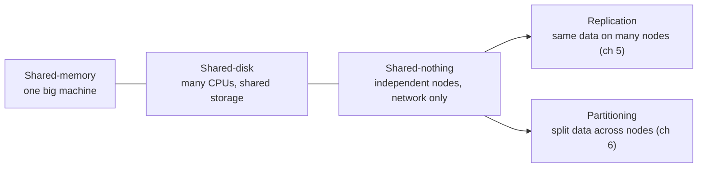

## 5.1 Leaders and followers

<BookRef pages="174–183" section="Leaders and Followers" />

The most common setup: **one leader** takes all writes and streams changes to **followers** (replicas). Clients can read from any of them.

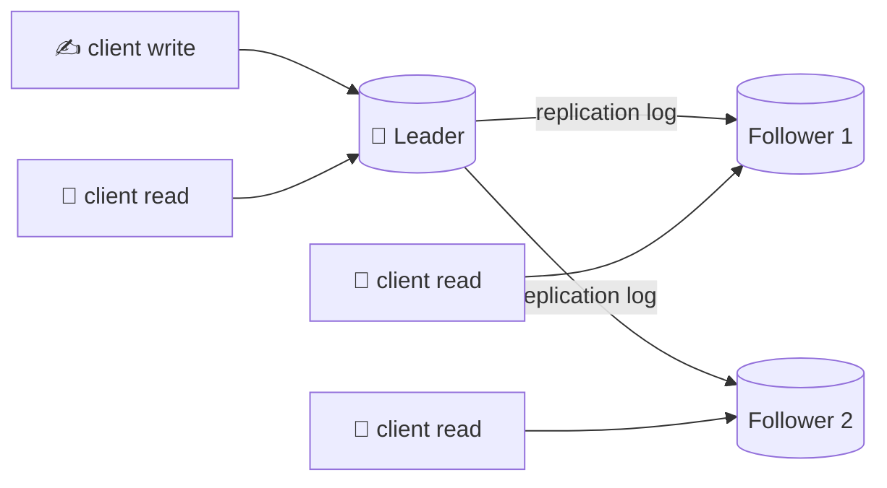

### Synchronous vs asynchronous

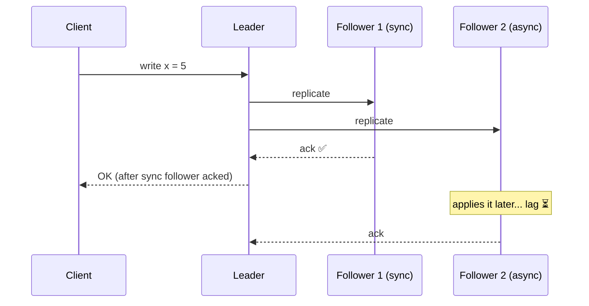

| | Synchronous | Asynchronous |
|---|---|---|
| Durability | Follower is guaranteed up to date | Writes can be **lost** if the leader dies before replicating |
| Availability | One slow follower blocks all writes | Leader keeps going whatever followers do |
| In practice | **Semi-synchronous**: one sync follower, the rest async | Very common, especially with many followers or across regions |

### Adding a new follower (no downtime)

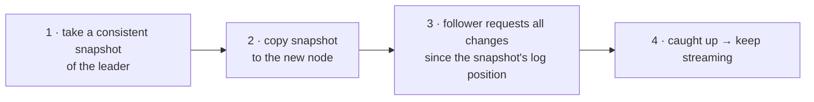

### Handling node outages

- **Follower fails:** on restart, it knows the last log position it processed, so it asks the leader for everything since then (**catch-up recovery**).
- **Leader fails → failover:**

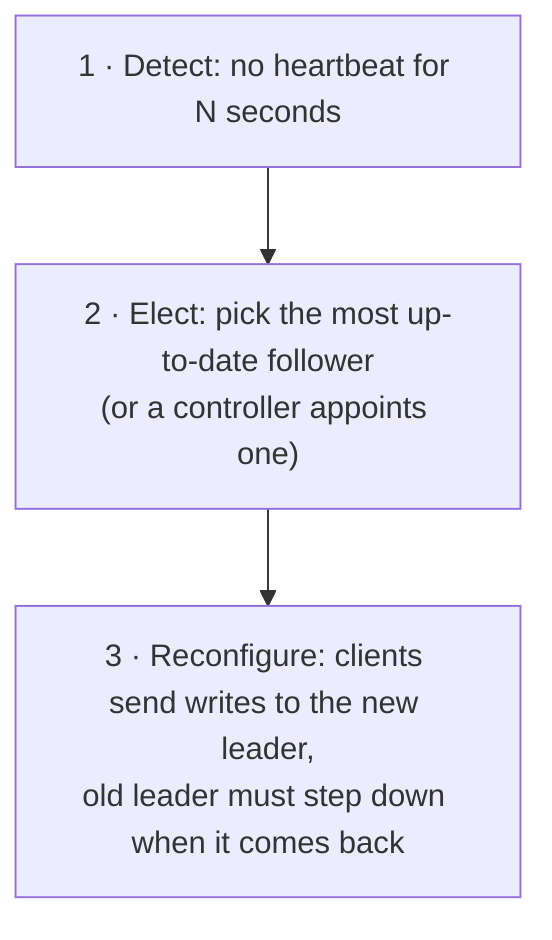

**Failover is full of traps:**

| Trap | What goes wrong |
|---|---|
| Lost writes | The new leader missed some async writes. They're usually discarded, and that can break things outside the DB (e.g. reused auto-increment IDs that a cache already used). |
| **Split brain** | Two nodes both believe they are the leader and both accept writes. Data diverges or gets corrupted. |
| Timeout too short | Unnecessary failovers during load spikes make things worse |
| Timeout too long | Longer outage |

### How the replication log is implemented

| Method | Idea | Problem |
|---|---|---|
| **Statement-based** | Send the SQL statements | Non-deterministic: `NOW()`, `RAND()`, auto-increment, triggers |
| **Write-ahead log shipping** | Send the storage engine's low-level WAL | Tied to storage format, so leader and follower usually need the same version. Makes zero-downtime upgrades hard. |
| **Logical (row-based) log** | Send "row inserted with these values", "row id=7 deleted" | Decoupled from the engine. Also enables **change data capture** (ch 11). |
| **Trigger-based** | App-level code copies changes | Flexible, but more overhead and bugs |

## 5.2 Problems with replication lag

<BookRef pages="183–190" section="Problems with Replication Lag" />

With async followers, reads can return stale data. The followers will catch up "eventually", which is called **eventual consistency**. In practice, lag can reach seconds or minutes. Three anomalies matter most.

### ① Reading your own writes

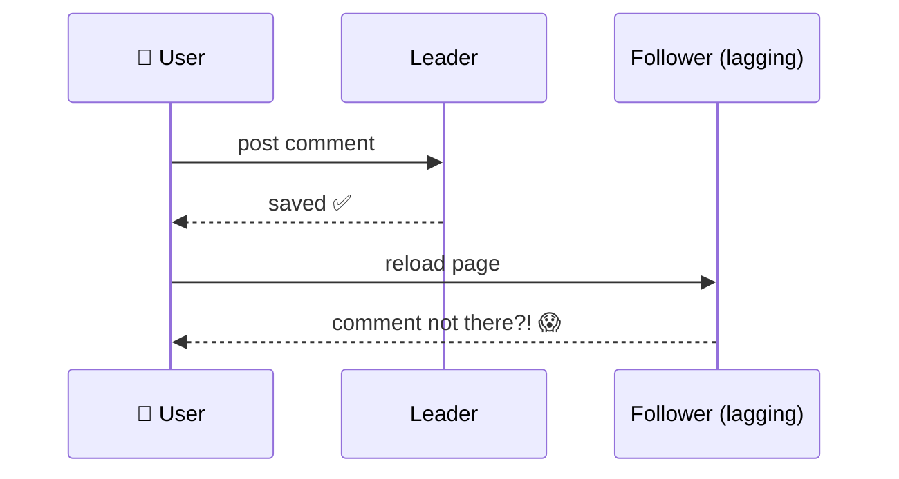

**Read-after-write consistency** fixes:
- read data the user may have changed (e.g. their own profile) from the leader
- read from the leader for 1 minute after the user's last write
- client remembers its last write timestamp; only use replicas that have caught up to it
- watch out for **cross-device** cases: the timestamp must be stored centrally

### ② Monotonic reads (no going back in time)

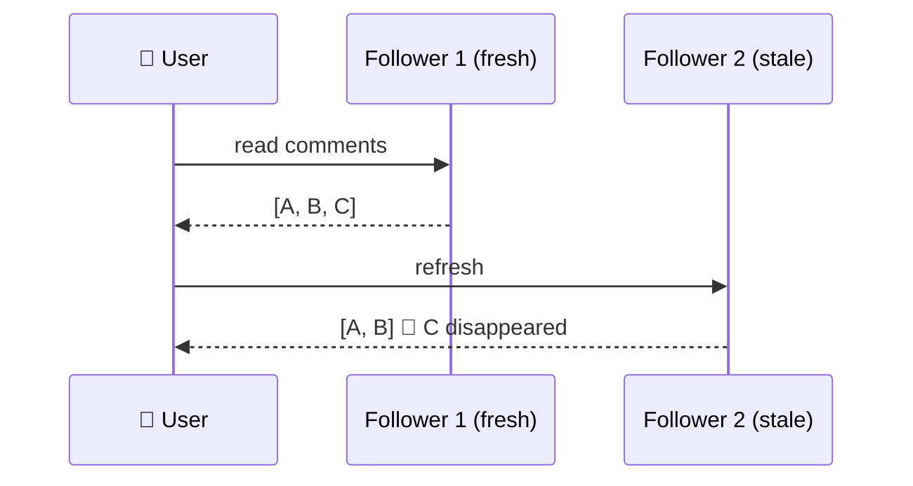

**Fix:** each user always reads from the **same replica** (e.g. pick by hash of user ID).

### ③ Consistent prefix reads (cause before effect)

If different partitions replicate at different speeds, an observer may see an answer before its question. **Fix:** write causally related data to the same partition, or track causal dependencies.

<KeyIdea>Don't pretend async replication is synchronous. Decide which of these guarantees each feature needs, or use transactions and stronger models (ch 7, ch 9).</KeyIdea>

## 5.3 Multi-leader replication

<BookRef pages="190–199" section="Multi-Leader Replication" />

More than one node accepts writes, and each leader replicates to the others.

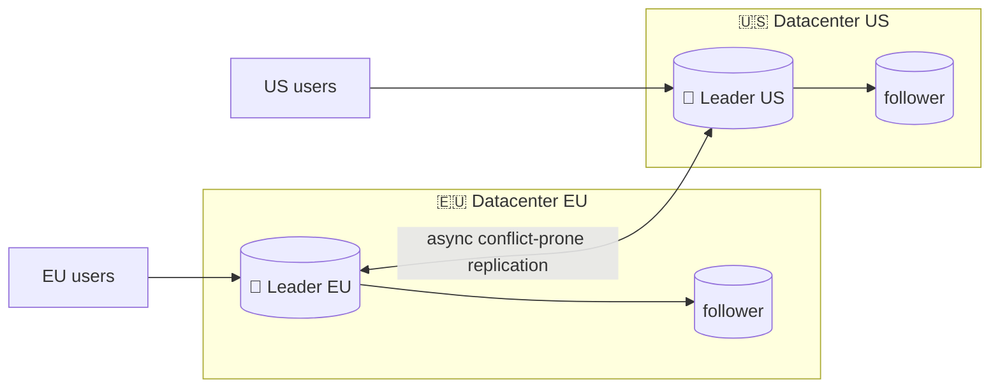

**Use cases:**
- **multi-datacenter** setups (lower write latency, survives a whole DC outage)
- **offline-capable clients**: every phone is effectively a "leader" with its own local DB
- **collaborative editing** like Google Docs

### The big problem: write conflicts

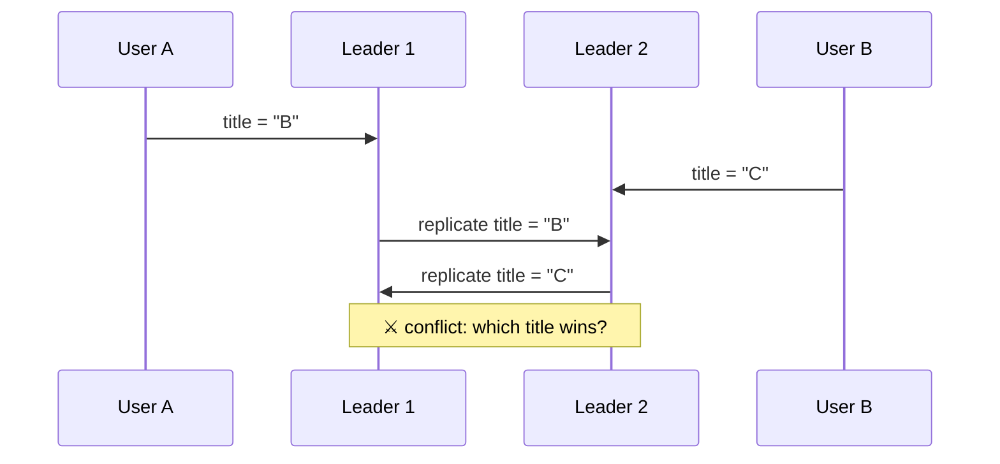

| Strategy | How | Caveat |
|---|---|---|
| **Avoid conflicts** | Route all writes for one record to the same leader (e.g. the user's "home" DC) | Breaks when that DC fails or the user moves |
| **Last write wins (LWW)** | Highest timestamp or ID wins | **Silently loses data** |
| Higher replica ID wins | Deterministic | Still loses data |
| **Merge values** | e.g. "B/C" | App-specific |
| **Record and resolve later** | Keep all versions (siblings); app or user resolves | Code complexity |
| **CRDTs, mergeable data structures, operational transforms** | Data types that merge automatically (counters, sets, text) | Limited to those types |

### Replication topologies

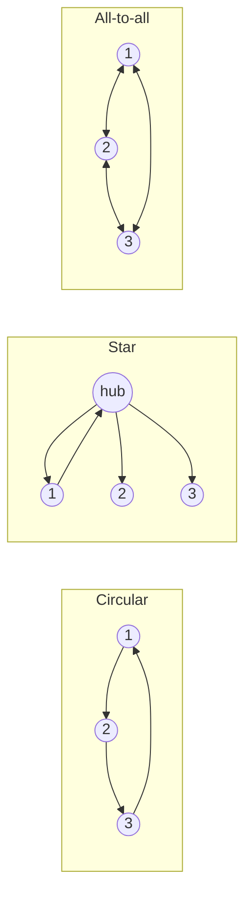

- Circular and star: one failed node can break the flow. Writes carry the IDs of nodes they passed through, to avoid infinite loops.
- All-to-all: more robust, but messages can **overtake** each other (an update arrives before the insert it depends on). Fix with **version vectors**.

## 5.4 Leaderless replication

<BookRef pages="199–214" section="Leaderless Replication" />

Dynamo-style (Cassandra, Riak, Voldemort): there's no leader. The client (or a coordinator) sends writes to **several replicas in parallel** and reads from several too.

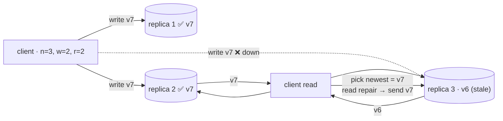

### Catching up stale replicas

- **Read repair:** when a read sees a stale replica, write the new value back to it.
- **Anti-entropy:** a background process compares replicas (e.g. Merkle trees) and copies missing data.

### Quorums: `w + r > n`

With *n* replicas, a write must be confirmed by *w* of them and a read must query *r*. If `w + r > n`, every read set **overlaps** every write set, so at least one replica in the read has the latest value.

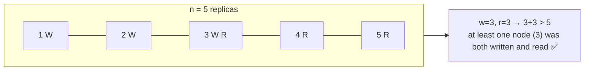

| Setting | Effect |
|---|---|
| Common: n odd, w = r = (n+1)/2 | Tolerates (n−1)/2 failed nodes |
| w = n, r = 1 | Fast reads, but any one node down blocks writes |
| w + r ≤ n | Lower latency and higher availability, but stale reads are likely |

**Quorums are not a guarantee of linearizability.** Edge cases:
- sloppy quorums (below)
- concurrent writes resolved with LWW (data lost to clock skew)
- a write that runs concurrently with a read
- a write that failed on some nodes but isn't rolled back on the nodes where it succeeded
- a node restored from a stale replica

### Sloppy quorums and hinted handoff

If the "home" nodes for a key are unreachable, accept the write on **other** reachable nodes. When the home nodes come back, those nodes **hand off** the data. This raises write availability, but `w + r > n` no longer guarantees you read the latest value.

### Detecting concurrent writes

Two operations are **concurrent** if neither knew about the other. Order in wall-clock time doesn't matter; what matters is **causality** ("happens-before").

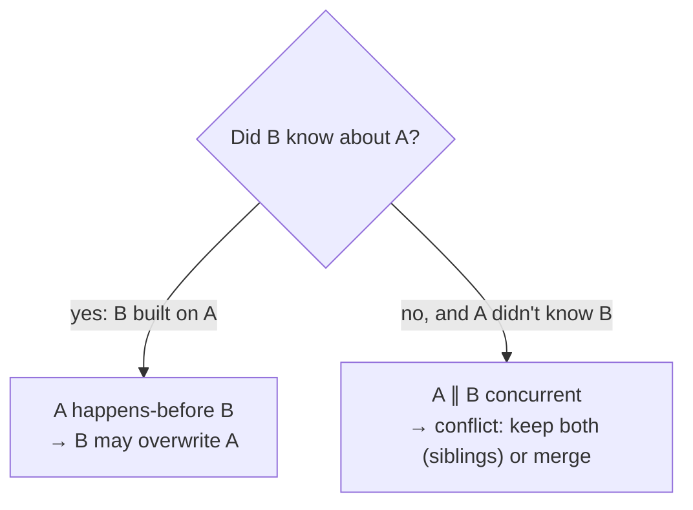

**Version numbers per key** (single replica):
1. the server increments a version on every write and returns it
2. the client must **read before writing** and send back the version it saw
3. the server overwrites everything at or below that version and **keeps newer values as siblings**

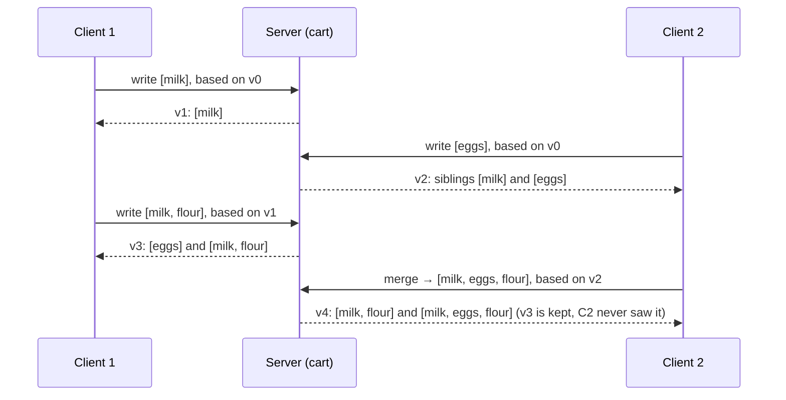

- Merging siblings: taking the **union** works for adding items. **Removals** need a **tombstone**, or the item comes back.
- With several replicas, use a **version vector**: one counter per replica, per key.

## Summary

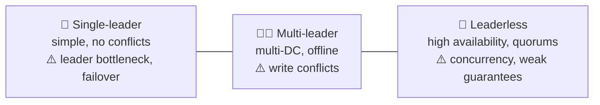

| Consistency guarantee under lag | Prevents |
|---|---|
| Read-your-writes | Not seeing your own update |
| Monotonic reads | Seeing time go backwards |
| Consistent prefix | Seeing effects before causes |

## 🧠 Check yourself

<Quiz question="n=3, w=2, r=2. How many nodes can be down while reads and writes both still succeed?" options={["0", "1", "2", "3"]} answer={1} explain="You need 2 of 3 for each operation, so you tolerate 1 unavailable node." />

<Quiz question="What does 'split brain' mean?" options={["A follower lags behind", "Two nodes both believe they are the leader", "A partitioned table", "A replica with corrupted disk"]} answer={1} explain="Both accept writes, so data diverges with no safe way to merge." />

<Quiz question="A user's comment vanishes and reappears between page refreshes. Which guarantee is missing?" options={["Read-your-writes", "Monotonic reads", "Consistent prefix", "Linearizability of quorums"]} answer={1} explain="They read from replicas with different lag. Pinning each user to one replica gives monotonic reads." />

<Quiz question="Why is statement-based replication risky?" options={["It's too slow", "Non-deterministic functions like NOW() or RAND() give different results on each replica", "It can't replicate deletes", "It requires the same storage engine"]} answer={1} explain="Each replica re-executes the statement, so non-deterministic parts diverge." />

**Interview prompts**
- Design a globally distributed shopping cart. Which replication style, and how do you merge carts?
- Your failover lost writes. What happened, and how would semi-sync help?
- Explain why `w + r > n` still doesn't give linearizability.
