# 5 · Replication

> **In one line:** keep a copy of the same data on several machines, to stay up when nodes die, to serve users from nearby, and to scale reads. Copying data that never changes is trivial; all the difficulty is in handling **changes** to the data, and there are three families of answers: **single-leader**, **multi-leader** and **leaderless** replication.

<BookRef pages="167–219" section="Part II intro + Chapter 5" />

## Part II: why distribute at all?

<BookRef pages="167–171" section="Part II. Distributed Data" />

Part I of the book assumed the data lives on **one machine**. Part II asks what changes when storage and retrieval involve **several machines**. There are three main reasons to go there:

<IconCards items={[
  {icon:'📈', title:'Scalability', text:'Data volume, read load or write load grows beyond what one machine can handle, so the load is spread over many machines.', color:'#3b82f6'},
  {icon:'🛟', title:'Fault tolerance / high availability', text:'The app must keep working when a machine, a rack or a whole datacenter goes down. Redundant machines take over.', color:'#10b981'},
  {icon:'🌍', title:'Latency', text:'Users are spread around the world. Keeping servers near each group of users avoids a round trip across an ocean.', color:'#f59e0b'}
]} />

### Scaling to higher load: three architectures

The simplest way to handle more load is to **buy a bigger machine** (vertical scaling, *scaling up*). Several CPUs, memory chips and disks are joined under one operating system, and a fast interconnect lets any CPU reach any part of memory or disk. This is the **shared-memory** architecture: the whole thing behaves like one big computer.

Problems with scaling up:

- **Cost grows faster than linearly.** A machine with twice the CPUs, RAM and disk usually costs a lot more than twice as much, and because of bottlenecks it often can't handle twice the load anyway.
- **Limited fault tolerance.** High-end machines have hot-swappable parts (you can replace a disk or a memory module without powering down), but the box is still in **one place**. A fire, flood or power cut in that building takes it out.

A second approach is **shared-disk**: several machines with their own CPUs and RAM store data on a **shared array of disks**, connected by a fast network (for example a SAN or NAS). Some data warehouses use this. Its scalability is limited by **contention** and the overhead of **locking**, because every machine wants the same disks.

The third approach, and the focus of Part II, is **shared-nothing** (horizontal scaling, *scaling out*). Each machine (a **node**) has its own CPUs, RAM and disks. Nodes coordinate only in **software**, over an ordinary network.

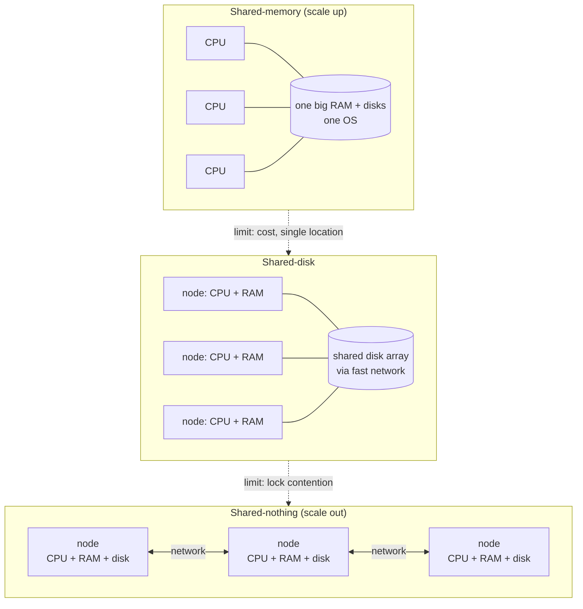

| | Shared-memory | Shared-disk | Shared-nothing |
|---|---|---|---|
| What is shared | RAM and disks, one OS | Disks only | Nothing except the network |
| Coordination | Hardware | Hardware + locks on shared storage | Software, over the network |
| Scaling limit | Price and size of the biggest box | Contention on the shared storage | Mainly your application's complexity |
| Fault tolerance | One location | Shared storage is a single point | Nodes can be in different racks, DCs, regions |
| Hardware | Specialised, expensive | Specialised storage network | Any machines with the best price/performance, including cloud VMs |

Why shared-nothing is popular:

- No special hardware: you pick whatever machines give the best price/performance ratio.
- You can spread data **across geographic regions**, cutting latency for users and surviving the loss of a whole datacenter.
- With cloud VMs, even a small company can run a multi-region setup.

The price is complexity. **The application developer must care**: a distributed shared-nothing system has constraints and trade-offs that the database can't fully hide. It may even limit which data models you can use. And it is not always faster: a well-tuned single-threaded program on one machine can beat a cluster of 100 cores for some jobs.

### Replication versus partitioning

Data is distributed across nodes in two common ways:

- **Replication:** keep a **copy of the same data** on several nodes, possibly in different locations. Gives redundancy (if one node is down, others still serve the data) and can improve performance. *This chapter.*
- **Partitioning (sharding):** split a big dataset into **smaller subsets** (partitions) and assign each one to a different node. *Chapter 6.*

They are separate mechanisms but usually **go together**: each partition is replicated on several nodes.

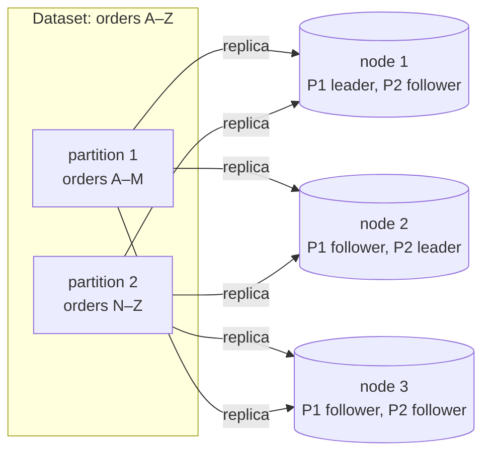

The rest of Part II follows a path: replication (ch 5), partitioning (ch 6), transactions (ch 7), what goes wrong in distributed systems (ch 8), and how to get agreement despite all that (ch 9).

## 5.0 Why replicate, and what's hard about it

<BookRef pages="173–174" section="Chapter 5. Replication" />

Replication means keeping a copy of the same data on several machines connected by a network. Reasons:

| Goal | How replication helps |
|---|---|
| **Reduce latency** | Keep a copy geographically close to users |
| **Increase availability** | The system keeps working if some parts fail |
| **Increase read throughput** | Spread read queries over many machines |

In this chapter we assume each node can hold a **full copy** of the dataset (partitioning comes in ch 6).

If the data never changed, replication would be easy: copy it once and you're done. **All the difficulty lies in changes.** The three popular algorithms for replicating changes are:

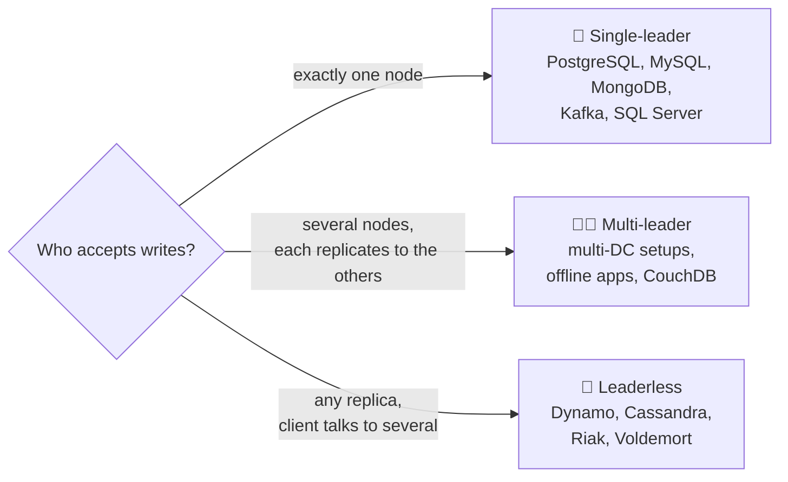

Trade-offs to keep in mind throughout: synchronous vs asynchronous replication, and how to handle failed replicas. These are configuration options in most databases, but the principles are the same everywhere. Database replication is old (the ideas date back to the 1970s and haven't changed much, because networks keep failing in the same ways), but many developers still assume a single-node world. The misunderstandings around **eventual consistency** are one result of that.

## 5.1 Leaders and followers

<BookRef pages="174–183" section="Leaders and Followers" />

Every node that stores a copy of the database is a **replica**. The key question: how do we make sure **every write ends up on every replica**? The most common answer is **leader-based replication** (also called *active/passive* or *master–slave* replication):

1. One replica is the **leader** (master, primary). Clients that want to **write** must send their writes to the leader, which first writes the new data to its own local storage.
2. The other replicas are **followers** (read replicas, slaves, secondaries, hot standbys). Whenever the leader writes new data, it also sends the change to all followers as a **replication log** or **change stream**. Each follower applies the writes **in the same order** as the leader processed them.
3. Clients can **read** from the leader or from any follower. Only the leader accepts writes.

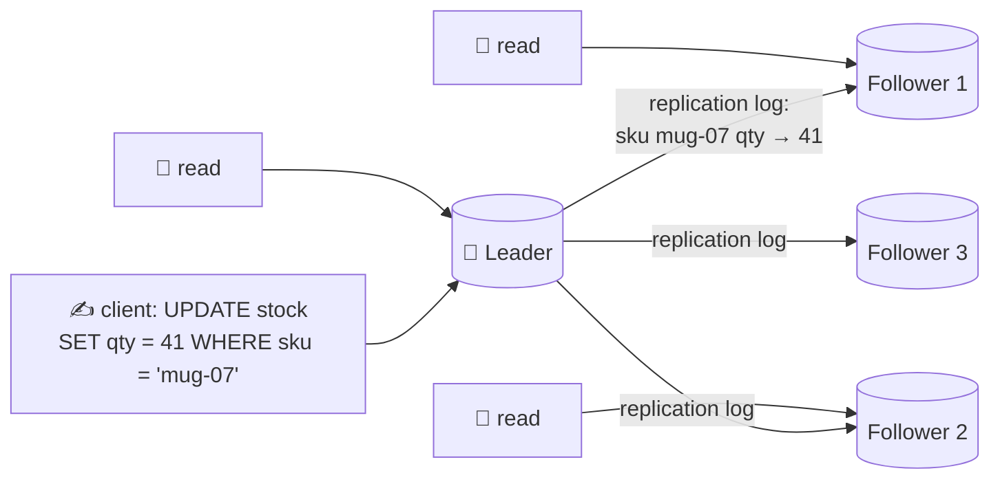

Where you'll find it:

- Relational: PostgreSQL (streaming replication), MySQL, Oracle Data Guard, SQL Server Always On availability groups.
- Non-relational: MongoDB, RethinkDB, Espresso.
- Message brokers: Kafka and RabbitMQ highly available queues.
- Some network filesystems and replicated block devices such as DRBD.

### Synchronous versus asynchronous replication

<BookRef pages="175–177" section="Synchronous Versus Asynchronous Replication" />

The important detail is **when the leader tells the client "done"**:

- **Synchronous:** the leader waits until a follower confirms it has received the write, and only then reports success and makes the write visible.
- **Asynchronous:** the leader sends the change but doesn't wait for the follower.

Picture an online shop with one synchronous and one asynchronous follower:

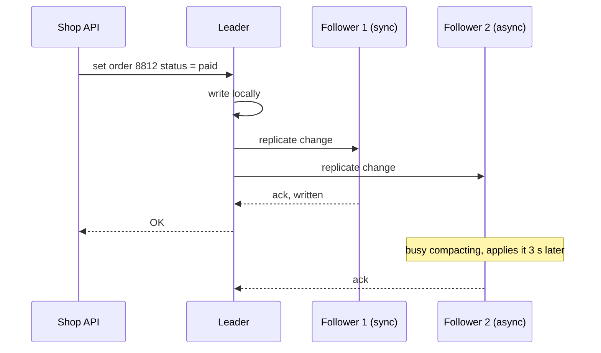

Usually replication is fast (followers apply changes in under a second), but there is **no upper bound**. A follower might fall minutes behind because it is recovering from a failure, the machine is near full capacity, or there's a network problem between nodes.

| | Synchronous follower | Asynchronous follower |
|---|---|---|
| **Durability** | Guaranteed to have an up-to-date copy. If the leader dies, the data is still there | A write confirmed to the client can be **lost** if the leader fails before it replicated |
| **Availability of writes** | If the sync follower is slow or down, the leader must **block all writes** until it is back | Leader keeps accepting writes even if all followers fall behind |
| **Latency of writes** | Includes a network round trip to the follower | Only the leader's local write |
| **Typical use** | One follower, for safety | Many followers, or followers far away |

**Making every follower synchronous is impractical**: any one node outage would halt the whole system. So in practice:

- **Semi-synchronous**: one follower is synchronous, the others asynchronous. If the sync follower becomes slow or unavailable, an async follower is promoted to synchronous. This guarantees the data is up to date on **at least two nodes** (the leader and one follower).
- **Fully asynchronous** is common too, especially with many followers or geographically distributed followers. It weakens durability but lets the leader keep processing writes whatever happens to the followers.

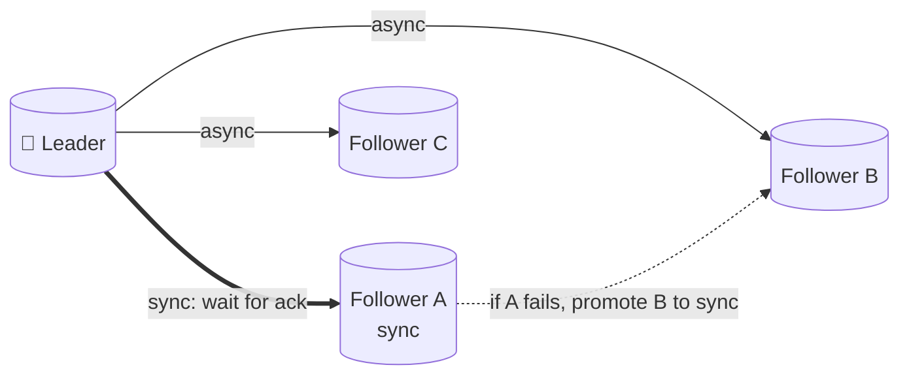

> **Research aside: chain replication.** Losing data when the leader fails is a serious problem for async systems, so researchers have looked for setups that don't lose data but still perform and stay available. **Chain replication** is a variant of synchronous replication where writes pass along a chain of nodes and reads are served from the tail. It's used in a few systems (for example Microsoft Azure Storage). Consistency and replication are closely tied to **consensus**, which chapter 9 explores.

<KeyIdea>Asynchronous replication trades durability for availability: a write the client saw as "committed" can still vanish if the leader crashes before passing it on.</KeyIdea>

### Setting up new followers

<BookRef pages="177–178" section="Setting Up New Followers" />

You'll regularly need new followers: to increase the number of replicas, or to replace failed nodes. How do you make sure the new follower has an **exact** copy?

- Simply copying data files isn't enough: clients are constantly writing, so a plain file copy would see different parts of the database at different points in time.
- You could **lock** the database to make it consistent, but that would kill availability.

The no-downtime procedure:

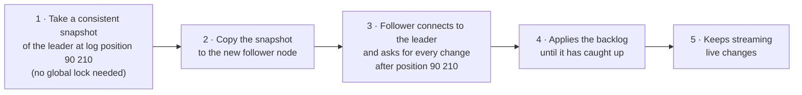

- Most databases can take snapshots without locking (they need them for backups anyway). Some need a third-party tool, like **Percona XtraBackup** for MySQL.
- The snapshot must be associated with an **exact position** in the leader's replication log. PostgreSQL calls it the **log sequence number (LSN)**; MySQL calls it the **binlog coordinates** (or a GTID set).
- The practical steps vary a lot between databases. In some it's fully automated; in others it's a multi-step manual workflow for an admin.

### Handling node outages

<BookRef pages="178–180" section="Handling Node Outages" />

Any node can go down: unexpectedly (crash, hardware fault) or on purpose (rebooting to install a kernel patch). Being able to reboot individual nodes **without downtime** is a big operational win. The goal is to keep the whole system running despite individual failures, and to keep the impact of a node outage as small as possible.

#### Follower failure: catch-up recovery

Each follower keeps a **log of the data changes** it has received from the leader on its local disk. If it crashes, or the network to the leader is briefly interrupted:

1. From its log, it knows the **last transaction it processed** before the fault.
2. It connects to the leader and requests all changes since that point.
3. Once it has applied them, it has caught up and continues receiving the stream as before.

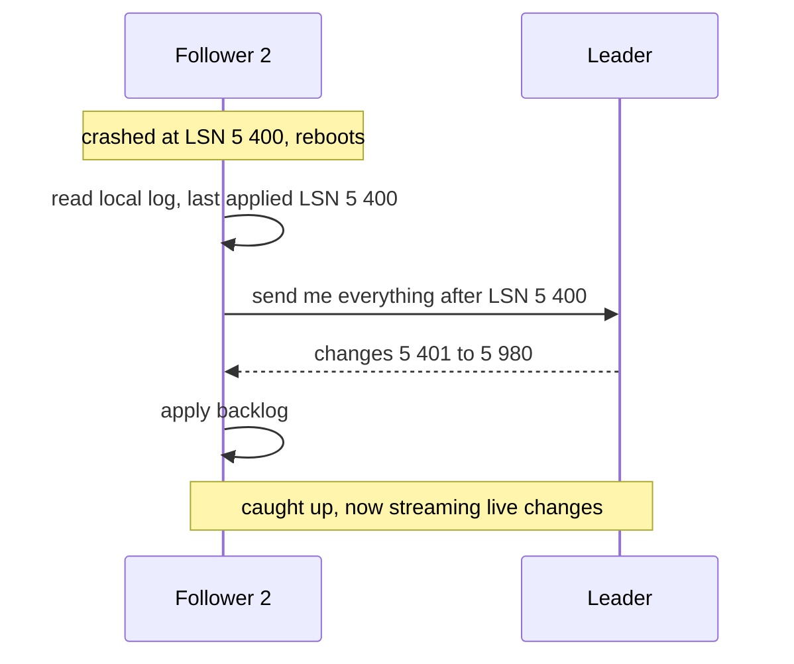

One operational detail: the leader must **keep its log long enough** for followers to catch up. In PostgreSQL this is handled with replication slots or retained WAL segments; if a follower is down for too long and the log has been recycled, it needs a fresh snapshot instead.

#### Leader failure: failover

Trickier. One of the followers must be **promoted** to the new leader, clients must be reconfigured to send writes to it, and the other followers must start consuming changes from it. This is **failover**. It can be manual (an admin is alerted and promotes a follower) or automatic:

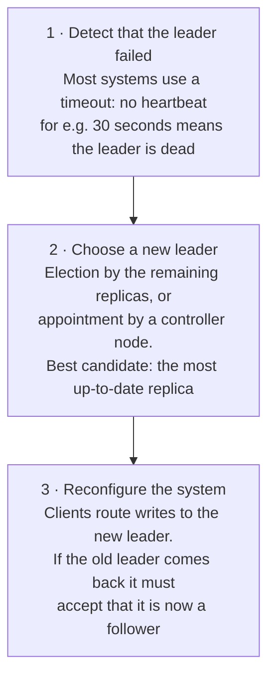

There is no foolproof way to detect a crash: nodes can't distinguish "dead" from "slow" or "unreachable", which is why a **timeout** is used. Getting all nodes to agree on a new leader is a **consensus** problem (chapter 9).

#### Failover is full of traps

| Trap | What can go wrong | Example of your own to remember it |
|---|---|---|
| **Lost writes** | With async replication, the new leader may not have received the last writes from the old one. If the old leader rejoins, what happens to its extra writes? The new leader may have received **conflicting** writes meanwhile. The common answer is to **discard** them, which breaks clients' durability expectations. | The old leader confirmed 40 ticket purchases that never reached the follower. After failover those purchases simply don't exist, though customers got confirmation emails. |
| **Discarded writes leak outside the DB** | Discarding is especially dangerous if other storage systems are coordinated with the DB contents. | Invoice IDs come from an auto-increment counter. The new leader is behind, so it reissues IDs 7001–7040, which the old leader had already used. A billing cache keyed by invoice ID now attaches old PDFs to new customers. |
| **Split brain** | Two nodes both believe they are the leader and both accept writes. No process for resolving conflicts, so data can be lost or corrupted. | During a network partition both sides promote a leader; each sells the last 5 seats of a flight. |
| **Unsafe fencing** | As a safety catch, some systems **shut down one node** when two leaders are detected (*STONITH*: shoot the other node in the head). Badly designed, this can shut down **both** nodes. | Both nodes see each other as rogue and power each other off. |
| **Timeout too long** | Longer time to recovery while the leader is truly gone. | 2-minute timeout means 2 minutes of failed checkouts. |
| **Timeout too short** | Unnecessary failovers. A temporary load spike or network glitch makes the leader slow, failover adds more load, and the system gets worse. | A Black Friday traffic spike triggers a failover, which triggers replay and catch-up traffic, which triggers another failover. |

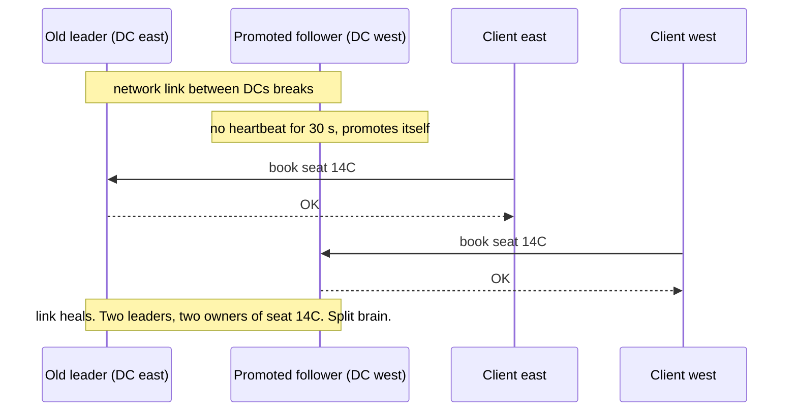

Because of these problems, some operations teams **prefer manual failover** even when the software supports automatic failover. These issues (unreliable networks, replica consistency, durability, availability, latency trade-offs) are fundamental problems of distributed systems, explored deeply in chapters 8 and 9.

<KeyIdea>Failover looks like a three-step recipe, but each step hides a hard problem: detecting failure needs timeouts, choosing a leader needs consensus, and the old leader needs fencing.</KeyIdea>

### Implementation of replication logs

<BookRef pages="180–183" section="Implementation of Replication Logs" />

How does the leader actually describe the changes it sends to followers? Four approaches.

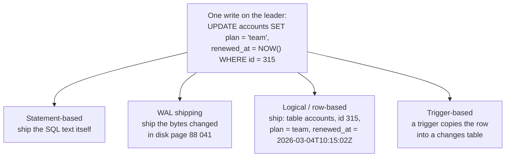

#### Statement-based replication

The leader logs every write **statement** (`INSERT`, `UPDATE`, `DELETE`) and sends the statement text to followers, which parse and execute it as if a client had sent it.

Ways it breaks:

- **Non-deterministic functions**: `NOW()` returns a different time on each replica, `RAND()` a different number.
- **Statements that depend on existing data** (auto-increment columns, or `UPDATE … WHERE score < (SELECT AVG(score) …)`) must run in **exactly the same order** on every replica, which limits concurrent transactions.
- **Side effects**: triggers, stored procedures, user-defined functions may behave differently on each replica unless they are fully deterministic.

Workarounds exist (the leader can replace non-deterministic calls with a fixed value before logging), but there are so many edge cases that other methods are generally preferred. MySQL used statement-based replication before version 5.1; it now switches to row-based by default when a statement is non-deterministic. VoltDB uses statement-based replication safely by **requiring transactions to be deterministic**.

```sql
-- Safe to re-run on a follower?
UPDATE coupons SET expires_at = NOW() + INTERVAL '7 days' WHERE code = 'SPRING7';
-- No: each replica computes its own NOW(), so expiry times differ by the replication lag.

UPDATE coupons SET expires_at = '2026-03-11 10:00:00' WHERE code = 'SPRING7';
-- Yes: the leader substituted a literal value before logging.
```

#### Write-ahead log (WAL) shipping

Storage engines already keep an append-only log of every write (chapter 3): the LSM segments themselves, or a B-tree's write-ahead log. The leader can simply **send this same log** to followers, and they build exact copies of the same data structures. PostgreSQL and Oracle work this way.

The big downside: the log describes data at a **very low level**: which bytes changed in which disk block. Replication is therefore tightly coupled to the **storage engine and its version**.

- Usually leader and followers can't run **different versions** of the database software.
- That makes **zero-downtime upgrades** hard. If the replication protocol allowed the follower to run a newer version, you could upgrade followers first, then fail over to an upgraded node. With WAL shipping this often isn't possible, so upgrades need downtime.

#### Logical (row-based) log replication

Use a **different log format for replication** than for storage, decoupling it from engine internals. A **logical log** describes changes at the granularity of **rows**:

- **Insert:** the new values of all columns.
- **Delete:** enough to identify the row, usually the primary key (or all old values if there's no key).
- **Update:** enough to identify the row plus the new values of all changed columns.

A transaction touching several rows produces several records followed by a "commit" record. MySQL's **binlog** in row-based mode works like this.

```json
{"txid": 77120, "op": "update", "table": "accounts",
 "key": {"id": 315},
 "after": {"plan": "team", "renewed_at": "2026-03-04T10:15:02Z"}}
{"txid": 77120, "op": "commit"}
```

Advantages:

- **Backward compatible**: leader and followers can run different software versions or even different storage engines.
- **Easy for external systems to parse.** Send the logical log to a data warehouse, a search index or a cache. This is **change data capture** (CDC), covered in chapter 11. Tools such as Debezium read exactly these logs from MySQL and PostgreSQL.

#### Trigger-based replication

Everything above is done by the database itself. Sometimes you need more flexibility: replicate **only a subset** of the data, replicate from one kind of database to another, or apply custom conflict resolution. Then you move replication **up to the application layer**.

- Some tools (like Oracle GoldenGate) read the database log and expose changes to an application.
- Or use database features: **triggers** and **stored procedures**. A trigger runs your code whenever a write occurs, and can log the change into a separate table, from which an external process reads it, applies any logic, and replicates it elsewhere. **Databus** (Oracle) and **Bucardo** (Postgres) worked this way.

```sql
CREATE TRIGGER capture_price_change
AFTER UPDATE OF price ON products
FOR EACH ROW
EXECUTE FUNCTION log_change('products');  -- writes (id, old, new, ts) to a changes table
```

| Method | Shipped content | Strengths | Weaknesses | Seen in |
|---|---|---|---|---|
| Statement-based | SQL text | Compact | Non-determinism, ordering, side effects | Old MySQL, VoltDB (deterministic) |
| WAL shipping | Low-level byte changes | Exact copy, no extra log | Tied to engine version, hard upgrades | PostgreSQL physical, Oracle |
| Logical / row-based | Row-level change records | Version-independent, CDC-friendly | Larger than statements for bulk updates | MySQL row binlog, Postgres logical decoding |
| Trigger-based | Whatever your code writes | Max flexibility, filtering, cross-DB | More overhead, more bugs, limited by triggers | Bucardo, Databus |

## 5.2 Problems with replication lag

<BookRef pages="183–190" section="Problems with Replication Lag" />

Leader-based replication fits **read-scaling** workloads well: mostly reads, few writes (common on the web). You add many followers and spread reads across them. This **read-scaling architecture** only realistically works with **asynchronous** replication: with synchronous replication, a single node failure would make the whole system unavailable for writes, and the more nodes, the likelier one is down.

But async followers may be **out of date**. Run the same query on the leader and on a follower at the same moment and you might get different answers. The inconsistency is temporary: stop writing and wait, and followers eventually catch up. This is **eventual consistency**.

"Eventually" is deliberately vague: there's no limit on how far a replica can fall behind. Normally the **replication lag** is a fraction of a second, but under load or network problems it can easily reach **seconds or minutes**. Then the inconsistencies become real user-facing problems. Three examples follow.

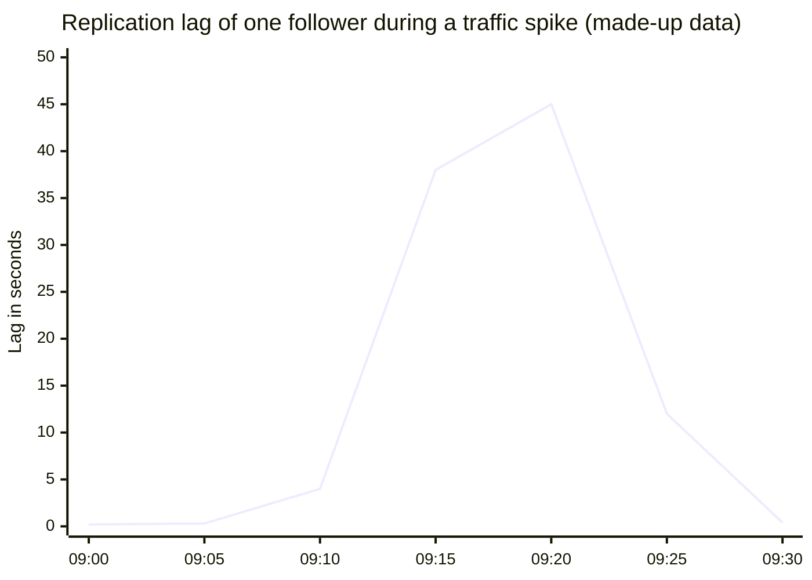

### Reading your own writes

<BookRef pages="184–186" section="Reading Your Own Writes" />

Many apps let a user submit data and then show it back to them. If the new data goes to the leader but the view is read from a lagging follower, the user's own update **seems to have vanished**.

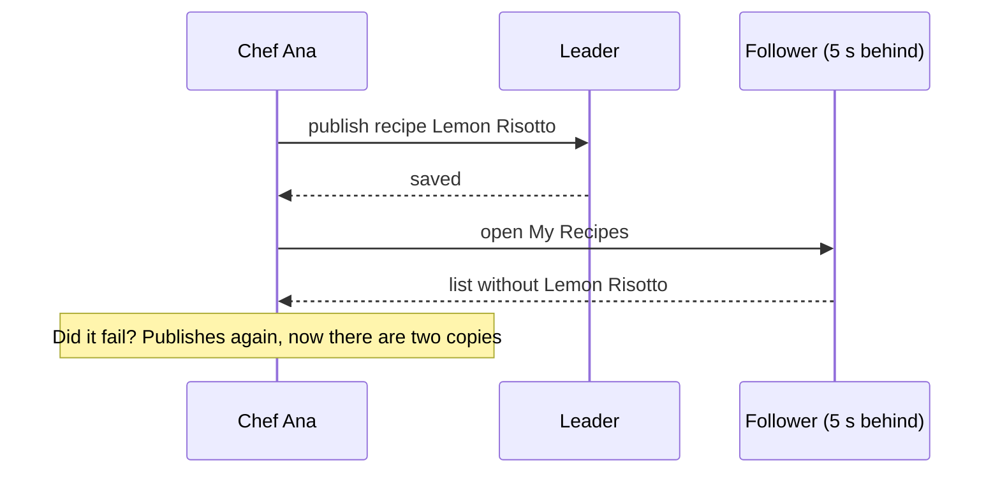

The guarantee we want is **read-after-write consistency** (also *read-your-writes*): if a user reloads the page, they always see updates **they submitted themselves**. It promises nothing about other users' updates, which may still appear later.

Techniques:

- **Read data the user may have modified from the leader**, everything else from followers. You need a way to know what might have been modified without querying. Example: a user's own profile is only editable by its owner, so read *your own* profile from the leader and *other people's* profiles from followers.
- If most things are user-editable, that sends most reads to the leader. Use other criteria instead: **for one minute after a user's last write**, read from the leader. Or monitor follower lag and avoid followers that are more than a minute behind.
- The **client remembers the timestamp of its most recent write**. The system ensures the replica serving that user's reads reflects updates at least up to that timestamp; if not, it uses another replica or waits. The timestamp can be a **logical timestamp** (a log sequence number) or wall-clock time (then clock sync matters, ch 8).
- With **several datacenters**, any request that must go to the leader has to be routed to the datacenter containing the leader.

```python
# Sketch: route a read using the user's last-write position
def read_my_recipes(user):
    min_lsn = session.get("last_write_lsn", 0)
    for replica in nearby_replicas():
        if replica.applied_lsn() >= min_lsn:
            return replica.query("SELECT * FROM recipes WHERE author = %s", user.id)
    return leader.query("SELECT * FROM recipes WHERE author = %s", user.id)
```

**Cross-device read-after-write** is a further complication: a user edits on their laptop and checks on their phone. Then:

- Remembering the last-write timestamp on the device doesn't work: the phone doesn't know what the laptop did. The metadata must be **centralised**.
- If replicas are spread over datacenters, the two devices may be routed to **different datacenters** (home Wi-Fi vs mobile network). If your approach needs reads from the leader, first route all of a user's devices to the **same datacenter**.

### Monotonic reads

<BookRef pages="186–187" section="Monotonic Reads" />

The second anomaly: a user can see things **moving backward in time**. It happens when a user makes several reads from **different replicas**.

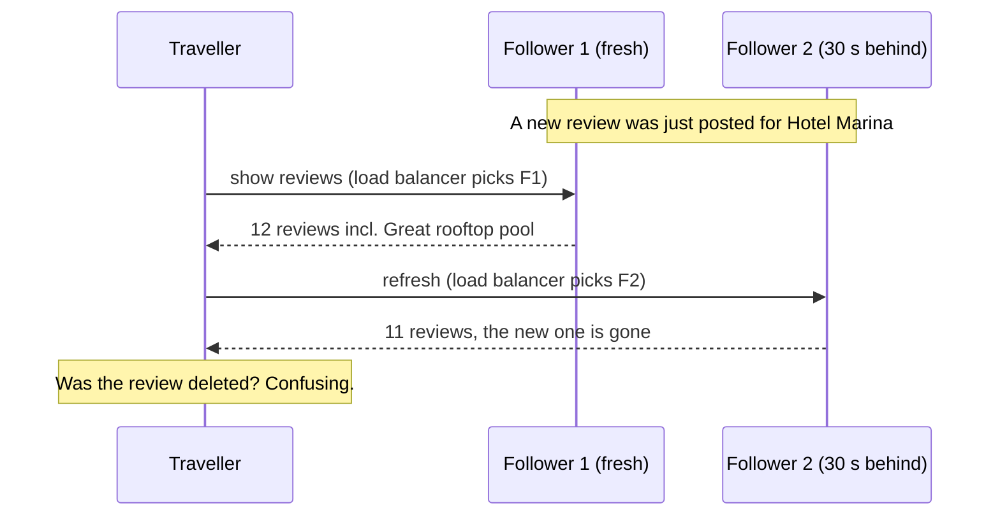

**Monotonic reads** guarantee this doesn't happen. It's a weaker guarantee than strong consistency but stronger than eventual consistency: you may read old data, but if one user makes several reads in sequence, they **won't see time go backward**. They never read older data after having read newer data.

Fix: make sure each user **always reads from the same replica** (different users can use different replicas). For example, choose the replica from a **hash of the user ID** rather than randomly. If that replica fails, the user's queries must be rerouted to another one, which needs care (it could be further behind).

```python
replica = replicas[hash(user_id) % len(replicas)]   # sticky per user
```

### Consistent prefix reads

<BookRef pages="187–189" section="Consistent Prefix Reads" />

The third anomaly breaks **causality**. Imagine a support chat:

- **Customer:** "Is the Oslo store open on Sunday?"
- **Agent:** "Yes, from 11 to 4."

There's a causal dependency: the answer only makes sense after the question. Now suppose a third person (a supervisor watching the chat) reads through followers. If the agent's message reaches their replica quickly but the customer's message is delayed, the supervisor sees the answer **before** the question.

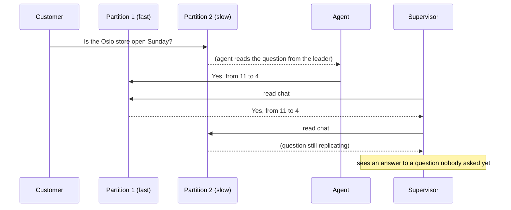

**Consistent prefix reads** guarantee that if a sequence of writes happens in a certain order, anyone reading them sees them **in the same order**.

Why does this mostly affect **partitioned (sharded)** databases? If the database always applied writes in the same order, reads would always see a consistent prefix. But in many distributed databases, **partitions operate independently**, so there's **no global ordering of writes**: a reader may see some parts of the database in an older state and others in a newer state.

Fixes:

- Make sure writes that are **causally related** go to the **same partition** (e.g. partition the chat by conversation ID). In some apps that can't be done efficiently.
- Use algorithms that explicitly **track causal dependencies** (see "happens-before" later in this chapter).

### Solutions for replication lag

<BookRef pages="189–190" section="Solutions for Replication Lag" />

With an eventually consistent system, ask: **what happens to the app if replication lag grows to several minutes or hours?** If the answer is "no problem", great. If it's a bad user experience, design the system to give a stronger guarantee, such as read-after-write.

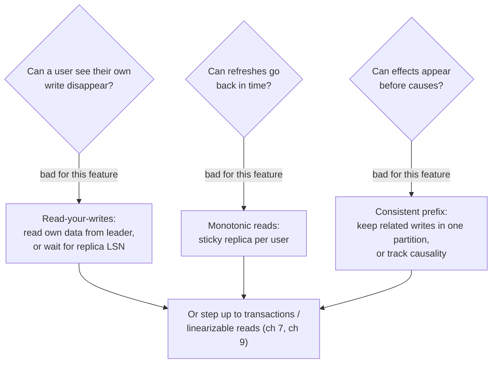

| Guarantee | Prevents | Typical fix |
|---|---|---|
| Read-after-write | Your own update seems lost | Leader reads for own data; LSN tracking |
| Monotonic reads | Seeing newer, then older data | Same replica per user |
| Consistent prefix | Effect seen before cause | Same partition for causally related data |

Pretending replication is synchronous when it's really asynchronous is a **recipe for problems later**. Handling all this in application code is complex and easy to get wrong. It would be better if developers didn't have to worry about it and could trust the database to "do the right thing". That's why **transactions** exist: a way for the database to provide stronger guarantees so the app can be simpler.

Single-node transactions have existed for a long time. Many distributed (replicated, partitioned) databases dropped them, claiming transactions are too expensive for performance and availability and that eventual consistency is inevitable in a scalable system. That claim is partly true but too simplistic; chapters 7 and 9 come back to it.

<KeyIdea>Don't pretend async replication is synchronous. For each feature, decide which lag anomalies would hurt users, and either design around them or use stronger guarantees.</KeyIdea>

## 5.3 Multi-leader replication

<BookRef pages="190–199" section="Multi-Leader Replication" />

Leader-based replication has one major downside: there's **only one leader**, and all writes go through it. If you can't reach the leader (say, a network interruption between you and it), **you can't write**.

A natural extension: allow **more than one node to accept writes**. Each node that processes a write must forward it to all other nodes. This is **multi-leader** (also *master–master* or *active/active*) replication. Each leader is simultaneously a **follower** of the other leaders.

### Use cases for multi-leader replication

<BookRef pages="190–193" section="Use Cases for Multi-Leader Replication" />

Multi-leader within a single datacenter rarely makes sense: the benefits rarely outweigh the added complexity. But there are situations where it's reasonable.

#### Multi-datacenter operation

With a database replicated across several datacenters (to tolerate the failure of an entire DC, or to be closer to users), plain leader-based replication puts the leader in **one** datacenter and all writes must cross to it. With multi-leader, you can have **a leader in each datacenter**. Within each DC, regular leader–follower replication; between DCs, each leader replicates its changes to the leaders in other DCs.

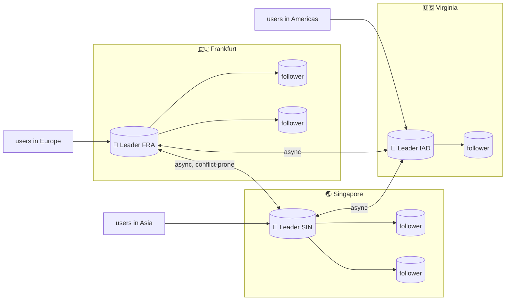

| Concern | Single leader across DCs | Multi-leader across DCs |
|---|---|---|
| **Performance** | Every write may cross the internet to the leader's DC: high latency, which partly defeats having multiple DCs | Every write is processed in the **local** DC and replicated asynchronously; inter-DC delay is hidden from users |
| **Tolerance of DC outages** | If the leader's DC fails, failover promotes a follower in another DC | Each DC operates independently; replication catches up when the failed DC returns |
| **Tolerance of network problems** | Inter-DC traffic goes over the public internet, which is less reliable than a local network. Single-leader is very sensitive, since writes are made synchronously over that link | Async replication tolerates network problems better; a temporary interruption doesn't stop writes |

Some databases support multi-leader natively; often it's done with external tools such as **Tungsten Replicator** (MySQL), **BDR** (PostgreSQL) and **GoldenGate** (Oracle).

The big downside: the same data may be **modified concurrently in two DCs**, and those **write conflicts must be resolved**. Multi-leader is often considered **dangerous territory** to avoid if possible: autoincrementing keys, triggers and integrity constraints can all behave badly with it.

#### Clients with offline operation

An app that must keep working **while disconnected from the internet** is another case. Think of a field-inspection app for engineers who visit wind turbines with no signal: they record findings on a tablet all day, and the app syncs with the server later.

- Every device has a **local database** that acts as a **leader** (it accepts writes).
- There's an asynchronous multi-leader sync process between the replicas on all devices.
- Replication lag can be **hours or days**, depending on when the device next has internet.

Architecturally this is the same as multi-leader across datacenters, taken to the extreme: **each device is a "datacenter"**, and the network between them is extremely unreliable. Getting it right is notoriously tricky (calendar sync is a classic example of how hard it is). Tools like **CouchDB** and its mobile cousins (PouchDB, Couchbase Lite) are designed for this mode.

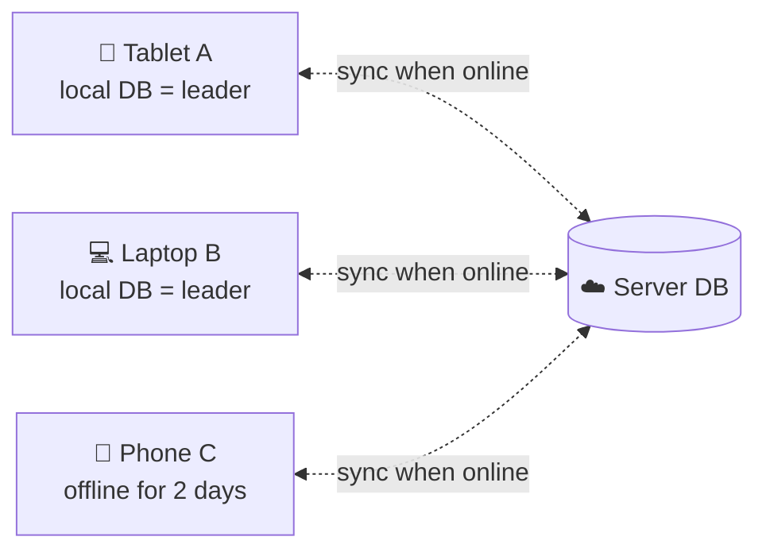

#### Collaborative editing

**Real-time collaborative editors** (Google Docs, Figma, Notion-style tools) let several people edit a document at the same time. It's not usually thought of as replication, but it's closely related to the offline case:

- When one user edits, the change is applied **instantly to their local replica** (the document in their browser), then **asynchronously replicated** to the server and other users.
- To **guarantee no conflicts**, the app could take a **lock** on the document before a user can edit; others must wait until the first user commits and releases it. That's equivalent to single-leader replication with transactions on the leader.
- For fast collaboration, you want a very **small unit of change** (one keystroke) and to **avoid locking**. That allows several users to edit at once, but brings all the multi-leader challenges, including conflict resolution.

### Handling write conflicts

<BookRef pages="193–197" section="Handling Write Conflicts" />

The biggest problem with multi-leader replication is that **write conflicts** can occur. Example of our own: a shared team task board. Priya changes a task's due date to **Friday** via the Frankfurt leader; at nearly the same time Marcus changes the same task's due date to **Monday** via the Singapore leader. Each write succeeds locally. The conflict is only detected later, when the changes replicate asynchronously.

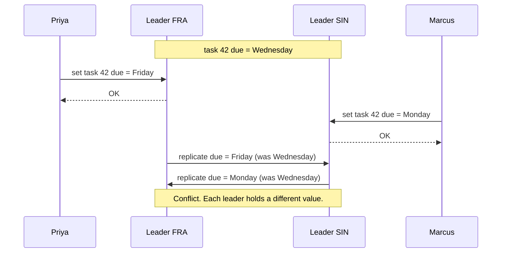

#### Synchronous versus asynchronous conflict detection

- In a **single-leader** database, the second writer either **blocks** until the first write completes, or the second write transaction is **aborted** and the user must retry.
- In **multi-leader**, both writes succeed, and the conflict is detected **asynchronously** at some later time. By then it may be too late to ask the user to resolve it.

You *could* make conflict detection synchronous: wait for the write to replicate to all replicas before telling the user it succeeded. But then you lose the main advantage of multi-leader (each replica accepting writes independently). In that case, just use single-leader replication.

#### Conflict avoidance

The simplest strategy: **avoid conflicts**. If all writes for a particular record go through the **same leader**, conflicts can't happen. Since many multi-leader implementations handle conflicts poorly, avoiding them is a **frequently recommended approach**.

- Example: in a note-taking app where users only edit their own notes, route each user's requests to a **"home" datacenter** and use that DC's leader for all their reads and writes. From a single user's point of view, it's essentially single-leader.
- It breaks when you need to **change the designated leader** for a record: the home DC failed, or the user moved to another continent and is now closer to a different DC. Then concurrent writes on different leaders become possible again.

#### Converging toward a consistent state

A single-leader database applies writes in a **sequential order**: the last write determines the final value. In multi-leader there's **no defined ordering**, so it's unclear what the final value should be. In the example, Frankfurt ends with Friday and Singapore with Monday.

If each replica just applied writes in the order it saw them, the database would end up **inconsistent forever**. Every replication scheme must ensure data is eventually the same on all replicas: the database must resolve conflicts in a **convergent** way, meaning all replicas arrive at the **same final value** once all changes have replicated.

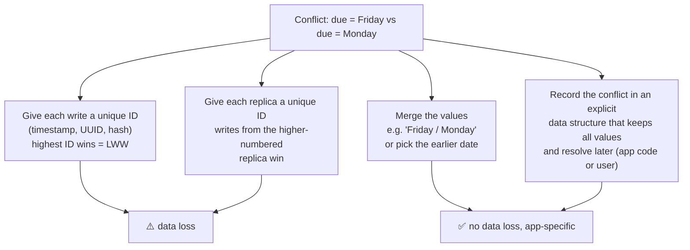

- **Last write wins (LWW)**: give each write a unique ID (timestamp, random number, UUID, hash of key+value), pick the highest ID as the winner and throw away the rest. Popular, but **prone to data loss**: one of the users' changes silently vanishes.
- **Replica precedence**: writes that originated at a higher-numbered replica always win. Also implies data loss.
- **Merge the values**: e.g. order them alphabetically and concatenate. Fine for some data, nonsense for a due date.
- **Keep everything and resolve later**: store all conflicting versions in an explicit data structure, and write application code that resolves the conflict later (possibly by asking the user).

#### Custom conflict resolution logic

The most appropriate resolution often depends on the application, so most multi-leader tools let you write **your own resolution code**. It can run:

- **On write:** when the database detects a conflict in the replication log, it calls a **conflict handler**. It typically can't prompt the user (it runs in a background process) and must be quick. *Bucardo* lets you write a Perl snippet for this.
- **On read:** all conflicting writes are **stored**. The next time the data is read, the multiple versions (**siblings**) are returned to the app, which resolves them (automatically or by asking the user) and writes the result back. *CouchDB* works this way.

Resolution usually applies at the level of an **individual row or document**, not a whole transaction. A transaction that makes several writes atomically has each write considered separately for conflicts.

```js
// On-read resolution for the task board: keep the EARLIEST due date and log the conflict
function resolveDueDate(siblings) {
  const winner = siblings.reduce((a, b) => (a.due < b.due ? a : b));
  auditLog.write({ task: winner.id, kept: winner.due, discarded: siblings.map(s => s.due) });
  return winner;
}
```

> **Automatic conflict resolution research.** Conflict-resolution rules quickly get complicated and error-prone (Amazon's shopping cart famously had a merge bug where removed items reappeared). Interesting research directions:
> - **Conflict-free replicated datatypes (CRDTs):** data structures (sets, maps, ordered lists, counters, registers) that can be edited concurrently by multiple users and **resolve conflicts automatically in sensible ways**. Some CRDTs are implemented in Riak 2.0; Automerge and Yjs bring them to apps.
> - **Mergeable persistent data structures:** track history explicitly, like **Git**, and use a **three-way merge** (CRDTs use two-way merges).
> - **Operational transformation (OT):** the algorithm behind Google Docs and Etherpad. Designed for concurrent editing of an **ordered list of items**, like the characters of a text document.

| Approach | Idea | Good for |
|---|---|---|
| CRDTs | Data types whose merge is commutative, associative and idempotent, so replicas converge in any order | Counters, sets, maps, collaborative text |
| Mergeable persistent structures | Keep version history; three-way merge against the common ancestor | Git-like document stores |
| Operational transformation | Transform concurrent edits on a sequence against each other so they apply in any order | Real-time text editors |

#### What is a conflict?

Some conflicts are obvious: two writes changed the **same field of the same record** to different values. Others are **subtle**. Example of our own: a co-working space lets members book desks. Each desk can be booked by only one person at a time. If two bookings for the same desk and time are created on **two different leaders**, there's a conflict, even though neither write touched the other's record: they **inserted two different rows**. The application must notice the overlap.

```mermaid
flowchart LR
  B1["Leader FRA: INSERT booking<br/>desk D7, 10:00–12:00, Lena"] --> CH{"Overlap check<br/>passes locally on each leader"}
  B2["Leader SIN: INSERT booking<br/>desk D7, 11:00–13:00, Kofi"] --> CH
  CH --> R["After replication:<br/>two bookings for desk D7 at 11:00.<br/>Nobody edited the same row,<br/>yet it's a conflict."]
```

There's no quick ready-made answer; chapter 7 (write skew, phantoms) and chapter 12 return to this.

### Multi-leader replication topologies

<BookRef pages="197–199" section="Multi-Leader Replication Topologies" />

A **replication topology** describes the communication paths along which writes propagate from one node to another. With two leaders there's only one sensible topology; with more, many are possible.

```mermaid
flowchart LR
  subgraph CIRC["Circular"]
    a1((A)) --> a2((B)) --> a3((C)) --> a4((D)) --> a1
  end
  subgraph STAR["Star / tree"]
    b0((Hub)) <--> b1((A))
    b0 <--> b2((B))
    b0 <--> b3((C))
  end
  subgraph ALL["All-to-all"]
    c1((A)) <--> c2((B))
    c2 <--> c3((C))
    c1 <--> c3
    c1 <--> c4((D))
    c2 <--> c4
    c3 <--> c4
  end
```

| Topology | How writes flow | Notes |
|---|---|---|
| **All-to-all** | Every leader sends its writes to every other leader | Most general; more fault-tolerant, since messages can travel along different paths |
| **Circular** | Each node receives writes from one node and forwards them (plus its own) to one other node | MySQL's default for a while. A single node failure can **interrupt the flow** until manually reconfigured |
| **Star (tree)** | One root node forwards writes to all others | Can be generalised to a tree. The root is a single point of failure |

**Avoiding infinite loops** in circular and star topologies: each node is given a **unique identifier**, and every write is tagged in the replication log with the IDs of all nodes it has passed through. A node that receives a change tagged with its own ID ignores it.

**Problem with all-to-all: messages can overtake each other.** Network links run at different speeds, so some replication messages may "overtake" others. Example: client 1 inserts a new user row on leader A, then client 2 updates that row on leader C (having read it there). Leader B might receive the update **before** the insert, and the update refers to a row it doesn't have yet.

```mermaid
sequenceDiagram
  participant A as Leader A
  participant C as Leader C
  participant B as Leader B
  A->>C: INSERT user 900 (fast link)
  Note over C: client changes user 900 email
  C->>B: UPDATE user 900 email (fast link)
  A->>B: INSERT user 900 (slow link, arrives late)
  Note over B: received UPDATE for a row that does not exist yet
```

This is a **causality** problem, like the consistent prefix reads above: the update depends on the insert. Attaching a **timestamp** to every write isn't enough, because clocks can't be trusted to be in sync (ch 8). The correct technique is **version vectors** (covered at the end of this chapter).

Conflict detection is **poorly implemented** in many multi-leader systems. For example, at the time the book was written, PostgreSQL BDR didn't provide causal ordering of writes, and Tungsten Replicator for MySQL didn't even try to detect conflicts. If you use a multi-leader system, **read the docs carefully and test** that it really gives the guarantees you think.

## 5.4 Leaderless replication

<BookRef pages="199–214" section="Leaderless Replication" />

Single-leader and multi-leader replication are both based on the idea that a client sends a write to one node (the leader), and the database copies it to the others. A leader decides the order in which writes are processed, and followers apply them in the same order.

Some data stores **abandon the leader concept** and let **any replica accept writes directly from clients**. Some early replicated systems were leaderless, but the idea was mostly forgotten during the era of relational DBs. It became fashionable again after Amazon used it for its in-house **Dynamo** system. **Riak, Cassandra and Voldemort** are open-source datastores with Dynamo-inspired leaderless models, so this kind of database is called **Dynamo-style**. (Amazon's later DynamoDB product uses a different, leader-based architecture.)

Two variants:

- The **client sends its writes directly** to several replicas.
- A **coordinator node** does this on the client's behalf. Unlike a leader, the coordinator **doesn't enforce a particular ordering** of writes.

### Writing to the database when a node is down

<BookRef pages="199–203" section="Writing to the Database When a Node Is Down" />

Imagine a database with three replicas, and one is unavailable (maybe rebooting for an update). In leader-based replication you might need a failover. **In leaderless, failover doesn't exist.** The client sends the write to all three replicas **in parallel**; the two available ones accept it; the client sees two OKs out of three and treats the write as **successful**, ignoring the missed one.

Now the unavailable node comes back. It missed the write, so reading from it returns **stale (outdated)** values. To fix that, the client sends read requests to **several nodes in parallel**, and uses **version numbers** to pick the newest value.

```mermaid
flowchart LR
  W["client write<br/>cart:ana = 3 items (v12)"] -->|"✅"| R1[("replica 1<br/>v12")]
  W -->|"✅"| R2[("replica 2<br/>v12")]
  W -.->|"❌ down, rebooting"| R3[("replica 3<br/>v11 (stale)")]
  RD["client read<br/>r = 2"] --> R2
  RD --> R3
  R2 -->|"v12"| RD
  R3 -->|"v11"| RD
  RD -->|"newest wins = v12<br/>read repair: send v12"| R3
```

#### Read repair and anti-entropy

How does a replica that missed writes catch up? Two mechanisms in Dynamo-style stores:

- **Read repair:** when a client reads from several nodes in parallel, it can **detect stale responses**. In the diagram, replica 3 returned v11 while replica 2 returned v12, so the client writes v12 back to replica 3. Works well for values that are **read frequently**.
- **Anti-entropy process:** a **background process** constantly looks for differences between replicas and copies missing data. Unlike a leader's replication log, it doesn't copy writes in any particular order, and there may be a significant delay before data is copied. Cassandra and Riak use **Merkle trees** to find differing ranges cheaply.

Not every system implements both. Without anti-entropy, values that are **rarely read** may be missing from some replicas, reducing durability, because read repair only fixes what someone reads.

```mermaid
flowchart TB
  subgraph RA["Replica A Merkle tree"]
    A0["root 9f2"] --> A1["keys a–m: 41c"]
    A0 --> A2["keys n–z: 7d0"]
  end
  subgraph RB["Replica B Merkle tree"]
    B0["root 3e8"] --> B1["keys a–m: 41c"]
    B0 --> B2["keys n–z: b55"]
  end
  A0 -.->|"roots differ"| B0
  A2 -.->|"only n–z differs:<br/>sync just that range"| B2
```

#### Quorums for reading and writing

In the example, the write succeeded on 2 of 3 replicas. How many must succeed for it to count?

In general, with **n** replicas, every write must be confirmed by **w** nodes to be considered successful, and every read must query at least **r** nodes. As long as `w + r > n`, we expect an up-to-date value when reading, because at least one of the r nodes must be up to date. Reads and writes obeying these r and w values are called **quorum** reads and writes. Think of r and w as the minimum number of votes required for a read or write to be valid.

```mermaid
flowchart LR
  subgraph N5["n = 5 replicas · w = 3 · r = 3"]
    direction LR
    N1["node 1<br/>written ✍️"]
    N2["node 2<br/>written ✍️"]
    N3["node 3<br/>written ✍️ + read 📖"]
    N4["node 4<br/>read 📖"]
    N5x["node 5<br/>read 📖"]
  end
  N5 --> OV["3 + 3 = 6 > 5, so the sets overlap:<br/>node 3 is in both and returns the new value"]
```

In Dynamo-style databases, **n, w and r are typically configurable**. A common choice is n odd (typically 3 or 5) and `w = r = (n + 1) / 2` rounded up. You can vary them:

| Configuration | Tolerates | Good for |
|---|---|---|
| n = 3, w = 2, r = 2 | 1 unavailable node | Balanced default |
| n = 5, w = 3, r = 3 | 2 unavailable nodes | Higher fault tolerance |
| n = 3, w = 3, r = 1 | Reads: 2 down; writes: none down | Read-heavy, few writes (but one dead node blocks writes) |
| n = 3, w = 1, r = 3 | Writes: 2 down; reads: none down | Write-heavy logging where reads are rare |
| `w + r ≤ n` | More nodes down, lower latency | Accepting possibly stale reads |

The quorum condition `w + r > n` lets the system **tolerate unavailable nodes**:

- If `w < n`, we can still process writes if a node is unavailable.
- If `r < n`, we can still process reads if a node is unavailable.
- With n = 3, w = 2, r = 2, we tolerate one unavailable node. With n = 5, w = 3, r = 3, two.

Normally reads and writes are **always sent to all n replicas in parallel**. w and r determine **how many we wait for**: how many of the n must report success before we consider the read or write successful. It doesn't matter *why* a node is unavailable (crashed, powered off, error executing the operation, network interruption), only whether it returned a successful response. If fewer than w or r nodes are available, writes or reads **return an error**.

```sql
-- Cassandra lets you pick per query (RF = 3 here)
CONSISTENCY QUORUM;   -- wait for 2 of 3
SELECT items FROM carts WHERE user_id = 'ana';
CONSISTENCY ONE;      -- wait for 1: faster, may be stale
```

### Limitations of quorum consistency

<BookRef pages="203–205" section="Limitations of Quorum Consistency" />

If `w + r > n`, every read will usually return the latest value, because the set of nodes written to and the set read from must **overlap**. Often r and w are chosen as a majority (more than n/2), which ensures `w + r > n` while still tolerating up to n/2 failures. But quorums **don't have to be majorities**: what matters is that the sets overlap in at least one node. Other assignments are possible.

You can also set `w + r ≤ n`. Then reads and writes still go to n nodes, but fewer successes are needed. You're **more likely to read stale values**, but get **lower latency and higher availability**: if the network is interrupted and many replicas are unreachable, there's a higher chance you can keep going. Only once the number of reachable replicas falls below w or r does the database become unavailable.

Even with `w + r > n`, there are edge cases where **stale values come back**:

| Edge case | Why it breaks the overlap argument |
|---|---|
| **Sloppy quorum** in use | The w writes may land on different nodes than the r reads, so overlap is no longer guaranteed (next section) |
| **Two writes occur concurrently** | Not clear which happened first. The only safe option is to merge. If a winner is picked by timestamp (LWW), writes can be lost to **clock skew** |
| **A write is concurrent with a read** | The write may be reflected on only some replicas; undetermined whether the read returns old or new |
| **A write succeeded on fewer than w replicas** | It's reported as failed but **not rolled back** on the replicas where it succeeded. Later reads may or may not return it |
| **A node carrying a new value fails and is restored from a replica with an old value** | The number of replicas holding the new value can fall below w, breaking the quorum condition |
| **Unlucky timing** | Even if everything works correctly, there are edge cases around timing (see linearizability in ch 9) |

So although quorums *appear* to guarantee that a read returns the latest written value, in practice it's **not so simple**. Dynamo-style databases are generally optimised for use cases that **tolerate eventual consistency**. The parameters w and r let you adjust the **probability** of stale values being read, but it's wise not to treat them as absolute guarantees.

In particular, you usually **don't get** the guarantees from the replication-lag section (read-your-writes, monotonic reads, consistent prefix reads), so those anomalies can occur. Stronger guarantees generally require **transactions or consensus**.

#### Monitoring staleness

Operationally, you should monitor whether your database returns up-to-date results. Even if your app tolerates stale reads, you need to understand the **health** of replication: if it falls behind significantly, investigate the cause (a network problem, an overloaded node).

- **Leader-based:** the database usually exposes **replication lag** metrics you can feed into monitoring. Easy, because writes are applied to leader and followers **in the same order**, and each node has a position in the log. Subtract a follower's position from the leader's position to get the lag.
- **Leaderless:** there's **no fixed order** in which writes are applied, which makes monitoring harder. If the database only uses read repair (no anti-entropy), there's **no limit to how old a value can be**: an infrequently read value may stay stale forever.

There's research on measuring the probability of stale reads in leaderless replicas depending on n, w and r, and on predicting expected staleness (e.g. the PBS "probabilistically bounded staleness" work). Making **eventual consistency quantifiable** ("how eventual?") is a good idea that isn't yet common practice.

```sql
-- PostgreSQL: lag of each follower as seen from the leader
SELECT application_name,
       pg_wal_lsn_diff(pg_current_wal_lsn(), replay_lsn) AS bytes_behind,
       replay_lag
FROM pg_stat_replication;
```

### Sloppy quorums and hinted handoff

<BookRef pages="205–206" section="Sloppy Quorums and Hinted Handoff" />

Appropriately configured quorums let a database tolerate the failure of individual nodes **without failover**. They also tolerate individual nodes being **slow**, because requests don't wait for all n nodes, just w or r. This makes leaderless databases appealing for **high availability and low latency** with occasional stale reads.

But quorums aren't as fault-tolerant as they could be. A **network interruption** can easily cut a client off from many database nodes. Those nodes are alive, and other clients might reach them, but to *this* client they look dead. It may then be impossible to reach w or r nodes, so the client can no longer reach a quorum.

In a large cluster (significantly more than n nodes), the client can probably connect to **some** nodes during the interruption, just not the ones that make up the quorum for this particular value. The trade-off:

- Return errors for all requests that can't reach a quorum, **or**
- Accept writes anyway, writing them to **some nodes that are reachable but aren't among the n "home" nodes** for that value.

The second option is a **sloppy quorum**: writes and reads still require w and r successful responses, but those may include nodes that are not among the designated n home nodes. Once the network is fixed, writes that a node temporarily accepted on behalf of another are sent to the appropriate home nodes. This is **hinted handoff**. (Analogy: you're locked out of your house, so you knock on the neighbour's door and ask to stay on their couch temporarily.)

```mermaid
sequenceDiagram
  participant C as Client (cut off from home nodes)
  participant H1 as Home node A
  participant H2 as Home node B
  participant X as Stand-in node X
  participant Y as Stand-in node Y
  Note over C,H2: network partition, A and B unreachable
  C->>X: write key photo-77 (hint: belongs to A)
  C->>Y: write key photo-77 (hint: belongs to B)
  X-->>C: OK
  Y-->>C: OK
  Note over C: w = 2 reached, sloppily
  Note over H1,Y: partition heals
  X->>H1: hinted handoff photo-77
  Y->>H2: hinted handoff photo-77
  Note over X,Y: stand-ins delete their temporary copies
```

Sloppy quorums are particularly useful for **increasing write availability**: as long as any w nodes are available, the database accepts writes. But even when `w + r > n`, you **can't be sure to read the latest value** for a key, because it may have been temporarily written to nodes outside the n. A sloppy quorum is **not really a quorum** at all; it's an assurance of **durability** (the data is stored on w nodes somewhere), with no guarantee a read of r nodes will see it until hinted handoff completes.

Sloppy quorums are optional: enabled by default in all common Dynamo implementations in Riak, disabled by default in Cassandra and Voldemort.

#### Multi-datacenter operation

Leaderless replication is also suitable for **multi-datacenter** operation, since it's designed to tolerate conflicting concurrent writes, network interruptions and latency spikes.

- **Cassandra and Voldemort:** n is the number of replicas across **all** datacenters, and you configure how many of the n replicas go in each DC. Each write from a client is sent to all replicas regardless of DC, but the client usually only waits for acknowledgment from a quorum **within its local datacenter**, so it's unaffected by delays on cross-DC links (Cassandra's `LOCAL_QUORUM`). Higher-latency writes to other DCs are often configured to happen asynchronously.
- **Riak:** keeps all client-to-database communication **local to one DC**, so n describes replicas within one DC. Cross-DC replication between clusters happens asynchronously in the background, in a style similar to multi-leader replication.

```mermaid
flowchart LR
  C["client in Mumbai"] -->|"wait for local quorum<br/>2 of 3"| M1[("BOM 1")]
  C --> M2[("BOM 2")]
  C --> M3[("BOM 3")]
  C -.->|"sent, not waited for"| D1[("AMS 1")]
  C -.-> D2[("AMS 2")]
  C -.-> D3[("AMS 3")]
```

### Detecting concurrent writes

<BookRef pages="206–214" section="Detecting Concurrent Writes" />

Dynamo-style databases allow **several clients to write to the same key concurrently**, so conflicts occur even with strict quorums. The situation is similar to multi-leader replication, though here conflicts can also arise during **read repair** or **hinted handoff**.

The problem: events may arrive in a **different order at different nodes**, due to variable network delays and partial failures. Example of our own: two clients, Jo and Sam, both write the key `theme:office` at the same time on a three-node store.

```mermaid
sequenceDiagram
  participant J as Jo
  participant N1 as Node 1
  participant N2 as Node 2
  participant N3 as Node 3
  participant S as Sam
  J->>N1: set theme = dark
  S->>N1: set theme = light
  S->>N2: set theme = light
  J->>N2: set theme = dark
  J->>N3: set theme = dark (lost in network)
  S->>N3: set theme = light
  Note over N1: final = light
  Note over N2: final = dark
  Note over N3: final = light
  Note over N1,N3: If each node just overwrites, they disagree permanently
```

If each node simply overwrote the value whenever it received a write, the nodes would become **permanently inconsistent**. To become eventually consistent, replicas must **converge toward the same value**. You might hope the database handles this automatically, but unfortunately most implementations are quite poor: **to avoid losing data, you, the developer, need to know a lot about the internals** of your database's conflict handling.

#### Last write wins (discarding concurrent writes)

One approach: each replica stores only the "most recent" value and allows "older" values to be overwritten and discarded. As long as we can unambiguously decide which write is more recent, and every write is eventually copied to every replica, replicas converge.

But "recent" is misleading here: the writes are **concurrent**, so their order is **undefined**. The clients didn't know about each other. Even so, we can **force** an arbitrary order: attach a **timestamp** to each write, pick the biggest as "most recent", discard the others. This is **last write wins (LWW)**, the **only** supported conflict resolution method in Cassandra, and an optional feature in Riak.

- LWW achieves **eventual convergence**, at the cost of **durability**: if several concurrent writes go to the same key, even if they were all reported as **successful** to the client (because they were written to w replicas), **only one survives**, and the others are silently discarded.
- LWW may even drop writes that **aren't** concurrent, because of clock skew (ch 8).
- Some situations, like **caching**, can accept lost writes. If losing data isn't acceptable, LWW is a poor choice.
- **The only safe way to use LWW**: ensure a key is **written only once** and thereafter treated as immutable. A recommended pattern in Cassandra is to use a **UUID as the key**, giving each write operation a unique key.

```text
Jo writes  theme = dark   at t = 10:00:00.120 (Jo's clock)
Sam writes theme = light  at t = 10:00:00.095 (Sam's clock, 200 ms behind real time)
Real order: Sam wrote slightly AFTER Jo.
LWW keeps "dark" (bigger timestamp). Sam's later write is silently thrown away.
```

#### The "happens-before" relationship and concurrency

How do we decide whether two operations are concurrent? Two cases:

- **Causally dependent:** client 1 inserts a key `k`, then client 2 *reads* `k` and *increments* it. Client 2's operation builds on client 1's, so the insert **happens before** the increment.
- **Concurrent:** in the theme example, when Jo and Sam each sent their write, neither knew the other had done the same. No causal dependency.

Formal definition: an operation A **happens before** another operation B if B **knows about** A, or **depends on** A, or **builds upon** A in some way. Whether one operation happens before another is the key to defining concurrency: **two operations are concurrent if neither happens before the other** (neither knows about the other).

For any two operations A and B, there are three possibilities:

```mermaid
flowchart TB
  P["Two operations A and B"] --> O1["A happened before B<br/>→ B may overwrite A"]
  P --> O2["B happened before A<br/>→ A may overwrite B"]
  P --> O3["A and B are concurrent<br/>→ a conflict that must be resolved<br/>(keep both / merge)"]
```

So we need an **algorithm** that tells us whether two operations are concurrent. If one happened before the other, the later one overwrites the earlier one; if they're concurrent, we have a conflict to resolve.

> **Concurrency, time and relativity.** It may seem that two operations are "concurrent" if they happen "at the same time". But because of problems with clocks in distributed systems, it's hard to tell whether two things happened at exactly the same time (ch 8). For defining concurrency, **exact time doesn't matter**: we call two operations concurrent if they're both **unaware of each other**, regardless of physical time. It's like special relativity: information can't travel faster than light, so two events far apart can't affect each other if the time between them is shorter than the time light needs to cross the distance. In computers, two operations might happen a while apart and still be concurrent, because the **network was slow or interrupted** at the time.

#### Capturing the happens-before relationship

Let's build an algorithm, starting with a database that has **only one replica**. Our own example: a shared party playlist stored under one key. Two clients, Dev and Mia, add tracks to it.

The server keeps a **version number** for the key, and stores each value with the version that wrote it.

```mermaid
sequenceDiagram
  participant D as Dev
  participant S as Server (key playlist)
  participant M as Mia
  D->>S: write [sunrise], based on nothing
  S-->>D: v1 values: [sunrise]
  M->>S: write [lowtide], based on nothing
  S-->>M: v2 values: [sunrise] and [lowtide]
  D->>S: write [sunrise, static], based on v1
  S-->>D: v3 values: [lowtide] and [sunrise, static]
  M->>S: write [sunrise, lowtide], based on v2
  S-->>M: v4 values: [sunrise, static] and [sunrise, lowtide]
```

Step by step:

1. Dev writes `[sunrise]` with no prior version. The server assigns **v1** and returns it.
2. Mia writes `[lowtide]` without having read anything (she didn't know about Dev's write). The server assigns **v2**. Since Mia's write wasn't based on v1, the two are **concurrent**: the server keeps **both** and returns both values to Mia (siblings).
3. Dev, who only knew about v1, writes `[sunrise, static]` based on v1. The server **overwrites v1** (Dev's new write builds on it) but **keeps v2** (Dev didn't know about it). Assigns **v3**.
4. Mia, who received v1 and v2 in step 2, **merges** them into `[sunrise, lowtide]` and writes it based on v2. The server overwrites v1 and v2, but **keeps v3**, because Mia never saw it. Assigns **v4**.

The data flow as a graph: arrows show which operation happened before which, and which values each write overwrote.

```mermaid
flowchart LR
  V1["v1 [sunrise]<br/>Dev"] -->|"Dev builds on v1"| V3["v3 [sunrise, static]<br/>Dev"]
  V1 -->|"Mia merged v1"| V4["v4 [sunrise, lowtide]<br/>Mia"]
  V2["v2 [lowtide]<br/>Mia"] -->|"Mia merged v2"| V4
  V3 -.-|"concurrent: still siblings"| V4
```

The algorithm:

- The server maintains a **version number for every key**, increments it every time that key is written, and stores the new version number along with the value.
- When a client **reads** a key, the server returns **all values that haven't been overwritten**, plus the latest version number. **A client must read a key before writing.**
- When a client **writes** a key, it must include the **version number from the prior read**, and must **merge together all values** it received in that read. (The response from a write can be like a read, returning all current values, which lets us chain writes.)
- When the server receives a write with a particular version number, it can **overwrite all values with that version number or below** (since it knows they've been merged into the new value), but it must **keep all values with a higher version number** (those are concurrent with the incoming write).
- A write that includes **no version number** is concurrent with all other writes, so it doesn't overwrite anything; it's just returned as one of the values on later reads.

```python
# Single-replica sibling store (sketch)
class Store:
    def __init__(self):
        self.version = 0
        self.values = {}            # version -> value

    def read(self):
        return self.version, list(self.values.values())

    def write(self, value, based_on=0):
        self.version += 1
        self.values = {v: val for v, val in self.values.items() if v > based_on}
        self.values[self.version] = value
        return self.read()
```

#### Merging concurrently written values

This algorithm ensures **no data is silently dropped**, but it requires extra work from clients: if several operations happen concurrently, clients must **clean up afterward by merging** the concurrently written values. Riak calls these concurrent values **siblings**.

Merging siblings is essentially the same problem as conflict resolution in multi-leader replication:

- A simple approach: pick one value based on version number or timestamp (LWW), but that loses data again.
- For a playlist, a reasonable approach is to take the **union**. In the example the final siblings are `[sunrise, static]` and `[sunrise, lowtide]`; the union is `[sunrise, static, lowtide]`, with duplicates removed.
- **But removals break the union.** If Dev *removes* `static` from his copy, and the siblings are unioned, `static` **reappears** in the merged result. To prevent this, an item can't simply be deleted from the database when removed. The system must leave a marker with an appropriate version number indicating the item was removed: a **tombstone** (seen in chapter 3 for log compaction).

```text
siblings:  [sunrise, lowtide]          and  [sunrise]  (Dev removed lowtide)
union:     [sunrise, lowtide]          ← lowtide comes back from the dead!
with tombstone: [sunrise, lowtide] + {removed: lowtide @ Dev:5}
           → merge drops lowtide       ✅
```

Merging siblings in application code is complex and error-prone, so there's work on data structures that merge automatically: **CRDTs**, as discussed earlier. Riak's datatypes support a family of CRDTs (counters, sets, maps) that can merge siblings in sensible ways, **including preserving deletions**.

#### Version vectors

The single-version-number scheme works for one replica. With **multiple replicas and no leader**, a single version number per key isn't enough. Instead, use a version number **per replica as well as per key**:

- Each replica increments **its own** version number when processing a write, and also keeps track of the version numbers it has **seen from each of the other replicas**.
- This tells us which values to overwrite and which to keep as siblings.

The collection of version numbers from all replicas is a **version vector**. (Riak 2.0 uses a variant called **dotted version vectors**; Riak calls them **causal context** in its API.)

- Version vectors are sent from the database replicas to clients when values are read, and must be sent back to the database when a value is subsequently written.
- The version vector lets the database **distinguish between overwrites and concurrent writes**.
- As in the single-replica example, the app may need to merge siblings. The version vector structure ensures it's safe to read from one replica and write back to another: it may create siblings, but **no data is lost** as long as siblings are merged correctly.

```mermaid
flowchart TB
  A["Value X on replica A<br/>vector: A=3, B=1, C=0"]
  B["Value Y on replica B<br/>vector: A=2, B=2, C=0"]
  Cmp{"Compare entry by entry"}
  A --> Cmp
  B --> Cmp
  Cmp -->|"A: 3 > 2 but B: 1 < 2<br/>neither dominates"| CON["X and Y are concurrent<br/>→ keep both as siblings"]
  M["Merged write Z<br/>vector: A=4, B=2, C=0<br/>(element-wise max + increment A)"]
  CON --> M
  M -->|"Z dominates both X and Y"| OK2["X and Y can be discarded"]
```

Comparison rule:

| Comparison of vectors V1 and V2 | Meaning |
|---|---|
| Every entry of V1 ≤ the matching entry of V2, at least one strictly smaller | V1 happened before V2: V2 may overwrite V1 |
| Every entry of V2 ≤ V1, at least one strictly smaller | V2 happened before V1 |
| All entries equal | Same version |
| Some entries bigger, some smaller | **Concurrent**: keep both as siblings |

```python
def compare(v1, v2):
    keys = set(v1) | set(v2)
    le = all(v1.get(k, 0) <= v2.get(k, 0) for k in keys)
    ge = all(v1.get(k, 0) >= v2.get(k, 0) for k in keys)
    if le and ge: return "equal"
    if le: return "v1 happened before v2"
    if ge: return "v2 happened before v1"
    return "concurrent"

compare({"A": 3, "B": 1}, {"A": 2, "B": 2})   # -> "concurrent"
```

> **Version vectors vs vector clocks.** The two are sometimes confused. They're similar but subtly different: a **version vector** tracks the version of a piece of **data** across replicas (for comparing the state of replicas), while a **vector clock** tracks **events** across processes (for ordering events). For comparing replica states, version vectors are the right structure.

<KeyIdea>"Concurrent" doesn't mean "at the same time". It means "neither knew about the other". Version numbers and version vectors capture exactly that knowledge, so the database can tell overwrites apart from conflicts.</KeyIdea>

## Summary

<BookRef pages="214–219" section="Summary" />

Replication serves several purposes:

| Purpose | Meaning |
|---|---|
| **High availability** | Keep the system running even when one machine, several machines, or a whole datacenter goes down |
| **Disconnected operation** | Let an app keep working when there's a network interruption |
| **Latency** | Place data geographically close to users, so they can interact with it faster |
| **Scalability** | Handle a higher volume of reads than one machine could, by reading from replicas |

Despite being a simple goal (keep a copy of the same data on several machines), replication is a remarkably tricky problem. It needs careful thought about **concurrency** and everything that can go wrong, and about the consequences of those faults: unavailable nodes and network interruptions, plus silent data corruption from software bugs.

Three main approaches:

```mermaid
flowchart LR
  SL["👑 Single-leader<br/>Clients send all writes to one node,<br/>which streams changes to followers.<br/>Reads may hit followers (maybe stale).<br/>✅ easy to understand, no conflicts<br/>⚠️ failover, leader bottleneck"]
  ML["👑👑 Multi-leader<br/>Clients write to one of several leaders,<br/>which exchange changes.<br/>✅ multi-DC, offline, latency<br/>⚠️ write conflicts, weak guarantees"]
  LL["🔘 Leaderless<br/>Clients write to several nodes and read<br/>from several in parallel, to detect stale data.<br/>✅ tolerates faulty, slow nodes and spikes<br/>⚠️ concurrency, only probabilistic consistency"]
  SL --- ML --- LL
```

- **Single-leader** is popular because it's fairly easy to understand and there's no conflict resolution to worry about.
- **Multi-leader and leaderless** can be more robust in the presence of faulty nodes, network interruptions and latency spikes, at the cost of being harder to reason about and providing only very weak consistency guarantees.

Replication can be **synchronous or asynchronous**, which has a profound effect on behaviour when there's a fault. Async replication can be fast when the system runs smoothly, but it's important to figure out what happens when replication lag increases and servers fail. If a leader fails and an async follower is promoted, **recently committed data may be lost**.

Consistency models that help decide how an app should behave under replication lag:

| Model | Promise |
|---|---|
| **Read-after-write consistency** | Users always see data they submitted themselves |
| **Monotonic reads** | After users have seen data at one point in time, they shouldn't later see it from an earlier point |
| **Consistent prefix reads** | Users see data in a state that makes causal sense, e.g. a question before its reply |

Finally, the concurrency issues inherent in multi-leader and leaderless replication: because they allow several writes to happen concurrently, **conflicts** can occur. We looked at an algorithm a database can use to **determine whether one operation happened before another, or whether they were concurrent**, and touched on methods for resolving conflicts by **merging** concurrent updates. The next chapter looks at partitioning; chapters 7–9 return to stronger guarantees.

```mermaid
mindmap
  root((Replication))
    Single-leader
      Sync, async, semi-sync
      New followers via snapshot plus log position
      Catch-up recovery
      Failover and split brain
      Statement, WAL, logical, trigger logs
    Replication lag
      Eventual consistency
      Read your writes
      Monotonic reads
      Consistent prefix reads
    Multi-leader
      Multi-datacenter
      Offline clients
      Collaborative editing
      Conflict avoidance and convergence
      CRDTs and operational transformation
      Circular, star, all-to-all topologies
    Leaderless
      Read repair and anti-entropy
      Quorums w plus r greater than n
      Sloppy quorums and hinted handoff
      Last write wins
      Happens-before and version vectors
```

## 🧠 Check yourself

<Quiz question="n=3, w=2, r=2. How many nodes can be down while reads and writes both still succeed?" options={["0", "1", "2", "3"]} answer={1} explain="Each operation needs 2 of 3 replicas to respond, so the system tolerates 1 unavailable node." />

<Quiz question="What does 'split brain' mean?" options={["A follower lags far behind", "Two nodes both believe they are the leader and both accept writes", "A table split across partitions", "A replica with a corrupted disk"]} answer={1} explain="Both leaders accept writes, so the data diverges and there is no safe way to merge it automatically." />

<Quiz question="A hotel review appears, then disappears on the next refresh. Which guarantee is missing?" options={["Read-your-writes", "Monotonic reads", "Consistent prefix reads", "Durability"]} answer={1} explain="The two refreshes hit replicas with different lag. Pinning each user to one replica gives monotonic reads." />

<Quiz question="Why is statement-based replication risky?" options={["It is too slow", "Non-deterministic functions like NOW() or RAND() give different results on each replica", "It cannot replicate deletes", "It requires identical disk layouts"]} answer={1} explain="Each replica re-executes the statement, so any non-deterministic part diverges unless the leader substitutes fixed values." />

<Quiz question="Why does WAL shipping make zero-downtime upgrades hard?" options={["The WAL is encrypted", "The WAL describes byte-level changes tied to one storage engine version, so leader and followers usually must run the same version", "Followers cannot read the WAL while running", "The WAL is deleted after each checkpoint"]} answer={1} explain="A logical (row-based) log avoids this coupling, which allows upgrading followers first and then failing over." />

<Quiz question="A sloppy quorum is enabled and w + r > n. Is a read guaranteed to see the latest write?" options={["Yes, the quorum condition holds", "No, the write may sit on stand-in nodes outside the n home nodes until hinted handoff finishes", "Yes, if r = n", "No, because sloppy quorums disable read repair"]} answer={1} explain="Sloppy quorums guarantee durability (w nodes somewhere), not overlap with the r home nodes being read." />

<Quiz question="Version vector X is A=3, B=1 and version vector Y is A=2, B=2. What is their relationship?" options={["X happened before Y", "Y happened before X", "They are concurrent", "They are equal"]} answer={2} explain="X is bigger in A and Y is bigger in B, so neither dominates: concurrent, keep both as siblings." />

<Quiz question="When is last write wins (LWW) safe to use?" options={["Always, if clocks are synced with NTP", "When each key is written only once and then treated as immutable", "When w = n", "When the topology is all-to-all"]} answer={1} explain="With concurrent writes to one key, LWW silently discards all but one. Write-once keys (e.g. UUIDs) avoid that." />

**Interview prompts**
- Design a globally distributed shopping cart. Which replication style would you pick, and how do you merge concurrent cart edits, including item removals?
- After a failover, customers report that confirmed orders disappeared. Explain what happened and how semi-synchronous replication would change it.
- Explain why `w + r > n` still doesn't give linearizable reads. List at least three edge cases.
- A user edits their profile on the web and checks it on their phone a second later through a different datacenter. How do you guarantee they see the edit?
- Your team wants multi-leader replication for a booking system. What conflicts would worry you, and would you avoid them instead?
- How would you monitor replication health in a leaderless cluster where there's no single log position to compare?
