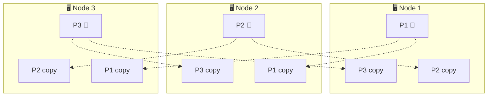
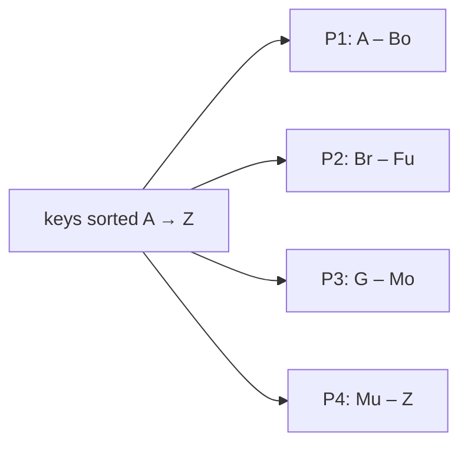
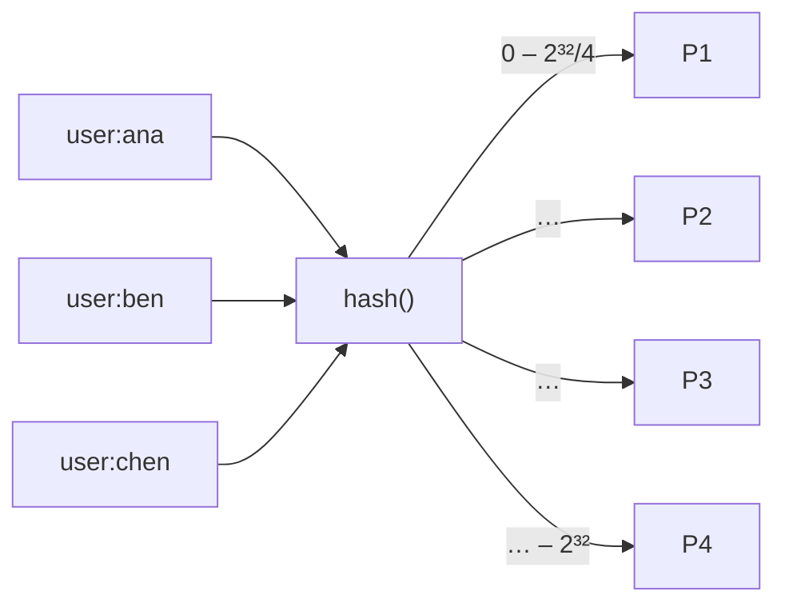
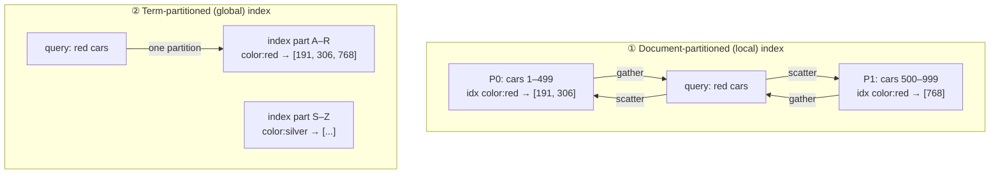
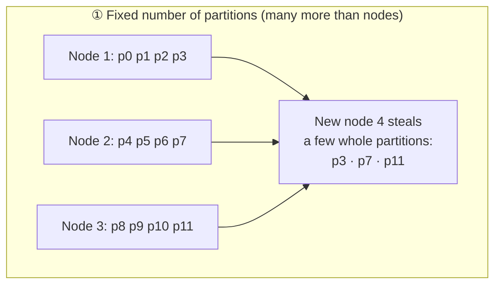
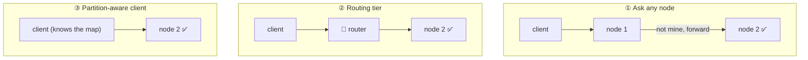
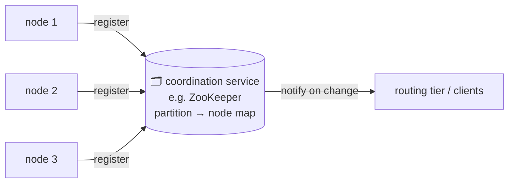

# 6 · Partitioning (sharding)

> **In one line:** when data or write load is too big for one machine, split it into **partitions**. Each record lives in exactly one partition, and each partition is spread to several nodes by replication.

<BookRef pages="221–241" section="Chapter 6" />

Different names for the same thing: *shard* (MongoDB, Elasticsearch), *region* (HBase), *tablet* (Bigtable), *vnode* (Cassandra, Riak), *vBucket* (Couchbase).

## 6.1 Partitioning + replication together

<BookRef pages="222–223" section="Partitioning and Replication" />

Each node is the leader for some partitions and a follower for others.

## 6.2 How to split key-value data

<BookRef pages="223–228" section="Partitioning of Key-Value Data" />

Goal: spread data and load **evenly**. A partition with much more load than the others is **skewed**, and a hot one is a **hot spot**.

### By key range

- ✅ **Range scans** are efficient (all keys between X and Y sit together)
- ⚠️ Ranges must follow the data's distribution, not be equal-sized
- ❌ Hot spots with ordered keys: timestamp keys send **all of today's writes to one partition**. Fix: prefix the key, e.g. `sensor_id + timestamp`.

### By hash of key

- ✅ Spreads keys evenly, even skewed ones
- ❌ **No efficient range queries**: neighbouring keys end up scattered
- Compromise (Cassandra): **compound primary key**. Hash the first part to choose the partition, then sort by the remaining columns inside it. For example, `(user_id, post_time)` gives fast range queries over one user's posts.

> ⚠️ Don't confuse this with "consistent hashing" as described in papers. Most databases use **fixed hash ranges per partition**, not random ring points.

### Skew and hot keys

Hashing can't help if **one key** is extremely hot (a celebrity post). An app-level fix is to add a random 2-digit suffix to that key, which splits its writes over 100 keys. The cost: reads must fetch all 100 and combine them, and you must track which keys are split.

## 6.3 Partitioning secondary indexes

<BookRef pages="228–231" section="Partitioning and Secondary Indexes" />

Secondary indexes (e.g. "find all red cars") don't map neatly onto partitions. There are two approaches.

| | Local (by document) | Global (by term) |
|---|---|---|
| Writes | Fast: update only your own partition | Slower: one write may touch several index partitions |
| Reads | **Scatter/gather** to every partition, so tail latency adds up | Read just one index partition |
| Freshness | Immediate | Usually **async**, so the index can lag |
| Used by | MongoDB, Cassandra, Elasticsearch | DynamoDB global secondary indexes |

## 6.4 Rebalancing

<BookRef pages="231–236" section="Rebalancing Partitions" />

Over time you add nodes, nodes fail, and data grows, so partitions must move. Requirements:
- the load is fair afterwards
- the DB keeps serving during the move
- move only what's necessary

### ❌ Don't do `hash mod N`

If N changes from 10 to 11, almost **every** key moves to a different node.

### Strategies that work

| Strategy | How | Notes |
|---|---|---|
| **Fixed number of partitions** | Create e.g. 1,000 partitions for 10 nodes. New nodes take whole partitions from existing ones. | Simple. You must choose the count up front: too few means huge partitions, too many means overhead. (Riak, Elasticsearch, Couchbase) |
| **Dynamic partitioning** | Split a partition when it grows too big, merge when it shrinks (like a B-tree) | Adapts to data volume. Start with **pre-splitting** to avoid one hot partition at first. (HBase, MongoDB) |
| **Proportional to nodes** | Fixed number of partitions **per node**. A new node splits random existing partitions. | Partition size stays stable as the cluster grows (Cassandra) |

### Automatic or manual?

Fully automatic rebalancing plus automatic failure detection is dangerous. An overloaded node looks dead, rebalancing moves load onto other nodes, which then look dead too: a **cascading failure**. Many systems **propose** a plan and let a human approve it.

## 6.5 Request routing (service discovery)

<BookRef pages="236–238" section="Request Routing" />

How does a client know which node holds key `foo`?

Someone must know the up-to-date partition → node map:

- **ZooKeeper-based:** HBase, Kafka (older versions), SolrCloud
- **Gossip protocol** between nodes: Cassandra, Riak, so any node can forward
- **Parallel query execution** in analytic (MPP) databases splits one SQL query into stages running on many partitions

## Summary

| Choice | Option A | Option B |
|---|---|---|
| Key → partition | Key range (range scans ✅, hot spots ⚠️) | Hash (even ✅, no range scans ❌) |
| Secondary index | Local (fast writes, scatter-gather reads) | Global (fast reads, slower async writes) |
| Rebalancing | Fixed / dynamic / per-node partitions | Never `mod N` |
| Routing | Any node, routing tier, or smart client | Coordination service or gossip |

## 🧠 Check yourself

<Quiz question="Why is hash(key) mod N a bad rebalancing strategy?" options={["Hashing is slow", "Changing N moves almost every key", "It creates hot spots", "It breaks secondary indexes"]} answer={1} explain="Each key's partition depends on N, so adding one node remaps most keys." />

<Quiz question="IoT sensors write readings keyed by timestamp into a range-partitioned store. What happens?" options={["Perfect balance", "All current writes hit one partition", "Range queries become impossible", "Reads get slower but writes are fine"]} answer={1} explain="Time-ordered keys put all writes for 'now' in the last range. Prefix the key with the sensor ID." />

<Quiz question="Which secondary index style requires scatter/gather reads?" options={["Global (term-partitioned)", "Local (document-partitioned)", "Covering index", "Clustered index"]} answer={1} explain="Each partition only indexes its own documents, so a query must ask all partitions." />

**Interview prompts**
- Shard a chat app's messages table. What's the partition key? What about group chats?
- One celebrity account melts a partition. Options?
- How does a client find the right shard after a rebalance?
