# 6 · Partitioning (sharding)

> **In one line:** when a dataset or its write traffic outgrows one machine, cut it into **partitions** so that every record belongs to exactly one partition, spread those partitions across many nodes, keep the load even, move partitions around as the cluster changes, and make sure every request still finds the right node.

<BookRef pages="221–241" section="Chapter 6" />

Chapter 5 was about keeping **copies** of the same data on several machines. That helps with fault tolerance and read throughput, but every replica still holds the *whole* dataset. If the data is 40 TB, or the write rate is 300,000 writes per second, copying it more times doesn't help: each node would still have to store 40 TB and absorb every write. The answer is to **split** the data so that each node only owns a slice of it. That's partitioning.

## 6.0 What partitioning is, and why bother

<BookRef pages="221–222" section="Partitioning (chapter introduction)" />

### Same idea, many names

Almost every distributed database partitions, but each one picked its own word for the pieces:

| System | What it calls a partition |
|---|---|
| MongoDB, Elasticsearch, SolrCloud | **shard** |
| HBase | **region** |
| Bigtable, Spanner | **tablet** (Spanner also uses "split") |
| Cassandra, Riak | **vnode** (a token range owned by a node) |
| Couchbase | **vBucket** |
| CockroachDB, TiKV | **range** / **region** |
| Kafka | **partition** (of a topic) |
| Vitess (MySQL) | **shard** (a keyspace range) |

"Sharding" is the term most engineers use day to day. This chapter uses **partition**, because it's the most neutral word, but treat them as synonyms.

> Don't mix this up with a **network partition** (a split in the network so some nodes can't talk to others). That is a *fault* and appears in Chapter 8. Here a partition is a deliberate *slice of data*.

### The basic rule

Each record (row, document, key-value pair) belongs to **exactly one** partition. Each partition is effectively a small database of its own. The system may still support operations that touch several partitions at once, but the normal path for a single-key read or write touches just one.

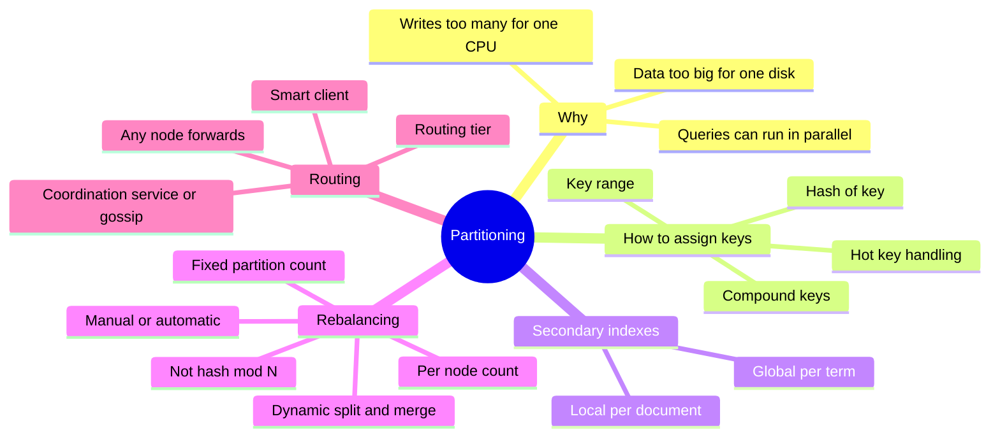

### Why partition?

The main motive is **scalability**. Different partitions can live on different nodes of a *shared-nothing* cluster (Part II's default setting: each node has its own CPU, RAM and disks and they only cooperate over the network). So:

- a **big dataset** can be spread over many disks,
- the **query load** can be spread over many CPUs,
- a query that touches a **single partition** can be answered by one node independently, so adding nodes adds throughput almost linearly,
- a **large query** can be split up and run in parallel across many nodes (much harder, but it's the basis of analytic MPP databases).

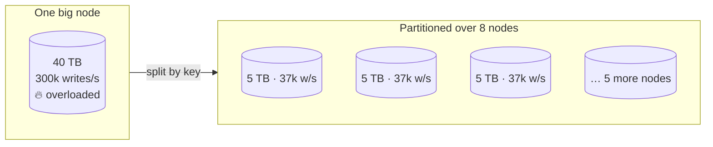

Partitioned databases were pioneered in the 1980s by systems such as Teradata and Tandem NonStop SQL, and rediscovered in the 2000s by the NoSQL wave and Hadoop-based warehouses. Some systems target transactional workloads and some target analytics, but the partitioning ideas are the same for both.

<KeyIdea>Replication gives you **copies** (for availability and read scaling). Partitioning gives you **slices** (for data volume and write scaling). Large systems almost always use both together.</KeyIdea>

## 6.1 Partitioning and replication

<BookRef pages="222–223" section="Partitioning and Replication" />

Partitioning is nearly always combined with replication: each partition's data is stored on several nodes. A record still belongs to one partition, but that partition has, say, three copies on three different machines. A node therefore stores **several partitions**, and plays a different role for each.

With leader-follower replication (Chapter 5), each partition has its own leader. Leaders are deliberately spread out, so every node is the leader for some partitions and a follower for others. Here's a cluster of 4 nodes with 4 partitions (`orders-0` to `orders-3`) and a replication factor of 3:

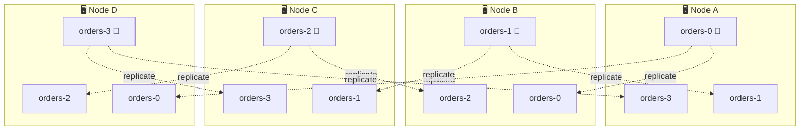

Things to notice:

- **Every node does a fair share of leader work.** If all the leaders sat on node A, node A would take every write while B, C and D idled.
- **Losing one node loses no data**, because each partition has two other copies, and a follower elsewhere can be promoted to leader for the partitions that node led.
- Each node holds 3 of the 4 partitions, so storage per node is about 75% of the total. With more nodes and more partitions this fraction falls (12 nodes, RF 3 → each node holds roughly a quarter of the data).

The choice of partitioning scheme is mostly **independent** of the choice of replication scheme. Everything in Chapter 5 (leaders, followers, quorums, replication lag) applies to each partition separately. To keep things simple, the rest of this chapter mostly ignores replication.

| | Replication | Partitioning |
|---|---|---|
| What's on each node | A full copy (of a partition) | A subset of the data |
| Main benefit | Fault tolerance, read scaling, lower latency | Storage and write scaling |
| Main difficulty | Keeping copies consistent | Even distribution, cross-partition queries |
| Unit of work | Replica | Partition |

## 6.2 Partitioning of key-value data

<BookRef pages="223–228" section="Partitioning of Key-Value Data" />

So you have a lot of data. How do you decide which record goes to which partition?

The goal is to spread **data and query load evenly**. If 10 nodes share the load fairly, you get roughly 10 times the storage and throughput of one node (ignoring replication). If the split is unfair, the busiest partition limits the whole system.

- A distribution where some partitions have more data or more queries than others is **skewed**.
- A partition with a disproportionately high load is a **hot spot**.

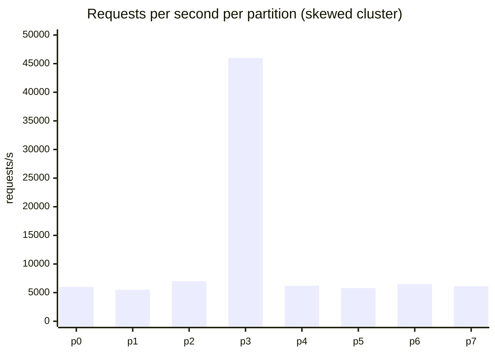

In this cluster the total load is about 89,000 requests/s, but partition `p3` alone carries 46,000. If one node can handle 20,000 requests/s, the cluster is overloaded even though seven of its eight partitions are nearly idle. **Skew wastes your scaling.**

The simplest way to avoid hot spots would be to put each record on a **random** node. Load would be perfectly even, but then reading a record means asking **every** node, because you have no idea where it went. We want something deterministic: a function from key to partition. Assume for now a simple key-value data model, where you always access a record by its primary key.

### Partitioning by key range

<BookRef pages="224–225" section="Partitioning by Key Range" />

Assign each partition a **continuous range of keys**, from some minimum to some maximum, like the letter tabs in an address book. If you know the boundaries, you can tell immediately which partition holds a key, and if you also know which node holds that partition, you can send the request straight there.

Example: a code-hosting site partitions repositories by `owner/repo` name.

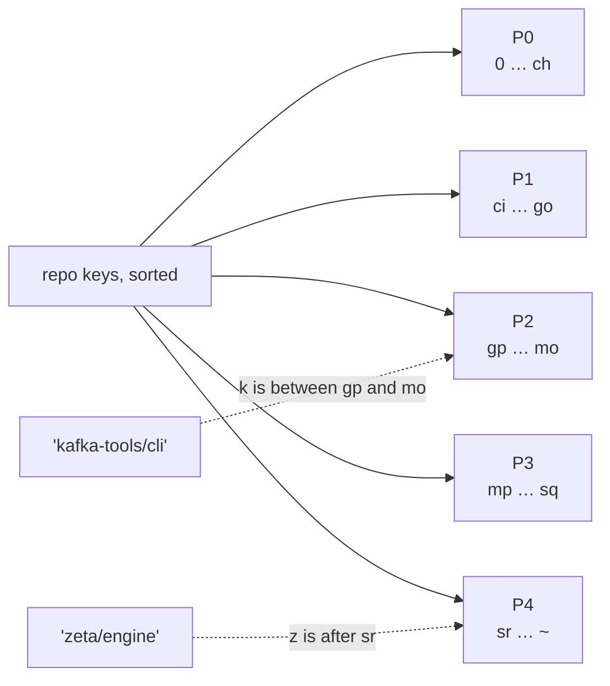

**Boundaries follow the data, not the alphabet.** The ranges are not equal width: `P0` covers "0" through "ch" while `P4` covers "sr" to the end. That's because names don't start evenly with each letter. If you split the alphabet into equal pieces, the partition for "s" would be enormous and the one for "x"–"z" nearly empty. The boundaries must adapt to the actual data distribution. They can be chosen by an administrator, or (more commonly) the database picks and adjusts them automatically (see dynamic partitioning, below).

Who uses key-range partitioning: **Bigtable**, its open-source cousin **HBase**, **RethinkDB**, **MongoDB** (ranged shard keys, and before version 2.4 it was the only option), **CockroachDB**, **TiKV**, **Spanner**, **YugabyteDB** (range-sharded tables).

#### The big advantage: range scans

Within each partition, keys can be kept **sorted** (an SSTable or LSM-tree from Chapter 3 does this naturally). That makes **range scans** cheap: "all repos whose names start with `kafka-`" touches one partition and reads a contiguous run of keys.

You can also design the key so it acts as a **concatenated index**. For a metrics store you might use keys like:

```text
2026-10-25T14:03:07Z/checkout-api/p99_latency_ms
2026-10-25T14:03:07Z/search-api/p99_latency_ms
2026-10-25T14:03:08Z/checkout-api/p99_latency_ms
```

Now "everything recorded between 14:00 and 14:05" is a single range scan. Nice for reads. But look at what happens to writes.

#### The big disadvantage: hot spots from ordered keys

If the key is a **timestamp** (or begins with one), the newest data always has the largest keys. Every write made *right now* lands in the partition that owns "now", and every other partition sits idle for writes:

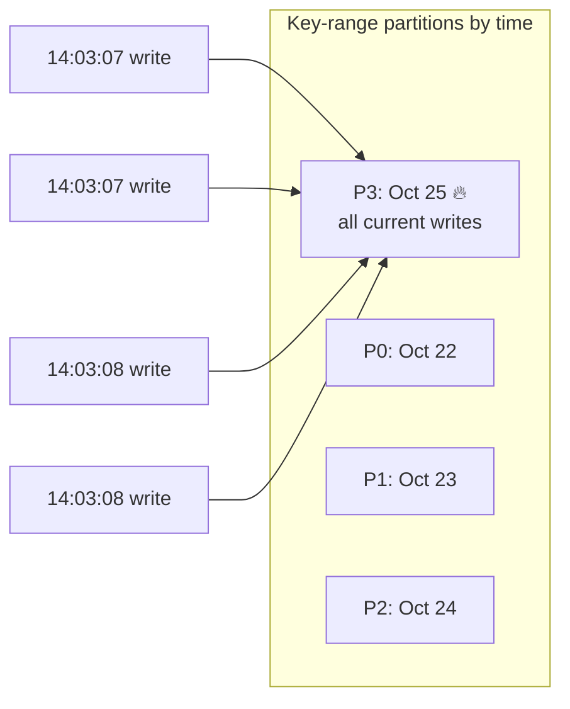

The fix is to make something **other than time** the first part of the key. Prefix it with the service name:

```text
checkout-api/2026-10-25T14:03:07Z/p99_latency_ms
search-api/2026-10-25T14:03:07Z/p99_latency_ms
```

Now writes from 40 different services spread across the partitions that own those prefixes, so the write load is shared. The price: "all metrics between 14:00 and 14:05 for **every** service" now needs a **separate range scan per service**. You traded a cheap cross-service time query for balanced writes. Choosing the order of key components is really choosing which queries are cheap.

Other sources of ordered keys that create the same problem:

| Key pattern | Why it's hot | Common fix |
|---|---|---|
| Auto-increment IDs (`order_id` = 1, 2, 3…) | New rows always go to the last range | Hash the ID, or use random IDs (UUIDv4) |
| Time-based IDs (UUIDv7, Snowflake IDs, ULIDs) | Mostly increasing | Prefix with a tenant or shard byte |
| Date-prefixed keys | Today's partition takes all writes | Put a high-cardinality field first |
| Alphabetical on popular prefix | e.g. every key starts `user_` | Reverse or hash part of the key |

> HBase users often "salt" row keys: prepend `hash(key) mod 16` as one byte, which spreads sequential writes over 16 regions. Reads of a time range then fan out to 16 scans and merge, the same trade-off as the service prefix.

### Partitioning by hash of key

<BookRef pages="225–227" section="Partitioning by Hash of Key" />

Because of skew and hot spots, many distributed datastores pass each key through a **hash function** and use the hash to choose the partition.

A good hash function turns skewed inputs into **uniformly distributed** outputs. Two keys that differ by one character (`order-1000` and `order-1001`) get completely unrelated hashes. So even if your keys cluster heavily, their hashes don't.

Requirements for the hash function:

- **Uniform**: outputs spread evenly across the range.
- **Deterministic and stable across processes and versions**: the same key must give the same hash on every node, every time, forever. That rules out some language built-ins. Java's `Object.hashCode()` can differ between processes for some types, and Python's built-in `hash()` of a string is randomized per process unless you set `PYTHONHASHSEED`.
- **Not necessarily cryptographic.** You don't need resistance to attackers, just good spread and speed.

Real choices: **Cassandra** and **ScyllaDB** use Murmur3 (64-bit). **MongoDB**'s hashed shard keys use an MD5-based hash. **Voldemort** used FNV. **Redis Cluster** uses CRC16 mod 16384 slots. **DynamoDB** hashes the partition key internally.

Once you have a hash, give each partition a **range of hashes** instead of a range of keys. Every key whose hash falls in a partition's range belongs to that partition:

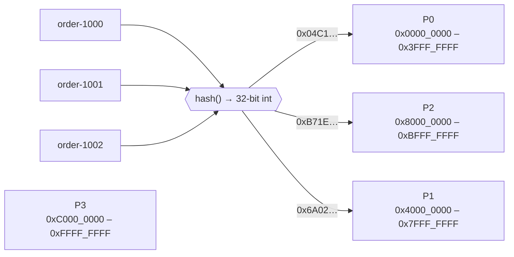

Three consecutive order IDs landed in three different partitions. A small sketch of the logic:

```python
import hashlib

BOUNDARIES = [0x4000_0000, 0x8000_0000, 0xC000_0000]   # 4 hash ranges

def key_hash(key: str) -> int:
    # Stable across machines and restarts, unlike Python's built-in hash()
    digest = hashlib.md5(key.encode("utf-8")).digest()
    return int.from_bytes(digest[:4], "big")            # 32-bit integer

def partition_for(key: str) -> int:
    h = key_hash(key)
    for i, upper in enumerate(BOUNDARIES):
        if h < upper:
            return i
    return len(BOUNDARIES)                             # last partition

for k in ["order-1000", "order-1001", "order-1002"]:
    print(k, hex(key_hash(k)), "→ P", partition_for(k))
```

The partition boundaries can be **evenly spaced** (hash outputs are uniform, so equal-width ranges get equal amounts of data) or chosen pseudo-randomly. Note that the boundaries are in *hash space*, not key space, and that this is **not** `hash mod N` (more on why that matters in rebalancing).

#### The price: no efficient range queries

Hashing destroys the ordering of keys. Keys that were adjacent are now scattered across every partition, so "orders 1000 to 1999" must be sent to **all** partitions and merged.

| System | What happens to range queries on the hashed key |
|---|---|
| MongoDB (hashed shard key) | Range queries are sent to all shards |
| Riak, Couchbase, Voldemort | Range queries on the primary key not supported |
| Cassandra | Not supported across partitions on the partition key, but see compound keys below |
| DynamoDB | `Scan` touches everything; `Query` requires an exact partition key |

#### A terminology trap: "consistent hashing"

You will often read that a database "uses consistent hashing". Be careful. **Consistent hashing**, as defined by Karger et al. (1997), was designed for **distributed caches** such as CDNs: nodes and keys are placed at **random points on a ring**, and each key belongs to the next node clockwise. The point was to avoid central coordination and to move very few keys when caches join or leave.

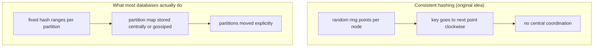

Most databases **don't** work that way. They divide the hash space into partition ranges and then move whole partitions between nodes with an explicit rebalancing strategy (below). Random-boundary schemes behave poorly for databases, and are rarely used in practice in that pure form. Because the term "consistent" is also used for replica consistency and for ACID consistency, the word is overloaded and confusing. It's clearer to just say **hash partitioning**.

> Cassandra and Riak's "virtual nodes" (vnodes) are the closest relative: each node owns many token ranges on a ring. But they still keep an explicit ring layout that all nodes agree on.

#### Compound primary keys: a middle ground

Cassandra offers a compromise between "hash everything" and "range everything". A table's primary key can have several columns:

- The **first part** (the *partition key*) is **hashed** to choose the partition.
- The **remaining columns** (the *clustering columns*) are used as a **sort order** within that partition's SSTables.

So you can't range-scan over the first column, but once you fix it, you **can** efficiently range-scan the rest. Example: a coffee chain stores every order, and the most common query is "orders at store S during a time window".

```sql
CREATE TABLE orders_by_store (
    store_id    text,
    ordered_at  timestamp,
    order_id    uuid,
    total_cents int,
    items       list<text>,
    PRIMARY KEY ((store_id), ordered_at, order_id)
) WITH CLUSTERING ORDER BY (ordered_at DESC, order_id ASC);

-- Hits exactly one partition, then reads a contiguous sorted slice:
SELECT order_id, total_cents
FROM orders_by_store
WHERE store_id = 'lisbon-07'
  AND ordered_at >= '2026-10-25 08:00'
  AND ordered_at <  '2026-10-25 11:00';
```

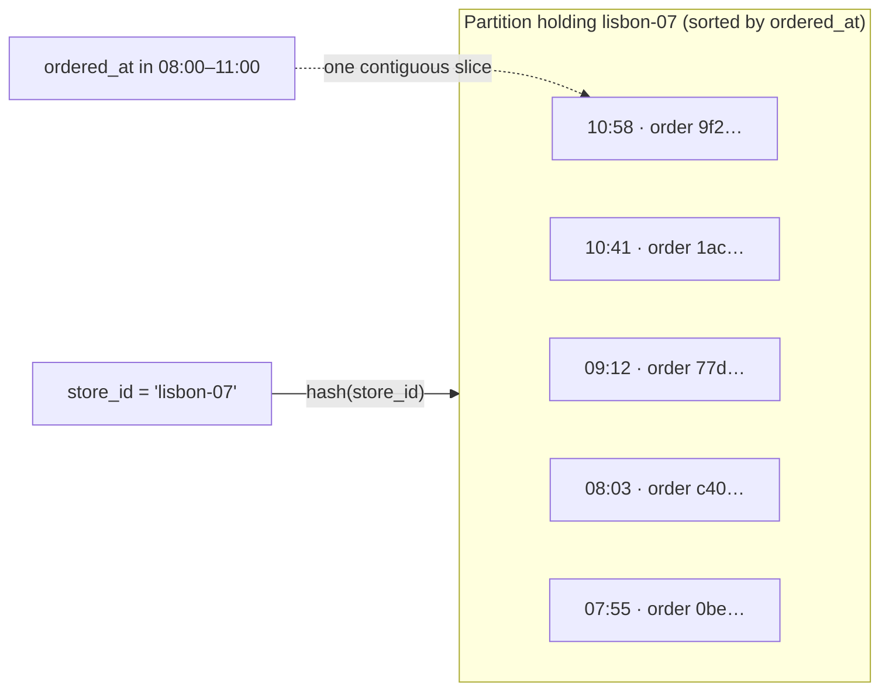

This gives an elegant **one-to-many** model: one store has many orders, all colocated and sorted. Different stores are spread evenly by the hash. The same idea appears elsewhere:

| System | First part (hashed) | Rest (sorted) |
|---|---|---|
| Cassandra / ScyllaDB | partition key | clustering columns |
| DynamoDB | partition key | sort key |
| Bigtable / HBase | (range, not hashed) row-key prefix you choose | rest of row key |
| Azure Cosmos DB | partition key | (items in a logical partition) |

Caveat: one partition key value must **fit in one partition**. If a single store generated hundreds of millions of orders, that partition would become huge and hot. The usual fix is to add a time bucket to the partition key, for example `PRIMARY KEY ((store_id, order_month), ordered_at, order_id)`.

### Skewed workloads and relieving hot spots

<BookRef pages="227–228" section="Skewed Workloads and Relieving Hot Spots" />

Hashing spreads **different keys** evenly. It can't do anything if a **single key** is responsible for most of the traffic, because every request for that key hashes to the same value and lands on the same partition.

This is rare, but it happens:

- a viral livestream where 2 million viewers post reactions to `stream:9001`,
- a flash sale where everyone is decrementing the stock counter of `sku:console-x`,
- a global config key that every service reads on every request,
- a social account with tens of millions of followers that posts something.

Today most datastores **can't automatically** compensate for one hugely skewed key, so it's up to the application.

#### Technique: split the hot key

Append a small random number to the key. With a two-digit suffix, writes to `stream:9001` are spread over `stream:9001#00` … `stream:9001#99`, i.e. 100 different keys, which hash to many different partitions.

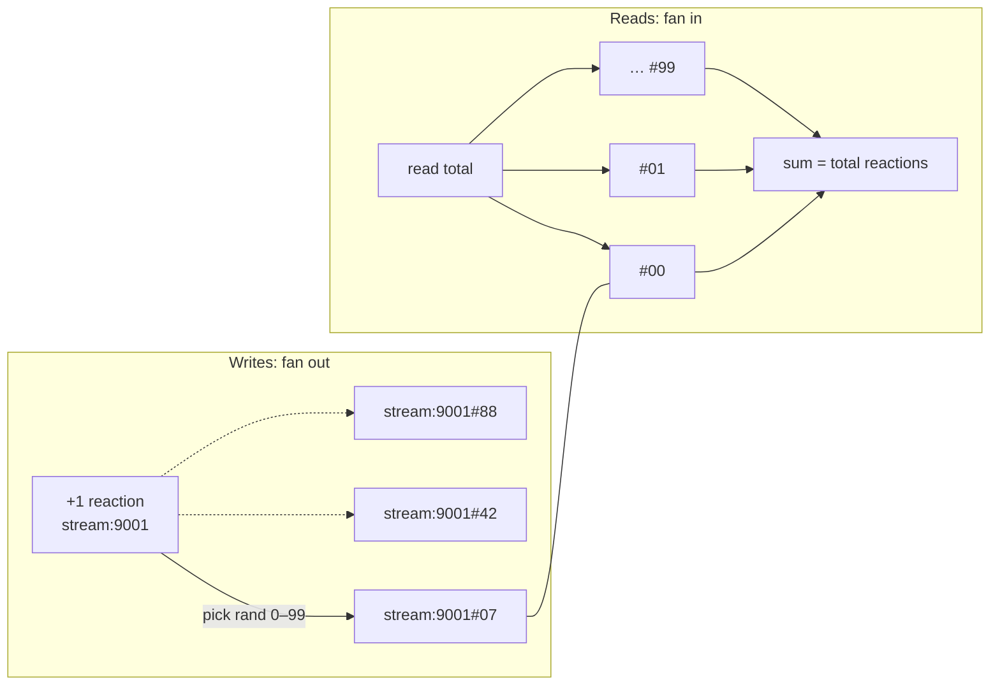

```python
import random

BUCKETS = 100
HOT_KEYS = {"stream:9001"}            # must be tracked somewhere!

def write_reaction(store, key):
    if key in HOT_KEYS:
        key = f"{key}#{random.randrange(BUCKETS):02d}"
    store.increment(key, 1)

def read_reactions(store, key):
    if key not in HOT_KEYS:
        return store.get(key)
    return sum(store.get(f"{key}#{i:02d}") or 0 for i in range(BUCKETS))
```

The costs:

- **Reads get more expensive**: each read of a split key must fetch all 100 sub-keys and combine them.
- **Bookkeeping**: you need to know which keys are split. Splitting every key would make all reads 100× more expensive for no reason, so you only do it for the few known hot ones.
- **Combining has to make sense**: counters, sets and append-only logs merge easily. A single value that must be overwritten atomically ("current price") does not.
- **Changing the split** (moving a key into or out of `HOT_KEYS`) needs care so that no writes are lost during the switch.

#### Other ways to cope

| Problem | Technique |
|---|---|
| Read-hot key | Put a **cache** in front (in-process or Redis), or read from **more replicas** of that partition |
| Write-hot counter | Split the key (above), or **buffer increments** in memory and flush a sum every few hundred ms |
| Hot partition (several warm keys together) | Split the partition or move it to a less loaded node |
| Predictable spikes | **Pre-split** or pre-warm before the event |
| Managed services | DynamoDB's **adaptive capacity** and "split for heat" automatically isolate hot items on their own partitions, within limits |

<KeyIdea>Hashing solves **many keys clustering**; it does nothing for **one key being hot**. For that you need application-level tricks such as key splitting, caching or batching, and each one makes reads or consistency harder.</KeyIdea>

In the future, datastores may detect and compensate for skewed keys automatically. For now, think about the trade-offs for your own application.

## 6.3 Partitioning and secondary indexes

<BookRef pages="228–231" section="Partitioning and Secondary Indexes" />

Everything so far assumed you look up records by **primary key**. Then the key tells you the partition, and you're done.

**Secondary indexes** complicate things. A secondary index doesn't identify a record uniquely. It's a way of searching for all records with a particular value: "all listings in Porto", "all tickets with status `open`", "all songs tagged `jazz`". They're the bread and butter of relational databases, common in document databases, and the reason search servers like Solr and Elasticsearch exist. Many key-value stores (HBase, Voldemort) avoided them because of the added complexity, while others (Riak) added them because they're so useful.

The problem: secondary indexes **don't map neatly to partitions**. The records with `city = 'Porto'` could be in any partition. There are two main approaches.

Running example: a holiday-rental site stores listings, partitioned by `listing_id` (8 partitions). Users filter by `city` and `bedrooms`.

### Partitioning secondary indexes by document

<BookRef pages="228–230" section="Partitioning Secondary Indexes by Document" />

Each partition maintains its **own** secondary index, covering **only the documents in that partition**. It doesn't care what's in other partitions. This is called a **local index** (or document-partitioned index).

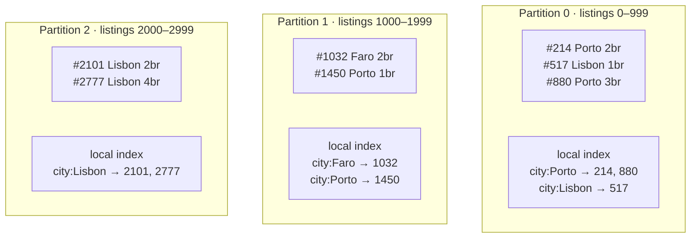

**Writes are simple.** Adding, updating or deleting a listing only touches the partition that owns that `listing_id`. The index update happens in the same partition, often in the same local transaction, so the index is **immediately consistent** with the data.

**Reads are expensive.** Nothing guarantees that all Porto listings are in the same partition (they're in 0 and 1 here). To answer "Porto listings", the query must go to **every** partition and combine the results. This is called **scatter/gather**.

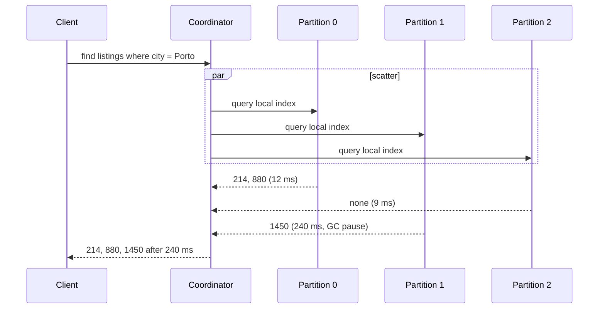

Why scatter/gather hurts:

- **Tail latency amplification.** The query is only as fast as the **slowest** partition. If 1% of requests to a partition are slow, a query that touches 50 partitions hits at least one slow one about 40% of the time (`1 − 0.99^50 ≈ 0.39`).
- **It doesn't scale with nodes.** Adding partitions spreads storage, but every index query still has to visit every partition, so the number of requests per index query *grows* with the cluster.
- Even if the partitions are queried **in parallel**, the total work is multiplied.

Who uses document-partitioned indexes: **MongoDB**, **Riak**, **Cassandra** (native secondary indexes), **Elasticsearch**, **SolrCloud**, **VoltDB**. Most vendors recommend that you design your partition key so the **most common** queries are served by a single partition. For example, if most searches filter by city, partition by `city` (or `(country, city)`), and use the local index only for the extra filters. That isn't always possible, especially when one query filters on several secondary attributes at once (`city = Porto AND bedrooms >= 3`).

### Partitioning secondary indexes by term

<BookRef pages="230–231" section="Partitioning Secondary Indexes by Term" />

Instead of each partition having its own index, build a **global index** that covers the data in **all** partitions. A global index can't live on one node (that node would be a bottleneck and a single point of failure), so the index itself is **partitioned too**, but **differently from the primary data**.

For example, the `city` index might be split so that cities starting with A–L live in index partition 0 and M–Z in index partition 1:

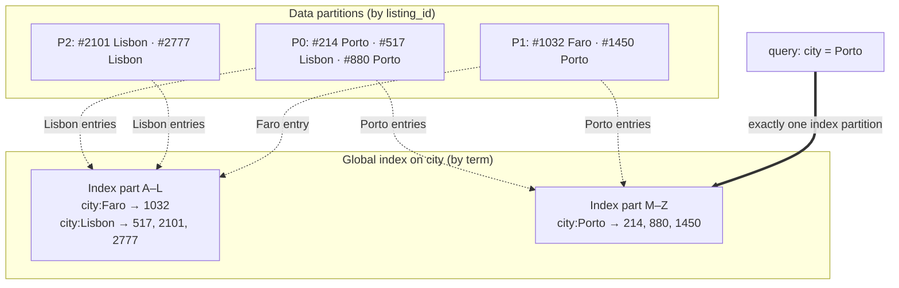

This is called **term-partitioned**, because the term you're looking for (`city:Porto`) determines which index partition holds it. The name comes from full-text search, where the terms are the words in a document.

As with primary keys, the index can be partitioned by:

- **the term itself** (range): useful for range queries over the indexed value, e.g. `bedrooms BETWEEN 2 AND 4` or price ranges,
- **a hash of the term**: spreads load more evenly, but loses range queries.

#### Trade-offs

**Reads are efficient.** A query goes to the single index partition that holds the term, instead of scattering to all partitions. (It may then fetch the actual documents from several data partitions, but the "who matches?" question is answered in one place.)

**Writes are slower and more complicated.** Updating one listing may touch **several** index partitions: the listing's own data partition, plus the index partition for its city, plus the one for its bedroom count, and so on. If the listing moves from Lisbon to Porto, the old entry must be removed from A–L and a new one added to M–Z.

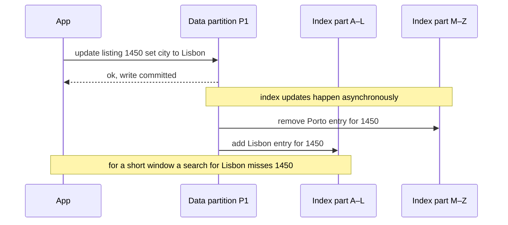

In an ideal world the index would always be up to date: every write reflected immediately. With a term-partitioned index that would require a **distributed transaction** across all affected partitions (Chapters 7 and 9), which many databases don't support or don't want to pay for. So in practice updates to global secondary indexes are often **asynchronous**: right after a write, a read from the index may not see it.

- **Amazon DynamoDB**: global secondary indexes are updated asynchronously, normally within a fraction of a second, longer during infrastructure faults. GSI reads are always eventually consistent.
- **Riak Search** and **Oracle data warehouse** global indexes let you choose between local and global indexing.
- **Google Spanner**, **CockroachDB** and **YugabyteDB** keep global secondary indexes **transactionally** consistent by updating them inside the same distributed transaction, at the cost of extra write latency.

| | Local index (by document) | Global index (by term) |
|---|---|---|
| Where index entries live | Next to their documents | In an index partition chosen by the term |
| Write cost | One partition | Possibly many partitions |
| Read cost | **Scatter/gather** to all partitions | Usually **one** index partition |
| Freshness | Immediately consistent | Often **asynchronous** (eventual), unless distributed transactions are used |
| Scales reads with nodes? | No, every query touches every node | Yes |
| Good for | Write-heavy data, queries that also include the partition key | Read-heavy lookups by a secondary attribute |
| Examples | MongoDB, Cassandra, Elasticsearch, SolrCloud | DynamoDB GSIs, Spanner, CockroachDB |

> **Design tip:** a very common alternative is to maintain your own "index" as a second table partitioned by the attribute you search on (e.g. `listings_by_city` with partition key `city`). You write both tables, which is exactly a hand-made global index, and you inherit its consistency problem.

## 6.4 Rebalancing partitions

<BookRef pages="231–236" section="Rebalancing Partitions" />

A database cluster doesn't stay the same:

- **Query throughput grows**, so you add CPUs.
- **The dataset grows**, so you add disks and RAM.
- **A machine fails**, so others must take over its responsibilities.

All of these require moving data and requests from one node to another. Moving load around the cluster is called **rebalancing**. Whatever the scheme, rebalancing should meet three minimum requirements:

1. **Fair afterwards**: storage, reads and writes are shared reasonably evenly between the nodes.
2. **No downtime**: the database keeps accepting reads and writes while rebalancing.
3. **Move as little as possible**: shipping data costs network bandwidth and disk I/O, and makes rebalancing slower.

### Strategies for rebalancing

<BookRef pages="232–235" section="Strategies for Rebalancing" />

#### How not to do it: hash mod N

With hash partitioning, it's tempting to compute `node = hash(key) mod N`, where N is the number of nodes. It's simple, and it does spread keys evenly. The trouble starts **when N changes**.

Take eight keys with these hashes and grow the cluster from 4 to 5 nodes:

| key | hash | `mod 4` | `mod 5` | moves? |
|---|---|---|---|---|
| order-a | 12 | 0 | 2 | ✅ moves |
| order-b | 17 | 1 | 2 | ✅ moves |
| order-c | 23 | 3 | 3 | stays |
| order-d | 30 | 2 | 0 | ✅ moves |
| order-e | 41 | 1 | 1 | stays |
| order-f | 58 | 2 | 3 | ✅ moves |
| order-g | 64 | 0 | 4 | ✅ moves |
| order-h | 77 | 1 | 2 | ✅ moves |

Six of eight keys move, even though we only added one node. In general, going from N to N+1 nodes keeps only about `1/(N+1)` of the keys in place, so roughly `N/(N+1)` of all data moves. Going from 10 to 11 nodes moves about 91% of the data. That's not "move as little as possible", it's "move almost everything".

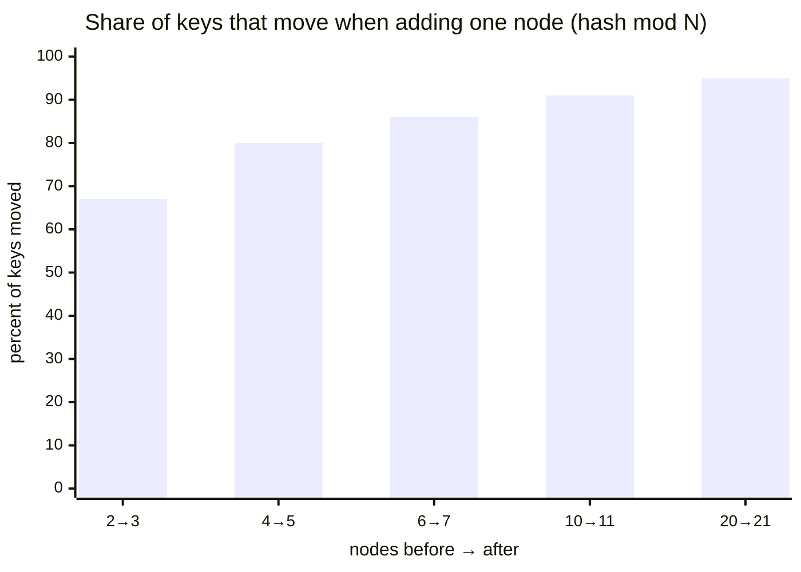

Ideally, adding one node to N nodes would move only about `1/(N+1)` of the data, just the share the new node should own. The strategies below get close to that.

#### Fixed number of partitions

Create **many more partitions than there are nodes**, and assign several partitions to each node. For example, a cluster of 3 nodes might start with 12 partitions, 4 per node. The key-to-partition mapping (by hash range) **never changes**. Only the **partition-to-node** assignment changes.

When a node is added, it **steals a few whole partitions** from every existing node until things are fair again:

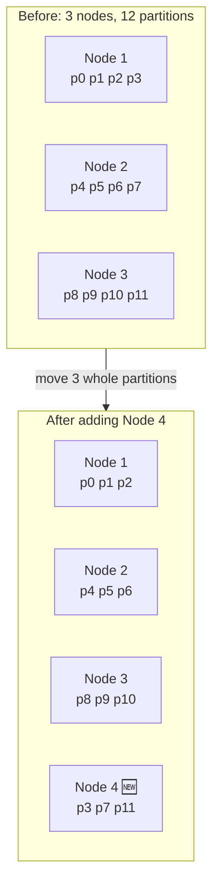

Only 3 of 12 partitions (25%) moved, which is exactly the new node's fair share. When a node is removed, the reverse happens.

How the move works without downtime:

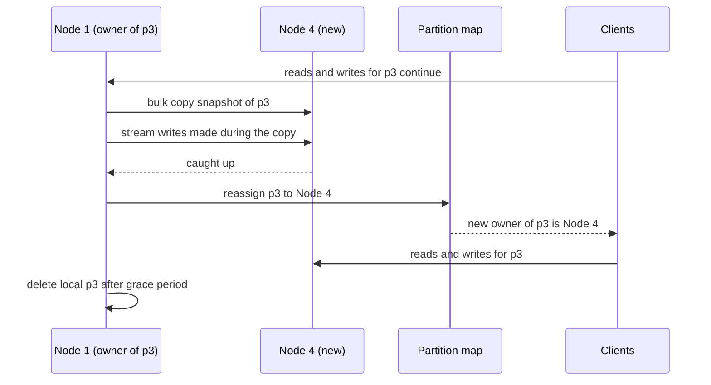

Details worth knowing:

- **Heterogeneous hardware**: a more powerful node can simply be assigned more partitions.
- **The number of partitions is usually fixed when the database is created** and not changed afterwards (some systems support splitting and merging, but it's operationally harder). So the count you choose is the **maximum number of nodes** you can ever have.
- **Choosing the number is hard if the data size is unknown.** Each partition holds `total data / number of partitions`. Too **few** partitions and each becomes huge, so rebalancing and recovery move huge chunks. Too **many** and the per-partition overhead (files, metadata, open handles, coordination) dominates. The "right" size is hard to hit when the dataset might grow 1000×.

Who uses it: **Riak**, **Elasticsearch** (primary shard count fixed per index at creation, with split/shrink APIs to change it by rebuilding), **Couchbase** (1024 vBuckets), **Voldemort**, **Redis Cluster** (16,384 hash slots), **Kafka** (partitions per topic, chosen up front).

#### Dynamic partitioning

For **key-range** partitioning, a fixed number of partitions with fixed boundaries is very awkward: if you got the boundaries wrong, all data might end up in one partition. Reconfiguring boundaries by hand is tedious.

So key-range databases such as **HBase**, **RethinkDB**, **CockroachDB** and **TiKV** create partitions **dynamically**:

- When a partition grows beyond a configured size, it **splits** into two halves of roughly equal size. (HBase's default region split size is 10 GB, CockroachDB's default range limit is 512 MiB.)
- When a partition shrinks below a threshold (lots of deletes), it can **merge** with an adjacent partition.

It's similar to how a B-tree splits and merges pages at the top level.

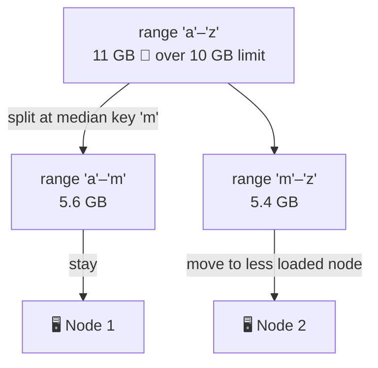

After a split, one half can be moved to another node to balance load. In HBase, partition files are moved through HDFS, the underlying distributed filesystem.

**Advantage:** the number of partitions **adapts to the data volume**. A small dataset has few partitions and little overhead. A huge one has many, each staying under the size limit.

**Caveat: the empty-database problem.** A brand-new, empty database starts with **one partition**, because there's no data yet to suggest where to split. Until the first split happens, every write goes to one node and the rest sit idle. Mitigation: **pre-splitting**. HBase and MongoDB let you configure an initial set of partitions on an empty database. For key-range partitioning that means you must know roughly what the key distribution will look like.

```bash
# HBase shell: create a table already split into 4 regions
create 'events', 'd', SPLITS => ['g', 'n', 't']
```

Dynamic partitioning isn't only for key ranges. **MongoDB** (since 2.4) supports both key-range and hash partitioning, and splits chunks dynamically in both cases.

#### Partitioning proportionally to nodes

Look at what controls the number of partitions in the first two strategies:

- **Fixed**: the size of each partition is proportional to the **dataset size**.
- **Dynamic**: the number of partitions is proportional to the **dataset size** (split and merge keep each partition between a minimum and a maximum).
- In both, the number of partitions is **independent of the number of nodes**.

A third option, used by **Cassandra** and **Ketama** (a client-side library for memcached), is to make the number of partitions **proportional to the number of nodes**: a **fixed number of partitions per node**.

- While the number of nodes stays the same, each partition grows with the dataset.
- When you add a node, partitions get smaller again, because the new node takes over part of many existing partitions.
- Bigger datasets typically need more nodes, so this keeps partition sizes fairly stable over time.

When a new node joins, it picks a number of existing partitions **at random**, splits each of them, and takes ownership of one half, leaving the other half in place:

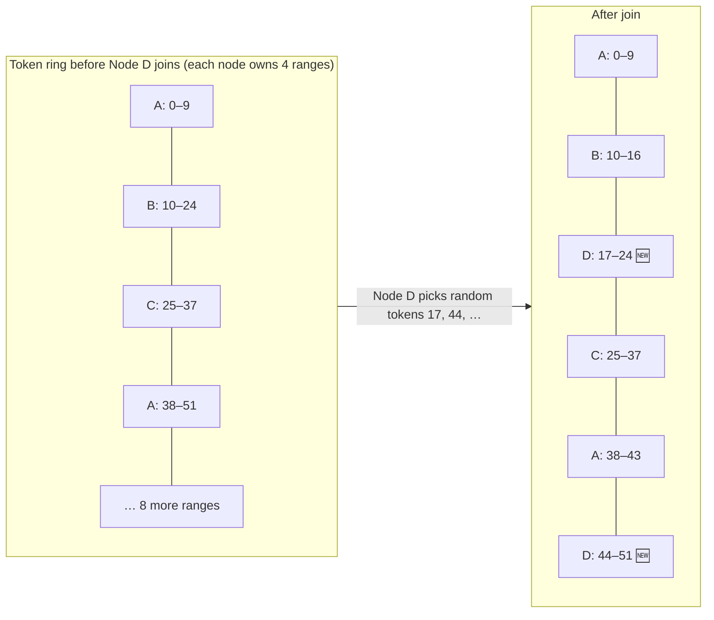

Random choice can produce unfair splits, but when averaged over many partitions per node (Cassandra historically defaulted to 256 per node), the new node ends up with a fair share. Cassandra 3.0 added an alternative allocation algorithm that chooses tokens to avoid unfair splits, and Cassandra 4.0 lowered the default to 16 tokens per node using that algorithm.

Picking partition boundaries randomly requires **hash-based partitioning**, so that boundaries can be picked from the range of hash outputs. This is actually the closest match to Karger's original consistent hashing. Newer hash functions can achieve a similar effect with less metadata overhead.

#### Comparing the strategies

| Strategy | Number of partitions | Partition size | Works with | Main risk | Examples |
|---|---|---|---|---|---|
| `hash mod N` | = N | data / N | hash | Almost all data moves when N changes | (Avoid) |
| Fixed number | Chosen up front, constant | Grows with data | Hash (mostly) | Wrong guess: huge or too many partitions; caps cluster size | Riak, Elasticsearch, Couchbase, Redis Cluster, Kafka |
| Dynamic | Grows and shrinks with data | Bounded (min–max) | Key range or hash | Single partition when empty (pre-split) | HBase, MongoDB, CockroachDB, TiKV, RethinkDB |
| Proportional to nodes | Fixed per node | Grows with data, shrinks as nodes join | Hash only | Unfair random splits (mitigated by many tokens) | Cassandra, ScyllaDB, Ketama |

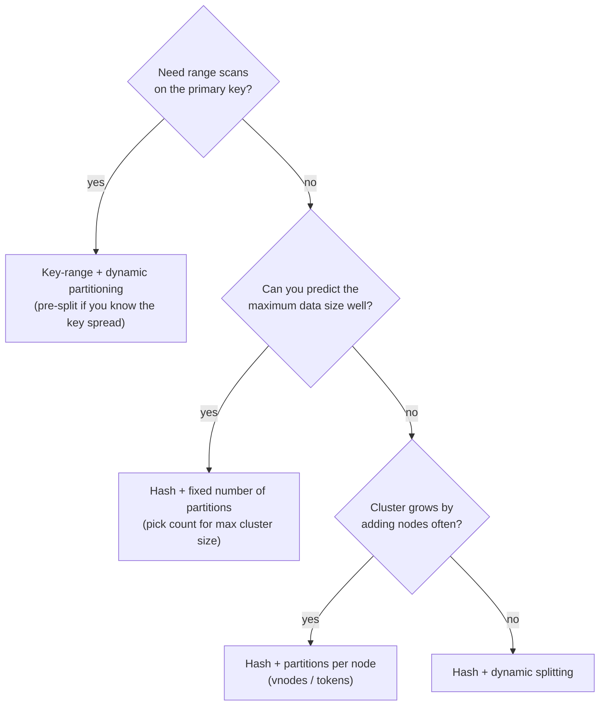

### Operations: automatic or manual rebalancing

<BookRef pages="235–236" section="Operations: Automatic or Manual Rebalancing" />

An important practical question: does rebalancing happen **automatically**, or does a human trigger it? There's a spectrum:

- **Fully automatic**: the system decides when to move partitions and does it, with no admin involvement.
- **Fully manual**: an administrator configures the partition-to-node assignment explicitly, and it changes only when they reconfigure it.
- **In between**: the system **generates a suggested assignment**, and an administrator must **commit** it before it takes effect. Couchbase, Riak and Voldemort work this way.

Fully automatic rebalancing is convenient, but it can be **unpredictable**. Rebalancing is expensive: it reroutes requests and moves large amounts of data between nodes. Done carelessly, it can overload the network or the nodes and hurt the performance of other requests while it runs.

The real danger is **combining automatic rebalancing with automatic failure detection**:

```mermaid
sequenceDiagram
  participant N3 as Node 3 (overloaded)
  participant FD as Failure detector
  participant RB as Auto-rebalancer
  participant N1 as Node 1
  participant N2 as Node 2
  Note over N3: traffic spike, responses slow to 4 s
  FD->>N3: heartbeat
  N3--xFD: no reply within timeout
  FD->>RB: Node 3 looks dead
  RB->>N1: take over half of Node 3 partitions
  RB->>N2: take over the other half
  Note over N1,N2: now serving extra traffic AND receiving GBs of data
  N3->>N1: (still alive) also streaming partitions
  Note over N1,N2: slow down, miss heartbeats
  FD->>RB: Node 1 and Node 2 look dead too
  Note over N1,N3: cascading failure across the cluster
```

A node that is merely **slow** (overloaded, long GC pause) looks the same as a dead one. Auto-rebalancing then piles more work onto the remaining nodes, which also become slow, which triggers more rebalancing. That's how one hot node can cascade into a whole-cluster outage.

That's why it can be a good thing to keep **a human in the loop** for rebalancing. It's slower than a fully automatic process, but it can prevent operational surprises. Practical safeguards used in real systems:

- **Delay before reassigning**: Elasticsearch waits (`index.unassigned.node_left.delayed_timeout`, 1 minute by default) before re-replicating shards from a node that left, in case it comes back.
- **Throttle data movement**: limit concurrent partition moves and bandwidth per node.
- **Separate "node is down" from "node is gone"**: Cassandra doesn't move data when a node merely goes down; an operator must explicitly decommission or replace it.
- **Dry runs**: Kafka's partition reassignment tool generates a plan you review before executing.

```bash
# Kafka: propose, review, then execute a reassignment
kafka-reassign-partitions.sh --bootstrap-server broker1:9092 \
  --topics-to-move-json-file topics.json --broker-list "1,2,3,4" --generate
kafka-reassign-partitions.sh --bootstrap-server broker1:9092 \
  --reassignment-json-file plan.json --execute --throttle 50000000
```

<KeyIdea>Moving partitions is cheap to decide and expensive to do. Automate the *planning*, be careful about automating the *execution*, especially when it's triggered by failure detection.</KeyIdea>

## 6.5 Request routing

<BookRef pages="236–238" section="Request Routing" />

Data is now spread over many nodes, and partitions keep moving. When a client wants to read `listing:1450`, **which IP address and port** should it connect to?

This is an instance of the general problem of **service discovery**, which isn't specific to databases: any software reachable over a network has it, especially if it aims for high availability. There are three broad approaches:

```mermaid
flowchart TB
  subgraph A["① Contact any node"]
    direction LR
    CA["client"] -->|"get k"| NA1["node 1<br/>(not mine)"]
    NA1 -->|"forward"| NA3["node 3 ✅ owner"]
    NA3 -->|"value"| NA1 -->|"value"| CA
  end
  subgraph B["② Routing tier"]
    direction LR
    CB["client"] -->|"get k"| RT["🧭 router<br/>(knows the map)"]
    RT --> NB3["node 3 ✅"]
  end
  subgraph C["③ Partition-aware client"]
    direction LR
    CC["client library<br/>(caches the map)"] -->|"get k"| NC3["node 3 ✅"]
  end
```

1. **Contact any node** (e.g. via a round-robin load balancer). If that node owns the partition, it handles the request. Otherwise it forwards the request to the right node, gets the reply and passes it back. Cassandra coordinators and Elasticsearch nodes work this way.
2. **Send all requests to a routing tier** first. The router doesn't handle requests itself; it only acts as a partition-aware load balancer. Examples: MongoDB's `mongos`, Vitess's `vtgate`, Twemproxy/Envoy for Redis, Couchbase's old `moxi`.
3. **Make the client aware of partitions** so it connects directly to the right node, with no intermediary. Redis Cluster clients, Kafka producers/consumers, Cassandra's token-aware drivers and the DynamoDB SDK (via its request routers) do this.

A related pattern: the node tells the client "wrong place, go there". Redis Cluster replies `MOVED 3999 10.0.0.7:6379` when a slot has moved permanently, and `ASK` during an in-progress migration, and the client updates its cached map.

In every case the key problem is the same: **how does the component making the routing decision learn about changes** in the assignment of partitions to nodes? This is hard because all participants must **agree**, otherwise requests go to the wrong node and are not handled correctly. There are protocols for reaching consensus in a distributed system (Chapter 9), but they're hard to implement correctly.

#### Using a coordination service

Many distributed data systems rely on a separate **coordination service** such as **ZooKeeper** (or etcd) to keep track of this cluster metadata:

```mermaid
flowchart LR
  N1["node 1"] -->|"register, heartbeat"| ZK[("🗂️ ZooKeeper / etcd<br/>authoritative map<br/>partition → node")]
  N2["node 2"] -->|"register, heartbeat"| ZK
  N3["node 3"] -->|"register, heartbeat"| ZK
  ZK -->|"watch: notify on change"| RT["routing tier"]
  ZK -->|"watch: notify on change"| CL["partition-aware clients"]
  RT --> N1 & N2 & N3
```

Each node registers itself in ZooKeeper, which maintains the authoritative mapping from partitions to nodes. Other actors, like the routing tier or partition-aware clients, **subscribe** to this information. Whenever a partition changes ownership, or a node is added or removed, ZooKeeper notifies the routing tier so its routing information stays current.

```mermaid
sequenceDiagram
  participant Adm as Rebalancer
  participant ZK as ZooKeeper
  participant R as Router
  participant N1 as Node 1
  participant N4 as Node 4
  R->>ZK: watch partition map
  Adm->>ZK: set p3 owner to Node 4 (version 18)
  ZK-->>R: map changed, version 18
  R->>ZK: read new map
  Note over R: route p3 requests to Node 4
  R->>N4: get listing 1450
  N4-->>R: listing 1450
  Note over N1: a stale request for p3 is rejected with wrong owner
```

Real systems:

| System | How routing metadata is managed |
|---|---|
| LinkedIn **Espresso** | **Helix** (on top of ZooKeeper) for cluster management, with a routing tier |
| **HBase**, **SolrCloud** | ZooKeeper tracks partition (region / shard) assignment |
| **Kafka** | Historically ZooKeeper; since KRaft, an internal Raft-based controller quorum |
| **MongoDB** | Its own **config server** replica set plus `mongos` routers |
| **Cassandra**, **Riak**, **ScyllaDB** | **Gossip protocol** among nodes spreads cluster state; any node can route |
| **CockroachDB** | Range locations stored in special meta ranges, cached by each node |
| **Couchbase** | Doesn't rebalance automatically; historically used `moxi` routers that learned the map from the cluster |

**Gossip** avoids a dependency on an external coordination service, at the cost of more complexity inside the database nodes, and nodes may briefly disagree about the state of the cluster. Cassandra and Riak accept this; the request is forwarded to the right replica anyway.

**What about the client finding a node at all?** Clients still need the IP of *some* node or router to start. Those addresses change rarely, so plain **DNS** (or a static seed list) is usually good enough for that part.

> Edge case: during a partition move there's a short window where some routers know the new owner and some don't. Systems handle this with **versioned maps** (requests carry an epoch, and a node rejects requests with an old epoch), with redirects (`MOVED`/`ASK`), or by having the old owner forward requests until everyone has caught up.

### Parallel query execution

<BookRef pages="238" section="Parallel Query Execution" />

So far we've looked at simple queries that read or write **one key** (plus scatter/gather for document-partitioned indexes). That's about the level supported by most NoSQL stores.

**Massively parallel processing (MPP)** relational databases, typically used for analytics, support much more complex queries: joins, filters, grouping and aggregation. The query optimiser breaks such a query into **stages and partitions**, many of which run **in parallel** on different nodes of the cluster. Queries that scan large parts of the dataset benefit the most.

Example: total revenue per country for October, over an `orders` table spread across 4 nodes.

```sql
SELECT c.country, SUM(o.total_cents) AS revenue
FROM orders o JOIN customers c ON o.customer_id = c.id
WHERE o.ordered_at >= '2026-10-01' AND o.ordered_at < '2026-11-01'
GROUP BY c.country;
```

```mermaid
flowchart TB
  Q["SQL query"] --> OPT["🧠 optimiser / coordinator"]
  OPT --> S1a["Node 1: scan + filter<br/>orders partition"] & S1b["Node 2: scan + filter"] & S1c["Node 3: scan + filter"] & S1d["Node 4: scan + filter"]
  S1a & S1b & S1c & S1d -->|"shuffle by customer_id"| J["join with customers<br/>(on each node)"]
  J -->|"partial SUM per country"| AGG["final aggregation"]
  AGG --> RES["country → revenue"]
```

Each node filters its own slice in parallel, data is **reshuffled** (repartitioned) by the join key so matching rows meet, partial aggregates are computed locally, and a final step merges them. Teradata, Greenplum, Amazon Redshift, Snowflake, Vertica, Trino, BigQuery and Spark SQL all work along these lines. Fast parallel execution of data warehouse queries is a specialised topic, and the techniques return in Chapter 10.

## Summary

<BookRef pages="238–241" section="Summary" />

Partitioning is needed when you have so much data that storing and processing it on one machine is no longer feasible. The goal is to spread data and query load **evenly** across machines, avoiding **hot spots**. That requires choosing a scheme that suits your data, and rebalancing partitions when nodes are added or removed.

```mermaid
mindmap
  root((Partitioning recap))
    Key to partition
      Key range
        sorted, range scans
        hot spots on ordered keys
        dynamic split and merge
      Hash
        even spread
        no range scans on key
        fixed partitions or per node
      Hybrid compound key
        hash first part
        sort the rest
    Secondary indexes
      Local by document
        cheap writes
        scatter gather reads
      Global by term
        fast reads
        multi partition async writes
    Rebalancing
      never hash mod N
      move whole partitions
      human in the loop
    Routing
      any node forwards
      routing tier
      smart client
      ZooKeeper or gossip
```

**Two main approaches to partitioning:**

| | Key-range partitioning | Hash partitioning |
|---|---|---|
| Assignment | Sorted keys; each partition owns a range from min to max | Hash each key; each partition owns a range of hashes |
| Range queries on the key | ✅ Efficient | ❌ Scatter to all partitions |
| Hot spot risk | ⚠️ High if access follows key order (timestamps, sequential IDs) | Low for many keys; still vulnerable to **one hot key** |
| Typical rebalancing | **Dynamic**: split when too big, merge when too small | Often a **fixed number** of partitions, or a fixed number **per node**; dynamic also possible |
| Examples | HBase, Bigtable, CockroachDB, TiKV, MongoDB ranged | Cassandra, DynamoDB, Riak, Redis Cluster, MongoDB hashed |

**Hybrids** are possible, e.g. a **compound key**: hash one part to find the partition, and sort by another part within it.

**Secondary indexes** also need partitioning:

- **Document-partitioned (local)**: index stored in the same partition as the primary key and value. A write updates only one partition, but a read on the secondary index needs **scatter/gather** across all partitions.
- **Term-partitioned (global)**: index partitioned separately, by the indexed values. A read can be served from one partition, but a write may update several index partitions, and is often applied **asynchronously**.

**Request routing** ranges from simple partition-aware load balancing to sophisticated parallel query execution engines.

By design, each partition operates mostly **independently**, which is what lets a partitioned database scale to many machines. But operations that write to **several partitions** are hard to reason about: what happens if the write to one partition succeeds and another fails? That's the topic of transactions, in the next chapter.

## 🧠 Check yourself

<Quiz question="A cluster grows from 10 to 11 nodes and uses node = hash(key) mod N. Roughly what fraction of keys changes node?" options={["About 9%", "About 50%", "About 91%", "None, hashing is stable"]} answer={2} explain="Only keys whose hash gives the same remainder for 10 and 11 stay put, about 1 in 11. The rest (about 91%) move, which is why mod N is a poor rebalancing scheme." />

<Quiz question="A metrics store uses key-range partitioning with keys that begin with an ISO timestamp. What goes wrong?" options={["Range scans become impossible", "All current writes land on the single partition that owns the latest time range", "Reads must scatter to every partition", "The hash function becomes uneven"]} answer={1} explain="Ordered keys put every new write at the end of the key space. Prefixing the key with something like a service name spreads writes, at the cost of one range scan per prefix." />

<Quiz question="In a Cassandra table with PRIMARY KEY ((store_id), ordered_at), which query is efficient?" options={["All orders between 08:00 and 11:00 across every store", "Orders for one store between 08:00 and 11:00", "All stores whose ID starts with 'lis'", "Orders sorted by total amount"]} answer={1} explain="store_id is hashed to pick one partition; within it, rows are sorted by ordered_at, so a time slice for one store is a contiguous read." />

<Quiz question="A single livestream key receives most of the cluster's writes. Why doesn't hash partitioning fix this?" options={["The hash function is too slow", "Every request for the same key hashes to the same partition", "Hash partitioning only works with range keys", "Replication sends the writes to every node"]} answer={1} explain="Hashing spreads many distinct keys; one key always maps to one place. You need app-level tricks such as splitting the key into random sub-keys and combining them on read." />

<Quiz question="Which statement about a document-partitioned (local) secondary index is true?" options={["Reads touch one partition, writes touch many", "Writes touch one partition, but reads by the indexed value must scatter/gather across all partitions", "It is always updated asynchronously", "It requires a distributed transaction for every write"]} answer={1} explain="Each partition indexes only its own documents, so writes stay local and consistent, but a query on the indexed field must ask every partition." />

<Quiz question="Why are global (term-partitioned) secondary indexes often updated asynchronously?" options={["Because indexes are stored in memory", "Because a single write may need to change several index partitions, and keeping them in sync would need a distributed transaction", "Because reads are slow", "Because hashing the term is expensive"]} answer={1} explain="The document and its index entries live on different partitions. Updating them atomically requires cross-partition transactions, which many systems avoid, so they accept a lag." />

<Quiz question="A brand-new HBase table with no pre-splitting receives a heavy bulk load. What's the problem?" options={["Too many regions at first", "It starts as one region, so one node takes all writes until splits happen", "HBase cannot split regions", "Rows are hashed unevenly"]} answer={1} explain="Dynamic partitioning starts with a single partition. Pre-splitting with known boundaries spreads the initial load." />

<Quiz question="Why can fully automatic rebalancing combined with automatic failure detection be dangerous?" options={["It never moves enough data", "A slow, overloaded node can be declared dead, and moving its load onto others can overload them too, causing a cascade", "It breaks hash functions", "It disables replication"]} answer={1} explain="Rebalancing adds load at exactly the moment the cluster is struggling. Many systems therefore propose a plan and let a human commit it." />

**Interview prompts**
- Design the partitioning for a chat app's messages. What's the partition key for 1:1 chats? What changes for group chats with 200,000 members?
- Your sharded orders table uses auto-increment IDs and range partitioning. Writes are bottlenecked on one shard. Walk through three fixes and their trade-offs.
- A product page in a flash sale receives 500,000 stock decrements per second on one key. How would you handle it, and what consistency do you give up?
- You need "find all open tickets assigned to agent X" on a ticket table partitioned by `ticket_id`. Compare a local index, a global index and a hand-maintained second table.
- You're choosing the partition count for a new Kafka topic or Elasticsearch index that might grow 50× in two years. How do you pick it, and what happens if you're wrong?
- Explain the difference between consistent hashing (as in the original paper) and hash-range partitioning in a database like DynamoDB or Cassandra.
- After a partition moves from node 1 to node 4, how does every client stop sending requests to node 1? What happens to requests in flight during the switch?
- How would you rebalance a 20-node cluster when one node is slow but not dead?
