# 7 · Transactions

> **In one line:** a transaction bundles several reads and writes into one unit that either takes effect completely (**commit**) or not at all (**abort**, so it's safe to retry). **Isolation levels** decide how much concurrently running transactions can see of each other, and every level weaker than serializable lets a specific family of concurrency bugs through.

<BookRef pages="243–293" section="Chapter 7" />

Real data systems fail in many boring ways: the disk fills up, the process is killed halfway through a write, the network drops between the app and the database, two requests touch the same row at the same millisecond, a client reads data that is only half updated. Every one of these can leave data in a state nobody intended.

For decades the standard answer has been the **transaction**: let the application group several operations into one logical unit, and let the database worry about the faults and races. The application gets a much simpler programming model:

- If the transaction **commits**, all of its writes happened.
- If it **aborts**, none of them happened, and the app can simply try again.
- While it runs, other transactions (mostly) can't trip over it.

This chapter is about what that promise really means, how much of it databases actually keep by default, and the three serious ways to make it airtight.

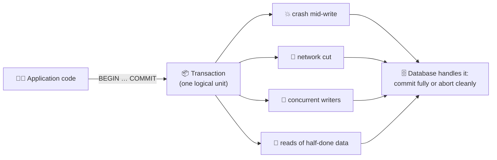

<KeyIdea>Transactions are not a law of nature. They are a **design choice that simplifies error handling** for the application. Some systems drop them for performance or availability; the point of this chapter is to understand exactly what you lose when they do.</KeyIdea>

## 7.1 The slippery concept of a transaction

<BookRef pages="244–255" section="The Slippery Concept of a Transaction" />

Almost every relational database today (PostgreSQL, MySQL/InnoDB, Oracle, SQL Server, SQLite) supports transactions in a style that goes back to IBM's **System R** from the 1970s. The overall design has barely changed in 50 years.

Around the late 2000s the **NoSQL** movement arrived with new data models, replication and partitioning built in. Many of those systems dropped transactions entirely, or redefined the word to mean something much weaker. That created a popular belief that "transactions don't scale" and that any serious large system must give them up.

Both extremes are wrong:

| Belief | Reality |
|---|---|
| "Transactions are the enemy of scale" | Many distributed databases (Spanner, CockroachDB, FoundationDB, YugabyteDB) offer serializable transactions at large scale. They cost something, but it's a trade-off, not an impossibility. |
| "Every serious app needs full transactions" | Some workloads (logging, metrics, caches, many append-only feeds) are fine without them. |

Like every engineering tool, transactions have **advantages and limitations**. To reason about them we need the precise vocabulary.

### The meaning of ACID

<BookRef pages="245–250" section="The Meaning of ACID" />

**ACID** stands for **Atomicity, Consistency, Isolation, Durability**. The acronym was coined in 1983 to name the safety guarantees of database transactions. In practice, one database's ACID is not the same as another's: the word "isolation" in particular is extremely ambiguous. Today "ACID compliant" is often closer to a **marketing term** than a precise specification.

Systems that don't meet ACID are sometimes called **BASE**: *Basically Available, Soft state, Eventual consistency*. That is even vaguer: about the only thing it reliably tells you is "not ACID".

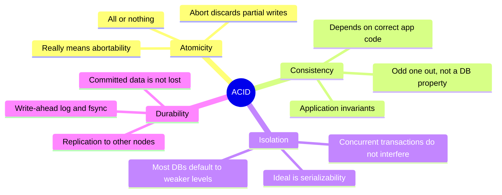

#### Atomicity

In general programming, "atomic" usually refers to concurrency: an atomic operation can't be observed half-finished by another thread. **ACID atomicity is not about concurrency** (that's isolation). It's about what happens when a fault strikes in the middle of a group of writes.

Example of my own: a concert-ticket purchase does three writes.

```sql
BEGIN;
UPDATE events  SET seats_left = seats_left - 2 WHERE event_id = 'gig-77';
INSERT INTO orders (order_id, event_id, buyer, qty) VALUES ('ord-5012', 'gig-77', 'nadia', 2);
INSERT INTO email_outbox (order_id, template) VALUES ('ord-5012', 'ticket-receipt');
COMMIT;
```

If the database process dies after the first `UPDATE` but before the `INSERT`s, then without atomicity two seats would vanish with no order to show for them. With atomicity, the database **discards every write of the unfinished transaction**, so the app can retry the whole purchase and know it isn't double-booking.

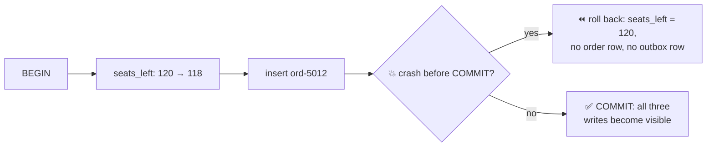

<KeyIdea title="Better name">**Abortability** would have been a better word than atomicity: the ability to abort a transaction on error and have all its writes discarded is what makes retries safe.</KeyIdea>

#### Consistency

"Consistency" is the most overloaded word in data systems. It also means replica consistency (chapter 5), consistent hashing (chapter 6), and linearizability in the CAP theorem (chapter 9). In ACID it means something else again: **certain statements about your data (invariants) are always true**.

Examples of invariants:
- In a double-entry ledger, the debits and credits of every journal entry sum to zero.
- `seats_left` for an event is never negative.
- Every `orders.event_id` points to an existing event.

The catch: **the invariants belong to the application**. The database can't know your business rules. If your code writes data that breaks an invariant, the database will happily store it. The database can enforce a few kinds of invariant for you (`NOT NULL`, `UNIQUE`, `FOREIGN KEY`, `CHECK` constraints), but in general it's the application's job to define valid states and to write transactions that preserve them.

So atomicity, isolation and durability are properties of the **database**; consistency is a property of the **application**, which relies on A, I and D to achieve it. The "C" was arguably added to make the acronym work.

#### Isolation

Most databases are accessed by many clients at once. If they touch different records, no problem. If they touch the **same** records, you get race conditions.

A tiny race of my own: two baristas' tablets both add a loyalty stamp to the same customer's card.

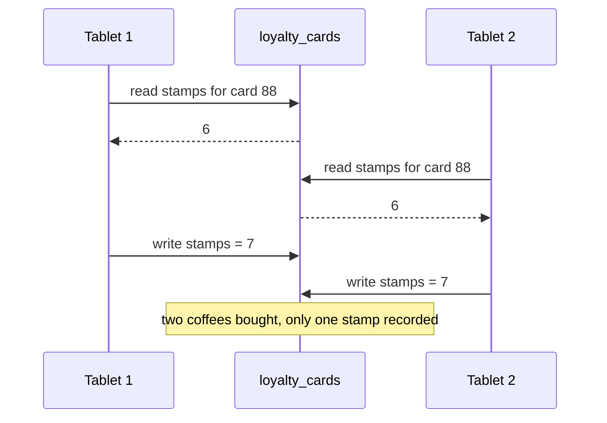

**Isolation** means concurrently executing transactions are isolated from each other: neither can step on the other's toes. The textbook definition is **serializability**: each transaction can pretend it is the only one running, and the final result is the same as if the transactions had run **one after another** in some order.

In practice, serializable isolation is rarely the default because of its performance cost. Oracle 11g, for example, doesn't even implement it: its "serializable" level is actually snapshot isolation. Most of section 7.2 is about these weaker levels.

#### Durability

The purpose of a database is to keep data without losing it. **Durability** promises that once a transaction has committed, its data won't be forgotten, even if the hardware fails or the process crashes.

- On a **single node**: data has been written to non-volatile storage (disk/SSD), usually along with a **write-ahead log** that allows recovery if on-disk structures get corrupted.
- In a **replicated** database: data has been copied to some number of other nodes. The database waits for those writes before reporting success.

Perfect durability doesn't exist. A few uncomfortable facts:

| Threat | Why it hurts |
|---|---|
| Machine dies with data only in memory | In-memory DBs lose it unless replicated or logged |
| Correlated failures | A power outage or a bug triggered by a particular input can take out **all** replicas at once |
| `fsync` lies or fails | Some drives acknowledge writes they haven't persisted; historically, Linux `fsync` errors could be silently swallowed |
| SSD and disk decay | SSDs can develop bad blocks; data can degrade if a drive is unpowered for long |
| Silent corruption | Firmware bugs and bit flips can corrupt data that is never detected until read |
| Asynchronous replication | A leader that fails before shipping recent writes loses them |

Durability is really **risk reduction**: combine disk writes, replication across failure domains, and **backups**, and take them all with a pinch of salt.

### Single-object and multi-object operations

<BookRef pages="250–255" section="Single-Object and Multi-Object Operations" />

Atomicity and isolation describe what the database should do when a client performs **several writes in one transaction**:

- **Atomicity:** if an error occurs halfway, the earlier writes are rolled back. No half-finished state.
- **Isolation:** concurrent transactions see either all of a transaction's writes or none of them. No half-finished state is visible.

A violation of isolation that shows up even with *reads* is easy to picture. Say an inbox-style app keeps a denormalised `open_tickets` counter on each support agent's row, next to the actual ticket rows:

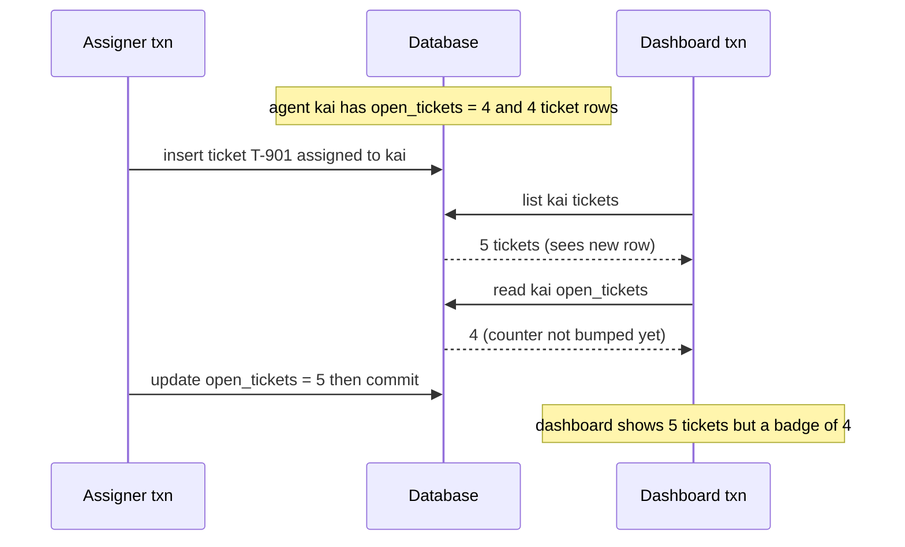

The dashboard saw half of a transaction. That's exactly the kind of anomaly isolation should prevent.

How does the database know which writes belong together? In relational databases it's tied to the **client's TCP connection**: everything between `BEGIN TRANSACTION` and `COMMIT` on that connection is one transaction. (This is imperfect: if the connection drops after the client sends `COMMIT` but before the server's acknowledgement arrives, the client doesn't know whether it committed. A transaction manager can use a unique transaction ID that isn't bound to a connection to fix this.)

Many non-relational databases **don't have a way of grouping operations**. Even with a "multi-put" API, some keys might succeed and others fail, leaving a partial update.

#### Single-object writes

Even a single object needs atomicity and isolation. Imagine writing a 40 KB JSON document:

- If the network cuts out after 18 KB has been sent, does the DB store a truncated fragment?
- If power fails while the DB is overwriting the old value on disk, do you get a spliced mix of old and new?
- If another client reads the document mid-write, does it see a partial value?

Practically every storage engine guarantees **atomicity and isolation at the level of a single object (one key or one row)** on one node:

- Atomicity via a **log** for crash recovery (chapter 3's write-ahead log).
- Isolation via a **lock on each object**, so only one thread at a time touches it.

Some databases go further and offer richer single-object primitives:

| Primitive | Example | What it prevents |
|---|---|---|
| **Atomic increment** | `UPDATE loyalty_cards SET stamps = stamps + 1 WHERE card_id = 88` | The read-modify-write race above |
| **Compare-and-set (CAS)** | "Set `status = 'shipped'` only if it is currently `'packed'`" | Overwriting a value someone else changed |
| **Conditional put** | DynamoDB conditional writes, etcd transactions on a single key | Same as CAS |

These are useful, but they are **not transactions in the usual sense**. Marketing sometimes calls them "lightweight transactions" or even "ACID", which is misleading. A transaction normally means grouping operations on **multiple objects**.

#### The need for multi-object transactions

Many distributed datastores abandoned multi-object transactions because they're hard to implement across partitions and get in the way of high availability and performance. Nothing fundamentally prevents them (chapter 9 shows how distributed transactions work), but should you care?

Plenty of everyday cases need several objects to change in lockstep:

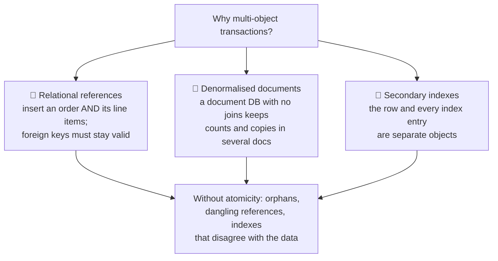

- **Relational data:** a row in one table refers to rows in another. Inserting a row that references something you're inserting at the same time must stay consistent.
- **Document data:** document databases encourage denormalisation because they lack joins. When a denormalised copy or counter must be updated, you need to change several documents at once.
- **Secondary indexes:** every time you change a value, the indexes must change too. Without transactional isolation a record could appear in one index but not another.

You *can* build apps without these guarantees, but error handling gets much harder, and concurrency bugs get much more subtle.

#### Handling errors and aborts

A key feature of transactions is: **if anything goes wrong, abort and retry safely**. ACID databases are built on the philosophy "if we can't guarantee all the guarantees, we'd rather abandon the transaction entirely than leave it half-done".

Not every system works this way. Leaderless replicated stores (Dynamo style, chapter 5) work on a **best-effort** basis: "do as much as possible, and if an error occurs, don't undo what's already done". Recovering from errors is the application's problem there.

Even with real transactions, many popular ORMs (older versions of Rails ActiveRecord, Django) **don't retry** aborted transactions; the error bubbles up as an exception and the user's input is thrown away. That's a shame, because retrying is the whole point. But naive retries have pitfalls:

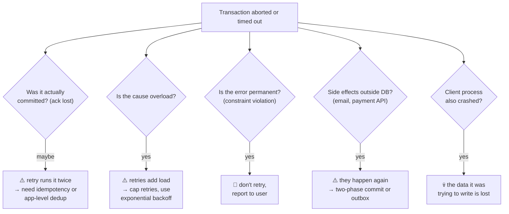

Worked fix for the "commit succeeded but ack was lost" case: generate a request ID on the client and store it inside the same transaction.

```sql
BEGIN;
INSERT INTO processed_requests (request_id) VALUES ('req-c1f3');   -- UNIQUE
UPDATE wallets SET credits = credits + 50 WHERE user_id = 'nadia';
COMMIT;
-- A retry with the same request_id hits the UNIQUE violation and
-- the client knows the first attempt already went through.
```

## 7.2 Weak isolation levels

<BookRef pages="255–273" section="Weak Isolation Levels" />

If two transactions don't touch the same data, they can run in parallel without any trouble. Concurrency problems (**race conditions**) only appear when one transaction reads data that another is modifying, or when two transactions modify the same data.

Race conditions are hard to find by testing: they're triggered only by unlucky timing, may be rare, and are hard to reproduce. Databases try to hide them with **transaction isolation**. In theory, **serializable isolation** makes them disappear completely. In practice, serializability has a performance cost many databases don't want to pay, so they default to **weaker isolation levels** that guard against some issues but not others.

These weak levels are not academic: real bugs from them have caused lost money, failed audits and corrupted customer data. Some well-known examples include Bitcoin exchanges that lost funds through race conditions in withdrawal logic. "Use an ACID database" is not a sufficient answer: many popular relational databases also use weak isolation by default.

So rather than trusting tools blindly, we need to understand **which race conditions each level permits**.

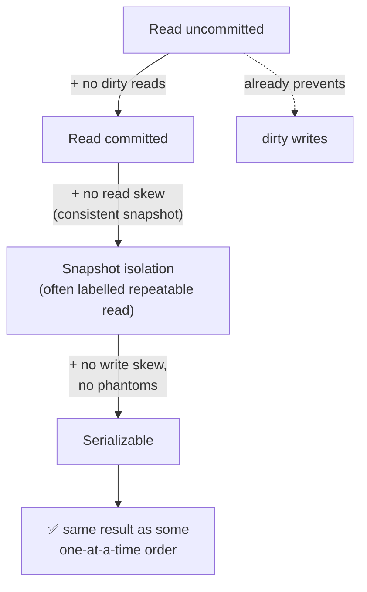

### Read committed

<BookRef pages="256–259" section="Read Committed" />

The most basic level that is still useful. It makes two guarantees:

1. **No dirty reads:** when you read, you only see data that has been committed.
2. **No dirty writes:** when you write, you only overwrite data that has been committed.

(Some databases support an even weaker level, **read uncommitted**, which prevents dirty writes but allows dirty reads.)

#### No dirty reads

A **dirty read** happens when a transaction can see another transaction's writes **before they commit**. Under read committed, any writes made by a transaction only become visible to others when it commits, and then all at once.

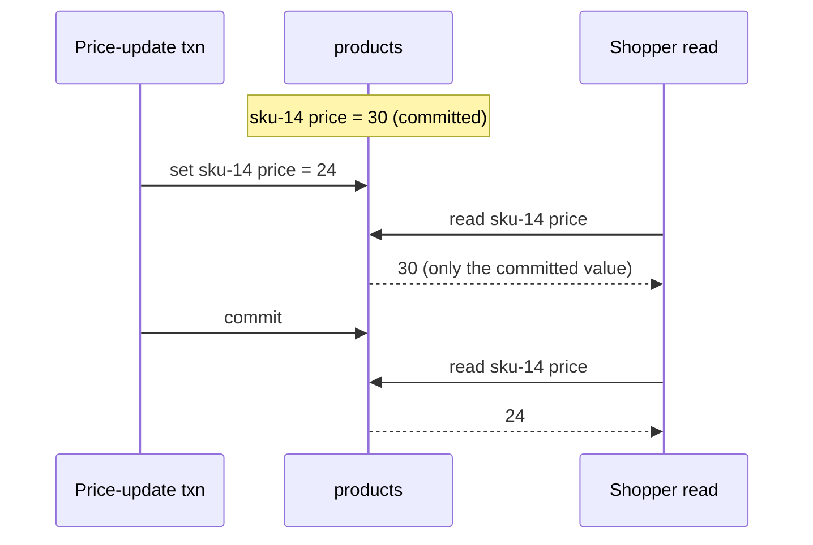

Why prevent dirty reads?

- **Partial updates:** with a multi-object transaction, another transaction could see some of the writes but not others (like the support-agent dashboard earlier). Confusing, and can lead to wrong decisions.
- **Rolled-back data:** if a transaction aborts, everything it wrote is rolled back. A dirty reader may have seen data that **never actually existed**, and acted on it (sent an email quoting a price of 24 that was cancelled).

#### No dirty writes

What if two transactions update the **same** object at once? Normally the later write overwrites the earlier one. A **dirty write** is when the later write overwrites a value that the earlier transaction wrote **but hasn't committed yet**.

Read committed prevents this, usually by **delaying the second write** until the first transaction has committed or aborted.

My own example: an office has a last-free parking bay. Assigning it means updating two rows: the `bays` table (who has bay P-12) and the `permits` table (which bay a permit is printed for). Two admins assign it at the same time to different employees.

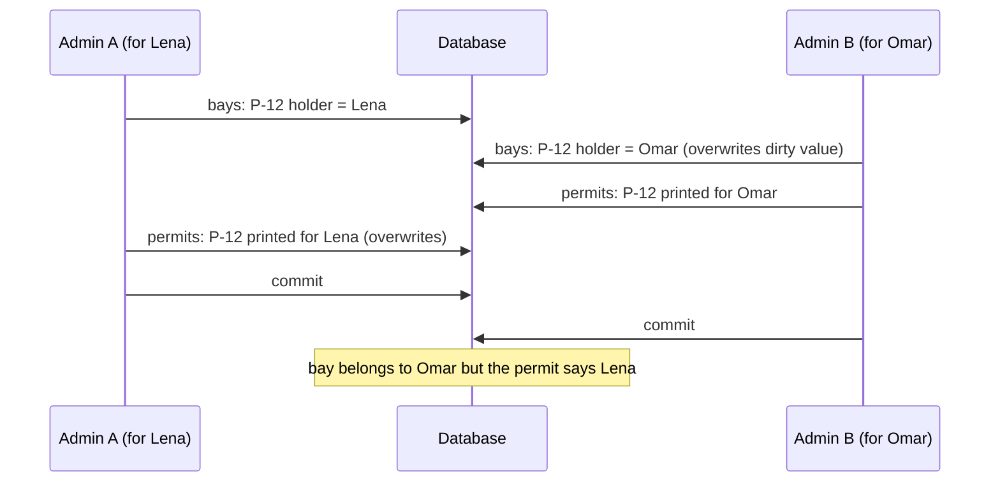

With dirty writes forbidden, Admin B's first write would have waited until Admin A committed, so both rows would end up consistent (both Omar, or both Lena, depending on order).

Note: read committed does **not** prevent the loyalty-stamp race from earlier. There the second write happens *after* the first transaction commits, so it isn't a dirty write. It's still wrong; that's the **lost update** problem covered below.

#### Implementing read committed

Read committed is very popular: it's the default in Oracle 11g, PostgreSQL, SQL Server 2012, MemSQL and many others.

| Guarantee | How it's typically implemented |
|---|---|
| No dirty writes | **Row-level locks.** To modify a row, a transaction must acquire its lock and hold it until it commits or aborts. Only one transaction can hold the lock on any object; others wait. Done automatically in read committed (or stronger). |
| No dirty reads | Option 1: readers briefly take the same lock and release it straight after reading. **Rarely used**: one long write transaction would block every reader of that row, hurting response time across the app. Option 2 (**used by most DBs**): for every object being written, remember **both the old committed value and the new value** set by the transaction holding the lock. Other transactions are given the old value until the writer commits. |

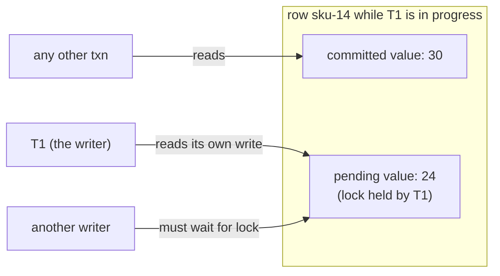

### Snapshot isolation and repeatable read

<BookRef pages="259–264" section="Snapshot Isolation and Repeatable Read" />

Read committed sounds like it covers everything: aborts are handled, half-finished results are hidden, concurrent writes don't mix. But there are still plenty of ways to get concurrency bugs.

**Read skew (non-repeatable read):** a transaction sees different parts of the database at different points in time.

My own example: a warehouse keeps stock of an item in two bins. Bin A has 30 units, bin B has 20 (total 50). A stock-move transaction shifts 10 units from A to B, while an auditor reads the two bins one after another.

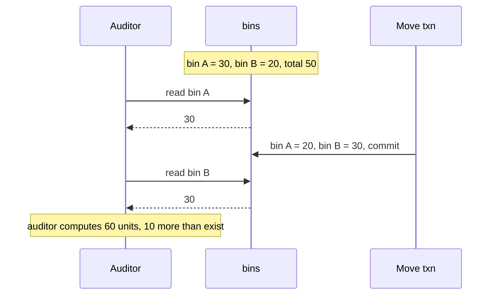

Every value the auditor saw was committed, so read committed is satisfied. If the auditor reads again later, both bins look fine. For a quick human glance that may be tolerable, but some situations **cannot** tolerate this temporary inconsistency:

- **Backups:** a backup copies the whole database, which can take hours, while writes continue. Some parts of the backup would contain older data and others newer data. **Restoring** from it would make the inconsistency (missing or duplicated stock) permanent.
- **Analytic queries and integrity checks:** a long query scanning large parts of the DB, or a periodic check that "all stock adds up", would return nonsense if it sees different points in time.

**Snapshot isolation** is the most common fix. Each transaction reads from a **consistent snapshot** of the database: it sees all the data that was committed **at the moment the transaction started**. Even if data is changed later by others, this transaction keeps seeing the old data from that point in time.

It's especially valuable for long-running read-only queries like backups and analytics, and it's supported by PostgreSQL, MySQL/InnoDB, Oracle, SQL Server and others.

#### Implementing snapshot isolation

Like read committed, implementations typically use **write locks** to prevent dirty writes: a write can block another write to the same object. **Reads require no locks at all.**

<KeyIdea>The key principle of snapshot isolation: **readers never block writers, and writers never block readers.** A long read (a backup) can run on its snapshot while normal writes continue at full speed.</KeyIdea>

To do this, the database keeps **several committed versions** of each object, because various in-progress transactions may need to see the database at different points in time. This is called **multi-version concurrency control (MVCC)**.

- A database that only needs read committed could keep just two versions (committed and uncommitted-overwrite).
- Snapshot isolation needs potentially **many** versions.
- A common design: read committed uses a **separate snapshot for each query**, snapshot isolation uses **the same snapshot for the whole transaction**.

How PostgreSQL-style MVCC tags versions (my own data):

- Each transaction gets an always-increasing **transaction ID** (`txid`).
- Every row version has a `created_by` field with the txid that inserted it.
- Every row version has a `deleted_by` field, initially empty. A delete doesn't remove the row; it sets `deleted_by`. Later, when no transaction can see the deleted data any more, a **garbage collector** (Postgres calls it `VACUUM`) removes it.
- An **update** is turned into a delete of the old version plus a create of a new version.

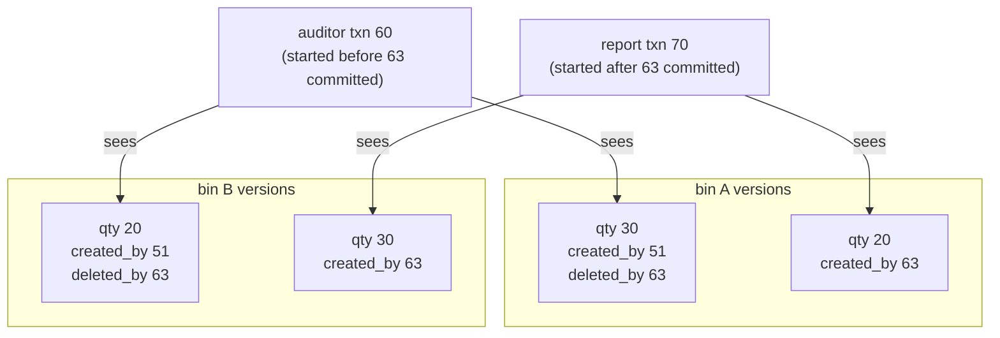

The auditor, as txn 60, now consistently sees 30 + 20 = 50.

#### Visibility rules for observing a consistent snapshot

When a transaction reads, the txids decide which versions it can see. At the start of each transaction, the database records the list of transactions that are **still in progress**. Then:

1. Writes by transactions that were **in progress** when I started are ignored, even if they commit later.
2. Writes by **aborted** transactions are ignored.
3. Writes by transactions with a **later txid** (started after me) are ignored, whether committed or not.
4. **All other writes are visible.**

Put the other way round, a row version is visible to me if **both**:
- the transaction that created it had **already committed** when I started, and
- it is **not marked deleted**, or the deleting transaction had **not yet committed** when I started.

```python
def visible(version, me):
    def committed_before_me(txid):
        return (txid is not None and txid < me.txid
                and txid not in me.in_progress_at_start
                and not aborted(txid))
    created_ok = committed_before_me(version.created_by) or version.created_by == me.txid
    deleted_ok = version.deleted_by is None or not committed_before_me(version.deleted_by)
    return created_ok and deleted_ok
```

A long-running transaction can keep using a snapshot for ages, continuing to read values that have long since been overwritten or deleted. Because the database never updates in place but always creates a new version, it can provide a consistent snapshot with only a small overhead.

#### Indexes and snapshot isolation

How do indexes work in a multi-version database? Several approaches:

| Approach | How it works | Used by |
|---|---|---|
| **Index points to all versions** | The index entry leads to every version of the object; the query filters out versions not visible to it. When GC removes old versions, matching index entries are removed too. | PostgreSQL (with optimisations like heap-only tuples to skip index updates when the version fits on the same page) |
| **Append-only / copy-on-write B-tree** | Pages are never overwritten. Modifying a leaf creates a new copy of it, and of every parent up to the root, which then points to the new child. Unaffected pages are shared. Each write transaction produces a **new root**, and each root is a consistent snapshot. | CouchDB, Datomic, LMDB |
| **Undo log** | The table holds the latest version; older versions are rebuilt from undo records when an old snapshot needs them. | MySQL InnoDB, Oracle |

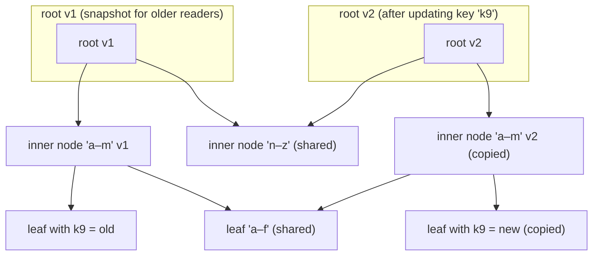

With copy-on-write trees there is no need to filter by txid: a query just starts from the root that was current when its transaction began. The cost is a background **compaction and garbage collection** process to reclaim pages no root references any more.

#### Repeatable read and naming confusion

Snapshot isolation is extremely useful, but many databases call it by different names:

| Database | Name it uses | What you actually get |
|---|---|---|
| PostgreSQL | `REPEATABLE READ` | Snapshot isolation (with lost-update detection) |
| MySQL InnoDB | `REPEATABLE READ` | Snapshot reads, but weaker: lost updates are **not** detected; locking reads see latest data |
| Oracle | `SERIALIZABLE` | Snapshot isolation (not truly serializable) |
| SQL Server | `SNAPSHOT` | Snapshot isolation |
| IBM Db2 | "repeatable read" | Actually closer to serializable |

Why the mess? The **SQL standard (1992)** defines isolation levels based on System R's lock-based definitions, from a time when snapshot isolation hadn't been invented. The standard's "repeatable read" looks superficially like snapshot isolation, so vendors used that label to claim standards compliance. The standard's definitions are also **ambiguous and incomplete**, and later research showed they don't map cleanly onto how real implementations behave.

<KeyIdea>**Never trust an isolation level by its name.** Read the docs (or tests like Jepsen's "Hermitage" style experiments) to see which anomalies it actually prevents.</KeyIdea>

### Preventing lost updates

<BookRef pages="264–268" section="Preventing Lost Updates" />

So far we've covered what a **read-only** transaction can see while others write. We've only lightly touched the problem of **two transactions writing concurrently**: dirty writes are one case; there are others.

The best known is the **lost update** problem, already seen with the loyalty stamps. It occurs when an app runs a **read-modify-write cycle**: read a value, change it in application code, write it back. If two transactions do this concurrently, one modification can be lost, because the second write doesn't include the first one's change ("the later write clobbers the earlier one").

Everyday versions of it:
- Incrementing a counter or updating a balance (read, compute new value, write back).
- Making a local change to a complex value: adding a tag to a JSON array of tags on a blog post.
- Two people editing the same wiki section at the same time; each saves the whole page, so whoever saves last wins.

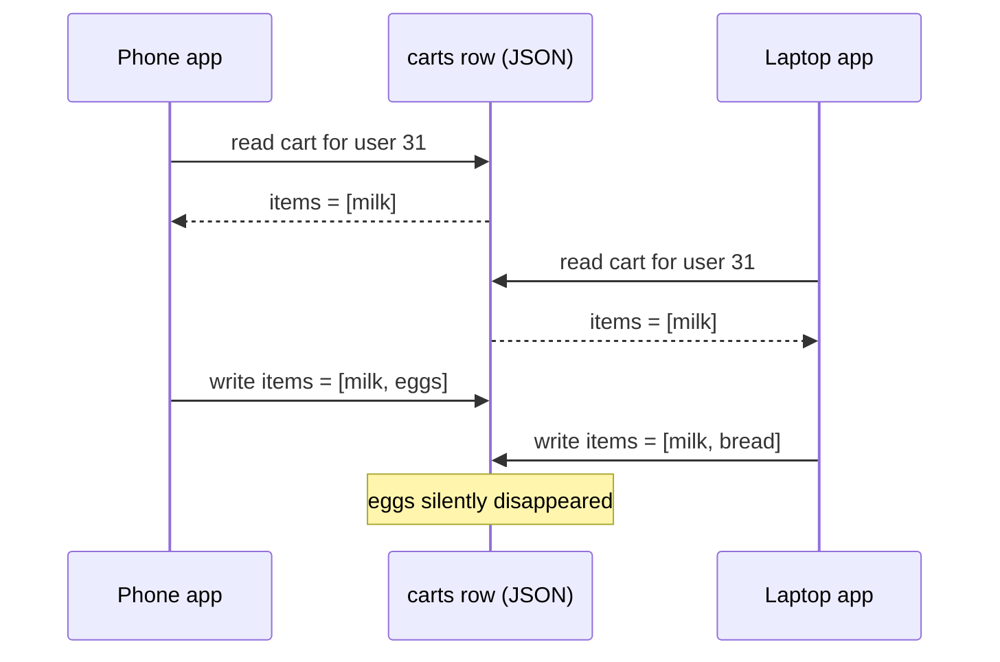

Because this is so common, a variety of fixes have been developed.

#### Atomic write operations

Many databases provide atomic update operations that **remove the need for the read-modify-write cycle in application code**. If your code can be expressed in terms of them, this is usually the best choice.

```sql
-- Relational: the increment happens inside the database
UPDATE loyalty_cards SET stamps = stamps + 1 WHERE card_id = 88;
```

```js
// MongoDB: atomic modification of part of a document
db.carts.updateOne({ user_id: 31 }, { $addToSet: { items: "eggs" } });
```

```bash
# Redis: atomic operations on data structures
INCR page_views:home
SADD cart:31 eggs
```

How they're implemented: usually by taking an **exclusive lock on the object** while it's read and written, so no other transaction can read it until the update is applied (sometimes called **cursor stability**). Another option is forcing all atomic operations onto a **single thread**.

Watch out: **ORMs** make it easy to accidentally write a read-modify-write cycle in Python/Ruby/Java instead of using the database's atomic operation (`card.stamps += 1; card.save()`). Not always a bug, but a frequent source of subtle ones that are hard to find through testing.

Not everything fits an atomic operation: editing a wiki page involves arbitrary text changes. (Though operational transformation / CRDT-style approaches, see chapter 5, can handle concurrent text edits.)

#### Explicit locking

If the database's built-in atomic operations aren't enough, the application can **explicitly lock** the objects it's going to update. Then it can do a read-modify-write cycle, and any other transaction trying to read the same object is forced to wait until the first cycle finishes.

My own example: a stock-trading simulator for a classroom where each student's portfolio must not go over a cash limit when adjusting positions, with logic too complex for one SQL statement.

```sql
BEGIN;
SELECT cash, risk_score
  FROM portfolios
 WHERE student_id = 'stu-204'
   FOR UPDATE;              -- lock this row until COMMIT
-- application checks rules, computes new allocation in code...
UPDATE portfolios SET cash = 812.40, risk_score = 0.37 WHERE student_id = 'stu-204';
COMMIT;
```

`FOR UPDATE` tells the database to take a lock on every row returned by the query. It works, but you have to **think carefully about your application logic**: it's easy to forget a lock somewhere and introduce a race.

#### Automatically detecting lost updates

Atomic operations and locks **force** read-modify-write cycles to happen sequentially. An alternative: let them run **in parallel**, and if the transaction manager detects a lost update, **abort the transaction** and force it to retry.

- Can be done efficiently on top of **snapshot isolation**.
- PostgreSQL's repeatable read, Oracle's serializable, and SQL Server's snapshot isolation **do** detect lost updates and abort the offending transaction (e.g. Postgres raises "could not serialize access due to concurrent update").
- MySQL/InnoDB's repeatable read **does not**. Some argue a database must prevent lost updates to qualify as snapshot isolation, by which definition InnoDB doesn't provide it.

<KeyIdea>Automatic lost-update detection is great because it's **less error-prone**: application code doesn't need any special operations or locks. You might forget a lock; the database won't forget to check.</KeyIdea>

#### Compare-and-set

In databases without transactions, you sometimes find an atomic **compare-and-set (CAS)** operation. The update only happens if the value **hasn't changed since you last read it**. If it has, the update has no effect and the read-modify-write cycle must be retried.

```sql
-- Only save the wiki section if nobody else changed it since we loaded version 17
UPDATE wiki_sections
   SET body = 'new text…', version = 18
 WHERE section_id = 'install-guide' AND version = 17;
-- 0 rows affected  → someone else saved first; reload, merge, retry
```

Comparing on a `version` column (or a hash or timestamp) is safer than comparing the old content, which might coincidentally match. One subtle trap: if the database lets the `WHERE` clause read from an **old snapshot**, the condition might pass even though another concurrent write happened. Check whether your database's CAS is actually safe before relying on it.

#### Conflict resolution and replication

In **replicated** databases, lost updates take on another dimension. Since copies of the data live on several nodes and can be modified concurrently on different nodes, more steps are needed.

- **Locks and CAS** assume there is a **single up-to-date copy**. Multi-leader and leaderless replication allow concurrent writes with asynchronous replication, so there's no guarantee of a single up-to-date copy. These techniques don't apply directly.
- Instead, such systems often allow concurrent writes to create **several conflicting versions (siblings)** and then use application code or special data structures to **resolve and merge** them afterwards (chapter 5).
- **Commutative atomic operations** work well: if they can be applied in any order and give the same result (incrementing a counter, adding to a set), they're safe to replicate. Riak 2.0 datatypes (CRDTs) do this and avoid lost updates across replicas.
- **Last write wins (LWW)** conflict resolution is **prone to lost updates**, yet it's the default in many replicated databases.

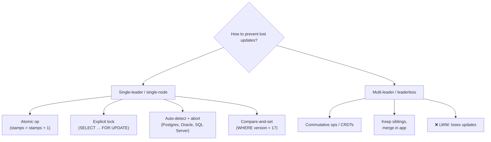

### Write skew and phantoms

<BookRef pages="268–273" section="Write Skew and Phantoms" />

Dirty writes and lost updates are two kinds of race that occur when different transactions concurrently write to the **same** object. But races can also happen in subtler ways, where the transactions write to **different** objects.

My own main example: a couple share a "family savings" arrangement made of two pots, one in each person's name. The bank's rule (an invariant) is that the pots may individually go negative, but **the combined balance must never drop below zero**. Pot J (Jamal) holds 300 and pot R (Rosa) holds 200, combined 500. On the same evening, Jamal withdraws 400 from his pot and Rosa withdraws 400 from hers. Each withdrawal transaction checks the combined balance first.

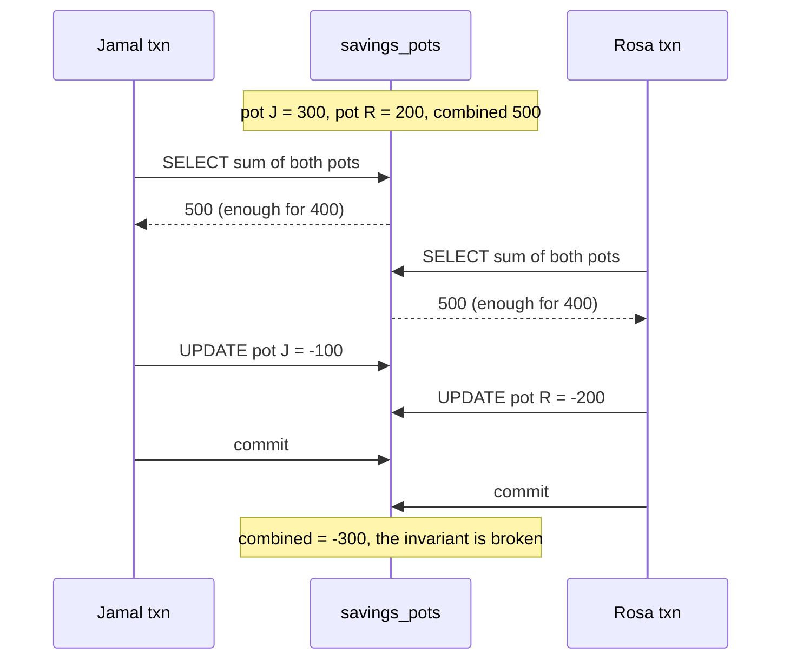

Both transactions ran under snapshot isolation; both checks passed; each **updated a different row**, so there was no dirty write and no lost update. Yet the combined result violates the rule. This anomaly is called **write skew**.

#### Characterising write skew

Write skew is neither a dirty write nor a lost update, because the two transactions update **two different objects**. It's subtler that a conflict happened at all, but it's definitely a race: if the two transactions had run one after the other, the second would have seen a combined balance of 100 and refused.

You can think of write skew as a **generalisation of the lost update problem**: two transactions read the same objects, then update some of those objects (different transactions may update different ones). In the special case where they update the same object, you get a dirty write or a lost update, depending on timing.

Our options for preventing it are more limited:

| Technique | Helps against write skew? |
|---|---|
| Atomic single-object operations | ❌ multiple objects are involved |
| Automatic lost-update detection (Postgres RR, Oracle, SQL Server SI) | ❌ not detected: it'd need true serializability |
| Database constraints | ⚠️ only simple ones (uniqueness, foreign keys); multi-object invariants like "combined ≥ 0" usually need triggers or materialised views |
| **Serializable isolation** | ✅ the cleanest fix |
| **Explicitly lock the rows the decision depends on** | ✅ second-best |

Explicitly locking the rows the transaction depends on:

```sql
BEGIN;
SELECT pot_id, balance
  FROM savings_pots
 WHERE household_id = 'hh-19'
   FOR UPDATE;          -- lock BOTH pots, not only the one being changed
-- app checks: combined - 400 >= 0 ?
UPDATE savings_pots SET balance = balance - 400 WHERE pot_id = 'pot-J';
COMMIT;
```

Now Rosa's transaction blocks on its `SELECT … FOR UPDATE` until Jamal commits, then sees the combined balance of 100 and refuses.

#### More examples of write skew

Once you know the pattern, you see it everywhere. All examples are my own:

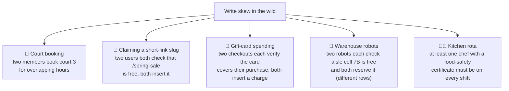

**Tennis-court booking.** A club wants no two bookings of the same court overlapping in time. A booking transaction first checks for conflicts, then inserts:

```sql
BEGIN;
-- check for any existing booking that overlaps 18:00–19:00 on court 3
SELECT COUNT(*) FROM court_bookings
 WHERE court_id = 3
   AND ends_at   > '2026-05-02 18:00'
   AND starts_at < '2026-05-02 19:00';
-- if the count was 0:
INSERT INTO court_bookings (court_id, member, starts_at, ends_at)
VALUES (3, 'ines', '2026-05-02 18:00', '2026-05-02 19:00');
COMMIT;
```

Snapshot isolation does **not** stop two members from both getting a count of 0 and both inserting. You need serializable isolation (or the materialising trick below). PostgreSQL can enforce this particular rule with an **exclusion constraint** on a time range (`EXCLUDE USING gist (court_id WITH =, tsrange(starts_at, ends_at) WITH &&)`), which is a neat escape hatch.

**Short-link slugs.** A URL shortener lets users pick a custom slug. Two users both check that `spring-sale` is unused and both create it. Fortunately, a **unique constraint** is a simple fix here: the second insert fails and the transaction aborts.

**Gift-card spending.** Two checkouts on the same card each check that the remaining credit covers their purchase, then each insert a new charge row. Combined, they overspend the card. Write skew turns into double spending.

#### Phantoms causing write skew

All these examples follow one pattern:

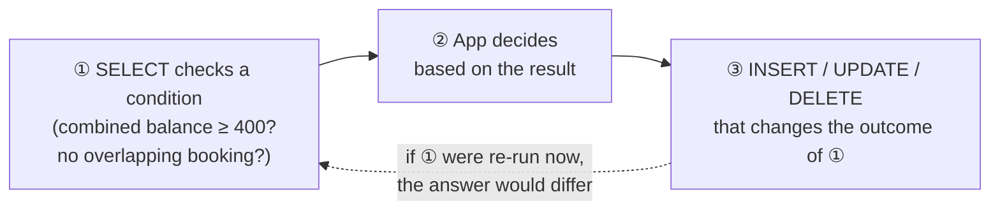

The write in step ③ changes the **precondition** of the decision in step ②. If you repeated the query in ① after committing, you'd get a different result.

The order can vary (write first, then query, then commit or abort based on the result). In the savings example, the step-③ row **existed** in step ①, so we could lock it with `FOR UPDATE`. But in the court-booking, slug and gift-card examples, step ① checks for the **absence** of rows matching a condition, and step ③ **adds** a row. If the query in ① returns no rows, `SELECT FOR UPDATE` has **nothing to attach a lock to**.

<KeyIdea>A **phantom** is when a write in one transaction changes the result of a **search query** in another transaction. Snapshot isolation avoids phantoms for read-only queries, but in read-write transactions phantoms can lead to particularly tricky write skew.</KeyIdea>

#### Materialising conflicts

If the problem is that there's no object to lock, maybe we can **artificially introduce a lock object** into the database.

For the tennis club: create a table of **time slots**, one row per court per 30-minute period, for, say, the next three months, populated ahead of time. The booking transaction now locks the rows for the slots it wants:

```sql
-- pre-populated: (court_id, slot_start) for every 30-min slot
BEGIN;
SELECT * FROM court_slots
 WHERE court_id = 3
   AND slot_start >= '2026-05-02 18:00'
   AND slot_start <  '2026-05-02 19:00'
   FOR UPDATE;               -- these rows DO exist, so they can be locked
-- now check court_bookings for overlaps, then insert
INSERT INTO court_bookings (court_id, member, starts_at, ends_at)
VALUES (3, 'ines', '2026-05-02 18:00', '2026-05-02 19:00');
COMMIT;
```

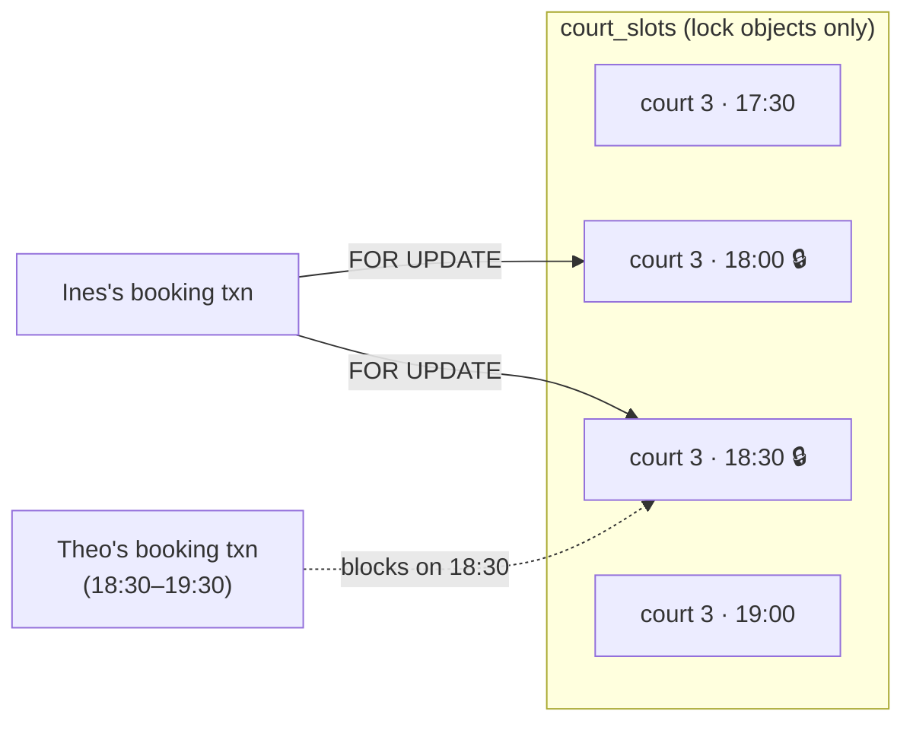

The slot table holds no real data; it exists only as a collection of locks to guard against concurrent bookings. This is **materialising conflicts**: it turns a phantom into a lock conflict on a concrete set of rows.

Downsides: it's hard and error-prone to figure out how to materialise conflicts, and it's ugly to let a concurrency-control mechanism **leak into the application data model**. It should be a **last resort**; a serializable isolation level is much preferable in most cases.

## 7.3 Serializability

<BookRef pages="273–288" section="Serializability" />

Where we've got to is a sad state of affairs:

- Isolation levels are **hard to understand** and inconsistently implemented across databases ("repeatable read" means very different things).
- Looking at your application code, it's **hard to tell** whether it's safe to run at a particular isolation level, especially in a large app where you don't know everything that's running concurrently.
- There are **no good tools** to detect race conditions. Static analysis might help in principle, but practical techniques haven't caught on. Testing for concurrency bugs is hard because they're non-deterministic.

The answer researchers have given since the 1970s: **use serializable isolation**. It's the strongest level. It guarantees that even though transactions may run in parallel, the end result is the same as if they had executed **one at a time, serially**, without any concurrency. So if each transaction is correct when run alone, it's correct when run concurrently: the database prevents **all** possible race conditions.

Why isn't everyone using it? Because of how it's implemented and what it costs. Today, most databases that offer serializability use one of three techniques:

```mermaid
flowchart TB
  S{"Serializable isolation"} --> SE["① Actual serial execution<br/>literally one transaction at a time,<br/>single thread"]
  S --> TPL["② Two-phase locking (2PL)<br/>pessimistic: shared/exclusive locks<br/>held to commit; ~30 years the only option"]
  S --> SSI["③ Serializable snapshot isolation (SSI)<br/>optimistic: run on a snapshot,<br/>check for conflicts at commit"]
  SE --> E1["VoltDB, H-Store, Redis, Datomic"]
  TPL --> E2["MySQL InnoDB SERIALIZABLE,<br/>SQL Server SERIALIZABLE, Db2"]
  SSI --> E3["PostgreSQL ≥ 9.1 SERIALIZABLE,<br/>FoundationDB, CockroachDB (variant)"]
```

### Actual serial execution

<BookRef pages="274–279" section="Actual Serial Execution" />

The simplest way to avoid concurrency problems: **remove concurrency entirely**. Execute only one transaction at a time, in serial order, on a **single thread**. You completely sidestep the problem of detecting and preventing conflicts; the resulting isolation is serializable by definition.

This seems obvious, but people only started believing a single-threaded loop could perform well around 2007. Two developments made it viable:

1. **RAM became cheap enough** that for many use cases you can keep the entire active dataset in memory. With everything in memory, transactions execute much faster than if they had to wait for disk.
2. Database designers realised that **OLTP transactions are usually short** and only make a small number of reads and writes. Long-running analytic queries are typically read-only, so they can run on a consistent snapshot (snapshot isolation) outside the serial loop.

Single-threaded execution can sometimes **outperform** a concurrent system, because it avoids the coordination overhead of locking. But its throughput is limited to **one CPU core**, and transactions need to be structured differently.

#### Encapsulating transactions in stored procedures

In the early days of databases, the intention was that a transaction could cover an **entire flow of user activity**: search for a ticket, choose a seat, enter details, pay, all in one transaction. But humans are slow to make decisions. A database that waited for them would need to support huge numbers of mostly idle open transactions. Most databases can't do that efficiently, so practically all OLTP apps keep transactions short by committing within one HTTP request.

Even so, in the **interactive** style, the app makes a query, reads the result, maybe makes another query based on the first, and so on, with a **network round trip** between each step. A single-threaded database would spend most of its time waiting for the network while the thread sits idle.

So systems with single-threaded serial execution **don't allow interactive multi-statement transactions**. The application must submit the **entire transaction code ahead of time**, as a **stored procedure**.

```mermaid
sequenceDiagram
  participant App
  participant DB
  Note over App,DB: Interactive transaction, the thread waits on the network
  App->>DB: BEGIN and SELECT seats for gig-77
  DB-->>App: 120 left
  App->>DB: UPDATE seats and INSERT order
  DB-->>App: ok
  App->>DB: COMMIT
  Note over App,DB: Stored procedure, one round trip
  App->>DB: CALL buy_tickets with gig-77, nadia, 2
  DB-->>App: ok, ord-5012
```

Example of my own, a Redis Lua script that atomically reserves seats (Redis runs scripts one at a time on its single thread):

```lua
-- KEYS[1] = seats key, KEYS[2] = orders list ; ARGV[1] = qty, ARGV[2] = order json
local left = tonumber(redis.call('GET', KEYS[1]) or '0')
local qty  = tonumber(ARGV[1])
if left < qty then
  return {err = 'SOLD_OUT'}
end
redis.call('DECRBY', KEYS[1], qty)
redis.call('RPUSH',  KEYS[2], ARGV[2])
return left - qty
```

#### Pros and cons of stored procedures

Stored procedures have existed in relational databases for a long time (part of SQL since 1999) and have a bad reputation:

| Traditional complaint | Modern answer |
|---|---|
| Each vendor has its own crusty language (PL/SQL, T-SQL, PL/pgSQL) with a poor ecosystem | Modern systems use general-purpose languages: **VoltDB** uses Java or Groovy, **Datomic** Java or Clojure, **Redis** Lua |
| Code inside the DB is hard to manage: debugging, version control, deployment, testing, monitoring | Still a real concern; needs disciplined tooling |
| A badly written procedure hurts far more than bad app-server code, since the DB is shared by many apps | Still true; a slow procedure stalls everything in a single-threaded system |

With stored procedures and in-memory data, executing all transactions on a single thread becomes feasible. With no disk waits and no network round trips inside a transaction, throughput on one thread can be quite good.

**Replication bonus:** VoltDB also uses stored procedures for replication. Instead of copying a transaction's writes from one node to another, it **executes the same stored procedure on each replica**. This requires procedures to be **deterministic** (same result on every node); if a procedure needs the current time, it must use special deterministic APIs.

#### Partitioning

Executing everything serially makes concurrency control much simpler but limits throughput to **one CPU core on one machine**. Read-only transactions can run elsewhere on snapshots, but for apps with high **write** throughput, the single thread becomes a bottleneck.

To scale to multiple cores and nodes you can **partition** the data (chapter 6). VoltDB supports this. If each transaction only needs to read and write data within **one partition**, each partition can have its own transaction-processing thread running independently. Throughput then scales linearly with the number of CPU cores.

```mermaid
flowchart TB
  subgraph N1["Node 1"]
    P1["partition 1 thread<br/>(events A–H)"]
    P2["partition 2 thread<br/>(events I–P)"]
  end
  subgraph N2["Node 2"]
    P3["partition 3 thread<br/>(events Q–Z)"]
  end
  TX1["buy tickets for 'gig-77'<br/>→ single partition ✅ fast"] --> P1
  TX2["move a booking from<br/>event C to event S"] -->|"cross-partition ❌<br/>lock-step coordination"| P1
  TX2 --> P3
```

However, any transaction that needs to touch **multiple partitions** requires coordination across all of them. The stored procedure must run in **lock-step** across every partition involved, so serializability holds across the whole system. Cross-partition transactions have far more overhead: VoltDB reported a throughput of about **1,000 cross-partition writes per second**, orders of magnitude below single-partition throughput, and it can't be increased by adding machines.

Whether transactions can be single-partition depends heavily on the **data structure**:
- Simple key-value data can often be partitioned very easily.
- Data with **multiple secondary indexes** is likely to require lots of cross-partition coordination (recall term-partitioned indexes in chapter 6).

#### Summary of serial execution

Serial execution of transactions is a viable way of achieving serializable isolation within certain constraints:

- ✅ Every transaction must be **small and fast**: one slow transaction stalls all processing.
- ✅ It works best when the **active dataset fits in memory**. Rarely accessed data could live on disk, but if a single-threaded transaction had to wait for disk, everything would stall. (A workaround is **anti-caching**: abort the transaction, load the data into memory asynchronously, then restart it.)
- ✅ **Write throughput must be low enough for one CPU core**, or transactions must be partitionable without cross-partition coordination.
- ⚠️ Cross-partition transactions are possible, but their use is strictly limited.

### Two-phase locking (2PL)

<BookRef pages="279–283" section="Two-Phase Locking (2PL)" />

For around **30 years** there was only one widely used algorithm for serializability in databases: **two-phase locking (2PL)**.

<KeyIdea title="Don't mix them up">**2PL** (two-phase *locking*, this chapter) and **2PC** (two-phase *commit*, chapter 9) sound alike but are completely different things.</KeyIdea>

We saw that locks prevent dirty writes: if two transactions try to write the same object, the second must wait. 2PL is similar but makes the lock requirements **much stronger**. Several transactions may concurrently **read** the same object as long as nobody is writing it. But as soon as anyone wants to **write**, exclusive access is required:

- If A has **read** an object and B wants to **write** it, B must wait until A commits or aborts. (B can't change the object behind A's back.)
- If A has **written** an object and B wants to **read** it, B must wait until A commits or aborts. (No reading old versions like in MVCC.)

<KeyIdea>In 2PL, **writers block other writers and readers, and readers block writers.** Snapshot isolation's mantra is the exact opposite: readers never block writers and writers never block readers. That difference is the heart of the comparison.</KeyIdea>

Because 2PL provides serializability, it protects against all the race conditions discussed so far, including **lost updates and write skew**.

#### Implementation of two-phase locking

2PL is used by the serializable level in MySQL InnoDB and SQL Server, and by the repeatable read level in Db2. Each object has a lock, which can be in **shared mode** or **exclusive mode**:

| Action | Lock needed | Rules |
|---|---|---|
| **Read** an object | Shared | Many transactions can hold it in shared mode at once. Must wait if someone holds it exclusively. |
| **Write** an object | Exclusive | No other transaction may hold any lock on it (shared or exclusive). |
| **Read, then write** | Upgrade shared → exclusive | Works like acquiring an exclusive lock directly. |
| After acquiring | Hold until end | Locks are held **until commit or abort**. |

The name: **phase 1** (while the transaction executes) is when locks are **acquired**; **phase 2** (at the end) is when **all locks are released**.

```mermaid
xychart-beta
  title "Locks held by one 2PL transaction over its lifetime"
  x-axis ["start", "read pots", "read limits", "write pot J", "write log", "commit", "after"]
  y-axis "locks held" 0 --> 5
  line [0, 2, 3, 3, 4, 4, 0]
```

The number of locks only grows (growing phase) and then drops to zero all at once at commit (shrinking phase).

Applying it to the savings pots:

```mermaid
sequenceDiagram
  participant J as Jamal txn
  participant LM as Lock manager
  participant R as Rosa txn
  J->>LM: shared lock on pot J and pot R
  R->>LM: shared lock on pot J and pot R
  Note over LM: both hold shared locks, both see combined 500
  J->>LM: upgrade pot J to exclusive
  Note over J,LM: waits, Rosa holds shared lock on pot J
  R->>LM: upgrade pot R to exclusive
  Note over R,LM: waits, Jamal holds shared lock on pot R
  Note over LM: deadlock detected, Rosa txn aborted
  LM-->>J: exclusive lock on pot J granted
  J->>LM: commit releases all locks
  R->>LM: retry sees combined 100 and refuses
```

Because so many locks are in use, **deadlocks** happen easily: A waits for B to release a lock, and B waits for A. The database automatically detects deadlocks between transactions and **aborts one** so the others can proceed. The aborted transaction must be retried by the application.

#### Performance of two-phase locking

The big downside, and the reason 2PL hasn't been used by everybody since the 1970s, is **performance**: throughput and response times are significantly worse than under weak isolation.

- **Overhead** of acquiring and releasing all those locks.
- **Reduced concurrency.** By design, if two transactions try to do anything that may result in a race, one must wait.
- **Unstable latencies.** Traditional databases don't limit transaction duration (they're designed for interactive apps waiting on humans). When one transaction has to wait for another, there's no limit on how long. One **slow transaction**, or one that reads a lot of data and takes many shared locks, can bring the rest of the system to a halt. High percentiles (p99) can be very slow.
- **Deadlock-heavy.** Much more frequent under lock-based serializable isolation than under read committed. Every deadlock wastes the aborted transaction's work, and retries do it all again.

```mermaid
flowchart LR
  BIG["🐢 one long report txn<br/>shared-locks 50,000 rows"] --> W1["⏳ checkout txn waits"]
  BIG --> W2["⏳ refund txn waits"]
  BIG --> W3["⏳ stock-adjust txn waits"]
  W1 --> Q["queue grows → p99 latency explodes"]
  W2 --> Q
  W3 --> Q
```

#### Predicate locks

What about **phantoms**, one transaction changing the results of another's search query? A serializable database must prevent them too. In the court-booking example, if one transaction has searched for bookings on court 3 between 18:00 and 19:00, another must not be allowed to concurrently insert or update a booking for the same court and an overlapping time (it's fine to book other courts, or court 3 at another time).

The solution is a **predicate lock**. It works like a shared/exclusive lock, but rather than belonging to one object, it belongs to **all objects that match some search condition**:

```sql
SELECT * FROM court_bookings
 WHERE court_id = 3
   AND ends_at   > '2026-05-02 18:00'
   AND starts_at < '2026-05-02 19:00';
-- → takes a SHARED predicate lock on this condition
```

The rules:
- If transaction A wants to **read** objects matching a condition, it must take a **shared-mode predicate lock** on the conditions of the query. If B currently has an exclusive lock on any object matching those conditions, A must wait.
- If A wants to **insert, update or delete** any object, it must first check whether **either the old or new value matches any existing predicate lock**. If a matching predicate lock is held by B, A must wait until B commits or aborts.

<KeyIdea>The key insight: a predicate lock applies **even to objects that don't yet exist** in the database but might be added in future (phantoms). With 2PL plus predicate locks, the database prevents all forms of write skew and race conditions, making isolation truly serializable.</KeyIdea>

#### Index-range locks

Unfortunately, predicate locks **perform poorly**: if there are many locks by active transactions, checking for matching locks becomes time-consuming. So most 2PL databases actually implement **index-range locking** (also called **next-key locking**), a simplified approximation of predicate locking.

The trick is to lock a **bigger, simpler** set of objects than strictly needed. A predicate lock on "court 3 between 18:00 and 19:00" can be approximated by:

- locking **all bookings on court 3 at any time** (via an index on `court_id`), or
- locking **all courts between 18:00 and 19:00** (via an index on `starts_at`).

```mermaid
flowchart TB
  PL["Exact predicate:<br/>court 3 AND 18:00–19:00"] --> O1["Option A: lock index entry<br/>court_id = 3<br/>(all times on court 3)"]
  PL --> O2["Option B: lock index range<br/>starts_at in 18:00–19:00<br/>(all courts in that hour)"]
  PL --> O3["No suitable index:<br/>shared lock on the<br/>whole table 😬"]
  O1 --> R["Any insert that would match the<br/>predicate also touches the locked<br/>index entry/range → it must wait"]
  O2 --> R
```

Either way, an approximation of the search condition is attached to one of the indexes. If another transaction wants to insert, update or delete a booking on court 3 or one overlapping that hour, it must update the same part of the index, encounters the shared lock, and is forced to wait.

This provides effective protection against phantoms and write skew. Index-range locks are **not as precise** as predicate locks (they may lock more than strictly needed), but their overhead is much lower, so they're a good compromise. If there's no suitable index, the database can fall back to a **shared lock on the entire table**: bad for performance, but safe.

### Serializable snapshot isolation (SSI)

<BookRef pages="283–288" section="Serializable Snapshot Isolation (SSI)" />

So far the picture is bleak. On one hand, implementations of serializability that **don't perform well** (2PL) or **don't scale** (serial execution). On the other hand, weak isolation levels that perform well but are **prone to race conditions**. Are serializable isolation and good performance fundamentally at odds?

Perhaps not: **serializable snapshot isolation (SSI)** is very promising. It provides **full serializability** with only a small performance penalty compared with snapshot isolation. First described in 2008 (Michael Cahill's PhD work), it's used in **PostgreSQL since 9.1** (its `SERIALIZABLE` level) and in distributed databases such as **FoundationDB**. CockroachDB also offers serializable isolation using related optimistic techniques.

#### Pessimistic versus optimistic concurrency control

| | Pessimistic (2PL, serial execution) | Optimistic (SSI) |
|---|---|---|
| Philosophy | "If anything might go wrong, wait until it's safe" | "Go ahead, hope it'll be fine; check at the end" |
| Mechanism | Locks (2PL) or literally one thread (serial execution, which is pessimism taken to the extreme: each transaction has an exclusive lock on the whole DB) | Run on a snapshot, detect violations at commit, **abort** offenders |
| Under high contention | Lots of waiting | Lots of **aborts and retries**, which can make performance worse, especially if the system is already near max throughput |
| Under low contention | Lock overhead paid for nothing | Close to snapshot-isolation speed |
| Helpful trick | — | **Commutative atomic ops** (e.g. two concurrent increments) don't conflict regardless of order, reducing contention |

Optimistic concurrency control is an old idea, with arguments for and against it going back decades. If there's **enough spare capacity** and **contention isn't too high**, optimistic techniques tend to beat pessimistic ones.

As the name suggests, SSI is built on **snapshot isolation**: all reads come from a consistent snapshot. On top of that, SSI adds an algorithm for **detecting serialization conflicts** among writes and deciding which transactions to abort.

#### Decisions based on an outdated premise

Recall the write-skew pattern: a transaction reads some data, examines the result, and decides to act based on it. Under snapshot isolation, the result of the original query may **no longer be up to date** by the time the transaction commits, because the data may have been modified in the meantime.

Put differently, the transaction acts on a **premise** (a fact that was true at the beginning, e.g. "the combined balance is 500"). Later, when it commits, the premise may no longer be true.

The application's query result can't be inspected by the database, so it must **assume that any change in the query result means the writes in the transaction may be invalid**. It must detect situations where a transaction may have acted on an outdated premise and abort it.

How does the database know whether a query result might have changed? Two cases:

```mermaid
flowchart TB
  P["Did my premise go stale?"] --> C1["Case 1: Stale MVCC read<br/>an uncommitted write existed<br/>BEFORE my read, and I ignored it<br/>(MVCC visibility rules)"]
  P --> C2["Case 2: Write after read<br/>someone else wrote data<br/>AFTER I read it"]
  C1 --> D1["Detect at MY commit:<br/>has any ignored write<br/>since committed?"]
  C2 --> D2["Detect at THEIR write:<br/>notify readers via index-range<br/>/ table-level read markers"]
  D1 --> AB["⛔ abort me if I also wrote"]
  D2 --> AB
```

#### Detecting stale MVCC reads

Recall that snapshot isolation is usually implemented with MVCC. When a transaction reads from a consistent snapshot, it **ignores writes** that were made by any other transactions that hadn't yet committed when the snapshot was taken.

In the savings example: suppose Jamal's transaction (txid 42) has already written `pot J = -100` but not committed yet, when Rosa's transaction (txid 43) reads the pots. Rosa's MVCC snapshot ignores that write. By the time Rosa commits, Jamal has committed, so the write Rosa ignored has **taken effect**, and her premise ("combined is 500") is false.

```mermaid
sequenceDiagram
  participant J as Jamal txn 42
  participant DB as SSI database
  participant R as Rosa txn 43
  J->>DB: read pots, combined 500
  J->>DB: write pot J = -100 (uncommitted)
  R->>DB: read pots
  DB-->>R: combined 500 (ignores 42's uncommitted write)
  Note over DB: record that 43 ignored a write by 42
  J->>DB: commit ok
  R->>DB: write pot R = -200
  R->>DB: commit
  DB-->>R: abort, the ignored write by 42 has committed
```

To prevent this, the database tracks when a transaction ignores another's writes due to MVCC visibility rules. When the transaction wants to **commit**, the database checks whether any of the ignored writes have now been committed. If so, the transaction must be aborted.

Why wait until commit rather than aborting Rosa immediately on the stale read?
- If Rosa's transaction is **read-only**, it doesn't need to be aborted: no risk of write skew.
- When Rosa reads, the database doesn't yet know whether she'll later write.
- Jamal's transaction might still **abort**, or might still be uncommitted when Rosa commits, so the read might turn out not to be stale.

By avoiding unnecessary aborts, SSI keeps snapshot isolation's support for **long-running reads from a consistent snapshot**.

#### Detecting writes that affect prior reads

The second case: another transaction modifies data **after** it has been read.

SSI uses a technique similar to index-range locks, **except that the lock doesn't block** anyone. When a transaction reads data that matches some search condition (say, `household_id = 'hh-19'`), the database records the fact in the index entry (or at table level if there's no index). These entries act as **tripwires**, not barriers.

```mermaid
sequenceDiagram
  participant J as Jamal txn 42
  participant IX as Index entry household hh-19
  participant R as Rosa txn 43
  J->>IX: read pots, leave read marker 42
  R->>IX: read pots, leave read marker 43
  J->>IX: write pot J
  IX-->>J: note, txn 43 read this data
  Note over IX: tell 43 its read may be stale
  R->>IX: write pot R
  IX-->>R: note, txn 42 read this data
  J->>IX: commit, first to commit wins
  R->>IX: commit
  IX-->>R: abort, a conflicting write by 42 committed
```

When a transaction **writes**, it looks in the indexes for any other transactions that have **recently read** the affected data. This is like acquiring a write lock on the affected key range, but rather than blocking until the readers commit, the "lock" acts as a **notification**: it tells those transactions that the data they read may no longer be up to date.

In the example, Jamal's write notifies Rosa and vice versa. Jamal commits first, so he succeeds. When Rosa tries to commit, the conflicting write from Jamal has already committed, so Rosa **must abort**, and her retry will see the true combined balance of 100.

The read markers can be dropped once all concurrent transactions have finished; the database only needs to remember them while it matters.

#### Performance of serializable snapshot isolation

As always, many engineering details affect how well it works in practice. A key trade-off is the **granularity** of tracking reads and writes:

- **Precise tracking** (row-level): the database knows exactly which transactions need to abort, but the bookkeeping overhead is significant.
- **Coarse tracking** (page or table level): faster bookkeeping, but more transactions get aborted than strictly necessary.

In some cases it's fine for a transaction to read information overwritten by another: depending on what else happened, the outcome can still be proven serializable. PostgreSQL uses this theory to reduce unnecessary aborts.

```mermaid
flowchart TB
  SSI["SSI vs the alternatives"] --> V1["vs 2PL: no blocking.<br/>Readers don't block writers and vice versa<br/>→ predictable, lower latency;<br/>read-only queries never need locks"]
  SSI --> V2["vs serial execution: not limited to<br/>one CPU core; FoundationDB distributes<br/>conflict detection across machines"]
  SSI --> V3["Cost: abort rate.<br/>Long read-write txns likely to conflict<br/>→ keep read-write txns short"]
```

Compared with 2PL, the big advantage is that one transaction doesn't need to **block** waiting for locks held by another. Like snapshot isolation, **writers don't block readers, and vice versa**. This makes query latency much more predictable and less variable. In particular, **read-only queries can run on a consistent snapshot without any locks**, which is very appealing for read-heavy workloads.

Compared with serial execution, SSI isn't limited to the throughput of a single CPU core. FoundationDB distributes the detection of serialization conflicts across multiple machines, allowing it to scale to very high throughput. Even though data may be partitioned across machines, transactions can read and write data in multiple partitions while ensuring serializability.

The rate of **aborts** significantly affects overall performance. A transaction that reads and writes data over a long period is likely to run into conflicts and abort, so SSI requires read-write transactions to be **fairly short**. (Long-running read-only transactions are fine.) Still, SSI is probably **less sensitive to slow transactions than 2PL or serial execution**.

| | Serial execution | 2PL | SSI |
|---|---|---|---|
| Style | Pessimistic (extreme) | Pessimistic | Optimistic |
| Readers block writers? | n/a (one at a time) | ✅ yes | ❌ no |
| Scales beyond one core? | Only via partitioning | ✅ | ✅ (even across machines) |
| Main cost | One slow txn stalls everything | Lock waits, deadlocks, bad p99 | Aborts under contention |
| Phantom protection | Automatic | Predicate / index-range locks | Read markers on index ranges |
| Best for | Small, fast, in-memory, partitionable txns | Legacy, high-contention short txns | General OLTP with modest contention |

## Summary

<BookRef pages="288–293" section="Summary" />

Transactions are an **abstraction layer** that lets an application pretend that certain concurrency problems and certain kinds of hardware and software faults don't exist. A large class of errors is reduced to a simple **transaction abort**, and the application just needs to retry.

Not every application is susceptible to all these problems: an app with very simple access patterns (reading and writing a single record) can probably manage without transactions. For more complex access patterns, transactions hugely reduce the number of error cases you need to think about.

Without transactions, various error scenarios (processes crashing, network interruptions, power outages, disk full, unexpected concurrency) mean data can become inconsistent in many ways. Denormalised data, for example, can easily drift out of sync with the source. It becomes very hard to reason about what complex interacting accesses can do to the database.

This chapter went deep on **concurrency control**. The anomalies we met:

```mermaid
mindmap
  root((Race conditions))
    Dirty read
      See uncommitted writes
      Fixed by read committed
    Dirty write
      Overwrite uncommitted writes
      Prevented by almost every level
    Read skew
      Parts of DB at different times
      Fixed by snapshot isolation via MVCC
    Lost update
      Concurrent read modify write cycles
      Some SI implementations detect it
      Else atomic ops or explicit locks
    Write skew
      Read then decide then write different objects
      Only serializable isolation prevents it
    Phantom read
      Write changes another txn search result
      Predicate locks, index range locks, SSI markers
```

| Anomaly | Read uncommitted | Read committed | Snapshot isolation | Serializable |
|---|---|---|---|---|
| Dirty write | ✅ prevented | ✅ | ✅ | ✅ |
| Dirty read | ❌ possible | ✅ | ✅ | ✅ |
| Read skew (non-repeatable read) | ❌ | ❌ | ✅ | ✅ |
| Lost update | ❌ | ❌ | ⚠️ detected in Postgres/Oracle/SQL Server, **not** MySQL InnoDB | ✅ |
| Write skew | ❌ | ❌ | ❌ | ✅ |
| Phantom causing write skew | ❌ | ❌ | ❌ (read-only phantoms are avoided by the snapshot) | ✅ |

Weak isolation levels protect against some of these anomalies but leave the rest to the application developer to handle manually (explicit locking, materialising conflicts). Only **serializable isolation** protects against all of them, and there are three ways to get it:

| Approach | One-line idea |
|---|---|
| **Actual serial execution** | Run transactions one at a time on a single thread; needs short, in-memory transactions, ideally stored procedures and single-partition. |
| **Two-phase locking** | Shared/exclusive locks held until commit, plus predicate or index-range locks; the decades-old standard, but performance is a problem. |
| **Serializable snapshot isolation** | Optimistic: run on a snapshot without blocking, then abort transactions whose premise has gone stale at commit time. |

The examples in this chapter used a relational data model, but transactions are a valuable feature **regardless of data model**. This chapter mostly discussed transactions on a **single machine**. Transactions across a distributed system bring a new set of challenges, which the next two chapters explore.

## 🧠 Check yourself

<Quiz question="A shop's phone app and laptop app both read a JSON cart, add a different item, and write the whole cart back. One item disappears. Which anomaly is this?" options={["Dirty read", "Lost update", "Phantom", "Read skew"]} answer={1} explain="Two concurrent read-modify-write cycles on the same object; the later write clobbers the earlier one." />

<Quiz question="Two partners each withdraw from their own savings pot after checking that the combined balance is enough. Combined balance goes negative. Which anomaly, and what's the cleanest fix?" options={["Lost update; atomic increment", "Write skew; serializable isolation (or locking both pots)", "Dirty write; read committed", "Read skew; snapshot isolation"]} answer={1} explain="They read the same data and update different rows based on it. Snapshot isolation does not catch it; serializable isolation or SELECT … FOR UPDATE on both rows does." />

<Quiz question="What does the A in ACID really guarantee?" options={["Operations can't be observed half-done by other threads", "On a fault, all writes of an unfinished transaction are discarded, so it can be retried", "Data survives a crash", "Invariants always hold"]} answer={1} explain="ACID atomicity is about abortability on faults; visibility to concurrent transactions is isolation." />

<Quiz question="An auditor sums stock across two bins while a move transaction runs and gets a total that is too high, though every value read was committed. Which level fixes this?" options={["Read uncommitted", "Read committed", "Snapshot isolation", "None, it is impossible to fix"]} answer={2} explain="That's read skew. Snapshot isolation gives the auditor one consistent point-in-time view for the whole transaction." />

<Quiz question="Why can't SELECT … FOR UPDATE prevent two members from double-booking a tennis court?" options={["FOR UPDATE only works in Postgres", "The conflict check looks for the absence of rows, so there is nothing to lock (a phantom)", "Tennis courts need distributed transactions", "Locks are released after each statement"]} answer={1} explain="The query returns zero rows, so no locks are taken; the conflicting insert creates a new row. Use materialised slot rows, predicate/index-range locks, an exclusion constraint, or serializable isolation." />

<Quiz question="What is the defining difference between 2PL and snapshot isolation?" options={["2PL never deadlocks", "In 2PL readers and writers block each other; in SI they never do", "SI uses locks for reads", "2PL keeps multiple versions"]} answer={1} explain="2PL holds shared locks for reads until commit, so writers must wait for readers and vice versa. MVCC lets readers use an old version." />

<Quiz question="Under SSI, why is a transaction that made a stale MVCC read not aborted at the moment of the read?" options={["Aborting is too expensive", "It may turn out to be read-only, or the other writer may abort, so the read might be harmless", "The database can't detect stale reads", "Reads are never stale under SSI"]} answer={1} explain="SSI waits until commit: read-only transactions don't need aborting and the conflicting writer may never commit, avoiding unnecessary aborts." />

<Quiz question="Which workload fits actual serial execution best?" options={["Long interactive transactions waiting for user input", "Short stored-procedure transactions on an in-memory dataset, mostly within one partition", "Large analytic scans over disk-resident data", "Transactions that touch every partition"]} answer={1} explain="Serial execution needs fast, short transactions without network or disk waits, and write throughput that fits one core per partition." />

**Interview prompts**
- Design a booking system for shared resources (tennis courts, hot desks, vet surgery rooms). Give three different ways to prevent double booking and their trade-offs.
- Your Postgres app runs at the default isolation level. Which anomalies can still happen, and how would you find the risky code paths?
- Why does PostgreSQL `REPEATABLE READ` still allow write skew, while its `SERIALIZABLE` level does not? What changes in your retry logic when you switch?
- Compare 2PL and SSI for a read-heavy dashboard workload with occasional writes. Which do you choose and why?
- A payment API call happens inside a transaction that later aborts and is retried. What goes wrong, and how do you design around it (idempotency keys, outbox pattern)?
- When is "compare-and-set on a version column" enough, and when do you need full transactions?
- How would you make a counter that's incremented from three data centres not lose updates?
