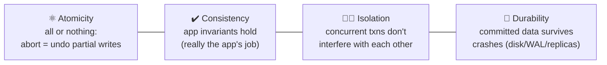
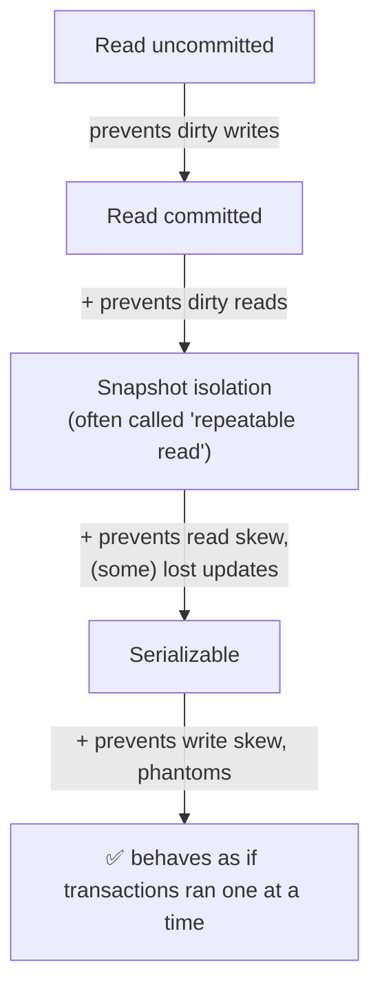
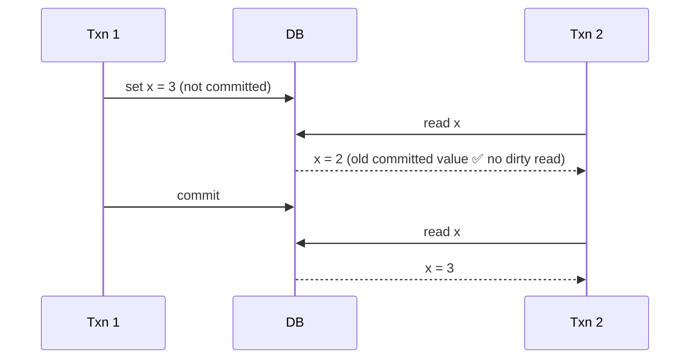
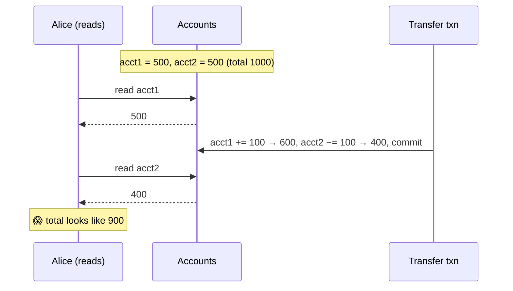
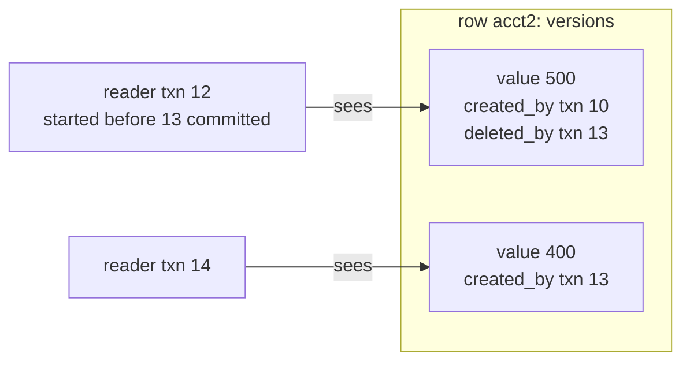
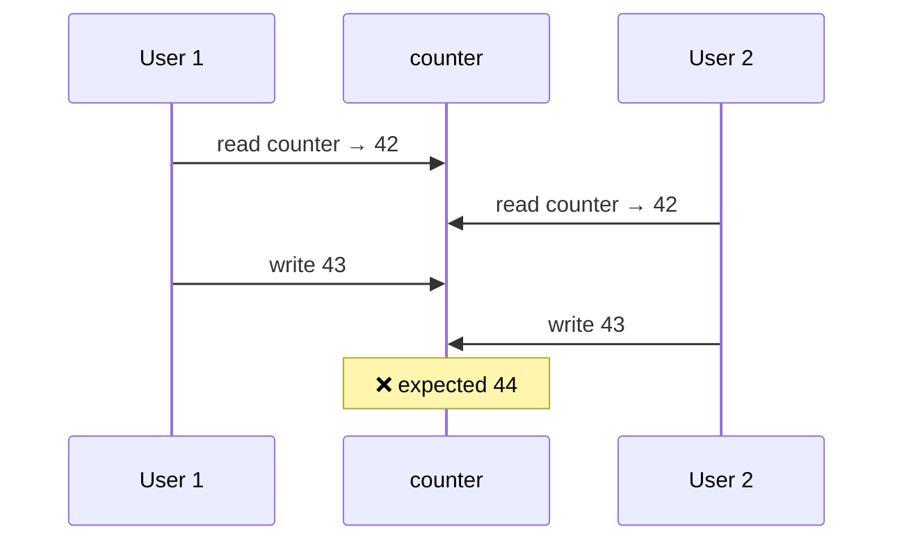
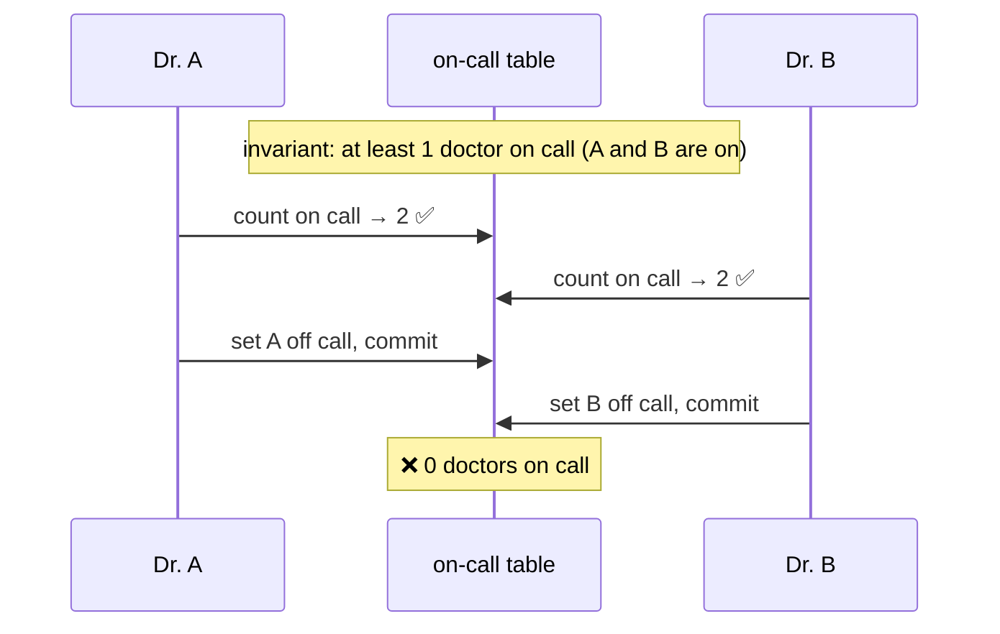
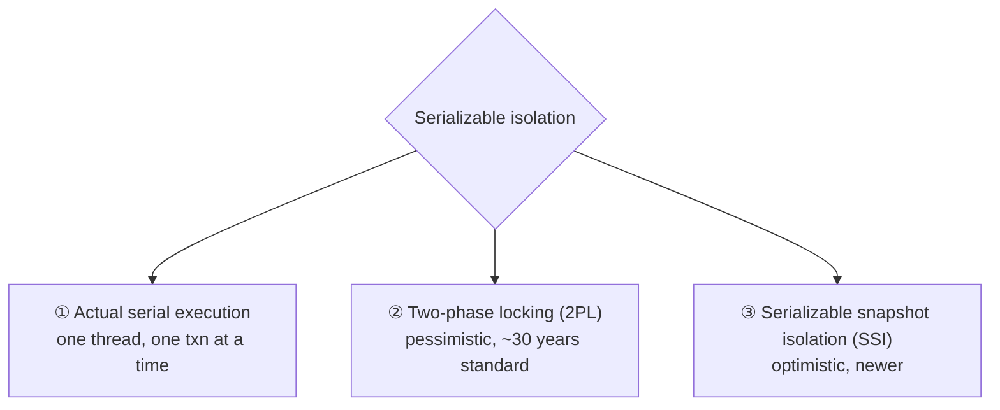
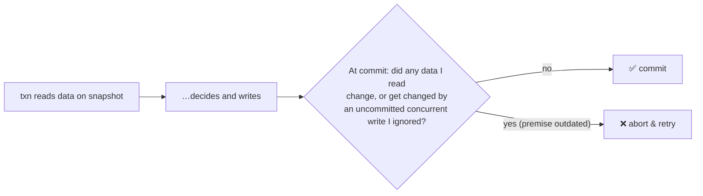

# 7 · Transactions

> **In one line:** a transaction groups several reads and writes into one unit that either fully succeeds (**commit**) or fully fails (**abort**, safe to retry). Isolation levels decide how much concurrent transactions can see of each other, and each weaker level allows specific bugs.

<BookRef pages="243–293" section="Chapter 7" />

## 7.1 What ACID really means

<BookRef pages="244–255" section="The Slippery Concept of a Transaction" />

| Letter | Common misunderstanding | Reality |
|---|---|---|
| **A** | "Concurrency" | It's about **abortability**: on a fault, all of the transaction's writes are discarded |
| **C** | A database property | The **application** defines invariants. The DB only helps (constraints). |
| **I** | Always serializable | Most DBs default to **weaker** levels |
| **D** | Perfect | Disks fail, fsync lies, all replicas can fail together. Durability is reduced risk, not zero risk. |

**BASE** (Basically Available, Soft state, Eventual consistency) mostly means "not ACID".

### Single-object vs multi-object

- Single-object atomicity and isolation (e.g. writing one 20 KB JSON doc) is provided by almost every engine, using a log plus a per-object lock. Also: atomic increment and compare-and-set.
- **Multi-object transactions** are needed for foreign keys, denormalised data that must stay in sync, and secondary indexes.

**Retrying aborted transactions** isn't perfect:
- the commit may have succeeded but the ack got lost, so the retry runs it twice
- retrying when the cause is overload makes the overload worse
- side effects outside the DB (sending email) still happen

## 7.2 Weak isolation levels

<BookRef pages="255–273" section="Weak Isolation Levels" />

### The ladder of anomalies

### Read committed

Two guarantees:
1. **No dirty reads:** you only see committed data.
2. **No dirty writes:** you only overwrite committed data.

**Implementation:**
- **dirty writes:** row-level locks held until commit
- **dirty reads:** remember both the old committed value and the new uncommitted one, and give readers the old value (no read locks)

### Read skew: why read committed isn't enough

This is a disaster for **backups** and long **analytic queries** that need a consistent picture.

### Snapshot isolation + MVCC

Each transaction reads from a **consistent snapshot** taken when it started. The DB keeps **several committed versions** of each row (**MVCC**, multi-version concurrency control).

**Visibility rules:** a version is visible if the transaction that created it had committed **before my snapshot**, and it hasn't been deleted by a transaction that committed before my snapshot.

> *Readers never block writers, and writers never block readers.* Garbage collection removes versions no transaction can see any more.

Naming confusion: Oracle calls it "serializable", and Postgres and MySQL call it "repeatable read".

### Lost updates

Two **read-modify-write** cycles at the same time, where one overwrites the other.

| Fix | Example |
|---|---|
| **Atomic operations** | `UPDATE counters SET value = value + 1 WHERE key = 'x'` |
| **Explicit locking** | `SELECT … FOR UPDATE`, then modify |
| **Automatic detection** | Snapshot isolation in Postgres, Oracle and SQL Server aborts the loser (MySQL InnoDB doesn't) |
| **Compare-and-set** | `UPDATE … SET content = 'new' WHERE content = 'old'` |
| **Replicated DBs** | Locks don't work across leaders, so use commutative ops or merge siblings. LWW loses updates. |

### Write skew and phantoms

Two transactions read the **same** data, then each updates **different** rows based on what they read. Together they break an invariant.

Pattern: ① `SELECT` checks a condition → ② app decides → ③ write changes the result of step ①.

More examples: booking a meeting room, claiming a username, double-spending.

A **phantom** is a write that changes the result of another transaction's search query. It's hard to lock, because the rows **don't exist yet**.
- **Materialising conflicts:** create rows to lock (e.g. one row per room per 15-minute slot). This is ugly; serializable isolation is better.

## 7.3 Serializability

<BookRef pages="273–288" section="Serializability" />

The strongest level: the result is the same as running the transactions **one after another**. There are three ways to implement it.

### ① Actual serial execution

This became feasible because RAM is cheap (the whole active dataset fits in memory) and OLTP transactions are short.

- Send the whole transaction as a **stored procedure**. No back-and-forth with the client while holding the CPU.
- Throughput is limited to **one CPU core**. To scale, **partition** so each transaction touches only one partition. Cross-partition transactions are much slower.
- Used by VoltDB / H-Store, Redis, Datomic.

### ② Two-phase locking (2PL)

> Not to be confused with **2PC** (two-phase commit, ch 9).

- Readers take **shared** locks and writers take **exclusive** locks. Writers block readers **and** readers block writers.
- Locks are held **until the end of the transaction**: phase 1 acquires, phase 2 releases everything at commit.
- **Deadlocks** are detected and one transaction is aborted.
- **Predicate locks** (or the cheaper **index-range locks**) lock *search conditions*, which prevents phantoms.

| ✅ | ❌ |
|---|---|
| Truly serializable | Poor throughput, very slow p99 |
| Well understood | One slow transaction stalls everything; frequent deadlocks |

### ③ Serializable snapshot isolation (SSI)

Optimistic: run on a snapshot without blocking, then **check at commit** whether the snapshot assumptions were broken. If so, abort.

Two things SSI tracks:
1. **Stale MVCC reads:** I ignored an uncommitted write that has since committed.
2. **Writes that affect earlier reads:** someone wrote data I had read (tracked through index-range markers).

| ✅ | ❌ |
|---|---|
| Readers don't block writers | Abort rate rises under high contention |
| Predictable latency | Long read-write transactions are likely to abort |
| Scales across partitions (FoundationDB) | |

Used by PostgreSQL ≥ 9.1 (`SERIALIZABLE`) and FoundationDB.

## Summary

| Anomaly | Read committed | Snapshot isolation | Serializable |
|---|---|---|---|
| Dirty read | ✅ prevented | ✅ | ✅ |
| Dirty write | ✅ | ✅ | ✅ |
| Read skew (non-repeatable read) | ❌ | ✅ | ✅ |
| Lost update | ❌ | ⚠️ some DBs detect it | ✅ |
| Write skew | ❌ | ❌ | ✅ |
| Phantom read | ❌ | ⚠️ read-only queries OK | ✅ |

## 🧠 Check yourself

<Quiz question="Two users increment a counter at the same moment; one increment is lost. Which anomaly?" options={["Dirty read", "Lost update", "Write skew", "Phantom"]} answer={1} explain="Two concurrent read-modify-write cycles; the second write clobbers the first." />

<Quiz question="Two doctors both leave on-call duty, each after checking someone else is on call. Which anomaly, and which level prevents it?" options={["Lost update / snapshot isolation", "Write skew / serializable", "Dirty write / read committed", "Read skew / snapshot isolation"]} answer={1} explain="They update different rows based on a shared read. Only serializable isolation (or explicit locks) prevents it." />

<Quiz question="What is the main downside of two-phase locking?" options={["Allows write skew", "Readers and writers block each other, hurting throughput and tail latency", "Needs a single CPU", "Doesn't work with B-trees"]} answer={1} explain="Shared and exclusive locks held to commit cause lots of waiting and deadlocks." />

<Quiz question="Under snapshot isolation, which statement is true?" options={["Readers block writers", "Writers block readers", "Readers never block writers and writers never block readers", "Only one transaction can run at a time"]} answer={2} explain="MVCC gives each reader its own consistent snapshot." />

**Interview prompts**
- Prevent double-booking of a meeting room. Give three approaches.
- Why does Postgres "repeatable read" still allow write skew?
- When would you pick SSI over 2PL?
