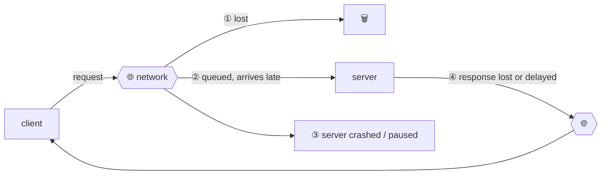
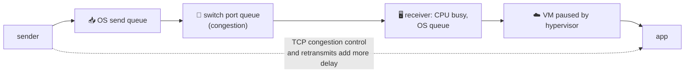
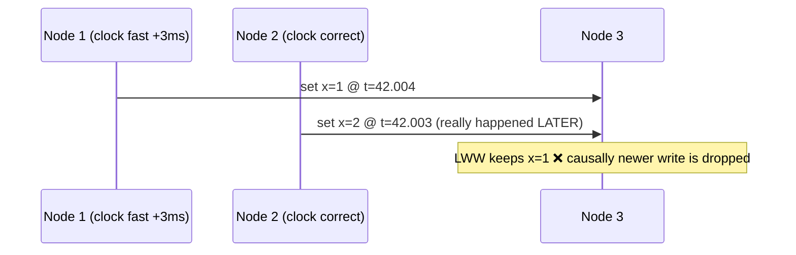
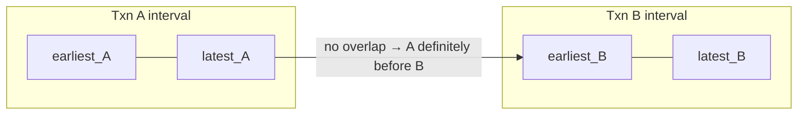
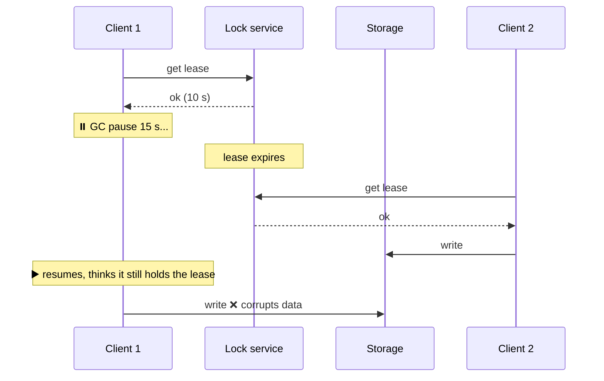
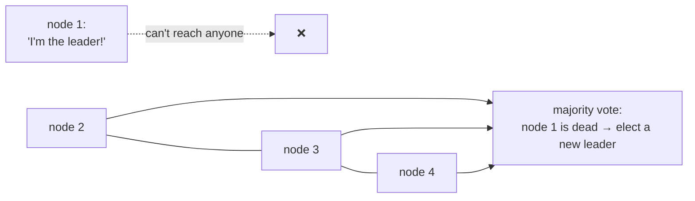
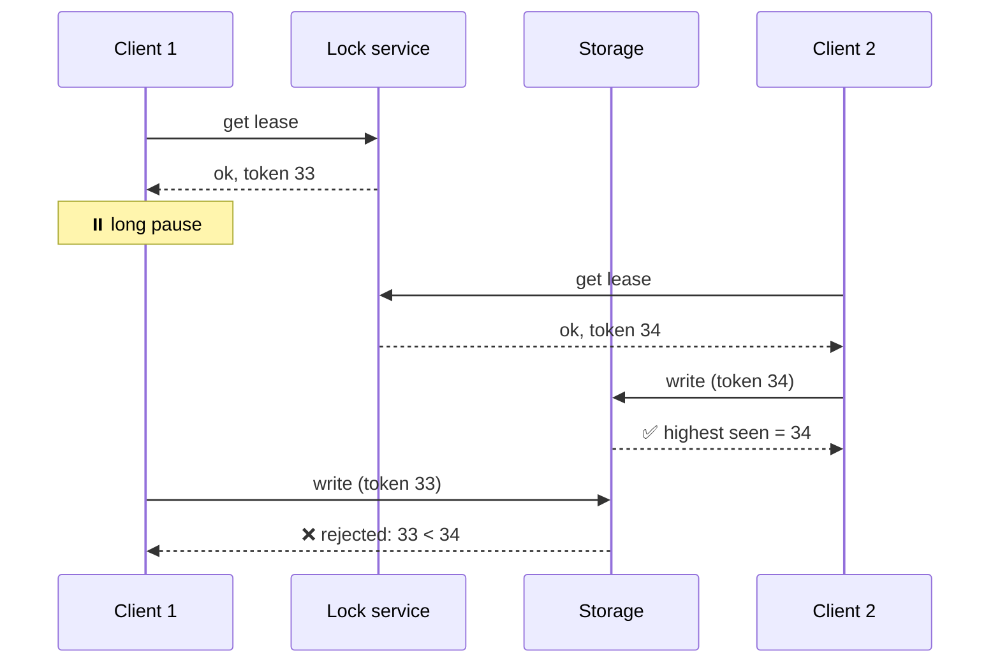
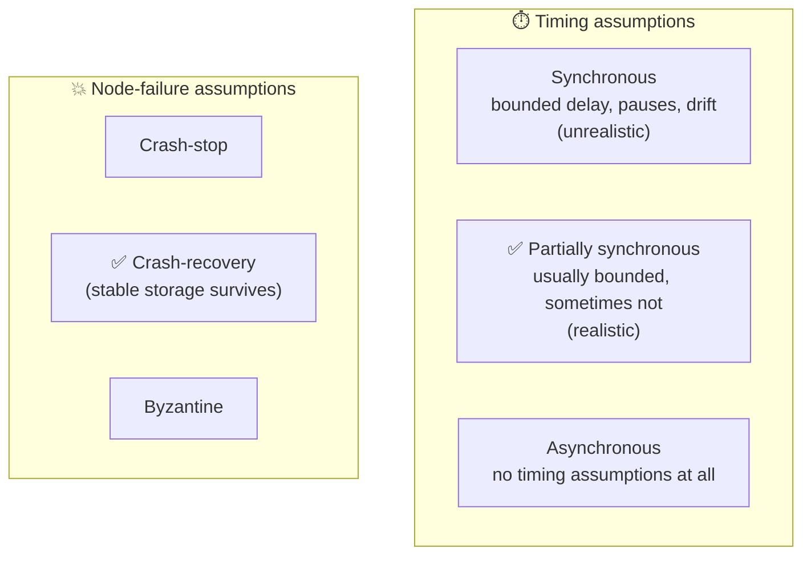
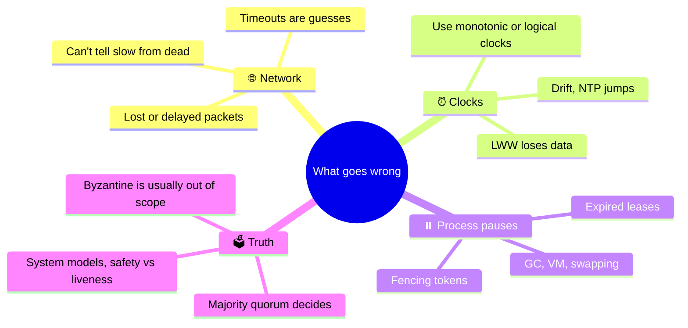

# 8 · The trouble with distributed systems

> **In one line:** on one computer, things either work or crash. Across a network, **partial failures** happen: some parts are broken in unpredictable ways, messages vanish, clocks drift and processes freeze. You must design for all of it.

<BookRef pages="295–341" section="Chapter 8" />

## 8.1 Partial failures

<BookRef pages="296–299" section="Faults and Partial Failures" />

| | Single computer | Distributed system |
|---|---|---|
| Behaviour | Deterministic: works or crashes (kernel panic) | **Non-deterministic partial failures** |
| Philosophy | Better to crash than return a wrong answer | Must keep going while some parts fail |
| Analogy | Supercomputer (checkpoint, restart everything) | Cloud services (always online, rolling upgrades) |

<KeyIdea>Build a **reliable system from unreliable parts**, just as TCP builds reliable delivery on top of unreliable IP, and error-correcting codes protect noisy channels.</KeyIdea>

## 8.2 Unreliable networks

<BookRef pages="299–309" section="Unreliable Networks" />

Shared-nothing nodes talk through an **asynchronous packet network**, which promises nothing about whether or when a message arrives.

From the client's side, **all of these look the same**: no response. You can't tell *why*.

### Timeouts: the only real failure detector

- **Too short:** you declare live nodes dead. Their work gets done twice, and you may trigger cascading failovers under load.
- **Too long:** users wait while a node really is dead.

**Why network delays vary so much: queueing everywhere.**

Practical approach: measure round-trip times continuously and **adapt timeouts** to the observed distribution (as Cassandra's phi accrual failure detector does).

### Why not just guarantee latency?

| | Telephone network (circuit) | Internet / datacenter (packet) |
|---|---|---|
| Bandwidth | Reserved per call | Shared, used dynamically |
| Delay | Bounded, fixed | **Unbounded** |
| Why | Constant bit-rate audio | Bursty traffic, so sharing gives far better utilisation |

Unbounded delay is a **cost/utilisation trade-off**, not a law of nature.

## 8.3 Unreliable clocks

<BookRef pages="309–322" section="Unreliable Clocks" />

### Two kinds of clock

| | Time-of-day clock | Monotonic clock |
|---|---|---|
| API | `clock_gettime(CLOCK_REALTIME)`, `System.currentTimeMillis()` | `CLOCK_MONOTONIC`, `System.nanoTime()` |
| Meaning | Wall time since the epoch | Arbitrary start point, always moves forward |
| Synced by NTP? | Yes, **can jump backwards** | Only its rate is adjusted (slewed) |
| Use for | Timestamps humans read | **Measuring durations / timeouts** |
| Compare across machines? | Roughly, with an error margin | ❌ Meaningless |

Quartz drift (~200 ppm ≈ 17 s per day), NTP problems, firewalled NTP, leap seconds and VM pauses all make time-of-day clocks lie.

### Danger: ordering events by timestamp (LWW)

**Logical clocks** (counters, version vectors) are the safe way to order events.

### Clock readings have a confidence interval

A timestamp is really `[earliest, latest]`. Google **Spanner's TrueTime** exposes this interval explicitly. To commit, Spanner **waits out the uncertainty** (~7 ms, using GPS and atomic clocks), so the intervals of causally ordered transactions don't overlap.

### Process pauses

A thread can be stopped at **any** point, for an unbounded time:
- stop-the-world **garbage collection** (seconds)
- VM suspended or live-migrated
- laptop lid closed
- OS context switch, swapping to disk (thrashing)
- `SIGSTOP`, or a slow synchronous disk on network storage

**The classic bug: a lease that expired while you were paused.**

**Real-time guarantees** (hard deadlines) exist in embedded systems, but they're expensive and limit which languages and tools you can use. Most servers instead **limit the impact of pauses**, for example by restarting processes before GC pauses get long or treating a pause as a short planned outage.

## 8.4 Knowledge, truth and lies

<BookRef pages="322–332" section="Knowledge, Truth, and Lies" />

A node can't trust its own view of the situation. **The truth is defined by the majority (a quorum).**

Even if node 1 is alive, it **must accept** the majority's decision.

### Fencing tokens: fixing the stale-lease bug

Every time the lock service grants a lease, it hands out a **monotonically increasing token**. Storage rejects writes with an older token than it has already seen.

In ZooKeeper, `zxid` or `cversion` can serve as the token.

### Byzantine faults

A **Byzantine** node may *lie*: send corrupted or malicious messages. Byzantine fault tolerance (needed in aerospace and blockchains) requires more than two-thirds of nodes to be honest, and it's expensive. In a datacenter you control, we usually assume **no Byzantine faults**, but still add cheap protection:
- checksums against corrupted packets
- input validation and sanitisation
- multiple NTP servers, ignoring outliers

### System models: what we assume

Correctness properties of an algorithm:
- **Safety:** nothing bad ever happens (e.g. tokens are unique). A violation can be pointed to at a specific moment and can't be undone.
- **Liveness:** something good eventually happens (e.g. a request eventually gets a response). It's often conditional ("if a majority is up").

<KeyIdea>Safety must **always** hold, even if every node crashes or the network misbehaves. Liveness is allowed to depend on conditions.</KeyIdea>

## Summary

## 🧠 Check yourself

<Quiz question="Which clock should you use to measure a request timeout?" options={["Time-of-day clock", "Monotonic clock", "NTP server time", "Lamport clock"]} answer={1} explain="Monotonic clocks never jump backwards, so durations measured with them are reliable." />

<Quiz question="A node was paused for 20 s by GC, then wrote to storage believing it still held a lock. What prevents corruption?" options={["Longer lease timeouts", "Fencing tokens checked by the storage", "NTP synchronisation", "Byzantine fault tolerance"]} answer={1} explain="Storage rejects writes carrying an older token than one it has already seen." />

<Quiz question="'A request eventually receives a response' is a…" options={["Safety property", "Liveness property", "Byzantine property", "Timing assumption"]} answer={1} explain="Liveness means something good eventually happens. Safety means nothing bad ever happens." />

**Interview prompts**
- Why do distributed locks need fencing tokens?
- How would you choose a failure-detection timeout?
- Why is last-write-wins with wall-clock timestamps dangerous?
