# 8 · The trouble with distributed systems

> **In one line:** on one computer, things either work or crash. Across a network, **partial failures** happen: some parts break in unpredictable ways while others keep running, messages vanish or arrive late, clocks disagree and processes freeze without noticing. A distributed system has to be designed so that it stays correct anyway.

<BookRef pages="295–341" section="Chapter 8" />

The previous chapters (replication, partitioning, transactions) kept mentioning things like "if a node fails" or "after a timeout" as if those events were tidy. This chapter is the reality check. It takes a deliberately pessimistic view and asks: **what can actually go wrong when programs talk to each other over a network?** The answer is: almost everything, and often in ways you can't even observe directly.

Why should an application engineer care? Because almost every backend today is distributed, even a "simple" one. A web server, a database, a cache and a queue on four machines already form a distributed system. Knowing the failure modes lets you:

- recognise when a bug is really a **timing or partial-failure** bug rather than a logic bug;
- choose sensible **timeouts, retries and leases** instead of guessing;
- understand why tools like ZooKeeper, etcd, Raft and Spanner are designed the way they are (the subject of the next chapter).

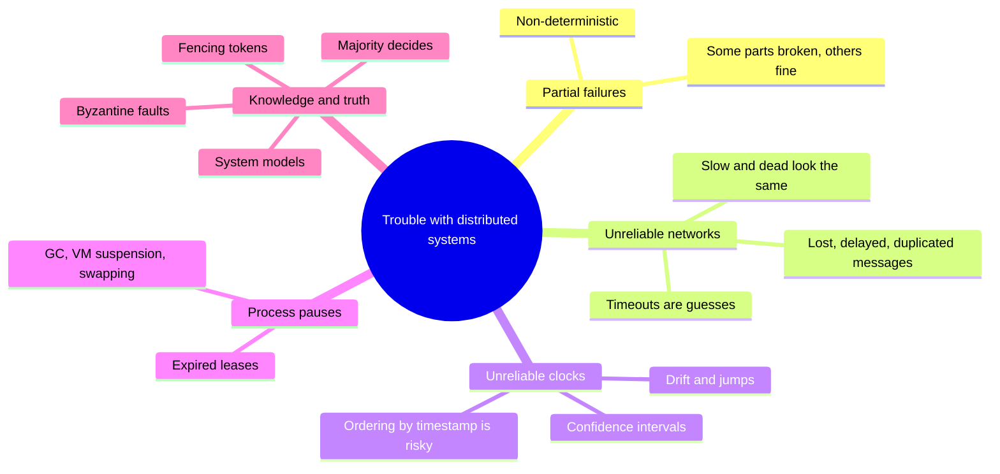

## 8.1 Faults and partial failures

<BookRef pages="296–299" section="Faults and Partial Failures" />

A program on a single, healthy computer is **deterministic** in a useful sense: run the same operation on the same data and you get the same result. If the hardware breaks badly (memory corruption, a loose connector), the usual outcome is a **total failure**: a kernel panic, a blue screen, a machine that won't boot. Computer designers chose this deliberately: **better to crash than to return a wrong answer**. An internal fault is turned into a clean, visible stop.

Distributed systems don't get that luxury. With several machines connected by a network, you routinely end up in a state where **some parts work and some don't**, and the broken parts fail in odd ways. This is a **partial failure**, and partial failures are **non-deterministic**: an operation involving several nodes might succeed one time and fail the next, and you may not even be able to tell whether it succeeded.

Some concrete partial failures (all of which happen in real fleets):

| Partial failure | What you observe |
|---|---|
| One rack's top-of-rack switch reboots | Some nodes are unreachable, others fine |
| A replica's disk becomes very slow | Writes to it time out, reads from others succeed |
| A misconfigured firewall rule drops traffic in one direction | Node A can send to B, B's replies never arrive |
| A node runs out of file descriptors | It accepts TCP connections but can't open files |
| A power-distribution unit fails | Half a row goes dark |
| A process hits a long GC pause | Looks dead for 8 seconds, then resumes as if nothing happened |

<KeyIdea title="Non-determinism is the hard part">It isn't that failures exist. It's that you often **can't know** whether something failed, which part failed, or whether your request took effect.</KeyIdea>

### Cloud computing and supercomputing

<BookRef pages="297–299" section="Cloud Computing and Supercomputing" />

Large-scale computing sits on a spectrum. At one end is **high-performance computing** (supercomputers with thousands of CPUs running batch scientific jobs); at the other is **cloud computing** (multi-tenant datacenters of commodity machines, elastic and always online). Traditional enterprise datacenters sit somewhere in between, and each end handles faults very differently.

**Supercomputers** run long computations (weather simulation, molecular dynamics). Their usual answer to faults is **checkpointing**: periodically save the state of the whole computation to durable storage. If any node fails, stop *everything* and restart from the last checkpoint. In effect, a supercomputer behaves like a giant single-node computer: a partial failure is escalated into a total failure.

This book focuses on **internet services**, which are different in almost every way:

| Aspect | Supercomputer style | Internet-service style |
|---|---|---|
| Availability goal | Batch job can stop and restart | Must serve users with **low latency all the time**; stopping the cluster is not acceptable |
| Hardware | Specialised, reliable nodes, shared memory or RDMA | **Commodity machines**, cheaper per unit but higher failure rates |
| Network | Specialised topologies (meshes, toruses) suited to HPC traffic patterns | **IP and Ethernet**, Clos-style datacenter topologies built for high bisection bandwidth |
| Scale vs. failures | Can assume most parts work most of the time | With thousands of nodes, **something is always broken**; a "stop and fix" strategy would mean being down constantly |
| Maintenance | Take the whole system down | **Rolling upgrades**, one node at a time, while still serving traffic |
| Geography | Usually one building | Often **geo-distributed** to be near users; traffic crosses the slow, unreliable internet |

Some quick arithmetic shows why "something is always broken" is literally true. Suppose each server has a 3% chance of some hardware fault per year and you run 5,000 servers:

```text
expected faults per year = 5,000 × 0.03 = 150
                         ≈ one every 2–3 days
```

And that's before counting software bugs, operator mistakes and network problems.

<KeyIdea title="Build reliable systems from unreliable parts">The goal is fault **tolerance**: the system as a whole keeps working even when components misbehave. This is an old engineering idea: TCP gives reliable, ordered delivery on top of IP, which may drop, delay or reorder packets; error-correcting codes recover data from a noisy channel. The higher layer is never *perfectly* reliable (TCP can't fix a cut cable) but it removes a whole class of low-level problems.</KeyIdea>

Even in a small system that runs on a handful of nodes, it's worth designing for partial failure. A fault that "basically never happens" will eventually happen, and if the code was written without considering it, the result is usually confusing, data-corrupting behaviour. A useful habit is **deliberately injecting faults** in testing (killing processes, dropping packets, pausing nodes) to see what the system really does. Netflix's Chaos Monkey and the Jepsen test suite are well-known examples of this approach.

## 8.2 Unreliable networks

<BookRef pages="299–309" section="Unreliable Networks" />

The systems in this book are **shared-nothing**: each node has its own memory and disks, and the only way nodes interact is by sending messages over a network. That's the dominant architecture because it's cheap (no special hardware), it can span regions, and it scales.

The network in question is an **asynchronous packet network** (the internet and most datacenter Ethernet). It offers **no guarantee** about whether or when a message will arrive. If you send a request and expect a response, many different things can go wrong:

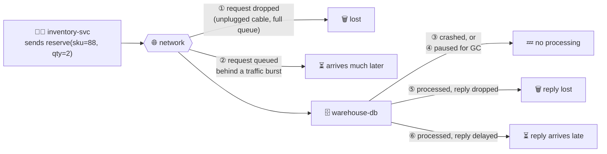

From the sender's point of view, every one of those cases looks **exactly the same**: no response yet. The sender cannot distinguish "the request was lost" from "the server is dead" from "the server did the work but the reply is stuck." In case ⑤ the stock *was* reserved even though the caller thinks it failed. That's why retries need **idempotency** (an idempotency key, or a deduplication table keyed by request ID) and why "exactly once" is so hard.

The usual tool is a **timeout**: after waiting some time, give up and assume the response won't come. But a timeout tells you nothing about *what* happened; the request may still be sitting in a queue and get processed later.

### Network faults in practice

<BookRef pages="301–302" section="Network Faults in Practice" />

Decades of networking haven't made networks fully reliable, and it's tempting to assume that problems are rare in a modern datacenter you control. Published operational studies and incident reports say otherwise:

- In medium-sized datacenters, studies have found **network faults on the order of a dozen per month**, roughly half isolating a single machine and half taking out a whole rack.
- **Redundant networking gear helps less than you'd expect**, because it doesn't protect against **human error** (misconfigured switches, bad routing changes), which is a leading cause of outages.
- Cloud networks have **transient glitches** too. Public post-mortems from major providers regularly mention brief partitions, packet loss between zones, or a bad network config push.
- Odd physical causes happen: cables cut by construction work, undersea cables damaged, a switch software upgrade that triggers a topology reconfiguration during which packets are delayed for over a minute.
- Network interfaces can fail **asymmetrically**: a NIC that drops all inbound packets but still sends outbound ones, so a node can talk but can't hear.

A **network partition** (or "netsplit") is when one part of the network is cut off from another. This book mostly uses the more general term **network fault**.

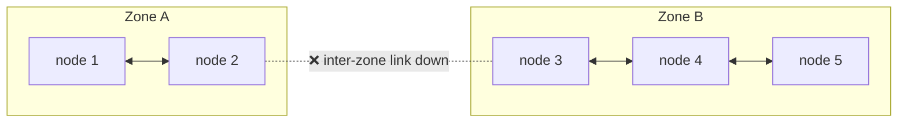

Both sides are alive and serving their local clients. Each side may believe the *other* side is dead. Any design that lets both sides keep accepting writes for the same data risks a **split brain**.

You don't necessarily need to *tolerate* every network fault, but you must **know how your software reacts** to them. If the network is down, it may be fine for the system to return errors to users, but it must not, for example, deadlock forever or silently delete data. When the network recovers, the system should recover too. Testing this deliberately (for example by dropping packets with `iptables` or `tc` in a staging environment) is the only way to be sure.

```bash
# simulate a partition: node-3 stops receiving anything from node-1
sudo iptables -A INPUT -s 10.0.1.11 -j DROP

# add 300 ms ± 200 ms of delay to all outgoing packets
sudo tc qdisc add dev eth0 root netem delay 300ms 200ms
```

### Detecting faults

<BookRef pages="302–303" section="Detecting Faults" />

Many systems need to **detect faulty nodes** automatically:

- a load balancer should stop sending requests to a dead backend;
- in single-leader replication, if the leader fails, a follower must be promoted.

Uncertainty makes this hard. Sometimes you *do* get explicit feedback that something is wrong:

| Situation | Feedback you might get |
|---|---|
| Machine is up but no process listens on the port | OS replies with a TCP `RST` (or FIN); you see "connection refused" quickly |
| Process crashed but the OS is fine | A sidecar or script on the node can **notify** other nodes so they fail over immediately (HBase does something like this) |
| You have access to the switches | Query their management interfaces to see whether a link is physically down |
| Router knows the destination is unreachable | It may send back an ICMP "destination unreachable" packet |

But none of these is reliable. A "connection refused" only tells you the *process* isn't listening right now; it says nothing about whether your earlier request was processed before the crash. A node that has crashed hard (power loss, kernel panic) can't send anything. A router can be as confused as you are.

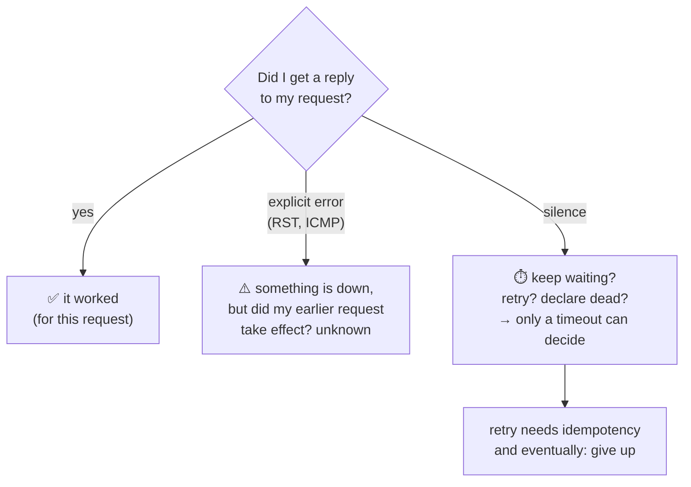

<KeyIdea title="Positive confirmation only">If you want to be sure a request succeeded, you need a **positive response from the application itself**. Lower layers can sometimes tell you something is broken, but silence never tells you something worked.</KeyIdea>

In practice: retry a few times (TCP retransmits for you, but you may also retry at the application level), wait for a timeout to elapse, and eventually declare the node dead if nothing comes back.

### Timeouts and unbounded delays

<BookRef pages="303–306" section="Timeouts and Unbounded Delays" />

If a timeout is the only reliable detector, how long should it be? There's no right answer, only trade-offs:

| Timeout | Benefit | Cost |
|---|---|---|
| **Long** (e.g. 60 s) | Few false alarms | Users wait or see errors for a long time before a dead node is detected |
| **Short** (e.g. 500 ms) | Fast detection | Higher chance of declaring a node dead that was only **temporarily slow** |

Declaring a node dead prematurely is costly:

1. If the node was actually in the middle of an action (say, sending a confirmation email), another node takes over and the action may happen **twice**.
2. Its load moves to other nodes. If the system was already slow because it was overloaded, failing over pushes even more load onto the survivors, which then get slow, get declared dead, and so on: a **cascading failure**.
3. Failover itself is risky (see chapter 5: split brain, lost writes, mismatched replicas).

**What would a "perfect" timeout look like?** Imagine a network where every packet is either delivered within some maximum time `d` or lost (never later), and every non-failed node always handles a request within time `r`. Then every successful request gets a response within `2d + r`, and you could use exactly that as the timeout. With `d = 4 ms` and `r = 10 ms`, a timeout of 18 ms would be perfectly accurate.

Real systems have **neither** guarantee. Asynchronous networks have **unbounded delays**: they try to deliver quickly, but there's no upper limit. Most servers can't promise a maximum request-handling time either. So a timeout that is "a bit longer than usual" is a guess, and a short burst of slowness can still knock nodes out.

#### Network congestion and queueing

Why do packet delays vary so much? Almost always, **queueing**. It's like car traffic: the road itself is fast, but the time to cross a busy junction depends on the queue.


The main sources of queueing delay:

| Where | What happens |
|---|---|
| **Network switch** | Several nodes send to the same destination at once. The switch queues packets for the output link. If the queue fills up, packets are **dropped** and must be resent. |
| **Receiving machine** | If all CPU cores are busy, the OS queues the incoming request until the application is ready. That wait can be arbitrary. |
| **Virtualised environments** | A running VM is often paused for tens of milliseconds while another VM uses the CPU core. During that time it can't consume network data, so the hypervisor buffers it. |
| **TCP flow control** | Also called congestion avoidance or backpressure. A node limits its own sending rate to avoid overloading the network or the receiver, so data queues at the **sender** before it even enters the network. |
| **TCP retransmission** | TCP treats a missing ack within a timeout (itself derived from observed round-trip times) as a lost packet and resends it. The application doesn't see the loss, but it sees the **extra delay**. |

**TCP vs UDP.** Latency-sensitive applications such as video calls and VoIP often use **UDP**, which has no flow control and no retransmission. That avoids some sources of variable delay, at the cost of possibly losing data. That's a sensible trade-off when late data is worthless: there's no point resending a 20 ms chunk of audio that should have played 300 ms ago; the app just fills the gap with silence and moves on.

**Noisy neighbours.** In public clouds and multi-tenant datacenters, resources (network links, switches, each machine's NIC and CPU) are **shared** with other customers. A batch job like a large MapReduce shuffle can saturate a link, and you have no control over or insight into other customers' usage. Delays can therefore be highly variable for reasons that have nothing to do with your code.

A useful mental model: queueing delay explodes as utilisation approaches 100%. For a simple single-server queue, average wait grows roughly like `ρ / (1 − ρ)` where `ρ` is utilisation:

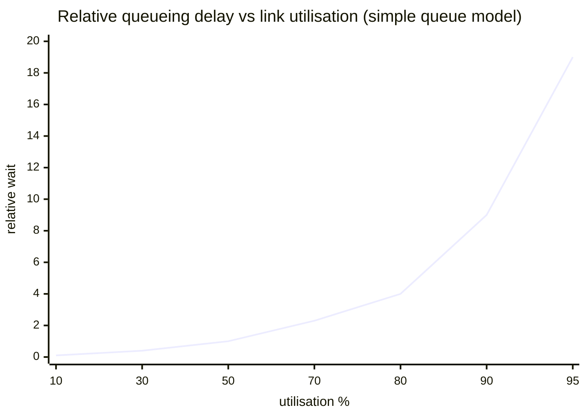

That's why a link that's "only" 90% busy can feel dramatically worse than one at 70%.

#### Choosing timeouts experimentally

Since there's no theoretically correct value, choose timeouts **from measurement**:

1. Measure the distribution of round-trip times over an extended period, across many machines.
2. Look at the tail (p99, p99.9) and at how variable it is.
3. Pick a value that balances detection delay against the risk of premature declarations for your application.

Better still, let the system **adapt continuously**. Instead of a fixed constant, monitor response times and jitter and adjust automatically:

- **Phi accrual failure detector** (used in Akka and Cassandra). Rather than a yes/no "dead or alive", it outputs a **suspicion level φ**. It keeps a sliding window of recent heartbeat inter-arrival times, fits a distribution, and computes how unlikely the current silence is. φ = 1 means roughly a 10% chance the node is still alive and just late; φ = 3 means roughly 0.1%. You pick a threshold (say φ ≥ 8) to act on.
- **TCP's retransmission timeout** works similarly: it tracks a smoothed round-trip time and its variance and sets the timeout from both.

Worked example, own numbers. Heartbeats from `cart-node-4` normally arrive every 1,000 ms with a standard deviation of about 50 ms:

| Silence so far | How unusual? | φ (approx) | Action at threshold 8 |
|---|---|---|---|
| 1,050 ms | Completely normal | below 1 | Nothing |
| 1,200 ms | A bit late | about 2 | Nothing |
| 1,400 ms | Very late for this node | above 8 | Suspect it, start failover |

Now suppose the same cluster is moved to a noisy cloud network where the heartbeat jitter is ±400 ms. The detector **learns** the wider distribution, so 1,400 ms of silence no longer looks alarming. A fixed 1,300 ms timeout would cause constant false alarms in that environment.

```python
# toy adaptive timeout: mean + k * stddev of recent RTTs
from statistics import mean, stdev
from collections import deque

window = deque(maxlen=200)

def record_rtt(ms):
    window.append(ms)

def current_timeout(k=6, floor_ms=50):
    if len(window) < 10:
        return 1000                     # conservative default until we have data
    return max(floor_ms, mean(window) + k * stdev(window))
```

### Synchronous versus asynchronous networks

<BookRef pages="306–309" section="Synchronous Versus Asynchronous Networks" />

Distributed systems would be far simpler if the network delivered packets with a **fixed maximum delay** and never dropped them. Why can't datacenter networks just do that?

Compare with the old **fixed-line telephone network**, which is extremely reliable: delayed audio and dropped calls are rare. When you place a call, the network sets up a **circuit**: a fixed, guaranteed amount of bandwidth is reserved along the entire route between the two callers for the whole duration of the call, even when nobody is speaking.

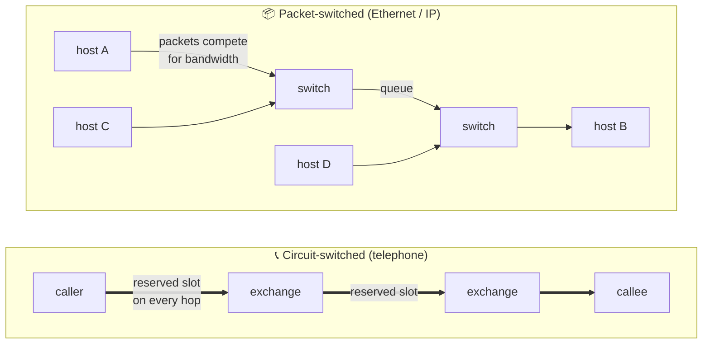

Because the slot is reserved, there's **no queueing**: the maximum end-to-end latency is fixed. That's a **synchronous** network, and it gives **bounded delay**.

#### Can we not simply make network delays predictable?

A TCP connection is not like a circuit. A circuit reserves a fixed bandwidth that nobody else can use while it exists. A TCP connection **opportunistically uses whatever bandwidth is available**: send a 20 MB file and TCP tries to push it as fast as the path allows; while it's idle it uses nothing.

If datacenters and the internet were circuit-switched, you could have bounded round-trip times. They aren't, because they're optimised for **bursty traffic**:

| | Phone call | Typical data traffic |
|---|---|---|
| Bandwidth need | Constant, known in advance (a fixed number of bits per second) | Bursty: idle, then a 2 GB transfer, then idle |
| Ideal latency for the job | Must be steady | "As fast as possible" |
| Circuit fit | Excellent | Poor: you'd have to guess the bandwidth. Guess low and transfers are needlessly slow; guess high and the circuit may not even be setup-able, and reserved capacity sits idle. |

**Hybrids exist.** ATM was an attempt to combine the two models in the 1980s and 1990s. InfiniBand has end-to-end flow control at the link layer that reduces queueing, though it can still suffer delays from link congestion. With careful **quality of service** (prioritising and scheduling packets) and **admission control** (rate-limiting senders), it's possible to emulate circuit switching on packet networks or to provide statistically bounded delay. But this kind of QoS isn't enabled in multi-tenant datacenters or public clouds, nor across the internet.

#### Latency and resource utilisation

The deeper way to see it: **variable delay is a consequence of dynamic resource sharing**.

| | Static partitioning | Dynamic sharing |
|---|---|---|
| How | Each user gets a fixed slice of bandwidth or CPU | Everyone draws from the whole pool |
| Latency | Predictable | Variable, unbounded (queueing) |
| Utilisation | Idle slices are wasted, so it's more expensive | High, so it's cheaper |

The same trade-off appears with CPUs: a core shared dynamically among threads (or VMs) is used efficiently, but any given thread may have to wait in the run queue. Statically giving each VM a dedicated core gives predictability but wastes capacity.

<KeyIdea title="Unbounded delay is an economic choice">Networks have variable delays not because of a law of physics but because of a **cost/benefit trade-off**. Dynamic sharing gives better utilisation and lower cost, at the price of unpredictability. So you can't assume delays are bounded or that a node is dead just because it's slow; you must **assume congestion, queueing and unbounded delay will happen**, and there's no "correct" timeout, only one chosen experimentally.</KeyIdea>

## 8.3 Unreliable clocks

<BookRef pages="309–322" section="Unreliable Clocks" />

Applications depend on clocks constantly. Some questions are about **durations** and some are about **points in time**:

| Kind of question | Example |
|---|---|
| Duration | Has this request taken longer than 2 s? What's the p99 latency of `/checkout`? How many messages per second did this consumer handle? |
| Duration | How long did the user spend on the onboarding screen? |
| Point in time | When was this coupon issued? When does this session cookie expire? |
| Point in time | At what date and time should the weekly digest email be sent? What timestamp goes in this log line? |

In a distributed system this is hard because **communication isn't instantaneous**: when a message is received, it was sent some unknown time earlier, so it's difficult to know the order of events across machines. And **each machine has its own clock**, usually a quartz crystal oscillator, which is not perfectly accurate. Each machine has its own notion of time, which may be slightly faster or slower than others.

The most common way to synchronise clocks is the **Network Time Protocol (NTP)**: a machine adjusts its clock according to the time reported by a group of servers, which in turn get their time from more accurate sources such as GPS receivers or atomic clocks.

### Monotonic versus time-of-day clocks

<BookRef pages="310–311" section="Monotonic Versus Time-of-Day Clocks" />

Modern computers have at least two different kinds of clock, built for different purposes.

**Time-of-day clocks** return the current date and time according to some calendar, also called **wall-clock time**. On Linux, `clock_gettime(CLOCK_REALTIME)`; in Java, `System.currentTimeMillis()`; in Python, `time.time()`. These usually return seconds or milliseconds since the **epoch** (midnight UTC on 1 January 1970, Gregorian calendar), not counting leap seconds.

Time-of-day clocks are **synchronised** with NTP, which is what makes a timestamp from one machine roughly mean the same as a timestamp from another. But they have quirks:

- If the local clock is too far ahead of the NTP server, it may be **forcibly reset**, appearing to **jump back in time**.
- They often **ignore leap seconds**, or handle them in surprising ways.
- Some older hardware or VMs have coarse resolution (for example 10 ms steps).

So time-of-day clocks are unsuitable for measuring elapsed time.

**Monotonic clocks** are built for measuring durations such as timeouts or response times. Linux: `clock_gettime(CLOCK_MONOTONIC)`; Java: `System.nanoTime()`; Python: `time.monotonic()`. The name comes from the guarantee that they **always move forward**, never back.

- You check the monotonic clock at one point, do some work, check it again; the **difference** tells you how much time elapsed.
- The **absolute value** is meaningless. It might be nanoseconds since the machine booted or something arbitrary. In particular, comparing monotonic readings from **two different machines** makes no sense.
- On a server with several CPU sockets, there may be a separate timer per CPU; the OS compensates so applications still see a monotonic clock, but it's wise to treat that guarantee with a pinch of salt.
- NTP may **slew** a monotonic clock (adjust its frequency, typically by at most around 0.05%), if it detects the local quartz is running fast or slow. NTP can't make it **jump**.
- Resolution is usually very good: microseconds or better.

```python
import time

# ❌ wrong: wall clock can jump during the operation (NTP step, manual change)
start = time.time()
do_payment_capture()
elapsed = time.time() - start      # can be negative or wildly too large

# ✅ right: monotonic clock for durations
start = time.monotonic()
do_payment_capture()
elapsed = time.monotonic() - start  # always >= 0 on this machine
```

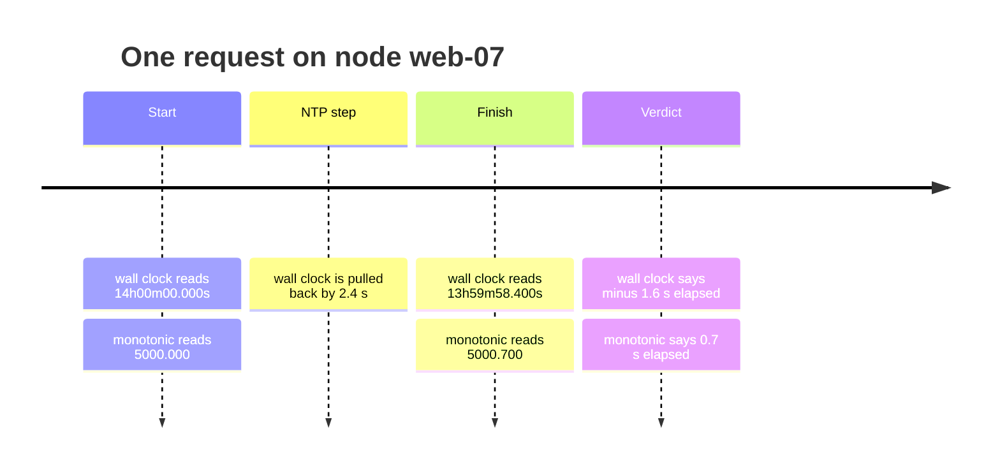

| | Time-of-day clock | Monotonic clock |
|---|---|---|
| Linux / Java / Python | `CLOCK_REALTIME` / `currentTimeMillis()` / `time.time()` | `CLOCK_MONOTONIC` / `nanoTime()` / `time.monotonic()` |
| Absolute value means | Seconds since the epoch | Nothing (arbitrary origin) |
| Can jump backwards? | **Yes** (NTP step, manual change) | No |
| Adjusted by NTP? | Stepped and slewed | Slewed only (rate) |
| Compare across machines? | Roughly, with unknown error | ❌ Meaningless |
| Use for | Human-readable timestamps, scheduling at a date | Timeouts, durations, rate measurement |

In a distributed system, using a monotonic clock for measuring elapsed time (timeouts, for instance) is fine, because it doesn't assume any synchronisation between nodes and isn't sensitive to small measurement inaccuracies.

### Clock synchronization and accuracy

<BookRef pages="311–313" section="Clock Synchronization and Accuracy" />

Monotonic clocks don't need synchronisation, but time-of-day clocks must be set according to an NTP server or other external source to be useful. The methods for getting a clock to tell the right time are much less reliable than you might hope:

| Problem | Why it hurts |
|---|---|
| **Quartz drift** | A crystal runs faster or slower depending on temperature and manufacturing. Google assumes up to 200 ppm drift for its servers. Even a modest 50 ppm is `50e-6 × 86,400 ≈ 4.3 s` per day. Resync often enough or the error grows. |
| **Forced resets** | If a clock differs too much from NTP, it may refuse to sync or be forcibly reset. Apps see time jump backward or forward suddenly. |
| **Firewalled NTP** | If a node is accidentally cut off from NTP servers, the misconfiguration can go unnoticed for a while as the clock silently drifts. |
| **Network delay** | NTP accuracy is limited by round-trip time. On a congested network, errors can reach tens or hundreds of ms. Large spikes can even make the client give up. |
| **Bad NTP servers** | Some public servers are misconfigured and report time off by hours. Clients query several servers and discard outliers, but you're still trusting strangers on the internet. |
| **Leap seconds** | A minute with 59 or 61 seconds breaks code that assumes otherwise. Leap seconds have crashed large systems. A common workaround is **smearing**: the NTP server lies a little, spreading the extra second over a day. |
| **Virtual machines** | The hardware clock is virtualised. When a VM is paused so another VM can use the CPU, the app sees the clock **suddenly jump forward** by tens of ms when it resumes. |
| **Untrusted devices** | On phones and embedded devices, users can set the clock to anything (for example to cheat time-limited game rewards). |

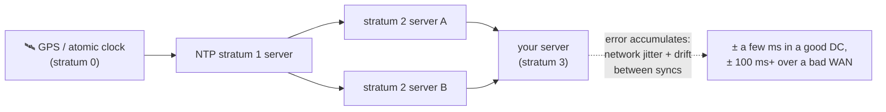

It's possible to do much better if you invest. Financial regulations such as **MiFID II** in Europe require high-frequency traders to keep clocks within **100 microseconds of UTC** so that market anomalies can be investigated. That level is achieved with **GPS receivers**, the **Precision Time Protocol (PTP)**, careful deployment and monitoring. Cloud providers now also offer high-precision time services backed by atomic clocks in each region. But it takes significant effort and expertise, and many failure modes remain: a misconfigured NTP daemon or firewall can quietly push a clock far off.

### Relying on synchronized clocks

<BookRef pages="313–317" section="Relying on Synchronized Clocks" />

Clocks seem simple and easy to use, but they have surprising pitfalls. A day may not have exactly 86,400 seconds, time-of-day clocks may move backward, and the time on one node may be quite different from another.

The network section taught that networks are *mostly* well-behaved but software must still handle faults. Clocks are the same: most of the time they're fine, but robust software must be prepared for wrong clocks.

The danger is that clock problems are **easy to miss**. If a CPU is defective or the network is misconfigured, the system usually doesn't work at all, and it's quickly noticed. If a quartz clock is faulty or NTP is broken, most things **seem to work fine**, even though the clock drifts further and further from reality. Any bug that depends on accurate clocks will show up as **silent and subtle data loss**, not a dramatic crash.

<KeyIdea title="Monitor clock offsets">If your software needs synchronised clocks, **monitor the offset** between all machines carefully. A node whose clock drifts too far from the others should be **declared dead and removed** from the cluster, before it does damage.</KeyIdea>

#### Timestamps for ordering events

A dangerous, popular use of clocks: ordering events across nodes. Suppose two clients update the same key in a multi-leader or leaderless database that uses **last write wins (LWW)**, comparing the time-of-day timestamps attached by the node that received each write.

Own example: a shared shopping list. Node P's clock is 5 ms **ahead**; node Q's clock is accurate.

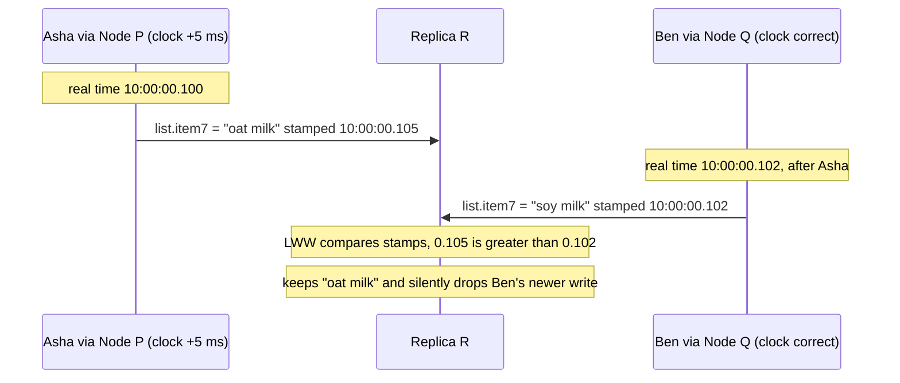

Ben's write happened **later in real time** and may even have been made after seeing Asha's value, yet it is discarded. The clocks were only 5 ms apart, comfortably inside normal NTP error, and data was still lost.

Problems with LWW based on wall clocks:

1. **Mysterious lost writes.** A node with a lagging clock can't overwrite values previously written by a node with a fast clock until the skew has elapsed. Writes are dropped with **no error** reported.
2. **Can't tell sequential from concurrent.** LWW can't distinguish writes that happened in quick succession (one after the other, causally) from truly concurrent writes. You need extra tracking such as **version vectors** (chapter 5) for that.
3. **Ties.** Two nodes can generate the same timestamp, especially with millisecond resolution. A tiebreaker (for example a random number or node ID) is needed, and that itself can violate causality.

Could NTP just be made accurate enough? No: NTP's accuracy is itself limited by network round-trip time plus other errors such as quartz drift. For ordering to be correct, the clock source would need to be **significantly more accurate** than the thing being measured (network delay), which is impossible.

**Logical clocks** are the safer alternative. They're based on incrementing counters rather than an oscillating crystal, and they capture only the **relative ordering** of events (did A happen before B?), not elapsed time or time of day. Lamport timestamps and version vectors are examples; chapter 9 covers them in detail.

| | Physical clock (time-of-day, monotonic) | Logical clock |
|---|---|---|
| Measures | Elapsed time / calendar time | Causal order of events |
| Source | Quartz crystal, NTP, GPS | Counters incremented on each event and message |
| Safe for ordering across nodes? | ❌ Only within skew | ✅ Yes (for causality) |

#### Clock readings have a confidence interval

You may be able to read a machine's clock with microsecond or nanosecond **resolution**, but that doesn't mean the value is **accurate** to that precision. If the drift is a few ms and the last sync was over a congested network, the reading could easily be off by 100 ms or more. Fine-grained digits in a timestamp are mostly noise.

So it's better to think of a clock reading not as a point but as **a range of times within a confidence interval**: "the time is between 12:30:04.120 and 12:30:04.270, with high confidence."

The uncertainty bound can be computed from the time source. A GPS receiver or atomic clock attached directly to the machine has an error range reported by the manufacturer. A clock synced via NTP has an uncertainty based on the expected drift since the last sync, plus the NTP server's uncertainty, plus the round-trip time. Unfortunately, most systems **don't expose** this uncertainty: `clock_gettime()` returns a single number.

An important exception is **Google's TrueTime API** in **Spanner**, which explicitly reports the confidence interval. `TT.now()` returns two values, `[earliest, latest]`: the earliest possible and latest possible timestamp. Based on its uncertainty calculations, the clock knows the actual current time is somewhere within that interval. The width depends, among other things, on how long it's been since the local quartz clock was last synced with a more accurate source.

#### Synchronized clocks for global snapshots

Recall **snapshot isolation** (chapter 7): it lets read-only transactions see the database as of a consistent point in time, without locking. It needs a **monotonically increasing transaction ID**: if a write happened later than the snapshot (has a greater ID), it's invisible to the snapshot.

- On a **single node**, a simple counter does the job.
- In a **distributed database** with partitions across many machines and datacenters, a global monotonically increasing ID that reflects **causality** is hard. If transaction B reads a value written by A, then B must have a higher ID than A, or the snapshot is inconsistent. With lots of small, fast transactions, a single central ID allocator becomes a bottleneck. (Chapter 9 discusses distributed sequence generators like Twitter's Snowflake, which are scalable but don't generally guarantee causal ordering.)

Can we use **synchronised time-of-day clocks** as transaction IDs? If clocks were good enough, a later transaction would have a higher timestamp. The problem is the uncertainty.

Spanner's answer: if you have two confidence intervals `A = [A_earliest, A_latest]` and `B = [B_earliest, B_latest]` and they **don't overlap** (`A_earliest < A_latest < B_earliest < B_latest`), then B definitely happened after A. Only if they overlap are you unsure.

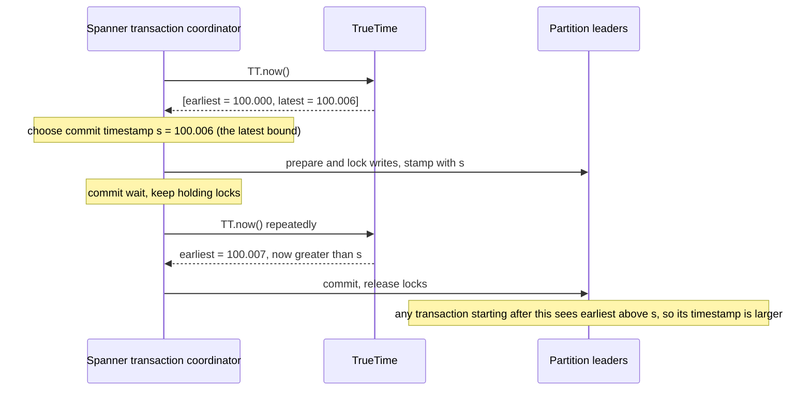

To make sure transaction timestamps reflect causality, Spanner **deliberately waits** for the length of the confidence interval before committing a read-write transaction. That way, any transaction that reads the data starts at a sufficiently later time, so their intervals don't overlap. To keep the wait short, the uncertainty must be small; Google deploys a **GPS receiver or atomic clock in each datacenter**, which keeps clocks within about **7 ms**.

| Approach | Clock uncertainty | Cost |
|---|---|---|
| Plain NTP over a WAN | tens to hundreds of ms | Commit waits would be very long |
| Spanner TrueTime | about 1–7 ms | GPS + atomic clocks per datacenter, plus engineering |
| CockroachDB (hybrid logical clocks over NTP) | configurable max offset, e.g. 250–500 ms | Doesn't commit-wait; instead restarts reads that hit the uncertainty window, and nodes whose clocks drift too far shut themselves down |

Using clock synchronisation for distributed transaction semantics is an active area of research. The ideas are interesting, but they haven't been implemented in mainstream databases outside Google until relatively recently.

### Process pauses

<BookRef pages="317–322" section="Process Pauses" />

Here's another example of dangerous clock use. Imagine a database with a **single leader per partition**. Only the leader may accept writes. How does a node know it's *still* the leader and that others haven't declared it dead?

One option: the leader obtains a **lease** from the other nodes, which is like a lock with a timeout. Only one node can hold the lease at a time. To stay leader, the node must renew it periodically before it expires; if the node fails, it stops renewing, and another node takes over.

Own example: a `ledger-writer` process that must be the only node appending entries for partition 12.

```python
LEASE_SAFETY_MARGIN = 5.0   # seconds

while True:
    batch = inbox.take_batch()              # may block for a while

    # renew if fewer than 5 s remain on the lease
    if lease.expires_at - time.time() < LEASE_SAFETY_MARGIN:
        lease = lease.renew()

    if lease.expires_at > time.time():      # "am I still the leader?"
        ledger.append(batch)                # ← danger zone
```

What's wrong with this?

1. **It compares a lease expiry set by another machine with the local wall clock.** If the clocks are out of sync by more than a few seconds, the check is meaningless. (Using the local monotonic clock helps for the duration part but not with the deeper problem.)
2. **It assumes very little time passes** between the check `lease.expires_at > time.time()` and the `ledger.append(batch)` call. Normally the gap is microseconds. But what if the thread is paused for 15 seconds right there? By the time it resumes, the lease has expired, another node has become leader, and this process happily appends anyway, with nothing in the code telling it otherwise.

Is a 15-second pause realistic? Unfortunately yes. Things that can stop a thread at an arbitrary point for an arbitrary time:

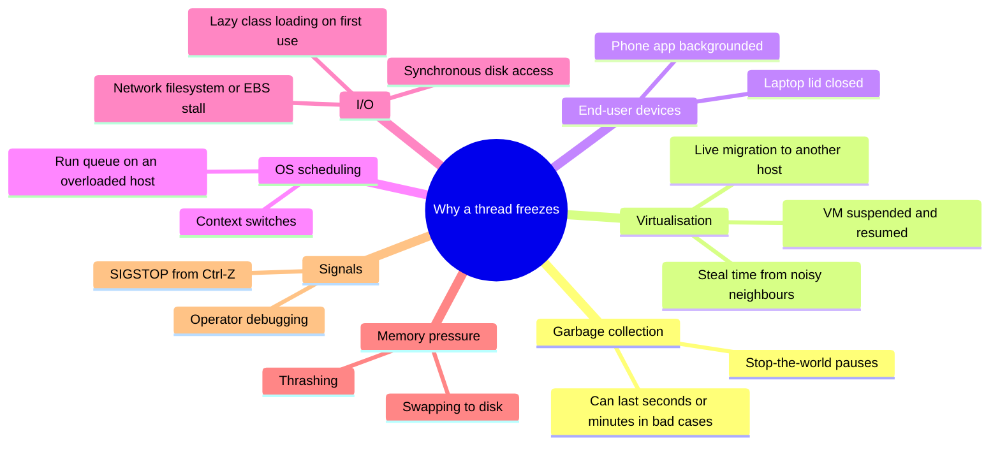

A few notes:

- **Garbage collectors** in many language runtimes (JVM, .NET, Go, Node.js to differing degrees) occasionally stop all running threads. "Stop-the-world" pauses have been known to last several minutes in pathological cases. Even concurrent collectors still pause briefly.
- **VM suspension** saves the VM's memory to disk and resumes later; the pause can be any length. **Live migration** moves a running VM to another host without a reboot, causing a pause proportional to how fast the process writes to memory.
- **Disk I/O** can block a thread unexpectedly, even when the code isn't explicitly reading a file: a JVM loads a class lazily the first time it's used, which may hit disk. If the disk is actually network storage (like a cloud block volume), I/O latency inherits all the network's variability.
- **Swapping (paging)**: a simple memory access can trigger a page fault that loads a page from disk. Under heavy memory pressure the OS spends most of its time swapping pages in and out (thrashing). Many server operators disable paging and prefer to kill a process (OOM) over thrashing.
- A Unix process can be paused by `SIGSTOP` (for example Ctrl-Z in a shell) and continued with `SIGCONT`, even if the process doesn't expect it, possibly by an operator by accident.

All of these **preempt** the running thread at any point and resume it later, **without the thread noticing**. The paused node can't do anything about it; the rest of the world keeps moving and may declare the paused node dead. When it wakes up, it continues with stale beliefs.

<KeyIdea title="A node can't trust its sense of time">Writing multi-threaded code on one machine has tools for this (mutexes, semaphores, atomic counters, blocking queues). Those don't translate to distributed systems: there's no shared memory, only messages over an unreliable network. A node must **assume its execution can be paused for a significant time at any point**, even in the middle of a function.</KeyIdea>

#### Response time guarantees

In some environments, a missed deadline is a real failure: aircraft control, airbag deployment, industrial robots. If a sensor says the car is crashing, the airbag can't wait for a GC pause. These are **hard real-time systems**.

Providing real-time guarantees takes support from every layer:

| Layer | What's required |
|---|---|
| OS | A **real-time OS (RTOS)** that schedules processes with guaranteed CPU time in specified intervals |
| Libraries | Every function must document its **worst-case execution time** |
| Memory | Dynamic allocation restricted or disallowed (real-time GCs exist but must be bounded) |
| Testing | Enormous amounts of testing and measurement |

That's very expensive, and real-time systems usually have **lower throughput**, because they prioritise timely responses above everything else. "Real-time" in web contexts (live dashboards, chat) means something much weaker: just "low latency, pushed to clients", with no hard guarantees.

For most server-side data processing, real-time guarantees are simply not economical. So servers must live with pauses and clock instability.

#### Limiting the impact of garbage collection

You can't eliminate pauses, but you can reduce their impact:

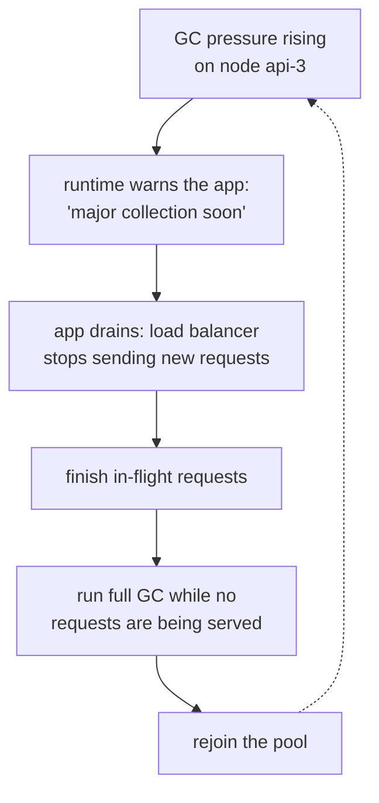

| Technique | Idea | Trade-off |
|---|---|---|
| **Treat GC as a planned outage** | The runtime warns the app that a GC pause is coming. The app stops sending new requests to that node, lets it finish outstanding work, then runs GC while idle. | Hides pauses from clients. Some latency-sensitive financial trading systems use this. |
| **Only collect short-lived objects** | Design so that only young-generation (fast) GC happens. Restart the process periodically, **before** a full GC on long-lived objects would be needed. | Like a rolling restart: traffic is shifted away from one node at a time. |
| **Pause-less collectors / tuning** | Use modern low-pause collectors (e.g. ZGC, Shenandoah in the JVM) and keep heaps moderate. | Reduces pause length, doesn't remove all pauses. |
| **Languages without GC** | Rust, C++ for the hottest paths. | Higher development cost. |

None of these prevent pauses entirely; they only make them rarer and shorter. Correctness still has to survive the pauses that remain, which leads to the next section.

## 8.4 Knowledge, truth, and lies

<BookRef pages="322–332" section="Knowledge, Truth, and Lies" />

So far: distributed systems differ from single-machine programs in that there's no shared memory, only messages over an unreliable network with variable delays; and nodes may suffer partial failures, unreliable clocks and process pauses.

That raises an almost philosophical question: **how can a node know anything at all?** A node can only learn about the world from the messages it receives (or doesn't). If a remote node doesn't respond, there's no way to know what state it's in, because network problems and node problems look the same.

The study of this is the topic of **system models**: we state precise assumptions about what can go wrong, and then design algorithms that are provably correct under those assumptions. Before formal models, let's see how practical systems decide what's "true".

### The truth is defined by the majority

<BookRef pages="322–326" section="The Truth Is Defined by the Majority" />

Consider some unpleasant scenarios for a single node, `pricing-2`:

1. **It can hear but not speak.** Its outbound link is broken. It receives every message, but nothing it sends arrives. After a timeout, the others declare it dead, even though it's running fine and can see the messages proving that the others are trying to replace it. It shouts "I'm alive!" but no one hears.
2. **It can speak but not hear.** Its inbound link is broken. It sends messages, and the others receive them, but it never sees any replies, so it may wrongly conclude the *others* are down.
3. **It paused.** A long GC pause freezes it for 40 seconds. Everyone else declares it dead. Then GC finishes and it carries on as if nothing happened, unaware that it has already been replaced.

The lesson: **a node can't necessarily trust its own judgement** of a situation. A distributed system can't rely on any single node, because any node can fail at any time, potentially leaving the system stuck.

Instead, many distributed algorithms rely on a **quorum**: voting among the nodes. Decisions require a minimum number of votes from several nodes, reducing dependence on any one node. That includes decisions about **declaring a node dead**: if a quorum of nodes says a node is dead, it **must be considered dead**, even if it still feels very much alive. The individual node must abide by the quorum decision and step down.

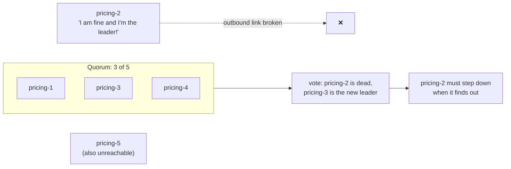

Most commonly the quorum is an **absolute majority** of more than half the nodes (other kinds exist, see chapter 5). Why a majority?

| Cluster size | Majority quorum | Failures tolerated |
|---|---|---|
| 3 | 2 | 1 |
| 4 | 3 | 1 (no better than 3!) |
| 5 | 3 | 2 |
| 7 | 4 | 3 |

- A majority quorum lets the system keep working if some nodes fail (with 5 nodes, 2 can be down).
- It's **safe**: there can only be **one** majority in the system at any time. Two majorities would need to share at least one node, and that node can't vote both ways, so there can't be two conflicting decisions at once.

Chapter 9 covers consensus algorithms that use quorums in detail.

#### The leader and the lock

Often a system needs there to be **only one** of something:

- only one node is the **leader** for a database partition, to avoid split brain;
- only one transaction or client may hold the **lock** for a particular resource, to prevent concurrent writes and corruption;
- only one user may register a particular **username**, since usernames must uniquely identify users.

Implementing this needs care. Even if a node believes it is "the chosen one" (leader for a partition, holder of a lock, winner of a username), it doesn't follow that a quorum agrees. A node may formerly have been leader, but if the others declared it dead in the meantime (network interruption, GC pause), it may have been demoted and another leader elected.

If a node keeps acting as the chosen one when the quorum has already declared it dead, it can cause real damage. Own example: two report-generator workers write the same object in a blob store, coordinated by a lock service with leases.

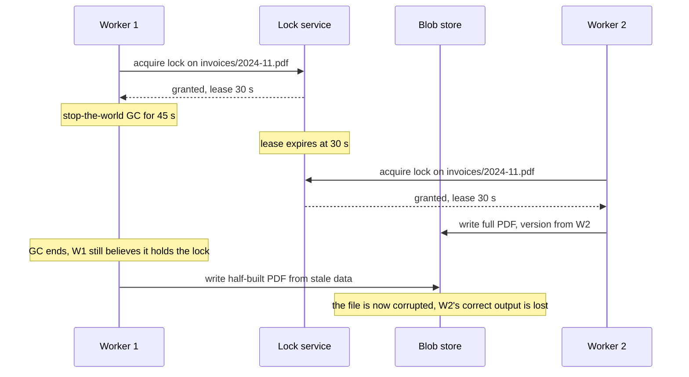

This is not hypothetical: a bug of exactly this shape (lease expiry + pause + storage that accepts any writer) has caused data corruption in real systems, for example HBase in earlier versions.

#### Fencing tokens

When using a lock or lease to protect access to a resource, we need to make sure a node under a false belief of being "the chosen one" can't disrupt the rest of the system. A simple technique is **fencing**.

Every time the lock service grants a lock or lease, it also returns a **fencing token**: a number that **increases every time** a lock is granted. Then every write request from a client to the storage service must **include its current fencing token**. The storage remembers the highest token it has processed and **rejects** any write with a lower one.

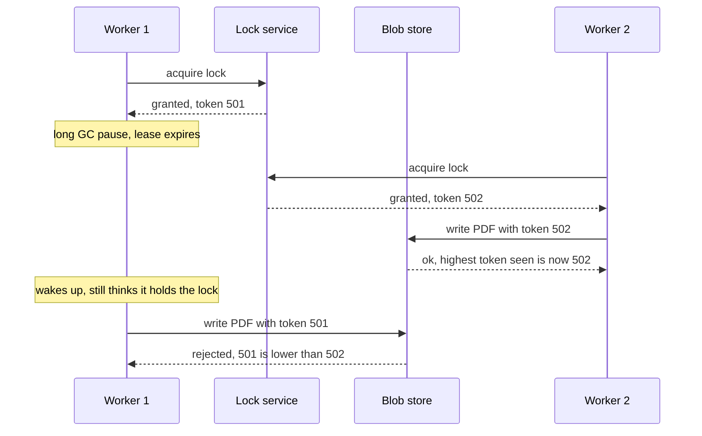

The storage-side check is tiny:

```python
class FencedStore:
    def __init__(self):
        self.max_token = {}          # resource -> highest token seen

    def write(self, resource, data, token):
        if token < self.max_token.get(resource, -1):
            raise StaleTokenError(f"token {token} is stale")
        self.max_token[resource] = token
        self._persist(resource, data)
```

Key points:

- The **resource itself** must check the token. It's not enough for the client to check its own lock status, because the client might be paused right after checking (that's the whole problem).
- If the resource can't check tokens natively, you can sometimes work around it: for example, include the token in the filename or object key, or use a conditional write (compare-and-set on a version number).
- With **ZooKeeper** as the lock service, the transaction ID `zxid` or the node version `cversion` can serve as the fencing token, since they're guaranteed to increase monotonically. etcd's **revision** numbers serve the same purpose.
- Some server-side checking is a good idea anyway: it's unwise for a service to assume its clients are always well-behaved, since clients are often run by people with different priorities. Defending against accidental abuse is just good practice.

| Without fencing | With fencing |
|---|---|
| Correctness depends on the paused client "noticing" it lost the lock | Correctness enforced by the resource, regardless of client timing |
| A single GC pause can corrupt data | A stale client gets a clean error |
| Lock service alone isn't enough | Lock service + monotonic token + checking resource |

<KeyIdea title="Locks alone don't protect resources">A lease tells a client it *was* allowed to act. Only a **fencing token checked by the resource** guarantees that a stale holder can't act after someone else has taken over.</KeyIdea>

### Byzantine faults

<BookRef pages="326–328" section="Byzantine Faults" />

Fencing tokens catch a node that is acting in **error** (it honestly believes it still holds the lease). But if the node deliberately wants to subvert the system, it could just send a fake fencing token.

This book assumes nodes are **unreliable but honest**: they may be slow or never respond (because of a fault), their state may be outdated (because of a GC pause or network delays), but if a node responds at all, it's telling the "truth" as far as it knows, according to the protocol.

If nodes may **"lie"** (send arbitrary faulty or corrupted responses), things get much harder. A node might claim to have received a message it never got, or send different values to different peers. That's a **Byzantine fault**, and reaching consensus in that environment is the **Byzantine Generals Problem**.

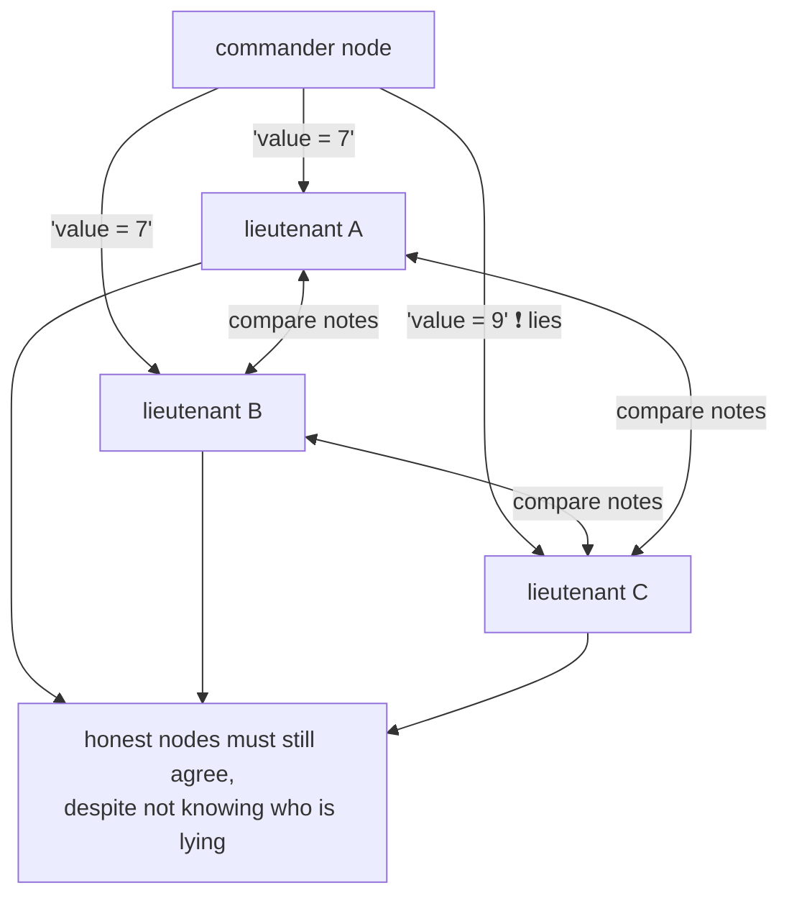

A system is **Byzantine fault-tolerant** if it continues to operate correctly even if some nodes malfunction and don't obey the protocol, or if malicious attackers interfere. Most BFT algorithms need a **supermajority**: more than two-thirds of nodes functioning correctly (with 4 nodes, at most 1 may be faulty; tolerating `f` Byzantine nodes needs `3f + 1` nodes in total).

Where Byzantine fault tolerance matters:

| Setting | Why |
|---|---|
| **Aerospace** | Memory or CPU registers can be corrupted by radiation, so a node responds unpredictably. A failure could kill people, so flight control systems must tolerate this. |
| **Multi-party systems** | When participants don't trust each other (peer-to-peer networks, blockchains and cryptocurrencies), a node may cheat. Bitcoin and similar systems are, in effect, a way for mutually untrusting parties to agree on whether a transaction happened without a central authority. |

In a typical **server-side data system**, though, assuming Byzantine faults is usually not worthwhile:

- Your organisation controls all the nodes, and they're in your datacenter, so they're generally not malicious. Protection against **external** attackers is done by authentication, access control, encryption and firewalls, not by BFT protocols.
- Web apps already treat **clients** (browsers, mobile apps) as untrusted. That's why the server is the authority on what's allowed: it validates input and decides. No BFT protocol needed.
- BFT doesn't save you from **software bugs**: if all nodes run the same buggy code, they all fail identically. You'd need four independent implementations of the same software, which is unrealistic for most companies.
- If an attacker compromises **one** node, they can probably compromise all of them, since they likely run the same software. BFT protocols don't help there either.

| | Crash/omission faults | Byzantine faults |
|---|---|---|
| Node behaviour | Stops, slow, or loses messages | Anything: wrong, inconsistent, malicious |
| Nodes needed to tolerate `f` faults (typical consensus) | `2f + 1` | `3f + 1` |
| Cost | Moderate | High (extra messages, crypto signatures) |
| Typical use | Datacenter databases (Raft, Paxos, ZooKeeper) | Aerospace, blockchains |

#### Weak forms of lying

Even if we assume nodes are generally honest, it can be worth adding cheap mechanisms that guard against **weak** forms of lying: invalid messages caused by hardware issues, software bugs and misconfiguration. These aren't full BFT, but they're simple and pragmatic:

- **Checksums at the application level.** Network packets do occasionally get corrupted by hardware or software bugs in the OS, drivers, routers and so on. Usually the TCP and UDP checksums catch this, but sometimes corruption slips past them. A checksum in the application protocol (for example a CRC32 or SHA-256 over each record) catches what the transport misses.
- **Sanitise input.** A publicly accessible app must carefully validate any input from users: check values are in a reasonable range, limit string sizes to prevent denial of service through huge allocations. An internal service behind a firewall may get away with less, but basic sanity checks on values (such as in protocol parsing) are a good idea.
- **Use several NTP servers.** NTP clients can be configured with multiple server addresses. When synchronising, the client contacts all of them, estimates their errors, and checks that a majority agree on some time range. As long as most servers are fine, a misconfigured server reporting the wrong time is detected as an outlier and excluded.

```json
{
  "record_id": "ord-77412",
  "payload": { "sku": "LAMP-03", "qty": 2, "price_cents": 4599 },
  "crc32": "8f3a21c4"
}
```

### System model and reality

<BookRef pages="328–332" section="System Model and Reality" />

Many algorithms have been designed to solve distributed problems (consensus, leader election, atomic broadcast, and so on). To be useful, they must tolerate the faults described in this chapter. Algorithms should be written so they don't depend too heavily on the details of the hardware and software they run on, so we **formalise** the faults we expect. We do that by defining a **system model**: an abstraction that describes what an algorithm may assume.

#### Timing assumptions

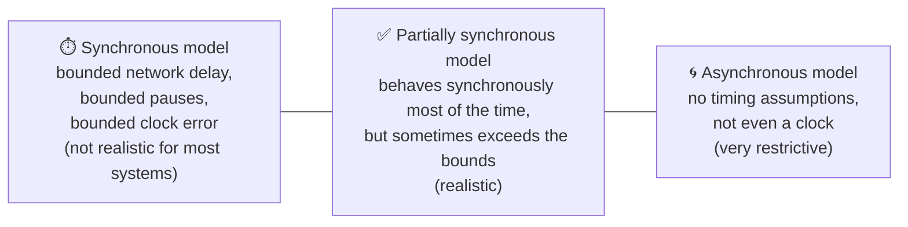

| Model | Assumes | Realistic? |
|---|---|---|
| **Synchronous** | Network delay, process pauses and clock error all have **known upper bounds**. Doesn't mean exactly synchronised clocks or zero delay, just that delay never exceeds a fixed limit. | No: unbounded delays and pauses do happen. |
| **Partially synchronous** | The system behaves like a synchronous one **most of the time**, but sometimes exceeds the bounds. When timing guarantees fail, delays, pauses and drift may become arbitrarily large. | **Yes**: the model most practical systems use. |
| **Asynchronous** | An algorithm may make **no** timing assumptions at all; it doesn't even have a clock, so it can't use timeouts. | Some algorithms can be designed this way, but it's very restrictive. |

#### Node-failure models

| Model | Assumes |
|---|---|
| **Crash-stop** | A node can only fail by crashing. It may stop responding at any moment and is then **gone forever**; it never comes back. |
| **Crash-recovery** | Nodes may crash at any moment and possibly **start responding again** after an unknown time. Nodes are assumed to have **stable storage** (non-volatile disk) whose contents survive crashes, while in-memory state is lost. |
| **Byzantine (arbitrary)** | Nodes may do absolutely anything, including trying to trick and deceive other nodes. |

<KeyIdea title="The usual combination">For modelling real systems, the most useful choice is generally the **partially synchronous** model with **crash-recovery** faults. Algorithms in chapter 9 (Raft, Paxos, ZooKeeper's Zab) are designed for exactly that.</KeyIdea>

#### Correctness of an algorithm

An algorithm is only "correct" relative to a written-down list of **properties**. For a single-machine function that's familiar: a function that deduplicates a list is correct if its output contains every input value exactly once. You can check that condition against any output.

Distributed algorithms get the same treatment. Own example: a leader-election protocol for a 5-node cluster that numbers its leadership periods with **terms**. We might require:

| Property | Meaning |
|---|---|
| **Single leader per term** | For any term number, at most one node ever believes it is leader in that term. |
| **Increasing terms** | If a node becomes leader in term `t1` and a later election completes after that, the later leader's term `t2` satisfies `t1 < t2`. |
| **Eventual leader** | If a majority of nodes are up and can talk to each other for long enough, some node eventually becomes leader. |

An algorithm is correct **in some system model** if it always satisfies its properties in all situations that we assume may occur in that model. But how can this make sense if all nodes crash, or every network delay suddenly becomes infinitely long? Then no algorithm can do anything. That's why we distinguish two kinds of property.

#### Safety and liveness

In the list above, **single leader per term** and **increasing terms** are **safety** properties, while **eventual leader** is a **liveness** property.

- **Safety**: informally, *nothing bad happens*.
- **Liveness**: informally, *something good eventually happens*. A hint: liveness properties often include the word "eventually" in their definition (yes, **eventual consistency** is a liveness property).

More precisely:

| | Safety | Liveness |
|---|---|---|
| Informal | Nothing bad happens | Something good eventually happens |
| If violated | You can point to a **specific moment** at which it broke (e.g. the instant a second node declared itself leader of term 9) | It may not hold at a given moment (a request has no response *yet*), but there's always hope it will be satisfied later |
| Can the violation be undone? | **No**: once violated, the damage is done | Not applicable: it might still become true |
| Examples | Uniqueness, no two leaders in the same term, linearizability, a committed write is never lost | Every request eventually gets a response, eventual consistency, leader eventually elected |

The point of the distinction: it lets us deal with difficult system models. For distributed algorithms, it's common to require that **safety always holds**, in all possible situations of the system model. Even if all nodes crash, or the whole network fails, the algorithm must ensure it doesn't return a wrong result (safety properties stay satisfied). For **liveness**, we're allowed to make caveats: for example, a request needs to receive a response only if a majority of nodes haven't crashed and the network eventually recovers from an outage. The definition of the partially synchronous model requires that the system eventually returns to a synchronous state: any network interruption lasts only finitely long and is then repaired.

#### Mapping system models to the real world

Safety, liveness and system models are very useful for reasoning about correctness, but **reality is messier** than any model. When implementing an algorithm in practice, the model's assumptions are always somewhat idealised:

- In the crash-recovery model, data in **stable storage** survives crashes. But what if the disk is corrupted, the data is wiped by a hardware error or misconfiguration, or a server firmware bug makes the drive invisible after a reboot? What if the node forgets data it supposedly stored?
- Quorum algorithms rely on nodes **remembering** what they promised. If a node suffers amnesia and forgets previously stored data, it breaks the quorum conditions and the algorithm's correctness.
- What happens when a situation the model rules out happens anyway? The code still has to do *something* sensible: refuse to continue, log loudly, page a human, and avoid making the damage worse. Handling the "impossible" case gracefully is where engineering practice goes beyond the proof.

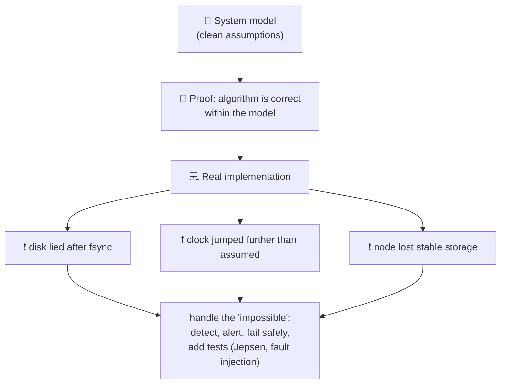

That doesn't make theoretical models useless. Proofs are valuable: they show that an algorithm is correct within the model, and they reduce a huge space of possible behaviours to a smaller set of assumptions that you can check. Theoretical analysis can uncover problems that stay hidden in real systems for a long time, and that only bite when an unusual combination of circumstances occurs. **Theory and empirical testing are equally important**: proofs tell you the algorithm is right under assumptions; testing tells you whether the implementation and the assumptions match reality.

## Summary

<BookRef pages="332–341" section="Summary" />

Pulling the chapter together in a few sentences:

- **Messages are unreliable.** A request or its reply can vanish or show up much later, and silence carries no information about which of those happened.
- **Clocks are unreliable.** Each machine's notion of "now" drifts, can be stepped backward or forward, and comes with an error bar that most APIs never report.
- **Execution is unreliable.** Any thread can freeze for seconds (GC, VM migration, swapping) and wake up with stale beliefs, while the rest of the cluster has moved on without it.

What makes this hard is not any single fault but **partial failure**: the system is never simply "up" or "down", and code that touches other nodes must expect to be occasionally slow, wrong about the world, or left without an answer.

**Detection is the first hurdle.** Without a reliable oracle, systems fall back on timeouts, and timeouts can't separate a dead node from a slow link. Worse than a clean crash is a **limping** node: one that still answers health checks but serves requests a thousand times slower than normal. Good systems watch latency and error rates, not just liveness.

**Deciding what to do is the second hurdle.** Machines share no memory and can't even agree on the time, so no single node is allowed to make an important call alone. Instead decisions go through **quorums**, and resources defend themselves with **fencing tokens** against nodes that are acting on outdated beliefs.

A practical corollary: if your workload genuinely fits on one machine, keeping it there avoids this whole class of problems. People distribute systems anyway for reasons a single box can't satisfy: surviving machine and datacenter loss, and serving users from nearby regions with low latency.

Finally, the unreliability is a **design choice made for cost**, not a physical necessity. Bounded-latency networks and hard real-time schedulers exist, but they waste capacity and money, so ordinary services accept cheap, shared, unpredictable infrastructure and handle the consequences in software. The payoff is that a well-designed distributed service can, in principle, keep running indefinitely, replacing and upgrading nodes one at a time, instead of stopping the world the way a checkpointing supercomputer must. In practice, the biggest remaining threat is often a single bad change pushed everywhere at once.

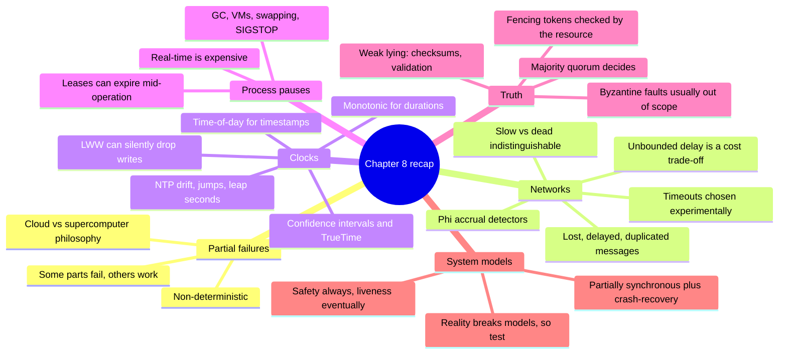

| Problem | Typical defence |
|---|---|
| Lost or delayed messages | Timeouts, retries with idempotency keys, adaptive failure detectors |
| False failure detection | Longer or adaptive timeouts, quorum-based decisions |
| Clock jumps when measuring durations | Monotonic clocks |
| Clock skew when ordering events | Logical clocks, version vectors, or TrueTime-style uncertainty waits |
| Process pause after a lease check | Fencing tokens checked by the resource |
| Split brain | Majority quorums, epoch/term numbers |
| Corrupted packets, bad input | Application checksums, input validation, multiple NTP servers |

Next chapter: given all these problems, what **guarantees** *can* we build? Linearizability, ordering, and consensus.

## 🧠 Check yourself

<Quiz question="A service sends a request and gets no reply within its timeout. What can it conclude?" options={["The request was lost", "The server crashed", "Nothing definite: the request or reply may be lost or delayed, or the server may be slow, paused or dead", "The server processed the request"]} answer={2} explain="In an asynchronous network, all of these cases look identical to the sender. That's why retries must be idempotent." />

<Quiz question="Which clock should you use to measure a request timeout on one machine?" options={["Time-of-day clock", "Monotonic clock", "The NTP server's clock", "A Lamport clock"]} answer={1} explain="A monotonic clock never jumps backward, so differences between two readings on the same machine are reliable durations." />

<Quiz question="Why do datacenter networks have unbounded delays instead of guaranteed latency like old phone networks?" options={["Ethernet is physically incapable of bounded delay", "Dynamic sharing of bandwidth gives much better utilisation and lower cost for bursty traffic, at the price of queueing", "TCP forbids it", "Because of the speed of light"]} answer={1} explain="Circuit switching reserves bandwidth and wastes it when idle. Packet switching shares bandwidth dynamically, which causes queueing and variable delay." />

<Quiz question="Two writes to the same key arrive at a last-write-wins replica. The later one (in real time) came from a node whose clock is 8 ms behind. What happens?" options={["The later write wins", "Both are kept as siblings", "The later write may be silently discarded", "The replica returns an error"]} answer={2} explain="LWW compares timestamps, so the write with the lagging clock looks older and is dropped without any error." />

<Quiz question="What does Spanner's commit wait achieve?" options={["It makes NTP more accurate", "It waits out the clock uncertainty interval so that causally later transactions get strictly larger timestamps", "It avoids the need for locks", "It reduces network traffic"]} answer={1} explain="TrueTime returns an interval. By waiting until the earliest bound has passed the chosen commit timestamp, non-overlapping intervals guarantee ordering." />

<Quiz question="A worker was paused for 50 s by GC, then wrote to storage believing it still held a lock. What prevents corruption?" options={["A longer lease timeout", "A fencing token that the storage checks and rejects if it is lower than one already seen", "Better NTP synchronisation", "Running the worker on a bigger machine"]} answer={1} explain="Only the resource can reliably reject stale writers, because the client may be paused right after checking its own lease." />

<Quiz question="'Every request eventually receives a response, provided a majority of nodes are up' is an example of which property?" options={["Safety", "Liveness", "Byzantine tolerance", "Synchrony"]} answer={1} explain="Liveness means something good eventually happens, and it may come with conditions. Safety means nothing bad ever happens, unconditionally." />

<Quiz question="Which system model is the most useful default for designing real datacenter algorithms?" options={["Synchronous with crash-stop", "Asynchronous with Byzantine faults", "Partially synchronous with crash-recovery", "Synchronous with Byzantine faults"]} answer={2} explain="Real systems are usually well-behaved but occasionally exceed timing bounds, and nodes restart with their stable storage intact." />

**Interview prompts**
- Why can't a client tell a slow server from a dead one? How does that affect the way you design retries and APIs?
- How would you choose a failure-detection timeout for a cluster that runs on shared cloud VMs? What would you measure?
- Explain how a phi accrual failure detector differs from a fixed heartbeat timeout.
- Why is last-write-wins with wall-clock timestamps dangerous? What would you use instead?
- Walk through the "lease expired during a GC pause" bug and show how fencing tokens fix it. What if the storage system can't check tokens?
- How does Spanner use TrueTime to get globally consistent snapshots, and what does it cost?
- Why does a 4-node majority-quorum cluster tolerate no more failures than a 3-node one?
- When would you actually need Byzantine fault tolerance? Why do most databases skip it?
- Give an example of a safety property and a liveness property for a leader-election algorithm.
