# 9 · Consistency and consensus

> **In one line:** build general-purpose **abstractions** with strong guarantees (linearizability, total ordering, consensus) so applications can ignore many of the problems from chapter 8. Then understand exactly what they cost.

<BookRef pages="343–405" section="Chapter 9" />

## 9.1 A spectrum of guarantees

<BookRef pages="344–346" section="Consistency Guarantees" />

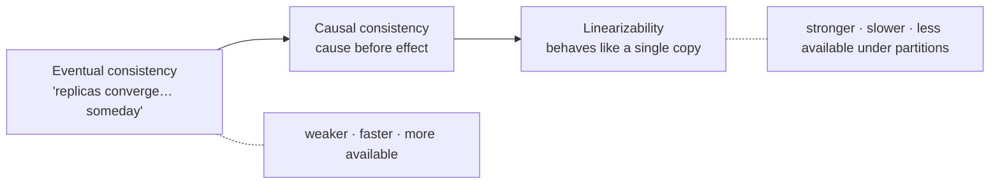

Transaction isolation (ch 7) is about **races between concurrent transactions**. Distributed consistency is about **the state of replicas despite delays and faults**. The two are related but different.

## 9.2 Linearizability

<BookRef pages="346–361" section="Linearizability" />

**Linearizability** (also called atomic consistency, strong consistency or external consistency): make the system look as if there's **only one copy of the data**, and every operation takes effect atomically at a single point in time.

**Recency guarantee:** once any read has returned a new value, every later read (by anyone) must return that value or a newer one.

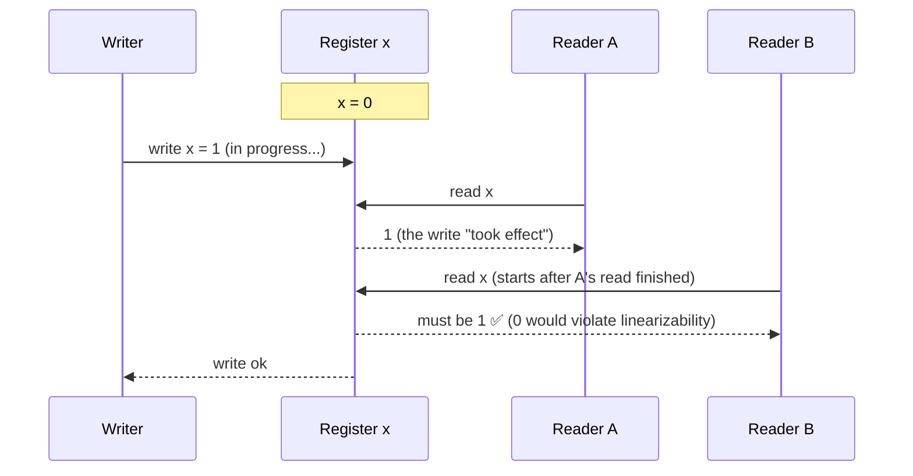

> **Linearizability ≠ serializability.** Serializability is about isolation between **transactions** (multi-object, any equivalent order). Linearizability is a **recency** guarantee on reads and writes of a **single object**. Doing both is "strict serializability". 2PL and actual serial execution are usually linearizable. SSI is **not**.

### When you really need it

| Use | Why |
|---|---|
| **Leader election / locks** | Every node must agree on who holds the lock (ZooKeeper, etcd) |
| **Uniqueness constraints** | Usernames, seats, account balance ≥ 0 |
| **Cross-channel timing** | e.g. a photo upload: the app stores the file, then sends a queue message to resize it. If the storage isn't linearizable, the resizer may read an old or missing file. |

### Which replication methods are linearizable?

| Method | Linearizable? |
|---|---|
| Single-leader | Potentially (read from the leader, and you know who the leader really is) |
| **Consensus algorithms** | ✅ Yes |
| Multi-leader | ❌ No |
| Leaderless (Dynamo-style) | ❌ Probably not, even with quorums: clock-based LWW and sloppy quorums break it |

**Quorums are not enough:**

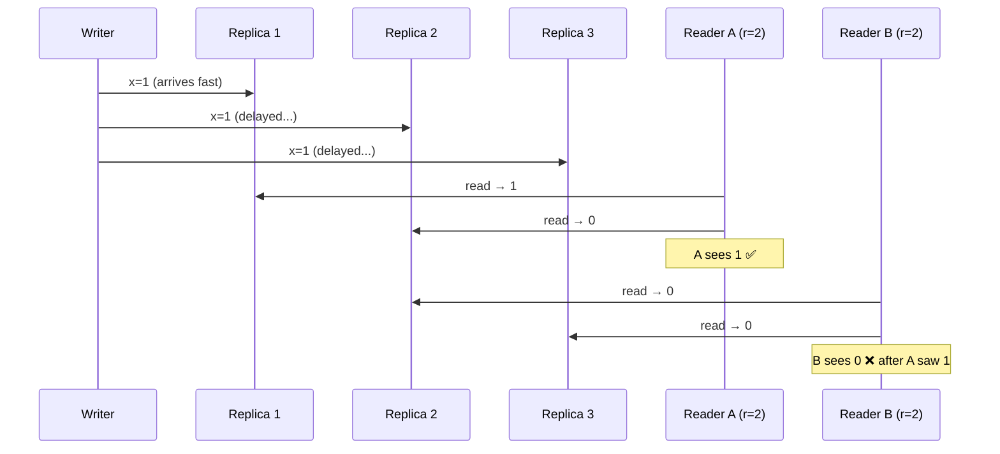

### The CAP theorem, stated properly

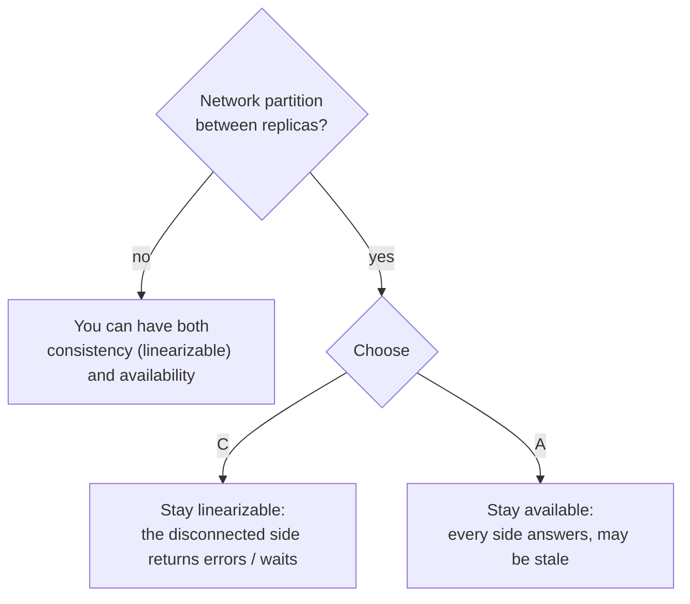

- CAP is better phrased as **"either Consistent or Available when Partitioned"**. Partitions aren't optional, so you don't get to "choose 2 of 3".
- It's very narrow: it covers only linearizability and only network partitions. It says nothing about delays, crashes or latency.
- The deeper reason many systems drop linearizability is **performance**, not just fault tolerance. Its response time is proportional to network delay uncertainty.

## 9.3 Ordering guarantees

<BookRef pages="361–374" section="Ordering Guarantees" />

Ordering keeps coming back: leader logs, serializability, timestamps, causality.

### Causality

Cause comes before effect: a question before its answer, a row created before it's updated.

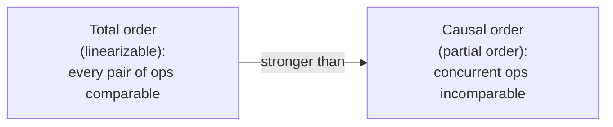

- Linearizability **implies** causality.
- **Causal consistency** is the strongest model that **doesn't slow down because of network delays** and stays **available during partitions**. That's a sweet spot.
- To track causality, record which version each operation **read**, as in version vectors or SSI's dependency tracking.

### Sequence numbers and Lamport timestamps

Without one leader, counters per node aren't consistent with causality. **Lamport timestamps** are:

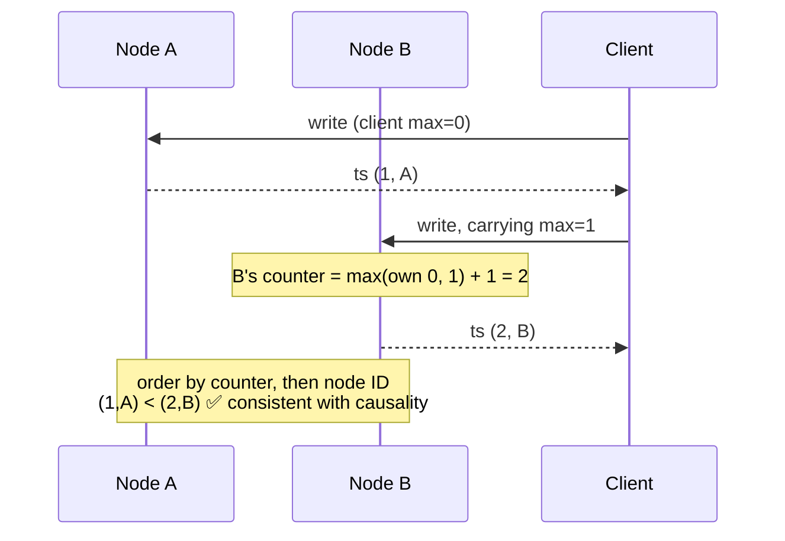

- Timestamp = `(counter, nodeID)`. Every node and client tracks the **max counter seen** and includes it in every request.
- This gives a **total order consistent with causality**.
- ❌ Still not enough for uniqueness constraints: when a node gets a "claim username" request, it can't know *right now* whether another node has a lower timestamp for the same name. The order is only known **after the fact**.

### Total order broadcast (atomic broadcast)

A protocol for delivering messages to all nodes:
1. **Reliable delivery:** if one node gets a message, all of them do.
2. **Totally ordered delivery:** every node gets the messages in the **same order**.

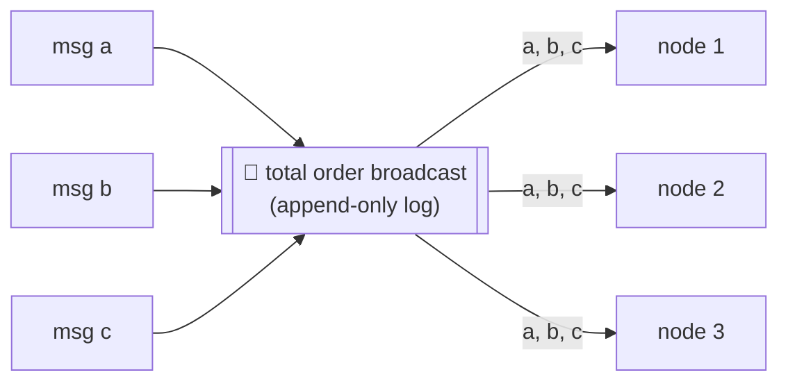

This is exactly **state machine replication**: if every replica processes the same deterministic writes in the same order, they all stay in sync.

**Equivalences (each can be built from the other):**

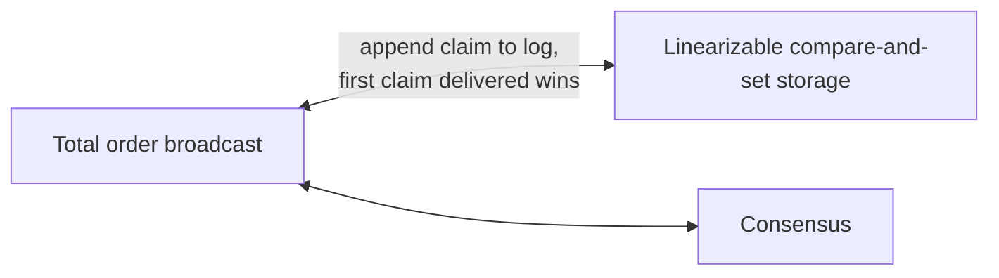

## 9.4 Distributed transactions and consensus

<BookRef pages="374–395" section="Distributed Transactions and Consensus" />

**Consensus:** get several nodes to **agree on something**: who the leader is, whether to commit a transaction, who got the username.

### Two-phase commit (2PC)

Atomic commit across nodes: all commit or all abort.

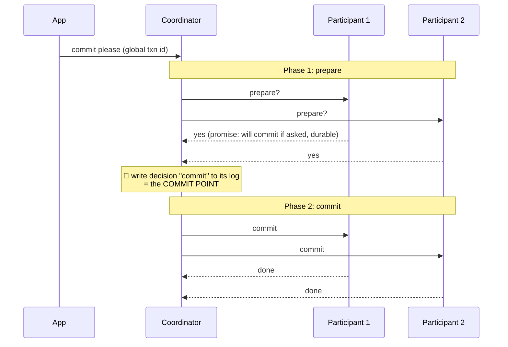

Two **points of no return** make this work:
1. a participant that votes **yes** gives up the right to abort
2. once the coordinator writes its decision, it **must** carry it out, retrying forever if needed

**The weakness: the coordinator crashes after participants voted yes.**

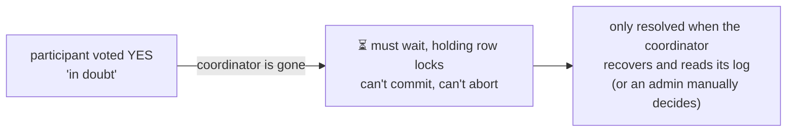

- 2PC is a **blocking** atomic commit protocol. 3PC avoids blocking only if network delay is bounded, which isn't realistic.
- **XA transactions** (2PC across different technologies, e.g. a database plus a message queue) bring operational pain:
  - the coordinator is a single point of failure, often running inside the stateless app server
  - in-doubt transactions hold locks forever ("orphaned")
  - they can't detect deadlocks or use SSI across systems
  - they **amplify failures**: any participant down means the whole transaction fails

**Exactly-once message processing:** a message is acknowledged **if and only if** the database transaction that processed it commits. Atomic commit makes this possible.

### Fault-tolerant consensus

Properties a consensus algorithm must have:

| Property | Type | Meaning |
|---|---|---|
| Uniform agreement | Safety | No two nodes decide differently |
| Integrity | Safety | No node decides twice |
| Validity | Safety | The decided value was proposed by some node |
| Termination | **Liveness** | Every non-crashed node eventually decides (needs a majority alive) |

Algorithms: **Paxos, Raft, Zab, Viewstamped Replication**. They implement **total order broadcast** directly.

**Epochs and quorums:** each election has a higher **epoch (term) number**, and leaders are unique *within* an epoch.

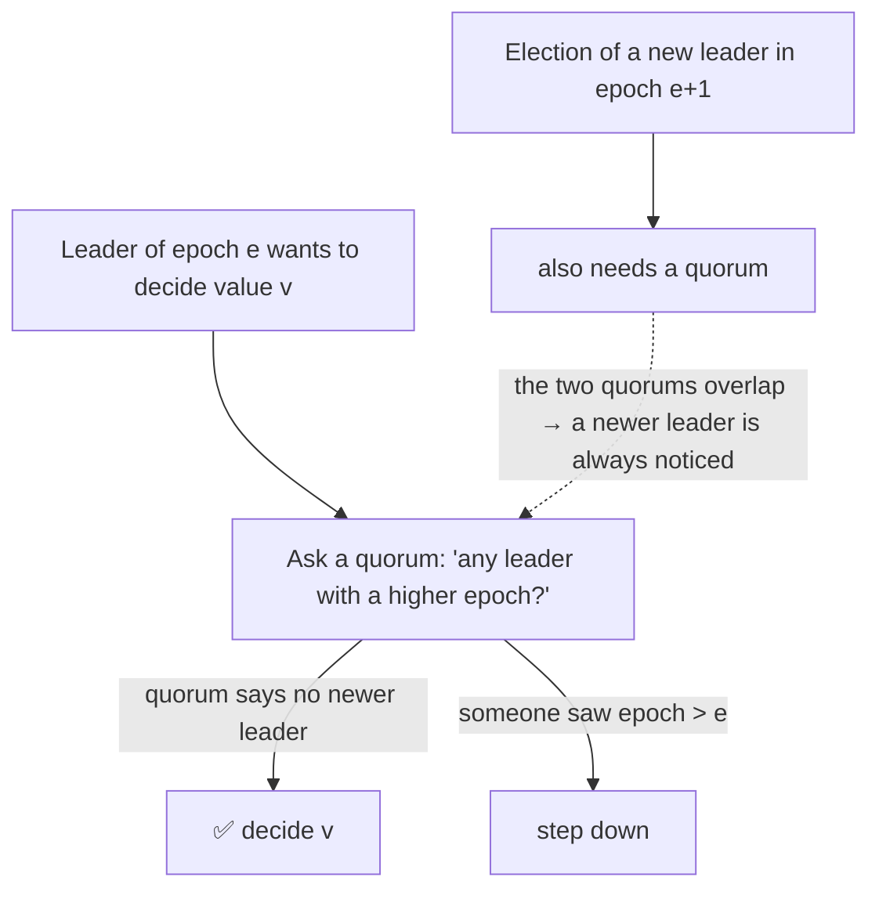

**Costs and limits:**
- every decision is a **synchronous vote** (like sync replication)
- needs a **strict majority**: 3 nodes tolerate 1 failure, 5 tolerate 2
- usually a fixed set of members (dynamic membership is complex)
- relies on **timeouts**, so with variable networks you get frequent re-elections and poor performance

### Membership and coordination services

**ZooKeeper / etcd** are small, fully in-memory, consensus-replicated key-value stores. You rarely use consensus directly; you **use these services**.

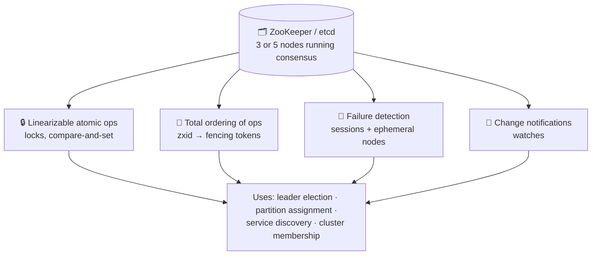

Coordination services are designed for **slowly changing** metadata (which node owns partition 7?), not for application data at high rates.

## Summary

<KeyIdea>Many problems are **equivalent to consensus**: linearizable compare-and-set, atomic transaction commit, total order broadcast, locks and leases, membership, uniqueness constraints. Solve one fault-tolerantly and you've solved them all. In practice, let ZooKeeper or etcd do it.</KeyIdea>

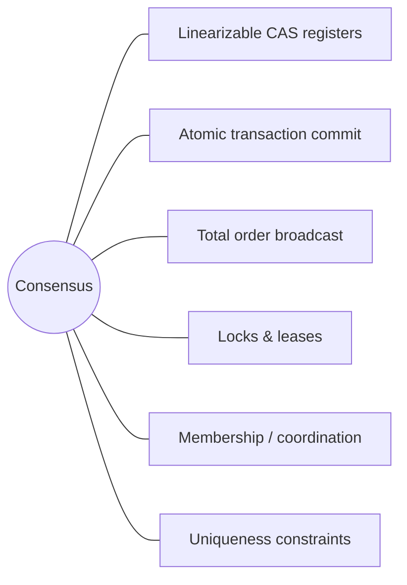

Systems that do **without** consensus (leaderless, multi-leader) accept conflicts and weaker guarantees, and handle the resulting non-linear history in the application.

## 🧠 Check yourself

<Quiz question="What does the CAP theorem actually say?" options={["Pick any 2 of C, A, P", "During a network partition, choose between linearizability and availability", "Consensus is impossible", "Eventual consistency is always enough"]} answer={1} explain="Partitions happen whether you like it or not. The choice is what you do when one occurs." />

<Quiz question="Which is NOT linearizable even with w + r > n?" options={["Single-leader reading from the leader", "Raft-based store", "Dynamo-style leaderless with LWW", "ZooKeeper sync reads"]} answer={2} explain="Variable delays and clock-based conflict resolution allow stale reads after newer ones." />

<Quiz question="Why is 2PC called a blocking protocol?" options={["It locks the whole database", "If the coordinator crashes after prepare, participants must wait for it", "It requires 3 round trips", "It disallows reads"]} answer={1} explain="In-doubt participants can neither commit nor abort on their own." />

<Quiz question="A 5-node Raft cluster can tolerate how many node failures?" options={["1", "2", "3", "4"]} answer={1} explain="It needs a majority (3 of 5) alive, so 2 can fail." />

**Interview prompts**
- Implement unique usernames across regions. What's the minimum coordination needed?
- Why does Kafka (older versions) use ZooKeeper, and what does it store there?
- Explain the difference between linearizability and serializability with an example.
