# 9 · Consistency and consensus

> **In one line:** instead of making every application cope with the chaos of chapter 8 (lost packets, paused processes, lying clocks), build a few **general-purpose abstractions** with strong guarantees (linearizability, total order broadcast, consensus) and let applications lean on them. Then be honest about what those guarantees cost in latency and availability.

<BookRef pages="343–405" section="Chapter 9" />

Chapter 8 was a catalogue of everything that goes wrong in a distributed system. This chapter is the constructive answer. The pattern is the same one we used with transactions in chapter 7: find an **abstraction** that hides a whole class of problems, implement it once, carefully, and let everyone else build on it.

The most important abstraction here is **consensus**: getting several nodes to agree on something, and keep agreeing, even when some of them crash and the network misbehaves. Once you have consensus you can build leader election that never produces two leaders, unique constraints across nodes, atomic commit across databases, and more.

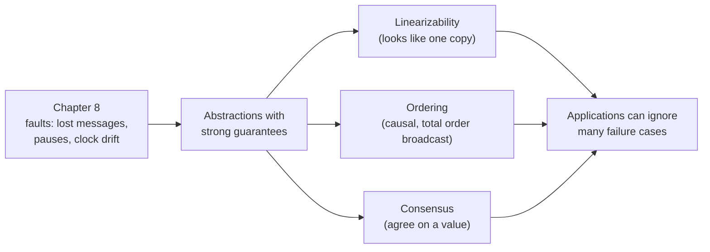

The road map:

1. What **consistency models** exist, from weak to strong.
2. **Linearizability**, the strongest common one: what it means, where you need it, how to build it, and what it costs (CAP).
3. **Ordering**: causality, sequence numbers, Lamport timestamps, total order broadcast.
4. **Distributed transactions and consensus**: two-phase commit, real consensus algorithms, and coordination services like ZooKeeper and etcd.

## 9.1 Consistency guarantees

<BookRef pages="344–346" section="Consistency Guarantees" />

If you write a value to a replicated database and then immediately read from a different replica, you may see the old value. Replication lag is almost unavoidable, because writes reach replicas at different times. Most replicated databases promise only **eventual consistency**: stop writing for a while, and eventually every replica returns the same value.

A better name would be **convergence**. The guarantee is weak in two ways:

- It says nothing about **when** replicas converge. Until then, any read can return anything (old, new, or something in between).
- It mostly matters in the **edge cases**, under faults or high concurrency, which are exactly the situations testing rarely covers. A bug caused by eventual consistency can sit unnoticed for months and then appear during a network blip.

Think of a shared shopping list app. You add "oat milk" on your phone, refresh on your laptop a second later, and it's not there. Is that a bug? Under eventual consistency, no: it'll appear "eventually". To an end user it feels broken.

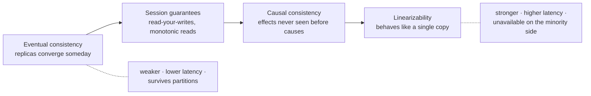

Stronger models are **easier to program against** (fewer weird cases to reason about), but they usually cost **performance** and **fault tolerance**. This chapter explores the strong end of the spectrum.

### Distributed consistency vs transaction isolation

The two topics look similar and the vocabulary overlaps, but they answer different questions:

| | Transaction isolation (ch 7) | Distributed consistency (this chapter) |
|---|---|---|
| Main question | How do **concurrently running transactions** avoid stepping on each other? | How do **replicas** agree on state despite delays and faults? |
| Typical anomalies | dirty reads, lost updates, write skew | stale reads, reads going "back in time", split brain |
| Strong end | serializability | linearizability |
| Scope | usually multi-object transactions | usually a single object (register, key) |

They do interact (some systems give both, see "strict serializability" below), but keep them separate in your head.

## 9.2 Linearizability

<BookRef pages="346–361" section="Linearizability" />

In an eventually consistent store, two clients reading the same key at the same moment may get different answers from different replicas. Wouldn't it be simpler if the database **pretended there was only one copy of the data**? That's the idea behind **linearizability**, also known as atomic consistency, strong consistency, immediate consistency or external consistency.

Under linearizability:

- every client sees the **same** view of the data, as if there were one copy;
- every operation appears to take effect **atomically at one instant** somewhere between its start and its end;
- once a write has completed, **every** later read (by any client) sees that value or a newer one.

That last point is the **recency guarantee**, and it's why linearizability is often summarised as "no stale reads".

Here's a failure that linearizability rules out. A festival ticket site shows remaining seats. Two friends, Kenji and Ines, refresh the page side by side:

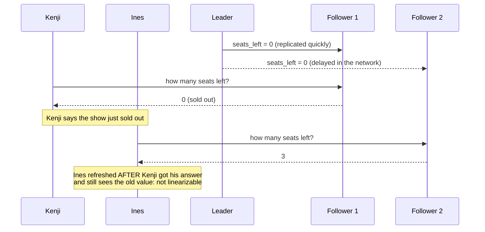

Ines's request began **after** Kenji's response returned, yet she got an older value. Each replica is individually "eventually consistent", but together they violate the recency guarantee.

### What makes a system linearizable?

<BookRef pages="347–352" section="What Makes a System Linearizable?" />

To make the idea precise, think about a single **register**: one key with one value (a row, a document, a cell). Clients can:

- `read(k)` → returns the current value
- `write(k, v)` → sets the value
- `cas(k, expected, new)` → compare-and-set: sets `new` only if the current value equals `expected`, and reports success or failure

Every operation has a **start** (request sent) and an **end** (response received). The database processes it at some moment in between, but the client can't see exactly when.

#### Concurrent reads are ambiguous… once

If a read overlaps in time with a write, it's **concurrent** with it and may legitimately return either the old or the new value. That alone isn't enough, though. Without a further rule, a value could "flicker": one reader sees the new value, a later one sees the old one again.

Linearizability adds the rule: **after any read returns the new value, all reads that start later must also return the new value**, even if the write operation itself hasn't returned yet.

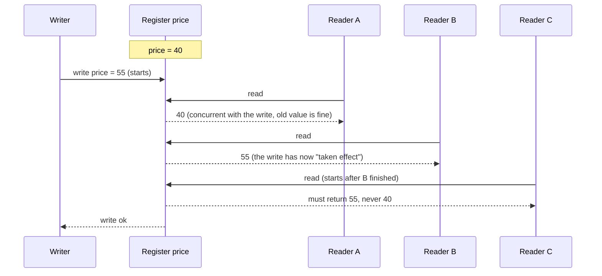

You can picture each operation as a bar on a timeline, with a **dot** somewhere inside the bar marking the instant it really took effect. A history is linearizable if you can place the dots so that:

1. the dots are in a single **left-to-right sequence**, and
2. each read returns the value of the **most recent write dot** before it.

The arrow formed by those dots must only ever **move forward in time**. It can never jump backwards, because that would mean a later read saw an older state.

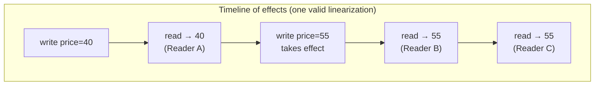

#### Compare-and-set makes it interesting

With `cas`, clients can implement things like "only change the price if nobody else changed it since I read it". A history is still linearizable as long as the dots can be ordered consistently: a `cas(price, 55, 60)` that succeeds must be placed after the write of 55 and before any read that returns 60; a concurrent `cas(price, 55, 70)` must then **fail**, because by the time its dot happens the value is no longer 55.

A useful mental test, applied to any history:

| Observation | Linearizable? |
|---|---|
| A read concurrent with a write returns the old value | ✅ fine |
| A read concurrent with a write returns the new value | ✅ fine |
| Reader X saw the new value, then reader Y (starting after X ended) saw the old value | ❌ violation |
| Two `cas` calls with the same `expected` both succeed | ❌ violation |
| A read returns a value that was never written | ❌ violation |

Testing whether a recorded history is linearizable is possible (tools such as **Knossos** and **Porcupine** do this, and the Jepsen test suite uses them) but computationally expensive, because you search over many possible orderings.

#### Linearizability vs serializability

These two words are confused constantly. They are **different guarantees**:

| | Serializability | Linearizability |
|---|---|---|
| Is a property of… | **transactions** (groups of reads and writes, often on many objects) | **individual operations** on a single object (register) |
| Promises | the outcome equals **some** serial order of the transactions | operations take effect in **real-time** order, as on one copy |
| Must the serial order match wall-clock order? | No. Transaction T2 may be ordered "before" T1 even if T1 committed first | Yes. Later operations must see the effects of earlier ones |
| Prevents write skew? | Yes | No (it isn't about multi-object invariants) |
| Stale reads allowed? | Yes, as long as some serial order explains them | No |

A database that offers **both** is said to provide **strict serializability** (or strong one-copy serializability). Some notes on real implementations:

- **Actual serial execution** (VoltDB, Redis scripts) and **two-phase locking** are typically linearizable as well as serializable.
- **Serializable snapshot isolation (SSI)** is **not** linearizable by design: reads come from a consistent snapshot, so they deliberately ignore writes that committed after the snapshot was taken. A read-only transaction can see slightly stale data, which is precisely the point (readers never block writers).
- **Google Spanner** and **CockroachDB** aim at strict serializability (Spanner fully, CockroachDB with some caveats around clock uncertainty), using clock bounds and consensus.

<KeyIdea title="Two different axes">Serializability is about **isolation** of multi-object transactions. Linearizability is about **recency** of single-object reads and writes. You can have either one without the other.</KeyIdea>

### Relying on linearizability

<BookRef pages="352–354" section="Relying on Linearizability" />

When is "no stale reads" not just nice, but **required for correctness**? Three classic situations.

#### Locking and leader election

In a single-leader setup, the nodes need to agree on which one is the leader. One way: every candidate tries to **acquire a lock**, and whoever gets it becomes leader. That lock **must be linearizable**: all nodes must agree on who holds it. If two nodes each believed they held it, you'd have **split brain**, with two leaders accepting conflicting writes.

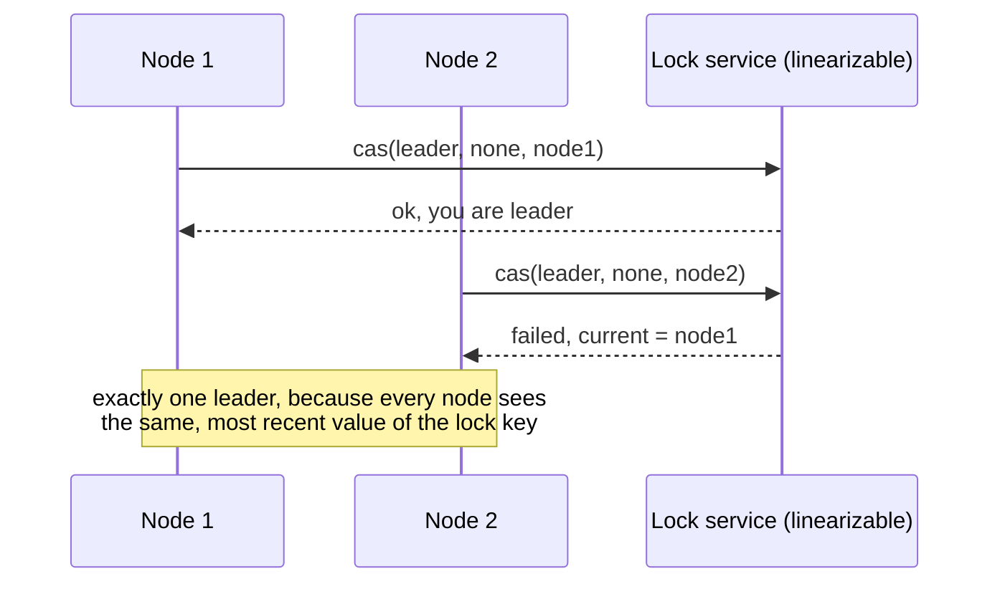

This is what **Apache ZooKeeper** and **etcd** are commonly used for. Their client libraries (e.g. **Apache Curator** recipes for ZooKeeper, the `concurrency` package in etcd) provide leader election and locks on top of linearizable operations. Kafka (before KRaft), HBase, Hadoop YARN and Kubernetes all used or use such a service to pick a leader or an active controller.

Linearizable locks also appear **inside** some distributed databases, at finer granularity. Oracle RAC, for example, uses a distributed lock per disk page so that several nodes can share the same storage.

Caveat from chapter 8: even with a perfect lock service, a lock holder can pause (GC, VM migration) and act after its lease expired. You still need **fencing tokens** on the resource. Linearizability makes the lock itself correct; fencing protects against zombies.

#### Constraints and uniqueness guarantees

A **uniqueness constraint** needs linearizability. Examples (our own):

- two shoppers must not both get the last unit of a limited sneaker drop;
- a URL shortener must not hand the same short code `/k7Qx` to two different links;
- a conference room can't be booked twice for the same slot;
- an account balance must never go below zero.

All of these boil down to: "claim this name / item / slot **only if nobody else has**", which is a `cas` on a register. And it's the same problem as acquiring a lock on that name.

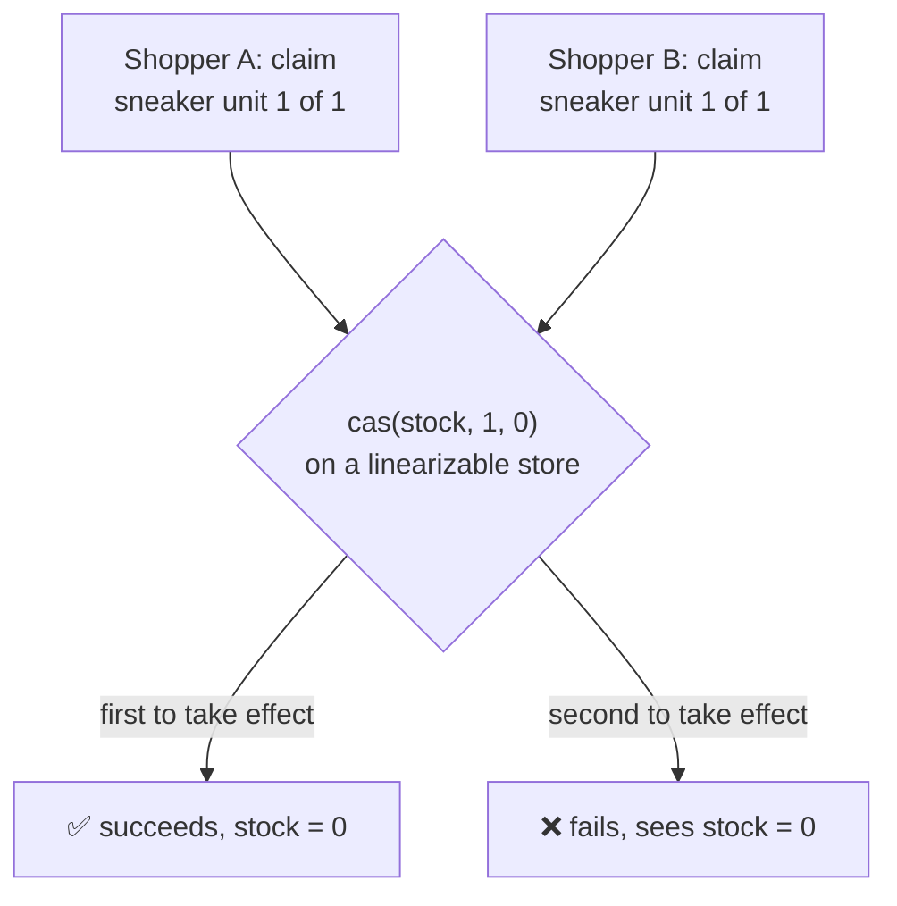

Constraints like **foreign keys** or attribute checks can often be enforced without linearizability. It's the **"there can be only one"** style constraints that need a single up-to-date value that everyone agrees on. A relaxed version is often acceptable for a business, though: an airline overbooks, a shop apologises and refunds (see chapter 12). Then you can avoid linearizability.

#### Cross-channel timing dependencies

The ticket example above only became a "problem" because Kenji and Ines **talked to each other** (a second communication channel) and noticed the discrepancy. Without that side channel, nobody could have told the difference.

The same thing happens inside systems. Our own example: a report generator.

1. The web server saves an uploaded spreadsheet `q3.xlsx` to a replicated **file store**.
2. It then sends a message "convert `q3.xlsx` to PDF" to a **job queue**.
3. A worker picks up the job and fetches the file from the file store.

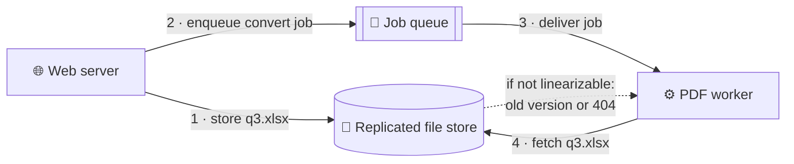

There are **two channels**: the file store and the queue. If the queue delivers faster than the file store replicates, the worker reads from a replica that doesn't have the file yet (or has the previous quarter's version). The PDF is wrong, or the job fails, and the inconsistency is **permanent** in the generated output.

If the file store were linearizable, step 4 would be guaranteed to see the result of step 1, because step 1 completed before step 2 started. Alternatives exist (e.g. put a version ID or content hash in the job message and have the worker wait for that version, as in read-your-writes), but they add complexity.

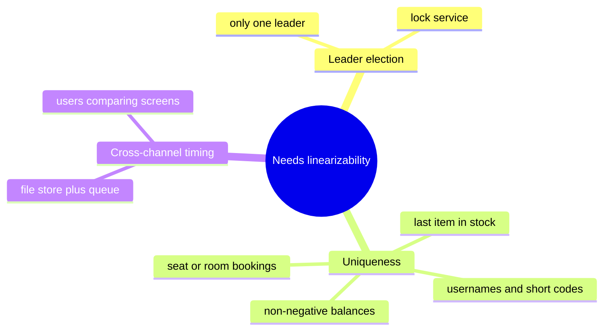

### Implementing linearizable systems

<BookRef pages="354–357" section="Implementing Linearizable Systems" />

The simplest linearizable system is **one copy of the data**. But then it doesn't tolerate faults. So which replication methods from chapter 5 can be made linearizable?

| Replication method | Linearizable? | Why |
|---|---|---|
| **Single-leader** | **Potentially** | Reads from the leader or from synchronously updated followers can be. But you must be sure who the leader *really* is (a deposed leader that thinks it's still leader breaks it), and async failover may lose committed writes, which violates both durability and linearizability. |
| **Consensus algorithms** (Raft, Zab, Multi-Paxos) | **Yes** | They're single-leader replication plus the safeguards that prevent split brain and stale leaders. ZooKeeper and etcd work this way. |
| **Multi-leader** | **No** | Several nodes accept writes concurrently and replicate asynchronously, producing conflicts that must be resolved later. No single-copy illusion. |
| **Leaderless** (Dynamo-style) | **Probably not** | Last-write-wins based on clocks is not linearizable (clock skew), sloppy quorums break it, and even strict quorums can show anomalies (below). |

Note the fine print for single-leader: if you read from an **asynchronous follower**, you get stale reads. If you read from the leader, you need the leader to know it's still leader. Many systems use a **lease** for that (the leader holds a time-bounded lease and only serves reads while it's valid), which depends on clocks behaving.

#### Linearizability and quorums

It feels like strict quorums (`w + r > n`) should give linearizability: every read overlaps every write in at least one node. But with variable network delay, race conditions remain. Our own example with `n = 5`, `w = 3`, `r = 3`:

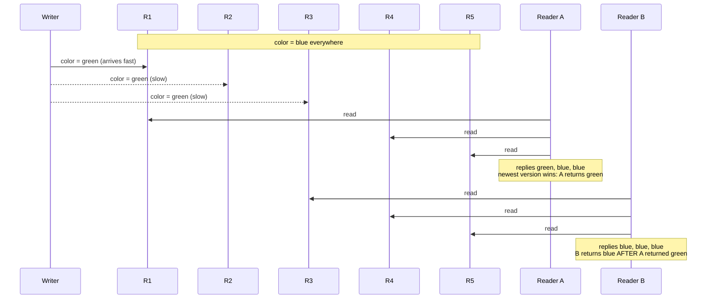

The quorum condition is satisfied, but Reader B, starting after Reader A finished, saw an older value. Not linearizable.

You **can** fix it, at a performance cost:

- **Read repair, synchronously:** before a reader returns a value, it writes that value back to any stale replicas in its quorum and waits for them (as in Lynch and Shvartsman's ABD-style algorithm). Then a later read can't miss it.
- **Writers read first:** the writer reads the latest state from a quorum before writing, so that its write version is ordered after anything already visible.

Riak doesn't do synchronous read repair because of the latency penalty. Cassandra waits for read repair on quorum reads, but it uses last-write-wins with clock timestamps, which still breaks linearizability under concurrent writes to the same key. Even with all this, only **reads and writes** can be made linearizable this way; a linearizable **compare-and-set** needs a consensus algorithm.

<KeyIdea>Leaderless systems with quorums are not linearizable in practice. If you need linearizability, use single-leader replication with careful leader handling, or a consensus algorithm.</KeyIdea>

### The cost of linearizability

<BookRef pages="357–361" section="The Cost of Linearizability" />

Picture a multi-region deployment: one datacenter in Frankfurt, one in Singapore, linked by a long-haul network. Suppose the link between them breaks, but clients in each region can still reach their local datacenter.

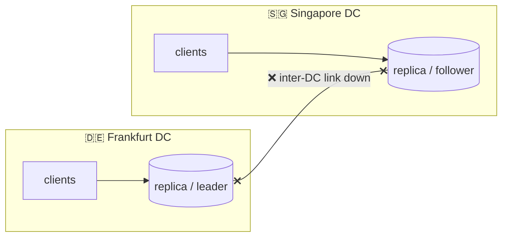

What happens depends on the replication scheme:

- **Multi-leader**: each datacenter keeps accepting writes locally and queues replication. Both sides stay **available**. Conflicts are sorted out once the link returns. Not linearizable.
- **Single-leader** with the leader in Frankfurt: Singapore clients' writes and linearizable reads must go to Frankfurt, which is unreachable. Singapore is **unavailable** for those operations until the link heals. (Clients that can reach Frankfurt directly are fine.) Singapore could still serve stale follower reads, but those aren't linearizable.

#### The CAP theorem

This trade-off is general:

- If the application **requires linearizability**, and some replicas are cut off from the others, then those replicas **can't process requests** while disconnected. They must wait or return an error. The system is **unavailable** on that side.
- If the application **doesn't require linearizability**, each replica can process requests independently, even when disconnected. It stays **available** but isn't linearizable.

This is the content of the **CAP theorem** (Consistency, Availability, Partition tolerance), conjectured by Eric Brewer in 2000 and proved formally by Gilbert and Lynch in 2002.

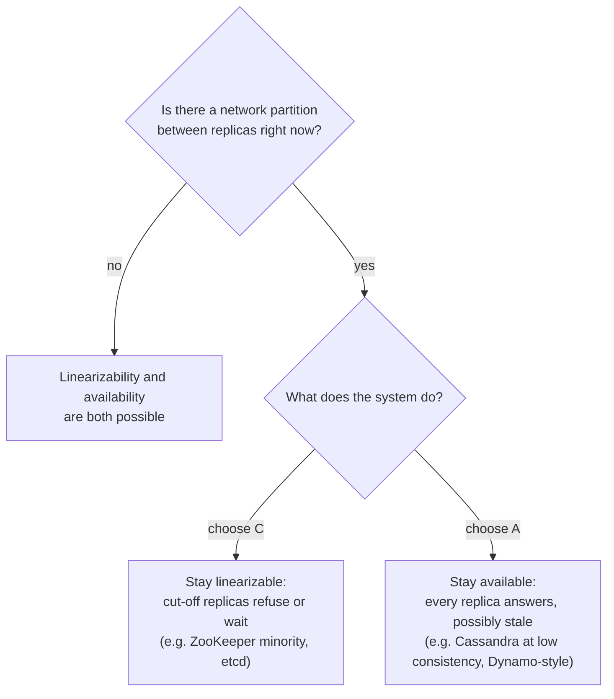

Why CAP is often misunderstood, and why it's less useful than its fame suggests:

| Common claim | What's actually true |
|---|---|
| "Pick 2 out of 3" | Misleading. **Partitions are a fault, not a choice**: they happen whether you like it or not. The real statement is *either consistent or available, when partitioned*. |
| "CAP is about consistency in general" | It's only about **linearizability**, one specific model. |
| "CAP covers faults in distributed systems" | It covers only **network partitions**. Not node crashes, slow disks, GC pauses or network delays. |
| "Availability" means high uptime | CAP's "availability" is a specific formal definition (every request to a non-failed node gets a non-error response), which doesn't match how people usually use the word. |
| "CAP helps you design systems" | In practice it has been superseded by more precise impossibility results and by thinking about latency (see PACELC below). It's mostly of historical interest, though it did help spark the NoSQL movement by legitimising non-linearizable designs. |

A popular extension is **PACELC** (Daniel Abadi): *if Partitioned, choose Availability or Consistency; Else (normal operation), choose Latency or Consistency*. It captures the point of the next section: even without partitions, consistency costs latency.

#### Linearizability and network delays

Surprisingly few systems are linearizable in practice, and the reason is usually **not** partitions. Even a modern multi-core CPU isn't linearizable! If one core writes a memory address and another core reads it right after, it can see an old value, because each core has its own cache and store buffers, which sync to main memory asynchronously. Fences or atomic instructions are needed to force a consistent view.

Why do CPUs do this? Not for fault tolerance (a core can't be "partitioned" from its RAM), but for **performance**. The same reason applies to many distributed databases.

Attiya and Welch proved that if you want linearizability, the response time of reads and writes is **at least proportional to the uncertainty of delays in the network**. In networks with highly variable delays (most real networks, see chapter 8), linearizable operations are inevitably slow. There's no faster algorithm for linearizability. Weaker models can be much faster.

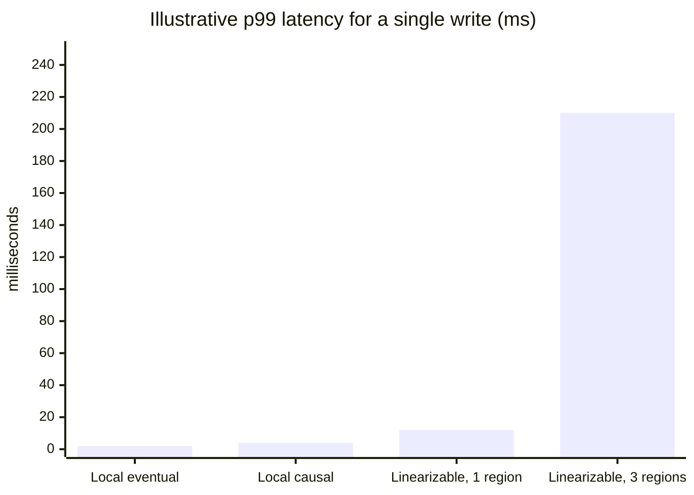

*(Numbers are illustrative only, to show the shape of the trade-off: cross-region linearizable writes pay at least one round trip between regions.)*

<KeyIdea title="Why systems drop linearizability">Usually for **performance**, not just partition tolerance. Linearizability's latency is tied to network delay uncertainty, so latency-sensitive systems often choose weaker models.</KeyIdea>

## 9.3 Ordering guarantees

<BookRef pages="361–374" section="Ordering Guarantees" />

"Order" keeps coming up in this book:

- In **single-leader replication**, the leader decides the order of writes in its log, and followers apply them in that order. Without a single leader, concurrent writes conflict.
- **Serializability** means transactions behave as if executed in *some* sequential order.
- **Timestamps and clocks** (chapter 8) are an attempt to say which of two events happened first.

There's a deep connection between ordering, linearizability and consensus. This section explores it.

### Ordering and causality

<BookRef pages="361–365" section="Ordering and Causality" />

One big reason ordering matters is that it helps preserve **causality**: causes come before effects. Examples from earlier chapters, retold with our own scenarios:

- **Consistent prefix reads** (ch 5): a reader shouldn't see a reply in a support ticket before seeing the customer's message it replies to.
- **Concurrent writes** (ch 5): if a row is created and then updated, a replica must not receive the update before the insert. "Happened before" is the causal relation; two writes are **concurrent** if neither knew about the other.
- **Snapshot isolation** (ch 7): a consistent snapshot is a **causally consistent** one: if it contains an effect, it contains the cause.
- **Write skew** (ch 7): a transaction's decision depends on what it read, so the read is causally before the write. SSI tracks exactly these causal dependencies.
- **Cross-channel timing**: the PDF worker job was caused by the file upload.

If a system obeys the ordering imposed by causality, we call it **causally consistent**.

#### The causal order is not a total order

A **total order** lets you compare any two elements: for any two numbers, one is larger. A **partial order** has pairs that are incomparable: is the set `{a, b}` larger or smaller than `{b, c}`? Neither is a subset of the other.

| Model | Ordering of operations |
|---|---|
| **Linearizability** | **Total order.** The system behaves like one copy, every operation is atomic, so for any two operations you can say which came first. |
| **Causality** | **Partial order.** Two events are ordered if one happened before the other (causally related), and **incomparable if concurrent**. |

So linearizable systems have **no concurrency** in their data model: there's a single timeline. Causally consistent systems have a **branching** history, like Git: commits on different branches are concurrent, and merges join them.

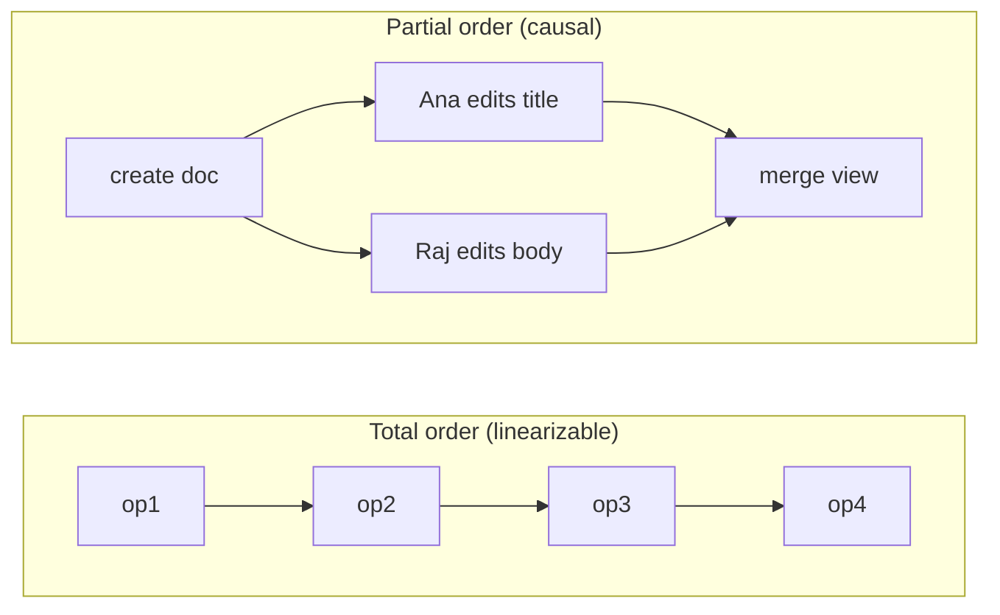

In the causal picture, "Ana edits title" and "Raj edits body" are **concurrent**: neither saw the other. Neither came "first" in any meaningful sense.

#### Linearizability is stronger than causal consistency

- Linearizability **implies** causality: any linearizable system preserves causal order. That's why it's so easy to reason about, and why it's appealing.
- But it costs performance and availability (CAP, network delay).
- **Causal consistency** is the **strongest** consistency model known that **does not slow down due to network delays** and **remains available during network partitions**.

In many cases, systems that look like they need linearizability only need causal consistency. Research systems (e.g. COPS, Eiger, Bolt-on causal consistency) explore this; production databases are still catching up, though MongoDB offers causally consistent sessions.

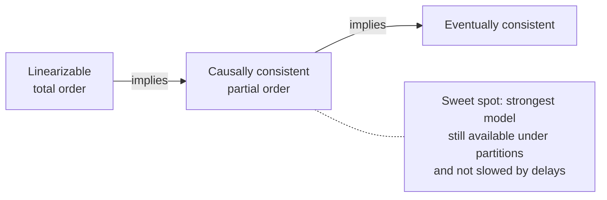

#### Capturing causal dependencies

To maintain causality, you need to know which operation **happened before** which. A replica must process an operation only after all its causal predecessors have been processed; if something is missing, it waits.

How do you know what a client "knew" when it issued a write? Techniques generalise those from chapter 5:

- **Version vectors**: track a counter per replica. Each write carries the version vector of the state it was based on. Concurrency shows up as incomparable vectors.
- **Recording reads**: when a client writes, it sends the version of the data it read. The database can then tell which writes depend on which prior state. This is what SSI does for write-skew detection: it notices when a transaction's premise (what it read) has changed.

The catch: tracking all causal dependencies can mean a lot of metadata, especially when clients read a lot before writing. Sequence numbers offer a cheaper alternative.

### Sequence number ordering

<BookRef pages="365–370" section="Sequence Number Ordering" />

Instead of tracking every dependency, we can use **sequence numbers** or **timestamps** (logical, not wall-clock) to order events. They're compact (a few bytes) and give a **total order**: any two numbers can be compared.

We can create sequence numbers **consistent with causality**: if A happened before B, then A gets a lower number than B. Concurrent operations get an arbitrary order.

In **single-leader replication**, this is easy: the leader increments a counter per write and stamps every log entry. Followers apply the log in that order and stay causally consistent (though they may lag).

#### Non-causal sequence number generators

Without a single leader (multi-leader, leaderless, or a partitioned database), it's less obvious. Common approaches:

| Approach | How it works | Example |
|---|---|---|
| **Per-node counters, interleaved** | Node 1 issues odd numbers, node 2 even ones. Or reserve some bits for the node ID. | 1, 3, 5… vs 2, 4, 6… |
| **Physical-clock timestamps** | Attach a time-of-day timestamp (high resolution) to each operation. | Last-write-wins in Cassandra |
| **Pre-allocated blocks** | Node A gets IDs 1–1000, node B 1001–2000, and so on. | Ticket servers, Hi/Lo key generation |

All three are faster and more scalable than routing everything through one leader, and they produce **unique**, roughly increasing numbers. But **none of them is consistent with causality**:

- With odd/even counters, a busy node 2 can be at 9,004 while quiet node 1 is at 101. An operation on node 1 at 103 may actually be causally **after** node 2's 9,004.
- Physical clocks drift (chapter 8): a causally later operation can get an earlier timestamp.
- With blocks, a later operation on node A (ID 512) can causally follow an earlier one on node B (ID 1,200).

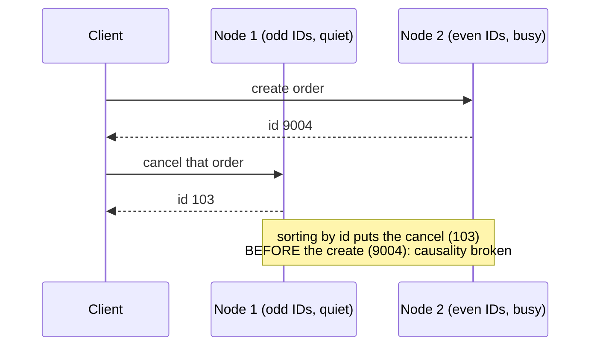

#### Lamport timestamps

Leslie Lamport (1978) found a simple way to generate sequence numbers **that are consistent with causality**. Each node has:

- a unique **node ID**, and
- a **counter** of operations it has processed.

A Lamport timestamp is the pair `(counter, nodeID)`. Two nodes may have the same counter value, but the node ID makes every timestamp unique. Ordering rule: compare counters; if equal, the higher node ID is greater.

The trick that makes it causal: **every node and every client tracks the maximum counter it has seen so far, and sends it with every request.** When a node receives a request or response whose counter is larger than its own, it immediately jumps its own counter up to that value.

```python
class LamportClock:
    def __init__(self, node_id):
        self.node_id = node_id
        self.counter = 0

    def tick(self):                       # a local event, e.g. handling a write
        self.counter += 1
        return (self.counter, self.node_id)

    def observe(self, seen_counter):      # on any message received
        self.counter = max(self.counter, seen_counter)

def happened_earlier(ts_a, ts_b):         # total order on (counter, node_id)
    return ts_a < ts_b                    # tuple comparison: counter, then node id
```

Our own run with three nodes P, Q, R and one client:

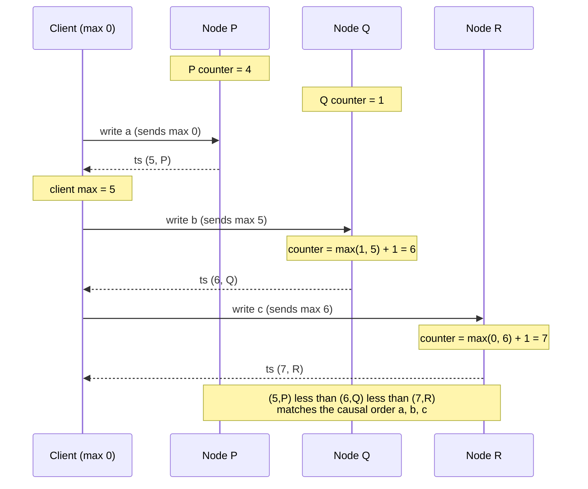

Even though Q was way "behind" P, it caught up the moment it saw a larger counter. So if operation B causally depends on A, B's timestamp is guaranteed to be larger.

**Lamport timestamps vs version vectors:**

| | Lamport timestamps | Version vectors |
|---|---|---|
| Size | one counter + node ID | one counter **per replica** |
| Gives | a **total order** consistent with causality | a **partial order**: can tell if two ops are concurrent |
| Can detect concurrency? | **No.** Two concurrent ops still get an order | **Yes** |
| Typical use | ordering, tie-breaking, logical clocks | conflict detection (Riak, Dynamo-style stores) |

Related ideas you'll see in practice: **hybrid logical clocks (HLC)**, used in CockroachDB and YugabyteDB, combine a physical clock with a Lamport-style counter so timestamps stay close to wall time while still respecting causality.

#### Timestamp ordering is not sufficient

Lamport timestamps give a total order consistent with causality. Is that enough to solve problems like uniqueness?

Take a URL shortener where users can request a **custom short code**. Two users on different nodes both ask for `/launch` at about the same moment. Rule: the request with the lower Lamport timestamp wins.

That rule works **after the fact**: once you've collected **all** requests in the system, you can sort them and pick the winner. But a node receiving a request needs to decide **now**, before replying to the user. To be sure it's the winner, it must check with **every other node** that no one has a lower timestamp for `/launch`. If any node is unreachable or slow, it can't decide, and the system grinds to a halt. That's not fault-tolerant.

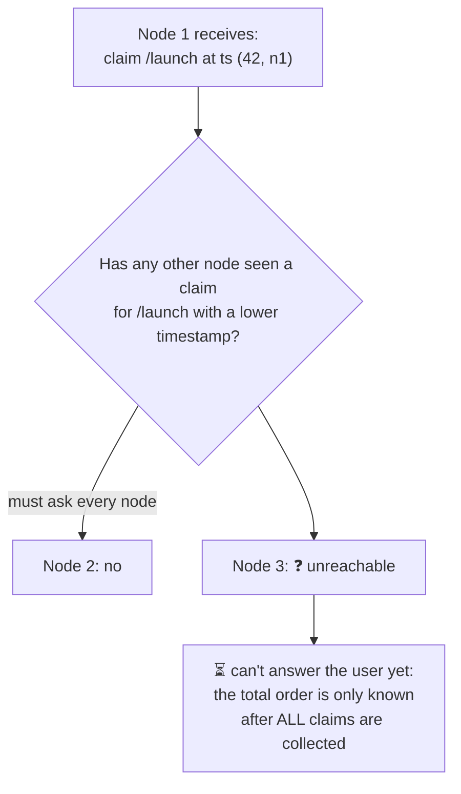

The problem: the total order **emerges only after you've gathered all operations**. To implement a uniqueness constraint you also need to know **when the order is finalised**, i.e. that no earlier operation can still appear. That idea is called **total order broadcast**.

### Total order broadcast

<BookRef pages="370–374" section="Total Order Broadcast" />

With one CPU core, total ordering is easy: the order operations are executed. Across nodes, it's tricky. Single-leader replication gets a total order by having one leader sequence everything, but the challenges are (a) **throughput** beyond one leader and (b) **failover** when the leader dies. Total order broadcast addresses (b).

**Total order broadcast** (also called **atomic broadcast**) is a protocol for exchanging messages between nodes, with two safety properties:

1. **Reliable delivery**: no messages are lost. If a message is delivered to one node, it's delivered to all of them.
2. **Totally ordered delivery**: messages are delivered to every node **in the same order**.

A correct algorithm must keep these properties even when nodes or the network fail. While the network is down, messages can't be delivered, but the algorithm keeps retrying, and when the network heals, messages arrive in the correct order.

An important detail: **the order is fixed at the moment of delivery**. A node can't insert a message retroactively into an earlier position. That's what makes it stronger than Lamport timestamps.

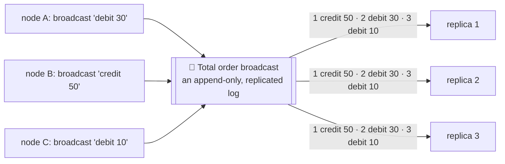

#### Using total order broadcast

Consensus services like **ZooKeeper** and **etcd** implement total order broadcast. Uses:

- **Database replication (state machine replication).** If every message is a write and every replica applies the same writes in the same order, replicas stay consistent (aside from temporary lag). This works as long as processing is **deterministic**.
- **Serializable transactions.** If every message is a deterministic transaction (a stored procedure, say), and every node processes them in the same order, the partitions and replicas stay consistent. Calvin and VoltDB use this idea.
- **A log.** Delivering a message is like appending to a log. All nodes read the same log and see messages in the same order. This is why Kafka-style logs and consensus logs feel similar.
- **Fencing tokens for locks.** Every lock request is appended as a message; its position in the log is a monotonically increasing sequence number that can serve as a fencing token. ZooKeeper's `zxid` is used exactly this way.

#### Implementing linearizable storage using total order broadcast

Total order broadcast is **asynchronous**: messages are delivered reliably in a fixed order, but there's no guarantee **when**. Linearizability is a recency guarantee. They're different, but closely related: you can build one from the other.

**Linearizable compare-and-set (a uniqueness check) from a total order broadcast log**, using our short-code example:

1. Append a message to the log, tentatively claiming the code: `claim /launch for user u17`.
2. Read the log, and wait for your own message to be delivered back to you.
3. Look at all messages claiming `/launch`. If the **first** one is yours, you won: commit the claim and tell the user. If someone else's came first, abort.

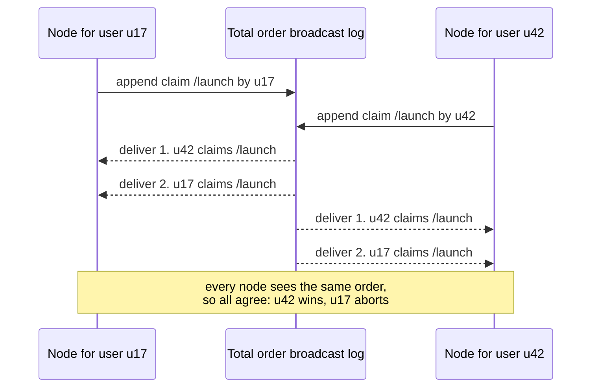

Because every node delivers log entries in the same order, all nodes agree on which claim was first. This gives **linearizable writes**.

**Reads** are not automatically linearizable: a node reading its local copy of the log may be behind (that's sequential consistency, also called timeline consistency). Options for linearizable reads:

- **Read through the log**: append a "read" marker message, wait until it's delivered back, then read. The position of the marker defines the point in time of the read. etcd's quorum reads work like this in spirit.
- **Sync then read**: ask the log for the position of the latest message, wait until your local replica has caught up to that position, then read. ZooKeeper's `sync()` followed by a read does this.
- **Read from a synchronously updated replica**, one that's guaranteed to be up to date (chain replication does this from the tail).

#### Implementing total order broadcast using linearizable storage

The other direction also works. Assume a linearizable register holding an integer with an atomic **increment-and-get** (or `cas`).

For every message you want to broadcast:

1. Increment-and-get the linearizable counter. Attach the result as the message's sequence number.
2. Send the message to all nodes (resending lost messages).
3. Recipients deliver messages **strictly in sequence-number order**. If a node has delivered message 7 and receives 9, it waits for 8.

```mermaid
flowchart LR
  CNT[("🔢 linearizable counter<br/>increment-and-get")]
  M1["message 'x'"] -->|"gets 7"| CNT
  M2["message 'y'"] -->|"gets 8"| CNT
  CNT --> DEL["Recipients deliver in order<br/>6, 7, 8, 9…<br/>and wait if there's a gap"]
```

The key difference from Lamport timestamps: these numbers have **no gaps**. If a node has delivered 7 and sees 9, it knows 8 exists and must wait for it. With Lamport timestamps, a jump from 7 to 9 tells you nothing.

The catch: how do you build a linearizable increment-and-get register that survives node failures? Thinking it through, you end up at **consensus**. That's no accident.

<KeyIdea title="The big equivalence">Linearizable compare-and-set (or increment-and-get) registers and total order broadcast are **both equivalent to consensus**. If you can solve one of them fault-tolerantly, you can solve the others.</KeyIdea>

```mermaid
flowchart LR
  TOB["Total order broadcast"] <-->|"build each<br/>from the other"| LIN["Linearizable CAS /<br/>increment-and-get register"]
  TOB <-->|"equivalent"| CONS(("Consensus"))
  LIN <-->|"equivalent"| CONS
```

## 9.4 Distributed transactions and consensus

<BookRef pages="374–395" section="Distributed Transactions and Consensus" />

Consensus is one of the most important and fundamental problems in distributed computing. Informally: **get several nodes to agree on something**. It sounds easy. Many broken systems were built on the belief that it was.

Situations where nodes need to agree:

- **Leader election.** All nodes must agree on who the leader is. If a network fault leaves some nodes unable to talk to the leader, disagreement can cause split brain and data loss.
- **Atomic commit.** A transaction spans several nodes or partitions. It might fail on some and succeed on others. To keep atomicity, all nodes must agree on the outcome: **all commit or all abort**.

#### The impossibility of consensus (FLP)

The **FLP result** (Fischer, Lynch and Paterson, 1985) proves that there's **no algorithm** that always reaches consensus if there's a risk that a node may crash, in the **asynchronous system model**: a model with no clocks and no timeouts, where messages can take arbitrarily long.

Yet we use consensus every day. How? The asynchronous model is very restrictive. If the algorithm can use **timeouts** (or any other way to suspect crashed nodes), or **randomness**, consensus becomes solvable. Real algorithms (Raft, Paxos) are always **safe** and only rely on timing for **liveness** (making progress). So FLP is important theory, but it doesn't mean consensus is unachievable in practice.

```mermaid
flowchart LR
  FLP["FLP: no deterministic algorithm<br/>always terminates in a purely<br/>asynchronous model with crashes"] --> WAY["Practical escape hatches"]
  WAY --> T["Timeouts to suspect failures<br/>(partially synchronous model)"]
  WAY --> R["Randomised algorithms"]
  T & R --> RES["Raft, Paxos, Zab:<br/>always safe, usually live"]
```

We'll start with atomic commit and two-phase commit (2PC), the most common way to do it, which is a kind of consensus algorithm but not a very good one. Then we look at real fault-tolerant consensus.

### Atomic commit and two-phase commit (2PC)

<BookRef pages="376–382" section="Atomic Commit and Two-Phase Commit (2PC)" />

Atomicity (chapter 7) prevents failed transactions from littering the database with half-finished results. It matters especially for multi-object transactions and for keeping secondary indexes consistent with the primary data.

#### From single-node to distributed atomic commit

On a **single node**, atomic commit is implemented by the storage engine:

1. The transaction's writes go to the write-ahead log.
2. To commit, the engine appends a **commit record** to the log and makes it durable (fsync).
3. If the node crashes before the commit record is on disk, the transaction is aborted on recovery. If after, it's committed.

So the commit decision comes down to **the order in which data is written to one disk**: the commit record after the data. One device, one controller, one point of truth.

With **several nodes** (a transaction touching multiple partitions, or a term-partitioned secondary index), it's not enough to send a commit request to each node and let them commit independently. Things can go wrong:

- some nodes detect a constraint violation or conflict and must abort, while others commit;
- some commit requests are lost in the network and time out, others arrive;
- some nodes crash before the commit record is durable and roll back on recovery, others don't.

The result would be inconsistent nodes: the order item reduced stock on partition 2, but the order record on partition 5 was rolled back. And a committed transaction **can't be retracted**, because other transactions may already have read its data (read committed). This is why a node must only commit once it's **certain** all other nodes will also commit.

(If a committed transaction is later found to be wrong, the remedy is a **compensating transaction**, a new transaction that undoes the effect, which is an application-level concern.)

```mermaid
flowchart TB
  APP["Transaction: place order 8812"] --> PA["Partition 2: decrement stock<br/>✅ commits"]
  APP --> PB["Partition 5: insert order row<br/>❌ unique key conflict, aborts"]
  PA & PB --> BAD["💥 stock reduced but no order exists:<br/>atomicity violated"]
```

#### Introduction to two-phase commit

**Two-phase commit (2PC)** is an algorithm for achieving atomic commit across multiple nodes. It's used inside some databases and exposed to applications as **XA transactions** (Java Transaction API) or via WS-AtomicTransaction.

> Don't confuse **2PC** (two-phase *commit*, atomic commit across nodes) with **2PL** (two-phase *locking*, serializable isolation from chapter 7). Completely different things.

2PC introduces a new component: the **coordinator** (or transaction manager). It's often a library inside the application process (e.g. Narayana, Atomikos), or a separate service. The database nodes are **participants**.

A normal run:

1. The application reads and writes on several participants as usual, under one transaction.
2. When ready to commit, the coordinator starts **phase 1**: it sends **prepare** to every participant, asking "are you able to commit?".
3. If **all** reply "yes", the coordinator sends **commit** in **phase 2**, and the commit actually happens.
4. If **any** reply "no" (or doesn't reply in time), the coordinator sends **abort** to everyone in phase 2.

Analogy (ours): a **property sale through an escrow agent**. The agent first asks the buyer's bank "are the funds locked and ready?" and the seller "is the deed signed and ready to transfer?". Only if both say yes does the agent declare the sale done and release both. Once the bank has said "funds locked", it can't spend that money elsewhere while waiting.

#### A system of promises

Why does this work when the simple "send commit to everyone" didn't? Look at the detailed steps:

1. When the application starts a distributed transaction, it requests a **globally unique transaction ID** from the coordinator.
2. The application begins a single-node transaction on each participant, tagged with the global ID. Reads and writes happen there. If anything fails before commit (a node crashes, a request times out), the coordinator or any participant can abort.
3. When ready to commit, the coordinator sends **prepare** (with the global ID) to all participants. If any fails or times out, it sends **abort** for that ID.
4. A participant that receives prepare makes sure it can **definitely commit under all circumstances**: it writes all transaction data to disk (a crash, power failure or full disk is no longer an excuse to refuse later) and checks constraints and conflicts. By replying **"yes"**, it **gives up the right to abort**, but doesn't actually commit yet.
5. When the coordinator has all responses, it makes the final decision: commit only if **all** voted yes. It writes the decision to **its own transaction log on disk**, so the decision survives a crash. This is the **commit point**.
6. The coordinator sends commit or abort to all participants. If a request fails or times out, it **retries forever** until it succeeds. There's no turning back: the decision must be enforced, no matter how many retries. A participant that crashed in the meantime will commit on recovery, because it voted yes and can't refuse.

```mermaid
sequenceDiagram
  participant App as Application
  participant CO as Coordinator
  participant P1 as Inventory DB
  participant P2 as Orders DB
  App->>CO: begin, get global txn id g91
  App->>P1: g91 decrement stock
  App->>P2: g91 insert order
  App->>CO: commit g91
  Note over CO,P2: Phase 1: prepare
  CO->>P1: prepare g91
  CO->>P2: prepare g91
  P1-->>CO: yes (data durable, promise kept)
  P2-->>CO: yes
  Note over CO: write COMMIT g91 to coordinator log<br/>this is the commit point
  Note over CO,P2: Phase 2: commit
  CO->>P1: commit g91
  CO->>P2: commit g91
  P1-->>CO: ok
  P2-->>CO: ok
```

<KeyIdea title="Two points of no return">1) A participant that votes **yes** promises it will be able to commit later, whatever happens. 2) Once the coordinator **writes its decision** to disk, that decision is irrevocable. These two promises are what make 2PC atomic.</KeyIdea>

#### Coordinator failure

If a participant or the network fails **during phase 1**, the coordinator aborts; if a commit or abort message is lost **during phase 2**, the coordinator retries. Those cases are fine.

The hard case: the coordinator crashes **after** participants voted yes but **before** they heard the decision. A participant in that state is **in doubt** (or **uncertain**):

- It can't **abort** on its own: the coordinator might have decided commit and told another participant, which already committed.
- It can't **commit** on its own: the coordinator might have decided abort because another participant voted no.
- It can't time out and pick a side safely. And without the coordinator, participants can't reliably resolve it by asking each other (some may not know either).

```mermaid
stateDiagram-v2
  [*] --> Working: reads and writes
  Working --> Aborted: error or abort request
  Working --> Prepared: receive prepare, vote yes
  Prepared --> Committed: coordinator says commit
  Prepared --> Aborted: coordinator says abort
  Prepared --> InDoubt: coordinator unreachable
  InDoubt --> InDoubt: wait, holding locks
  InDoubt --> Committed: coordinator recovers, log says commit
  InDoubt --> Aborted: coordinator recovers, no commit record
  Committed --> [*]
  Aborted --> [*]
```

The only clean way out: **wait for the coordinator to recover**. That's why the coordinator must write its decision to disk **before** sending it. On recovery, it reads its log; any transaction without a commit record is aborted. So the **commit point of 2PC is a single-node atomic commit on the coordinator**.

#### Three-phase commit

2PC is a **blocking** atomic commit protocol: it can get stuck waiting for the coordinator to come back.

**Three-phase commit (3PC)** was proposed as a non-blocking alternative. But 3PC assumes a network with **bounded delay** and nodes with **bounded response times**. In most real systems (unbounded delays, process pauses), 3PC can't guarantee atomicity.

In general, non-blocking atomic commit needs a **perfect failure detector**, a reliable way to tell whether a node has crashed. With unbounded delays, a timeout isn't a reliable detector: a node may be suspected dead just because the network is slow. So, despite the known coordinator problem, **2PC is still what's used**.

| | 2PC | 3PC |
|---|---|---|
| Phases | prepare, commit | can-commit, pre-commit, do-commit |
| Blocking on coordinator crash? | Yes | No, **if** delays are bounded |
| Safe with unbounded delays? | Yes (but may block) | No |
| Used in practice? | Widely (XA, databases) | Rarely |

### Distributed transactions in practice

<BookRef pages="382–386" section="Distributed Transactions in Practice" />

Distributed transactions, especially 2PC-based ones, have a **mixed reputation**. They provide an important safety guarantee, but they cause operational problems, kill performance, and promise more than they can deliver. Many cloud services choose not to implement them.

Performance is a real issue: distributed transactions in MySQL are reported to be **more than 10× slower** than single-node transactions. Much of it comes from the extra **fsyncs** needed for crash recovery and the extra network round trips.

Two very different kinds of "distributed transaction" exist:

| Type | Example | Characteristics |
|---|---|---|
| **Database-internal** | VoltDB, MySQL Cluster NDB, Spanner, CockroachDB, YugabyteDB | All nodes run the same software. The protocol can be optimised for that one system, use its own consensus, etc. Often works quite well. |
| **Heterogeneous** | A Postgres DB + a RabbitMQ broker, or two databases from different vendors | Participants are different technologies. Atomic commit must work across all of them. Much harder. |

#### Exactly-once message processing

Heterogeneous distributed transactions allow powerful integrations. Our example: a consumer reads a "payment received" message from a queue and updates an `invoices` table. You want: the message is **acknowledged if and only if** the database transaction that processed it commits.

With atomic commit across the queue and the database:

- If either the database write or the message ack fails, **both** are aborted.
- The broker can then safely redeliver the message later.
- Any side effects of processing are rolled back, so the message is effectively processed **exactly once**, even if it took a few retries.

```mermaid
flowchart LR
  Q[["📨 Queue: payment received<br/>for invoice 5520"]] --> C["Consumer"]
  C --> TX{"One distributed transaction"}
  TX --> DB[("🗄️ mark invoice 5520 paid")]
  TX --> ACK["✅ ack the message"]
  TX -.->|"either fails →<br/>both roll back, redeliver later"| Q
```

This only works if **all** systems affected by the transaction support the same atomic commit protocol. If processing also **sends an email** via an SMTP server that doesn't support 2PC, a retry could send the email twice. (Chapter 11 shows how to get exactly-once effects **without** distributed transactions, using idempotence and logs.)

#### XA transactions

**X/Open XA** (eXtended Architecture), introduced in 1991, is the standard for 2PC across heterogeneous technologies. It's widely supported: PostgreSQL, MySQL, SQL Server, Oracle DB, and message brokers such as ActiveMQ, HornetQ, MSMQ and IBM MQ.

XA is not a network protocol. It's a **C API** for interfacing with a transaction coordinator (with bindings elsewhere, e.g. JTA in Java EE). The database or broker driver implements XA and calls back to the coordinator to report whether an operation is part of a distributed transaction.

```mermaid
flowchart TB
  subgraph APPPROC["Application process"]
    APPC["App code"] --> TM["Transaction manager<br/>(XA coordinator library)"]
    TM --> LOG[("coordinator log<br/>on local disk")]
  end
  TM -->|"XA via JDBC driver"| PG[("PostgreSQL")]
  TM -->|"XA via JMS driver"| MQ[["ActiveMQ"]]
```

The coordinator usually lives **inside the application process** (as a library), with its log on the **application server's local disk**. If that server crashes, the participants with prepared but uncommitted transactions are stuck in doubt until the server comes back and the coordinator library reads its log. The database can't contact the coordinator directly; all communication goes through the driver.

#### Holding locks while in doubt

Why do we care so much about in-doubt transactions? Because of **locks**.

Under serializable isolation (2PL), a transaction holds row-level **exclusive locks** on rows it modified and **shared locks** on rows it read. The database can't release them until the transaction commits or aborts. Under 2PC, an in-doubt transaction must keep holding them until the coordinator's decision arrives.

If the coordinator's log is lost or the coordinator takes 20 minutes to restart, the locks are held for 20 minutes. If the log is **permanently** lost, the locks are held **forever**, or until an administrator resolves it manually.

While those locks are held, **other transactions can't modify those rows**. Depending on the database, they may not even be able to read them. A large part of the application can stall because of one stuck transaction.

```mermaid
gantt
  title Locks held by an in-doubt transaction (illustrative)
  dateFormat HH:mm
  axisFormat %H:%M
  section Transaction g91
  Running normally          :done, a1, 10:00, 2m
  Prepared, voted yes       :done, a2, after a1, 1m
  In doubt (coordinator down) :crit, a3, after a2, 20m
  Committed after recovery  :a4, after a3, 1m
  section Other transactions
  Blocked on the same rows  :crit, b1, 10:03, 20m
```

#### Recovering from coordinator failure

In theory, if the coordinator crashes and restarts, it recovers from its log and resolves all in-doubt transactions. In practice, **orphaned in-doubt transactions** happen: transactions for which the coordinator can't determine the outcome (e.g. its log was lost or corrupted by a software bug). These sit forever, holding locks. Even rebooting the database doesn't help, because a correct 2PC implementation **must preserve** in-doubt locks across restarts (otherwise it would break atomicity).

The only way out is for an **administrator** to manually decide commit or abort for each in-doubt transaction, after checking each participant to see if any has already committed. This is stressful, error-prone work, often during a major outage.

Many XA implementations have an emergency escape hatch called **heuristic decisions**: a participant unilaterally decides to commit or abort an in-doubt transaction without the coordinator. "Heuristic" here is a euphemism for **probably breaking atomicity**, since the decision may contradict the others. It's meant for catastrophes, not routine use.

#### Limitations of distributed transactions

XA solves the real problem of keeping several systems consistent, but brings major operational problems. In a way, the coordinator is **itself a kind of database** (it stores transaction outcomes), so it needs the same care:

| Problem | Why it hurts |
|---|---|
| **Coordinator is a single point of failure** | If it's not replicated (many implementations aren't, or only rudimentarily), its failure blocks other systems' in-doubt transactions. |
| **Stateful app servers** | Many server-side apps are designed stateless so you can add or remove instances freely. Embedding the coordinator makes the app server's **logs** critical durable state. It's no longer stateless. |
| **Lowest common denominator** | XA has to be compatible with many systems, so it can't detect **deadlocks across systems** (no standard way to exchange lock info) and doesn't work with **SSI** (no protocol for identifying conflicts across systems). |
| **Failure amplification** | For database-internal transactions too: if **any** participant fails, the whole transaction fails. Distributed transactions tend to **amplify** failures, which conflicts with the goal of fault tolerance. |

```mermaid
mindmap
  root((Trouble with XA))
    Coordinator
      single point of failure
      log on app server disk
      app no longer stateless
    Locks
      held while in doubt
      orphaned transactions
      manual admin fixes
      heuristic decisions break atomicity
    Lowest common denominator
      no cross-system deadlock detection
      no SSI across systems
    Availability
      any participant down fails all
      slow due to extra fsyncs
```

Does that mean we should give up on keeping systems consistent? No. Chapters 11 and 12 show alternative approaches (logs, idempotence, end-to-end checks) that achieve the same goals without heterogeneous distributed transactions.

### Fault-tolerant consensus

<BookRef pages="386–392" section="Fault-Tolerant Consensus" />

Formally, the consensus problem: one or more nodes **propose** values, and the algorithm **decides** on one of them. Example (ours): several nodes try to become the scheduler for a nightly batch job; consensus decides which one wins.

A consensus algorithm must satisfy:

| Property | Kind | Meaning |
|---|---|---|
| **Uniform agreement** | Safety | No two nodes decide differently. |
| **Integrity** | Safety | No node decides twice. |
| **Validity** | Safety | If a node decides value v, then v was proposed by some node. |
| **Termination** | Liveness | Every node that doesn't crash eventually decides some value. |

Agreement and integrity are the **core** idea: everyone decides the same outcome, and once decided, you can't change your mind. Validity rules out trivial solutions (e.g. always deciding `null`).

Why **termination** matters: without it, you could just appoint one node as a "dictator" that decides everything. If it crashes, the system never decides again. That's exactly **2PC's problem**: the coordinator is the dictator, so if it fails, in-doubt participants can't decide. **2PC does not satisfy termination.**

Termination is a fault-tolerance property: consensus must make progress even if some nodes fail. Of course, if **all** nodes crash, nothing can be decided. There's a known limit: any consensus algorithm requires **at least a majority** of nodes to be functioning correctly to ensure termination. That majority forms a **quorum**.

| Cluster size `n` | Majority quorum | Failures tolerated |
|---|---|---|
| 3 | 2 | 1 |
| 4 | 3 | 1 (an even size buys nothing) |
| 5 | 3 | 2 |
| 7 | 4 | 3 |

Note that **safety** (agreement, integrity, validity) holds even if a majority fails or the network is terrible. A large outage can stop the algorithm from **progressing**, but it can't corrupt the system by making invalid decisions.

Most consensus algorithms assume **no Byzantine faults** (chapter 8): if a node doesn't follow the protocol correctly (e.g. sends contradictory messages), it may break safety. Byzantine-tolerant consensus exists (PBFT, Tendermint, HotStuff) and can tolerate fewer than one-third Byzantine nodes, but that's a different world (mostly blockchains).

#### Consensus algorithms and total order broadcast

The best-known fault-tolerant consensus algorithms:

| Algorithm | Notes | Used in |
|---|---|---|
| **Viewstamped Replication (VSR)** | 1988, one of the earliest | research and some systems |
| **Paxos** (and Multi-Paxos) | Lamport, notoriously hard to understand and implement | Google Chubby, Spanner, many internal systems |
| **Raft** | designed for understandability (2014) | etcd, Consul, CockroachDB, TiKV, Kafka KRaft, MongoDB's replication protocol is Raft-like |
| **Zab** | ZooKeeper Atomic Broadcast | ZooKeeper |

Most of these don't directly use the formal "propose and decide one value" model. Instead they decide on a **sequence of values**, which makes them **total order broadcast algorithms**. Total order broadcast is equivalent to **repeated rounds of consensus**, where each round decides on the next message to deliver:

- **Agreement** → all nodes deliver the same messages in the same order.
- **Integrity** → messages aren't duplicated.
- **Validity** → messages aren't corrupted or invented.
- **Termination** → messages aren't lost.

VSR, Raft and Zab implement total order broadcast directly, because it's more efficient than doing repeated one-value consensus. Paxos's version of this optimisation is **Multi-Paxos**.

```mermaid
flowchart LR
  subgraph LOG["Replicated log = consensus, round after round"]
    direction LR
    S1["slot 1<br/>decided: set a=1"] --> S2["slot 2<br/>decided: del b"] --> S3["slot 3<br/>decided: set c=7"] --> S4["slot 4<br/>being decided…"]
  end
  LOG --> SM1["state machine on node 1"]
  LOG --> SM2["state machine on node 2"]
  LOG --> SM3["state machine on node 3"]
```

#### Single-leader replication and consensus

Chapter 5's single-leader replication puts all writes through the leader and applies them in the same order on followers. Isn't that already total order broadcast? Why do we need consensus at all?

It depends on **how the leader is chosen**:

- If a human **manually** picks and configures the leader, you have a "consensus algorithm" of the dictator type: only one node may accept writes, and if it goes down, the system is unavailable for writes until an operator intervenes. It doesn't satisfy termination without human help.
- Some databases do **automatic failover**: a follower is promoted when the leader fails. That brings us closer to fault-tolerant total order broadcast, but now we must avoid **split brain**.

And there's a chicken-and-egg problem: to elect a leader we need consensus, but consensus algorithms described as "leader-based" need a leader. How do we escape?

#### Epoch numbering and quorums

All the consensus protocols above use a leader internally, but they **don't guarantee the leader is unique** across time. They give a weaker guarantee: they define an **epoch number** (called **ballot number** in Paxos, **view number** in VSR, **term number** in Raft) and guarantee that **within each epoch, the leader is unique**.

- Whenever the current leader is suspected dead, nodes start a vote to elect a new one.
- That election gets an **incremented epoch number**, so epoch numbers are totally ordered and monotonically increasing.
- If two leaders from different epochs conflict (maybe the old one wasn't really dead), the one with the **higher epoch wins**.

Before a leader can decide anything, it must check that there isn't a newer leader that might decide something conflicting. How can a leader know it hasn't been ousted? Remember chapter 8: **the truth is defined by the majority**. A node can't trust its own judgment.

So the leader must **collect votes from a quorum**. For every decision, the leader sends the proposed value to the other nodes and waits for a quorum to respond in favour. A node votes in favour of a proposal only if it's not aware of any leader with a higher epoch.

That gives **two rounds of voting**:

1. once to **elect a leader** (needs a quorum), and
2. once to **vote on each leader's proposal** (needs a quorum).

The key insight: **the two quorums must overlap**. If a proposal vote succeeds, at least one of the voters also took part in the most recent leader election. So if the proposal vote didn't reveal any higher-numbered epoch, the current leader can conclude no leader election with a higher epoch has happened, and it can safely decide the value.

```mermaid
flowchart TB
  subgraph NODES["5 nodes: N1 N2 N3 N4 N5"]
    direction LR
    E["Election quorum for epoch 8:<br/>N3, N4, N5 voted for N3"]
    PV["Proposal quorum for epoch 7 leader N1:<br/>N1, N2, N3"]
  end
  E --> OV["Overlap: N3 is in both"]
  PV --> OV
  OV --> RES["N3 knows epoch 8 exists, so it rejects<br/>N1's epoch-7 proposal. N1 steps down"]
```

Raft term flow, as a timeline:

```mermaid
sequenceDiagram
  participant N1 as N1 (leader, term 7)
  participant N2 as N2
  participant N3 as N3
  Note over N1: long GC pause
  N2->>N3: request vote, term 8
  N3-->>N2: granted
  Note over N2: N2 is leader for term 8 (majority N2 plus N3)
  N1->>N3: append entry, term 7
  N3-->>N1: reject, I have seen term 8
  Note over N1: N1 learns of term 8 and steps down to follower
```

This looks a lot like 2PC (propose, vote, decide). The big differences:

| | 2PC | Fault-tolerant consensus |
|---|---|---|
| Coordinator / leader | not elected; fixed | elected, and can be **replaced** via a new epoch |
| Votes needed | **all** participants must say yes | only a **majority** |
| On leader / coordinator crash | blocks until it recovers | a new leader is elected; progress continues |
| Recovery | coordinator reads its log | a defined recovery process brings new leader and followers into a consistent state |
| Satisfies termination? | No | Yes (given a majority and eventual timely communication) |

#### Limitations of consensus

Consensus algorithms are a huge breakthrough: they bring **safety** (agreement, integrity, validity) to systems where everything else is uncertain, while staying fault-tolerant. They provide total order broadcast, and therefore linearizable atomic operations. But they have costs:

- **Synchronous replication cost.** The voting on proposals is a form of synchronous replication. Many databases are configured for async replication precisely to avoid this, accepting the risk of losing committed data on failover.
- **Strict majority.** To tolerate 1 failure you need 3 nodes; to tolerate 2, you need 5. If a network failure cuts off some nodes from the rest, only the majority side can make progress; the rest is blocked.
- **Fixed membership.** Most algorithms assume a fixed set of voting nodes, so you can't just add or remove nodes. Dynamic membership extensions exist (Raft's joint consensus, single-server changes) but are much less well understood and harder to get right.
- **Timeouts for failure detection.** Consensus relies on timeouts to detect failed nodes. In environments with highly variable network delays (especially geo-distributed systems), nodes often wrongly believe the leader has failed due to a transient blip. That's not unsafe, but frequent leader elections cause terrible performance: the system spends more time electing than doing work.
- **Network sensitivity.** Some algorithms are especially sensitive to network problems. Raft, for example, has a known edge case: if one particular link is consistently unreliable, leadership can **bounce between two nodes** continuously, or the leader can be forced out repeatedly so the system effectively never makes progress. (Pre-vote and check-quorum extensions mitigate this.) Designing algorithms more robust to unreliable networks is an open research area.

```mermaid
flowchart LR
  BENEFIT["✅ Consensus gives:<br/>agreement, integrity, validity<br/>total order broadcast<br/>linearizable CAS"] --- COST["💸 Consensus costs:<br/>sync replication latency<br/>needs majority alive<br/>fixed membership<br/>timeout-driven elections"]
```

### Membership and coordination services

<BookRef pages="392–395" section="Membership and Coordination Services" />

Projects like **ZooKeeper** and **etcd** are often described as "distributed key-value stores" or "coordination and configuration services". Their API looks like a database: read and write values by key, iterate over keys. So why do people put so much effort into consensus algorithms just to build… a key-value store?

Because you rarely use them **directly**. You use them **indirectly** via other projects: Kafka (pre-KRaft), HBase, Hadoop YARN, OpenStack Nova, Apache Druid, Solr use ZooKeeper; Kubernetes stores all its cluster state in etcd. These services are designed to hold **small amounts of data that can fit entirely in memory** (though they're still written to disk for durability). That data is replicated across all nodes with a fault-tolerant total order broadcast algorithm.

#### Features of ZooKeeper and etcd

Besides total order broadcast (which is like database replication), they offer a bundle of useful features for distributed systems:

| Feature | What it gives you | ZooKeeper term | etcd term |
|---|---|---|---|
| **Linearizable atomic operations** | Atomic compare-and-set to build locks. If several nodes try the same operation concurrently, only one succeeds. Locks are usually **leases** with an expiry, so they're released if a client fails. | versioned `setData`, znodes | transactions with compare, leases |
| **Total ordering of operations** | Every operation gets a monotonically increasing ID, usable as a **fencing token** to prevent paused clients from clobbering newer ones. | `zxid`, `cversion` | `revision` |
| **Failure detection** | Clients maintain a long-lived **session** with heartbeats. If heartbeats stop for longer than the session timeout, the session is declared dead and any locks it held are released automatically. | sessions, **ephemeral nodes** | leases with keep-alive |
| **Change notifications** | Clients can watch keys and get notified when they change, e.g. when a node joins or another client's ephemeral node disappears. No polling needed. | **watches** | **watch** API |

Only the linearizable atomic operations strictly need consensus. But the combination of all these features is what makes these systems so useful for coordination.

```mermaid
flowchart TB
  ZK[("🗂️ ZooKeeper or etcd ensemble<br/>3 or 5 nodes running Zab or Raft")]
  ZK --> F1["🔒 Linearizable CAS<br/>locks and leases"]
  ZK --> F2["📜 Total order<br/>zxid or revision as fencing token"]
  ZK --> F3["💓 Failure detection<br/>sessions, ephemeral keys"]
  ZK --> F4["🔔 Notifications<br/>watches"]
  F1 & F2 & F3 & F4 --> USES["Leader election · work allocation ·<br/>service discovery · membership · config"]
```

#### Allocating work to nodes

Two common patterns:

1. **Choosing a leader or primary.** You have several instances of a process or service, and one must be chosen as active (e.g. the primary of a database, or the active job scheduler). If it fails, another takes over. Useful for single-leader databases, and also for job schedulers and similar stateful systems.
2. **Assigning partitions to nodes.** You have a partitioned resource (a database, message streams, file storage) and need to decide which partition goes to which node. As nodes join, partitions move to them (rebalancing); when nodes fail, others take over.

These can be built with atomic operations, ephemeral nodes and notifications in ZooKeeper, often via a higher-level library such as **Apache Curator**. Done right, the application can recover from failures automatically without human intervention. It's still not easy, despite the libraries.

Here's a sketch of leader election with etcd-style primitives (pseudocode, our own):

```python
lease = etcd.grant_lease(ttl_seconds=10)          # dies if we stop heartbeating
key = "/jobs/nightly-scheduler/leader"

# Atomically create the key only if nobody holds it.
ok = etcd.txn(
    compare=[etcd.create_revision(key) == 0],      # key doesn't exist yet
    success=[etcd.put(key, "worker-3", lease=lease)],
    failure=[],
)

if ok:
    fencing_token = etcd.get(key).mod_revision     # monotonically increasing
    run_scheduler(fencing_token)                   # pass token to every write
    keep_alive(lease)                              # heartbeats in background
else:
    etcd.watch(key, on_delete=retry_election)      # wake up when leader goes
```

```mermaid
sequenceDiagram
  participant W1 as worker-1
  participant W3 as worker-3
  participant E as etcd
  W3->>E: txn create leader key if absent (lease 10s)
  E-->>W3: success, revision 3150
  W1->>E: txn create leader key if absent
  E-->>W1: failed, key exists
  W1->>E: watch leader key
  Note over W3: worker-3 crashes, heartbeats stop
  Note over E: lease expires after 10s, key deleted
  E-->>W1: watch event: leader key deleted
  W1->>E: txn create leader key if absent
  E-->>W1: success, revision 3188 (higher fencing token)
```

**Scale note:** an application may grow from one node to thousands. Trying to run a majority vote over thousands of nodes would be terribly inefficient. Instead, ZooKeeper runs on a **fixed small number of nodes** (usually 3 or 5) and performs its majority votes among them, while supporting a potentially huge number of clients. ZooKeeper effectively lets you **outsource** coordination work (consensus, operation ordering, failure detection) to an external service.

Data in ZooKeeper should **change slowly**: "the node at 10.1.1.23 is the leader for partition 7" may change on a timescale of minutes or hours. It's **not** meant for runtime application state that changes thousands of times per second. For high-rate replication of application state, use other tools (e.g. **Apache BookKeeper**, which builds a replicated log on top of ZooKeeper's coordination).

#### Service discovery

ZooKeeper, etcd and **Consul** are also often used for **service discovery**: finding out which IP address you need to connect to in order to reach a particular service. In dynamic cloud environments, VMs and containers come and go, and you often don't know addresses ahead of time. Services register their network endpoints in the registry when they start, and others look them up.

Does service discovery **need** consensus? Not really. DNS is the traditional way to look up a service by name, and it uses multiple layers of caching for performance and availability. Reads from DNS are absolutely **not linearizable**, and it's usually fine if results are a little stale. It's more important that DNS is reliably **available** and robust to network interruptions.

Leader election, though, **does** need consensus. So if your consensus system already knows who the leader is, it makes sense to let other services discover the leader through it too. For that, some consensus systems support **read-only caching replicas** (ZooKeeper's **observers**): they asynchronously receive the log of all decisions, but don't vote. They can serve read requests that don't need linearizability, at scale.

```mermaid
flowchart LR
  subgraph VOTERS["Voting ensemble (consensus)"]
    V1["voter 1"] --- V2["voter 2"] --- V3["voter 3"]
  end
  VOTERS -->|"async log of decisions"| O1["observer A<br/>(no vote)"]
  VOTERS -->|"async log of decisions"| O2["observer B<br/>(no vote)"]
  O1 --> CL1["many clients:<br/>where is the payments service?"]
  O2 --> CL2["many clients:<br/>stale-but-fast reads are OK"]
```

| Need | Requires consensus? | Typical tool |
|---|---|---|
| Elect exactly one leader | **Yes** | ZooKeeper, etcd, Consul |
| Look up service endpoints | **No** (staleness OK) | DNS, Consul catalog, Kubernetes Services, observers |
| Store config that changes rarely | Helpful (single source of truth) | etcd, ZooKeeper, Consul KV |
| Store high-volume app data | **No, wrong tool** | a real database or log |

#### Membership services

ZooKeeper and friends can be seen as part of a long history of research into **membership services**, going back to the 1980s and important for building highly reliable systems (e.g. air traffic control).

A membership service determines **which nodes are currently active and live members of a cluster**. Because of unbounded network delays, you can't reliably detect whether another node has failed. But if you **couple failure detection with consensus**, nodes can come to an **agreement** about which nodes should be considered alive or dead.

It's still possible for a node to be **wrongly declared dead** by consensus even though it's actually alive. But it's very useful for a system to have **agreement on membership**. For example, choosing a leader can mean simply "the lowest-numbered member among the current members", but that only works if all nodes agree on who the current members are.

## Summary

<BookRef pages="395–405" section="Summary" />

This chapter looked at consistency and consensus from several angles.

**Linearizability** is a popular consistency model: its goal is to make replicated data appear as though there were **only one copy**, and to make all operations act on it **atomically**. That makes a database behave like a variable in a single-threaded program, which is easy to understand. But it's **slow**, especially in environments with large network delays.

**Causality** imposes an ordering based on cause and effect (what happened before what). Unlike linearizability, which puts all operations in one totally ordered timeline, causality gives a **weaker** consistency model: some things can be **concurrent**, so the version history is like a timeline with branches and merges. Causal consistency doesn't have linearizability's coordination overhead and is much less sensitive to network problems.

But even with causal ordering (e.g. Lamport timestamps), some things **can't** be done: the short-code example showed that to ensure a name is claimed only once, a node needs to know **right now** whether another node is concurrently claiming it. That problem led us to **consensus**.

Achieving consensus means deciding something such that **all nodes agree** on what was decided, and the decision is **irrevocable**. With some digging, a wide range of problems turn out to be **reducible to consensus and equivalent to each other** (if you have a solution for one, you can transform it into a solution for the others):

| Problem equivalent to consensus | What must be agreed |
|---|---|
| **Linearizable compare-and-set registers** | Whether to set the value, based on whether the current value equals the expected one |
| **Atomic transaction commit** | Whether to commit or abort a distributed transaction |
| **Total order broadcast** | The order in which to deliver messages |
| **Locks and leases** | Which of several clients racing for a lock gets it |
| **Membership / coordination service** | Given a failure detector (timeouts), which nodes are alive and which are considered dead |
| **Uniqueness constraint** | Which of several concurrent transactions trying to create conflicting records with the same key is allowed, and which must fail |

```mermaid
flowchart TB
  CONS(("Consensus"))
  CONS --- A["Linearizable CAS registers"]
  CONS --- B["Atomic transaction commit"]
  CONS --- C["Total order broadcast"]
  CONS --- D["Locks and leases"]
  CONS --- E["Membership and coordination"]
  CONS --- F["Uniqueness constraints"]
```

All of these are straightforward on a **single node**, or if you give decision-making power to one node. That's what a single-leader database does: all decision-making is concentrated in the leader, which is why it can provide linearizable operations, uniqueness constraints, a totally ordered replication log, and more.

But if that single leader fails, or a network interruption makes it unreachable, the system can't make any progress. There are three ways to handle that situation:

```mermaid
flowchart TB
  F["The single leader failed<br/>or is unreachable"] --> O1["1 · Wait for it to recover<br/>Accept that the system is blocked meanwhile.<br/>Many XA / JTA coordinators do this.<br/>Doesn't satisfy termination."]
  F --> O2["2 · Manual failover<br/>A human picks a new leader and reconfigures.<br/>Many relational DBs do this.<br/>Consensus by act of God, limited by human speed."]
  F --> O3["3 · Automatic leader election<br/>Use a consensus algorithm.<br/>Fault-tolerant consensus, handles<br/>adverse network conditions properly."]
```

Although a single-leader database can provide linearizability without running a consensus algorithm on every write, it **still needs consensus to maintain its leadership** and for leadership changes. In that sense, having a leader only "kicks the can down the road": consensus is still required, just less frequently. Good news: fault-tolerant algorithms and systems for consensus exist, and we briefly looked at them.

Tools like **ZooKeeper** and **etcd** provide an "outsourced" consensus, failure detection and membership service. They're not easy to use, but much better than developing your own algorithms that withstand every problem in chapter 8. If you find yourself wanting one of the things reducible to consensus, and you want it fault-tolerant, use something like ZooKeeper or etcd.

Not every system needs consensus, though. **Leaderless** and **multi-leader** replication systems typically don't use global consensus. The conflicts that occur in them (chapter 5) are a consequence of not having consensus across leaders. Maybe that's fine: maybe we just need to cope without linearizability and learn to work better with data that has **branching and merging version histories**.

<KeyIdea title="Remember this">Many hard problems (CAS registers, atomic commit, total order broadcast, locks, membership, uniqueness) are **all the same problem: consensus**. Solve it once with a proven algorithm, usually by delegating to ZooKeeper or etcd, and only pay that cost where you really need "there can be only one".</KeyIdea>

```mermaid
mindmap
  root((Chapter 9))
    Consistency models
      eventual
      causal
      linearizable
    Linearizability
      single copy illusion
      locks and uniqueness
      CAP and latency
    Ordering
      causality is partial
      Lamport timestamps
      total order broadcast
    Distributed transactions
      2PC and its blocking
      XA in practice
      exactly once processing
    Consensus
      agreement integrity validity termination
      epochs and quorums
      Raft Paxos Zab
      ZooKeeper and etcd
```

## 🧠 Check yourself

<Quiz question="What does the CAP theorem actually say?" options={["Pick any 2 of consistency, availability and partition tolerance", "When the network is partitioned, a system must choose between being linearizable and being available", "Consensus is impossible in practice", "Eventual consistency is always enough"]} answer={1} explain="Partitions happen whether you like it or not. CAP only concerns linearizability and only network partitions: when one occurs, you either refuse some requests or give up linearizability." />

<Quiz question="Reader A's read returns the new value of a key. Reader B starts its read after A's read finished and gets the old value. Under linearizability this is…" options={["Allowed, because the write hadn't returned yet", "A violation of linearizability", "Allowed if the reads hit different replicas", "Allowed under strict quorums"]} answer={1} explain="Once any read has returned the new value, all later reads must also see it (or something newer), regardless of whether the write has acknowledged." />

<Quiz question="Which statement about serializability and linearizability is correct?" options={["They are two names for the same thing", "Serializable snapshot isolation is linearizable", "Serializability is about multi-object transactions in some serial order. Linearizability is a recency guarantee on single objects", "Linearizability prevents write skew"]} answer={2} explain="They are different axes. Having both is called strict serializability. SSI is deliberately not linearizable, because reads come from a snapshot." />

<Quiz question="Why are Lamport timestamps not enough to enforce a uniqueness constraint?" options={["They are not consistent with causality", "They can collide between nodes", "The total order is only known after collecting all operations, so a node cannot decide immediately whether it won", "They require synchronized clocks"]} answer={2} explain="A node would need to check with every other node that no lower timestamp exists for the same key. Any unreachable node blocks the decision. Total order broadcast fixes this by knowing when the order is final." />

<Quiz question="Why is 2PC called a blocking protocol?" options={["It locks the whole database", "If the coordinator crashes after participants voted yes, they must wait for it to recover", "It needs three round trips", "It disallows reads during commit"]} answer={1} explain="In-doubt participants can neither commit nor abort unilaterally without risking atomicity, so they hold locks until the coordinator returns." />

<Quiz question="A 5-node Raft cluster can tolerate how many node failures while still making progress?" options={["1", "2", "3", "4"]} answer={1} explain="It needs a majority (3 of 5) alive, so up to 2 can fail. A 6-node cluster would still tolerate only 2." />

<Quiz question="Which property of consensus does 2PC fail to satisfy?" options={["Uniform agreement", "Integrity", "Validity", "Termination"]} answer={3} explain="If the coordinator crashes, in-doubt participants may never decide. The coordinator is effectively a dictator, which breaks termination." />

<Quiz question="How does a consensus leader know it hasn't been replaced by a newer leader before deciding a value?" options={["It checks its local clock", "It asks a quorum; since election and proposal quorums overlap, any newer epoch would be noticed", "It pings the old leader", "It waits for the lease to expire"]} answer={1} explain="Any node that voted in a newer election will reject a proposal from an older epoch, and overlap guarantees at least one such node is in the proposal quorum." />

**Interview prompts**
- Design globally unique custom short codes for a URL shortener running in three regions. Where exactly do you need consensus, and how would you keep the latency acceptable for the 99% of requests that don't pick a custom code?
- Explain the difference between linearizability and serializability with a concrete example where you have one but not the other.
- Your service writes a file to object storage and then publishes a job to a queue; workers sometimes read the old file. Explain why, and give two fixes.
- Why does a leaderless store with `w + r > n` still return stale reads? What would make it linearizable for plain reads and writes, and why still not for compare-and-set?
- Walk through what happens in 2PC if the coordinator crashes right after writing its commit decision but before sending it. What if it crashes before writing it?
- Why do Kubernetes and (older) Kafka depend on etcd or ZooKeeper, and what kind of data should never be stored there?
- Explain Raft terms and why two leaders can exist at the same moment without breaking safety.
- When is causal consistency enough, and when do you truly need linearizability?
