# 10 · Batch processing

> **In one line:** take a large, bounded input, run a job over it, and produce derived output. Because the input is **immutable** and jobs have **no side effects**, failures are cheap: just rerun. The same ideas run from a Unix pipe on a laptop to MapReduce on thousands of machines, and on to modern dataflow engines like Spark and Flink.

<BookRef pages="407–459" section="Part III intro + Chapter 10" />

## Part III: systems of record vs derived data

<BookRef pages="407–410" section="Part III. Derived Data" />

Parts I and II looked at a database as if it were *the* place where data lives: one system, perhaps replicated and partitioned, but still one logical store. Real applications almost never look like that. A typical product has an OLTP database, a cache in front of it, a search index, an analytics warehouse, a recommendation model, a few materialised dashboards, and some queues gluing them together. Part III is about **how to connect several different data systems into one coherent architecture**, and that starts with a simple classification.

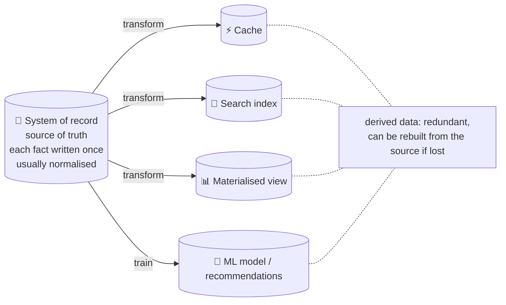

| | System of record | Derived data system |
|---|---|---|
| Also called | Source of truth | Cache, index, view, model, denormalised copy |
| What it holds | The **authoritative** version of each fact. New input (a user signs up, an order is placed) is written here **first**. | The result of taking existing data from somewhere else and **transforming** it. |
| If it disagrees with another system | It wins, by definition | It's the one that's wrong, and should be recomputed |
| If you lose it | Data is gone | Annoying, but you can **rebuild it** from the source |
| Typical shape | Normalised, one copy per fact | Denormalised, redundant, shaped for one kind of read |

Some points worth absorbing early:

- **Derived data is redundant on purpose.** It duplicates information that exists elsewhere, but it's shaped for a specific read pattern (search by keyword, lookup by product, "top 10 this week"), and that's what makes reads fast. Without it, many queries would be too slow to serve.
- **The distinction is about how you use a system, not which product it is.** Postgres can be a system of record for orders and, in the same company, a derived reporting replica. Elasticsearch is almost always derived, but nothing stops someone from (unwisely) treating it as the source of truth.
- **Being clear about which is which clarifies your dataflow.** Once you can say "this field originates in the orders DB, flows into the warehouse nightly, and into the search index via CDC", most consistency questions get much easier to answer. Lots of confusion in real architectures comes from nobody being sure which copy is authoritative.

### How Part III is organised

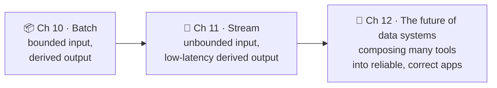

Batch processing comes first because it's the simplest form of "derive data from other data": the input is **finite and fixed**, so you can reason about the whole job as a pure function of its input.

## Kinds of system: services, batch and stream

<BookRef pages="411–413" section="Chapter 10 introduction" />

Most of Parts I and II assumed a **request/response** world: a client asks, the server answers, a human is often waiting. That's one of three broad styles of system.

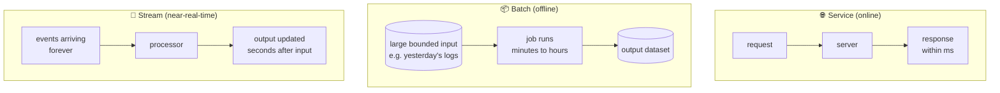

| | Service | Batch job | Stream processor |
|---|---|---|---|
| Input | One request at a time | A large, **bounded** dataset | An **unbounded** sequence of events |
| Who waits? | A user, usually | Nobody: it's scheduled (hourly, nightly) | Nobody directly, but freshness matters |
| Main metric | Response time, availability | **Throughput** (how long to crunch N terabytes) | Lag behind the input |
| Typical run time | Milliseconds | Minutes to days | Runs forever |
| Example | `GET /cart/42` | Rebuild tomorrow's product search index | Update a fraud score as card swipes arrive |

Stream processing sits between the other two: like batch, it consumes inputs and produces outputs without a request/response cycle; like a service, it reacts to things shortly after they happen. Chapter 11 is about streams; this chapter is about the batch end.

Batch processing is **old**. Mechanical tabulating machines were counting punched cards for censuses and businesses long before electronic computers, and the "read a big input, group it, aggregate it" pattern hasn't changed much since. What changed in the 2000s was **scale**: Google's MapReduce paper (2004) and its open-source clone, Hadoop, made it practical to run such jobs across thousands of cheap machines. MapReduce itself is now fading, but it's a great teaching tool because it makes every trade-off **explicit**.

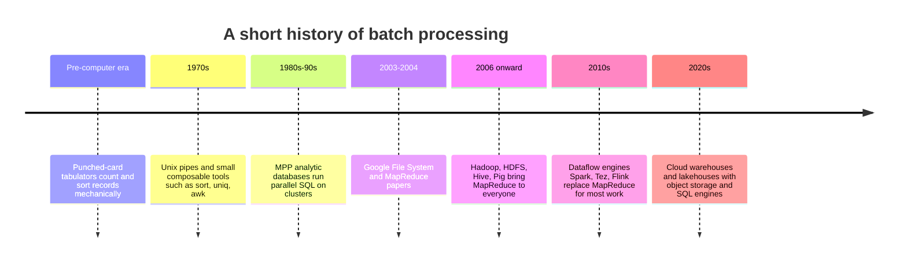

## 10.1 Batch processing with Unix tools

<BookRef pages="413–419" section="Batch Processing with Unix Tools" />

Before distributing anything, it's worth looking at batch processing on **one machine** with plain Unix tools. Many of the design ideas behind MapReduce and its successors come directly from here.

### Simple log analysis

<BookRef pages="413–416" section="Simple Log Analysis" />

Suppose you run a small online bookshop and your checkout service writes one tab-separated line per completed order line item to `orders.tsv`:

```text
2025-03-01T09:14:02Z	ord-8812	DE	isbn-9780131103627	2	39.90
2025-03-01T09:14:02Z	ord-8812	DE	isbn-9781449373320	1	44.50
2025-03-01T09:20:47Z	ord-8813	FR	isbn-9780262033848	1	89.00
2025-03-01T09:31:15Z	ord-8814	DE	isbn-9781449373320	3	133.50
…
```

Columns: timestamp, order id, country, ISBN, quantity, line total (EUR). The marketing team asks: **"Which 3 books sold the most copies to customers in Germany in March?"**

#### Chain of commands

```bash
grep '^2025-03' orders.tsv |                 # only March
  awk -F'\t' '$3 == "DE" { qty[$4] += $5 }    # keep German lines, sum quantity per ISBN
              END { for (b in qty) print qty[b] "\t" b }' |
  sort -t$'\t' -k1,1 -n -r |                 # biggest quantity first
  head -n 3
```

Output might be:

```text
412	isbn-9781449373320
198	isbn-9780131103627
151	isbn-9780596517748
```

And a second question, "how many **distinct orders** came from each country?", is a classic sort-then-count chain with no hash map in sight:

```bash
cut -f2,3 orders.tsv |    # (order id, country)
  sort -u |               # one line per distinct order (an order can have many items)
  cut -f2 |               # keep just the country
  sort | uniq -c |        # group equal countries together and count each run
  sort -r -n              # largest first
```

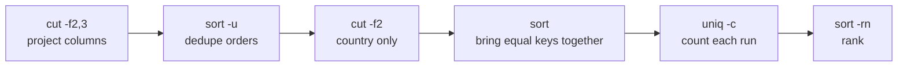

Each tool is tiny, but chained together they answer real questions over gigabytes of data in seconds. It's also **easy to tweak**: want only orders above 50 EUR? Add an `awk '$6 > 50'` stage. Want weekly figures? Change the `grep` and `cut` the date. People who are fluent with these tools can often beat a "proper" analytics setup for one-off questions.

#### Chain of commands vs custom program

The same "distinct orders per country" logic as a small Python script:

```python
from collections import defaultdict

orders_by_country = defaultdict(set)      # country -> set of order ids

with open("orders.tsv") as f:
    for line in f:
        ts, order_id, country, isbn, qty, total = line.rstrip("\n").split("\t")
        orders_by_country[country].add(order_id)

ranked = sorted(orders_by_country.items(), key=lambda kv: len(kv[1]), reverse=True)
for country, orders in ranked:
    print(len(orders), country)
```

It's arguably more readable than the pipeline. The interesting difference isn't syntax, it's **how the grouping is done**:

| | Unix pipeline | Python script |
|---|---|---|
| How equal keys meet | **Sort** the data so equal keys become adjacent, then scan once | **In-memory hash table** keyed by country |
| Memory needed | Small: `sort` streams through data | Proportional to the number of **distinct keys** (and here, distinct orders per key) |
| Behaviour when data exceeds RAM | `sort` spills sorted runs to disk and **merges** them, like SSTables in Chapter 3 | Runs out of memory, or starts swapping and crawls |
| Parallelism | GNU `sort` can use multiple cores (`--parallel`) | Single-threaded unless you rewrite it |
| Bottleneck | Usually disk read speed | Usually RAM size |

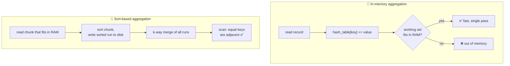

Rule of thumb: if the number of distinct keys is modest (a few hundred countries, a hundred thousand ISBNs), the hash table wins: it's one pass and fits easily. If the working set is huge (every user session in a year of logs), a **sort-based** approach degrades gracefully because it only ever needs a bounded amount of memory and uses the disk **sequentially**. Keep this trade-off in mind: it reappears as "sort-merge join vs hash join" later in the chapter.

### The Unix philosophy

<BookRef pages="416–419" section="The Unix Philosophy" />

Why do these tools compose so nicely? Because they were designed around a set of principles from the 1970s that are often summarised as:

1. **Small and focused.** A tool solves one narrow problem. A new problem gets a new tool, not a new flag on an old one.
2. **Plain, composable output.** Write output that some *future, unknown* program could consume: no banners, no prompts, no pretty tables.
3. **Prototype fast.** Get something working quickly, then rewrite the parts that turn out badly.
4. **Automate the boring bits.** Write a helper tool rather than doing a repetitive task by hand.

If that sounds like modern agile, DevOps or microservices advice, it is: small pieces, quick feedback loops, automation, and decomposing a large problem into parts you can reason about separately.

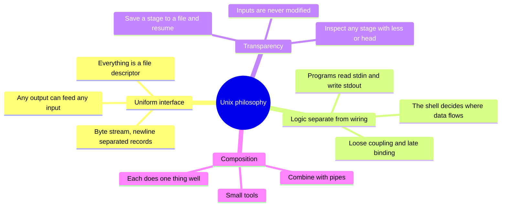

#### A uniform interface

For one program's output to feed another program, they need to agree on a format. In Unix that interface is a **file**, or more precisely a **file descriptor**: an ordered sequence of bytes. That one abstraction covers real files on disk, pipes between processes, devices like `/dev/random`, and TCP sockets.

By convention, many tools treat the byte stream as **ASCII text with one record per line** (newline-delimited). Fields within a line are separated by whitespace, tabs or commas, depending on the tool. It's not elegant: `cut -f` and `awk -F` have different ideas about delimiters, `sort -k` has its own syntax, and escaping is a mess. But it's **good enough** that `grep`, `sed`, `awk`, `sort`, `uniq`, `join`, `cut`, `head` and `wc` from different authors and decades all interoperate.

That's surprisingly rare. Compare with today's world: you can't pipe the output of your CRM into your email platform's segmentation tool without an integration, an export button, or a custom script. Most software **doesn't compose** the way Unix tools do.

#### Separation of logic and wiring

Unix tools read from **stdin** and write to **stdout** by default. The program doesn't know or care whether stdin is a file, the keyboard, or another process; the **shell** wires things up. This is a form of **loose coupling / late binding** (or inversion of control): the program focuses on its logic and lets someone else decide where its data comes from and goes.

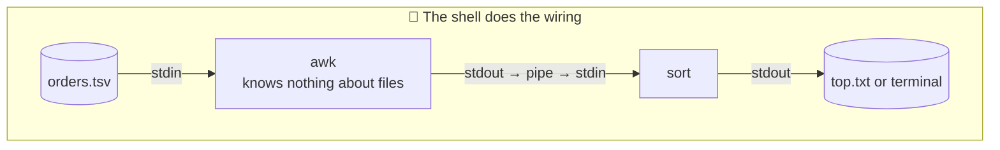

The limits of the model:

- A program with **multiple inputs or outputs** is awkward to wire up (you need named pipes or temporary files).
- You can't pipe into a **network connection** directly unless a tool does it for you (`nc`, `curl`).
- If a program opens files and network sockets itself, it takes the wiring back and **loses** the flexibility: the shell can no longer redirect its I/O.

#### Transparency and experimentation

Unix tools are pleasant to work with because it's easy to **see what's going on**:

- **Inputs are treated as immutable.** You can run a pipeline a hundred times with different flags and `orders.tsv` is untouched. No risk of damaging data while experimenting.
- **Stop anywhere and look.** Pipe any stage into `less` or `head` to check that intermediate output looks right. That makes debugging fast.
- **Checkpoint intermediate results.** Write the output of an expensive stage to a file, then restart only the later stages from it while you iterate.

The big limitation: **all of this runs on one machine**. When the data outgrows a single disk, or the job needs more CPU than one box has, you need something else. That's where MapReduce comes in, and it deliberately keeps these same three properties.

<KeyIdea title="Unix → MapReduce">MapReduce is roughly "Unix tools, distributed across thousands of machines": a uniform file interface (HDFS), small programs that don't know about wiring (mappers and reducers), immutable inputs, and sort-based grouping.</KeyIdea>

## 10.2 MapReduce and distributed filesystems

<BookRef pages="419–441" section="MapReduce and Distributed Filesystems" />

A MapReduce job is like a single Unix process: it takes one or more inputs and produces one or more outputs. Like most Unix tools, running a job **doesn't modify its input** and has **no side effects** other than producing output. The outputs are written sequentially, once, and never modified in place.

Where Unix tools use stdin and stdout, MapReduce jobs read and write files on a **distributed filesystem**. In Hadoop that's **HDFS** (Hadoop Distributed File System), an open-source reimplementation of the Google File System (GFS). Other options exist: GlusterFS, Quantcast File System, and today most often **object stores** like Amazon S3, Google Cloud Storage or Azure Blob Storage, which play a similar role even though they aren't strictly filesystems.

### HDFS in one picture

HDFS follows the **shared-nothing** principle from Part II: commodity machines connected by an ordinary network, no special shared storage hardware (unlike NAS or SAN setups).

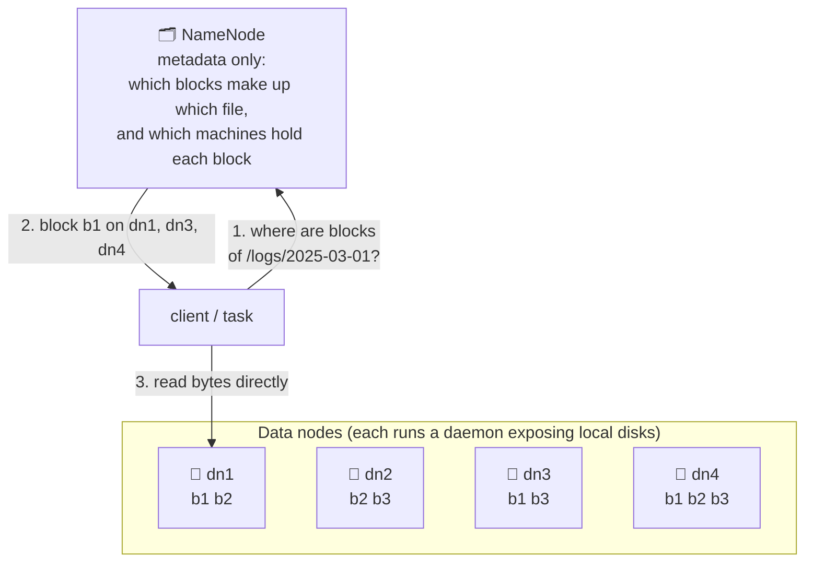

- A **daemon on every machine** exposes that machine's disks over the network. Files are split into large **blocks** (128 MB by default in modern Hadoop).
- A central **NameNode** tracks which blocks live on which machines. Clients ask it where data is, then read the bytes straight from the data nodes.
- To survive machine and disk failures, blocks are **replicated** (typically 3 copies) or protected with **erasure coding** (e.g. Reed–Solomon), which gives similar durability with much less storage overhead than full replication. This is the same idea as RAID, but across machines over the network instead of across disks in one box.
- HDFS scales well: the largest deployments ran tens of thousands of machines with hundreds of petabytes. Because it uses commodity hardware and open-source software, storing data in HDFS was **much cheaper per byte** than in a dedicated appliance, which is a big reason "keep everything" became affordable.

### MapReduce job execution

<BookRef pages="421–425" section="MapReduce Job Execution" />

MapReduce is a **programming framework** for writing code that processes large datasets in a distributed filesystem like HDFS. The pattern mirrors the pipeline from earlier:

| Step | Unix analogue | Who writes it? |
|---|---|---|
| 1. Read input files and **break them into records** | Reading lines of `orders.tsv` | Framework (an input format parser) |
| 2. **Map**: extract a key and value from each record | `awk` pulling out ISBN and quantity | **You** |
| 3. **Sort** all key-value pairs by key | `sort` | Framework (implicit, always happens) |
| 4. **Reduce**: iterate over all values for each key | `uniq -c` or the summing in `awk` | **You** |

So to create a job you implement two callbacks:

- **Mapper**: called once per input record. It extracts zero or more key-value pairs. It keeps **no state** between records, so each record is handled independently.
- **Reducer**: called once per distinct key, with an iterator over **all values for that key** (in sorted key order). It produces output records.

Here's the "copies sold per ISBN in Germany" job written MapReduce-style (pseudo-Python, in the spirit of Hadoop Streaming):

```python
# mapper.py: one call per input line
def map(line):
    ts, order_id, country, isbn, qty, total = line.split("\t")
    if country == "DE" and ts.startswith("2025-03"):
        emit(isbn, int(qty))                      # key = ISBN, value = quantity

# reducer.py: one call per ISBN, values arrive grouped
def reduce(isbn, quantities):
    emit(isbn, sum(quantities))
```

To then pick the top 3, you'd run a **second** MapReduce job that sorts by the summed quantity. A single MapReduce job has exactly one sort/shuffle stage; anything needing a second grouping needs a second job.

#### Distributed execution of MapReduce

The big difference from Unix pipes is that MapReduce **parallelises across many machines without you writing any parallel code**. The mapper and reducer handle one record or one key at a time; the framework handles moving data between machines.

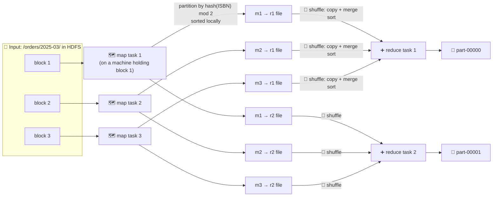

How it works, step by step:

1. **Partitioning the input.** Parallelism comes from splitting the input: usually **one map task per input block** (or per file). A job reading 200 blocks gets 200 map tasks.
2. **Putting the computation near the data.** The scheduler tries to run each map task **on a machine that already stores a replica** of its block. This is called **data locality**: shipping a few MB of code is far cheaper than shipping 128 MB of data over the network.
3. **Code distribution.** The framework copies the job's code (for Hadoop, JAR files) to the chosen machines, starts a task, and the task reads its input one record at a time, calling your mapper for each.
4. **Reduce partitioning.** The number of reduce tasks is **configured by the job author** (not tied to input size). To make sure all values for one key end up at the same reducer, the framework uses a **hash of the key** to choose the reducer.
5. **Sorting in stages.** The full dataset is too big to sort on one machine, so each map task **partitions** its output by reducer, and within each partition writes a **sorted file** to its local disk (using an SSTable-like approach: sort in memory, spill sorted runs, merge).
6. **The shuffle.** When a mapper finishes, the scheduler tells reducers they can fetch their partitions. Each reducer connects to every mapper and downloads its sorted file for that reducer. This copying of partitions from mappers to reducers, plus the merging, is called the **shuffle** (a confusing name: nothing is randomised).
7. **Merge and reduce.** Each reducer **merge-sorts** the files it downloaded, preserving sort order. Even though the same key came from many mappers, the merged stream puts all its values next to each other. The reducer then calls your reduce function once per key with an iterator over its values.
8. **Output.** Each reducer writes its output to a file on the distributed filesystem, normally with replicas on other machines.

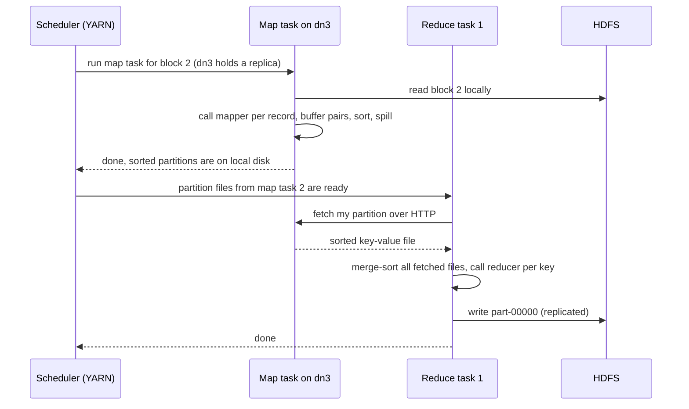

Notice the **mappers write to local disk, not HDFS**: their output is temporary and only needs to survive until reducers fetch it. If a map task's machine dies before that, the framework just reruns the map task elsewhere.

#### MapReduce workflows

One MapReduce job can do surprisingly little: one map, one grouping, one reduce. Our "top 3 books" question already needs two jobs (sum per ISBN, then rank). Real analytics needs many more, so jobs are **chained into workflows**: the output directory of one job is configured as the input directory of the next.

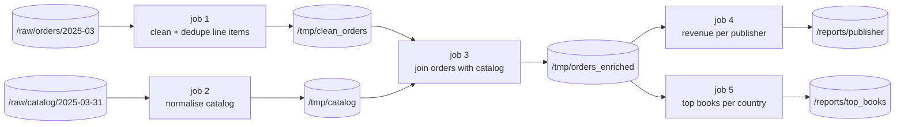

Key points:

- Chaining is done **through files**, not through Unix-style pipes. A job's output is **fully written** (and replicated) to the distributed filesystem before the next job can start. This is called **materialising** intermediate state; we'll come back to its costs.
- Hadoop itself has no notion of a workflow, so a whole ecosystem of **workflow schedulers** grew up to manage dependencies: Oozie, Azkaban, Luigi, and later Airflow, Dagster and others. They handle "run job 3 only after jobs 1 and 2 succeed", retries, and backfills.
- Big organisations ended up with workflows of **50–100+ jobs** (recommendation systems are a classic example), maintained by different teams that read each other's outputs. Tooling for visualising and managing these graphs becomes essential.
- Higher-level tools like **Pig, Hive, Cascading, Crunch and FlumeJava** let you describe a multi-stage computation in one program and automatically compile it into a chain of MapReduce jobs.

Hadoop workflows usually have one convention borrowed from Unix: a job's output directory only "counts" once the job completes successfully (Hadoop writes a `_SUCCESS` marker). Downstream jobs wait for it, so they never consume **half-written output** from a job that failed.

### Reduce-side joins and grouping

<BookRef pages="425–430" section="Reduce-Side Joins and Grouping" />

In Chapter 2 we saw that a record often refers to another record by ID: an order references a customer, a play event references a track. In a database, you'd resolve those references with a **join**, using indexes to look up just the matching rows.

MapReduce has **no indexes** in that sense. A job reads its whole input, which is like a **full table scan**. That sounds terrible if you want one customer's orders, but batch jobs usually want aggregates over **all** records (all customers, all tracks), and then scanning everything is perfectly reasonable, especially when it can be parallelised across many machines.

> In this chapter, "join" means resolving **all** occurrences of some association in the dataset at once, not looking up one record. That's an analytic join, not an OLTP one.

#### Example: analysing listening activity

Let's use our own running example. A music streaming service has two datasets:

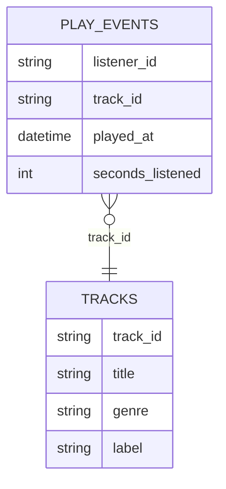

- `play_events`: a huge log, billions of rows per month, written by the playback service.
- `tracks`: the catalog, tens of millions of rows, exported from the catalog's OLTP database.

The analysts ask: **"How many hours were listened to per genre this month?"** Each play event only has a `track_id`; the genre lives in the catalog. We need a join.

**Option A: query the catalog database per event.** For each play event, call the catalog DB over the network: "what's the genre of `trk-55102`?" This is a bad idea:

- **Throughput** is limited by round-trip time to the DB, and caching only helps if the access pattern is friendly.
- With hundreds of parallel tasks hammering it, you could easily **overload the production database**.
- The catalog may **change while the job runs**, so the result is **nondeterministic**: rerunning the job could give a different answer.

**Option B (the batch way): take a copy of the catalog** (e.g. a database dump or a CDC-derived snapshot), put it in HDFS next to the play events, and join the two datasets **inside the batch system**. All data is local to the cluster, it's a consistent snapshot, and the result is reproducible.

#### Sort-merge joins

Write **two mappers**, one per input. Both emit the **join key** (`track_id`) as the MapReduce key:

```python
# mapper over tracks
def map_track(row):
    emit(row.track_id, ("T", row.genre))

# mapper over play_events
def map_play(row):
    emit(row.track_id, ("P", row.seconds_listened))
```

The framework partitions by `track_id` and sorts, so **every record with the same track_id ends up at the same reducer, adjacent to each other**. With a **secondary sort**, we can also make sure the reducer sees the catalog record (`"T"`) **first**, followed by all the play events for that track:

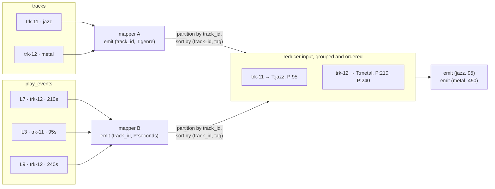

The reducer is then simple and needs **almost no memory**:

```python
def reduce(track_id, values):
    genre = None
    total = 0
    for tag, v in values:            # secondary sort guarantees T comes first
        if tag == "T":
            genre = v
        else:
            total += v
    if genre is not None:
        emit(genre, total)           # a second job (or a combiner) sums per genre
```

It only holds **one track's catalog record** at a time, and streams over that track's play events. No network requests, no giant hash maps. This algorithm is a **sort-merge join**, because the mapper output is sorted by key and the reducer merges the two sorted lists from either side of the join.

#### Bringing related data together in the same place

The deeper idea: the mappers' job is to **send messages** to reducers. The key is the **destination address**. Everything sent to the same key, from any mapper on any machine, arrives at the same reducer, sorted.

This cleanly **separates two concerns**:

| Concern | Who handles it |
|---|---|
| Getting the right data to the right place (network communication, retries, partial failures, re-fetching from a mapper that died) | The **framework** |
| The actual logic: what to compute once the data is together | **Your** mapper and reducer code |

Compare with a typical database-backed application, where fetching data and processing it are interleaved, and every network call is a place where your code has to handle failure. In MapReduce, your code **never touches the network**, so it can't experience a partial network failure. If a task fails, the framework retries it transparently.

#### GROUP BY

Grouping records by some key, then aggregating within each group, is the other common use of "bringing related data together". In SQL:

```sql
SELECT genre, SUM(seconds_listened) / 3600.0 AS hours
FROM plays_enriched
GROUP BY genre;
```

In MapReduce, it's the same trick: the mapper emits the **grouping key** (`genre`) as the key, and the reducer aggregates. Common aggregations:

- **Count** records per group (like `COUNT(*)`; the Unix `uniq -c`).
- **Sum** a field per group (`SUM(seconds_listened)`).
- **Top k** per group (the 10 most-played tracks per country).

Grouping is also how you **collect all activity for one entity**. A classic example is **sessionisation**: gather all events for a listener, sort them by time, and split into sessions wherever there's a gap of more than 30 minutes. That lets you answer "what does a typical listening session look like?" or "after which track do people stop listening?".

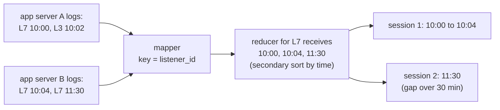

Logs for one listener are naturally **scattered across many servers** (a load balancer sent their requests to different backends). Grouping by `listener_id` brings them together, regardless of where they were written.

#### Handling skew

"All records with the same key go to the same reducer" breaks down when **one key has vastly more records than others**. These are **linchpin objects** or **hot keys**: a viral track played 200 million times this month, a celebrity account with 80 million followers, a "guest" user ID that a buggy client sends for every logged-out request.

Effects of skew:

- One reducer gets far more data than the rest. The job **can't finish until its slowest reducer finishes**, so everyone waits for the straggler.
- That reducer might run out of disk or memory and fail, get retried, and fail again.

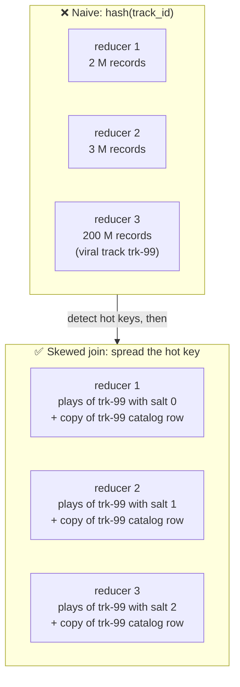

Techniques:

| Technique | How it works | Used by |
|---|---|---|
| **Skewed join with sampling** | Run a sampling job first to find hot keys. For records with a hot key, the mapper sends each one to a **random** reducer among several (instead of the hash-chosen one). The **other side** of the join, for that key, is **replicated** to all of those reducers. | Pig's `skewed` join |
| **Explicitly declared hot keys** | Same idea, but you tell the system which keys are hot instead of sampling. Hot keys can then be handled with a **map-side** join, since their other side is usually small. | Crunch's sharded join, Hive's skewed join (hot keys listed in table metadata) |
| **Two-stage aggregation** | For grouping (not joining): first stage sends hot-key records to random reducers, each computing a **partial** aggregate (e.g. a partial sum). A second stage combines the partial results into one value per key. | Common pattern in Spark (salting), Hive |
| **Combiners** | A mini-reducer that runs on the mapper side, pre-aggregating before the shuffle (e.g. summing seconds per genre within one map task). Only works for associative, commutative operations like sum, count, max. | Hadoop's combiner API |

```python
# two-stage aggregation for a hot key, with "salting"
# stage 1 mapper
def map1(play):
    salt = random.randint(0, 9)                       # spread each key over 10 reducers
    emit((play.track_id, salt), play.seconds_listened)
# stage 1 reducer: partial sum per (track, salt)
def reduce1(key, values):
    track_id, salt = key
    emit(track_id, sum(values))
# stage 2: ordinary reduce, at most 10 values per track
def reduce2(track_id, partial_sums):
    emit(track_id, sum(partial_sums))
```

### Map-side joins

<BookRef pages="430–433" section="Map-Side Joins" />

Reduce-side joins are general: they make **no assumptions** about the input. Inputs can be in any order, any partitioning, any size. The mappers just tag and re-key records; the shuffle does the heavy lifting.

The cost: **all that sorting, copying to reducers and merging is expensive**, and depending on memory buffers, data may be written to disk several times along the way.

If you **can** make assumptions about your input, you can do the join in the mappers alone, with **no reducers and no shuffle**. Each mapper reads one input block and writes one output file to HDFS. Here are three variants.

#### Broadcast hash joins

Simplest case: **one side is small enough to fit in memory** on every mapper.

Example: join `play_events` (billions of rows) with a `countries` table mapping country codes to regions and currencies (a few hundred rows, a few KB). Or with a `genres` table that maps sub-genres to top-level genres (a few thousand rows).

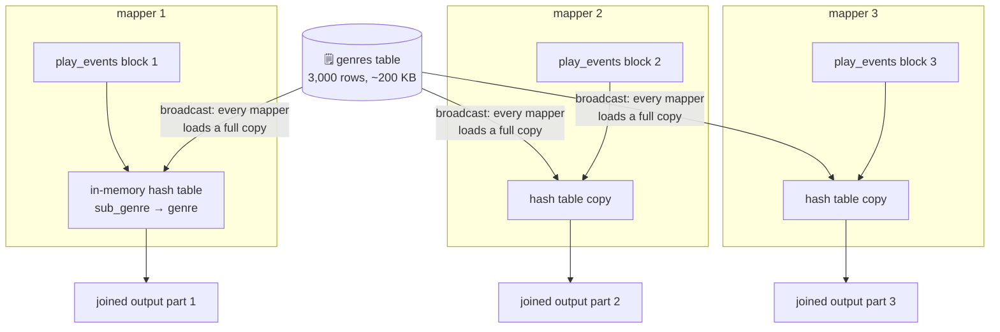

- When a mapper starts, it reads the **whole small input** from HDFS into an **in-memory hash table**.
- Then it streams through its block of the large input, looking up each record's key in the hash table.
- "**Broadcast**" because every mapper for a block of the large input gets the entire small input: the small side is broadcast to all partitions of the large one. "**Hash join**" because it uses a hash table.
- **Variant:** if the small side doesn't quite fit in memory, store it in a **read-only on-disk index** on each machine's local disk. Frequently accessed parts sit in the OS page cache, so random lookups are nearly as fast as memory.

Supported by Pig ("replicated join"), Hive ("MapJoin"), Cascading, Crunch, and in **Spark SQL** as a broadcast join, chosen automatically when a table is below a size threshold (`spark.sql.autoBroadcastJoinThreshold`, 10 MB by default).

#### Partitioned hash joins

If **both** inputs are **partitioned the same way**, you can apply the hash-join idea to **each partition independently**.

Example: suppose the outputs of earlier jobs partitioned **both** `play_events` and `listener_profiles` into 64 partitions by `hash(listener_id) mod 64`. Then all play events for listener `L7` are in partition 23 of `play_events`, and `L7`'s profile is in partition 23 of `listener_profiles`.

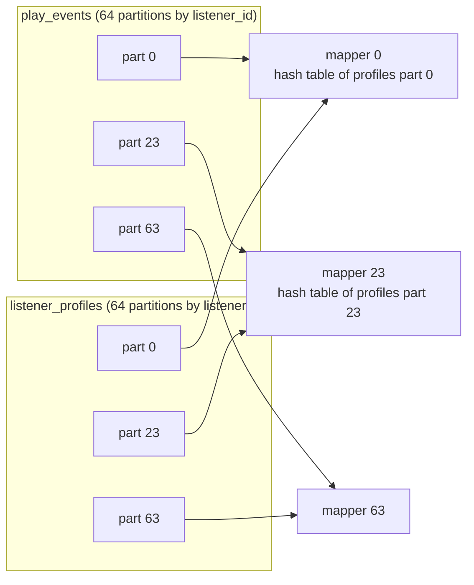

- Mapper *i* loads only partition *i* of the smaller side into its hash table, then streams partition *i* of the larger side.
- Each hash table is 1/64 the size, so this works even when the whole small side wouldn't fit in memory.
- It **only works** if both inputs have the **same number of partitions**, using the **same partitioning function** on the **same key**. Usually that's because they were both written by earlier MapReduce jobs that grouped by that key.

In Hive this is a **bucketed map join** (tables declared `CLUSTERED BY (listener_id) INTO 64 BUCKETS`). In Spark, the equivalent idea is **bucketed tables**, or co-partitioned RDDs that avoid a shuffle.

#### Map-side merge joins

One step further: if the inputs are partitioned the same way **and sorted** by the join key within each partition, the mapper doesn't even need a hash table. It can **read both files in order**, advancing whichever has the smaller key, matching equal keys, just like the reducer in a sort-merge join (or merging SSTables).

```text
profiles part 23 (sorted):  L102  L340  L341  L777  L901
plays    part 23 (sorted):  L102 L102 L340 L777 L777 L777 L900
                            ^ advance both cursors in lockstep, emit matches:
                            (L102,p)(L102,p)(L340,p)(L777,p)(L777,p)(L777,p)
                            L341 has no plays, L900 has no profile
```

When is this realistic? Typically when an earlier job **already** sorted and partitioned the data. Then you have a choice: perform the join in that earlier job's reduce phase, or keep the datasets separate and do a map-side merge join later. Keeping them separate makes sense when the partitioned, sorted dataset is **also needed for other purposes**.

#### Map-side joins and workflow design

The join algorithm affects the **structure of the output**, which matters for downstream jobs:

| | Reduce-side join output | Map-side join output |
|---|---|---|
| Partitioned by | The **join key** | Same as the **large input** (one output file per input block or partition) |
| Sorted by | The join key | Same order as the large input |
| Assumptions on input | None | Size, partitioning and/or sort order |

To use map-side joins, you need to **know the physical layout** of your datasets: not just their schema, but how many partitions, partitioned by which key, sorted by which key. In Hadoop that knowledge lives in **metadata catalogs** like the **Hive metastore** (now also used by Spark, Trino, and others). Without that metadata, a scheduler can't safely choose a map-side join.

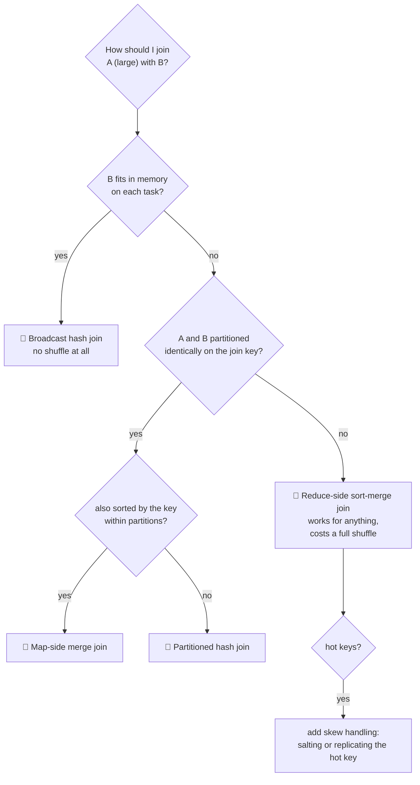

### The output of batch workflows

<BookRef pages="433–436" section="The Output of Batch Workflows" />

What's the **point** of all this? It's not transaction processing (no user waiting, no small lookups), and it's not quite classic analytics either (analysts typically use SQL on a warehouse to produce reports). Batch processing builds something in between: usually a **derived structure that something else will use**.

#### Building search indexes

Google's original use for MapReduce was to build the **search index** for its search engine, as a workflow of 5–10 MapReduce jobs. Google later moved away from MapReduce for this, but building a search index is still a great example.

Recall from Chapter 3 that a full-text index like **Lucene** (used by Elasticsearch and Solr) is a file where you can look up a term and get the list of document IDs that contain it (a **postings list**). Building one is a natural batch job:

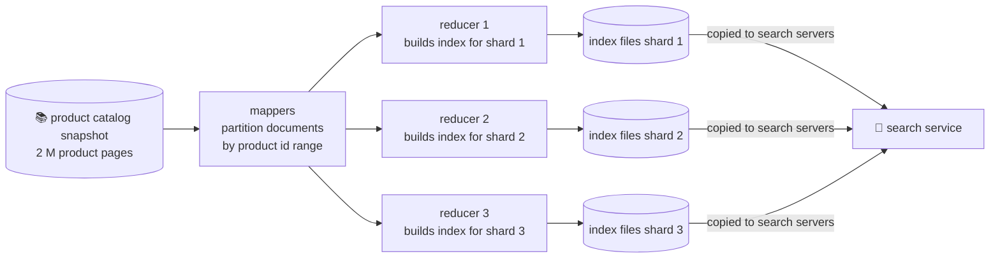

- Mappers partition the set of documents; each reducer builds the index for its partition and writes index files to the distributed filesystem.
- Building document-partitioned indexes (Chapter 6) **parallelises very well**.
- Once built, index files are **immutable**. Since querying an index by keyword is read-only, they're ideal for serving.
- When documents change, the simplest approach is to **rerun the whole indexing workflow** periodically and replace all index files atomically. That's expensive if few documents changed, but very easy to reason about. The alternative is **incremental** indexing, which Lucene does by writing new segment files and merging them in the background (the same idea as LSM compaction).

#### Key-value stores as batch process output

Another very common output: data for **machine learning systems** and **recommendation systems**, such as classifiers (spam filters, fraud scores, image labels) or recommendation lists ("listeners like you also play…", "products frequently bought together").

The output is typically a **database** that a web service queries by key: look up listener `L7`, get their 30 recommended tracks. But how should the batch job get its output into that database?

**Bad idea: write directly from mappers or reducers into the production database, one record at a time.**

| Problem | Why |
|---|---|
| **Slow** | A network round-trip per record is orders of magnitude slower than the batch task's normal throughput, even with client-side batching. |
| **Overwhelms the database** | Hundreds of parallel tasks writing at full speed can swamp a database that's also serving live traffic, hurting other parts of the system. |
| **Breaks all-or-nothing semantics** | MapReduce promises a clean output only if the job succeeds; if tasks fail and are retried, direct writes create **partial results** and **duplicates** that other systems can already see. |

**Good idea: build a brand-new database inside the batch job**, write it as files to the distributed filesystem, then **bulk-load** it into read-only servers that switch over atomically.

```mermaid
sequenceDiagram
  participant J as Batch job (night of day 41)
  participant H as HDFS
  participant S as Read-only KV servers
  participant U as Recommendation API
  J->>H: write new sorted database files v41
  J->>H: write _SUCCESS marker
  S->>H: download v41 files in the background
  Note over S: still serving v40 while v41 loads
  S->>S: atomically switch reads from v40 to v41
  U->>S: get recommendations for L7
  S-->>U: answer from v41
  Note over S: v40 files kept for a while, a rollback is just switching back
```

Systems built for this: **Voldemort** (read-only stores built by Hadoop jobs), **Terrapin**, **ElephantDB**, and **HBase bulk loading** (writing HFiles directly). The batch job builds the files, which can be done efficiently since the data is sorted and the whole thing is built in one go; the database server just memory-maps them. Today the same pattern appears as "write Parquet files to object storage, then atomically update a table pointer" in lakehouse formats like Iceberg and Delta Lake.

#### Philosophy of batch process outputs

The Unix philosophy encouraged experimentation by being explicit about dataflow: a program reads input, writes output, and doesn't touch anything else. Batch processing keeps that property, and it buys a lot:

```mermaid
mindmap
  root((Immutable inputs, replaced outputs))
    Human fault tolerance
      Buggy code deployed
      Roll back to the previous code
      Rerun and get correct output
      Or keep the old output and switch back
    Minimising irreversibility
      Fast feature iteration
      Mistakes are recoverable
      Agile friendly
    Automatic retries are safe
      Failed task reruns on the same input
      Deterministic code gives the same output
      Failed output is discarded
    Reuse
      Same files feed many jobs
      Monitoring and metrics jobs
      Ad hoc analysis
    Separation of concerns
      Logic separate from wiring
      One team writes a job
      Another decides where it runs
```

- **Human fault tolerance.** If you deploy buggy code and the output is wrong, you **roll back the code**, rerun the job, and the output is correct again. Or, even simpler, keep the previous output in a different directory and switch back to it. Compare that with a database that's been overwritten with bad data by buggy code: rolling back the code doesn't fix the data. The book calls this the ability to recover from **human errors**, not just hardware ones.
- **Minimising irreversibility.** Because mistakes are recoverable, you can **move faster**. This is useful for agile development.
- **Safe retries.** If a map or reduce task fails, the framework reschedules it on the same input. If the failure is due to a bug, it'll fail again and the job eventually fails; if it was a transient problem (a node dying), the retry fixes it. Either way, output from failed tasks is discarded, so retries are **safe** (assuming deterministic code).
- **One input, many consumers.** The same set of files can feed the main job, a monitoring job that checks output quality, and ad hoc exploration.
- **Separation of logic and wiring.** Like Unix, MapReduce separates code from where the data comes from and goes to, so different teams can work on different jobs and reuse them in different workflows.

Where Hadoop **doesn't** follow Unix: Unix tools rely on untyped text, which forces a lot of input parsing. Hadoop workflows typically use **structured file formats** with schemas: **Avro** and **Parquet** (Chapter 4), which also allow efficient schema evolution. That's an improvement on the Unix model.

<KeyIdea>Never let a batch job mutate shared state record by record. Produce a new, immutable output, then switch to it atomically. That one rule gives you retries, rollbacks and reproducibility.</KeyIdea>

### Comparing Hadoop to distributed databases

<BookRef pages="436–441" section="Comparing Hadoop to Distributed Databases" />

Hadoop resembles a distributed Unix: HDFS is the filesystem, MapReduce is a (quirky) implementation of a Unix process that always runs `sort` between the map and reduce phases. And everything in MapReduce had already been implemented decades earlier in **massively parallel processing (MPP) databases** like Teradata, Gamma and Tandem NonStop SQL. The join algorithms in this chapter were known in the 1980s.

So what was new? The difference is that MPP databases focus on **parallel execution of analytic SQL queries** on a cluster, while MapReduce plus a distributed filesystem provides something more like a **general-purpose operating system** that can run arbitrary programs.

```mermaid
flowchart LR
  subgraph MPP["🏛️ MPP database"]
    direction TB
    a1["schema designed up front"] --> a2["proprietary storage,<br/>tightly integrated"] --> a3["SQL only, cost-based optimiser"] --> a4["query fails, rerun whole query"]
  end
  subgraph HAD["🐘 Hadoop ecosystem"]
    direction TB
    b1["dump raw files first,<br/>schema on read"] --> b2["open file formats<br/>on HDFS"] --> b3["SQL, ML, custom code,<br/>many engines on one cluster"] --> b4["task fails, rerun just that task"]
  end
```

#### Diversity of storage

Databases require you to **structure data according to a model** (relational, document) before you can load it. Files in a distributed filesystem are just **byte sequences**: they can be written using any data model and encoding: database records, but also text, images, videos, sensor readings, sparse matrices, feature vectors, genome sequences.

Hadoop opened up the possibility of **dumping data into HDFS first and figuring out how to process it later**. MPP databases typically require careful up-front modelling of the data and query patterns before importing.

| Up-front modelling (warehouse) | Dump first (data lake) |
|---|---|
| Clean, consistent, query-ready data | Data is available **quickly**, in whatever form it arrived |
| Slow and political: agreeing on one schema across teams takes months | Different consumers can interpret the raw data in their own way ("schema on read", Chapter 2) |
| Data that doesn't fit the schema is often dropped | Nothing is lost; you can always reprocess the raw input |

This is the **data lake** (or enterprise data hub) idea: collect raw data from all over the organisation in one place, and push the burden of interpreting it to the **consumer**. It works because the same raw data can feed many different derived views: a warehouse table for analysts, a feature set for an ML team, a sanitised extract for a partner.

In this model, the ETL processes that turn raw data into a warehouse-ready shape are themselves **batch jobs** running inside Hadoop, and the warehouse is just **one of many derived outputs**. Data collection is decoupled from data modelling.

(Caveat from practice: without discipline, a data lake turns into a **data swamp**: nobody knows what's in it, what it means, or whether it's still updated. Catalogs, schemas on files (Avro, Parquet) and ownership conventions are what keep it usable.)

#### Diversity of processing models

MPP databases are **monolithic, tightly integrated** pieces of software: storage layout, query planner, scheduling and execution are all tuned together for SQL. That gives very good performance on the queries they're designed for, and SQL is expressive enough for most analysis, which is why business intelligence tools (Tableau, Looker) target it.

But **not every kind of processing can be expressed sensibly as SQL**:

- Machine learning model training and feature engineering
- Recommendation systems
- Full-text search index building
- Image analysis, video transcoding, geospatial processing, genome alignment

These typically need **general code**, and often very application-specific. MapReduce let engineers easily run their own code over large datasets. And once you have HDFS and MapReduce, you can **build a SQL engine on top** (Hive did exactly this), and many other processing models too.

Over time, the Hadoop ecosystem grew a variety of engines **all sharing the same cluster and the same files**: Hive and Impala (SQL), HBase (OLTP-style random access), Spark (general dataflow), Giraph (graphs), Mahout and Spark MLlib (ML), Solr indexing jobs. Different workloads can coexist on one cluster without moving data between specialised systems. Not having to copy terabytes between a warehouse, an ML platform and a search cluster is a huge practical win.

#### Designing for frequent faults

The two approaches also differ in how they handle faults and use memory and disk:

| | MPP database | MapReduce |
|---|---|---|
| A node crashes mid-query | Usually **abort the whole query**; the user resubmits it (fine, since queries take seconds to minutes) | Retry **only the failed task**; the rest of the job continues |
| Memory use | Keeps as much as possible **in memory** (e.g. hash joins) to avoid disk | **Eagerly writes to disk**: mapper output is spilled and sorted, job output is replicated in HDFS |
| Designed for | Queries of seconds to minutes on dedicated hardware | Jobs of hours on **shared, overcommitted** clusters |

Why would MapReduce be so pessimistic? Hardware failures alone aren't frequent enough to justify it. The real reason is **Google's environment**: MapReduce jobs ran on mixed-use datacentres where **online production services and offline batch jobs share the same machines**. Each task has a resource allocation, and a priority. If a higher-priority process needs more resources, lower-priority tasks on the same machine get **preempted** (killed) to free them up.

```mermaid
xychart-beta
  title "Chance a long batch job is hit by preemption (illustrative)"
  x-axis "Job length in hours" [1, 2, 4, 8, 12, 24]
  y-axis "Probability at least one task is killed (%)" 0 --> 100
  line [5, 10, 19, 34, 46, 71]
```

- Low-priority batch work is cheap because it **soaks up spare capacity** that's reserved for production services but not used at that moment. That improves overall utilisation dramatically.
- The price: a long job with many tasks is **very likely** to see some task killed along the way (the curve above is illustrative, but the shape is the point). Restarting the whole job each time would mean long jobs might **never finish**. Hence task-level retries and writing everything to disk.

In open-source clusters (YARN, Mesos, Kubernetes), preemption is **less widely used**, so in practice tasks fail less often than at Google, and MapReduce's design decisions look excessively cautious there. That's one of the motivations for the alternatives in the next section. (Interestingly, cloud **spot / preemptible instances** have brought the "your machine may vanish any minute" world back, and engines designed for retries benefit.)

## 10.3 Beyond MapReduce

<BookRef pages="441–451" section="Beyond MapReduce" />

MapReduce became hugely popular in the late 2000s, but it's just **one** programming model for distributed systems. Depending on the data volume, structure and type of processing, other tools are more appropriate.

MapReduce is valuable to study because it's a **clear, simple abstraction** on top of a distributed filesystem: simple to understand, not simple to use. Implementing a complex job like a skewed join by hand in raw MapReduce takes a lot of code. That's why higher-level models (Pig, Hive, Cascading, Crunch) appeared. But even with those, there are problems with the **MapReduce execution model** itself that no abstraction layer can fix.

### Materialisation of intermediate state

<BookRef pages="441–446" section="Materialization of Intermediate State" />

Every MapReduce job is **independent**. Its only contact with the world is its input and output directories on the distributed filesystem. If you want one job's output to be the input of the next, the first job writes its output to HDFS, and the second job reads it back.

That's great when the output is **published** for others to consume: a well-known directory that multiple teams can reuse. But very often the output of one job is used **only** by one other job maintained by the same team. Then those files are just **intermediate state**, a way to pass data from one step to the next. Writing out that intermediate state to files is called **materialisation** (computing the result eagerly and writing it out, rather than on demand).

Unix pipes, by contrast, **stream** output to input incrementally via a small in-memory buffer. Compared with that, fully materialising intermediate state has several downsides:

| Downside | Why it hurts |
|---|---|
| **A job can only start when all upstream jobs finish** | Pipes start consuming as soon as the first bytes arrive. In MapReduce, one **straggler** task in job 1 delays the entire start of job 2. |
| **Redundant mappers** | Mappers often just read back what a reducer wrote a moment ago and re-key it. It would be simpler to chain reducers directly. |
| **Replicated temporary files** | Intermediate state goes to HDFS, which **replicates it across several nodes**. Overkill for temporary data that'll be deleted in an hour. |

#### Dataflow engines

To fix those problems, a new generation of engines was developed: **Spark**, **Tez** and **Flink**. They differ in design, but share one key idea: **handle an entire workflow as one job**, rather than breaking it into independent subjobs.

Because they model the flow of data through several stages explicitly, they're known as **dataflow engines**. Your code still sees one record at a time, and parallelism still comes from splitting data into partitions. What changes is the shape: instead of a rigid map → sort → reduce sandwich, you get general **operators** (filter, join, aggregate, window, …) wired together into a **directed acyclic graph (DAG)** that the engine plans and schedules as a whole.

```mermaid
flowchart LR
  subgraph MR["MapReduce chain of 2 jobs"]
    direction LR
    a1["map"] --> a2["sort + reduce"] --> h1[("HDFS write ×3 replicas")] --> a3["map (just re-reads)"] --> a4["sort + reduce"] --> h2[("HDFS write")]
  end
  subgraph DF["Dataflow engine, one job"]
    direction LR
    b1["read + filter"] --> b2["join"] --> b3["aggregate"] --> b4["rank"] --> h3[("HDFS write<br/>only at the end")]
  end
```

Operators can be connected in several ways:

| Connection | What it does | Analogous to |
|---|---|---|
| **Repartition + sort** | Partition records by key and sort them | The MapReduce shuffle (for sort-merge joins, grouping) |
| **Repartition, no sort** | Partition by key but skip the sort | Fine for partitioned hash joins, where order doesn't matter |
| **Broadcast** | Send the same output to all partitions of the next operator | Broadcast hash join |
| **One-to-one (pipelined)** | Feed directly to the next operator on the same machine | Unix pipe |

Advantages over MapReduce:

- **Expensive work like sorting happens only where actually needed**, not by default between every map and reduce stage.
- **No unnecessary map tasks**: a mapper's work can often be folded into the preceding reduce operator, since a mapper doesn't change the partitioning.
- **Locality optimisations**: the scheduler sees all joins and data dependencies up front, so it can place a consumer task on the **same machine** as its producer, exchanging data via a shared memory buffer instead of the network.
- **Intermediate state lives in memory or local disk**, not replicated HDFS. Less I/O.
- **Operators can start as soon as their input is ready**, without waiting for the whole preceding stage to finish.
- **JVM reuse**: existing processes can run new operators, avoiding startup overhead per task (each MapReduce task traditionally launched a new JVM).

You can use dataflow engines to implement **the same computations** as MapReduce workflows, and they usually run **significantly faster**. Since operators are a generalisation of map and reduce, the same processing code can run on either engine: Pig, Hive or Cascading workflows can switch from MapReduce to Tez or Spark with a configuration change.

Here's our genre report as a Spark job (PySpark DataFrame API); the whole multi-stage workflow is one program and one DAG:

```python
plays  = spark.read.parquet("s3://music/plays/2025-03/")
tracks = spark.read.parquet("s3://music/catalog/2025-03-31/")

report = (plays
    .filter(plays.seconds_listened >= 30)                 # skip accidental plays
    .join(tracks.select("track_id", "genre"), "track_id") # optimiser picks the join type
    .groupBy("genre")
    .agg((F.sum("seconds_listened") / 3600).alias("hours"))
    .orderBy(F.desc("hours")))

report.write.mode("overwrite").parquet("s3://music/reports/genre_hours/2025-03/")
```

```mermaid
flowchart LR
  P[("plays")] --> F["filter<br/>seconds ≥ 30"]
  T[("tracks")] --> PR["project<br/>track_id, genre"]
  F -->|"repartition by track_id"| J["join"]
  PR -->|"repartition by track_id<br/>(or broadcast if small)"| J
  J -->|"one-to-one"| PA["partial sum per genre"]
  PA -->|"repartition by genre"| AG["final sum per genre"]
  AG -->|"repartition + sort"| S["order by hours"]
  S --> O[("output files")]
```

#### Fault tolerance

An advantage of fully materialising intermediate state to a distributed filesystem is that it's **durable**, which makes fault tolerance easy in MapReduce: if a task fails, restart it on another machine and read the same input again from HDFS.

Spark, Flink and Tez avoid writing intermediate state to HDFS, so they need a different approach: if a machine fails and its intermediate state is lost, **recompute it from other data that's still available** (an earlier intermediate stage if possible, or else the original input, which is usually on HDFS).

- **Spark** tracks the **ancestry** (lineage) of data with the **resilient distributed dataset (RDD)** abstraction: which input partitions and which operators produced each partition.
- **Flink** periodically **checkpoints** operator state, so it can resume from the last checkpoint after a failure.

```mermaid
flowchart LR
  IN1[("input part 4<br/>on HDFS ✅")] --> OP1["filter"] --> X["join output part 4<br/>❌ lost: executor died"]
  IN2[("tracks part 4<br/>on HDFS ✅")] --> OP2["project"] --> X
  X --> AGG["aggregate"]
  X -.->|"recompute only part 4<br/>by replaying its lineage"| RE["filter + project + join<br/>on another executor"]
  RE -.-> AGG
```

The tricky part: **is the computation deterministic?** If a lost partition is recomputed and comes out different from the first time, and some downstream operators have **already consumed** the first version, you get a contradiction: some downstream partitions saw the old data and some the new. The usual fix for **nondeterministic** operators is to kill the downstream operators too and rerun them on the new data.

So operators should be **deterministic**: same input → same output. That's harder than it looks; nondeterminism sneaks in through:

- **Hash table iteration order**: many languages don't guarantee it (Python dicts do now; Java `HashMap` and Go maps don't), and some randomise it.
- **Random numbers**: e.g. random sampling or the salting trick above. Fix: use a **fixed seed** derived from something stable (like the partition ID).
- **The system clock**: `now()` gives a different answer on rerun. Fix: use timestamps that come from the input data, or pass a fixed "run date" parameter.
- **External data sources**: querying a live database or API mid-job.

When recomputing is expensive (e.g. the intermediate data is much smaller than the source data, or the computation is very CPU-heavy), it's cheaper to **materialise** that particular intermediate stage to durable storage. In Spark that's `rdd.checkpoint()` or `df.persist()` with a durable storage level.

#### Discussion of materialisation

Back to the Unix analogy:

- **MapReduce** is like writing the output of each command to a **temporary file**.
- **Dataflow engines** look much more like **Unix pipes**: operators stream output incrementally to the next operator, and consumers can start processing before the producer has finished.

```mermaid
flowchart TB
  subgraph PIPE["Pipelined (most operators)"]
    direction LR
    p1["filter"] -->|"records flow<br/>as produced"| p2["map"] -->|"records flow"| p3["join probe"]
  end
  subgraph BLOCK["Blocking (needs all input first)"]
    direction LR
    q1["all input"] --> q2["sort<br/>can't emit the first record<br/>until it has seen the last"] --> q3["output"]
  end
```

Some operations, like **sorting**, inevitably need to consume their entire input before producing any output, because the last input record might be the one with the lowest key. So any operator that requires sorting accumulates state, at least temporarily. But **many other parts of a workflow can be pipelined**.

When the job completes, its output still needs to go somewhere **durable** so users can find and use it: usually back to the distributed filesystem. So with dataflow engines, **inputs and final outputs** are still files on HDFS (or object storage). Inputs are immutable, outputs are completely replaced. The improvement over MapReduce is that you **don't have to write all intermediate state** to the filesystem too.

### Graphs and iterative processing

<BookRef pages="446–448" section="Graphs and Iterative Processing" />

Chapter 2 discussed graph data models and how graph databases support OLTP-style queries ("find friends of friends who live in Lisbon"). Graphs are also interesting in **batch** settings, where the goal is to run an algorithm over the **entire graph** offline. Examples:

- **PageRank**: estimating the importance of a web page from which other pages link to it. Used in search ranking.
- **Connected components**: finding groups of accounts that are linked together (useful in fraud detection: accounts sharing devices, cards or addresses).
- **Shortest paths** for logistics, **community detection**, **recommendation** via graph propagation, and ML features computed over graphs.

Many of these algorithms are **iterative**: traverse the graph one edge at a time, joining a vertex with its neighbours to propagate information, and **repeat until some condition is met** (no more changes, or changes below a threshold).

Doing this in plain MapReduce is very inefficient, because MapReduce doesn't account for iteration:

```mermaid
flowchart LR
  S["external scheduler<br/>loop"] --> J1["MR job: iteration 1<br/>reads ENTIRE graph"]
  J1 --> C{"converged?<br/>(needs another job to check)"}
  C -->|"no"| J2["MR job: iteration 2<br/>reads ENTIRE graph again,<br/>even if only a few vertices changed"]
  J2 --> C
  C -->|"yes"| D["done"]
```

Each iteration rereads and rewrites the whole graph, even if only a small part changed from the last iteration.

#### The Pregel processing model

As an optimisation for batch graph processing, the **bulk synchronous parallel (BSP)** model of computation became popular. It's implemented by Apache Giraph, Spark's **GraphX** API and Flink's **Gelly** API. It's also known as the **Pregel** model, after Google's 2010 paper that popularised it.

The idea is close to MapReduce's "mappers send messages to reducers by key", but for graphs: **a vertex can send a message to another vertex**, usually along an edge.

- In each iteration (a **superstep**), a function is called **for each vertex**, receiving all messages sent to it in the previous superstep.
- The function can update the vertex's state and send messages to other vertices, to be delivered in the **next** superstep.
- Crucially, a vertex **remembers its state in memory** from one iteration to the next, so the function only needs to process new incoming messages. If no messages are sent in some part of the graph, no work needs to be done there.
- You can picture each vertex as a tiny **actor** (Chapter 4), with two twists: the framework makes vertex state and messages survive crashes, and time advances in lockstep **rounds**, so a message sent during superstep *n* is always seen during superstep *n+1*, never earlier or later.
- The algorithm stops when there's a superstep in which **no vertex sends messages** (all vertices "vote to halt").

**Worked example: connected components by minimum-label propagation.** Each account starts with its own ID as a label. In each superstep, every vertex adopts the **smallest label** among its own and its incoming messages; if its label changed, it sends the new label to its neighbours.

```text
graph (undirected):  acc3 — acc7 — acc2      acc9 — acc5

superstep 0:  acc3:3  acc7:7  acc2:2  acc9:9  acc5:5   (everyone sends own label)
superstep 1:  acc3:3  acc7:2  acc2:2  acc9:5  acc5:5   (acc7 heard 3 and 2, keeps 2; acc9 heard 5)
superstep 2:  acc3:2  acc7:2  acc2:2  acc9:5  acc5:5   (acc3 heard 2 from acc7)
superstep 3:  no label changed → no messages → halt
result:  component 2 = {acc2, acc3, acc7},  component 5 = {acc5, acc9}
```

```mermaid
sequenceDiagram
  participant A3 as acc3
  participant A7 as acc7
  participant A2 as acc2
  Note over A3,A2: superstep 0, labels 3, 7, 2
  A3->>A7: label 3
  A2->>A7: label 2
  A7->>A3: label 7
  A7->>A2: label 7
  Note over A3,A2: superstep 1, acc7 becomes 2, acc3 keeps 3, acc2 keeps 2
  A7->>A3: label 2
  A7->>A2: label 2
  Note over A3,A2: superstep 2, acc3 becomes 2 and notifies acc7
  A3->>A7: label 2
  Note over A3,A2: superstep 3, nothing changed, all vote to halt
```

```python
# Pregel-style vertex program (pseudo-code)
def compute(vertex, messages, superstep):
    if superstep == 0:
        vertex.label = vertex.id
        send_to_neighbours(vertex, vertex.label)
        return
    smallest = min(messages, default=vertex.label)
    if smallest < vertex.label:
        vertex.label = smallest
        send_to_neighbours(vertex, smallest)
    else:
        vote_to_halt(vertex)        # wakes up again only if a new message arrives
```

#### Fault tolerance

Vertices can only communicate by message passing (not by querying each other directly), which helps performance: messages can be **batched**, and there's less waiting for communication. The only waiting is **between supersteps**: since the model guarantees that all messages from superstep *n* are delivered in *n+1*, every superstep must finish before the next begins (a **barrier**).

Even though the underlying network may drop, duplicate or arbitrarily delay messages (Chapter 8), Pregel implementations guarantee that **messages are processed exactly once** at their destination vertex in the following superstep. Like MapReduce, the framework transparently recovers from faults, to simplify the programming model.

That's achieved by **periodically checkpointing the state of all vertices** at the end of a superstep, i.e. writing their full state to durable storage. If a node fails and its in-memory state is lost, the simplest solution is to **roll back the whole graph computation to the last checkpoint** and restart. If the algorithm is deterministic and messages are logged, it's also possible to selectively recover only the lost partition (as with dataflow engines).

#### Parallel execution

A vertex doesn't need to know which physical machine it runs on: when it sends a message to another vertex, it just addresses it by vertex ID. **Partitioning the graph** is up to the framework, i.e. deciding which vertex runs on which machine and how to route messages.

Because the programming model deals with just one vertex at a time (sometimes called "**thinking like a vertex**"), the framework can partition the graph however it likes. Ideally, vertices that communicate a lot would be colocated on the same machine. In practice, finding such an optimised partitioning is hard, so the graph is usually just partitioned by an **arbitrarily assigned vertex ID** (e.g. a hash), with no attempt to group related vertices.

The consequence: graph algorithms often have a lot of **cross-machine communication overhead**, and intermediate state (messages between nodes) is often **bigger than the original graph**. The overhead of sending messages over the network can significantly slow down distributed graph algorithms.

```mermaid
flowchart TB
  Q{"Does the graph fit in<br/>one machine's memory?"} -->|"yes"| SINGLE["🖥️ Single-machine algorithm<br/>(e.g. GraphChi, or just NetworkX/igraph)<br/>often FASTER than a distributed one"]
  Q -->|"no, but fits on one disk"| DISK["💽 Single-machine,<br/>out-of-core processing"]
  Q -->|"no"| DIST["🌐 Distributed Pregel-style<br/>(Giraph, GraphX, Gelly)<br/>pay the network cost"]
```

For this reason, **if your graph fits in memory on a single computer**, a single-machine (possibly multi-threaded) algorithm will very likely beat a distributed batch process. Even if the graph is bigger than memory, it may fit on one machine's disks, and frameworks like GraphChi can process it there. Only when the graph is too big for one machine is a distributed approach like Pregel unavoidable. Efficiently parallelising graph algorithms remains an area of active research.

### High-level APIs and languages

<BookRef pages="448–451" section="High-Level APIs and Languages" />

The plumbing has matured: clusters with tens of thousands of nodes and petabytes of storage are routine. Running a job across ten thousand machines is no longer the hard part. The interesting work moved elsewhere: **nicer programming models, more efficient execution per machine, and support for more kinds of problems**.

Higher-level languages and APIs such as **Hive, Pig, Cascading and Crunch** became popular because programming raw MapReduce jobs by hand is quite laborious. As Tez emerged, these high-level languages had the added benefit of being able to move to the new dataflow engine without rewriting job code. **Spark and Flink** also include their own high-level dataflow APIs, often inspired by **FlumeJava**.

These dataflow APIs generally use **relational-style building blocks**: joining datasets on the value of a field, grouping tuples by key, filtering by condition, aggregating by counting, summing, etc. Internally, these operations are implemented using the join and grouping algorithms discussed earlier in this chapter.

Besides requiring less code, these high-level interfaces also allow **interactive use**: you can write analysis code incrementally in a shell (or a notebook) and run it frequently to see what it's doing. That's very much in the spirit of the Unix philosophy's "try things early" principle.

They also make the humans more productive and the **machines more efficient** at the job level.

#### The move toward declarative query languages

An advantage of specifying joins as **relational operators**, rather than spelling out the code that performs the join, is that the framework can analyse the properties of the inputs and **automatically decide** which join algorithm is most suitable. Hive, Spark and Flink have **cost-based query optimisers** that do this, and can even change the order of joins to minimise intermediate state.

The choice of join algorithm can make a **big** difference to performance, and the developer shouldn't have to understand and remember all the join algorithms in this chapter. That's possible if joins are specified **declaratively**: the application just says which joins are required, and the optimiser decides how to execute them. We saw this idea in Chapter 2.

But in other ways, MapReduce and its dataflow successors are **very different** from the fully declarative model of SQL:

- MapReduce was built around the idea of **function callbacks**: for each record or group, a user-defined function (mapper or reducer) is called, and it's free to call **arbitrary code** to decide what to output.
- That means you can draw on a large ecosystem of **existing libraries** for parsing, natural-language analysis, image analysis, numerical and statistical algorithms. That freedom is what distinguished MapReduce batch systems from MPP databases.

Dataflow engines found that there are **also advantages to incorporating declarative features** in areas besides joins:

```mermaid
flowchart LR
  subgraph IMP["Opaque callback"]
    direction TB
    i1["df.filter(lambda r: r.country == 'DE')<br/>engine can't see inside the lambda"] --> i2["must deserialise every row<br/>and call the function"]
  end
  subgraph DEC["Declarative expression"]
    direction TB
    d1["df.filter(col('country') == 'DE')<br/>engine understands the predicate"] --> d2["push the filter down to Parquet,<br/>skip row groups whose<br/>min/max excludes DE,<br/>read only needed columns"]
  end
```

- If a callback contains only a **simple filter condition**, or just **selects some fields**, there's significant CPU overhead in calling the function on every record.
- If those simple filters and projections are expressed **declaratively**, the optimiser can take advantage of **column-oriented storage layouts** (Chapter 3) and read only the required columns from disk. **Hive, Spark DataFrames and Impala** also use **vectorised execution**: iterating over data in a tight inner loop that's friendly to CPU caches, avoiding function calls. Spark generates **JVM bytecode** (whole-stage code generation) and Impala uses **LLVM** to generate native code for these inner loops.
- By incorporating declarative aspects in their high-level APIs, and having query optimisers that can take advantage of them during execution, batch frameworks **begin to look more like MPP databases**, and can achieve comparable performance. At the same time, by keeping the extensibility of running **arbitrary code** and reading data in **arbitrary formats**, they retain their flexibility advantage.

```sql
-- the same genre report in Spark SQL / Hive / Trino: the optimiser chooses
-- broadcast vs shuffle join, pushes the filter into the Parquet scan, and
-- reads only the 3 columns it needs
SELECT t.genre, SUM(p.seconds_listened) / 3600.0 AS hours
FROM plays p
JOIN tracks t ON p.track_id = t.track_id
WHERE p.seconds_listened >= 30
GROUP BY t.genre
ORDER BY hours DESC;
```

#### Specialisation for different domains

While being able to run arbitrary code is useful, there are also many common cases where standard processing patterns keep recurring, so it's worth having **reusable implementations** of common building blocks.

| Domain | What's needed | Examples |
|---|---|---|
| **Business intelligence / reporting** | Analytic SQL over huge tables | Hive, Spark SQL, Impala, Presto/Trino |
| **Statistics and numerical algorithms** | Classification, regression, clustering, recommendation | Mahout (on MapReduce, Spark, Flink), Spark MLlib, MADlib (inside the MPP database Greenplum) |
| **Spatial / similarity search** | **k-nearest neighbours**: find items close to a given item in some multi-dimensional space (a kind of similarity search) | Spark-based kNN libraries; today also vector-search tooling |
| **Approximate search** | Search for genome sequences, fuzzy string matching | Specialised libraries on Hadoop/Spark |
| **Graphs** | PageRank, components, shortest paths | GraphX, Gelly, Giraph |

As batch processing systems gain built-in functionality and high-level declarative operators, and as MPP databases become more programmable and flexible, **the two are beginning to look more alike**: in the end, they're all just systems for storing and processing data. Today's cloud warehouses (BigQuery, Snowflake) running arbitrary UDFs, and lakehouses (Spark or Trino over Iceberg or Delta tables on object storage) supporting SQL, ACID-ish table semantics and ML, are the clearest evidence of that convergence.

```mermaid
flowchart LR
  MR["MapReduce<br/>arbitrary code,<br/>no optimiser"] -->|"add declarative APIs,<br/>optimisers, columnar formats"| CONV(("🤝 convergence"))
  MPP["MPP databases<br/>SQL only,<br/>tight integration"] -->|"add UDFs, open formats,<br/>ML, separate storage"| CONV
  CONV --> NOW["Spark SQL · Trino · BigQuery ·<br/>Snowflake · lakehouses"]
```

## Summary

<BookRef pages="451–459" section="Summary" />

The thread running through this chapter: the habits that make `grep | awk | sort` pleasant on a laptop are the same ones that make petabyte-scale batch systems workable. Never modify inputs. Make every output usable as somebody else's input. Build big computations out of small, composable steps.

What plays the role of "files and pipes" changes with scale: on one machine it's the local filesystem and pipes; in MapReduce it's a **distributed filesystem**; in dataflow engines it's in-memory or local-disk exchange **between** operators, with the distributed filesystem (or object store) still holding the job's **starting input and final output**.

A distributed batch framework has to get a few things right:

```mermaid
mindmap
  root((Distributed batch processing))
    Partitioning
      Mappers partitioned by input file blocks
      Mapper output repartitioned, sorted, merged into reducer partitions
      Purpose: bring related data, same key, together
      Dataflow engines avoid sorting unless required
    Fault tolerance
      MapReduce writes to disk often, retry one task cheaply
      Slower in the common no-failure case
      Dataflow engines keep state in memory
      Recompute from lineage or checkpoint
      Requires deterministic operators
    Join algorithms
      Sort-merge reduce-side join
      Broadcast hash join
      Partitioned hash join
      Map-side merge join
    Outputs
      Search indexes
      Read-only key value files
      Immutable, swapped atomically
```

**Partitioning: getting matching keys to one place.** Map work is split along input blocks; map output is then re-split by key (hash), sorted and merged so that each reducer sees every record for its keys. Dataflow engines use the same re-split-by-key idea but only pay for sorting when an operator actually needs ordered input.

**Fault tolerance: what to redo after a crash.** MapReduce pays up front: it writes a lot to disk, so a dead task can be rerun alone, but even failure-free runs are slower. Dataflow engines bet on failures being rare: they keep intermediates in memory and, when something is lost, recompute it from lineage or a checkpoint. That recomputation is only clean if operators are deterministic.

**Joins: four algorithms worth knowing by heart.** They show up in MapReduce, MPP databases and dataflow engines alike:

| Join | Assumption | Mechanism | Shuffle? |
|---|---|---|---|
| **Sort-merge join (reduce-side)** | None | Each input goes through a mapper that extracts the join key. Partitioning, sorting and merging bring all records with the same key to the same reducer call, which outputs the joined records. | Yes, both sides |
| **Broadcast hash join** | One input is small | Small input loaded entirely into a hash table on every mapper; each mapper scans its block of the large input and probes the hash table. | No |
| **Partitioned hash join** | Both inputs partitioned identically (same key, same function, same count) | Hash-table approach applied independently to each partition pair. | No |
| **Map-side merge join** | Both partitioned identically **and** sorted | Each mapper merges two sorted partition files in lockstep. | No |

**The bargain behind it all.** These frameworks only let you write code of a restricted kind: your mapper, reducer or operator must not keep hidden state between records and must not touch anything outside its official output. In exchange, the framework takes on the nasty distributed-systems work for you. A crashed or slow task is simply run again; output from attempts that failed is thrown away; if two attempts of the same task both finish (say, because the scheduler launched a speculative copy of a straggler), exactly one result is kept. The end result is indistinguishable from a run where nothing went wrong. That's a far stronger promise than a typical web service gets, where a request handler that writes to a database halfway through and then crashes leaves a mess for someone to clean up.

**What makes it "batch".** The job derives new data from old without changing the old, and the old data has an **end**: last month's play events, last night's catalog snapshot. Because the input is finite, the job can tell when it has seen everything, finish, and hand over a complete result.

**Next up: streams.** Chapter 11 drops the "finite input" assumption. A stream job consumes events that keep arriving forever, so it never reaches a natural finish line. Much of this chapter carries over (partitioning, joins, deterministic recomputation), but having no end to the input forces new answers to questions like "when is a result complete?" and "what do we recompute after a crash?"

| Theme | Unix tools | MapReduce | Dataflow engines (Spark, Flink, Tez) |
|---|---|---|---|
| Scale | One machine | Thousands of machines | Thousands of machines |
| Uniform interface | Files and pipes | HDFS files | HDFS files at the edges, in-memory/local exchange inside |
| Unit of work | Process | map + reduce | DAG of operators |
| Intermediate state | Pipe buffer (or temp file) | Written to replicated HDFS | Memory / local disk |
| Grouping | `sort` then scan | Shuffle (always sorts) | Repartition, sort only when needed |
| Fault tolerance | Rerun the pipeline | Rerun a failed task from its HDFS input | Recompute from lineage / checkpoint |
| Joins | `join` on sorted files | Hand-written sort-merge, broadcast, partitioned | Same algorithms, chosen by an optimiser |

<KeyIdea>Batch processing = **immutable inputs → deterministic functions → new outputs**. That makes it safe to experiment, rerun and roll back, and lets the framework hide partial failures entirely.</KeyIdea>

## 🧠 Check yourself

<Quiz question="You join a 3 TB play-event log with a 150 KB table mapping sub-genres to genres. Which join is best?" options={["Reduce-side sort-merge join", "Broadcast hash join", "A network lookup to the catalog DB per event", "Map-side merge join"]} answer={1} explain="The small side fits in memory on every task, so each mapper builds a hash table and streams its block of the big side. No shuffle of 3 TB is needed." />

<Quiz question="Why does the Unix pipeline using sort handle inputs much larger than RAM, while a hash-map-based script may not?" options={["sort compresses data", "sort spills sorted runs to disk and merges them, so it needs only bounded memory", "Pipes are faster than Python", "uniq uses a Bloom filter"]} answer={1} explain="External merge sort uses disk sequentially and bounded memory. A hash table needs memory proportional to the number of distinct keys." />

<Quiz question="Why should a batch job not write its results directly into the production database, record by record?" options={["HDFS cannot talk to databases", "It is slow, can overload the live database, and retried tasks leave partial or duplicate results visible", "Reducers have no network access", "Databases cannot store recommendations"]} answer={1} explain="Building new immutable files and switching to them atomically keeps the job side-effect free, fast, and easy to roll back." />

<Quiz question="One track was played 200 million times and its reducer takes hours while others finish in minutes. What is a good fix?" options={["Add more mappers", "Spread the hot key across several reducers (salting) and replicate the other side of the join to each, or aggregate in two stages", "Switch to a map-side merge join", "Increase the HDFS block size"]} answer={1} explain="Skew handling distributes the hot key over many reducers; for aggregations a second stage combines partial results." />

<Quiz question="What do partitioned hash joins require?" options={["Both inputs sorted by timestamp", "Both inputs partitioned with the same function, on the same key, into the same number of partitions", "The smaller input under 10 MB", "A cost-based optimiser"]} answer={1} explain="Then partition i of one side only ever matches partition i of the other, so each mapper loads a small hash table." />

<Quiz question="How does Spark recover a lost partition of intermediate data that was never written to HDFS?" options={["It restarts the whole job", "It recomputes that partition from its lineage, using ancestors that are still available", "It reads a replica from ZooKeeper", "It skips the partition"]} answer={1} explain="RDD lineage records how each partition was derived, so only the lost piece is recomputed. This relies on deterministic operators." />

<Quiz question="Why did MapReduce write intermediate data to disk so eagerly, even though disks are slow?" options={["Disks were faster than RAM at Google", "Batch tasks ran at low priority on shared clusters and were frequently preempted, so cheap task-level retries mattered", "HDFS requires it", "To make sorting optional"]} answer={1} explain="With frequent preemption, restarting whole jobs would mean long jobs might never finish; materialising lets one task be retried in isolation." />

<Quiz question="Your graph has 50 million edges and fits comfortably in one server's memory. Best way to compute connected components?" options={["Chain MapReduce jobs until convergence", "A distributed Pregel job on 100 nodes", "A single-machine in-memory algorithm", "A broadcast hash join"]} answer={2} explain="Distributed graph processing pays heavy cross-machine messaging costs. If the graph fits on one machine, a single-machine algorithm is usually faster." />

**Interview prompts**
- Design a nightly pipeline that computes "tracks you might like" for 100 M listeners and serves them with single-digit millisecond lookups. How do you publish each night's output and roll back a bad run?
- Walk through what happens in a MapReduce shuffle, from a mapper's local spill files to a reducer's merged input. Where is data written to disk?
- You must join a 5 TB clickstream with a 400 GB user table every day. Which join strategies would you consider, and what layout would you give the tables to make the join cheaper next time?
- A Spark job sometimes produces different totals when rerun on the same input. What sources of nondeterminism would you look for?
- When would you choose a data lake (raw files plus many engines) over loading everything into a warehouse up front? How do you stop it becoming a swamp?
- Compare MapReduce, Spark and an MPP database for an ad hoc analytic query that runs for 30 seconds. Which would you pick and why?
- How would you build a product search index from a 2 M item catalog in batch, and how would you keep it fresh during the day?
