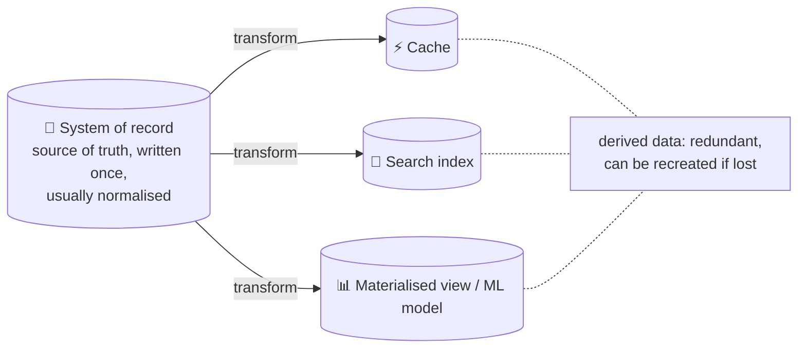
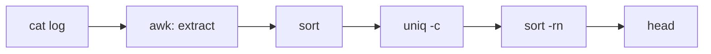
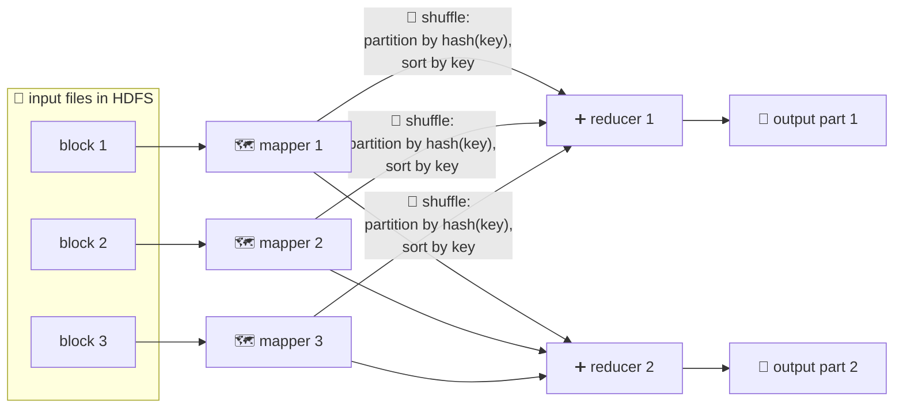
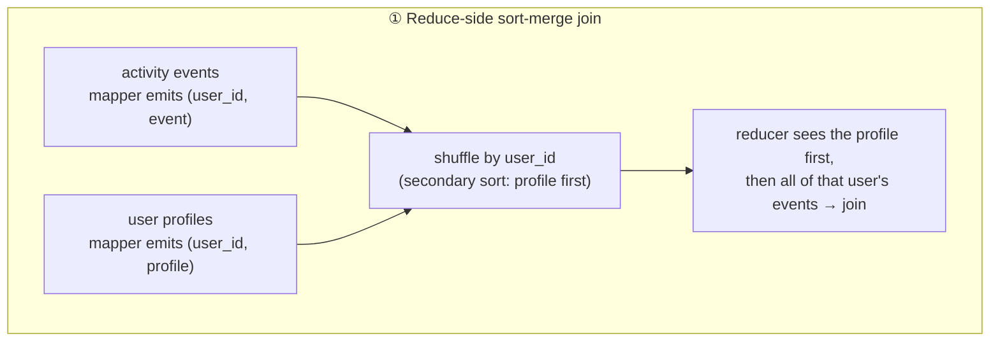
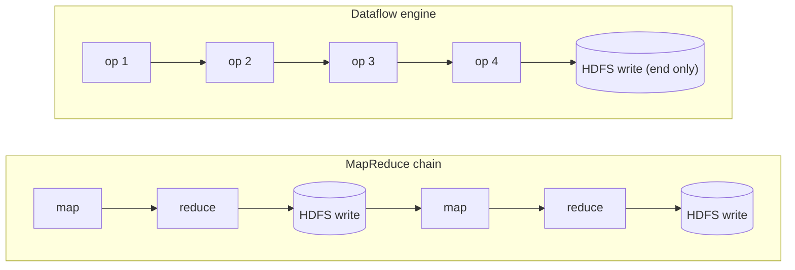
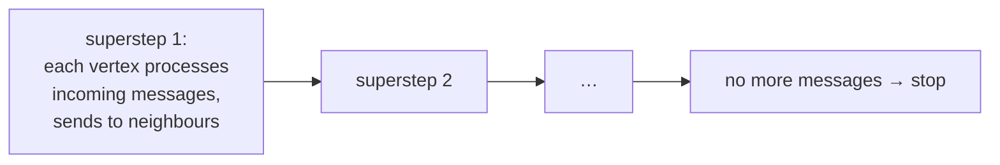

# 10 · Batch processing

> **In one line:** take a large, bounded input, run a job over it, and produce derived output. Because the input is **immutable** and jobs have **no side effects**, failures are cheap: just rerun.

<BookRef pages="407–459" section="Part III intro + Chapter 10" />

## Part III: systems of record vs derived data

<BookRef pages="407–410" section="Part III. Derived Data" />



| System type | Input | Latency | Measure |
|---|---|---|---|
| **Services (online)** | Request | ms | Response time, availability |
| **Batch (offline)** | Bounded dataset | minutes – days | **Throughput** |
| **Stream (near-real-time)** | Unbounded events | seconds | Lag |

## 10.1 The Unix philosophy

<BookRef pages="413–419" section="Batch Processing with Unix Tools" />

Example: find the 5 most-requested URLs in a web-server log.

```bash
cat access.log |
  awk '{print $7}' |   # extract the URL field
  sort             |   # group identical URLs together
  uniq -c          |   # count each
  sort -r -n       |   # most frequent first
  head -n 5
```



`sort` spills to disk automatically when the data is bigger than RAM. That's why this chain handles gigabytes easily.

**Ideas that carried over to big-data systems:**
1. Each program does **one thing well**
2. A **uniform interface**: everything is a file (a stream of bytes, lines as records)
3. **Separate logic from wiring**: stdin/stdout, so a program doesn't know where its data comes from or goes
4. Inputs are **immutable**, so it's safe to experiment and rerun
5. Inspect any stage (`| less`), and write intermediate results to files

Limit: it runs on **one machine**.

## 10.2 MapReduce and distributed filesystems

<BookRef pages="419–441" section="MapReduce and Distributed Filesystems" />

**HDFS** (like GFS): a shared-nothing filesystem. A NameNode holds metadata, and data blocks are replicated (or erasure-coded) across many machines. Think of it as **one huge file system made of commodity disks**.

### How a MapReduce job runs



1. **Map:** for each input record, emit `(key, value)` pairs. Mappers run **where the data is** ("put the computation near the data").
2. **Shuffle:** pairs are partitioned by key, sorted, and copied to reducers.
3. **Reduce:** for each key, iterate over all its values and emit output.

Real pipelines chain **dozens of jobs** in a workflow (Airflow, Oozie, Luigi), where each job's output directory is the next job's input.

### Joins in batch

The batch world prefers a **full copy of the other dataset** over random network lookups per record.



| Join type | When | How |
|---|---|---|
| **Sort-merge (reduce-side)** | No assumptions about the inputs | Both sides keyed by the join key, so the shuffle brings them together |
| **Broadcast hash join (map-side)** | One side is **small** | Load the small table into every mapper's memory as a hash table |
| **Partitioned hash join (map-side)** | Both inputs are **partitioned the same way** | Mapper *i* loads only partition *i* of the small side |
| **Merge join (map-side)** | Both are partitioned **and sorted** the same way | Read both in order, like an SSTable merge |

**Skew ("hot keys"):** one celebrity key overloads a single reducer. Fix: sample the data to find hot keys and spread them across several reducers, replicating the other side of the join to each.

### What's the output for?

- Building **search indexes** (the original use at Google)
- Building **key-value stores** for serving, e.g. ML features or recommendations. Write **new immutable database files**, then switch servers over to them atomically. Don't write to the live DB record by record.
- **Philosophy:** inputs are immutable and outputs replace the old ones, so a bad job is fixed by **rolling back to the previous output** (human fault tolerance).

### Hadoop vs MPP databases

| | MPP database | Hadoop / MapReduce |
|---|---|---|
| Data | Must be modelled up front | **Dump anything first** ("data lake", sushi principle: raw is better) |
| Processing | SQL only | SQL, ML, image processing, arbitrary code |
| Faults | Abort the whole query | Retry **individual tasks**. Designed for jobs being preempted on shared clusters. |

## 10.3 Beyond MapReduce

<BookRef pages="441–451" section="Beyond MapReduce" />

**MapReduce's pain point:** every job writes its full output to HDFS (**materialisation**), and the next job can't start until the previous one finishes.

### Dataflow engines (Spark, Flink, Tez)



- A whole workflow is one job: a **DAG of operators**
- Sorting only where needed, with pipelined execution
- Intermediate state stays in memory or local disk
- **Fault tolerance** without materialisation: recompute lost partitions from their ancestors (Spark RDD lineage) or use checkpoints (Flink). This requires **deterministic** operators.

### Graph processing: the Pregel / BSP model

For iterative algorithms like PageRank: "repeat until convergence".



- Vertices keep state in memory between iterations.
- Fault tolerance comes from checkpointing at the end of each superstep.

### High-level APIs

Hive, Pig, Spark DataFrames and Flink Table API are **declarative**, so a **query optimiser** can choose join algorithms, push down filters and use column storage. Batch engines start to look like MPP databases, while keeping the freedom to run arbitrary code.

## Summary

| Theme | MapReduce | Dataflow engines |
|---|---|---|
| Unit of work | map + reduce | DAG of operators |
| Intermediate state | Written to HDFS | Memory / local disk |
| Fault tolerance | Rerun a failed task from its HDFS input | Recompute from lineage / checkpoint |
| Joins | Sort-merge, broadcast, partitioned | Same, picked by an optimiser |

<KeyIdea>Batch processing = **immutable inputs → deterministic functions → new outputs**. That makes it safe to experiment, rerun and roll back.</KeyIdea>

## 🧠 Check yourself

<Quiz question="You join a 2 TB event log with a 200 MB country lookup table. Best join?" options={["Reduce-side sort-merge", "Broadcast hash join", "Nested loop over the network", "Two-phase commit"]} answer={1} explain="The small side fits in memory on every mapper, so no shuffle of the 2 TB side is needed." />

<Quiz question="Why do batch jobs build new database files instead of writing to the live DB record by record?" options={["Network is faster", "Overwhelming the live DB, partial results on failure, and no easy rollback", "HDFS can't write to databases", "Mappers have no network"]} answer={1} explain="Writing immutable files keeps the job side-effect-free and allows atomic switch-over and rollback." />

<Quiz question="How does Spark recover a lost partition without materialised intermediate data?" options={["Restarts the whole job", "Recomputes it from its lineage (ancestors)", "Reads it from ZooKeeper", "Skips it"]} answer={1} explain="It tracks how each partition was derived, so it can recompute only what was lost." />

**Interview prompts**
- Design a daily pipeline that computes "people you may know" and serves it with low latency.
- How would you handle a skewed join key?
- When would you choose a data lake over a warehouse?
