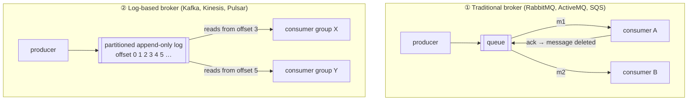
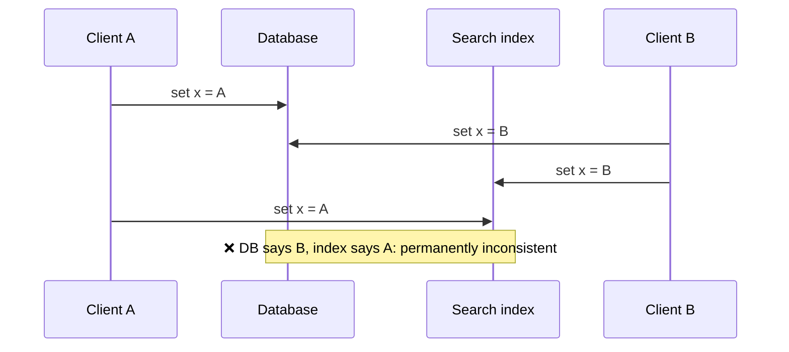
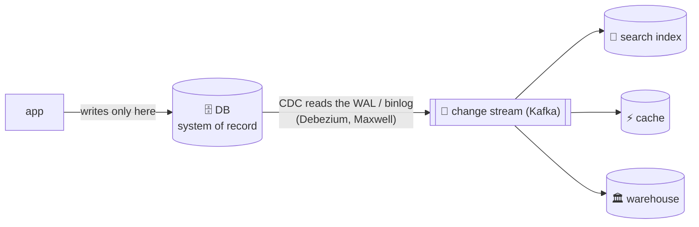
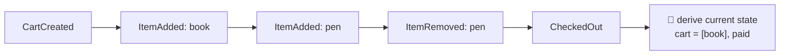
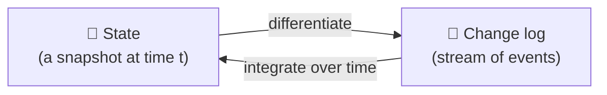
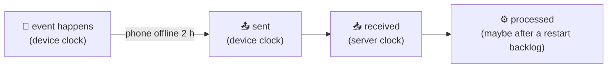
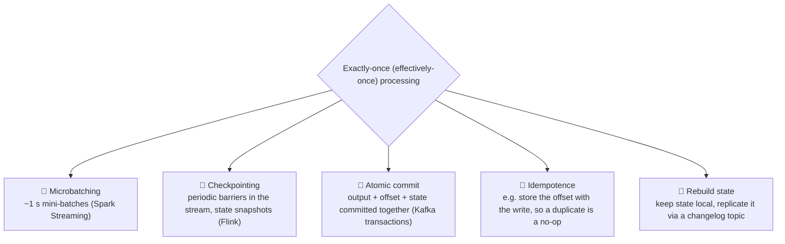
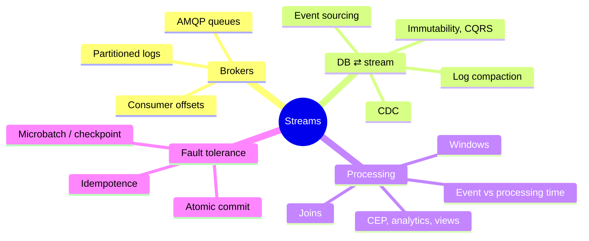

# 11 · Stream processing

> **In one line:** batch processing, but the input never ends. Process each **event** shortly after it happens. Logs connect databases and streams: a database's change log *is* a stream, and a stream can rebuild a database.

<BookRef pages="461–509" section="Chapter 11" />

## 11.1 Transmitting event streams

<BookRef pages="462–473" section="Transmitting Event Streams" />

An **event** is a small, immutable record of something that happened at a point in time. **Producers** publish, **consumers** subscribe, and events are grouped into **topics** (streams).

### Messaging design questions

1. What if producers are faster than consumers? **Drop**, **buffer** (queue), or apply **backpressure** (block the producer).
2. What if nodes crash? Can messages be lost?

### Two families of broker

| | Traditional queue | Log-based |
|---|---|---|
| After consumption | Message **deleted** | Message **kept** (retention by time or size) |
| Fan-out to many groups | Each needs its own queue | Free: each group tracks its own **offset** |
| Load balancing | Any consumer can take any message | Each **partition** goes to one consumer in a group, so parallelism = number of partitions |
| Ordering | Lost when redelivering to another consumer | **Guaranteed within a partition** |
| Replay | ❌ | ✅ Reset the offset and reprocess |
| One slow message | Only that message waits | Blocks the rest of its partition (head-of-line blocking) |
| Best for | Expensive, independent tasks, order irrelevant | High throughput, ordering matters, replay |

**Consumer offsets** work like a replication log position: on restart, a consumer continues from its last committed offset. A slow consumer just **falls behind**; it doesn't slow down anyone else. Monitor **consumer lag**.

## 11.2 Databases and streams

<BookRef pages="473–486" section="Databases and Streams" />

### The dual-write problem

Writing to two systems from the app also breaks when one write fails and the other succeeds.

### Change data capture (CDC)

Make the database the **leader** and turn its replication log into a stream.

- Every consumer applies changes **in the same order** as the DB, so there are no races.
- **Bootstrapping a new consumer:** start from a consistent snapshot at a known log offset, then follow the log.
- **Log compaction:** keep only the latest value per key (tombstones for deletes). The log then becomes a full copy of the DB, and a new index can be rebuilt from offset 0.

### Event sourcing

| | CDC | Event sourcing |
|---|---|---|
| Level | Low-level: row changes from a mutable DB | App-level: **domain events** ("SeatReserved") |
| Source of truth | The DB | The **immutable event log** |
| App writes | Normal updates | Only appends events |

**Commands vs events:** a *command* (user request) is validated first. Only after validation does it become an *event*: an immutable **fact**.

### State, streams and immutability

> The log is the truth. The database is a cached view of the latest values in the log.

Benefits of an immutable log:
- **auditability**, like an accounting ledger
- recovery from bugs: deploy the fix and **rebuild views**
- **several read-optimised views** from the same events (**CQRS**: separate the write format from the read formats)
- captures more information than the current state ("added, then removed")

Limits:
- heavy churn means a huge history, so you need compaction or GC
- **legal deletion** (privacy regulations) requires **excision** of the original data, not just appending a "deleted" event

## 11.3 Processing streams

<BookRef pages="486–501" section="Processing Streams" />

What can you do with a stream?
1. Write it into a store (DB, cache, index)
2. Push it to users (notifications, dashboards)
3. **Process** it into new streams (the operator pipeline)

### Uses

| Use | Example |
|---|---|
| **Complex event processing (CEP)** | Queries are stored long-term, and events flow past them looking for patterns ("3 failed logins, then a password reset") |
| **Stream analytics** | Rates, rolling averages, percentiles over windows; probabilistic sketches (HyperLogLog) |
| **Maintaining materialised views** | Keep caches or search indexes up to date (needs *all* events, not just a window) |
| **Search on streams** | Saved searches matched against each new document |

### Reasoning about time

**Event time** (when it happened) ≠ **processing time** (when the processor saw it).

- Windowing by processing time distorts results, e.g. a fake spike after a backlog.
- **Stragglers:** when is a window "done"? Use a timeout (watermark), then either ignore late events or publish a correction.
- **Device clocks lie.** Log three timestamps (event time and send time by device clock, receive time by server clock) and estimate the offset.

### Window types

```mermaid
gantt
  title Window types over a timeline (minutes)
  dateFormat mm
  axisFormat %M
  section Tumbling (fixed, no overlap)
  w1 :00, 5m
  w2 :05, 5m
  w3 :10, 5m
  section Hopping (5 min, every 1 min)
  h1 :00, 5m
  h2 :01, 5m
  h3 :02, 5m
  section Sliding (any events within 5 min of each other)
  s1 :03, 5m
  section Session (until 30 s inactivity)
  user A session :00, 7m
  user A session 2 :11, 3m
```

| Window | Definition |
|---|---|
| **Tumbling** | Fixed length, each event belongs to exactly one window |
| **Hopping** | Fixed length, overlapping (computed by aggregating tumbling windows) |
| **Sliding** | Contains all events within an interval of each other |
| **Session** | Groups a user's events together; closes after inactivity |

### Stream joins

| Join | Example | State kept |
|---|---|---|
| **Stream-stream (window)** | Search event ⋈ click event within 1 hour → click-through rate | Buffer of recent events from both sides, indexed by the join key |
| **Stream-table (enrichment)** | Activity event ⋈ user profile | Local copy of the table, **kept current via CDC** |
| **Table-table (materialised view)** | Followers ⋈ posts → home timelines | Both tables, updated from both change streams |

**Time-dependence:** if the profile changes, which version does the join use? Order across streams isn't deterministic. **Slowly changing dimensions**: give each version of a record its own ID (e.g. tax rate v3) so joins can be reproduced.

### Fault tolerance: exactly-once *effect*

You can't just rerun a failed stream job "from the start". Options:

Note: none of these can undo side effects that already escaped the system, such as an email that was sent.

## Summary

## 🧠 Check yourself

<Quiz question="Why are dual writes (app writes to DB and search index separately) dangerous?" options={["Too slow", "Concurrent writes can arrive in different orders, and partial failures leave the two systems inconsistent", "Search indexes can't accept writes", "It needs 2PC by law"]} answer={1} explain="Without a single ordered log, the two systems can disagree permanently. CDC fixes this." />

<Quiz question="You need replay and per-key ordering at very high throughput. Which broker style?" options={["Traditional AMQP queue", "Log-based (Kafka)", "Email", "Shared database table"]} answer={1} explain="Partitioned logs keep order per partition and retain messages so consumers can rewind." />

<Quiz question="A dashboard shows a huge spike right after a stream job restarts and catches up on a backlog. Root cause?" options={["Network partition", "Windowing by processing time instead of event time", "Too many partitions", "Log compaction"]} answer={1} explain="The backlog was processed all at once. Window by event time to see the real rate." />

<Quiz question="Which window type groups a user's clicks until 30 minutes of inactivity?" options={["Tumbling", "Hopping", "Sliding", "Session"]} answer={3} explain="Session windows have no fixed length; they close after a gap in activity." />

**Interview prompts**
- Keep Elasticsearch in sync with Postgres. Design it.
- Compute "trending hashtags in the last 10 minutes" at scale.
- How does Kafka achieve exactly-once processing between topics?
