# 11 · Stream processing

> **In one line:** stream processing is batch processing whose input never ends. Instead of waiting for a day's worth of data, you handle each **event** shortly after it happens. The glue is the **log**: a database's change log *is* a stream, and replaying a stream can rebuild a database.

<BookRef pages="461–509" section="Chapter 11" />

Chapter 10 assumed a **bounded** input: a set of files of known size. A batch job reads everything, produces output, and stops. That assumption is convenient, but the real world rarely works that way. Users keep signing up, sensors keep reporting, payments keep arriving. The data is **unbounded**: it arrives gradually and is never "complete".

A batch system copes with unbounded data by **chopping it into chunks**, for example "process yesterday's data at 01:00 every night". The problem is latency: a change made at 09:00 isn't reflected in the output until the next morning. If you shrink the chunk to an hour, a minute, a second, you eventually arrive at the limit case: process every event **as it arrives**. That is stream processing.

<KeyIdea title="Stream = unbounded, incrementally available data">A batch job reads a finite input and finishes. A stream job reads an input that never ends, so it never "finishes"; it keeps producing output as new events arrive. Almost every idea in this chapter comes from asking "what changes when the input has no end?"</KeyIdea>

This chapter has three parts:

1. **Transmitting event streams**: how events get from where they happen to where they're processed (message brokers and logs).
2. **Databases and streams**: the surprisingly deep connection between the two, via change data capture and event sourcing.
3. **Processing streams**: what you can compute on a stream, how to reason about time, how to join streams, and how to survive failures.

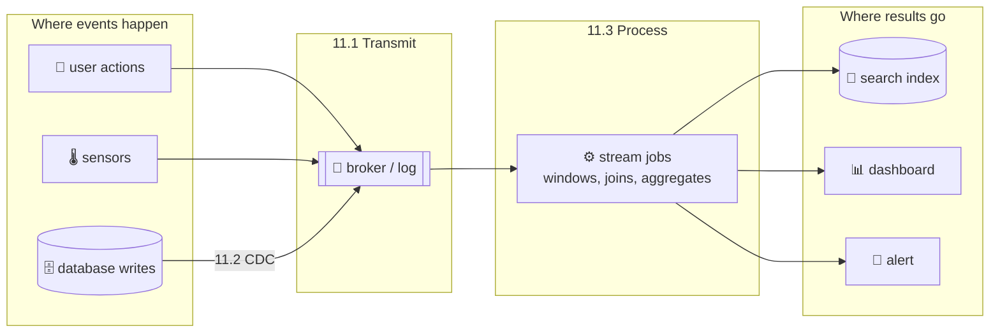

## 11.1 Transmitting event streams

<BookRef pages="462–473" section="Transmitting Event Streams" />

In batch processing the inputs and outputs are **files**. The stream equivalent of a single record is an **event**: a small, self-contained, **immutable** object describing something that happened at a point in time. An event usually carries a timestamp (by some clock) and some payload.

```json
{
  "type": "parcel_scanned",
  "parcel_id": "PKG-55120",
  "depot": "Pune-East",
  "scanner": "hand-07",
  "ts": "2026-03-14T08:21:09.412Z"
}
```

The event might be encoded as JSON, Avro, Protobuf, or plain text (a log line is an event too). Some vocabulary:

| Batch world | Stream world |
|---|---|
| File | **Topic** / **stream**: a named group of related events |
| Record written by a job | Event emitted by a **producer** (a.k.a. publisher, sender) |
| Job reading a file | **Consumer** (a.k.a. subscriber, recipient) |
| Filename identifies data | Topic name identifies data |

### How does a consumer learn about new events?

In principle you could put events into a database table and have consumers **poll** it: "anything new since I last looked?" That works at low volume, but polling becomes expensive as you try to shrink latency. Poll every 10 ms and most polls return nothing, yet every one costs a query. It's better for consumers to be **notified** when new events appear.

Traditional databases aren't great at notifications. Triggers exist, but they're limited and were bolted on after the fact. So specialised tools emerged for delivering event notifications: **messaging systems**.

### Messaging systems

<BookRef pages="463–468" section="Messaging Systems" />

The simplest messaging system is a direct channel between a producer and a consumer, like a Unix pipe or a TCP connection. Real messaging systems go further and let **many producers** send to the same topic and **many consumers** receive from it: the **publish/subscribe** (pub/sub) model.

Pub/sub systems differ hugely. To compare them, ask two questions:

**1. What happens if producers send faster than consumers can process?** There are three options:

| Option | What happens | Example |
|---|---|---|
| **Drop** messages | Excess messages are discarded | A metrics agent that drops samples when overloaded |
| **Buffer** in a queue | Messages pile up waiting | Most brokers. But what if the queue outgrows memory? Spill to disk? Crash? |
| **Backpressure** (flow control) | Block the producer until the consumer catches up | Unix pipes and TCP: a full buffer makes the sender wait |

**2. What happens if nodes crash or go offline temporarily?** Are messages lost? Durability means writing to disk and/or replicating, which costs throughput and latency. For some workloads (a live stock ticker where the next price supersedes the last one) losing a message is fine. For others (a payments stream) it absolutely isn't.

<KeyIdea>Whether losing messages is acceptable depends on the application. Batch processing gave us a strong guarantee for free: a failed task is retried from its immutable input, and output is replaced atomically. Stream systems must work hard to offer anything comparable.</KeyIdea>

#### Direct messaging from producers to consumers

Some systems skip any intermediary and send messages **straight from producer to consumer** over the network:

- **UDP multicast** is common in financial market-data feeds, where low latency matters more than anything. UDP itself is unreliable, so the application layer adds sequence numbers and retransmission requests for gaps.
- **Brokerless messaging libraries** like **ZeroMQ** and **nanomsg** implement pub/sub over TCP or IP multicast.
- **StatsD** and similar metric collectors send counters over UDP. Lost packets just make the metric slightly inaccurate.
- **Webhooks / HTTP callbacks**: a service registers a URL with another service, which makes a request to that URL whenever an event happens. Effectively the producer makes a direct RPC to the consumer.

These approaches work well where they fit, but they generally require the application code to be **aware of possible message loss**. Their fault tolerance is limited: they assume producer and consumer are both online most of the time. If the consumer is offline, it misses messages sent meanwhile. Some protocols let the producer retry, but if the **producer** crashes, its retry buffer is lost too.

#### Message brokers

The widely used alternative is a **message broker** (a.k.a. **message queue**): essentially a database specialised for message streams. It runs as a server; producers and consumers connect to it as clients.

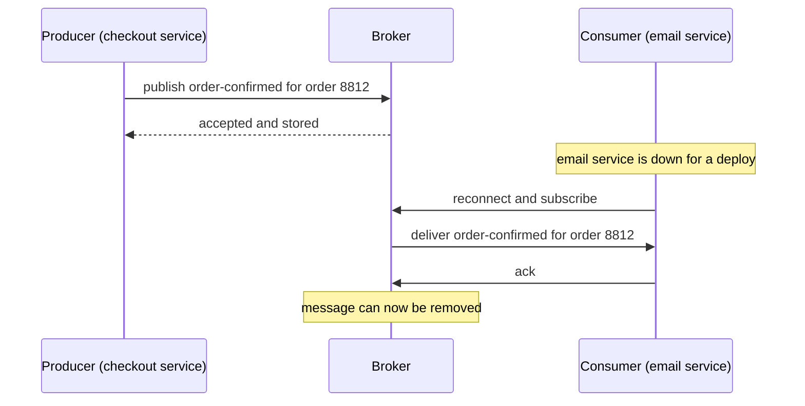

Centralising data in the broker means:

- **Clients come and go** (connect, disconnect, crash) and the broker deals with it. Durability moves into the broker.
- Some brokers keep messages only in memory; others write them to disk so a broker crash doesn't lose them.
- Faced with slow consumers, brokers usually **queue without bound** (rather than drop or apply backpressure), though this is often configurable.
- Consumers are generally **asynchronous**: the producer waits only for the broker to confirm it buffered the message, not for the consumer to process it. Delivery might happen a few milliseconds later, or hours later if there's a backlog.

#### Message brokers compared to databases

Some brokers can even take part in two-phase commit with XA/JTA, which makes them look a lot like databases. But there are practical differences:

| | Database | Traditional message broker |
|---|---|---|
| Retention | Keeps data until explicitly deleted | **Deletes** a message once it's been delivered and acknowledged |
| Working set | Can be huge | Assumed small: queues are short. A big backlog (spilled to disk) degrades throughput |
| Querying | Secondary indexes, arbitrary queries | Subscribe to topics matching a pattern; that's about it |
| Reading | A query returns a point-in-time snapshot; you aren't told when results change | **Pushes** new data to clients as it arrives |

That last row is the heart of the difference. A database answers "what is the state now?" A broker answers "tell me whenever something new happens". This describes the traditional view of brokers, codified in standards like **JMS** and **AMQP** and implemented by **RabbitMQ**, **ActiveMQ**, **HornetQ**, **Qpid**, **TIBCO EMS**, **IBM MQ**, **Azure Service Bus** and **Google Cloud Pub/Sub**.

#### Multiple consumers

When several consumers read from the same topic, there are two main patterns:

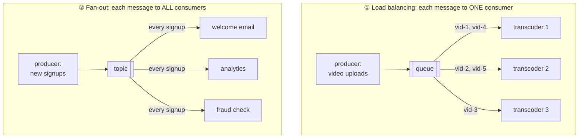

- **Load balancing** (competing consumers): each message goes to **one** consumer, so the consumers share the work. Great when each message is expensive to process (transcoding a video) and you want to add consumers to parallelise. AMQP lets several clients consume from the same queue; JMS calls it a *shared subscription*.
- **Fan-out**: each message goes to **all** consumers, so several independent consumers each "tune in" to the same broadcast without affecting each other. This is the streaming equivalent of several batch jobs reading the same input file. JMS calls these *topic subscriptions*; AMQP does it with exchange bindings.

The two patterns **combine**: two separate *groups* each receive every message (fan-out), while within each group only one member receives each message (load balancing). In the diagram above, "analytics" could itself be five instances sharing the load.

#### Acknowledgements and redelivery

Consumers can crash at any time. A broker might hand a message to a consumer that never finishes processing it, or only partially processes it before dying. To make sure messages aren't lost, brokers use **acknowledgements**: a client must explicitly tell the broker when it has finished processing a message, so the broker can remove it.

If the connection closes or times out without an ack, the broker assumes the message wasn't processed and **delivers it again** to another consumer. Note the catch: the message may actually have been **fully processed** but the ack was lost in the network. Handling that needs an atomic commit protocol (see "Fault tolerance" later), otherwise you get **at-least-once** delivery and possible duplicates.

Combined with load balancing, redelivery has an awkward effect on **ordering**:

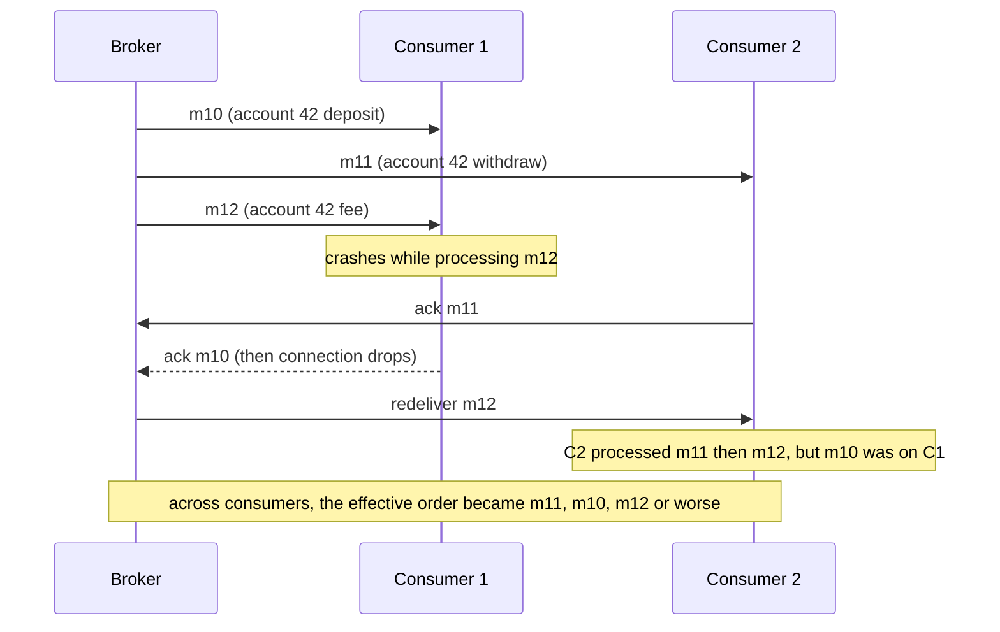

Even if the broker tries to preserve order (JMS and AMQP both nominally do), the combination of **load balancing + redelivery** inevitably reorders messages. If messages are independent (each video upload is its own job) this doesn't matter. If there are **causal dependencies** between messages (deposit before withdrawal on the same account), it matters a lot. The usual fix is to avoid load balancing for related messages: route everything for one key to one consumer, which is exactly what partitioned logs do.

### Partitioned logs

<BookRef pages="468–473" section="Partitioned Logs" />

Sending a packet over a network or calling a service is normally a **transient** operation that leaves no permanent trace. Brokers inherited that mindset: even a durable broker deletes messages soon after delivery, because they are seen as "in transit". Contrast this with databases and filesystems, where everything written is expected to stay until someone deletes it.

This difference has a big practical consequence. Batch jobs can be rerun over the same input as often as you like, with no harm: input is read-only. But **receiving a message from an AMQP/JMS broker is destructive**: once it's acked, it's gone. You can't rerun a consumer and expect the same results. And a consumer added later only sees messages sent **after** it subscribed; earlier messages are gone.

Why not have both: **the durable storage of a database with the low-latency notifications of messaging?** That's the idea behind **log-based message brokers**.

#### Using logs for message storage

A **log** is an append-only sequence of records on disk (as in Chapter 3's log-structured storage and Chapter 5's replication logs). Use it as a broker:

- A **producer** appends a message to the end of the log.
- A **consumer** reads the log **sequentially**. When it reaches the end, it waits to be notified of new messages (like `tail -f` on a file).

A single disk and a single log can't take unbounded throughput, so the log is **partitioned**: different partitions live on different machines, each partition is a separate log that can be read and written independently. A **topic** is a group of partitions carrying the same kind of message.

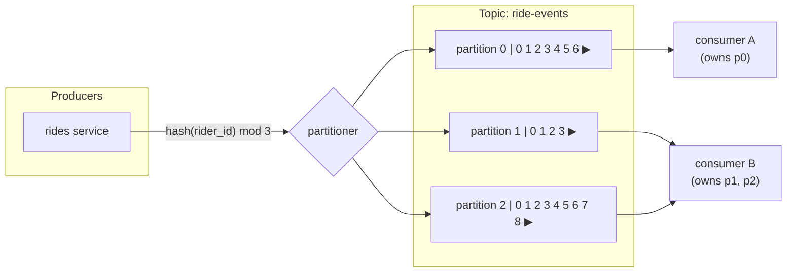

Within each partition the broker assigns a monotonically increasing **offset** to every message. Messages within a partition are **totally ordered**; there is **no ordering guarantee across partitions**. So you pick a partition key (here `rider_id`) such that the events that must stay in order share a key.

Real systems built this way: **Apache Kafka**, **Amazon Kinesis Data Streams**, **Twitter's DistributedLog**, **Apache Pulsar** (backed by BookKeeper), **Redpanda**, Azure Event Hubs. **Google Cloud Pub/Sub** is architecturally similar but exposes a JMS-style API. Despite writing everything to disk, these systems reach **millions of messages per second** by partitioning across machines, and get fault tolerance by **replicating** each partition.

#### Logs compared to traditional messaging

Log-based brokers support **fan-out** trivially: several consumers each read the log independently, and reading doesn't delete anything. For **load balancing** within a group, the broker assigns **whole partitions** to consumers rather than individual messages. Each consumer then reads all messages in its assigned partitions, single-threaded and in order.

This coarse-grained approach has downsides:

- The number of consumers sharing a topic's work is **at most the number of partitions** (extra consumers sit idle).
- If one message is slow to process, it **holds up everything after it** in that partition (head-of-line blocking).

| Situation | Better choice |
|---|---|
| Messages are expensive to process, you want to parallelise message by message, and order doesn't matter | **JMS/AMQP-style broker** |
| High throughput, each message fast to process, ordering matters (per key), you want replay | **Log-based broker** |

Many teams use both: a work queue for "transcode this video" style jobs, and a log for "every change to every order".

#### Consumer offsets

Reading a partition sequentially makes it **trivial to tell which messages have been processed**: everything with an offset less than the consumer's current offset has been processed, everything greater hasn't. So the broker doesn't need to track an ack for every single message; it only needs to **periodically record each consumer's offset**. Less bookkeeping, easier batching and pipelining, higher throughput.

This is exactly like the **log sequence number** in single-leader replication (Chapter 5). There, a follower that reconnects tells the leader "I have everything up to LSN 9,204, send me the rest". Here the broker is the leader and the consumer is the follower.

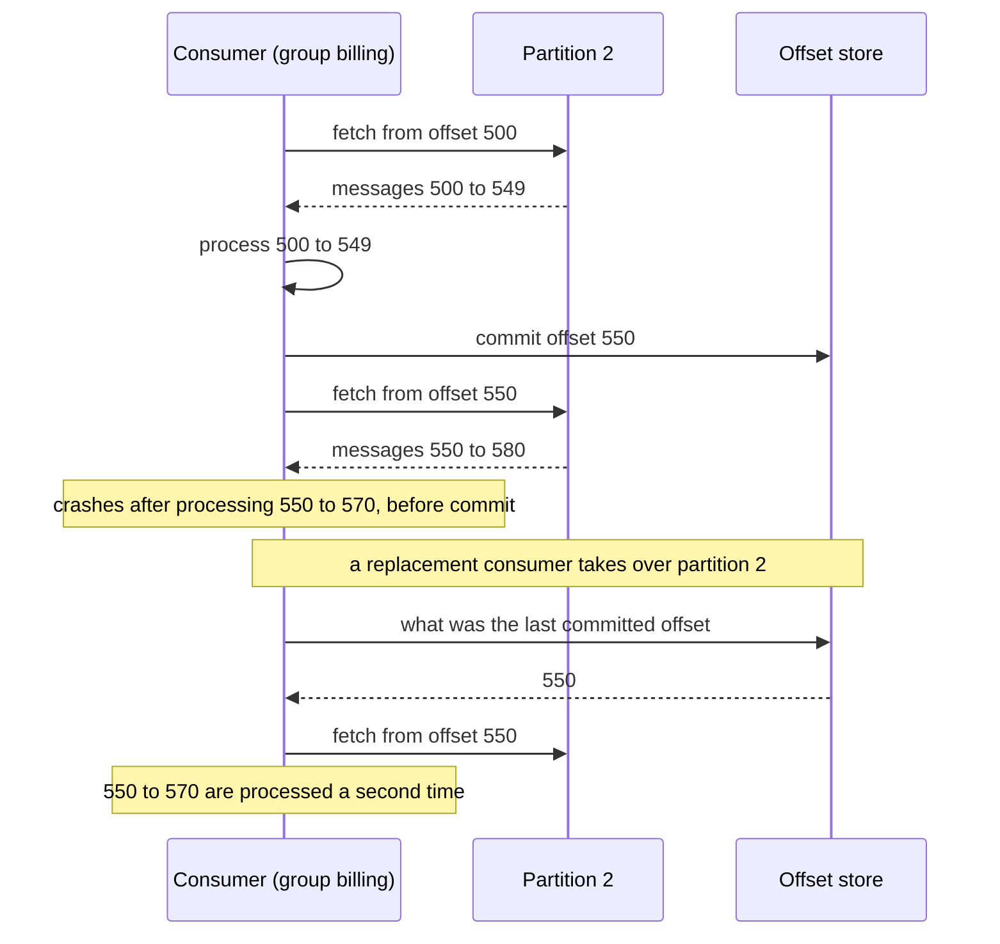

If a consumer node fails, another consumer in the group takes over its partitions and resumes from the **last recorded offset**. Any messages processed but not yet committed get **processed twice**. Keep that in mind; we come back to it in "Fault tolerance".

#### Disk space usage

If you only ever append, you eventually run out of disk. To reclaim space, the log is split into **segments**, and old segments are periodically deleted or moved to archive (cheap object storage, sometimes called *tiered storage*). The log behaves like a big **bounded buffer** (a circular or ring buffer) that discards old messages when full.

A quick back-of-the-envelope with my own numbers:

```text
Disk per broker:        8 TB usable for one busy topic's partitions
Write rate:             120 MB/s sustained across that disk
Time to fill:           8,000,000 MB / 120 MB/s ≈ 66,700 s ≈ 18.5 hours

If peak load is 120 MB/s but average is ~25 MB/s:
                        8,000,000 / 25 ≈ 320,000 s ≈ 3.7 days of buffer
```

In practice, with commodity disks and typical average rates, a log can often hold **days to weeks** of messages. Importantly, **throughput is roughly constant regardless of retention**, because every message is written to disk anyway. Compare traditional brokers that are fast when queues are short and slow down sharply when they start spilling to disk.

#### When consumers can't keep up with producers

Recall the three options: drop, buffer, backpressure. The log-based approach is a form of **buffering with a large but fixed-size buffer** (bounded by disk).

If a consumer falls so far behind that its offset points to a **deleted segment**, it will miss messages. But the buffer is usually so large that a human operator has time to notice and fix the slow consumer first. Monitor **consumer lag** (how far the consumer's offset trails the head of the log) and alert when it grows. Example: if the log holds 3.7 days, alert when lag exceeds, say, 6 hours.

Crucially, a slow or dead consumer **only affects itself**. It doesn't slow the broker or other consumers, because nobody is waiting on it. This makes experiments cheap: you can attach a consumer to production logs for testing or debugging and kill it whenever, without worrying about disrupting production. (With a traditional broker, you must remember to delete the queue of a shut-down consumer, or it keeps accumulating messages and hogging memory.)

#### Replaying old messages

With AMQP/JMS, processing and acking is destructive. With a log, consuming is **read-only**: the only side effect is the consumer offset moving forward. And the offset is under the consumer's control, so it can be **moved back**.

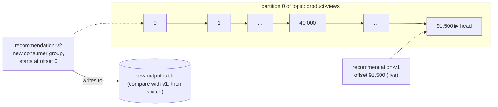

This makes log-based messaging behave much more like **batch processing**: derived data is cleanly separated from input through a repeatable transformation. You can:

- start a **new consumer group** at offset 0 to compute a new derived dataset from the history;
- **fix a bug** in a consumer, rewind to yesterday's offset, and reprocess into a fresh output;
- run **two versions side by side** and compare their outputs before cutting over.

<KeyIdea>A log turns messaging from a destructive "deliver and forget" operation into a repeatable, read-only one. That's what lets stream processing borrow batch processing's best property: you can always recompute.</KeyIdea>

## 11.2 Databases and streams

<BookRef pages="473–486" section="Databases and Streams" />

So far we've borrowed ideas from databases (durable logs) and applied them to messaging. Now the other direction: use ideas from messaging and streams in **databases**.

An event is a record of something that happened. Something "happening" can be a user action, a sensor reading, or **a write to a database**. The fact that something was written to a database is an event that can be captured, stored and processed.

The link is already familiar from Chapter 5: a **replication log** is a stream of database write events, produced by the leader as it processes transactions. Followers apply that stream to their own copy and end up with the same data. The events describe data changes.

And the **state machine replication** principle from Chapter 9 says the same thing in general form: if every replica processes the same events in the same order, every replica ends up in the same final state (assuming deterministic processing). That's just another stream.

### Keeping systems in sync

<BookRef pages="474–476" section="Keeping Systems in Sync" />

As Chapters 1 and 10 stressed, no single system serves every need. A typical application combines:

- an **OLTP database** to serve user requests,
- a **cache** to speed up common reads,
- a **full-text search index** for search queries,
- a **data warehouse** for analytics.

Each holds its own copy of (some of) the data, in its own representation, optimised for its own purpose. They must be kept **in sync**: when a product's price changes in the database, the cache, the search index and the warehouse must all hear about it.

For the warehouse this is usually done by **ETL**: take a full copy of the database, transform it, bulk-load it. That's batch processing. If a periodic full dump is too slow, the common alternative is **dual writes**: the application code explicitly writes to every system whenever data changes.

```python
def update_price(product_id, new_price):
    db.execute("UPDATE products SET price = %s WHERE id = %s",
               (new_price, product_id))
    search.index(product_id, {"price": new_price})   # second write
    cache.delete(f"product:{product_id}")             # third write
```

Dual writes have **serious problems**.

**Problem 1: race conditions.** Two clients update the same product concurrently. Each writes the database and then the search index, but the requests interleave differently at each system:

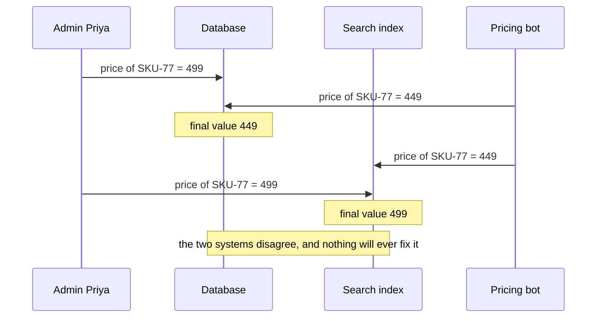

Nobody gets an error. The two systems are just **silently, permanently inconsistent** until someone overwrites the value again. You'd need extra concurrency detection (such as version vectors) to notice it.

**Problem 2: partial failure.** The database write succeeds but the search-index write fails (timeout, crash, deploy). Or vice versa. Now the systems are inconsistent. Making both writes succeed or fail together is the **atomic commit** problem, which is expensive to solve (2PC across heterogeneous systems, Chapter 9).

<KeyIdea title="Root cause">With dual writes there is no single leader deciding the order of writes. If one system were the leader and the others followers that apply its changes in its order, races would vanish. That's exactly what change data capture does.</KeyIdea>

### Change data capture

<BookRef pages="476–479" section="Change Data Capture" />

For decades, most databases treated their replication log as a private internal detail, not a public API. Clients were supposed to query the data model, not parse the log. That made it hard to get at the changes and send them elsewhere.

**Change data capture (CDC)** is the process of observing all data changes written to a database and extracting them in a form they can be replicated to other systems. It's especially interesting if changes are made available as a **stream** immediately as they're written.

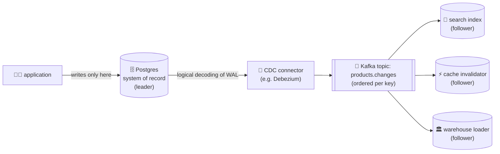

The database becomes the **leader** and every derived system becomes a **follower**. A log-based broker is a natural transport because it **preserves the order** of changes, which is the whole point: every follower applies changes in the same order as the leader, so the race from the dual-write example can't happen.

#### Implementing change data capture

Derived data systems (search index, warehouse, cache) are just **consumers** of the change log. CDC makes sure every change made to the system of record is also reflected in the derived systems, so they hold an accurate copy.

Ways to implement it:

| Approach | How | Notes |
|---|---|---|
| **Database triggers** | A trigger on each table writes every change into a changelog table | Fragile, adds overhead to every write |
| **Parse the replication log** | Read the WAL / binlog / oplog directly | More robust, but must handle schema changes. Most common today |

Real tools:

- **Debezium**: CDC connectors for MySQL (binlog), PostgreSQL (logical decoding), MongoDB (oplog), SQL Server, Oracle, and more, usually writing into Kafka.
- **Maxwell** and **Bottled Water**: MySQL binlog and Postgres WAL respectively (Bottled Water is historical now).
- **LinkedIn's Databus**, **Facebook's Wormhole**, **Yahoo!'s Sherpa**: in-house large-scale CDC systems.
- **Kafka Connect**: a framework with CDC connectors for many databases.
- **GoldenGate** for Oracle.

CDC is **asynchronous**, like async replication: the system of record doesn't wait for consumers before committing. The upside: adding a slow consumer doesn't affect the database. The downside: all the issues of **replication lag** (Chapter 5) apply, for example a user updates a product and the search page shows the old price for a second.

#### Initial snapshot

If you had the **entire** log of every change ever made, you could rebuild the full database state by replaying it. But keeping every change forever needs too much disk, and replaying years of history would take too long. So the log gets truncated.

To build a **new** full-text index (or any new derived system), you need a full copy of the database, not just recent changes. The approach:

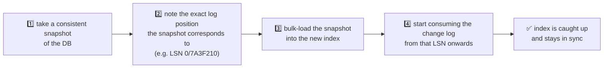

The snapshot **must correspond to a known position** in the change log, so you know where to resume applying changes. Otherwise you either miss changes made during the snapshot or apply some twice in the wrong order. Some CDC tools integrate this snapshot step; others leave it as a manual operation. Debezium, for example, can run an initial snapshot and then switch to streaming automatically, and newer versions can do *incremental* snapshots that interleave chunks of the table with live changes.

#### Log compaction

If you can only keep a limited log history, you need the snapshot process every time you add a new derived system. **Log compaction** is a neat alternative.

We met compaction in Chapter 3 (log-structured storage): the storage engine periodically looks for records with the **same key**, throws away duplicates, and keeps only the **most recent** update per key. Compaction and merging run in the background.

- A **delete** is written as a special null value, a **tombstone**, telling compaction to eventually drop the key entirely.
- As long as a key isn't overwritten or deleted, it stays in the log forever.
- The disk space needed depends only on the **current contents** of the database, not on the total number of writes ever made. If the same key is overwritten frequently, old values get garbage-collected and only the latest remains.

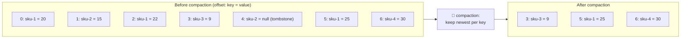

Offsets are preserved; compaction just leaves gaps. sku-2's tombstone itself is eventually removed too (after a grace period, so consumers that were mid-read still see the delete).

The same idea works for **log-based brokers with CDC**. If the CDC system ensures every change carries a primary key, and every update for a key replaces the previous value, it's enough to keep the **latest write per key**. Now, to rebuild a derived system like a search index, start a **new consumer at offset 0** of the compacted topic and scan to the end. The compacted log contains the latest value for every key in the database: a **full copy** of it. No separate snapshot needed.

Kafka supports this per topic (`cleanup.policy=compact`). It lets the broker act as durable storage, not just transient messaging. Kafka itself uses compacted topics internally to store consumer offsets.

#### API support for change streams

Increasingly, databases support change streams as a **first-class interface** instead of the retrofitted, reverse-engineered CDC described above:

| System | Change-stream feature |
|---|---|
| **RethinkDB** | Queries can subscribe to notifications when their result changes |
| **Firebase**, **CouchDB** | Sync data based on a change feed, also exposed to applications |
| **Meteor** | Uses the MongoDB oplog to push changes to the UI |
| **VoltDB** | Transactions can export data continuously as a stream; the stream is a special table that writes are inserted into but queries can't read; it's consumed externally |
| **MongoDB** | Change streams API (built on the oplog) |
| **DynamoDB** | DynamoDB Streams |
| **Kafka Connect** | Integrates CDC tools for many databases with Kafka, so change events can flow into search indexes and other systems, or into stream processors |

<KeyIdea>CDC turns "the database" from a black box into a publisher. The database stays the single leader for writes, and every other copy of the data becomes a follower that replays its changes in order.</KeyIdea>

### Event sourcing

<BookRef pages="479–481" section="Event Sourcing" />

**Event sourcing** is a technique from the **domain-driven design** (DDD) community. Like CDC, it stores all changes to application state as a **log of change events**. The big difference is the **level of abstraction**:

| | Change data capture | Event sourcing |
|---|---|---|
| Who writes events | The **database**, as a side effect of normal writes | The **application**, deliberately |
| How the app uses the DB | Mutable: ordinary `UPDATE`/`DELETE`; the app doesn't know CDC is happening | Immutable: only appends events; updates and deletes are discouraged or forbidden |
| Event granularity | Low-level: "row 553 in table loans changed column due_date" | High-level, domain meaning: "LoanExtended" |
| Source of truth | The current database state | The **event log** |

Events in event sourcing are designed to reflect things that happened **at the application level**, not low-level state changes. That's powerful:

- It records **user intent** and the reason behind each change, not just the final effect. That aids debugging and evolving the application.
- It's easier to evolve the app over time: new features can be built on the existing events without migrating data.
- It guards against application bugs: a bad update in a mutable DB destroys information; an event log keeps it.

A worked example: a public library's loan system. Instead of a `loans` table with a mutable `status` column, the app appends events:

```json
{"seq": 1, "type": "BookBorrowed",  "member": "M-310", "copy": "C-9001", "due": "2026-04-01"}
{"seq": 2, "type": "LoanExtended",  "member": "M-310", "copy": "C-9001", "new_due": "2026-04-15", "reason": "online renewal"}
{"seq": 3, "type": "BookReturned",  "member": "M-310", "copy": "C-9001", "condition": "good", "late_days": 0}
{"seq": 4, "type": "BookBorrowed",  "member": "M-077", "copy": "C-9001", "due": "2026-05-02"}
```

From this, the "is copy C-9001 on loan?" view is easy to derive, and so are views nobody planned for at first ("how often do members renew online?", "average days a copy sits on the shelf").

Event sourcing is like the **chronicle data model**, and similar to the **fact table** in a star schema (Chapter 3), which also records events. Specialised databases such as **EventStoreDB** exist, but any database or log-based broker can store an event log. Frameworks like **Axon** support the pattern.

#### Deriving current state from the event log

An event log by itself isn't very useful: users want **current state** ("which books are on loan right now?"), not the full history. So an event-sourced application must **transform** the log into state suitable for display. The transformation can use arbitrary logic, but it must be **deterministic**, so you can run it again and get the same state from the same log.

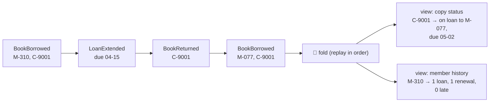

Like CDC, replaying the log reconstructs the state. But **log compaction works differently**:

- In CDC, an update event usually carries the **entire new version** of a record, so the latest event for a key fully determines its value. Older events for the key can be discarded.
- In event sourcing, events model **user actions**, not state replacements. A later event usually **doesn't override** an earlier one ("LoanExtended" means nothing without the "BookBorrowed" before it). So you need the **full history** to rebuild state, and compaction by key isn't possible.

Applications that use event sourcing usually store **snapshots** of the current state derived from the log, so they don't have to replay everything on every start-up. But that's just a performance optimisation: the intention is that the system can always **reprocess the full log** if needed.

#### Commands and events

The event-sourcing philosophy distinguishes **commands** from **events**:

- A **command** is a request from a user. When it first arrives, it's not yet a fact; it might fail. "Borrow copy C-9001" fails if the copy is already on loan, or the member has too many overdue books.
- The application must **validate** the command first (check integrity constraints). If validation succeeds and the command is accepted, it becomes an **event**: **durable and immutable**, a fact.

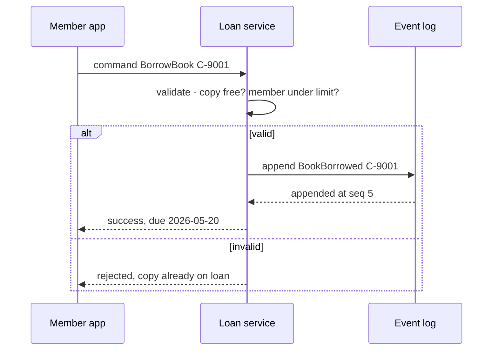

Once an event is generated, it's a fact. Even if the member later returns the book early or cancels, the fact that they **borrowed** it remains true; the cancellation or return is a **separate event added later**.

Consequence: a consumer of the event stream **isn't allowed to reject an event**. By the time a consumer sees it, it's already an immutable part of the log, and other consumers may have seen it too. So **validation must happen synchronously, before the command becomes an event**: for example using a serializable transaction that atomically validates and publishes.

Alternatively, split a request into **two events**: first a tentative "ReservationRequested", then, after validation, a separate "ReservationConfirmed". This split lets validation happen asynchronously (we use this in Chapter 12).

### State, streams, and immutability

<BookRef pages="481–486" section="State, Streams, and Immutability" />

Chapter 10 showed that batch processing benefits from **immutable inputs**: you can run experimental jobs on existing files without fear of damage. The same immutability is what makes event sourcing and CDC so powerful.

We normally think of a database as storing the **current state** of the application: optimised for reads and convenient for queries. The nature of state is that it **changes**: rows are inserted, updated, deleted. How does this fit with immutability?

Whenever state changes, it's the result of **events that mutated it** over time. The current list of available library copies is the result of all borrows and returns processed so far. A counter is the result of every increment. Even when state changes, the sequence of events that produced it is **immutable**.

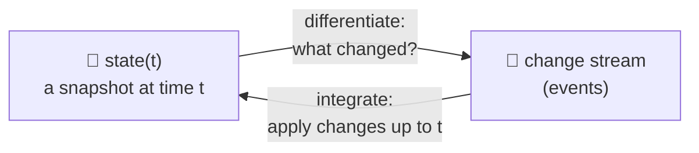

Mathematically: application state is what you get by **integrating** an event stream over time, and a change stream is what you get by **differentiating** the state with respect to time. (An analogy, not to be taken too literally, but a useful mental model.)

If you store the change log durably, the state becomes **reproducible**. Think of the log of events as the **system of record**, and any mutable state as derived from it. Pat Helland's phrase for this idea: the log is the truth, and **the database is a cache of a subset of the log**, namely the latest record values. Log compaction bridges the two: it keeps only the latest version per record, which is exactly what a database holds.

#### Advantages of immutable events

Immutability isn't new. **Accountants** have used it for centuries in financial bookkeeping. Each transaction is recorded as an append-only entry in a **ledger**: essentially a log of events describing money, goods or services changing hands. Profit-and-loss statements and balance sheets are derived from the ledger by adding entries up.

If a mistake is made, accountants don't erase or change the wrong entry. They add a **compensating transaction** that corrects it. Example with my own numbers:

| Entry | Description | Amount |
|---|---|---|
| 1041 | Invoice INV-9 to client Orbit Ltd | +₹ 84,000 |
| 1042 | Correction: INV-9 overbilled (wrong hourly rate) | −₹ 12,000 |
| 1043 | Payment received for INV-9 | −₹ 72,000 (receivable cleared) |

The incorrect amount stays in the ledger forever, which matters for **auditing**. If incorrect figures from it have propagated into reports, those reports are fixed by re-deriving them, not by erasing history.

Software benefits the same ways:

- **Debugging and recovery.** If you deploy buggy code that writes bad data to a mutable database, recovery is much harder: the bad code may have overwritten the good data. With an append-only log, you diagnose what happened and recover by **fixing the code and rebuilding** the derived state.
- **More information than the current state.** Consider a shopper on a grocery app who adds oat milk to the basket and removes it again before checking out. The final order is the same as if they'd never added it, so a mutable DB would show nothing. But for analytics, the add-then-remove is interesting: maybe they were put off by the delivery fee, or they might buy it next time. The event log keeps it; the database would lose it.

#### Deriving several views from the same event log

Separating mutable state from the immutable log lets you derive **several different read-oriented representations** from the **same** event log. It works just like having multiple consumers of a stream:

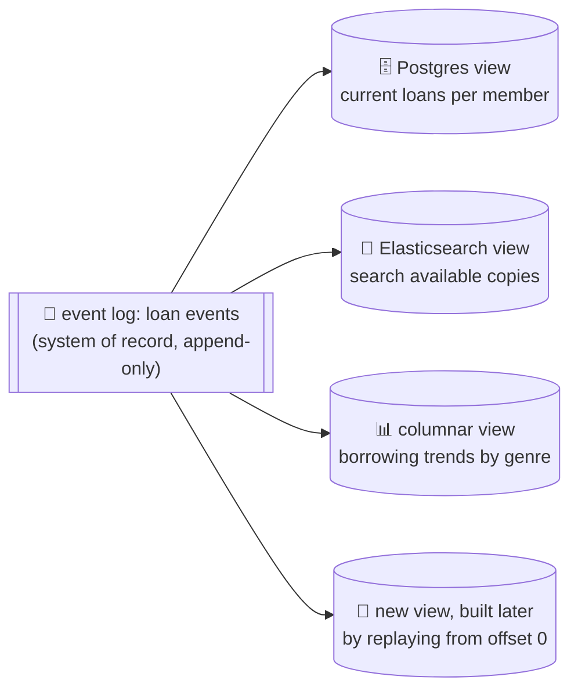

Examples:
- **Druid** ingests directly from Kafka.
- **Pistachio** is a distributed KV store that uses Kafka as a commit log.
- **Kafka Connect sinks** export from Kafka into many databases and indexes.

Having an explicit translation step from event log to database makes **evolving your application** easier. If you want a new feature that presents existing data in a new way, use the event log to build a **separate read-optimised view** for it, run it **alongside** the existing systems, and only shut the old one down when nothing uses it. That's much easier than a complicated schema migration of a live system.

**CQRS (command query responsibility segregation)** is the name for this: separate the form in which data is **written** from the form in which it is **read**, and allow several different read views. You gain a lot of flexibility.

This also dissolves an old debate. Traditional database schema design is built on the fallacy that data must be written in the same form as it will be queried. Debates about **normalisation vs denormalisation** (Chapter 2) become largely irrelevant if you can translate data from a write-optimised event log into read-optimised views: it's reasonable to **denormalise in the read views**, because the translation process keeps them consistent with the log.

A small worked example of read-optimised state: a social app where people "clap" for articles. The write side is simple: append `ClapGiven(article, user)`. The read side might keep **two** views: a per-article counter (for the article page) and a per-user "recently clapped" list (for the profile page). Each read is a single cheap lookup; the price is paid at write time by updating both views from the stream. This is the same **fan-out-on-write** trade-off we saw for home timelines in Chapter 1.

#### Concurrency control

The biggest **downside** of event sourcing and CDC: consumers of the event log are usually **asynchronous**. A user might write to the log, then read from a log-derived view and **not see their own write**, because the view hasn't caught up. Chapter 5's **read-your-writes** problem.

Solutions:

1. **Update the read view synchronously** with appending to the log. That needs a transaction combining both writes: either both in the same storage system, or a distributed transaction across them. Alternatively, use the approaches from Chapter 9 for linearizable storage via total order broadcast.
2. Or design so that the client is routed to a view that has caught up at least to the client's last write offset.

On the other hand, deriving current state from an event log also **simplifies** some concurrency problems. Much of the need for **multi-object transactions** (Chapter 7) comes from a single user action needing to change data in several places. With event sourcing, you can design an event so it's a **self-contained description** of one user action. The user action then needs only **one write**, one append to the log, which is easy to make atomic.

If the event log and the application state are **partitioned the same way** (for example, all events for member M-310 go to partition 4, and the view for M-310 also lives on partition 4), then a **single-threaded log consumer per partition** needs no concurrency control for writes at all: it processes one event at a time, in log order (the "actual serial execution" approach of Chapter 7). The log removes the non-determinism of concurrency by defining a **serial order** of events within a partition. If an event touches several partitions, more work is needed (Chapter 12).

#### Limitations of immutability

Many systems that don't use an event-sourced model still rely on immutability: databases use immutable structures or multi-version data for point-in-time snapshots (Chapter 7), and **Git**, **Mercurial** and **Fossil** use immutable data to preserve version history. How far can you push keeping an immutable history of **all** changes forever? It depends on the **amount of churn** in the dataset:

| Workload | Immutable history? |
|---|---|
| Mostly adds, rarely updates or deletes (e.g. sensor readings, orders) | Easy to keep immutable |
| Very high rate of updates and deletes on a small dataset (e.g. a live leaderboard, a hot counter) | History grows prohibitively large; **fragmentation** becomes an issue; **compaction and garbage collection** performance becomes crucial for operational robustness |

Beyond performance, there may be circumstances where you **must** delete data even though it's immutable by design:

- **Privacy regulations** (GDPR's right to erasure, for example) may require deleting a user's personal information after they close their account.
- **Data protection law** may require erasing incorrect information.
- An accidental leak of sensitive information (a password pasted into a support ticket) may need to be contained.

In these cases it isn't enough to append another event saying "data X is deleted": you need to actually **rewrite history** and pretend the data was never written. **Datomic** calls this **excision**; **Fossil** has a similar concept called **shunning**.

**Truly deleting data is surprisingly hard.** Copies live in many places: storage engines, filesystems and SSDs often write to a new location rather than overwrite in place, and **backups** are often deliberately immutable to prevent accidental deletion or corruption. Deletion is more a matter of "**making it harder to retrieve** the data" than "making it impossible to retrieve". You have to try anyway (Chapter 12 returns to this). A practical technique is **crypto-shredding**: encrypt each user's personal fields with a per-user key, and "delete" by destroying the key, which makes every copy unreadable, including those in old log segments and backups.

## 11.3 Processing streams

<BookRef pages="486–501" section="Processing Streams" />

We've covered where streams come from (user activity, sensors, database writes) and how they're transported (direct messaging, brokers, logs). What can you **do** with a stream? Broadly three things:

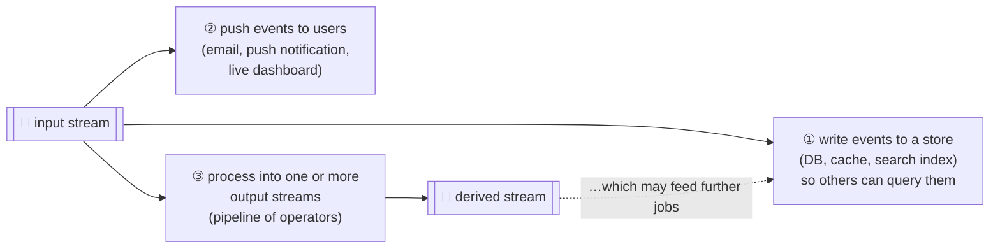

Options 1 and 2 are where a human or another system consumes the stream. This section is mostly about option 3: a **stream processor** (or **job**) that reads streams and produces new streams. The structure looks a lot like Unix pipes and MapReduce: a stream processor consumes input streams in a **read-only** fashion and writes output to a different location in an **append-only** fashion.

The patterns for **partitioning and parallelisation** are very similar to batch. Basic operations like **transforming and filtering** records work the same. The **one crucial difference**: a stream **never ends**. Consequences:

- **Sorting** doesn't make sense on an unbounded dataset, so **sort-merge joins can't be used**.
- **Fault tolerance** changes: a batch job running for minutes can just be restarted from the beginning, but restarting a stream job that's been running for years from the beginning is not an option.

### Uses of stream processing

<BookRef pages="487–490" section="Uses of Stream Processing" />

Stream processing has long been used for **monitoring**, where an organisation wants to be alerted when certain things happen:

- **Fraud detection:** a credit card used in an unusual pattern ("five purchases in three countries within an hour").
- **Trading systems:** examine price changes and execute trades per rules.
- **Manufacturing:** monitor machine status and quickly identify a malfunction.
- **Military and intelligence:** track activity of a potential aggressor and raise alarms on signs of attack.

These need fairly sophisticated pattern matching and correlation. Other uses have also emerged over time.

#### Complex event processing

**Complex event processing (CEP)** came out of the 1990s for analysing event streams, especially for applications that must **search for certain event patterns**. Like a regular expression lets you search for character patterns in a string, CEP lets you specify rules to search for certain **patterns of events** in a stream.

CEP systems often use a high-level declarative query language like SQL, or a graphical UI, to describe the patterns. The queries are submitted to a processing engine that consumes the input streams and internally keeps a **state machine** to perform the matching. When a match is found, the engine emits a **complex event** (hence the name) with the details of the detected pattern.

<KeyIdea title="The database relationship, inverted">In a normal database, data is stored persistently and queries are transient: a query comes in, finds matching data, and is forgotten. In CEP, the **queries are stored long-term**, and events from the input stream continuously flow past them in search of a match.</KeyIdea>

A pseudo-CEP rule in a SQL-like syntax (Flink SQL's `MATCH_RECOGNIZE` works roughly this way):

```sql
-- Alert: a login from a new device, then a payout-address change,
-- then a large withdrawal, all within 20 minutes, for the same account.
SELECT * FROM account_events
MATCH_RECOGNIZE (
  PARTITION BY account_id
  ORDER BY event_time
  MEASURES A.event_time AS login_at, C.amount AS withdrawn
  PATTERN (A B C) WITHIN INTERVAL '20' MINUTE
  DEFINE
    A AS A.type = 'login'           AND A.new_device = TRUE,
    B AS B.type = 'payout_changed',
    C AS C.type = 'withdrawal'      AND C.amount > 50000
);
```

Implementations: **Esper**, **IBM InfoSphere Streams**, **Apama**, **TIBCO StreamBase**, **SQLstream**, and the **Flink CEP** library. Distributed stream processors like **Samza** also support declarative queries on streams.

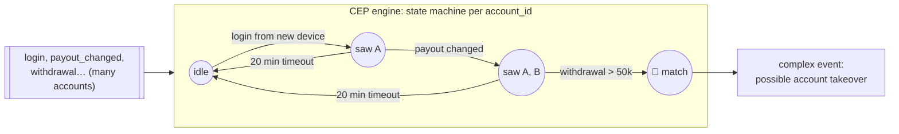

#### Stream analytics

The boundary between CEP and stream analytics is blurry, but as a rule, **analytics** is less interested in finding specific event sequences and more oriented toward **aggregations and statistical metrics** over a large number of events:

- Measuring the **rate** of some type of event (how often it happens per time interval).
- Computing the **rolling average** of a value over a time period.
- Comparing current statistics to previous intervals (to detect trends, or alert on unusually high or low metrics versus the same time last week).

Such statistics are usually computed over **fixed time intervals**, called **windows** (more on windows below). For example, "average checkout latency over the last 5 minutes": averaging over a few minutes smooths out irrelevant fluctuations between individual seconds while still giving a timely picture of any change in traffic.

Stream analytics systems sometimes use **probabilistic algorithms**:

| Algorithm | Approximates | Memory |
|---|---|---|
| **Bloom filter** | Set membership ("have we seen this device ID?") | A few bits per element |
| **HyperLogLog** | Cardinality ("how many unique visitors this hour?") | ~kilobytes for billions of items, ~1–2% error |
| **Count-Min sketch** | Frequency of each item ("top hashtags") | Fixed table of counters |
| **t-digest**, HDR histogram | Percentiles ("p99 latency") | Compact summaries |

These give approximate results but need **significantly less memory** than exact algorithms. This has led to the misconception that stream processing is inherently lossy and inexact. There's nothing inherently approximate about stream processing: probabilistic algorithms are **merely an optimisation**.

Frameworks with analytics in mind: **Apache Storm**, **Spark Streaming** (and Structured Streaming), **Flink**, **Concord**, **Samza**, **Kafka Streams**. Hosted services: **Google Cloud Dataflow**, **Azure Stream Analytics**, **Amazon Kinesis Data Analytics** (now Managed Service for Apache Flink).

#### Maintaining materialised views

We saw earlier that a stream of database changes can keep derived data systems (caches, search indexes, warehouses) up to date with a source database. These are specific cases of **maintaining materialised views** (Chapter 3): deriving an alternative view onto a dataset so you can query it efficiently, and **updating that view whenever the underlying data changes**.

Similarly, in event sourcing, application state is maintained by applying a log of events: the application state is also a kind of materialised view.

Unlike stream analytics, it's usually **not sufficient to consider only events within a time window**. Building the materialised view potentially requires **all events over an arbitrary time period**, apart from obsolete events discarded by log compaction. In effect, you need a window that stretches all the way back to the beginning of time.

In principle any stream processor can maintain a materialised view, but needing to keep events forever runs counter to the assumptions of some analytics-oriented frameworks that mostly operate on windows of limited duration. **Samza** and **Kafka Streams** support this kind of usage, building on Kafka's log compaction. Newer systems like **Materialize** and **RisingWave** make "incrementally maintained SQL views over streams" the main product.

#### Search on streams

Besides CEP's multi-event patterns, sometimes you need to search for individual events based on **complex criteria**, such as full-text search queries.

Example: a job-board app lets candidates save searches ("senior Rust roles, remote, salary above X") and get notified when a new posting matches. Similarly, media-monitoring services subscribe to news feeds and alert on articles mentioning a given company or topic. This is done by formulating a search query in advance and continually matching the stream of new items against it. The **percolator** feature of **Elasticsearch** is one way to implement it.

Conventional search engines first index documents, then run queries over the index. Searching a stream **turns this on its head**: the **queries are stored**, and the documents run past the queries, as in CEP.

With very many stored queries, testing every document against every query gets slow. To optimise, you can **index the queries as well as the documents**, and so narrow down the set of queries that may match. For example, only test the query against new postings whose `language` field equals "Rust".

#### Message passing and RPC

Earlier we noted that message-passing systems can be an alternative to RPC: a mechanism for services to communicate, as used in the **actor model**. Although those systems are also based on messages and events, we normally **don't think of them as stream processors**:

| | Actor frameworks | Stream processing |
|---|---|---|
| Primary purpose | Managing **concurrency** and distributed execution of communicating modules | **Data management** technique |
| Communication | Ephemeral and **one-to-one** | Durable and **multi-subscriber** (event logs) |
| Topology | Arbitrary, including **cyclic** request/response | Usually **acyclic** pipelines, each stream output of one job |

That said, there's some **crossover** between RPC-like systems and stream processing:

- **Apache Storm** has a feature called **distributed RPC**: user queries are farmed out to a set of nodes that also process event streams; the queries are interleaved with events from the input streams, and results can be aggregated and sent back to the user.
- It's also possible to process streams using **actor frameworks**. But many such frameworks don't guarantee message delivery in case of crashes, so processing isn't fault-tolerant unless you add retry logic.

### Reasoning about time

<BookRef pages="490–494" section="Reasoning About Time" />

Stream processors often need to deal with time, especially for analytics ("average over the last five minutes"). The meaning of "the last five minutes" seems obvious, but it's surprisingly **tricky**.

In a **batch** process, tasks rapidly crunch through a large collection of historical events. If windowing by time is needed, the batch job must look at the **timestamp embedded in each event**. There's no point looking at the system clock of the machine running the batch job: the time at which the process runs has nothing to do with when the events actually occurred. A batch job can process a year of events in minutes. Using the event's timestamp makes processing **deterministic**: running it again on the same input yields the same result.

Many stream processing frameworks, on the other hand, use the **local system clock** on the processing machine (the **processing time**) to decide windowing. Simple, and reasonable **if** the delay between event creation and processing is negligibly short. But it breaks down with any significant **processing lag**.

#### Event time versus processing time

Many things can delay processing: queueing, network faults, performance issues leading to contention in the broker or processor, a restart of the stream consumer, or **reprocessing** past events while recovering from a fault or after fixing a bug.

Message delays can also lead to **unpredictable ordering**. Example: a user makes one web request (handled by server A) and then a second (handled by server B). A and B emit events describing the requests, but B's event reaches the broker before A's. Now stream processors see the events in the opposite order to the order they actually happened.

Analogy: think of a **TV series released out of order**. A streaming platform lists season 3 before season 1 because of a licensing glitch; viewers who watch in "release order" get a confusing story, even though the episodes themselves carry the in-story chronology. The release order is processing time; the in-story order is event time.

Confusing event time and processing time leads to **bad data**. Example with my own numbers:

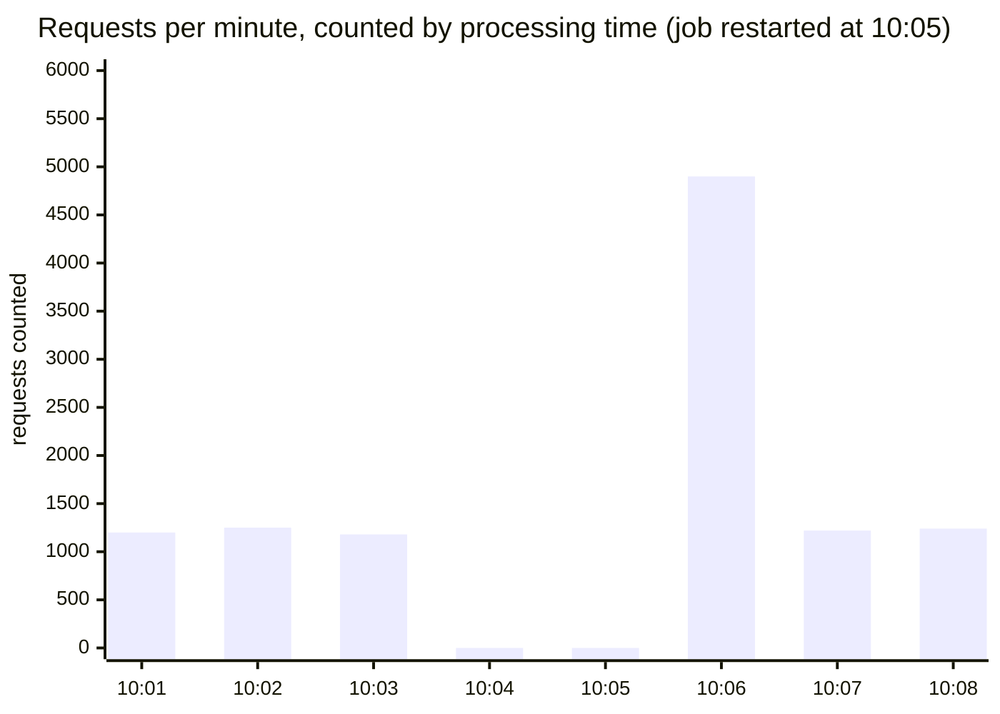

The real request rate was a steady ~1,200 per minute. The stream processor was down from 10:04 to 10:06; when it restarted it processed the **backlog** all at once. Windowed by **processing time**, the chart shows a dip to zero followed by a huge spike that never happened. Windowed by **event time**, the chart would show a flat ~1,200/minute line (once the late data arrived).

#### Knowing when you're ready

A tricky problem when defining windows in terms of event time: **you can never be sure when you've received all events** for a particular window.

Say you group events into one-minute windows and count requests per minute. You've counted events with timestamps in the 14:37 minute, and time has moved on: events now arriving are from 14:38 and 14:39. When can you declare the 14:37 window complete and output its count?

You can **time out** and declare a window ready after you haven't seen any new events for it for a while. But it's still possible some events were buffered on another machine (delayed by a network interruption) and arrive later. Such events are called **stragglers**: they arrive after the window was declared complete.

Two broad options for handling stragglers:

1. **Ignore** them. They're probably a small percentage, so drop them, but **track the number of dropped events** as a metric and alert if you start dropping a lot.
2. **Publish a correction**: an updated value for the window with stragglers included. You may also need to **retract** the previous output.

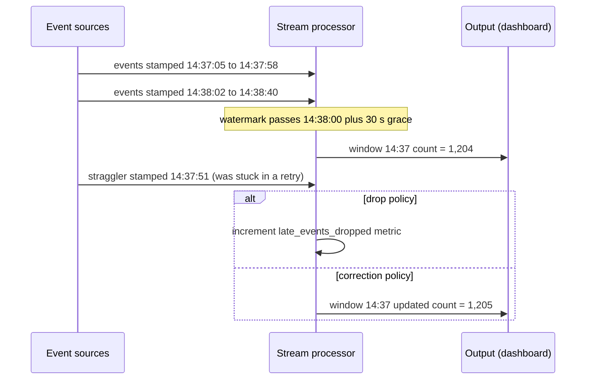

In some cases you can use a special message to say "from now on there will be no more messages with a timestamp earlier than t", which consumers use to trigger windows. This is the idea of a **watermark** (the term used by Google's Dataflow model, Apache Beam and Flink). However, if several producers on different machines generate events, each with its own minimum timestamp threshold, consumers need to keep track of **each producer individually**. Adding and removing producers is trickier in this case.

Watermarks are a **heuristic trade-off** between latency and completeness: wait longer and fewer events are late, but results arrive later.

#### Whose clock are you using, anyway?

Assigning timestamps to events is even harder when events can be **buffered at several points** in the system. Example: a fitness watch records workout events while offline (on a hike with no signal) and uploads them to the server when it next syncs with the phone, maybe **hours or days later**. To any consumer of this stream, the events will appear as **extremely delayed stragglers**.

In this context, the timestamp on the events should really be the time at which the **user interaction occurred**, according to the **device's local clock**. But the clock on a user-controlled device often **can't be trusted**: it may be accidentally or deliberately set to the wrong time (Chapter 8). The time the server received the event (server clock) is more likely accurate, since the server is under your control, but less meaningful for describing the user interaction.

To adjust for incorrect device clocks, log **three timestamps**:

1. The time the event **occurred**, according to the **device clock**.
2. The time the event was **sent** to the server, according to the **device clock**.
3. The time the event was **received** by the server, according to the **server clock**.

By subtracting (2) from (3), you can estimate the **offset** between the device clock and the server clock (assuming the network delay is negligible compared to the timestamp precision). Apply that offset to (1) to estimate the **true time** the event occurred (assuming the device clock offset didn't change between occurrence and sending).

Worked example (my own numbers):

```text
(1) occurred, device clock:  2026-06-02 07:15:00   (hike, offline)
(2) sent,     device clock:  2026-06-02 19:40:00   (phone synced in the evening)
(3) received, server clock:  2026-06-02 19:52:30

offset = (3) − (2) = +12 min 30 s   → device clock runs 12.5 min slow
true event time ≈ (1) + offset = 2026-06-02 07:27:30
```

This problem isn't unique to stream processing: batch processing suffers from exactly the same issues of reasoning about time. It's just more **noticeable** in a streaming context, where we're more aware of the passage of time.

#### Types of windows

Once you know how to determine an event's timestamp, define windows over periods of time. The window can be used for aggregations (counting events, average value within the window). Four common types:

```mermaid
gantt
  title Four window types on one timeline (minutes past 09:00)
  dateFormat mm
  axisFormat %M
  section Tumbling 4 min
  t1 :00, 4m
  t2 :04, 4m
  t3 :08, 4m
  section Hopping 4 min every 2 min
  h1 :00, 4m
  h2 :02, 4m
  h3 :04, 4m
  h4 :06, 4m
  section Sliding 4 min
  around event at 05 :01, 4m
  around event at 07 :03, 4m
  section Session gap 3 min
  user Ana session 1 :00, 5m
  user Ana session 2 :09, 2m
```

**Tumbling window.** Fixed length; **every event belongs to exactly one window**. A 4-minute tumbling window puts all events with timestamps 09:00:00–09:03:59 into one window, 09:04:00–09:07:59 into the next, and so on. Implementation: take each event's timestamp and **round it down** to the nearest 4 minutes to find its window.

```python
def tumbling_window_start(ts_seconds, size=240):
    return ts_seconds - (ts_seconds % size)
```

**Hopping window.** Also fixed length, but windows **overlap** to provide some smoothing. A 4-minute window with a hop size of 2 minutes contains events 09:00:00–09:03:59, then 09:02:00–09:05:59, and so on. Implementation: first compute **2-minute tumbling windows**, then **aggregate over several adjacent windows**. Each event belongs to `size / hop` = 2 windows.

**Sliding window.** Contains **all events that occur within some interval of each other**. A 4-minute sliding window would include events at 09:03:39 and 09:07:09, because they're less than 4 minutes apart (a tumbling or hopping window might put them in different windows, since they use fixed boundaries). Implementation: keep a **buffer of events sorted by time** and remove old events when they expire from the window.

**Session window.** **No fixed duration**. Defined by grouping together all events for the same user that occur closely together in time, ending when the user has been **inactive** for some time (e.g. 30 minutes). Common in website analytics ("how long was the visit?", "how many pages per session?").

| Window | Fixed length? | Overlap? | Typical use |
|---|---|---|---|
| Tumbling | Yes | No | Per-minute counts, billing per hour |
| Hopping | Yes | Yes (by `size − hop`) | Smoothed moving averages on a dashboard |
| Sliding | Yes (interval between events) | Yes, continuous | "More than 5 failed logins within 2 minutes" |
| Session | No | No (per key) | Visit length, pages per visit, user journeys |

### Stream joins

<BookRef pages="494–498" section="Stream Joins" />

Chapter 10 discussed how batch jobs join datasets by key, and how such joins are an important part of data pipelines. Since stream processing generalises data pipelines to incremental processing of unbounded datasets, there's exactly the same need for **joins on streams**.

But new events can appear **anytime**, which makes joins harder than in batch. Three types:

```mermaid
flowchart TB
  J{"Stream joins"}
  J --> SS["🔁 stream-stream<br/>(window join)<br/>both sides are activity events"]
  J --> ST["📇 stream-table<br/>(enrichment)<br/>one side is a changelog of a table"]
  J --> TT["🗂️ table-table<br/>(materialised view maintenance)<br/>both sides are changelogs"]
```

#### Stream-stream join (window join)

Example: a food-delivery app wants to measure how long restaurants take to accept orders, and how often orders are **never accepted** (so they can be auto-cancelled and refunded). Two event streams:

- `order_placed` (order id, restaurant, time) from the checkout service,
- `order_accepted` (order id, time) from the restaurant tablet app.

To compute acceptance rate and latency, bring together events for the same order ID. Note that the acceptance may **never arrive** (restaurant busy, tablet offline), and even if it does, the time between the two events is highly variable: usually seconds, occasionally many minutes. And because of delays, the "accepted" event might even **arrive at the processor before** the "placed" event.

So you choose a **suitable window** for the join, for example: join a placement and an acceptance if they occur within 15 minutes of each other.

Implementation: the stream processor **maintains state**. All events in the last 15 minutes, **indexed by order ID**. Whenever an `order_placed` or `order_accepted` event arrives, add it to the appropriate index and check the other index for an event with the same order ID. On a match, emit an event saying the order was accepted, with the latency. When a placement **expires** without a matching acceptance, emit an event saying the order was never accepted.

```mermaid
sequenceDiagram
  participant PL as order_placed stream
  participant JP as Join processor (15-min state)
  participant AC as order_accepted stream
  participant OUT as Output stream
  PL->>JP: placed O-501 at 19:02:10
  Note over JP: store O-501 in placed-index
  AC->>JP: accepted O-501 at 19:02:48
  JP->>OUT: O-501 accepted after 38 s
  PL->>JP: placed O-502 at 19:03:00
  Note over JP: no acceptance arrives
  Note over JP: 19:18:00 the 15-min window for O-502 expires
  JP->>OUT: O-502 never accepted, trigger refund
  AC->>JP: accepted O-503 at 19:04:05 (arrived first)
  PL->>JP: placed O-503 at 19:04:01 (arrived late)
  JP->>OUT: O-503 accepted after 4 s
```

(To compute this you also need the placement event: you can't just embed the "placed" details in the "accepted" event, because the acceptance may never happen. And there are two independent services producing them.)

#### Stream-table join (stream enrichment)

Example: a payments processor receives a stream of **card transactions**, each with a merchant ID. A fraud model needs the merchant's **category** and **risk tier**, which live in a `merchants` table in the database. Joining each transaction with the table to add merchant info is called **enriching** the activity events.

```mermaid
flowchart LR
  TX[["💳 card transactions<br/>(merchant_id, amount)"]] --> JOIN["⚙️ enrich operator"]
  subgraph LOCAL["local state inside the job"]
    MT[("merchants copy<br/>merchant_id → category, risk")]
  end
  DB[("🗄️ merchants table<br/>(system of record)")] -->|"CDC changelog"| MT
  MT --- JOIN
  JOIN --> OUT[["enriched transactions<br/>(…, category, risk_tier)"]]
```

Two ways to look up the merchant:

1. **Query the remote database** for every event. Slow and risks overloading the database (and the result can change between replays, so it's non-deterministic).
2. **Load a copy of the table into the stream processor** (in an in-memory hash table if small enough, or an index on local disk) so lookups are local. This is very similar to the **hash joins / map-side joins** of Chapter 10.

The difference from batch: the batch job uses a point-in-time snapshot of the table as input, but a stream processor is long-running and the **contents of the table change** over time. So the local copy must be **kept up to date**, which is done with **change data capture**: the stream processor subscribes to a changelog of the `merchants` table as well as the transaction stream. When a merchant is created or modified, the processor updates its local copy.

So a stream-table join is really a join between **two streams**: the activity stream and the table's changelog. The table changelog stream is like a window that reaches back to the "beginning of time" (with newer versions of a record overwriting older ones), while the activity stream may have no window at all. Kafka Streams models exactly this as a **KStream-KTable join**.

#### Table-table join (materialised view maintenance)

Example: a podcast app shows each listener a "**New episodes**" inbox: the latest episodes from shows they follow. Same fan-out idea as social timelines:

- When a show publishes an episode, add it to the inbox of every follower.
- When a show **deletes** an episode (say, a mistaken upload), remove it from every follower's inbox.
- When a listener **follows** a show, add that show's recent episodes to their inbox.
- When a listener **unfollows** a show, remove its episodes from their inbox.

To implement this cache maintenance in a stream processor, you need streams of events for **episodes** (publish and delete) and for **follow relationships** (follow and unfollow). The processor maintains a database containing the **set of followers for each show**, so it knows which inboxes to update when a new episode arrives.

Viewed another way, this stream process maintains a **materialised view** for a query that joins two tables:

```sql
SELECT f.listener_id, array_agg(e.* ORDER BY e.published_at DESC) AS inbox
FROM episodes e
JOIN follows f ON f.show_id = e.show_id
GROUP BY f.listener_id;
```

The join of the streams corresponds directly to the join of the tables in that query. The timelines are effectively a **cache of the result of this query**, updated every time the underlying tables change.

<KeyIdea>If you think of a stream as the derivative of a table and a join as a product of two tables u·v, then the change to the join result follows the product rule: (u·v)′ = u′v + uv′. A change to episodes is joined with the current followers, and a change to follows is joined with the current episodes.</KeyIdea>

```mermaid
flowchart LR
  EP[["episodes changelog<br/>(publish / delete)"]] --> P["⚙️ join processor"]
  FO[["follows changelog<br/>(follow / unfollow)"]] --> P
  subgraph STATE["state kept by the processor"]
    S1[("show → followers")]
    S2[("show → recent episodes")]
  end
  P <--> S1
  P <--> S2
  P --> INB[("📥 listener inboxes<br/>(materialised view)")]
```

#### Time-dependence of joins

The three joins have a lot in common: they all require the stream processor to **maintain some state** (search and click events, merchant profiles, follower lists) based on one join input, and query that state on messages from the other join input.

The **order of the events** that maintain the state matters (it matters whether you first follow and then unfollow, or the other way round). In a partitioned log, ordering within a partition is preserved, but there's typically **no ordering guarantee across different streams or partitions**.

This raises a question: if events on different streams happen around a similar time, **in which order are they processed**? In the stream-table join, if a merchant's risk tier is updated, which transactions are joined with the old tier (processed before the update) and which with the new one (processed after)? Put another way: if state changes over time and you join with some state, **what point in time do you use for the join**?

Such time dependence occurs in many places. Example: an online shop sells across currencies and must convert each sale at the **exchange rate in effect at the time of sale**, which may differ from today's rate. When joining sales with a table of exchange rates, you probably want to join with the rate **at the time of the sale**, which might not be the current rate if you're reprocessing historical data.

If the ordering of events across streams is undetermined, the join becomes **nondeterministic**: you can't rerun the same job on the same input and necessarily get the same result. Events on the input streams may be interleaved differently when you run the job again.

In data warehouses this is known as a **slowly changing dimension (SCD)**, and it's often addressed by using a **unique identifier for a particular version** of the joined record:

```text
exchange_rates (versioned)
rate_id | pair     | rate   | valid_from
--------+----------+--------+--------------------
R-1001  | USD/INR  | 83.10  | 2026-02-01 00:00
R-1002  | USD/INR  | 83.45  | 2026-02-08 00:00
R-1003  | USD/INR  | 82.90  | 2026-02-15 00:00

sales
sale_id | amount_usd | sold_at           | rate_id
--------+------------+-------------------+--------
S-77    | 120.00     | 2026-02-10 14:12  | R-1002   ← recorded at time of sale
```

Every time the rate changes, it gets a new identifier, and the sale event includes the identifier of the rate at the time of sale. The join is now **deterministic**. The cost: **log compaction isn't possible**, since all versions of the records in the table must be retained. Flink SQL and Kafka Streams support **temporal joins** ("join with the version valid as of the event's timestamp") that automate this.

### Fault tolerance

<BookRef pages="498–501" section="Fault Tolerance" />

Chapter 10 showed how batch frameworks tolerate faults fairly easily: if a task in a MapReduce job fails, it can simply be restarted on another machine, and the output of the failed task is discarded. This is possible because input files are immutable, each task writes its output to a separate file on HDFS, and output is only made visible when a task completes successfully.

In particular, the batch approach ensures that the **output of the job is the same as if nothing had gone wrong**, even if some tasks did fail. It appears as though every input record was processed **exactly once**: no records skipped, none processed twice. Restarting tasks means records may in fact be processed multiple times, but the **visible effect in the output** is as if they'd only been processed once. This principle is known as **exactly-once semantics**, although **effectively-once** would be a more descriptive term.

The same issue arises in stream processing, but it's less straightforward: waiting until a task is finished before making its output visible isn't an option, because a stream is infinite and you can never finish processing it.

```mermaid
flowchart TB
  FT{"How do stream processors get<br/>exactly-once (effectively-once) results?"}
  FT --> MB["🔹 Microbatching<br/>split the stream into small batches"]
  FT --> CP["🔹 Checkpointing<br/>periodic consistent snapshots of state"]
  FT --> AC["🔹 Atomic commit<br/>output + offsets + state commit together"]
  FT --> ID["🔹 Idempotence<br/>duplicates have no extra effect"]
  FT --> RS["🔹 Rebuilding state<br/>recover operator state after a crash"]
```

#### Microbatching and checkpointing

**Microbatching**: break the stream into small blocks and treat each block like a miniature batch process. Used in **Spark Streaming**. The batch size is typically around **one second**, which is a performance compromise: smaller batches incur more scheduling and coordination overhead; larger batches mean a longer delay before results are visible.

Microbatching also implicitly provides a **tumbling window equal to the batch size** (windowed by processing time, not event timestamps). Any job that needs larger windows must explicitly carry state from one microbatch to the next.

**Checkpointing**, used in **Apache Flink**: periodically generate rolling checkpoints of state and write them to durable storage. If a stream operator crashes, it can restart from its most recent checkpoint and discard any output generated between the last checkpoint and the crash. The checkpoints are triggered by **barriers** in the message stream, similar to the boundaries between microbatches, but without forcing a particular window size.

```mermaid
sequenceDiagram
  participant SRC as Kafka source
  participant OP as Operator (counts per key)
  participant ST as Durable checkpoint store (S3)
  SRC->>OP: events at offsets 1000 to 1999
  SRC->>OP: barrier for checkpoint 17
  OP->>ST: snapshot state and source offset 2000
  ST-->>OP: checkpoint 17 complete
  SRC->>OP: events at offsets 2000 to 2600
  Note over OP: crash
  OP->>ST: load checkpoint 17
  Note over OP: state restored as of offset 2000
  OP->>SRC: seek to offset 2000 and replay
```

Within the confines of the stream processing framework, microbatching and checkpointing provide the **same exactly-once semantics** as batch processing. However, as soon as output **leaves** the stream processor (writing to a database, sending messages to an external broker, or sending emails), the framework can no longer discard the output of a failed batch. Restarting a failed task then causes the external side effect to **happen twice**, and microbatching or checkpointing alone isn't sufficient to prevent this.

#### Atomic commit revisited

To give the appearance of exactly-once processing in the presence of faults, we need to ensure that **all outputs and side effects** of processing an event take effect **if and only if** the processing is successful. Those effects include:

- any messages sent to downstream operators or external messaging systems (including email or push notifications),
- any database writes,
- any changes to operator state,
- any acknowledgement of input messages (including moving the consumer offset forward in a log-based broker).

These things either **all happen atomically, or none of them happen**, and they must not go out of sync with each other. If this sounds familiar, it's because we discussed it in Chapter 9 under **exactly-once message processing in distributed transactions**.

There, we covered traditional XA distributed transactions. More restricted environments can implement such atomic commit facilities **efficiently**:

- **Google Cloud Dataflow** and **VoltDB** do it.
- **Apache Kafka** added **transactions** (with idempotent producers): a processor that reads from Kafka and writes to Kafka can commit its output messages **and** its consumer offsets in a single atomic transaction.

Unlike XA, these implementations don't attempt to provide transactions across heterogeneous technologies. They keep transactions **internal** by managing both state changes and messaging within the stream processing framework. The overhead of the transaction protocol can be amortised by processing several input messages within a single transaction.

```mermaid
flowchart LR
  IN[["input topic<br/>offset 7,400"]] --> P["⚙️ processor<br/>(Kafka transaction T-88)"]
  P -->|"write"| OUT[["output topic"]]
  P -->|"write"| CH[["state changelog topic"]]
  P -->|"write offset 7,401"| OFF[["__consumer_offsets"]]
  OUT -.- TX["✅ commit T-88:<br/>all three become visible together,<br/>or abort: none do"]
  CH -.- TX
  OFF -.- TX
```

Downstream consumers configured with `isolation.level=read_committed` only see output from committed transactions.

#### Idempotence

Our goal is to discard the partial output of any failed tasks so they can be safely retried without taking effect twice. Distributed transactions are one way, but another way is to rely on **idempotence**.

An **idempotent operation** is one you can perform multiple times, and it has the same effect as if you performed it only once.

| Operation | Idempotent? |
|---|---|
| Set key `stock:sku-9` to 14 | ✅ Yes: setting it again gives the same result |
| Increment counter `stock:sku-9` by 1 | ❌ No: doing it twice adds 2 |
| Insert row with primary key `event_id`, ignore if exists | ✅ Yes |
| Send "your parcel shipped" email | ❌ No |
| Append to a list | ❌ No (unless deduplicated) |

Even if an operation isn't naturally idempotent, it can often be **made idempotent with a bit of extra metadata**. For example, when consuming from Kafka, every message has a persistent, monotonically increasing **offset**. When writing a value to an external database, you can include the offset of the message that triggered the last write. Then you can tell whether an update has already been applied, and avoid performing it again.

```sql
-- Store the offset that produced each row alongside the value.
UPDATE inventory
SET    quantity     = quantity - 1,
       last_offset  = 88213
WHERE  sku = 'sku-9'
  AND  last_offset < 88213;   -- already applied? then 0 rows change
```

The state handling in **Storm's Trident** is based on a similar idea. Relying on idempotence implies several **assumptions**:

- restarting a failed task must **replay the same messages in the same order** (a log-based broker does this),
- the processing must be **deterministic**,
- **no other node may concurrently update** the same value.

When failing over from one processing node to another, **fencing** (Chapter 8) may be required to prevent interference from a node that's thought to be dead but is actually alive (a zombie). Despite these caveats, idempotent operations can be an effective way to achieve exactly-once semantics with only **a small overhead**.

#### Rebuilding state after a failure

Any stream process that requires state (windowed aggregations such as counters, averages and histograms; tables and indexes used for joins) must ensure that this **state can be recovered** after a failure.

| Approach | How | Used by |
|---|---|---|
| **Remote datastore** | Keep state in a remote DB and replicate it there | Simple, but querying a remote DB for every message is **slow** |
| **Local state + periodic snapshots** | Keep state local to the processor; snapshot it to durable storage (HDFS, S3) | **Flink** |
| **Local state + changelog topic** | Replicate state changes to a dedicated **log-compacted Kafka topic**, like CDC for the operator's state | **Samza**, **Kafka Streams** |
| **Replicated in-memory state** | Run each input partition's processing on several nodes | **VoltDB** |
| **Rebuild from input** | If state is a short window, just replay the input for that window | Any framework, for small windows |

```mermaid
flowchart LR
  subgraph NODE1["node 1 (crashes)"]
    T1["task: count per merchant"] --> RDB1[("local RocksDB")]
  end
  RDB1 -->|"every state change"| CL[["compacted changelog topic<br/>merchant → count"]]
  subgraph NODE2["node 2 (takes over)"]
    T2["same task, restarted"] --> RDB2[("local RocksDB<br/>restored from changelog")]
  end
  CL -->|"replay to restore"| RDB2
```

In some cases it may not even be necessary to replicate the state, because it can be **rebuilt from the input streams**. If the state consists of aggregations over a fairly short window, it may be fast enough to replay the input events for that window. If the state is a local replica of a database maintained by CDC, the database can also be rebuilt from the log-compacted change stream.

All of these trade-offs depend on the **performance characteristics of the underlying infrastructure**:
- In some systems, network delay may be lower than disk access latency, and network bandwidth may be comparable to disk bandwidth.
- There's no universally ideal trade-off for all situations; the merits of local vs remote state may shift as storage and networking technologies evolve.

<KeyIdea>Exactly-once is never magic. It's built from replayable input, deterministic processing, and either atomic commit of all effects or idempotent effects. Anything that escapes the system before commit (an email, a call to a third-party API) can still happen twice unless that external system cooperates, for example via an idempotency key.</KeyIdea>

## Summary

<BookRef pages="501–509" section="Summary" />

This chapter covered event streams, what purposes they serve, and how to process them. In some ways stream processing is very much like batch processing (Chapter 10), but done **continuously on unbounded** (never-ending) streams rather than on a fixed-size input. From this perspective, **message brokers and event logs** serve as the streaming equivalent of a filesystem.

**Two types of message broker:**

| | AMQP/JMS-style broker | Log-based broker |
|---|---|---|
| Delivery | Broker assigns individual messages to consumers; consumers ack each one | All messages in a partition go to the same consumer node, always in the same order |
| After processing | Message **deleted** when acked | Message **retained** on disk |
| Parallelism | Per message | Per partition |
| Progress tracking | Acks per message | One **offset** per consumer per partition |
| Replay | Not possible | Rewind the offset |
| Good for | Asynchronous RPC-like task queues, where order doesn't matter and you don't need to go back | Database-like durable streams, ordering, replay; similar to a leader-follower replication log |

**Where streams come from:** user activity events, sensors providing periodic readings, data feeds (e.g. market data), and **writes to a database**, captured either implicitly via **change data capture** or explicitly via **event sourcing**. **Log compaction** allows the stream to retain a full copy of the database contents.

Representing databases as streams opens powerful opportunities for **integrating systems**: you can keep derived systems such as search indexes, caches and analytics systems continually up to date by consuming the change log and applying changes in order. You can even build fresh views onto existing data by starting from scratch and consuming the log from the beginning to the present.

**Maintaining state as streams and replaying messages** are also the basis of the techniques that enable stream joins and fault tolerance in stream processing frameworks.

**Purposes of stream processing:** searching for event patterns (CEP), computing windowed aggregations (stream analytics), and keeping derived data systems up to date (materialised views).

**Reasoning about time:** distinguish processing time from event timestamps, and deal with **straggler** events that arrive after you thought a window was complete.

**Three types of joins:**

| Join | Inputs | State |
|---|---|---|
| **Stream-stream** | Two activity event streams | Events within a time window, indexed by join key |
| **Stream-table** | Activity events + a database changelog | A local, continuously updated copy of the table |
| **Table-table** | Two database changelogs | Both tables; output is a stream of changes to the materialised view of the join |

**Fault tolerance and exactly-once:** as with batch, discard partial output of failed tasks. But a stream process is long-running and produces output continuously, so you can't just discard everything. Use finer-grained recovery based on **microbatching**, **checkpointing**, **transactions**, or **idempotent writes**.

```mermaid
mindmap
  root((Stream processing))
    Transmitting events
      Direct messaging: UDP, webhooks
      AMQP and JMS brokers
        Load balancing vs fan-out
        Acks and redelivery
      Partitioned logs
        Offsets
        Retention and lag
        Replay
    Databases and streams
      Dual writes are dangerous
      Change data capture
        Initial snapshot
        Log compaction
      Event sourcing
        Commands vs events
      Immutability
        Ledger, auditing
        CQRS and many views
        Excision and crypto-shredding
    Processing
      CEP, analytics, materialised views
      Search on streams
      Event time vs processing time
        Stragglers and watermarks
        Three timestamps
      Windows
        Tumbling, hopping, sliding, session
      Joins
        Stream-stream
        Stream-table
        Table-table
        Slowly changing dimensions
    Fault tolerance
      Microbatching and checkpointing
      Atomic commit
      Idempotence
      Rebuilding state
```

## 🧠 Check yourself

<Quiz question="Why are dual writes (the application writes to the database and then to the search index) dangerous?" options={["They are too slow for production", "Concurrent writes can be applied in different orders at each system, and a partial failure leaves the two systems inconsistent", "Search indexes cannot accept writes from applications", "They require two-phase commit by definition"]} answer={1} explain="With no single leader ordering the writes, the two systems can silently and permanently disagree. CDC makes the database the leader and replays its changes in order." />

<Quiz question="You need per-key ordering, very high throughput and the ability to rebuild a new index from history. Which broker style fits?" options={["A traditional AMQP/JMS queue", "A log-based broker such as Kafka", "UDP multicast", "Webhooks"]} answer={1} explain="Partitioned logs keep order within a partition and retain messages, so a new consumer group can start from offset 0." />

<Quiz question="In a log-based broker, a consumer processed messages 300 to 320 but crashed before committing its offset (last committed was 300). What happens on recovery?" options={["Messages 300 to 320 are lost", "Messages 300 to 320 are processed again", "The broker skips to 321", "The partition is deleted"]} answer={1} explain="The new consumer resumes from the last committed offset, so already-processed messages are reprocessed. That's why idempotence or atomic commit is needed." />

<Quiz question="Why can't an event-sourced log usually be compacted by key the way a CDC log can?" options={["Events have no keys", "Later events usually describe actions relative to earlier ones rather than replacing the whole value, so you need the full history", "Compaction is only possible in databases", "Event sourcing forbids snapshots"]} answer={1} explain="A CDC update carries the full new row, so only the latest matters. A domain event like LoanExtended only makes sense with the events before it." />

<Quiz question="A dashboard shows a huge spike right after a stream job restarts and works through a backlog. What's the root cause?" options={["A network partition", "Windowing by processing time instead of event time", "Too many partitions", "Log compaction"]} answer={1} explain="The backlog was processed all at once and counted in the current processing-time window. Windowing by event time shows the real rate." />

<Quiz question="Which window type groups a user's page views together until 30 minutes pass with no activity?" options={["Tumbling", "Hopping", "Sliding", "Session"]} answer={3} explain="Session windows have no fixed length; they close after a gap in activity for each key." />

<Quiz question="A stream job enriches card transactions with merchant data. What's the best way to look up merchant details?" options={["Query the merchants database for every transaction", "Keep a local copy of the merchants table in the job and update it from the table's CDC changelog", "Cache it once at start-up and never refresh it", "Ask the producer to include all merchant fields"]} answer={1} explain="Local lookups are fast, and following the changelog keeps the copy current. This is a stream-table join." />

<Quiz question="Which write is idempotent?" options={["Increment a counter by 1", "Send a push notification", "Upsert a row keyed by event ID, ignoring it if it already exists", "Append an item to a list"]} answer={2} explain="Applying the same keyed upsert twice leaves the same result. The others double their effect on a retry." />

**Interview prompts**
- Keep Elasticsearch in sync with Postgres without dual writes. Walk through CDC, the initial snapshot, and what happens when you add a brand-new index next year.
- Design "trending hashtags in the last 10 minutes" for 500k events per second. Which window type, which state, how do you handle late events?
- How does Kafka achieve exactly-once processing for a read-process-write job between topics? What still can't be made exactly-once?
- When would you choose RabbitMQ or SQS over Kafka, and vice versa?
- A user updates their profile and immediately sees the old value on a page backed by a CDC-fed view. Explain why and propose two fixes.
- You must convert historical sales at the exchange rate valid at the time of sale, and reprocessing must give identical results. How do you model the join?
- A regulator requires deleting a user's personal data, but your system is event-sourced with an immutable log. What are your options?
