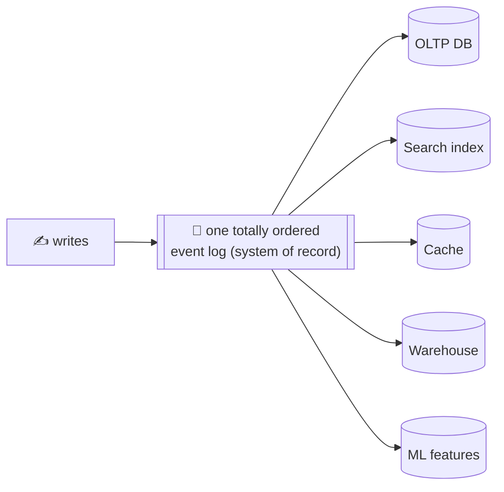
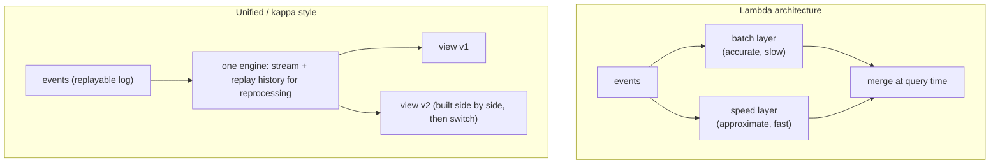
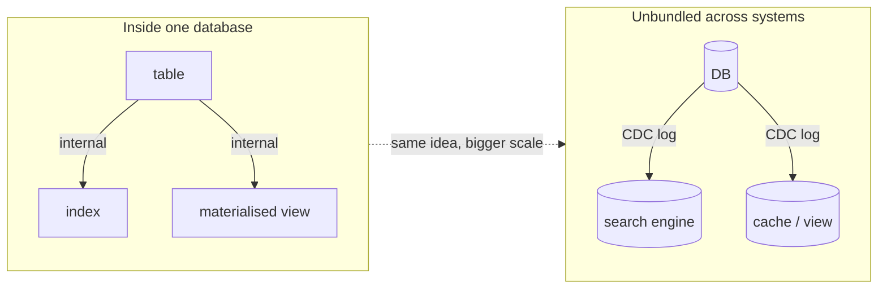
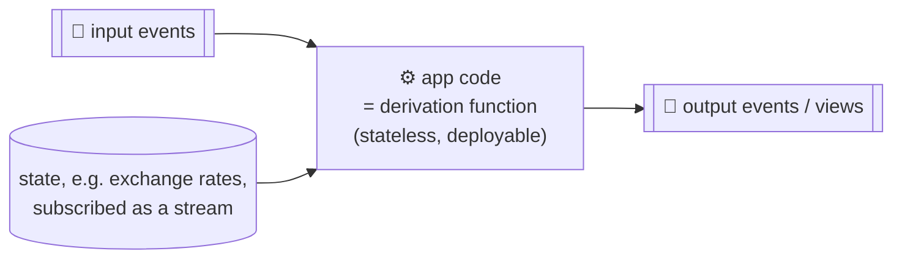
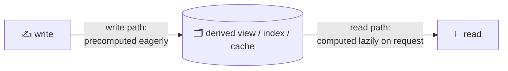
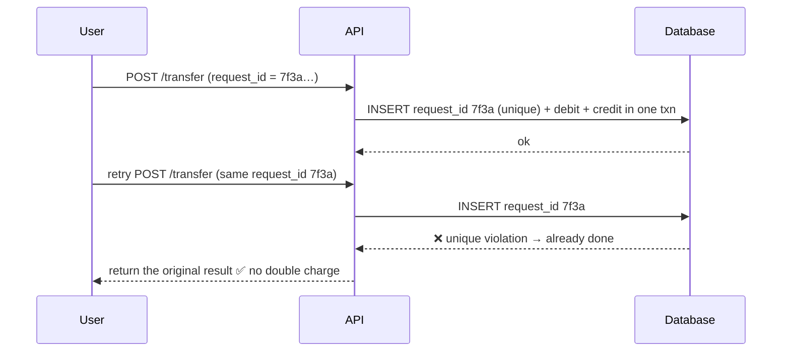
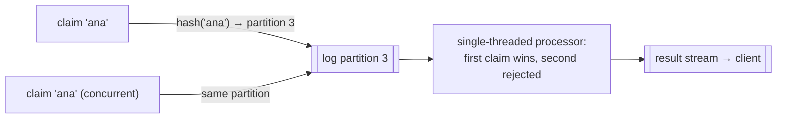
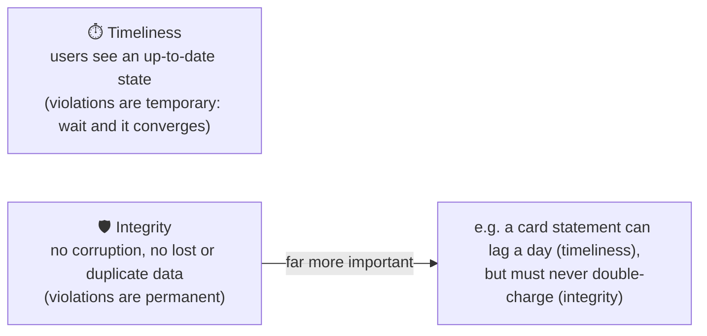
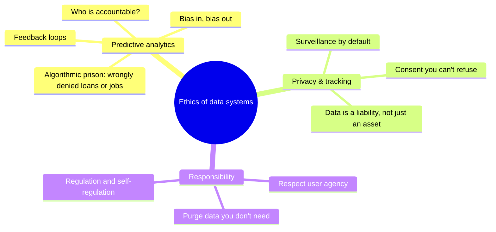

# 12 · The future of data systems

> **In one line:** no single tool does everything, so compose specialised systems around an **ordered event log** and **derived views**. Build correctness end to end, and keep ethics in mind as you design.

<BookRef pages="511–573" section="Chapter 12" />

## 12.1 Data integration

<BookRef pages="512–521" section="Data Integration" />

The right tool depends on the use case, so real systems combine several. The hard part is keeping them **consistent with each other**.

**Derived data vs distributed transactions:**

| | Distributed transactions (2PC) | Log-based derived data |
|---|---|---|
| Ordering | Locks | The log's order |
| Atomicity | Atomic commit | Deterministic retries + idempotence |
| Consistency | Linearizable reads | Usually async: read-your-writes is not guaranteed by default |
| Fault behaviour | Amplifies failures | Isolates them: a broken consumer just lags |

**Limits of total ordering:**
- one leader per log means throughput is capped (partition it, and you lose cross-partition order)
- multiple datacenters each need a leader
- microservices have no shared log
- offline clients

**Batch and stream together** (lambda vs kappa):

**Reprocessing for schema evolution:** build the new view next to the old one from the full history, shift readers over gradually, and you can always roll back. It's like a railway changing gauge by laying a third rail.

## 12.2 Unbundling databases

<BookRef pages="521–537" section="Unbundling Databases" />

A database internally already contains secondary indexes, materialised views, replication logs and triggers. **"Unbundling"** means building those same features **across** systems, with the event log as the glue.

- **Federated databases (unify reads):** one query interface over many stores.
- **Unbundled databases (unify writes):** the log keeps all stores in sync. Asynchronous, loosely coupled, and each team owns its own piece.

### Application code as a derivation function

- Separate **application code** (stateless, deployable) from **state** (durable, in the DB). The DB acts like a spreadsheet: change an input and dependent cells update.
- Stream processors **subscribe** to state changes instead of making request/response lookups. Example: keep a local copy of exchange rates updated through a stream, instead of calling a rates service for every purchase.

### Observing derived state: the write path and read path

- Moving work to the write path (precompute more) makes reads cheaper, and vice versa. Indexes, caches and materialised views all **shift the boundary**.
- **Push state to clients:** a browser or app is like an offline replica. Push changes to it over WebSockets or server-sent events (as React/Redux-style clients already model state as a stream of events).
- **Reads are events too:** logging read requests into the stream lets you join reads with writes (causal tracking, audit).

## 12.3 Aiming for correctness

<BookRef pages="537–555" section="Aiming for Correctness" />

### The end-to-end argument

Low-level guarantees (TCP dedup, DB transactions) **aren't enough** on their own. For example, a user double-clicks "Pay", and TCP sees two separate connections.

Generate a **unique request ID on the client**, pass it **end to end**, and enforce **idempotence** in the database.

### Enforcing constraints with a log

Uniqueness without distributed transactions: **partition the log by the constrained value**.

**Multi-partition operations** (e.g. a money transfer):
1. log the **request** with a unique ID
2. a processor emits a debit event to partition A and a credit event to partition B, both carrying the request ID
3. downstream consumers **deduplicate by request ID**

This gives atomic, exactly-once results **without** 2PC.

### Timeliness vs integrity

- Event-driven dataflow systems keep **integrity** without coordination: deterministic derivation, idempotent consumers and end-to-end request IDs.
- Many businesses accept **temporarily** broken constraints and apologise afterwards (overbooked flights, oversold stock). Coordination is only needed where an apology costs too much.
- **Coordination-avoiding** systems give better performance and availability.

### Trust, but verify

- Hardware and software do corrupt data (bit flips, buggy DBs).
- **Audit:** periodically read your backups and check integrity end to end. Event logs make auditing much easier.
- Cryptographic tools such as Merkle trees and certificate-transparency-style logs prove data hasn't been tampered with.

## 12.4 Doing the right thing

<BookRef pages="555–565" section="Doing the Right Thing" />

Data is about **people**. Engineers are responsible for the consequences of the systems they build.

- Replace the word **"data"** with **"surveillance"** and see whether your design still sounds acceptable.
- **Data minimisation:** don't keep data forever "just in case".
- Systems that make decisions about people must allow **appeal and explanation**.

## Summary

<KeyIdea>Design systems as **dataflow**: an immutable, ordered log of facts → deterministic derivation functions → many read-optimised views. Enforce correctness end to end with idempotence, prefer integrity over timeliness, audit everything, and remember there are humans on the other side.</KeyIdea>

## 🧠 Check yourself

<Quiz question="A user double-clicks 'Pay'. What prevents a double charge end to end?" options={["TCP sequence numbers", "Serializable isolation alone", "A client-generated request ID, enforced unique in the database", "Bigger timeouts"]} answer={2} explain="Lower layers see two independent requests. Only an end-to-end ID can deduplicate them." />

<Quiz question="Which is usually more important: timeliness or integrity?" options={["Timeliness", "Integrity", "Equal", "Neither"]} answer={1} explain="A delayed update is fixable by waiting. Corrupted or duplicated data may be permanent." />

<Quiz question="How can a log enforce unique usernames without distributed transactions?" options={["Use 2PC", "Partition the log by username and process each partition sequentially", "Use LWW", "Use a cache"]} answer={1} explain="All claims for the same name go to one partition, so a single-threaded processor decides the first one deterministically." />

**Interview prompts**
- Design a payments ledger using event sourcing. How do you guarantee no double spending?
- How would you migrate a search index to a new schema with zero downtime?
- What data would you choose *not* to collect in your design, and why?
