# 12 · The future of data systems

> **In one line:** no single tool does everything, so real applications compose specialised systems. The cleanest way to glue them together is an **ordered log of events** feeding **derived views**, with correctness enforced **end to end** (idempotence, request IDs, auditing) rather than by distributed transactions, and with the people behind the data kept firmly in mind.

<BookRef pages="511–573" section="Chapter 12" />

The previous eleven chapters described how data systems *are*. This last chapter is more opinionated: it pulls the ideas together and sketches how data systems *could* be built. Three threads run through it:

1. **Integration.** How do you keep a database, a search index, a cache, a warehouse and an ML feature store consistent with each other?
2. **Correctness.** How do you build applications that stay correct when every component can crash, retry, reorder or duplicate?
3. **Ethics.** Data systems make decisions about people. What responsibilities come with that?

Throughout these notes I'll use one running example of my own: **Basketly**, an online grocery delivery service. It has orders, a product catalogue, warehouse stock, delivery drivers, a recommendation model and a mobile app. It's big enough to need every technique in the chapter.

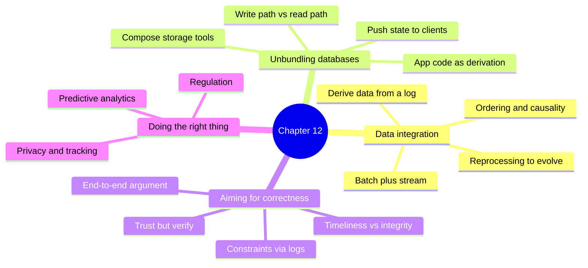

## 12.1 Data integration

<BookRef pages="512–521" section="Data Integration" />

A recurring theme of the book is that for any problem there are several solutions, each with pros, cons and trade-offs. Storage engines (Chapter 3) differ for OLTP and OLAP; replication (Chapter 5) has single-leader, multi-leader and leaderless flavours. So choosing a tool is always "it depends", and the best choice depends on the **usage pattern**.

The consequence: once an application has several different access patterns, **no single piece of software is good at all of them**. Basketly needs:

| Need | Good tool | Why not the others? |
|---|---|---|
| Place an order, decrement stock | Relational OLTP DB (Postgres) | Transactions, constraints |
| "Search for oat milk" with typo tolerance | Search engine (Elasticsearch / OpenSearch) | Inverted indexes, relevance ranking |
| Product page in under 20 ms | Cache (Redis) | In-memory key lookups |
| "Revenue per store per week" | Column store / warehouse (BigQuery, Snowflake) | Big scans over few columns |
| "Customers who bought X also bought Y" | ML feature store + batch training | Large offline computation |
| Driver location on a live map | Stream processor + pub/sub | Low-latency fan-out |

<KeyIdea>Vendors love to claim their product does everything. In practice, any non-trivial application uses several data systems, and the real difficulty is not choosing them but **keeping them in sync**.</KeyIdea>

### Combining specialized tools by deriving data

<BookRef pages="512–516" section="Combining Specialized Tools by Deriving Data" />

The classic integration need: data lives in an OLTP database, and you also want it in a full-text search index. Some databases ship a basic full-text feature (Postgres `tsvector`), but serious search needs a dedicated engine. Conversely, a search engine isn't a durable system of record. So you run both.

As the number of representations grows (cache, warehouse, recommendation features, notification triggers), integration gets harder. Someone saying "nobody needs X, just use Y" usually means they haven't met your use case; what's overkill for one team is essential for another.

#### Reasoning about dataflows

When the same data must be in several places, be very explicit about **inputs and outputs**: where is data written first, and which representations are derived from which sources?

The naive approach is **dual writes**: application code writes to the DB and then to the search index. Chapter 11 showed why this is broken: two clients can interleave their writes, so the DB and the index end up with different "last" values, and nothing ever notices.

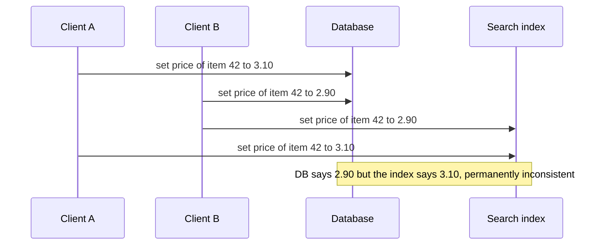

The fix is to make **one system the source of truth** and decide a **single order** for all writes. For example: write only to the database, capture its changes with **CDC** (change data capture), and apply them to the index **in the same order**. Or write events to a log first and derive both the DB and the index from it.

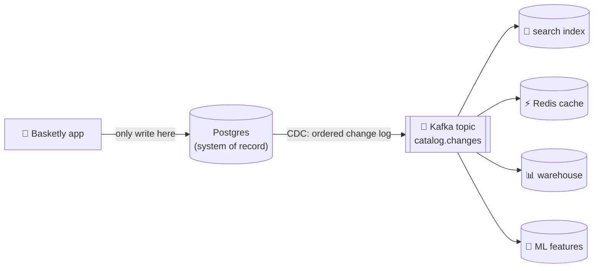

If all derived systems consume the same log in the same order, they converge on the same state. This is **state machine replication** (Chapter 9's total order broadcast) applied across heterogeneous systems. Whether you use CDC or event sourcing (where the log of events *is* the source) matters less than the principle: **one ordered source, many deterministic consumers**.

#### Derived data versus distributed transactions

The traditional way to keep different systems consistent is a **distributed transaction** (two-phase commit, XA; Chapter 9). How does the log-based approach compare?

| Aspect | Distributed transactions (2PC / XA) | Log-based derived data |
|---|---|---|
| **How write order is decided** | Locks for mutual exclusion (2PL) | The order of entries in the log |
| **How "exactly once" is achieved** | Atomic commit across all participants | Deterministic retry plus idempotent consumers |
| **Read guarantees** | Linearizable: read your own writes immediately | Usually asynchronous: no read-your-writes by default |
| **Coupling** | Every participant must speak XA; lowest common denominator | Each consumer is independent, any technology |
| **Fault behaviour** | Coordinator or participant failure blocks everyone (failure amplification) | A slow or crashed consumer just lags; others continue |
| **Performance** | Poor across heterogeneous systems | High throughput, batched |

Both approaches are ways of achieving "every system ends up agreeing". The author's view (and mine, after Chapters 9 and 11): XA has poor fault tolerance and performance, so for integrating *different* data systems, **log-based derived data is the more promising approach**. The cost is weaker timeliness guarantees, which we'll address later ("timeliness vs integrity").

> A middle ground is possible: derived systems with a way to wait for a specific log offset, so a user can read their own write. But that's a per-feature effort, not a default.

#### The limits of total ordering

A single totally ordered log is lovely for small systems. At scale, constructing it runs into hard limits:

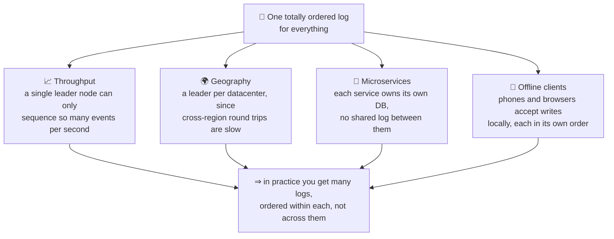

- **Partitioning** the log for throughput (Kafka partitions) gives order within a partition but none across partitions.
- **Multi-region** deployments usually run a leader per region; events from Mumbai and Frankfurt have no defined relative order.
- **Microservices** deliberately avoid shared durable state, so two services' events are unordered.
- **Offline-capable clients** (Chapter 5) create writes that only reach the server later.

Formally, deciding a total order is equivalent to **consensus** (Chapter 9). Most consensus algorithms assume a single node can handle the whole event throughput, and have no mechanism for sharing the ordering work across nodes. Building consensus that scales beyond one node's throughput and works across regions is still an open research problem.

#### Ordering events to capture causality

When events have no total order, the problem that remains is usually **causality**. Example at Basketly:

1. Priya **removes** her old address (a privacy request).
2. Then she places an order, and a notification service sends a confirmation email that includes the "address on file".

If the "address removed" event is in the users partition and the "order placed" event is in the orders partition, the notification service might process the order **before** the address removal, and email the deleted address. The two events have a causal dependency (she removed the address *then* ordered), but nothing in the infrastructure records it.

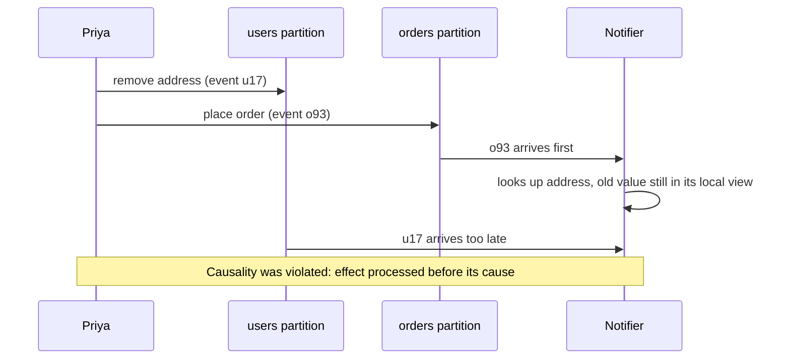

There's no easy general answer, but some starting points:

| Technique | Idea | Cost |
|---|---|---|
| **Logical timestamps** (Lamport, vector clocks; Chapter 9) | Attach ordering metadata without a central sequencer | Recipients must still handle out-of-order delivery and buffer events |
| **Record the state the user saw** | Log "the order was placed while profile version 8 was current" with a unique ID; later events can reference it | Extra metadata on every decision |
| **Conflict resolution** (CRDTs, Chapter 5) | Make operations commute so order doesn't matter | Only works for state with mergeable semantics, and doesn't help with external side effects like emails |
| **Join with time-dependence awareness** (Chapter 11) | Version the joined data so the join is deterministic | Data retention for old versions |

<KeyIdea>Total order is expensive and doesn't scale; what you usually really need is **causal order**. Capture it explicitly (versions, IDs, references to "what I saw") instead of hoping the infrastructure preserves it.</KeyIdea>

### Batch and stream processing

<BookRef pages="516–521" section="Batch and Stream Processing" />

The goal of data integration is to get data into the **right form in all the right places**. That means consuming inputs, transforming, joining, filtering, aggregating, training models, and finally writing to outputs. **Batch and stream processors are the tools for this.** Their outputs are derived datasets: search indexes, materialised views, recommendations, aggregate metrics.

Batch and stream share a lot of principles. The main difference: stream processors handle **unbounded** input, batch processors handle **known, finite** input. The lines are blurring: Spark does streaming as micro-batches on top of a batch engine; Flink does batch as a special case of a bounded stream.

#### Maintaining derived state

Batch processing has a strong **functional** flavour (even when the code isn't written in a functional language): deterministic, pure functions where output depends only on input; no side effects other than the explicit output; inputs treated as immutable; outputs append-only. Stream processing is similar, but extends operators with managed, fault-tolerant state.

Why is this good for derived data?

- **Fault tolerance:** a deterministic function can simply be re-run after a crash (Chapter 10 retries, Chapter 11 checkpoints).
- **Reasoning:** dataflow is explicit, so you can trace exactly which inputs produced which outputs.
- **Easy to rebuild:** if a derived view is wrong, throw it away and recompute.

Derived data is usually updated **asynchronously**, just as secondary indexes in a partitioned database are often "global" and asynchronously updated (Chapter 6). That's the point: asynchrony means a fault in one consumer stays **local** rather than spreading. With distributed transactions, one failing participant aborts everyone, i.e. failure is **amplified**.

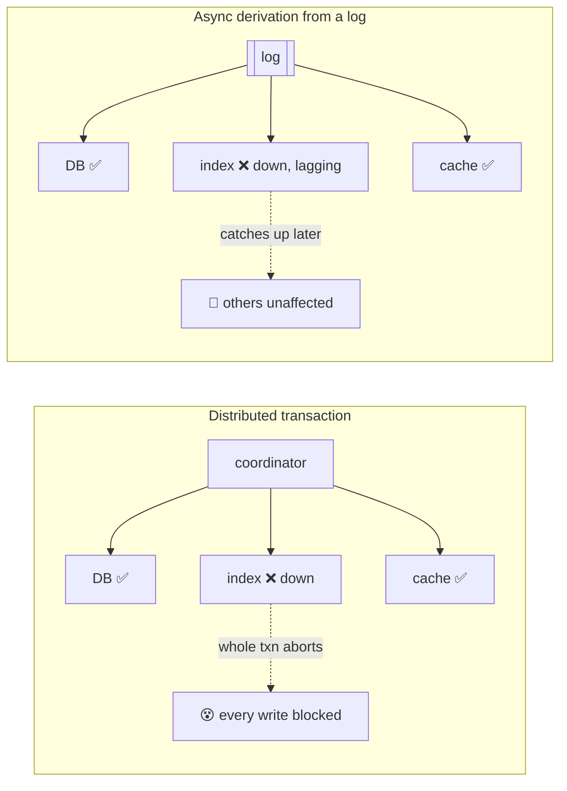

#### Reprocessing data for application evolution

When maintaining derived data, batch and stream both have a role:

- **Stream processing** reflects changes in the input with low delay.
- **Batch processing** can **reprocess large amounts of historical data** to build a brand-new view of an existing dataset.

Reprocessing is the key to **evolving** a system. Schema evolution inside a database (Chapter 4) is limited to simple changes: add an optional field, add a table. With reprocessing you can **restructure** the data into a completely different model, which is far more powerful.

Basketly example: the search index currently stores products by English name only. The team wants a new index that adds Hindi and Marathi names, plus a "popularity last 30 days" ranking field derived from orders. You can't do that with an `ALTER`. Instead:

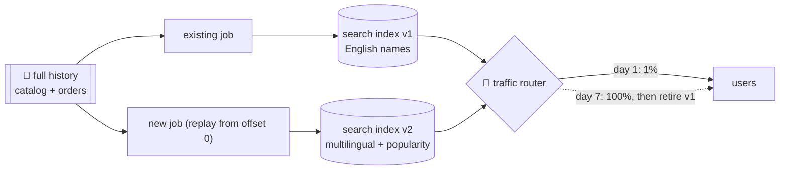

1. Start a new job that replays the whole history and builds **v2 next to v1**. Both keep consuming new events.
2. Point a small slice of readers at v2 and compare results and latency.
3. Gradually move more traffic. If anything goes wrong, **switch back** to v1 instantly.
4. Once fully migrated, retire v1.

The beauty is that **every stage is reversible**. Compare a database migration that rewrites a table in place: if it goes wrong halfway, you're stuck. Gradual migration with two parallel views lowers the risk of each change, which makes teams more willing to improve the system.

> **My analogy:** it's like moving house by first fully furnishing the new flat while still living in the old one, sleeping a few nights in the new place, and only handing back the old keys once you're sure. The 19th-century railway story in the book (switching track gauges with a third rail) makes the same point; this one is mine.

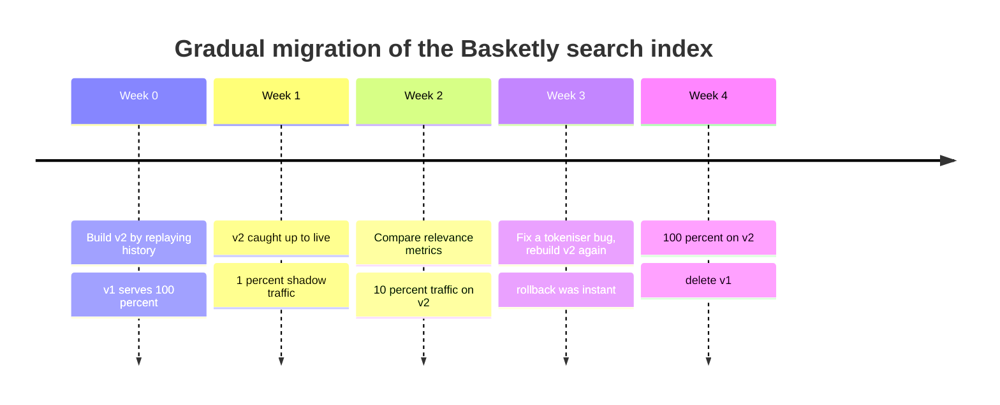

#### The lambda architecture

If batch is good for reprocessing and stream is good for recency, how do you combine them? The **lambda architecture** (proposed by Nathan Marz) was an influential answer:

- Record incoming data as **immutable events** appended to an always-growing dataset (like event sourcing).
- Run **two systems in parallel**: a **batch layer** (e.g. Hadoop MapReduce) and a **speed layer** (e.g. Storm).
- The stream processor produces a fast **approximate** view; later the batch processor produces a **corrected** exact view of the same data.
- Queries merge both views.

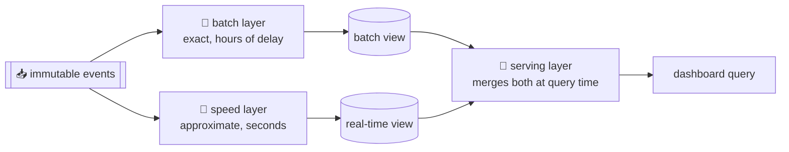

The reasoning: batch is simple and reliable, while stream processors (back then) were considered less reliable and harder to make fault-tolerant. So use stream for speed, batch for correctness.

**Practical problems with lambda:**

| Problem | Why it hurts |
|---|---|
| **Same logic written twice** | Two frameworks, two codebases (libraries like Summingbird tried to abstract this, but debugging and ops still double) |
| **Merging outputs is hard** | Fine for simple sums; painful for joins, sessionisation, or non-time-series outputs |
| **Full reprocessing is expensive** | So batch is often run incrementally on, e.g., the last hour, which brings back the timing and windowing problems (stragglers, cross-boundary windows) that batch was supposed to avoid |

At Basketly, a "basket abandonment rate per hour" metric built with lambda would need: a Flink job, a nightly Spark job with the same session logic, and a query layer that knows where the batch view ends and the stream view starts. Three places for bugs.

#### Unifying batch and stream processing

More recent work keeps the benefits of lambda (fast plus correct) while avoiding the downsides, by letting **one system** do both batch-style reprocessing and stream processing. This needs:

1. **Replay historical events through the same engine** that handles live events. For example, Kafka's retained log can be replayed; or Flink can read from a file system as a bounded stream.
2. **Exactly-once semantics** for stream processors: the output is the same as if no faults had happened, even though faults did happen (Chapter 11: checkpointing, idempotence, atomic commit of offset + state).
3. **Windowing by event time, not processing time.** When you reprocess history, processing time is meaningless (you're processing a year of data in an hour). Apache Beam's model, implemented by Flink and Google Dataflow, expresses this cleanly.

This is often called the **kappa architecture**: the log is the source of truth, and "batch" is just "stream processing from offset zero".

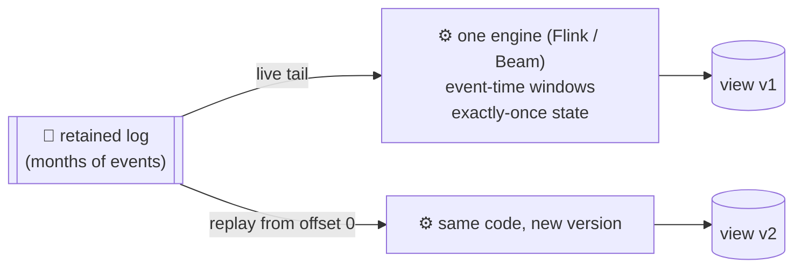

| | Lambda | Unified / kappa |
|---|---|---|
| Codebases | Two (batch + stream) | One |
| Reprocessing | Batch layer | Replay the log through the stream engine |
| Correctness | Batch "fixes" stream later | Stream is exactly-once from the start |
| Query-time merge | Required | Not required |
| Requirement | HDFS-style immutable store | Long log retention, event-time windowing |

## 12.2 Unbundling databases

<BookRef pages="521–537" section="Unbundling Databases" />

At a very abstract level, databases, Hadoop and operating systems all do the same thing: they **store data** and let you **process and query** it. A database stores records in tables, documents or graph vertices; an OS stores data in files. Both are information management systems.

But they come from different philosophies:

| Unix | Relational databases |
|---|---|
| Gives programmers a thin, low-level wrapper around the hardware | Gives application programmers a high-level abstraction hiding disk layout, concurrency, crash recovery |
| Pipes and files: just sequences of bytes | SQL and transactions: declarative queries with rich guarantees |
| "Do one thing well", compose small tools | "We handle all of it for you" |

Which is better? It depends what you want. Unix is "simpler" in the sense of a thin layer; databases are "simpler" in the sense of short declarative programs that reuse powerful infrastructure. The **NoSQL movement** can be seen as an attempt to apply a Unix-style, low-level approach to distributed OLTP storage.

This section tries to **combine** the two philosophies: get the composability of Unix and the high-level guarantees of databases.

### Composing data storage technologies

<BookRef pages="521–526" section="Composing Data Storage Technologies" />

Over the book we've met many features that databases provide, and they turn out to be surprisingly similar to the dataflow systems of Chapters 10 and 11:

| Feature inside a database | Dataflow system analogue |
|---|---|
| **Secondary indexes** (search by field) | A batch/stream job building a search index |
| **Materialised views** (precomputed query results) | Stream processor maintaining a view |
| **Replication logs** (keep copies up to date) | CDC / event log consumed by followers |
| **Full-text search indexes** | Elasticsearch fed from a log |
| **Triggers / stored procedures** | Event consumers reacting to changes |

#### Creating an index

Think about what happens when you run `CREATE INDEX` in a relational database:

1. Take a **consistent snapshot** of the table.
2. Scan all rows, extract the indexed field, **sort** them, write the index.
3. Then **process the backlog** of writes that happened since the snapshot.
4. From then on, **keep the index up to date** whenever a transaction writes to the table.

```sql
-- Basketly: add an index for "orders by delivery slot"
CREATE INDEX CONCURRENTLY idx_orders_slot ON orders (delivery_slot_start);
```

That's exactly **reprocessing the existing dataset** (batch over a snapshot) plus **deriving the index as a stream** of subsequent changes. It's the same process as setting up a new follower replica (Chapter 5) or bootstrapping CDC into a new search index (Chapter 11).

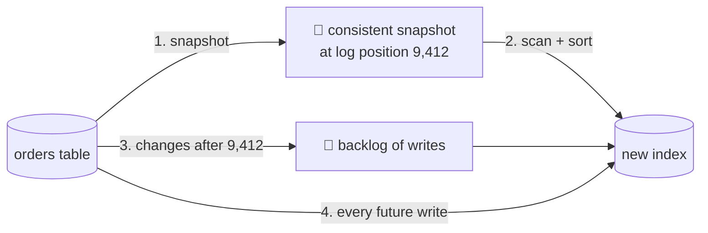

<KeyIdea>Creating an index is reprocessing plus stream processing. A database is already a little dataflow engine; it just hides that inside one process.</KeyIdea>

#### The meta-database of everything

Seen this way, the **dataflow across an entire organisation** starts to look like one huge database. Every batch, stream or ETL job that moves data from one place to another and transforms it is acting like the database subsystem that keeps indexes and materialised views up to date.

Batch and stream processors are like elaborate implementations of triggers, stored procedures and materialised-view maintenance. The derived systems (search, cache, warehouse) are like different **index types**. A relational DB supports B-tree, hash, spatial and full-text indexes; the organisation's "meta-database" supports Postgres, Elasticsearch, Redis and BigQuery as its index types.

If no single storage system will ever do everything, how could different tools be composed into a cohesive whole? Two directions:

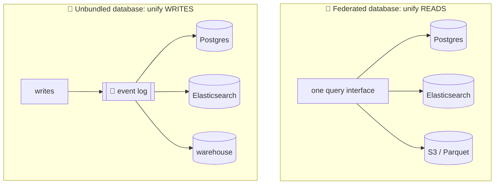

- **Federated databases (polystores), unifying reads.** Provide one query interface over many storage engines. Postgres foreign data wrappers fit here, as do Trino/Presto and Apache Drill. Applications needing a specialised data model can still access the underlying engine directly, while users wanting to combine data from many places use the federated interface. Good for read-only querying; but it doesn't answer "how do we keep the writes in sync?".
- **Unbundled databases, unifying writes.** When data is stored in several systems, make sure every change ends up in all the right places, even with faults. Synchronising writes across disparate technologies is a harder engineering problem. This is like the **Unix tradition** of small tools that do one thing well and talk through a uniform low-level API (pipes), composed with a higher-level language (the shell).

#### Making unbundling work

Federation and unbundling are two sides of the same coin. The harder side is keeping writes in sync. The traditional answer, distributed transactions across heterogeneous systems, is the **wrong** one (as discussed above): XA is a lowest-common-denominator protocol with poor fault tolerance.

The better answer: an **asynchronous event log with idempotent writes**. Two arguments:

1. **Robustness at the system level.** Async logs with idempotent consumers **loosely couple** components. If one consumer is slow or fails, the log buffers messages so the producer and other consumers continue. When the faulty consumer recovers, it catches up without missing data. With synchronous distributed transactions, a local fault escalates into a large-scale failure.
2. **Robustness at the human level.** Unbundled components can be **developed, improved and maintained independently** by different teams. Specialisation lets each team focus on one thing; well-defined interfaces between them (the log and its event schema) let teams evolve without coordinating every change. The log captures enough strong consistency (thanks to durability and ordering) while staying general enough to fit any kind of data.

Basketly, organisationally:

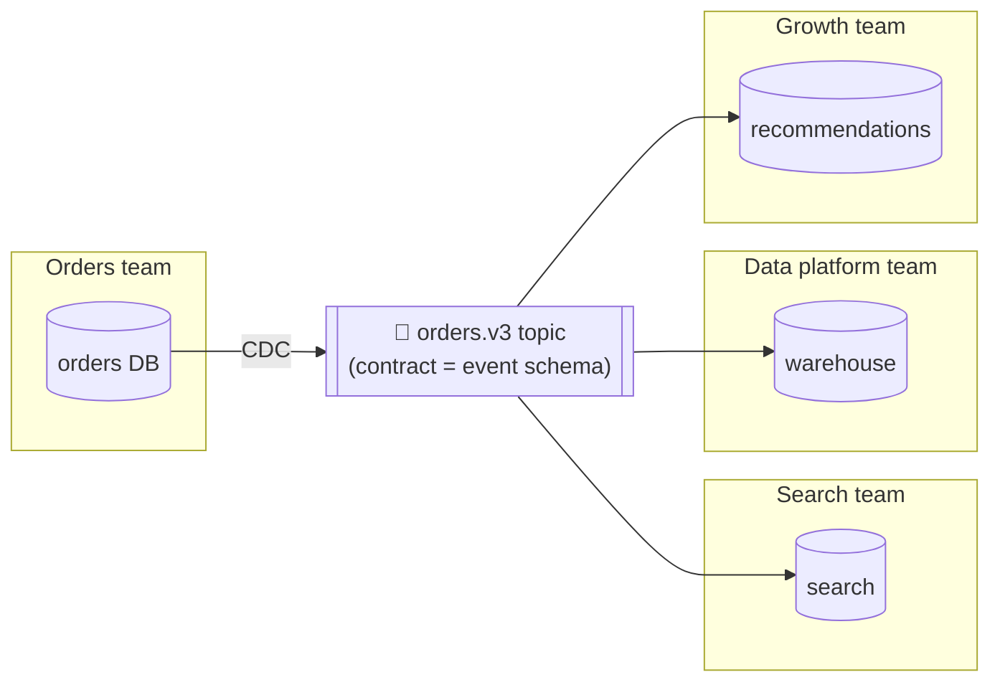

Each team owns its store, can upgrade or replace it, and only has to honour the **event schema contract**.

#### Unbundled versus integrated systems

Unbundling doesn't make classic databases obsolete:

- You still need databases for **maintaining state** in stream processors, and for **serving queries** over batch and stream outputs.
- **Specialised query engines** will remain important (MPP warehouses for analytics, for example).
- Running several pieces of infrastructure is **complex**: each has a learning curve, configuration quirks and operational surprises. A single integrated product can give **better and more predictable performance** for the workload it's designed for, because it can optimise across layers.

<KeyIdea>The goal of unbundling is not to beat a single database at its own workload. It's **breadth**: covering a wider range of workloads well by combining several systems. If one tool does everything you need, use it; unbundling is for when it doesn't.</KeyIdea>

| Choose... | When |
|---|---|
| **One integrated DB** | Your access patterns fit one engine; small team; strong consistency needed everywhere |
| **Unbundled + log** | Many access patterns (search, analytics, cache, ML); many teams; tolerance for asynchronous views |

#### What's missing?

The tools for composing data systems are improving, but a key piece is missing: there is no high-level language or declarative way to say "build this derived view" as easily as `CREATE INDEX`. The dream is something like:

```text
-- an imaginary, Unix-shell-flavoured composition of a whole data system
mysql.orders | elasticsearch --index=orders_search
mysql.orders | redis --key=order:{id} --ttl=1h
mysql.orders join mysql.customers | bigquery --table=orders_enriched
```

The infrastructure would then automatically handle snapshotting, CDC, ordering, retries, schema changes and backfill. Ideas in this space include **differential dataflow** and incremental view maintenance research, and products such as Materialize, RisingWave, and Kafka Connect / Debezium pipelines are moving toward it. Similarly, it would be great to precompute and update **cache entries** declaratively (caches are essentially materialised views).

### Designing applications around dataflow

<BookRef pages="526–531" section="Designing Applications Around Dataflow" />

The "**database inside-out**" approach (a term popularised by Martin Kleppmann and Jay Kreps, and related to dataflow languages like Oz and Juttle, functional reactive programming such as Elm, and logic languages like Bloom) means composing specialised storage and processing systems with application code.

The best analogy is a **spreadsheet**. Put a formula in a cell (`=SUM(B2:B9)`), and whenever any input cell changes, the result recomputes automatically. That's exactly what we want at the data-system level: when a record changes, every index, cache and view that depends on it updates automatically, without the application developer worrying about how.

The data system differs from a spreadsheet in that it must also be **durable, fault-tolerant, scalable**, integrate with diverse technologies, and reuse existing libraries and services.

#### Application code as a derivation function

When one dataset is derived from another, it goes through some **transformation function**:

| Derived dataset | Derivation function |
|---|---|
| Secondary index | Pick the indexed field from each row, sort by it. Simple and generic, built into every DB |
| Full-text index | Tokenise, stem, remove stop words, then build an inverted index. Built in, but language-specific config |
| ML model | Feature extraction + training; very application-specific |
| Cache | Aggregate data in exactly the shape the UI will display; entirely app-specific |

The more application-specific the function, the less it fits into the database's built-in features. Databases do let you run custom code via triggers, stored procedures and user-defined functions, but these were mostly **afterthoughts** in database design, not first-class features.

#### Separation of application code and state

In theory, databases could be deployment environments for arbitrary code, like an OS. In practice they're poorly suited to modern needs:

- dependency and package management
- version control and rolling upgrades
- evolvability, monitoring, metrics, calls to network services
- integration with external systems

Meanwhile, tools like Kubernetes, Docker, YARN and Mesos are **designed** for running application code. It makes sense to let each do what it's good at: some parts of the system specialise in **durable state** (databases), others in **running code** (container platforms).

The common pattern today is **stateless application services** + a **database** holding all state. This is like a funny inversion of the Fortran convention: the database is a big shared mutable variable reachable over the network, which app code reads and writes.

The problem: in most languages you **can't subscribe** to changes in a mutable variable; you can only read it periodically. Databases have inherited this passive approach: if you want to know when data changed, you **poll**. Subscriptions are only beginning to appear as a feature (CDC, Postgres `LISTEN/NOTIFY`, change streams in MongoDB, Firestore listeners).

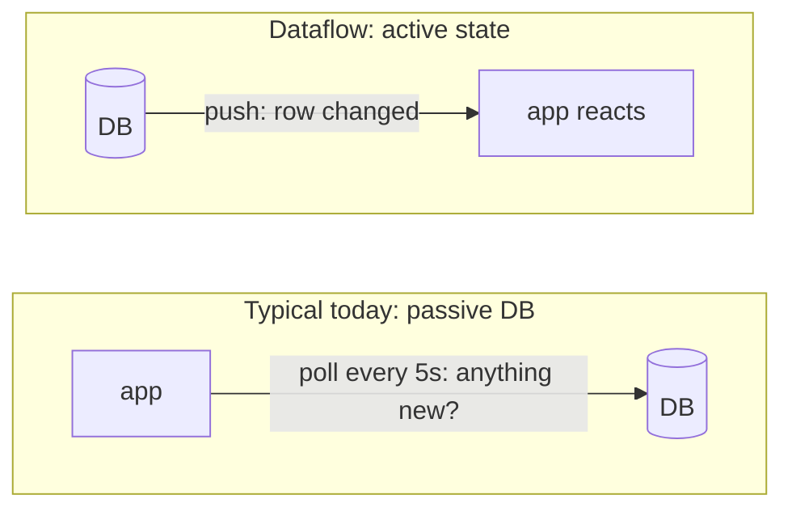

#### Dataflow: interplay between state changes and application code

Thinking in dataflow means redesigning the relationship between application code and state. Instead of treating the database as a passive variable, think about how **state, state changes and code that processes them** work together. App code responds to state changes in one place by triggering state changes in another.

We already saw this with databases-as-streams in Chapter 11 (CDC, event sourcing). Unbundling takes it further: tasks like keeping caches, indexes and views in sync are really **dataflow** jobs. Two features make this robust:

1. **Durable, ordered state changes.** Losing a message means the derived state goes permanently out of sync, so delivery must be reliable. Ordering matters too: many derived states depend on the order of changes (Chapter 11 showed that typical message brokers lack this on redelivery).
2. **Fault tolerance.** Stream processing frameworks give exactly-once-effect processing with checkpointing and idempotence, which is far easier than doing the same with distributed transactions.

Stable message ordering plus fault-tolerant processing are **quite stringent**, but they're much less expensive and operationally more robust than distributed transactions. Modern stream processors deliver both at scale, and app code can run as **stream operators**.

#### Stream processors and services

The dominant style today is **microservices**: break functionality into services that talk via synchronous network requests (REST). The advantage is **organisational scalability** through loose coupling: teams deploy independently.

Composing **stream operators** into dataflow systems is similar in spirit, but the communication is fundamentally different: **one-directional, asynchronous message streams** instead of request/response.

My own example (in place of any book scenario): computing the **price of a Basketly order**, which depends on the delivery fee for the customer's postcode zone. Delivery fees change during the day (surge pricing in the evening rush).

**Microservices approach:** the checkout service calls the pricing service synchronously for every order.

**Dataflow approach:** the checkout service **subscribes** to a stream of fee changes and keeps a local copy in its own store. Pricing an order is then a **local lookup**.

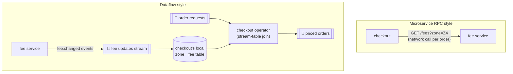

| | RPC to fee service | Subscribe to fee stream |
|---|---|---|
| Latency per order | Network round trip | Local lookup (microseconds) |
| If fee service is down | Checkout fails or degrades | Checkout continues with last known fees |
| Coupling | Runtime dependency | Only depends on the event schema |
| Time-dependence | Implicit: "the fee at whatever moment the call happened" | Explicit: the join is a stream-table join (Chapter 11); reprocessing gives the same result |

This is a **stream-table join** (Chapter 11). The pricing question becomes deterministic and replayable: reprocess the order stream with the fee-change stream and you get the same prices. Note the time-dependence: if an order is later reprocessed, you want the fee **at the time of the order**, not today's fee. Keeping the history of fee changes in the log makes that possible.

<KeyIdea>Subscribing to a stream of changes, rather than querying the current state on demand, brings us closer to the spreadsheet model: faster, more robust, and with less runtime coupling between services.</KeyIdea>

### Observing derived state

<BookRef pages="531–537" section="Observing Derived State" />

At an abstract level, the dataflow systems above give a process for creating derived datasets and keeping them up to date. Call this the **write path**: whenever data is written to the system, it passes through all the stages of batch and stream processing, and each derived dataset is updated. The derived dataset is where the **read path** begins: a user's query reads from it, perhaps processes the result further, and builds the response.

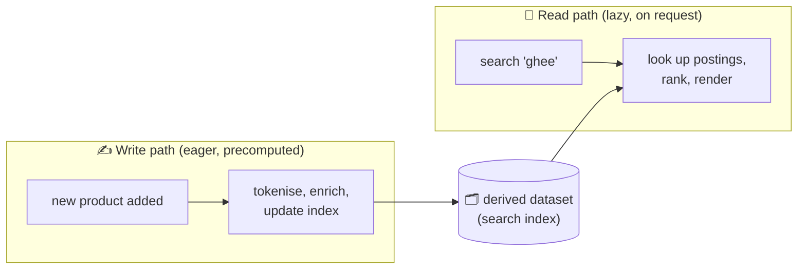

Together, write path and read path cover the whole journey of the data, from collection to consumption. The derived dataset is the place where they **meet**. It represents a trade-off between work done at write time and work done at read time.

#### Materialized views and caching

A full-text index is a clear example: the write path updates the index; the read path searches it. Both do some work. Consider the extremes:

| Strategy | Write path work | Read path work |
|---|---|---|
| **No index at all** | Nothing: just store documents | Grep every document for every query (like `grep`): very expensive at scale |
| **Index of words** (normal) | Update posting lists per word | Look up the query words; for multi-word queries, intersect (AND) or union (OR) the lists |
| **Precompute results for every possible query** | Enormous: every query, every document | Nothing: just a lookup. Impossible, since the set of possible queries is infinite |
| **Cache results for the most common queries** | Recompute these whenever a relevant document changes | Lookup for common queries; fall back to index for rare ones |

So caches, indexes and materialised views are all mechanisms to **shift the boundary** between read path and write path. They let you do more work on the write path, by precomputing results, to save effort on the read path.

Basketly example: the "Top 20 deals in your city" widget.

- **Read-heavy, rarely changing:** precompute per city whenever a price changes (write path), serve as a single key lookup.
- **Personalised "deals for you":** too many combinations to precompute fully; compute candidate lists offline (batch), then personalise at read time.

This is the same trade-off as the **social media timeline** fan-out in Chapter 1, framed differently: fan-out on write for normal users, fan-out on read for celebrities. Here we see it as a general principle.

#### Stateful, offline-capable clients

The write/read path boundary is interesting to revisit in the context of web and mobile apps.

For the last couple of decades, web apps were **stateless clients**: the browser renders what the server sends, and needs a network connection to do anything. The server's database holds all the state. Recently, with single-page apps and mobile apps, clients have become **stateful**: they keep local state, often in IndexedDB or SQLite, work offline, and sync in the background. This was the **offline-first** idea from Chapter 5 (multi-leader replication, with the device as a "datacenter").

If you think of on-device state as a **cache of state on the server**, then the screen pixels are a materialised view onto model objects in the client app, and those model objects are a **local replica** of the remote datacenter's state.

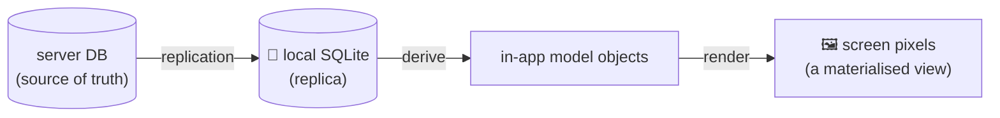

#### Pushing state changes to clients

In a typical web page, the browser reads data at load time and assumes it's static; it doesn't subscribe to changes. So the state on the device is a **stale cache** that's only refreshed when you explicitly poll (reload).

Newer protocols move beyond request/response: **server-sent events** (EventSource) and **WebSockets** let the server push messages to the browser as long as it's connected. This extends the write path all the way to the end user.

When a client goes **offline** and comes back, it needs to catch up. This is the same problem as a consumer of a log-based message broker reconnecting after a failure: it resumes **from its last offset**. So each device is like a small subscriber to a stream of events.

Basketly's order-tracking screen:

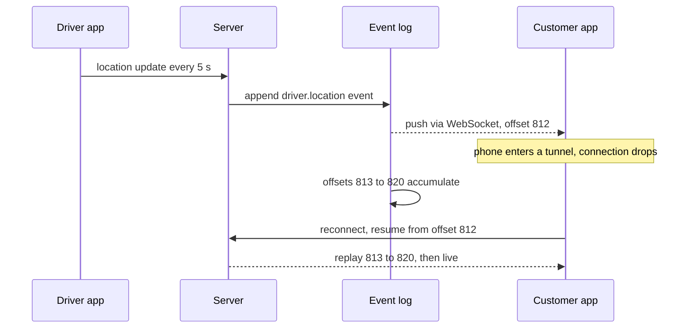

#### End-to-end event streams

Recent tools for building stateful clients already work this way. **React** (with **Redux** or similar), **Elm** and others manage internal client state by subscribing to a stream of events representing user input or server responses, structured like event sourcing.

It would be natural to extend this programming model to let a server push **state-change events** into this client-side event pipeline. State changes could then flow through an **end-to-end write path**: from an interaction on one device triggering a state change, via event logs and several derived data systems and stream processors, all the way to the UI of a person observing state on another device. Latency can be low (under a second end to end).

Some apps already do this: **instant messaging** and **online games** have this "real-time" architecture. Collaborative editors (Figma, Google Docs) do too. But why don't **all** apps work this way? Because the assumption of **stateless clients and request/response** is deeply ingrained in our databases, libraries, frameworks and protocols. Many datastores support reads and writes that return one response, but far fewer let you subscribe to changes, i.e. a request that returns a **stream of responses over time**.

<KeyIdea>To extend the write path all the way to the user, we need to rethink many systems: move away from request/response toward **publish/subscribe dataflow**. The benefit is more responsive UIs and better offline support.</KeyIdea>

#### Reads are events too

Earlier, we said that when a stream processor writes derived data to a store, and users query that store, the store acts as the boundary between write and read paths. The store allows **random-access** read queries that would otherwise need scanning the whole event log.

In many cases the data storage is **separate** from the streaming system. But stream processors also need to maintain state for aggregations and joins (Chapter 11), and this state is usually hidden inside the processor. Some frameworks allow it to be **queried by outside clients** (Kafka Streams interactive queries, Flink queryable state), turning the stream processor into a simple database.

Taking this further: **represent read requests as streams of events too**, sent through the stream processor alongside writes. The processor responds by emitting the result to an output stream. When both writes and reads are events routed to the same operator, you're essentially doing a **stream-table join** between the stream of read queries and the database.

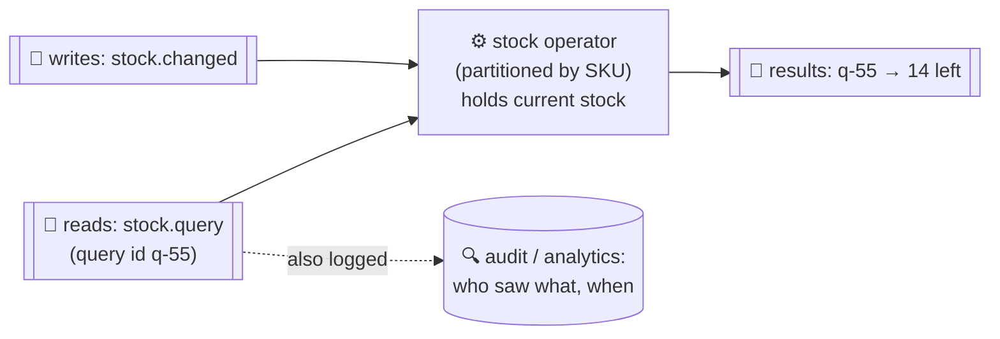

A one-off read request just passes through the join operator and is forgotten; a **subscribe** request is a persistent join with past and future events on the other side.

Why would you log reads?

- **Causal dependency tracking.** Record exactly what a user saw before making a decision. Basketly: the customer saw "14 left, ₹199" and then placed the order. If a dispute happens ("the app showed a lower price!"), you can reconstruct their view.
- **Analytics.** Online shops already log what users viewed (for recommendations and A/B tests). Logging reads in a structured stream makes them joinable with writes.
- **Cost:** extra storage and I/O, but if you already log requests for operational purposes, making the log the source of the request is mostly a side effect.

#### Multi-partition data processing

For queries that touch a single partition, sending them through a stream is overkill. But the idea opens up **distributed execution of complex queries** that combine data from several partitions, using the routing and partitioning infrastructure stream processors already have.

Storm's **distributed RPC (DRPC)** worked like this. Basketly example: "How many unique people saw this promotion banner?" Each user's impressions live in different partitions. The query is fanned out as events to every partition, each computes partial counts, and a final operator combines them.

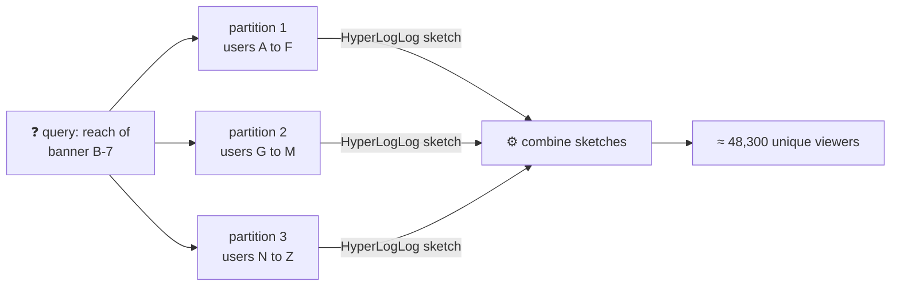

Another example: **fraud detection**. To score a purchase, you combine the reputations of the buyer's IP address, email, billing address, delivery address, each partitioned differently. Routing the read through several partitions as events lets you gather all the signals. MPP databases already have internal query graphs like this; implementing it on stream processors may be simpler if you already run them.

## 12.3 Aiming for correctness

<BookRef pages="537–555" section="Aiming for Correctness" />

Stateless services that only read data are easy: a bug is fixed by deploying a fix. **Stateful** systems are different: they're designed to remember things forever, so a bug's mistakes can **last forever too**. Correctness matters more.

Traditionally, we leaned on **transaction properties** (atomicity, isolation, durability; Chapter 7) for correctness. But:

- Weak isolation levels are confusing, and it's unclear which bugs they allow (Chapter 7).
- Consistency models and their guarantees are often misunderstood. Jepsen tests keep finding databases that **don't** deliver what they claim.
- Transactions may not suit some apps, and serializable transactions across heterogeneous systems scale poorly.

If your app can tolerate occasional corruption or loss, life is easy. If you need stronger assurances, **serializability and atomic commit** are established, but they have a cost: they typically only work in one datacenter, and limit scale and fault tolerance.

This section looks at how to think about correctness in **dataflow architectures**.

### The end-to-end argument for databases

<BookRef pages="538–543" section="The End-to-End Argument for Databases" />

Using a database with strong safety properties (serializable transactions) doesn't mean the application is free from data loss or corruption. If the application **writes bad data** or **deletes data** due to a bug, serializability won't save you.

This is an argument for **immutable and append-only data**: it's easier to recover from mistakes if you remove the ability of faulty code to destroy good data. But immutability isn't a cure-all either.

#### Exactly-once execution of an operation

In Chapter 11 we saw **exactly-once** (or **effectively-once**) semantics. If something goes wrong while processing a message, you can give up (drop it, data loss) or try again. Retrying risks processing **twice**, which in many cases is a form of data corruption: charging a customer twice, or incrementing a counter twice.

**Exactly-once** means arranging the computation so the final effect is the same as if no faults occurred, even if the operation was retried. One approach: make the operation **idempotent**. But turning a non-idempotent operation into an idempotent one takes care: extra metadata (e.g. the set of operation IDs that already updated a value) and fencing when failing over between nodes (Chapter 8).

#### Duplicate suppression

The need to suppress duplicates appears in many places, not only in stream processing. For example, **TCP** uses sequence numbers to put packets in order and detect lost or duplicated ones. Any lost packet is retransmitted, and duplicates are removed by the TCP stack before data reaches the application.

But TCP's duplicate suppression works only **within a single TCP connection**. Imagine a Basketly client connected to Postgres, running:

```sql
BEGIN;
UPDATE wallets SET balance = balance - 250 WHERE customer_id = 'c-8812';
UPDATE wallets SET balance = balance + 250 WHERE customer_id = 'merchant-31';
COMMIT;
```

The client sends `COMMIT`, then the network connection drops (or the DB crashes) **before** the client hears back. Did the transaction commit? The client doesn't know. If it reconnects and retries, it might transfer ₹500 instead of ₹250. TCP can't help: the retry is a **new connection**.

Even 2PC (Chapter 9) doesn't fully solve this: it breaks the 1:1 link between a TCP connection and a transaction, but only within the database. And the problem extends further: the **end user's device**. A customer taps "Pay" in the app; the request travels over a flaky mobile network; there's a timeout; they tap again, or the app automatically retries. From the server's perspective, it's **two separate requests** on different connections, and maybe through different load balancers.

```mermaid
flowchart LR
  U["📱 user taps Pay"] -->|"HTTP 1, times out"| LB["load balancer"]
  U -->|"HTTP 2, retry"| LB
  LB --> A1["app server 1"]
  LB --> A2["app server 2"]
  A1 --> DB[("DB: txn 1 commits")]
  A2 --> DB2[("DB: txn 2 commits")]
  DB & DB2 --> BAD["💸 charged twice"]
```

Every layer below (TCP, the DB transaction, the HTTP library) is doing its job correctly, and yet the outcome is wrong.

#### Operation identifiers

To make the operation idempotent through **several hops** of network communication, it's not enough to rely on the transaction mechanism of the DB. You need to consider the **end-to-end flow** of the request.

Generate a **unique identifier** for the operation (a UUID), on the client, and include it in the request (e.g. a hidden form field, or an `Idempotency-Key` header as Stripe does). Pass it all the way to the database and store it with a **uniqueness constraint**:

```sql
-- Basketly payments: the request_id makes the transfer idempotent end to end
ALTER TABLE wallet_requests ADD UNIQUE (request_id);

BEGIN;
INSERT INTO wallet_requests (request_id, from_cust, to_cust, amount)
VALUES ('0d6e9c1a-4b77-4f2e-9a13-5c2be2a1f0aa', 'c-8812', 'merchant-31', 250);
-- If this INSERT fails with a unique violation, the transfer already happened:
-- roll back and return the stored result instead of applying it again.
UPDATE wallets SET balance = balance - 250 WHERE customer_id = 'c-8812';
UPDATE wallets SET balance = balance + 250 WHERE customer_id = 'merchant-31';
COMMIT;
```

```mermaid
sequenceDiagram
  participant App as Basketly app
  participant API as Payments API
  participant DB as Postgres
  App->>App: generate request_id 0d6e
  App->>API: POST pay, key 0d6e
  API->>DB: insert 0d6e plus debit plus credit in one txn
  DB-->>API: committed
  API--xApp: response lost on mobile network
  App->>API: retry POST pay, same key 0d6e
  API->>DB: insert 0d6e
  DB-->>API: unique violation, already done
  API-->>App: return original result, charged once
```

Notes:

- The uniqueness check relies on **serializability** or at least a reliable unique index; under weaker isolation, check-then-insert isn't safe (Chapter 7 write skew).
- The `wallet_requests` table doubles as an **event log** of requests, which hints at event sourcing: the balance updates don't even need to be in the same transaction, since they could be **derived** from the request log downstream, as long as each request is processed exactly once.
- Store the **response** too, so a retry can return the same answer.

#### The end-to-end argument

This scenario is an instance of a much older idea, the **end-to-end argument** from a classic 1984 networking paper by Saltzer, Reed and Clark. In my own words: some guarantees can only be delivered by the two applications at the ends of a conversation, because only they know what "done correctly" means. Building the guarantee into the network or the database in the middle can make failures rarer (a useful performance optimisation), but it can never make them impossible.

Applied here: duplicate suppression can only be correctly implemented **end to end**, with an ID passed from the original client to the final database. Other examples of the same principle:

| Concern | Low-level feature (helps, not sufficient) | End-to-end solution |
|---|---|---|
| Duplicates | TCP dedup, DB transactions | Client-generated request ID checked at the final store |
| Data corruption | Ethernet CRC, TCP checksums | Checksums computed by the sender app, verified by the receiver app (catches bugs in software in the middle) |
| Confidentiality | Wi-Fi WPA2, TLS on each hop | End-to-end encryption (Signal protocol); TLS protects the link, but not against a compromised server |

The low-level features are still **useful**: they make higher-level problems **less likely**. TCP makes duplicates rare, so the end-to-end mechanism rarely has to step in. But they're not sufficient on their own.

<KeyIdea>Correctness properties like "exactly once", "not corrupted" and "private" can only be fully guaranteed **at the endpoints**. Every layer in between can help, but none can guarantee it alone.</KeyIdea>

#### Applying end-to-end thinking in data systems

Using a data system with strong safety guarantees doesn't automatically mean your application is safe. The application itself must take **end-to-end measures** like duplicate suppression.

That's a shame, because fault-tolerance mechanisms are hard to get right. Low-level reliability mechanisms like TCP work well, so the remaining higher-level faults are rare. It would be great to wrap the remaining high-level fault-tolerance machinery in an **abstraction** so app code doesn't have to worry about it. But we haven't found the right one yet.

Transactions have long been seen as a good abstraction: they collapse many possible issues (concurrent writes, constraint violations, crashes, network interruptions, disk failures) into two outcomes, **commit or abort**. That's a huge simplification. But they're not enough for the end-to-end case, and they're expensive across heterogeneous storage. So we end up reimplementing fault tolerance in application code, which is error-prone. The author argues it's worth exploring abstractions that make end-to-end correctness easy while keeping good performance and operational properties in a distributed setting.

### Enforcing constraints

<BookRef pages="543–546" section="Enforcing Constraints" />

Let's think about correctness in the context of the unbundled architecture: data flows through logs, and constraints must be maintained.

#### Uniqueness constraints require consensus

Chapter 9 showed that in a distributed setting, enforcing a **uniqueness constraint** requires **consensus**: if several concurrent requests have the same value, the system must decide which one to accept and reject the others.

Examples of uniqueness-type constraints at Basketly:

- Two customers can't claim the **same one-time promo code** `DIWALI-7Q2K`.
- A delivery driver can't be assigned **two overlapping time slots**.
- A **warehouse slot** for a delivery window can't be overbooked beyond capacity.
- A gift-card balance can't go **negative**.

The most common way to achieve consensus is to make one node the **leader** and have it decide. That works fine until you need to tolerate the leader failing, which brings back the consensus problem (Chapter 9).

Uniqueness checking can be **scaled out by partitioning** on the value that needs to be unique. For promo codes, partition by hash of the code: all requests for `DIWALI-7Q2K` go to the same partition. But **asynchronous multi-master replication** is ruled out, because different masters could concurrently accept conflicting writes. If you want to **immediately** reject violations, synchronous coordination is unavoidable.

#### Uniqueness in log-based messaging

The log ensures all consumers see messages in the **same order**, which is total order broadcast, equivalent to consensus (Chapter 9). In the unbundled approach with log-based messaging, we can enforce uniqueness like this:

1. Every request to redeem a promo code is encoded as a message and appended to a **log partition determined by the hash of the code**.
2. A **stream processor reads the partition sequentially** with a local database to track which codes are taken. For each request, if the code is free it records the redemption and emits a **success** message to an output stream; otherwise it emits a **rejection**.
3. The client that made the request watches the output stream and **waits** for the success or rejection message for its request.

```mermaid
flowchart LR
  C1["👤 Asha: redeem DIWALI-7Q2K<br/>req r-1"] -->|"hash(code) → p2"| P2[["📜 promo-requests<br/>partition 2"]]
  C2["👤 Ben: redeem DIWALI-7Q2K<br/>req r-2"] -->|"hash(code) → p2"| P2
  P2 --> SP["⚙️ single-threaded consumer<br/>local state: used codes"]
  SP -->|"r-1 ✅ accepted"| OUT[["📜 promo-results"]]
  SP -->|"r-2 ❌ already used"| OUT
  OUT --> C1
  OUT --> C2
```

This algorithm is the same as achieving linearizable storage using total order broadcast (Chapter 9). It **scales** easily to a large request throughput by increasing the number of partitions, since each partition is processed independently.

The approach works for **many kinds of constraints**, not just uniqueness. The principle: any writes that may **conflict** are routed to the **same partition** and processed sequentially. A conflict then becomes a deterministic decision in a single-threaded processor, and the definition of "conflict" can be application-specific.

#### Multi-partition request processing

Things get interesting when several partitions are involved. Consider moving **200 units of stock** from Warehouse North to Warehouse South at Basketly (my example). Three things can be partitioned differently:

- the **request ID** (for deduplication)
- **source warehouse** stock (North is in partition 1)
- **destination warehouse** stock (South is in partition 4)

The traditional DB approach would need an **atomic commit across all three partitions**, which forces them into a total order with everything else on those partitions. Throughput suffers. But the same correctness can be achieved with **partitioned logs and no atomic commit**:

```mermaid
flowchart TB
  CL["🧑‍💼 ops tool<br/>request id t-9001:<br/>move 200 units North→South"] -->|"1. append once"| RQ[["📜 transfer-requests<br/>(partitioned by request id)"]]
  RQ --> PR["⚙️ 2. request processor<br/>reads request, emits two events"]
  PR -->|"debit North 200 (t-9001)"| PN[["📜 stock partition 1<br/>(North)"]]
  PR -->|"credit South 200 (t-9001)"| PS[["📜 stock partition 4<br/>(South)"]]
  PN --> CN["⚙️ 3. North processor<br/>dedupes by t-9001,<br/>applies debit"]
  PS --> CS["⚙️ 3. South processor<br/>dedupes by t-9001,<br/>applies credit"]
```

1. The transfer request gets a **unique request ID** from the client and is appended to a log partition based on the request ID.
2. A stream processor reads the request log. For each request, it emits **two messages**: a debit to the source partition and a credit to the destination partition, both **tagged with the original request ID**.
3. Further processors consume the stock-partition streams, **deduplicate by request ID**, and apply the changes to their local state.

Why this is correct:

- **Single-object write.** Step 1 is the only atomic step: appending one message to one partition. Once in the log, the request **will** be fully processed eventually. There is no multi-partition atomic commit.
- **Crash during step 2.** If the processor crashes after emitting the debit but before the credit, it restarts from its last checkpoint and re-emits **both** messages. Because it's deterministic, the duplicates are identical, and step 3 drops them by request ID.
- **Validation.** To avoid overdrawing North (ensuring stock never goes negative), add a step: a processor for the North partition first checks there's enough stock, either rejecting or **reserving** the units by emitting an event into the North partition's log. Only after the reservation succeeds does the request fan out.

<KeyIdea>By breaking a multi-partition transaction into **two partitioned stages** and using an **end-to-end request ID**, you get the same correctness (every request applied exactly once to both sides) without an atomic commit protocol, even when faults occur.</KeyIdea>

### Timeliness and integrity

<BookRef pages="546–550" section="Timeliness and Integrity" />

A convenient property of transactions is that they're usually **linearizable**: once a writer commits, all readers immediately see the result. That's not true when operations are unbundled into stages of stream processors: consumers of a log are **asynchronous** by design, so a sender doesn't wait for its messages to be processed. A client **can** wait for a message in an output stream (like the promo-code example), but correctness doesn't depend on it.

The word **consistency** mixes up two different requirements worth separating:

```mermaid
flowchart TB
  CONS["🤔 'consistency'"] --> TL["⏱️ Timeliness<br/>users observe the system in an<br/>up-to-date state"]
  CONS --> IN["🛡️ Integrity<br/>no corruption, no missing data,<br/>no contradictory or false data"]
  TL --> TLV["violation = temporary inconsistency<br/>fix: wait and retry<br/>(eventual consistency)"]
  IN --> INV["violation = permanent inconsistency<br/>fix: explicit check and repair<br/>(waiting won't help)"]
```

- **Timeliness** means users see an up-to-date state. Reading from a stale replica violates it, but only temporarily; it resolves by waiting. Linearizability is a strong form of timeliness; **read-after-write** is a weaker but useful one.
- **Integrity** means absence of corruption: no data loss, no contradictory or false data. If a derived dataset (index, view) is maintained correctly, it must accurately reflect the underlying data. A violation is **permanent**; you have to explicitly check and repair.

<KeyIdea>Slogan: **violations of timeliness are "eventual consistency", violations of integrity are "perpetual inconsistency"**. In most applications, integrity is **much more important** than timeliness.</KeyIdea>

Basketly example: when a customer gets a refund, it's fine if the wallet balance shows the refund **a few minutes later** (timeliness). It's **not** fine if the refund is applied twice, or applied to the wrong customer, or disappears entirely (integrity). Banks work this way: a card transaction may take a day to appear on the statement, but the bank reconciles and the money never vanishes.

#### Correctness of dataflow systems

ACID transactions usually provide both timeliness (linearizability) and integrity (atomic commit) together. So in ACID-land, the distinction doesn't matter much.

In **event-based dataflow** systems, they **decouple** timeliness and integrity. Async event streams don't guarantee timeliness unless you explicitly build consumers that wait. But **integrity is central** to streaming systems.

Exactly-once / effectively-once semantics (Chapter 11) are mechanisms for preserving integrity: if an event is lost or applied twice, integrity is violated. So fault-tolerant message delivery and duplicate suppression (idempotence) are important for integrity.

Stream processors can preserve integrity **without** distributed transactions and atomic commit, through this combination:

| Mechanism | What it does for integrity |
|---|---|
| **Represent a write as a single immutable message** | Appending one message to a log is atomic, so it fits event sourcing nicely |
| **Deterministic derivation functions** | All other state updates are derived from that single message (like stored procedures), so they can be recomputed |
| **End-to-end request IDs** | Passed from the client through every stage, enabling duplicate suppression and idempotence |
| **Immutable messages + reprocessing** | Derived data can be rebuilt from scratch, making it easier to recover from bugs |

This combination gives very strong integrity guarantees with much **better performance and operational robustness** than distributed transactions. The price is loss of timeliness, which is often acceptable.

#### Loosely interpreted constraints

Uniqueness, as shown, needs consensus, typically by funnelling all events in one partition through a single node. That's required if you want the **traditional** form of uniqueness: reject violations immediately.

But many real applications can do with a much **weaker** notion. They allow the constraint to be **temporarily violated**, then fix it later with a **compensating transaction**, i.e. an apology:

| Situation | Constraint violated temporarily | Compensation (apology) |
|---|---|---|
| Two people register the same handle concurrently | Uniqueness | Ask one of them to pick another name (and say sorry) |
| Basketly sells the last 3 mangoes to 5 customers | Stock not negative | Refund 2 customers, add a voucher, offer substitute |
| Airline sells more seats than the plane has | Capacity | Offer compensation to volunteers to take a later flight; overbooking is a deliberate business strategy |
| A customer withdraws more than their balance at an ATM | Balance not negative | Overdraft fee; the bank pursues repayment |

Key insight: in many business contexts, apologies are **already part of the process**, because the real world isn't perfectly consistent anyway. A warehouse might discover a crate of mangoes was crushed in transit. Stock levels in the database can be wrong for reasons outside the software (theft, damage, miscounting), so the business must handle "we can't deliver this" anyway. Then a slightly overbooked order due to asynchronous checking costs nothing extra.

The cost of an apology is **business-specific**: if it's acceptable, the traditional constraint check can happen **after** the fact rather than before writing data. The app still needs to check **integrity** (no orders lost, no double charges); what's relaxed is **timeliness** of the constraint check.

```mermaid
flowchart LR
  ORD["🛒 order for 2 mangoes"] --> ACC["✅ accept immediately<br/>(no coordination)"]
  ACC --> LOG[["📜 orders log"]]
  LOG --> CHK["⚙️ async stock checker"]
  CHK -->|"stock OK"| OK["📦 pack and deliver"]
  CHK -->|"oversold"| SORRY["📧 apology + refund + ₹100 voucher<br/>(compensating transaction)"]
```

#### Coordination-avoiding data systems

Two observations so far:

1. Dataflow systems can maintain **integrity** guarantees on derived data **without** atomic commit, linearizability or synchronous cross-partition coordination.
2. Although strict uniqueness requires timeliness and coordination, many apps are fine with **loose constraints** that may be temporarily violated and fixed later, as long as integrity is preserved throughout.

Together, these mean dataflow systems can provide data management for many applications **without coordination**, while still giving strong integrity guarantees. Such **coordination-avoiding** systems have big advantages: better performance and fault tolerance than systems needing synchronous coordination.

Example: a system that operates across several datacenters in a **multi-leader** configuration, asynchronously replicating between regions. Any one datacenter can keep operating independently. Weak timeliness, but strong integrity.

In this context, **serializable transactions** are still useful for maintaining derived state, but they can be run at a **small scope** where they work well (inside one partition). Heterogeneous distributed transactions (XA) aren't required. Synchronous coordination can still be introduced **where needed**, e.g. to enforce strict constraints before an irreversible operation, but there's no need for everything to pay the cost.

```mermaid
flowchart TB
  Q{"❓ If this constraint is briefly violated,<br/>how costly is the apology?"}
  Q -->|"cheap: refund, voucher, rename"| A["🙂 accept async, check later<br/>e.g. last mango sold twice,<br/>basket edits"]
  Q -->|"moderate: annoyed customer"| B["⚖️ partition by key and serialise<br/>e.g. promo code reuse,<br/>driver slot double-booking"]
  Q -->|"expensive or irreversible"| C["🔒 coordinate before acting<br/>e.g. wallet withdrawal,<br/>releasing a payout"]
```

<KeyIdea>Coordination and constraints trade off against apologies. Reduce the number of apologies by coordinating more; reduce coordination (and gain performance and availability) by accepting more apologies. Find the **sweet spot**: neither inconsistent too often nor slow because of coordination.</KeyIdea>

### Trust, but verify

<BookRef pages="550–555" section="Trust, but Verify" />

All discussions of correctness, integrity and fault tolerance rest on **assumptions** about what can go wrong (Chapter 8's **system models**). For instance, we assume processes can crash, machines can lose power, and the network can delay or drop messages. We might also assume data written to disk isn't lost after `fsync`, data in memory isn't corrupted, and CPU multiplication always gives the right answer.

These assumptions are reasonable most of the time. But the question isn't binary ("can this happen or not?"); it's **probabilistic**: what's the probability that this violation happens?

Things that "can't happen" happen at scale:

- **Hardware data corruption.** Bit flips in memory, sometimes even with ECC. Faulty disk firmware. Cosmic rays. The **rowhammer** attack showed that repeatedly accessing memory rows can flip bits in neighbouring rows, from user-space code.
- **Silent corruption in transit and at rest.** Network packets corrupted in ways that evade TCP checksums; disks returning wrong data.
- At large scale, rare events become **regular**: with millions of disks and billions of requests per day, a one-in-a-billion bug happens daily.

#### Maintaining integrity in the face of software bugs

Beyond hardware, there's always the risk of **software bugs**, which no checksums at lower levels catch. Even widely used, well-tested databases have bugs:

- MySQL has had bugs failing to correctly maintain uniqueness constraints.
- PostgreSQL's serializable isolation level has had write-skew anomalies in the past.
- Jepsen analyses have repeatedly found real databases violating their documented guarantees.

And **application code** is far less battle-tested than databases. Many applications don't even use the integrity features databases provide (foreign keys, uniqueness constraints) correctly.

Consistency in the ACID sense assumes the database starts in a consistent state and that transactions transform it from one consistent state to another. This only works if the transaction is **free of bugs**. A buggy app using weak isolation unsafely can corrupt data, and the DB can't prevent that.

#### Don't just blindly trust what they promise

With both hardware and software not always living up to the ideal, data corruption is **inevitable sooner or later**. So you should at least have a way to find out if data has been corrupted, to fix it and track down the source of the error. Checking integrity is called **auditing**.

| System | Built-in self-checking |
|---|---|
| **HDFS, Amazon S3** | Don't trust disks: background processes continually read back files, compare to replicas, move files from one disk to another to mitigate silent corruption |
| **ZFS, Btrfs** | Checksums on every block, verified on read; scrubbing |
| **Cassandra / Dynamo-style** | Anti-entropy with Merkle trees to find and repair divergent replicas |

<KeyIdea>If you want to be sure your data is still there, you have to **actually read it and check**. Most of the time it's fine, but if you never check, you'll discover problems only when it's too late (e.g. a backup that fails to restore).</KeyIdea>

#### A culture of verification

Systems like HDFS and S3 still assume disks work correctly **most of the time**. That's reasonable: it's not the same as assuming they **always** work. But not many systems have this "**trust, but verify**" approach of continually auditing themselves. Many assume correctness guarantees are absolute and make no provision for rare data corruption.

The author hopes for more **self-validating** or **self-auditing** systems that continually check their own integrity, rather than relying on blind trust. ACID consistency has encouraged a culture of blind trust in technology (and neglecting auditability). As NoSQL and weaker guarantees became common, and as storage technologies matured less, this mindset becomes more dangerous.

#### Designing for auditability

If a transaction mutates several objects in a database, it's hard to tell **after the fact** what that transaction meant. Even if you capture transaction logs (CDC), the insertions, updates and deletes in various tables don't necessarily tell you **why** they were done. The invocation of application logic that decided those mutations is transient and can't be reproduced.

By contrast, **event-based systems** give better auditability. In event sourcing, user input is represented as a **single immutable event**, and resulting state updates are **derived** from it. The derivation can be made **deterministic and repeatable**, so running the same log of events through the same version of the code gives the same state.

```mermaid
flowchart LR
  EV[["📜 event log<br/>(immutable facts)"]] --> F["⚙️ derivation v12<br/>(deterministic)"]
  F --> S1[("production view")]
  EV --> F2["⚙️ same derivation v12<br/>run by the auditor"]
  F2 --> S2[("audit view")]
  S1 --> CMP{"🔍 hash compare"}
  S2 --> CMP
  CMP -->|"match"| OK["✅ integrity confirmed"]
  CMP -->|"mismatch"| BUG["🐞 bug or corruption found<br/>(and the log shows where)"]
```

Benefits:

- **Explicit dataflow** makes the provenance of data much clearer, so integrity checks are more feasible. For the event log, use hashes to check storage hasn't been corrupted. For derived state, **rerun** the batch/stream processors and check you get the same result, or even run a redundant derivation in parallel.
- **Debugging and tracing:** a deterministic, well-defined dataflow makes it easier to debug and trace execution, to find out **why** the system did something. If something unexpected happens, you can reproduce the exact circumstances: **time-travel debugging**.

Basketly scenario: a customer complains a ₹40 discount was missing. With event sourcing, support replays her session's events through the pricing derivation and sees the promo event arrived 2 seconds after the order was priced, a causal-ordering bug, not a payment bug.

#### The end-to-end argument again

If we can't fully trust every individual component to be free of corruption, we must at least **periodically check the integrity** of our data. Otherwise corruption goes unnoticed until it's too late and has caused downstream damage, at which point it's much harder and more expensive to track down.

Checking integrity is best done **end to end**: the more systems included in an integrity check, the fewer opportunities for corruption to go unnoticed at some stage. If you can check that an **entire derived data pipeline** is correct end to end, then any disks, networks, services and algorithms along the path are implicitly included.

Having continuous end-to-end integrity checks gives **confidence**, which lets you **move faster**. Like automated testing, auditing increases the chances bugs are found quickly, reducing the risk that a change or new storage technology causes damage. If you're not afraid of making changes, you can evolve the application to meet changing requirements much better.

#### Tools for auditable data systems

Currently, not many data systems make auditability a top-level concern. Some apps implement their own audit mechanisms (logging all changes to a separate audit table), but guaranteeing the integrity of both the audit log and the database state is hard. A transaction log can be made **tamper-proof** by periodically signing it with a hardware security module, but that doesn't guarantee the right transactions went into the log.

**Cryptographic tools** are an interesting direction:

| Tool | How it helps |
|---|---|
| **Merkle trees** | Trees of hashes that efficiently prove a record appears in a dataset, or that two datasets match |
| **Certificate Transparency** | Append-only, Merkle-tree-based public logs of TLS certificates; anyone can verify no certificate was silently added or removed |
| **Blockchains / distributed ledgers** | Essentially a distributed, Byzantine-fault-tolerant, replicated log; each replica independently verifies others' work |
| **Ledger databases** (e.g. Amazon QLDB, immudb) | Hash-chained journals offering cryptographic verification of history |

```mermaid
flowchart TB
  ROOT["🔐 root hash<br/>H(H12 + H34)"] --> H12["H12 = H(H1 + H2)"]
  ROOT --> H34["H34 = H(H3 + H4)"]
  H12 --> H1["H1 = H(event 1:<br/>order o-501 placed)"]
  H12 --> H2["H2 = H(event 2:<br/>refund o-488)"]
  H34 --> H3["H3 = H(event 3:<br/>price change SKU 77)"]
  H34 --> H4["H4 = H(event 4:<br/>promo redeemed)"]
```

To prove event 3 is in the log, you only need H4, H12 and the root: a **log-sized** proof. Changing any event changes the root hash, so publishing the root periodically makes tampering detectable.

The author is somewhat sceptical about blockchains: Byzantine fault tolerance and proof-of-work mining make throughput low and costs enormous. But **integrity-checking and auditing algorithms** like those of Certificate Transparency and distributed ledgers may well become more widely used in data systems generally. Making them scalable to the volumes of a typical database, with low performance penalty, needs more work.

## 12.4 Doing the right thing

<BookRef pages="555–565" section="Doing the Right Thing" />

The final part of the book takes a step back. Every system is built for a purpose; every action has intended and unintended consequences. The purpose may be as simple as making money, but the consequences reach far beyond. As engineers building these systems, we have a **responsibility** to consider those consequences consciously and decide what kind of world we want to live in.

We talk about data as an abstract thing, but many datasets are **about people**: their behaviour, interests, identity. We must treat such data with **humanity and respect**. Users are humans too, and human dignity is paramount.

Software development increasingly involves **important ethical choices**. There are guidelines (e.g. the ACM Software Engineering Code of Ethics and Professional Practice), but they're rarely discussed, applied or enforced in practice. Engineers and product managers sometimes take a cavalier attitude to privacy and potential negative consequences.

A technology isn't good or bad in itself; what matters is **how it's used** and how it affects people. That's true of a search engine just as of a weapon. It's not sufficient for engineers to focus exclusively on the technology and ignore its consequences: the **ethical responsibility is ours** too. Reasoning about ethics is difficult, but too important to ignore.

### Predictive analytics

<BookRef pages="555–558" section="Predictive Analytics" />

Predictive analytics is a big part of why people are excited about "big data". Using data to predict the weather or the spread of diseases is one thing; predicting whether **a person** will reoffend, default on a loan, or file expensive insurance claims is another. The latter have a **direct effect on individual lives**.

Naturally, payment networks want to prevent fraud, banks want to avoid bad loans, airlines want to avoid hijackings, companies want to avoid hiring ineffective employees. From their perspective, the cost of a missed business opportunity is low, but the cost of a bad loan or a problematic employee is high, so organisations naturally want to be **cautious**. If in doubt, say no.

But as algorithmic decision-making becomes widespread, someone who has (accurately or falsely) been labelled as risky by some algorithm may suffer a large number of those "no" decisions. Systematically being excluded from jobs, air travel, insurance, property rental, financial services and other key parts of society is such a large constraint on freedom that it's been called **"algorithmic prison"**. In countries that respect human rights, the criminal justice system presumes innocence until proven guilty. Automated systems can systematically and arbitrarily exclude a person from participating in society **without any proof of guilt**, and with little chance of appeal.

```mermaid
flowchart LR
  P["👤 one person"] --> S1["❌ loan model: risky"]
  P --> S2["❌ rental screening: risky"]
  P --> S3["❌ hiring filter: risky"]
  P --> S4["❌ insurance pricing: high"]
  S1 & S2 & S3 & S4 --> AP["🔒 'algorithmic prison':<br/>many automated no's,<br/>no explanation, no appeal"]
```

#### Bias and discrimination

Decisions made by an algorithm aren't necessarily better or worse than those made by a human. Every person is likely to have biases, even if they actively try to counteract them, and discriminatory practices can become **culturally institutionalised**. There's hope that basing decisions on data rather than subjective human judgement could be fairer, giving a better chance to people who are often overlooked.

When we develop predictive analytics systems, though, we're not merely automating a human's decision with rules for when to say yes or no; we're leaving the **rules themselves to be inferred from data**. The patterns learned are opaque: even if there's a correlation in the data, we may not know why. And if there's a **systematic bias in the input**, the system will most likely **learn and amplify** it in its output.

In many countries, anti-discrimination laws prohibit treating people differently based on **protected traits** (ethnicity, age, gender, sexuality, disability, beliefs). Other features may still be analysed, but what if they correlate with protected traits? In racially segregated neighbourhoods, a person's postal code, or even their IP address, is a strong predictor of race. Put like this, believing that an algorithm could take biased data as input and produce fair output seems absurd. Critics have compared this to laundering: biased inputs go in, and come out looking objective because "the model decided".

Predictive analytics systems merely **extrapolate from the past**. If the past is discriminatory, they **codify** that discrimination. If we want the future to be better than the past, **moral imagination** is required, and that's something only humans can provide. Data and models should be our tools, not our masters.

A Basketly thought experiment (my own): a "delivery risk" model learns that orders from certain postcodes are more often cancelled. It quietly starts showing those postcodes later delivery slots and higher fees. The model never sees caste, religion or income, but postcodes in a segregated city encode them anyway. Nobody decided to discriminate; the system did it on its own.

#### Responsibility and accountability

Automated decision-making opens up the question of **accountability**. If a human makes a mistake, they can be held accountable, and the person affected can appeal. Algorithms make mistakes too, but who is accountable if they go wrong? When a self-driving car causes an accident, who is responsible? If an automated credit-scoring algorithm systematically discriminates, is there recourse? If a machine learning system's decision comes under judicial review, can you explain how it made the decision?

| Traditional credit score | Data-driven "alternative" scoring |
|---|---|
| Based on relevant facts: your actual borrowing and repayment history | Based on who your friends are, where you shop, what device you use |
| Errors in the record can be corrected (in many countries there are rights to inspect and correct) | Opaque: hard to know what went into it, and hard to correct |
| Judges you on your own past behaviour | Judges you based on **stereotypes**: "people similar to you" |

Much data is **statistical**: even if the probability distribution on the whole is correct, **individual cases may well be wrong**. If the average life expectancy in your country is 80, that doesn't mean you'll die on your 80th birthday. From an average and a distribution, you can't say much about any one person. Similarly, a prediction system's output is probabilistic and may be wrong in individual cases.

Treating model output as unquestionable truth is therefore not just naive but **harmful**. As data-driven decision-making spreads, we need to figure out how to make algorithms **accountable and transparent**, how to avoid reinforcing existing biases, and how to fix them when they inevitably make mistakes. We'll also need to figure out how to prevent data being used to harm people, and realise its positive potential instead (e.g. analytics could reveal financial and social characteristics of people's lives, to help those who need support rather than punish them).

#### Feedback loops

Even with predictive applications that have less immediately far-reaching effects on people (recommendation systems), there are difficult issues. When services become good at predicting what content users want to see, they may end up showing people **only opinions they already agree with**, leading to echo chambers in which stereotypes, misinformation and polarisation breed. We're already seeing the impact of social media echo chambers on election campaigns.

When predictive analytics affect people's lives, particularly pernicious problems arise from **self-reinforcing feedback loops**:

```mermaid
flowchart LR
  A["📉 job lost<br/>(not the person's fault)"] --> B["⏰ misses a few bill payments"]
  B --> C["📊 credit score drops"]
  C --> D["🚫 employers who check credit<br/>reject the applicant"]
  D --> E["💸 stays unemployed longer"]
  E --> B
```

Consider employers using credit scores to evaluate potential hires. A good worker with a good credit score suddenly faces financial difficulty due to circumstances beyond their control. They miss payments, their score suffers, and they're less likely to find work. Joblessness pushes them toward poverty, which further worsens their score, making it even harder to find employment. It's a **downward spiral**, and because a number produced it, it looks objective and nobody questions it.

We can't always predict when such feedback loops happen. But many consequences **can** be predicted by thinking about the **entire system** (not just the computerised parts, but also the people interacting with it): an approach known as **systems thinking**. We can try to understand how a data analysis system responds to different behaviours, structures or characteristics. Does the system reinforce and amplify existing differences between people (making the rich richer or the poor poorer), or does it try to combat injustice? Even with the best intentions, we must beware of unintended consequences.

### Privacy and tracking

<BookRef pages="558–565" section="Privacy and Tracking" />

Besides predictive analytics (using data to make automated decisions about people), there are ethical problems with **data collection itself**. What's the relationship between the organisations collecting data and the people whose data is being collected?

When a system only stores data that a user has **explicitly entered**, because they want the system to store and process it in a certain way, the system is **performing a service for the user**: the user is the customer. But when a user's activity is **tracked and logged as a side effect** of other things they're doing, the relationship is less clear. The service no longer just does what the user tells it; it takes on interests of its own, which may conflict with the user's.

Tracking behavioural data has become increasingly important for user-facing features of many online services: which search results get clicked influences search ranking; "people who liked X also liked Y" recommendations; A/B tests and user-flow analysis improve the UI. These features require some tracking, and users benefit from them.

However, depending on a company's business model, tracking often doesn't stop there. If the service is funded through **advertising**, the advertisers are the actual customers, and users' interests take second place. Tracking data becomes more detailed, analyses become further-reaching, and data is retained for a long time to build up detailed profiles of each person for marketing purposes.

Now the relationship between the company and the user whose data is collected starts looking quite different. The user is given a free service and is coaxed into engaging with it as much as possible. The tracking of the user serves the needs of the advertisers who are funding the service, rather than the individual.

#### Surveillance

As a thought experiment, try **replacing the word "data" with "surveillance"** and see if common phrases still sound so good:

| Common phrase | After substitution |
|---|---|
| "We're a data-driven organisation" | "We're a surveillance-driven organisation" |
| "Real-time data streams from our app" | "Real-time surveillance streams from our app" |
| "Our data warehouse holds 5 years of user data" | "Our surveillance warehouse holds 5 years of user surveillance" |
| "Data scientists analyse user behaviour" | "Surveillance scientists analyse user behaviour" |

*(These are my own illustrative phrases.)*

This thought experiment is unusually polemic, but it reflects a real situation: in our attempts to make software "eat the world", we've built the greatest **mass surveillance infrastructure** the world has ever seen. Rushing toward an Internet of Things, we're rapidly approaching a world where every inhabited space has at least one Internet-connected microphone: smartphones, smart TVs, voice assistants, baby monitors, even children's toys with cloud-based speech recognition. Many have a terrible security record.

What's new compared to past surveillance regimes is that this surveillance isn't primarily forced on us by governments; we've **voluntarily** filled our homes and pockets with devices. The difference from a totalitarian state is that the data is collected by **corporations** to provide services, not by the state to suppress dissent.

Not all data collection qualifies as surveillance, but examining it this way helps us understand our relationship with the data collector. Why are we seemingly happy to accept surveillance by corporations? Perhaps you feel you have nothing to hide (i.e. you're in line with existing power structures, not a marginalised minority, and needn't fear persecution). Not everyone is so fortunate. Or perhaps the purpose seems benign: not overt coercion and conformance, just better recommendations and more personalised marketing. But combined with predictive analytics, the line blurs.

Example: car insurance premiums linked to **tracking devices** in cars, health insurance linked to **fitness trackers**. When surveillance determines things that hold sway over important aspects of life, such as insurance coverage or employment, it starts to appear **less benign**. And data analysis can reveal surprisingly intrusive things: a smartwatch's movement sensor can infer what you're typing (passwords included) with fair accuracy.

#### Consent and freedom of choice

We might argue that users **voluntarily** chose to use a service that tracks them, and agreed to the terms of service and privacy policy, so they consented to data collection. We might even claim users receive a valuable service in return, and tracking is necessary to provide it. Undoubtedly, social networks, search engines and other free services are valuable to users, but there are problems with this argument:

- **Users have little knowledge** of what data they're feeding into databases, or how it's retained and processed. Most privacy policies **obscure more than they illuminate**. Without understanding what happens to their data, users can't give meaningful consent.
- Data from one user often says things about **other people** who aren't users and haven't agreed to anything (e.g. contacts uploaded from an address book, people in photos).
- The derived datasets we've discussed (combining data from the entire user base with tracking and external sources) are precisely the kinds of data users **can't meaningfully understand**.
- Data is extracted from users through a **one-way process**, not a relationship with true reciprocity, and not a fair value exchange. There's no dialogue, no option to negotiate how much data to provide and what service to receive in return: the service sets the terms.

For a user who doesn't consent to surveillance, the only real alternative is **not to use the service**. But that choice isn't free either: once a platform is where your family group chat, your school notices or your job leads live, opting out isn't realistic. Using the service is **de facto mandatory**. In many communities, participating in social life, professional networking, or getting news requires these platforms. Declining has a real social cost. Especially for people with limited time and knowledge, surveillance becomes inescapable. Only the **privileged** can afford to opt out.

#### Privacy and use of data

Sometimes people claim "privacy is dead", on the grounds that some users are willing to post all sorts of things about their lives on social media. That's false and rests on a misunderstanding of the word **privacy**.

Having privacy doesn't mean keeping everything secret; it means having the **freedom to choose** which things to reveal to whom, what to make public, and what to keep secret. The right to privacy is a **decision right**: it enables each person to decide where they want to be on the spectrum between secrecy and transparency, in each situation. It's an important aspect of a person's freedom and autonomy.

When data is extracted from people through surveillance infrastructure, privacy rights aren't necessarily eroded but rather **transferred to the data collector**. Companies that acquire data essentially say "trust us to do the right thing with your data", meaning the right to decide what to reveal and what to keep secret moves from the individual to the company.

The companies in turn choose to keep much of the outcome of this surveillance secret, because revealing it would be perceived as creepy and would harm their business model (which relies on knowing more about people than other companies do). Intimate information is usually revealed only **indirectly**, e.g. through ads targeted at specific groups (people with a particular illness).

Even if particular users can't be personally reidentified from the bucket of people targeted by an ad, they've **lost their agency** about the disclosure of some intimate information. It's not the user who decides what to reveal to whom on the basis of their personal preferences; it's the company exercising the privacy right with the goal of **maximising its profit**.

Many companies have a goal of not being perceived as creepy, avoiding the question of how intrusive their data collection actually is and focusing on managing user perceptions. And even those perceptions are often poorly managed: something may be factually correct, but if it triggers painful memories, the user may not want to be reminded of it. With any kind of data, we should expect the possibility that it's **wrong, undesirable or inappropriate** in some way, and build mechanisms for handling those failures. Whether something is "undesirable" or "inappropriate" is, of course, down to **human judgement**; algorithms are oblivious to such notions unless explicitly programmed to respect human needs. As engineers, we must be humble, accepting and planning for such failings.

Privacy settings that let users control what other users can see are a starting point for handing back some control. However, regardless of the setting, the **service itself** still has unfettered access to the data, and is free to use it in any way permitted by the privacy policy. Even if the service promises not to sell data to third parties, it usually grants itself unrestricted rights to process and analyse data internally, often going much further than what's overtly visible to users.

This kind of large-scale transfer of privacy rights from individuals to corporations is historically **unprecedented**. Surveillance has always existed, but it used to be expensive and manual, not scalable and automated. Trust relationships have always existed (a patient and doctor, a defendant and attorney), but in these cases data use has been strictly governed by **ethical, legal and regulatory constraints**. Internet services have made it much easier to amass huge amounts of sensitive information without meaningful consent, and to use it at massive scale without users understanding what's happening to their private data.

#### Data as assets and power

Since behavioural data is a **byproduct** of users interacting with a service, it's sometimes called "**data exhaust**", suggesting it's worthless waste material. Seen this way, behavioural and predictive analytics can be thought of as recycling that extracts value from data that would otherwise be thrown away.

More correct would be to view it the other way round: from an economic point of view, if targeted advertising is what pays for a service, then behavioural data about people is the service's **core asset**. In that model the app itself is mostly the bait: the features exist to keep people engaged so that more behavioural data flows in, and the genuine creativity and friendships people bring to the platform become raw material for profiling.

The assertion that personal data is a valuable asset is supported by the existence of **data brokers**, a shady industry operating in secrecy, purchasing, aggregating, analysing, inferring and reselling intrusive personal data about people, mostly for marketing. Startups are valued by their user numbers, by "eyeballs", i.e. by their **surveillance capabilities**.

Because data is valuable, many people want it. Of course companies want it; that's why they collect it. But **governments** want to obtain it too: by means of secret deals, coercion, legal compulsion, or simply stealing it. When a company goes bankrupt, the personal data it collected is one of the **assets that gets sold**. Moreover, data is difficult to secure, so **breaches** happen disconcertingly often.

These observations have led critics to say that data isn't just an asset, but a "**toxic asset**", or at least "**hazardous material**". Even if we think we're capable of preventing abuse of data, whenever we collect data, we need to balance the benefits with the risk of it falling into the wrong hands: computer systems may be compromised by criminals or hostile foreign intelligence services, data may be leaked by insiders, the company may fall into the hands of unscrupulous management that doesn't share our values, or the country may be taken over by a regime that has no qualms about compelling us to hand over the data.

<KeyIdea>When collecting data, consider not just today's owners and government but **every future one**. A database built for friendly purposes can be repurposed by whoever controls it next, so the safest data is data you never stored.</KeyIdea>

"Knowledge is power", as the old adage goes. Scrutinising others while avoiding scrutiny oneself is one of the most important forms of power. This is why totalitarian governments want surveillance: it gives them the power to control the population. Although today's technology companies aren't overtly seeking political power, the data and knowledge they've accumulated nevertheless gives them a lot of power over our lives, much of it surreptitious, outside public oversight.

#### Remembering the Industrial Revolution

Data is the defining feature of the **information age**. The Internet, data storage, processing and software-driven automation are having a major impact on the global economy and human society. As our daily lives and social organisation have been transformed by IT, and will probably continue to change radically in the coming decades, comparisons to the **Industrial Revolution** come to mind.

The Industrial Revolution came about through major technological and agricultural advances, bringing sustained economic growth and significantly improved living standards in the long run. Yet it also came with major problems:

| Industrial Revolution problem | How it was eventually addressed | Information-age analogue |
|---|---|---|
| Air pollution from smoke and chemicals | Environmental protection regulation | **Data** as the pollution problem of the information age |
| Dreadful working conditions, child labour | Labour laws, safety rules, unions | Exploitative data practices, dark patterns |
| Unsafe food and medicine | Food and drug safety inspections | Lack of accountability for algorithms |

Undoubtedly the cost of doing business **increased** when factories could no longer dump waste into rivers, sell tainted food or exploit workers. But society as a whole benefited hugely, and few of us would want to return to a time before those regulations.

Just as the Industrial Revolution had a dark side that had to be managed, the information age has problems we need to confront, and data collection is one of them. Security writer Bruce Schneier has popularised the framing of personal data as the **pollution** of our era: every system emits it as a by-product, it accumulates, and how we contain and dispose of it will decide how later generations judge this period of computing.

#### Legislation and self-regulation

**Data protection laws** might help preserve individuals' rights. For example, the 1995 European Data Protection Directive already required that personal data be gathered only for clearly stated, legitimate purposes, not reused for unrelated ones, and limited to what those purposes actually need. Its successor, the **GDPR** (2018), strengthened these principles, and many other jurisdictions have followed (California's CCPA/CPRA, Brazil's LGPD, India's DPDP Act 2023).

Key ideas in modern data protection law:

```mermaid
mindmap
  root((Data protection principles))
    Purpose limitation
      Collect for a stated reason
      Don't repurpose freely
    Data minimisation
      Collect only what is needed
      Delete when no longer needed
    Transparency
      Explain processing clearly
    Individual rights
      Access and correction
      Erasure
      Portability
      Object to automated decisions
    Accountability
      Breach notification
      Fines
```

However, it's doubtful whether this legislation is effective in today's Internet context. These rules run directly counter to the philosophy of **big data**, which is to maximise data collection, to combine it with other datasets, to experiment and explore in order to generate new insights. Exploration means using data for **unforeseen purposes**, which is the opposite of the narrow, stated purpose the user agreed to (assuming they meaningfully agreed at all). Updated regulations are being developed, but there's tension.

Companies that collect lots of data about people oppose regulation as being a **burden and a hindrance to innovation**. To some extent that opposition is justified: for example, when sharing medical data, there are clear risks to privacy, but there are also potential opportunities (preventing deaths through better diagnosis, finding better treatments). Over-regulation may prevent such breakthroughs. It's difficult to balance these.

Fundamentally, we need a **culture shift** in the tech industry with regard to personal data:

- Stop regarding users as **metrics to be optimised**; remember they're humans who deserve respect, dignity and agency.
- **Self-regulate** data collection and processing practices to establish and maintain the trust of the people who depend on our software.
- **Educate** end users about how their data is used, rather than keeping them in the dark.
- Allow each individual to **maintain their privacy**: control over their own data, not have that control stolen through surveillance. The right to control our own data is like the natural environment of a national park: if we don't explicitly protect and care for it, it will be destroyed. It will be a **tragedy of the commons**, and we'll all be worse off.

Ubiquitous surveillance isn't inevitable; we're still able to stop it. How exactly is an open question, but a starting point:

| Practice | What it looks like at Basketly |
|---|---|
| **Purge data when no longer needed** | Delete raw GPS traces of drivers after 30 days; keep only aggregated route stats |
| **Minimise collection** | Don't request contacts or always-on location if the feature doesn't need it |
| **Prefer aggregates over individuals** | Analytics on "orders per postcode per week", not per-person histories |
| **Encrypt and restrict access** | Separate PII store, column-level encryption, access logging |
| **Make deletion real across derived data** | A "forget me" event flows through the log to every index, cache, warehouse table and ML feature store (crypto-shredding for immutable logs) |
| **Explain automated decisions** | Show why a delivery slot or fee was offered; provide a human appeal path |

The last row connects back to the technical chapters: in an **immutable-log** architecture, deletion is hard. One technique is **crypto-shredding**: encrypt each person's data with a per-person key, and delete the key to make all copies (logs, backups) unreadable.

```mermaid
sequenceDiagram
  participant U as Customer
  participant API as Privacy API
  participant L as Event log
  participant D as Derived stores
  participant K as Key vault
  U->>API: delete my data
  API->>L: append user.forgotten for c-8812
  L->>D: consumers purge c-8812 from search, cache, warehouse, features
  API->>K: destroy encryption key for c-8812
  Note over L,K: old log entries and backups for c-8812 are now unreadable
  D-->>API: purge confirmations
  API-->>U: confirmation with completion date
```

The idea of **remembering the people** behind the data isn't a separate topic from the rest of the book. It shapes retention policies, schema design (separating PII), dataflow (propagating deletions), and the choice of what to derive at all.

## Summary

<BookRef pages="565–573" section="Summary" />

This chapter discussed new approaches to designing data systems, with the author's personal opinions and speculation about the future.

**Data integration.** No single tool can efficiently serve all use cases, so applications must compose several pieces of software. The data integration problem is solved by using **batch processing and event streams** to let data changes flow between different systems. Certain systems are designated as **systems of record**, and other data is **derived** from them through transformations. Indexes, materialised views, ML models, statistical summaries and more can all be maintained this way. Making derivations and transformations **asynchronous and loosely coupled** prevents a problem in one area from spreading to unrelated parts of the system, increasing robustness and fault tolerance.

**Evolvability.** Expressing dataflows as transformations from one dataset to another helps applications evolve: to change a processing step (e.g. index structure or cache layout), rerun the new transformation code on the whole input dataset to rederive the output. When something goes wrong, fix the code and reprocess to recover.

**Unbundling databases.** These processes are quite similar to what databases already do internally, so the idea of **unbundling** the components of a database and building an application by composing these loosely coupled components emerges. Derived state can be updated by **observing changes** in the underlying data. That derived state can itself be observed by downstream consumers. We can even take this dataflow all the way to the **end-user device** that displays the data, building UIs that dynamically update to reflect data changes and continue to work offline.

**Correctness.** We discussed how to ensure all this processing remains correct in the presence of faults. Strong integrity guarantees can be implemented **scalably** with asynchronous event processing, by using **end-to-end operation identifiers** to make operations idempotent and by checking **constraints asynchronously**. Clients can either wait until the check has passed, or go ahead without waiting but risk having to **apologise** about a constraint violation. This approach is much more scalable and robust than distributed transactions, and fits how many business processes work in practice. By structuring applications around dataflow and checking constraints asynchronously, we can avoid most coordination and create systems that maintain integrity but still perform well, even in geographically distributed scenarios and in the presence of faults. **Audits** verify the integrity of data and detect corruption.

**Ethics.** Finally, we took a step back and examined ethical aspects of building data-intensive applications. Data can be used to do good, but it can also do significant harm: making justifying decisions that seriously affect people's lives and are difficult to appeal; leading to discrimination and exploitation; normalising surveillance; and exposing intimate information. We also run the risk of data breaches, and we may find that a well-intentioned use of data has unintended consequences. As software and data have such a large impact on the world, engineers must remember that we carry a **responsibility to work toward the kind of world we want to live in**: a world that treats people with humanity and respect.

```mermaid
flowchart LR
  SRC[["📜 systems of record<br/>(immutable event log)"]] --> DER["⚙️ deterministic derivations<br/>(batch + stream, replayable)"]
  DER --> VIEWS[("🗂️ many read-optimised views<br/>search, cache, warehouse, ML")]
  VIEWS --> CLIENT["📱 clients subscribe<br/>(end-to-end write path)"]
  ID["🆔 end-to-end request IDs"] -.-> DER
  AUD["🔍 continuous audits"] -.-> VIEWS
  ETH["🧭 purpose, minimisation,<br/>deletion, accountability"] -.-> SRC
```

<KeyIdea>Design systems as **dataflow**: an immutable, ordered log of facts, deterministic derivation functions, and many read-optimised views. Enforce correctness end to end with request IDs and idempotence, prefer integrity over timeliness, audit continuously, and remember there are humans on the other side of every record.</KeyIdea>

<IconCards items={[
  {icon:'📜', title:'Log as the glue', text:'One ordered source of truth; every other store is derived and rebuildable.', color:'#3b82f6'},
  {icon:'🔁', title:'Reprocess to evolve', text:'Build v2 next to v1 from history, shift traffic gradually, roll back any time.', color:'#10b981'},
  {icon:'🆔', title:'End-to-end IDs', text:'Exactly-once only exists at the endpoints: a client-generated ID checked at the final store.', color:'#f59e0b'},
  {icon:'🛡️', title:'Integrity over timeliness', text:'Being late is recoverable; being wrong is permanent. Apologise where cheap, coordinate where not.', color:'#ef4444'},
  {icon:'🔍', title:'Trust, but verify', text:'Continuously audit: rerun derivations, compare hashes, test restores.', color:'#8b5cf6'},
  {icon:'🧭', title:'Remember the humans', text:'Minimise, purge, explain, allow appeal. Data is a liability as well as an asset.', color:'#64748b'}
]} />

## 🧠 Check yourself

<Quiz question="Two clients write to a database and then to a search index (dual writes). What is the core problem?" options={["The search index is too slow", "The writes can interleave differently in each system, leaving them permanently inconsistent", "The database cannot handle concurrent writes", "Search indexes do not support updates"]} answer={1} explain="Without a single agreed order, the DB and the index can each end up with a different 'last' value, and nothing ever detects it. Deriving both from one ordered log fixes this." />

<Quiz question="Why is a single totally ordered log hard to keep at large scale?" options={["Logs cannot be replicated", "Ordering requires consensus, which typically funnels everything through one leader, limiting throughput and cross-region operation", "Disks are too small", "Consumers cannot read in order"]} answer={1} explain="Total order is equivalent to consensus, and most consensus algorithms assume a single node can sequence all events. Partitioning, multiple regions, microservices and offline clients all break total order." />

<Quiz question="What is the main drawback of the lambda architecture?" options={["It cannot produce exact results", "The same logic must be maintained in two different systems and their outputs merged", "It does not support immutable events", "It only works with SQL"]} answer={1} explain="Batch and speed layers duplicate code and operational effort, and merging their outputs is hard for anything beyond simple aggregates. Unified engines replay the log through one codebase instead." />

<Quiz question="A customer's app retries a payment after a timeout. Which mechanism prevents a double charge end to end?" options={["TCP sequence numbers", "Serializable isolation alone", "A client-generated request ID stored under a uniqueness constraint at the final database", "Longer HTTP timeouts"]} answer={2} explain="Each retry is a new connection and a new transaction, so lower layers see two independent requests. Only an ID carried from the client to the final store can detect the duplicate." />

<Quiz question="How can a log-based system enforce that a one-time promo code is redeemed only once, without distributed transactions?" options={["Use last-write-wins replication", "Route all requests for the same code to one log partition and process that partition sequentially", "Check a cache before writing", "Use two-phase commit across all partitions"]} answer={1} explain="Partitioning by the constrained value puts all conflicting requests into one ordered sequence; a single-threaded consumer then deterministically accepts the first and rejects the rest." />

<Quiz question="Moving stock between two warehouses on different partitions: what replaces an atomic commit?" options={["A global lock", "Appending one request with a unique ID, deterministically fanning out debit and credit events tagged with that ID, and deduplicating downstream", "Writing to both partitions and hoping", "Running the transfer twice"]} answer={1} explain="The only atomic step is a single append. Crash-and-retry produces identical duplicates, which consumers drop by request ID, so each side is applied exactly once." />

<Quiz question="Which statement correctly contrasts timeliness and integrity?" options={["Both violations fix themselves by waiting", "Timeliness violations are temporary (eventual consistency); integrity violations are permanent and need explicit repair", "Integrity only matters for analytics", "Timeliness is always more important"]} answer={1} explain="A stale read resolves itself when replication catches up; corrupted or duplicated data stays wrong until someone finds and fixes it. Most applications care far more about integrity." />

<Quiz question="Why do event-sourced systems make auditing easier?" options={["They use less storage", "Each user action is one immutable event and state is derived deterministically, so derivations can be rerun and compared", "They don't need backups", "They encrypt everything automatically"]} answer={1} explain="Replaying the same log through the same code must give the same state; a mismatch exposes a bug or corruption and the log shows where it started." />

**Interview prompts**
- Design the payments flow for a mobile app with unreliable connectivity. Where is the idempotency key generated, where is it enforced, and what does a retry return?
- You need to add a new field and a new ranking signal to a production search index with zero downtime. Walk through a reprocessing-based migration and how you'd roll back.
- Compare XA / two-phase commit with CDC plus a log for keeping Postgres, Elasticsearch and Redis in sync. Which failure modes does each handle better?
- An e-commerce site occasionally oversells limited-stock items. Would you add strict coordination or accept apologies? How would you decide, and what compensation flow would you build?
- How would you enforce unique usernames in a system partitioned across several regions?
- How do you implement "delete my data" in a system built on immutable event logs and many derived stores?
- What continuous integrity checks would you add to a data pipeline feeding a financial dashboard?
- Name one piece of data you would deliberately *not* collect in your last system design, and justify it.
