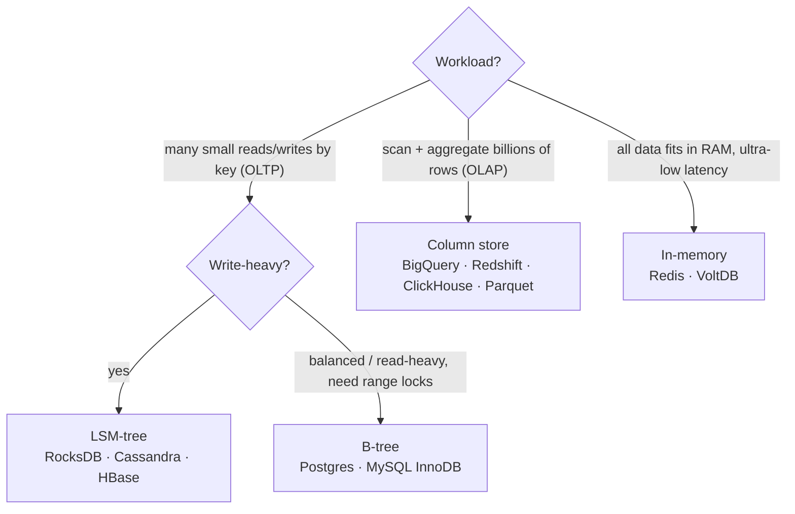

# ⚡ Cheat sheet: "when to use what"

One page to review before a system design interview. Each row links back to its chapter.

## Storage engine

→ [Chapter 3](/docs/chapters/part-1/storage-retrieval)

## Data model

| Data shape | Model | Examples |
|---|---|---|
| Self-contained trees, flexible schema | Document | MongoDB, Couchbase, Postgres JSONB |
| Lots of joins, many-to-many, integrity | Relational | Postgres, MySQL |
| Highly connected, variable-length paths | Graph | Neo4j, Neptune |
| Simple lookups by key at huge scale | Key-value / wide-column | DynamoDB, Cassandra |

→ [Chapter 2](/docs/chapters/part-1/data-models)

## Replication

| Need | Choose | Watch out for |
|---|---|---|
| Simplicity, read scaling | Single-leader + async followers | Replication lag, failover traps |
| No data loss on leader crash | Semi-synchronous | Write latency |
| Writes in several regions / offline | Multi-leader | Conflict resolution (CRDTs, merges) |
| Very high availability, tunable | Leaderless quorums (n, w, r) | Not linearizable, siblings |

→ [Chapter 5](/docs/chapters/part-2/replication)

## Partitioning

| Need | Choose |
|---|---|
| Range scans (time series, sorted keys) | Key-range partitioning (+ key prefix to avoid hot spots) |
| Even spread | Hash partitioning |
| Range within one entity | Compound key: hash(partition key) + sort key |
| Rebalancing | Fixed many partitions, or dynamic splitting. **Never `mod N`.** |

→ [Chapter 6](/docs/chapters/part-2/partitioning)

## Isolation level: what each one prevents

| Anomaly | Read committed | Snapshot | Serializable |
|---|:-:|:-:|:-:|
| Dirty read / write | ✅ | ✅ | ✅ |
| Read skew | ❌ | ✅ | ✅ |
| Lost update | ❌ | ⚠️ | ✅ |
| Write skew / phantoms | ❌ | ❌ | ✅ |

**Serializable implementations:** serial execution (small, in-memory), 2PL (pessimistic), SSI (optimistic).
→ [Chapter 7](/docs/chapters/part-2/transactions)

## Distributed systems reflexes

| Situation | Reflex |
|---|---|
| No response | Can't tell lost / slow / dead. Use timeouts plus idempotent retries. |
| Ordering events across nodes | Logical clocks, not wall clocks |
| Measuring durations | Monotonic clock |
| Distributed lock / lease | **Fencing tokens** |
| Who is the leader? | Majority quorum / consensus (ZooKeeper, etcd, Raft) |
| Unique constraint across nodes | Consensus or single-partition log processing |
| Atomic across services | Avoid 2PC; use an outbox/log + idempotent consumers |

→ [Chapter 8](/docs/chapters/part-2/distributed-trouble) · [Chapter 9](/docs/chapters/part-2/consistency-consensus)

## Consistency ladder

## Data pipelines

| Need | Choose |
|---|---|
| Keep a search index / cache in sync with the DB | **CDC** (Debezium → Kafka) |
| Full audit, rebuildable views | **Event sourcing** + CQRS |
| Expensive independent tasks | Traditional queue (SQS, RabbitMQ) |
| Ordered, high-throughput, replayable | Log broker (Kafka, Kinesis) |
| Large historical recompute | Batch dataflow (Spark) |
| Real-time aggregates | Stream processor (Flink, Kafka Streams) with event-time windows |
| Joins: small × big | Broadcast hash join |
| Exactly-once effect | Idempotence + end-to-end request IDs |

→ [Chapter 10](/docs/chapters/part-3/batch-processing) · [Chapter 11](/docs/chapters/part-3/stream-processing) · [Chapter 12](/docs/chapters/part-3/future)

## Numbers worth remembering (orders of magnitude)

| Thing | Rough value |
|---|---|
| Main memory reference | ~100 ns |
| SSD random read | ~100 µs |
| Round trip within a datacenter | ~0.5 ms |
| HDD seek | ~10 ms |
| Round trip across continents | ~150 ms |
| Quartz clock drift | ~200 ppm ≈ 17 s/day |
| Raft/Paxos cluster | 3 nodes → tolerates 1 failure; 5 → tolerates 2 |
