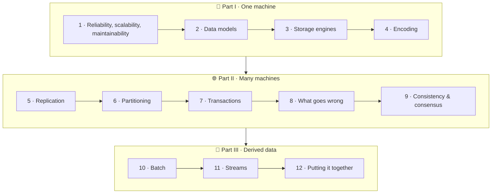

# 🗺️ Start here: how to use this book

These are **study notes**, not a copy of the book. Each chapter follows the structure of a chapter in Martin Kleppmann's *Designing Data-Intensive Applications* (DDIA). The text is rewritten in plain language and every diagram is redrawn from scratch. Each section has a 📖 page pointer so you can jump to the same topic in your PDF.

<IconCards items={[
  {icon: '📖', title: 'Page pointers', text: 'Every section links to the PDF page where the same topic starts, so the notes and the book stay in sync.', color: '#f59e0b'},
  {icon: '🖼️', title: 'Diagrams', text: 'Every mechanism is drawn as a Mermaid diagram you can read in light or dark mode.', color: '#8b5cf6'},
  {icon: '💡', title: 'Key ideas', text: 'Highlighted boxes hold the one sentence to remember from each section.', color: '#3b82f6'},
  {icon: '🧠', title: 'Quizzes', text: 'Each chapter ends with quick checks and interview-style questions.', color: '#10b981'},
]} />

## Suggested reading order

| If you want to… | Read |
|---|---|
| Prepare for system design interviews | 1 → 5 → 6 → 7 → 9, then the [⚡ cheat sheet](/docs/cheat-sheet) |
| Understand how a database works inside | 3 → 7 → 2 → 4 |
| Build event-driven / streaming systems | 4 → 11 → 10 → 12 |
| Debug weird distributed bugs | 8 → 9 → 5 |

## The three questions behind every chapter

1. **What can go wrong?** (faults, races, lag, partitions)
2. **What guarantee do I get?** (durability, isolation, ordering, consistency)
3. **What does it cost?** (latency, throughput, availability, complexity)

If you can answer those three for a design, you understand it.
